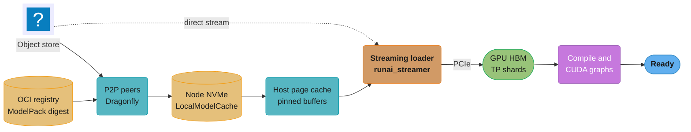
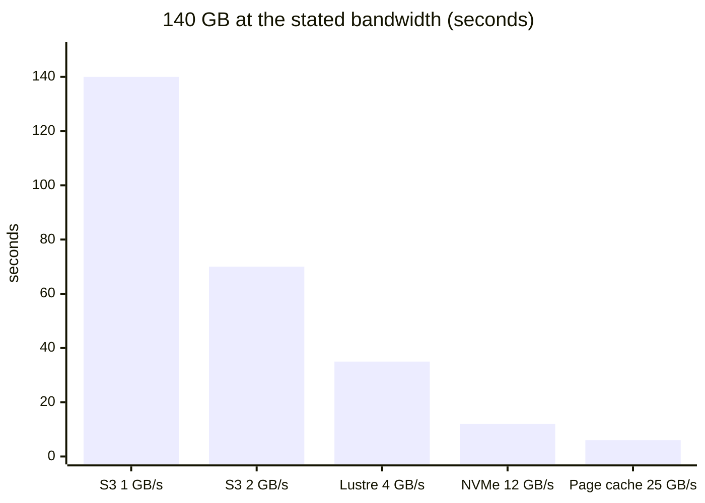
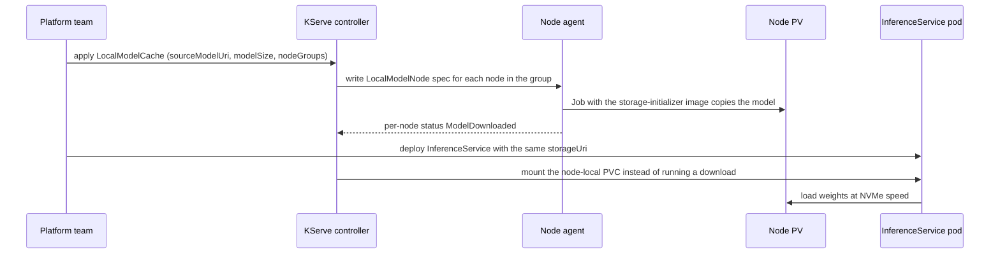

# Model Storage, Loading and Cold Start

> **Version anchor (2026-10-18).** vLLM v0.32.0 (2026-10-18); its `--load-format` values include
> `safetensors`, `fastsafetensors`, `instanttensor`, `runai_streamer`, `runai_streamer_sharded`,
> `sharded_state`, `tensorizer` and `ipc_cache`, and `--safetensors-load-strategy` takes `lazy`,
> `eager`, `prefetch` or `torchao`. Model Streamer 0.17.0 (2026-10-13) adds GPU streaming through
> the C API and a ring buffer that bounds host RAM; the repo is `dsx-ai-factory/model-streamer`
> (`run-ai/runai-model-streamer` redirects to it) and the pip package is `runai-model-streamer`.
> KServe v0.21.0 (2026-09-25), with `LocalModelCache`, `LocalModelNamespaceCache`,
> `LocalModelNodeGroup` and `LocalModelNode` in `serving.kserve.io/v1alpha1`. Kubernetes 1.37
> (1.37.1 on 2026-09-15); the OCI image volume source has been GA since 1.36. ModelPack
> model-spec v0.0.7 (git tag of 2025-07-21). Every version claim below is checked against this
> anchor; versions of tools outside it (fastsafetensors, Dragonfly, Kraken, Modal) were fetched
> from their release pages and docs on 2026-10-18 and are dated where they appear.

A GPU replica is useless until its weights sit in HBM, its kernels are compiled and its first
batch has run. For a 70B model that path moves 140 GB through four or five storage tiers and
spends another minute or two on compilation, and the GPU is billed for all of that time while it
serves nothing. This page breaks the cold start into its stages,
puts a bandwidth number on each tier the weights cross, and shows which tool removes which stage.

---

## 1. Concept Overview

**Cold start** is the time from "the platform decides it needs one more replica" to "that replica
answers its first production request at its normal latency." For an LLM server it has six stages.
They run mostly in series, and each one has its own fix.

| Stage | What happens | Typical driver of its length | Fix that targets it |
|---|---|---|---|
| Node provisioning | Cloud API allocates a GPU VM, it boots, joins the cluster, the GPU driver and device plugin come up | GPU capacity, AMI or image, driver install | Warm node pool, pre-baked node image, reservations |
| Image pull | Container runtime pulls the serving image (CUDA, PyTorch, engine) | 5 to 15 GB of compressed layers | Pre-pulled image, lazy pulling, smaller image |
| Weight fetch | Weights move from durable storage to somewhere the process can read | Model bytes divided by the slowest link | Node cache, P2P, streaming loader, ImageVolume |
| GPU load | Bytes move from host memory to HBM, sharded per TP rank | PCIe bandwidth, page-cache misses, host RAM copies | Streaming into pinned buffers, GPUDirect Storage, `ipc_cache` |
| Compile and graph capture | `torch.compile` traces and compiles, CUDA graphs are captured for each batch size | Model size, number of capture sizes, cache hit or miss | Persisted compile cache, fewer capture sizes |
| Warmup | First requests fill allocators, autotune kernels, warm the prefix cache | Engine and model | Synthetic warmup before readiness |

The **storage tiers** a weight file can live on, from farthest to nearest the GPU: an object store
(S3, GCS, Azure Blob), a parallel or network file system (FSx for Lustre, Filestore, NFS), a
registry (OCI artifact by digest), a node-local NVMe disk, the host page cache, and finally HBM.
Toward the GPU, read bandwidth generally rises and capacity falls. A cold-start design decides
which tier holds a copy of which model before the scale-out happens.

The **loader** is the code that reads the files and puts tensors on the GPU. The default PyTorch
and vLLM path memory-maps safetensors files and copies tensors to the GPU one by one. Streaming
loaders (Model Streamer, fastsafetensors, tensorizer, InstantTensor) read many byte ranges in
parallel, overlap storage reads with host-to-device copies and, in some cases, read straight from
an object store with no local copy at all.

The packaging side (safetensors layout, ModelPack, digests, image
volume mounts) is in [Model Registry and Packaging](../model_registry_and_packaging/model_registry_and_packaging.md).
The policy that decides when to scale is in
[Inference Autoscaling and Capacity Planning](../inference_autoscaling_and_capacity_planning/inference_autoscaling_and_capacity_planning.md).

**Not here.** Container image layer formats, eStargz, SOCI, Nydus and lazy pulling of the serving
image live in [OCI Image Formats and Lazy Pulling](../../devops/container_runtimes_and_oci/oci_image_formats_and_lazy_pulling.md).
Volume, PVC and access-mode mechanics live in
[Kubernetes Storage and State](../../devops/kubernetes_storage_and_state/kubernetes_storage_and_state.md).
How a GPU node is provisioned, drained and retired lives in
[GPU Node Lifecycle](../../devops/case_studies/cross_cutting/gpu_node_lifecycle.md). Pinned
memory and host-to-device copy mechanics live in
[CUDA Memory Management and Data Transfer](../../cuda/memory_management_and_data_transfer/memory_management_and_data_transfer.md).
The storage fabric itself (Lustre sizing, RDMA, GPUDirect Storage networks) is in
[AI Networking and Storage Fabric](../ai_networking_and_storage_fabric/ai_networking_and_storage_fabric.md).

---

## 2. Intuition

**One-line analogy.** Cold start is a relay where every runner waits for the previous one; making
one runner faster helps only if that runner was the slow one.

**Mental model.** Draw the path from the bucket to HBM as a chain of pipes with a width in GB/s
written on each. The time to fill the GPU is the model size divided by the narrowest pipe, plus
every fixed cost that does not depend on size (boot, compile, graph capture). A 140 GB model over a
2 GB/s pipe takes 70 s no matter how fast the GPU is. Over a 12 GB/s NVMe RAID it takes 12 s. If
the bytes are already in HBM in another process, it takes the time to map a CUDA IPC handle.

**Why it matters.** GPU autoscaling reacts to load that is already queued. If a replica takes 9
minutes to become useful, a traffic spike that lasts 5 minutes is served entirely by the replicas
that existed before it, and the new ones arrive in time to sit idle. Teams then over-provision to
cover the gap and pay for idle GPUs around the clock. Cutting cold start from 9 minutes
to 90 seconds lets the same SLO run on fewer warm GPUs.

**Key insight.** Each stage has a different owner and a different fix, and they add. A streaming
loader does nothing for a 4-minute node boot; a warm node pool does nothing for a 90-second compile
on a cache miss. Measure all six stages separately, then fix the largest one first.

---

## 3. Core Principles

1. **Time is bytes over the narrowest link.** Write the bandwidth of each hop next to the model
   size before choosing a tool. A 100 Gbit/s NIC moves at most 12.5 GB/s; one S3 GET stream moves
   far less; a PCIe Gen5 x16 link moves about 64 GB/s raw per direction.
2. **Overlap, do not serialize.** Download-then-load reads every byte twice and waits for the last
   byte before the first tensor moves. Streaming overlaps the storage read with the GPU copy, so
   total time approaches the slower of the two, not their sum.
3. **Move copies closer before you need them.** A model already on a node's NVMe or in its page
   cache skips the network entirely. Pre-placement is a scheduling decision, made before scale-out.
4. **Cache by digest, never by mutable name.** A node cache keyed by `s3://models/llm/latest`
   keeps serving yesterday's bytes after someone overwrites the prefix. Key every cache on an
   immutable version or content digest.
5. **Fan-out must not hit the origin N times.** 64 nodes pulling 140 GB each is 9 TB of origin
   reads. Peer-to-peer distribution or a pre-seeded cache turns that into roughly one origin read.
6. **Fixed costs are cacheable too.** Compiled graphs and Triton kernels are artifacts. Persist
   them with the model and they stop costing time on every start.
7. **Warm capacity is a cost line, not a free fix.** A warm pool trades idle GPU-hours for
   latency. Price it against the SLO miss it prevents.
8. **Readiness means "serves at normal latency".** A pod that is Ready before warmup takes real
   traffic at cold latency and fails the SLO it was started to protect.

---

## 4. Types / Architectures / Strategies

### 4.1 Storage tiers

| Tier | Example | Per-node read bandwidth (order of magnitude) | Shared across nodes | Survives node loss | Main risk |
|---|---|---|---|---|---|
| Object store | S3, GCS, Azure Blob | 1 to 10 GB/s with many parallel range GETs | Yes | Yes | Request-rate throttling during fan-out |
| Parallel file system | FSx for Lustre, Filestore, Weka | 1 to 10+ GB/s, set by provisioned throughput | Yes | Yes | Throughput is bought per TiB; mmap random reads are slow |
| OCI registry | Harbor, ECR, Artifact Registry with ModelPack layers | Same limits as the registry backend | Yes | Yes | Registry egress during fan-out |
| ROX PVC | One volume mounted read-only by many pods | Set by the backing storage | Yes | Yes | Not every CSI driver supports `ReadOnlyMany` |
| Node NVMe | Instance store, local PV, `hostPath` cache | 5 to 25 GB/s with several drives striped | No | No | Eviction, disk pressure, stale copies |
| Host page cache | Files read once stay in RAM | 20+ GB/s | No | No | Counts against node memory; dropped under pressure |
| GPU memory in another process | vLLM `ipc_cache` daemon | No copy, only an IPC map | No | No | Holds HBM while no engine runs |

### 4.2 Loaders

| Loader | How it reads | Where it reads from | Best fit |
|---|---|---|---|
| Default (`--load-format auto`, no load strategy set) | mmap, tensor by tensor; auto-prefetch on detected NFS | Local or mounted file system | Local NVMe |
| Safetensors `eager` or `prefetch` | Whole file into RAM, or into page cache with threads | Network file systems | Lustre, NFS |
| Model Streamer (`runai_streamer`) | Parallel range reads into a bounded host buffer, streamed to GPU | Local FS, S3, GCS, Azure Blob | Object store with no local copy |
| `runai_streamer_sharded`, `sharded_state` | Each TP rank reads only its pre-sharded file | Local or object store | Large TP or EP deployments |
| fastsafetensors | Batched reads, GPUDirect Storage when present | Local NVMe | NVMe with GDS |
| InstantTensor (`instanttensor`) | Distributed loading, pipelined prefetch, direct I/O | Local | Multi-GPU loads on CUDA |
| tensorizer | Serialized tensors streamed over HTTP, S3 or file | HTTP, S3, local | Pre-serialized models, CoreWeave stacks |
| `ipc_cache` | Maps weights another process already holds in HBM | GPU memory | Engine restarts on the same node |

### 4.3 Fan-out distribution patterns

| Pattern | Origin reads for N nodes | Notes |
|---|---|---|
| Direct pull from origin | N times the model size | Simple; breaks at fan-out |
| Regional mirror or pull-through cache | One per region, then N from the mirror | Mirror becomes the bottleneck |
| P2P (Dragonfly, Kraken) | About one, then peers serve peers | Needs node-to-node bandwidth and a seed |
| Pre-seeded node cache (KServe `LocalModelCache`) | One per node, before any pod needs it | Cache fill runs ahead of scale-out |
| OCI image volume | One per node, shared by pods on it | Uses the runtime's pull and cache path |

### 4.4 Warm capacity and restart caches

| Strategy | Stage it removes | Cost |
|---|---|---|
| Warm node pool (GPUs running, no model) | Node provisioning, image pull | Idle GPU-hours |
| Warm replicas (`minReplicas` above 0) | All six | Idle GPU-hours at full price |
| Persisted compile cache | Compile on a cache hit | Storage and a cache-key discipline |
| Weight cache daemon (`vllm preload` plus `ipc_cache`) | Weight fetch and GPU load on restart | HBM held by the daemon |
| GPU memory snapshot (Modal, alpha) | Init and warmup captured in the snapshot | Single-GPU limits, vendor lock |

---

## 5. Architecture Diagrams

### Path of the weights from durable storage to HBM



There are two routes. The cached route lands bytes on node NVMe ahead of time and loads from there.
The direct route streams from the object store into GPU memory with no local copy. The dotted edge
is the route most teams try first; it scales until the object store throttles the fan-out.

### Cold-start budget before and after, 70B BF16 on 4 GPUs

```
seconds          0        60       120      180      240      300      360      420      480    540
                 |--------|--------|--------|--------|--------|--------|--------|--------|--------|
before  node     [============== 240 s ==============]
        image                                        [=== 90 s ===]
        weights                                                    [=== 95 s ===]
        gpu load                                                                 [30]
        compile                                                                      [= 75 s ==]
        warmup                                                                                  [10]
                                                                                    total 540 s

after   node     (warm pool: 0 s)
        image    (pre-pulled: 0 s)
        weights  [24]        streaming from NVMe at 6 GB/s, overlapped with gpu load
        gpu load [24]
        compile     [15]     compile cache hit
        graphs         [10]
        warmup            [5]
                          total 54 s
```

The two largest stages before the fix, node boot and compile, are not weight problems. A streaming
loader alone would have cut the 95 s weight fetch to about 25 s and the total only from 540 s to
about 470 s. The warm node pool and the compile cache take most of the rest out.

### Time to move 140 GB at each tier's bandwidth



These are divisions, not benchmarks: 140 / 2 = 70. Real numbers are worse because of protocol
overhead, small reads and per-rank duplication, and better only when two stages overlap.

### Fan-out to 64 nodes: origin reads with and without P2P

```
direct pull                              P2P with one seed
-----------                              -----------------
origin ──► node 01   140 GB              origin ──► seed       140 GB
origin ──► node 02   140 GB                          ├─► node 01..04
origin ──► node 03   140 GB                          │     ├─► node 05..16
   ...                                               │     └─► node 17..64
origin ──► node 64   140 GB                          └─ pieces move between peers

origin reads:  64 x 140 GB = 8.96 TB      origin reads:  about 140 GB
origin egress at 25 GB/s cap: 358 s      origin egress at 25 GB/s cap: 6 s, then peer-bound
```

The origin cap of 25 GB/s is an assumed account-level ceiling for the example. With direct pull
every node waits on the same shared pipe, so adding nodes makes each one slower. With P2P the
aggregate bandwidth grows with the number of peers that already hold pieces.

### KServe LocalModelCache flow



The cache fill happens when the platform team applies the resource, not when a pod schedules. That
moves the weight fetch out of the cold-start path for every node in the group.

---

## 6. How It Works - Detailed Mechanics

### 6.1 The arithmetic

Model bytes: parameters times bytes per parameter. 70B in BF16 is 140 GB; an FP8 checkpoint of the
same model is about 70 GB; a 671B MoE in FP8 is roughly 700 GB.

```
time_weights  = model_bytes / min(bw_storage, bw_network, bw_disk, bw_pcie_per_rank * ranks)
time_total    = t_node + t_image + max(time_weights, time_gpu_copy)   # streaming overlaps
              + t_compile + t_graphs + t_warmup
```

Worked numbers for 140 GB on one node with 4 GPUs at TP=4:

| Hop | Bandwidth | Time for 140 GB |
|---|---|---|
| Object store, 64 parallel range GETs | about 2 GB/s | 70 s |
| 100 Gbit/s NIC, line rate | 12.5 GB/s | 11 s |
| 4 NVMe Gen4 drives striped | about 24 GB/s | 6 s |
| PCIe Gen5 x16 per GPU, 35 GB per rank | about 50 GB/s effective | 0.7 s per rank, in parallel |

The NIC is not the bottleneck here; the object store's per-client throughput is. That is why "buy a
faster network" rarely helps an object-store load and "keep a copy on NVMe" does.

### 6.2 Per-stage timing from events and logs

The stages leave timestamps in Kubernetes events and engine logs. Collect them per pod so the
dashboard shows six bars, not one.

```python
import re
from datetime import datetime

STAGES = [
    ("scheduled",   r"Successfully assigned"),
    ("image_done",  r"Successfully pulled image|already present on machine"),
    ("started",     r"Started container"),
    ("weights_done", r"Loading weights took ([\d.]+) seconds"),
    ("graphs_done", r"Graph capturing finished in ([\d.]+) secs"),
    ("ready",       r"Application startup complete"),
]

def stage_times(lines: list[tuple[datetime, str]]) -> dict[str, float]:
    t0 = lines[0][0]
    seen = {}
    for ts, msg in lines:
        for name, pat in STAGES:
            if name not in seen and re.search(pat, msg):
                seen[name] = (ts - t0).total_seconds()
    return seen
```

Log strings change between engine versions, so pin the patterns to the engine version in the
release bundle and fail the parser loudly when a stage is missing. Node provisioning time comes from
the autoscaler (Karpenter `NodeClaim` launch and ready times, or Cluster Autoscaler events), not
from the pod.

### 6.3 Init-container download vs `runai_streamer`

Broken: an init container copies the model from S3 to an `emptyDir`, then vLLM reads it.

```yaml
initContainers:
  - name: fetch
    image: amazon/aws-cli
    command: ["aws", "s3", "cp", "--recursive", "s3://models/llama-70b/", "/models/"]
    volumeMounts: [{name: weights, mountPath: /models}]
containers:
  - name: vllm
    image: vllm/vllm-openai:v0.32.0
    args: ["/models", "--tensor-parallel-size", "4"]
volumes:
  - name: weights
    emptyDir: {}
```

Three defects. Every byte crosses storage twice (S3 to disk, disk to GPU) and the second pass starts
only after the last byte lands. The `emptyDir` counts against the node's ephemeral storage, so
140 GB on a node with less free disk evicts the pod. And each pod on the node downloads its own copy.

Fixed: stream straight from the object store into GPU memory.

```yaml
containers:
  - name: vllm
    image: vllm/vllm-openai:v0.32.0
    args:
      - "s3://models/llama-70b/sha-7c1e/"
      - "--tensor-parallel-size=4"
      - "--load-format=runai_streamer"
      - '--model-loader-extra-config={"concurrency": 32, "memory_limit": 8589934592}'
    env:
      - name: AWS_REGION
        value: us-east-1
```

`concurrency` sets the number of parallel reads (vLLM writes it to `RUNAI_STREAMER_CONCURRENCY`) and
`memory_limit` caps the host buffer in bytes (`RUNAI_STREAMER_MEMORY_LIMIT`; `-1` means no cap).
The only other key vLLM accepts in that JSON for this loader is `distributed`; anything else is
rejected. The `vllm[runai]` extra accepts `runai-model-streamer` 0.15.7 or newer; with 0.17.0
installed, a ring buffer bounds host RAM by storage bandwidth instead of model size. The path in the
example ends in a digest-named prefix, so a re-upload cannot change what the pod loads.

### 6.4 mmap on network file systems and `--safetensors-load-strategy`

Safetensors loading defaults to mmap. On local NVMe that is ideal: the kernel pages in exactly the
byte ranges each tensor needs. On Lustre or NFS each page fault is a small network read, and a
70B load turns into millions of 4 KB to 1 MB requests.

```bash
# broken on Lustre: lazy mmap turns each page fault into a small remote read
vllm serve /fsx/models/llama-70b --tensor-parallel-size 4

# fixed: read files sequentially into the page cache first
vllm serve /fsx/models/llama-70b --tensor-parallel-size 4 \
  --safetensors-load-strategy prefetch
```

In vLLM v0.32.0 the default (no strategy set) already turns on prefetch when it detects NFS and the
checkpoint fits in 90% of available RAM. Lustre and other mounts it does not detect need the flag.
`eager` reads whole files into process memory, which vLLM recommends for network file systems and
which uses the most host RAM; `lazy` set explicitly turns the NFS auto-prefetch off; `prefetch` uses 8 threads and 16 MiB reads by default
(`safetensors_prefetch_num_threads`, `safetensors_prefetch_block_size`).

### 6.5 Per-rank reads under tensor parallelism

With TP=4, each rank needs one quarter of most weight matrices. With the default loader every rank
opens the full checkpoint and slices on the fly, so the page cache absorbs most of the duplicate
reads only when all ranks share one node. Across nodes (TP=16 over 2 nodes, or PP), each node
reads the files it needs separately.

`sharded_state` and `runai_streamer_sharded` load from checkpoints that were saved once per rank, so
each rank reads exactly its own bytes and nothing else. The cost is one checkpoint per parallelism
layout: a TP=4 shard set cannot serve a TP=8 deployment. Store the layout in the registry entry
next to the digest.

### 6.6 fastsafetensors and GPUDirect Storage

fastsafetensors reads safetensors files in large batches and, when GPUDirect Storage (cuFile) is
available, moves bytes from NVMe to GPU memory without a bounce buffer in host RAM. Its README
reports 26.4 GB/s NVMe read throughput for Llama-70B on four GPUs with GDS, and vLLM startup for
Llama-2-13B on 4x L40S dropping from 12.39 s to 4.74 s. On ROCm it runs without GDS. In vLLM it is
`--load-format fastsafetensors`. It reads files from a local or GDS-capable file system, so an
object-store model needs a local copy first.

### 6.7 KServe LocalModelCache

```yaml
apiVersion: serving.kserve.io/v1alpha1
kind: LocalModelNodeGroup
metadata:
  name: h100-nvme
spec:
  storageLimit: 3Ti
  persistentVolumeSpec:
    accessModes: ["ReadWriteOnce"]
    volumeMode: Filesystem
    capacity: {storage: 3Ti}
    local: {path: /mnt/nvme/models}
    nodeAffinity:
      required:
        nodeSelectorTerms:
          - matchExpressions:
              - {key: node.kubernetes.io/instance-type, operator: In, values: [p5.48xlarge]}
  persistentVolumeClaimSpec:
    accessModes: ["ReadWriteOnce"]
    resources: {requests: {storage: 3Ti}}
---
apiVersion: serving.kserve.io/v1alpha1
kind: LocalModelCache
metadata:
  name: llama-70b-sha-7c1e
spec:
  sourceModelUri: s3://models/llama-70b/sha-7c1e
  modelSize: 141Gi
  nodeGroups: ["h100-nvme"]
```

`LocalModelNodeGroup` (cluster-scoped) declares which nodes cache models, the per-node
`storageLimit`, and the PV and PVC specs used both for downloads and in the InferenceService
namespaces. `LocalModelCache` (cluster-scoped) or `LocalModelNamespaceCache` (namespaced, usable only
by InferenceServices in its namespace) names a `sourceModelUri`, its `modelSize` and the node groups.
The controller writes a `LocalModelNode` per node listing what that node must hold, and a node agent
downloads each model. An InferenceService whose `storageUri` matches a cached `sourceModelUri` (or a
subdirectory of it) mounts the local copy instead of running the storage initializer.

The storage key is the first 16 hex characters of the SHA-256 of `sourceModelUri`. The URI is the
identity, so a URI that names a mutable prefix gives a cache that never notices new bytes. The
CRD's validation rule also rejects any change to `sourceModelUri` after creation. Put the version or digest in
the path, as above, and create a new `LocalModelCache` per version. The
controller-side details are in [KServe Deep Dive](../model_serving_platforms/kserve_deep_dive.md).

### 6.8 OCI artifacts and image volumes

With weights packaged as a ModelPack artifact in an OCI registry (see
[Model Registry and Packaging](../model_registry_and_packaging/model_registry_and_packaging.md)),
the Kubernetes image volume source mounts the artifact read-only by digest. The container runtime
pulls it once per node into its content store, and every later pod on that node mounts the same
copy. That reuses the runtime's node-level cache, registry auth and mirror configuration, and P2P comes
from whatever the runtime already uses for images (Dragonfly as a registry mirror, or Kraken as the
registry itself). The feature has been GA since Kubernetes 1.36; the security view of the volume type is in
[Kubernetes Security](../../devops/kubernetes_security/kubernetes_security.md).

Two limits. The runtime pulls the whole artifact before the pod starts, so the weight fetch is not
overlapped with GPU load. And runtime support for non-image artifact media types varies by runtime
version; test the exact ModelPack layer types on the exact node image before rollout.

### 6.9 P2P distribution

Dragonfly splits a file into pieces, has a scheduler tell each peer which other peers hold which
pieces, and lets a seed peer fetch from the origin once. Its scope covers container images, OCI
artifacts and AI models. Kraken, built at Uber, is a P2P Docker registry backed by blob storage. Its
README reports support for at least 15,000 hosts per cluster, over 1 million blobs a day in the busiest cluster,
and a 3 GB two-layer image pulled by 2,600 hosts at p50 10 s and p99 18 s under a 300 MB/s per-agent
limit.

Arithmetic for 64 nodes and 140 GB with P2P: the origin serves one copy to the seed. If each node
can upload and download at 10 GB/s and pieces spread in a tree, the last node finishes after about
`140 / 10 + log2(64) * piece_time`, which is close to one transfer time, 14 s plus a small number of
piece hops, rather than 64 copies through one pipe. In practice node uplink, disk write speed and
the seed's own fetch dominate; plan for 2 to 3 times the single-transfer time.

### 6.10 Compile and CUDA graph caches

vLLM compiles the model with `torch.compile` and captures CUDA graphs for a set of batch sizes; the
mechanics and flags are in
[vLLM Deep Dive](../../llm/vllm_deep_dive/vllm_deep_dive.md) ("Compilation and CUDA Graph
Capture"). For a large model these steps take tens of seconds to minutes on a cache miss. vLLM
stores compile artifacts under `$VLLM_CACHE_ROOT/torch_compile_cache/<hash>/rank_<i>_<j>/` (default
`~/.cache/vllm`). The hash covers the vLLM version, the model, cache, parallel and compilation
configs, the traced source files and the compiler environment.

Broken: the cache lives in the container's home directory, which is ephemeral. Every new pod
compiles from scratch.

Fixed: build the cache in the release pipeline and ship it with the model.

```bash
# release job, on the same GPU type, engine version and TP layout as production
export VLLM_CACHE_ROOT=/build/vllm-cache
vllm serve /models/llama-70b --tensor-parallel-size 4 &
until curl -sf localhost:8000/health; do sleep 5; done
kill %1
tar -C /build -cf vllm-cache-llama70b-tp4-v0.32.0.tar vllm-cache
```

At serve time, mount the unpacked directory and set `VLLM_CACHE_ROOT` to it. A change to the engine
version, TP size or compilation flags gives a new hash and a miss, so the cache is part of the
release bundle and is rebuilt when any of those or the GPU type change. CUDA graph capture time
scales with the number of capture sizes; `--max-cudagraph-capture-size` (capped at 512 by default,
1024 on data-center Blackwell) and `--cudagraph-capture-sizes` trade capture time against how many
batch sizes run as graphs.

### 6.11 `vllm preload` and `ipc_cache`

```bash
# once per node: one daemon per GPU holds post-quantized, sharded weights in HBM
vllm preload --model /models/llama-70b --tensor-parallel-size 4

# engine start or restart maps those weights through CUDA IPC
vllm serve /models/llama-70b --tensor-parallel-size 4 --load-format ipc_cache
```

The weight cache daemon keeps the weights in GPU memory and hands CUDA IPC handles to engines over a
Unix socket. An engine crash, a config change that does not touch weights, or a rolling restart then
skips both weight fetch and GPU load. Before mapping, the engine compares a fingerprint (checkpoint
metadata hash, architecture, TP and DP layout, dtype, quantization, vLLM version) and falls back to
a disk load on any mismatch. In the default `zero_copy` mode the engine shares the daemon's
allocations, so the daemon must outlive the engine; `copy` mode clones the tensors and lets the
daemon free its memory. CUDA IPC handles are node-local, so multi-node TP runs one `vllm preload`
per node with a shared rendezvous. This helps restarts on a node that already has the model. It
does nothing for a brand-new node.

### 6.12 GPU memory snapshots

Modal's memory snapshots restore a saved process state instead of re-running initialization; its
docs say initialization-heavy functions often start 3 to 10 times faster. GPU memory snapshots (alpha,
enabled with `enable_memory_snapshot=True` plus `experimental_options={"enable_gpu_snapshot": True}`)
also capture GPU state, so model load into HBM and warmup forward passes placed in a
`@modal.enter(snap=True)` method are restored rather than repeated. The documented limits: generally
incompatible with multi-GPU code and with non-CUDA GPU code, no speedup for reading weights from
storage, can interact poorly with `torch.compile`, may need code changes (for example discarding an
unfilled KV cache before the snapshot), and a redeploy makes earlier snapshots obsolete. Randomness
captured in the snapshot is identical after every restore. Treat it as a single-GPU tool.

### 6.13 Warm pool or scale from zero

Let `C` be the GPU cost per replica-hour, `w` the number of warm idle replicas, `T` the cold start in
hours, and `S` the spike rate. A warm pool costs `w * C * 24` per day. Scale-from-zero costs the SLO
misses during `T` after each spike.

Example: 4 H100s per replica at $3 per GPU-hour gives `C = $12`. One warm replica costs $288 a day.
Cold start is 540 s. If the service sees 6 spikes a day and each cold-start window drops or slows
2,000 requests that carry an SLA credit or lost conversion worth $0.10 each, misses cost $1,200 a
day. The warm replica wins. Cut cold start to 54 s with the fixes above and the miss window shrinks
tenfold, to about $120 a day; now the warm replica costs more than it saves, and the right answer is
a warm node pool (GPUs on, no model loaded, or a cheaper GPU type kept warm for the image pull) plus
fast weight load. The capacity side of this decision is in
[Inference Autoscaling and Capacity Planning](../inference_autoscaling_and_capacity_planning/inference_autoscaling_and_capacity_planning.md),
and the cost model is in
[AI Cost Engineering and Unit Economics](../ai_cost_engineering_and_unit_economics/ai_cost_engineering_and_unit_economics.md).

### 6.14 startupProbe and readiness for model loads

```yaml
startupProbe:
  httpGet: {path: /health, port: 8000}
  periodSeconds: 10
  failureThreshold: 60        # 600 s budget for load, compile and graph capture
readinessProbe:
  httpGet: {path: /health, port: 8000}
  periodSeconds: 5
livenessProbe:
  httpGet: {path: /health, port: 8000}
  periodSeconds: 10
  failureThreshold: 3
```

Without a `startupProbe`, the liveness probe starts counting at container start and kills a pod that
is still loading 140 GB, which restarts the load from zero. Run synthetic warmup requests before the
readiness endpoint returns success, through a small sidecar or a `postStart` hook that blocks until
a few prompts at production lengths complete.

---

## 7. Real-World Examples

**Uber, Kraken.** Uber built Kraken as a P2P registry for container images and has run it in
production since early 2018. Its published numbers: support for at least 15,000 hosts per cluster,
more than 1 million blobs a day in the busiest cluster including 100,000 blobs over 1 GB, and 20,000
blobs of 100 MB to 1 GB distributed in under 30 seconds at peak. The same mechanics apply to model
artifacts stored as OCI blobs. Uber limits blobs to 20 GB, so a large model ships as several shard
layers.

**Dragonfly.** A CNCF graduated project whose stated scope includes container images, OCI artifacts
and AI/ML models. It sits in front of a registry or object store as a P2P layer, and its Nydus
sub-project covers lazy pulling of images (the devops page covers that part).

**Modal, GPU memory snapshots.** Modal snapshots process memory, and in alpha also GPU memory, so a
restored container skips model load to HBM. Its docs report startup 3 to 10
times faster for init-heavy functions and a sentence-transformers example where moving weights to
the GPU after restore cut startup from about 6 s to about 2 s even without GPU snapshots.

**fastsafetensors.** The project behind `--load-format fastsafetensors` in vLLM and SGLang reports
4.8 to 7.5 times faster standalone loading than the default safetensors deserializer on Llama,
Falcon and Bloom, and 26.4 GB/s from NVMe for Llama-70B on four GPUs with GDS.

**CoreWeave, tensorizer.** vLLM ships a `tensorizer` load format that uses CoreWeave's library to
stream pre-serialized tensors from HTTP, S3 or local files.

**KServe LocalModelCache.** Added so that InferenceServices on a node group mount a pre-downloaded
copy instead of running the storage initializer on every pod start. In v0.21.0 it has a
namespace-scoped variant, `LocalModelNamespaceCache`, for multi-tenant clusters.

**vLLM weight cache daemon.** v0.32.0 includes `vllm preload` and `--load-format ipc_cache`, which
keep post-quantized, TP-sharded weights in HBM across engine restarts on the same node.

---

## 8. Tradeoffs

### Weight source

| Option | Cold-start time for 140 GB | Cost | Ops burden | Fails how |
|---|---|---|---|---|
| Stream from object store | 60 to 120 s | Requests and egress | Low | Throttling at fan-out |
| Parallel file system | 30 to 60 s with prefetch | Provisioned throughput per TiB, paid all the time | Medium | Throughput exhausted by many concurrent loads |
| Node NVMe cache | 10 to 25 s | Disk on GPU nodes, cache fill traffic | Medium | Stale or evicted copies |
| OCI image volume | Pull time, then NVMe speed | Registry storage and egress | Low if the runtime supports it | Unsupported artifact types on some runtimes |
| `ipc_cache` daemon | Seconds on restart | HBM held while idle | Medium | Useless on a new node |

### Loader

| Loader | Needs local files | Overlaps read and GPU copy | Pre-sharding needed | Notes |
|---|---|---|---|---|
| Default safetensors, lazy | Yes | Partly | No | Best on NVMe; poor on network FS |
| Safetensors prefetch or eager | Yes | No | No | Fixes network FS; costs RAM |
| `runai_streamer` | No | Yes | No | Object store and local; host buffer cap |
| `runai_streamer_sharded`, `sharded_state` | No or yes | Yes | Yes | One checkpoint per layout |
| `fastsafetensors` | Yes | Yes | No | README reports 26.4 GB/s with GDS |
| `tensorizer` | No | Yes | Serialize step | Extra artifact format to version |

### Keeping capacity warm

| Option | Idle cost | Cold start it hides | When it is the wrong call |
|---|---|---|---|
| Warm replicas | Full GPU price | All of it | Spiky traffic with long quiet periods |
| Warm node pool, no model | GPU price, no serving | Node boot and image pull | When weight load is the largest stage |
| Scale from zero | None | None | Interactive SLOs under 10 s |

---

## 9. When to Use / When NOT to Use

**Use streaming from the object store** when models change often, nodes are short-lived, and the
fleet is small enough that origin throughput holds (a handful of replicas scaling at once).

**Use a node cache (LocalModelCache, local PV, image volume)** when a fixed set of models runs on a
known node group and scale-out speed matters more than disk on GPU nodes. Do not use it for hundreds
of rarely used models; the cache fill traffic and disk usage outgrow the benefit.

**Use P2P** when more than a few dozen nodes pull the same artifact at once: fleet rollouts, regional
failover, or a big scale-out. Below that, a regional mirror is simpler.

**Use a parallel file system** when training and serving share the same checkpoints and the
throughput is already bought for training. Do not buy Lustre for serving alone; NVMe caches are
cheaper per GB/s.

**Use `ipc_cache`** when engines restart often on long-lived nodes (config tuning, crash recovery,
adapter changes). Skip it for autoscaled nodes that live minutes.

**Use GPU memory snapshots** for single-GPU models on a platform that supports them, where
initialization dominates. Not for multi-GPU TP deployments.

**Do not scale from zero** a model that takes minutes to start behind an interactive SLO. Keep a
floor of warm replicas and scale above it.

---

## 10. Common Pitfalls

**Mutable URI in the node cache.** A team cached `s3://models/support-llm/` with KServe
LocalModelCache, then retrained and overwrote the prefix. New pods kept mounting the old copy
because the cache key is a hash of the URI, not of the content. The A/B test compared the old model
against itself for two days. Fix: digest or version in every `sourceModelUri`, one cache object per
version, and log the loaded checksum at startup.

**Liveness probe kills the load.** A 70B deployment with a 30 s liveness probe and no startup probe
restarted every pod at about 90 s into a 4-minute load. The ReplicaSet showed CrashLoopBackOff with
healthy logs. Fix: a `startupProbe` sized for the measured worst-case load.

**`emptyDir` download evicted by the kubelet.** An init container wrote 140 GB into `emptyDir` on a
node whose ephemeral storage was 200 GB with images already using 70 GB. The kubelet evicted the pod
for disk pressure, the next pod tried again on the same node, and the GPU sat idle for an hour. Fix:
stream, or use a sized local PV for the cache, and set `ephemeral-storage` requests.

**Fan-out throttling.** A failover moved traffic to a second region and 48 replicas started at once,
each streaming the same 140 GB from one bucket prefix. S3 returned `503 SlowDown`, loaders retried,
and the slowest pod took 22 minutes. Fix: P2P or a pre-filled node cache in the failover region,
and staggered starts with a cap on concurrent loads per prefix.

**mmap on Lustre.** A training team's FSx for Lustre volume held the checkpoints, and serving read
them with default mmap loading. Load took 6 minutes on a file system rated at several GB/s. Fix:
`--safetensors-load-strategy prefetch` or `eager`, and enough host RAM for it.

**Compile cache miss after an upgrade.** An engine patch release changed the compile hash. The
shipped cache no longer matched, and every pod compiled for 80 s during the canary. The canary's
scale-out alerts fired and the rollout was rolled back for a problem that was not in the model.
Fix: rebuild the compile cache in the release job for the new engine version, as part of the bundle.

**Ready before warm.** Pods passed readiness as soon as `/health` answered and took full traffic.
The first requests on each new pod ran at several times normal latency while allocators and kernels
warmed. p99 spiked on every scale-out, which triggered more scale-out. Fix: warmup requests before
readiness.

**Page cache counted as free.** A node had 2 TB RAM, and the team assumed weights in the page cache
were free. A second model's load pushed the first model's pages out, and the next restart of the
first model went back to the network. Fix: treat page cache as a best-effort tier; the durable node
tier is the NVMe cache.

**Pre-sharded checkpoint, new layout.** A team moved from TP=4 to TP=8 for latency and pointed the
new deployment at the `sharded_state` checkpoint built for TP=4. Load failed on shape checks. Fix:
record the parallel layout in the registry entry and build shard sets per layout.

---

## 11. Technologies & Tools

| Tool | Role | Notes |
|---|---|---|
| vLLM | Inference engine and loaders | v0.32.0; `--load-format`, `--safetensors-load-strategy`, `vllm preload`, compile cache |
| Model Streamer | Streaming weight loader | 0.17.0; repo `dsx-ai-factory/model-streamer`; pip `runai-model-streamer`; local FS, S3, GCS, Azure Blob |
| fastsafetensors | Batched safetensors loader | 0.5.0 (2026-10-17); GPUDirect Storage when available |
| tensorizer | Tensor serialization and streaming | CoreWeave library; vLLM v0.32.0's `tensorizer` extra pins `tensorizer==2.10.1` |
| KServe | Model serving platform | v0.21.0; `LocalModelCache`, `LocalModelNamespaceCache`, `LocalModelNodeGroup` |
| Kubernetes | Image volume source | GA since 1.36, pinned 1.37 |
| ModelPack | OCI model artifact spec | model-spec v0.0.7 |
| Dragonfly | P2P distribution | v2.5.2 (2026-09-14); CNCF graduated; images, OCI artifacts, models |
| Kraken | P2P registry | v0.1.32 (2026-10-12); built at Uber |
| Modal | Serverless GPU platform | Memory snapshots; GPU memory snapshots alpha as of 2026-10-18 |
| Amazon FSx for Lustre | Parallel file system | Throughput provisioned per TiB |
| Amazon S3 | Object store | Per-prefix request limits apply during fan-out |
| Karpenter | Node autoscaler | `NodeClaim` timings give the node provisioning stage |

---

## 12. Interview Questions with Answers

**Q: Why can a node cache keyed by the model URI serve the wrong model?**
**Short:** The cache identity is the URI, so overwriting the bytes behind a mutable path leaves every node holding the old copy with no error.

KServe derives the LocalModelCache storage key from a SHA-256 of `sourceModelUri`; other home-grown
caches do the same with the path. If the training job overwrites `s3://models/support-llm/`, the URI
is unchanged, the cache looks valid, and new pods mount yesterday's weights. Put a version or digest
in the path, create one cache object per version, and log the checksum of what was loaded so a
mismatch shows up in the first minute.

**Q: An autoscaler adds GPU replicas during a spike, but latency does not recover for 9 minutes. Where is the time going?**
**Short:** Into six serial stages: node boot, image pull, weight fetch, GPU load, compile and graph capture, warmup; measure each before fixing any.

A typical 70B replica spends minutes on node provisioning and driver start, a minute or more pulling
a CUDA image, a minute or more fetching 140 GB, and another minute compiling and capturing CUDA
graphs. Teams often buy a faster loader and save 70 s out of 540. Emit a timestamp per stage, then
fix the largest: a warm node pool for boot, a pre-pulled image, a node cache or streaming for
weights, and a shipped compile cache for compile.

**Q: How long does a 70B BF16 model take to load from storage that delivers 2 GB/s, and why is the real number often worse?**
**Short:** 140 GB / 2 GB/s = 70 s in theory; real loads are slower because stages run in series, reads are small or duplicated, and storage throttles under fan-out.

The 70 s assumes one sequential stream at full bandwidth straight into the GPU. Download-then-load
reads the bytes twice. Default mmap on a network file system issues small random reads. Each TP rank
may read the full checkpoint on multi-node layouts. And when 40 nodes load at once, the object store
divides its throughput among them. Write the per-hop bandwidth down and assume the narrowest one,
divided by concurrent loaders.

**Q: Why does a pod loading a large model end up in CrashLoopBackOff with clean logs?**
**Short:** The liveness probe starts at container start and kills the pod mid-load, so the load restarts from zero every time.

Kubelet runs the liveness probe as soon as the container starts unless a `startupProbe` gates it.
A 4-minute load against a 30 s liveness budget never finishes. Add a `startupProbe` whose
`failureThreshold * periodSeconds` covers the measured worst-case load, compile and graph capture,
then let liveness take over. Size it from the stage timings, not a guess.

**Q: Why is loading safetensors from Lustre or NFS often much slower than the file system's rated throughput?**
**Short:** The default mmap path pages tensors in with small random reads, which network file systems serve poorly; reading files sequentially first fixes it.

On local NVMe, mmap reads exactly the needed ranges and is fast. Over a network file system, each
page fault becomes a small remote read. vLLM's `--safetensors-load-strategy prefetch` reads files
into the page cache with parallel 16 MiB reads, and `eager` reads whole files into process memory.
v0.32.0 turns prefetch on automatically only when it detects NFS and the checkpoint fits in 90% of
available RAM, so Lustre needs the flag set explicitly.

**Q: What does `--load-format runai_streamer` change compared with downloading the model and then loading it?**
**Short:** It reads byte ranges in parallel from S3, GCS, Azure Blob or local disk and streams them to the GPU, so fetch and load overlap and no local copy is written.

Download-then-load writes every byte to disk, waits for the last byte, then reads it all again.
Model Streamer issues many concurrent reads into a bounded host buffer and hands tensors to the GPU
as they arrive. Tune `concurrency` and `memory_limit` through `--model-loader-extra-config`; vLLM
accepts only those two and `distributed`. It does not fix fan-out: 64 nodes streaming from one bucket still share the
bucket's throughput.

**Q: Why can 64 nodes pulling the same model take longer each than 8 nodes did?**
**Short:** They share the origin's throughput, so per-node bandwidth falls as nodes are added; P2P or a pre-filled cache removes the shared bottleneck.

Direct pull costs N times the model size in origin reads: 64 x 140 GB is about 9 TB. The object
store or registry has an aggregate ceiling and per-prefix request limits, and throttling adds
retries. With P2P (Dragonfly, Kraken), the origin serves roughly one copy and peers exchange pieces,
so aggregate bandwidth grows with the number of peers. A cache filled before scale-out takes the
origin out of the critical path entirely.

**Q: What does KServe LocalModelCache do, and what does it not do?**
**Short:** It pre-downloads a model to node-local PVs on a node group so InferenceServices mount a local copy; it does not stream, deduplicate across versions, or handle mutable URIs.

You declare a `LocalModelNodeGroup` (nodes, `storageLimit`, PV and PVC specs) and a `LocalModelCache`
(`sourceModelUri`, `modelSize`, `nodeGroups`). The controller writes per-node `LocalModelNode`
specs, an agent downloads, and an InferenceService whose `storageUri` matches mounts the local PVC
instead of running the storage initializer. The fill happens ahead of scale-out, which is the point.
Disk on every node in the group pays for it, and the URI is the cache key.

**Q: Why did cold start jump by a minute after an engine patch upgrade, with no model change?**
**Short:** The compile cache key includes the engine version and config, so the shipped cache missed and every pod recompiled and recaptured graphs.

vLLM stores compile artifacts under `$VLLM_CACHE_ROOT/torch_compile_cache/<hash>/`, and the hash
covers the vLLM version, model config, parallel layout and compilation settings. Any change gives a
miss. Build the cache in the release pipeline on the production GPU type and layout, version it in
the release bundle with the engine, and alert when a pod logs a compile on a supposed cache hit.

**Q: When is a warm replica cheaper than scaling from zero?**
**Short:** When the SLO misses during cold-start windows cost more per day than the idle GPU-hours of the warm replica.

Price both sides. One 4-GPU replica at $3 per GPU-hour costs $288 a day idle. If six daily spikes each
hit a 9-minute cold start and each window loses $200 of SLA credit or conversion, misses cost $1,200
a day and the warm replica wins. Cut cold start to under a minute and the miss cost falls about
tenfold, so a warm node pool without a loaded model, plus fast loading, becomes cheaper. Redo the
math after every cold-start improvement.

**Q: How does tensor parallelism change how much each node reads during load?**
**Short:** With the default loader each rank may read the full checkpoint and slice it; pre-sharded checkpoints let each rank read only its own bytes, at the cost of one shard set per layout.

On one node the page cache absorbs most duplicate reads across ranks. Across nodes, each node fetches
what its ranks touch, often the full files. `sharded_state` and `runai_streamer_sharded` load from
files saved per rank, which cuts the bytes per rank to its share. A TP=4 shard set cannot serve TP=8,
so record the parallel layout next to the digest in the registry.

**Q: What does an OCI image volume give you for model weights, and what is its limit?**
**Short:** A read-only, digest-pinned mount that the runtime pulls once per node and shares across pods; the pull completes before the pod starts, so fetch is not overlapped with load.

The image volume source has been GA since Kubernetes 1.36. It reuses registry auth, mirrors, the
runtime's content store and any P2P plugged into the image path, and leaves no writable copy in
`emptyDir`. The runtime must support the artifact's media types; ModelPack layers are not an image
filesystem, so test on the exact runtime and node image. For the largest models, combine it with a
pre-pull so the fetch happens before scheduling.

**Q: What do GPU memory snapshots save, and where do they not help?**
**Short:** They restore GPU state captured after model load and warmup; Modal's alpha feature is generally single-GPU, can clash with torch.compile, and does not speed up reading weights from storage.

Modal captures process memory and, with `enable_gpu_snapshot`, GPU memory, so work placed in a
`@modal.enter(snap=True)` method is restored instead of repeated. Its docs say snapshots often give
3 to 10 times faster starts for init-heavy functions. Limits from the same docs: generally not for
multi-GPU or non-CUDA code, can interact poorly with `torch.compile`, restored randomness is
identical each time, and a redeploy makes earlier snapshots obsolete. Use it for single-GPU models
where initialization dominates.

**Q: What does `vllm preload` with `--load-format ipc_cache` speed up?**
**Short:** Engine restarts on a node that already holds the weights: a daemon keeps sharded weights in HBM and the engine maps them through CUDA IPC instead of reloading.

One daemon per GPU holds its rank's post-quantized, sharded weights and serves CUDA IPC handles over
a Unix socket. A crash restart, a config change or a rolling restart then skips weight fetch and GPU
load; a fingerprint mismatch (different checkpoint, layout, dtype, quantization or vLLM version)
falls back to a disk load. IPC handles are node-local, so multi-node TP runs one `vllm preload` per
node with a shared rendezvous. It does not help a new node, and the daemon holds HBM even when no
engine runs.

**Q: When does fastsafetensors beat the default loader, and when does it not apply?**
**Short:** It wins on local NVMe, most of all with GPUDirect Storage; it reads files, so a model in an object store needs a local or GDS-capable copy first.

It reads safetensors in large batches and, with GDS, moves bytes from NVMe to GPU memory without a
host bounce buffer. Its README reports 26.4 GB/s for Llama-70B on four GPUs with GDS and vLLM startup
for a 13B model cut from 12.39 s to 4.74 s on 4x L40S. Pair it with a node cache, and use a
streaming loader when there is no local copy.

**Q: Why does the first traffic on a freshly Ready replica often breach the latency SLO?**
**Short:** Readiness passed before warmup, so real users pay for allocator growth, kernel autotuning and an empty prefix cache.

An engine's health endpoint answers once the model is loaded, not once it has served production-shaped
requests. The first batches grow memory pools and may run slower kernels, and the prefix cache is
empty. That p99 spike can trigger more scale-out, which adds more cold pods. Send a few synthetic
requests at production lengths before readiness succeeds, and remove the pod from rotation only
after it has passed them.

**Q: Which cold-start metrics should a serving platform emit?**
**Short:** One duration per stage per pod (node, image, weights, GPU load, compile, graphs, warmup) plus the bytes and source tier of each load.

A single "pod ready" duration hides which stage regressed. Per-stage histograms, labeled by model
digest, engine version, node type and source tier (NVMe, object store, P2P), show that a compile
cache missed or that a region lost its node cache. Alert on the p95 of total cold start against the
autoscaler's reaction budget, and on any load that read from the origin when a cache was expected.

---

## 13. Best Practices

- Measure cold start as six stages per pod; fix the largest stage first.
- Write the bandwidth of every hop next to the model size before choosing a tool.
- Put a version or digest in every model URI that a cache, mount or loader uses.
- Stream from object storage with `runai_streamer` when there is no local copy; never download to
  `emptyDir` and then load.
- On Lustre or NFS set `--safetensors-load-strategy prefetch` or `eager`; keep lazy mmap for local
  NVMe.
- Pre-fill node caches for the models a node group serves (`LocalModelCache`, local PV, image volume
  pre-pull) before the scale-out that needs them.
- Use P2P or a pre-filled cache once more than a few dozen nodes load the same artifact at once.
- Build the compile cache in the release job on production hardware, and version it in the release
  bundle with the engine and parallel layout.
- Record the parallel layout with any pre-sharded checkpoint.
- Size `startupProbe` from measured load time; gate readiness on warmup requests.
- Price warm capacity against SLO misses, and redo the math after each cold-start improvement.
- Plan the end-to-end distribution system with the
  [model weight distribution case study](../case_studies/design_a_model_weight_distribution_system.md);
  serving-platform specifics are in [Model Serving Platforms](../model_serving_platforms/model_serving_platforms.md).
- Read the loader internals in [PyTorch Deep Dive](../../ml/pytorch_deep_dive/pytorch_deep_dive.md)
  and engine flag semantics in [vLLM Deep Dive](../../llm/vllm_deep_dive/vllm_deep_dive.md).

---

## 14. Case Study

### 70B support assistant on vLLM and KServe: cold-start reduction

**Setup.** A support assistant runs a 70B BF16 model (140 GB) with vLLM v0.32.0 at TP=4 on 8-GPU H100
nodes, two replicas per node, behind KServe v0.21.0. Weights sit in S3. The autoscaler adds a node
when queue depth stays high for 60 s. Traffic has six sharp spikes a day around shift changes.

**Symptom.** p99 time to first token goes from 0.8 s to 9 s for about 9 minutes after each spike
starts. New replicas become Ready after the spike has already peaked.

**Measurement.** Per-stage timings across 40 scale-outs (medians):

| Stage | Before |
|---|---|
| Node provisioning and driver ready | 240 s |
| Image pull (11 GB compressed) | 90 s |
| Weight fetch, init container `aws s3 cp` | 95 s |
| GPU load from `emptyDir` | 30 s |
| Compile and graph capture (cache miss every time) | 75 s |
| Warmup (none; first users paid it) | 10 s |
| **Total** | 540 s |

**Changes.**

- Warm node pool of one idle 8-GPU node with the serving image pre-pulled: removes 330 s. Cost is
  one node's idle hours, which the team priced against the SLA credits it was paying.
- `LocalModelCache` with a digest in `sourceModelUri` on the GPU node group's NVMe, so the warm
  node already holds the weights: fetch plus load drops from 125 s to about 24 s, streaming from
  local NVMe.
- Compile cache built by the release job on H100 at TP=4, shipped with the release bundle and
  mounted with `VLLM_CACHE_ROOT`: compile and graph capture drop from 75 s to about 25 s (15 s
  compile, 10 s capture).
- A warmup sidecar that sends 20 prompts at production lengths before readiness, so users no longer
  pay the cold latency.
- A `startupProbe` with a 600 s budget replaces the old liveness-only setup that occasionally
  killed slow loads.

**Result.** Median cold start 54 s, p95 75 s. p99 TTFT during spikes stays under 1.5 s. The team
lowered `minReplicas` by two, since a replica now arrives within one autoscaler cycle, which saved
more GPU-hours per day than the warm node costs.

**What they did not do.** They did not adopt P2P: the fleet tops out at 12 nodes per region, well
below the fan-out where the bucket throttles. They revisit it when a planned failover design would
start 40 nodes in one region at once, which is the scenario in the
[model weight distribution case study](../case_studies/design_a_model_weight_distribution_system.md).
