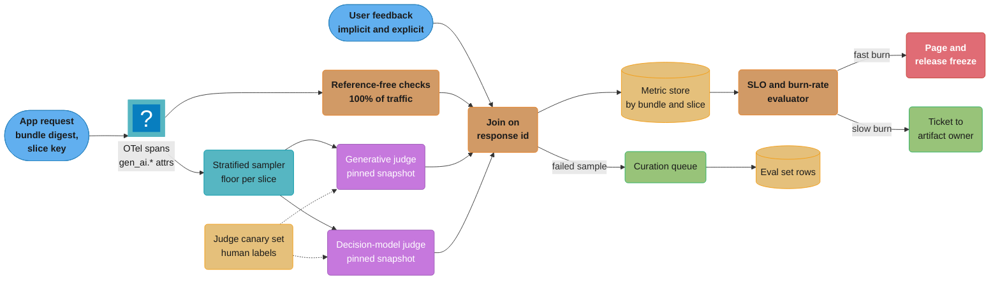
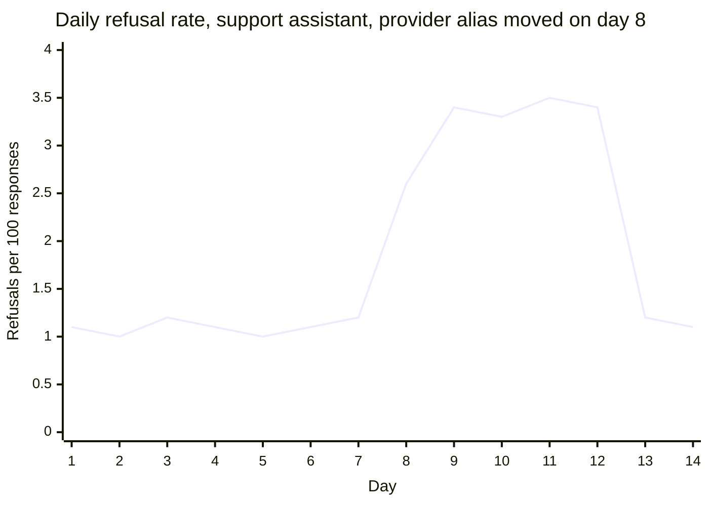
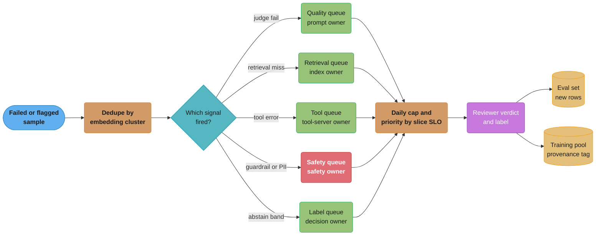

# Production Quality Monitoring and Drift

> **Version anchor (2026-10-18).** Tools appear at the mlops pin-table versions: Arize Phoenix
> v20.23.0 (2026-10-16); Langfuse v4.63.0 (2026-10-16), with OpenAI decision-model evaluators
> from v4.55.0 (2026-10-08) and decision-model evaluators graduated in v4.57.0 (2026-10-12);
> MLflow 3.17.1 (2026-10-13), which adds the Decision API to `make_judge()`, on top of the
> TypeSafe judges added in 3.17.0 (2026-10-07); SGLang v0.5.21 (2026-10-02) for `label_mass`
> on `/v1/decisions`. The OpenTelemetry GenAI semantic conventions moved to the
> `open-telemetry/semantic-conventions-genai` repository (checked 2026-10-18); this page claims
> no stability level for them. Evidently, NannyML, Fiddler and Datadog LLM Observability have
> no pin-table row and are named without a version.
>
> **On prices.** The OpenAI Decisions API input price ($0.10 per 1M tokens, no output charge,
> public beta) was checked on 2026-10-18. Every other dollar figure is a stated assumption.
> Replace it with what your account pays; the formulas do not change.

## 1. Concept Overview

An AI feature fails in production in two ways. The loud way is a 500, a timeout or a GPU that
falls off the bus; the infrastructure monitors catch it in seconds. The quiet way is a 200 OK
with a worse answer: a retriever that returns last quarter's policy, a provider snapshot that
refuses 3% more requests, a prompt that a new user segment does not fit, a classifier whose
scores slid 0.08 to the right. Nothing pages. The first signal is a customer complaint, a
support ticket backlog or a revenue line, days or weeks later.

**Production quality monitoring** is the per-artifact plan that turns the quiet failures into
signals with a known delay, a known cost and a known false-alert rate. For every artifact in the
release bundle (model weights, prompt version, index snapshot, tool-server version, decision
schema, provider model id) it answers four questions: **which signals** say it is getting worse
(labels, proxies, sampled judges, reference-free checks, guardrail rates, feedback, drift
statistics); **how fast** each arrives; **what target** each is held to (a quality SLO per slice); and **where it goes** (a
page, a ticket, a release freeze, or a curation queue that turns bad examples into eval rows).

**Drift** is the subset of these signals that compares a current distribution to a reference
one. The drift taxonomy for an AI system is wider than the classic input and concept drift: it
includes embedding and retrieval drift, output length and refusal-rate drift, tool-error drift,
provider-side model drift (the model behind an API name changes) and decision-probability drift
(the score histogram of a classifier or decision model moves).

The page treats monitoring as a release concern. Every signal is attributed to the bundle
version that produced it, so a regression can be traced to the artifact that changed. Gate
design for the offline side lives in
[Evaluation Gates and Eval Sets](../evaluation_gates_and_eval_sets/evaluation_gates_and_eval_sets.md),
and the eval rows that monitoring produces flow back there. Monitoring signals for typed
decisions (probability histograms, abstain-band rate, `label_mass`) build on
[Decision Models](../decision_models/decision_models.md). The refresh decision that a sustained
drift signal starts is owned by
[Continuous Training and Refresh Policy](../continuous_training_and_refresh_policy/continuous_training_and_refresh_policy.md).
Prompt re-qualification after a provider change is in
[Prompt Lifecycle and Versioning](../prompt_lifecycle_and_versioning/prompt_lifecycle_and_versioning.md),
and what happens after an alert fires (incident classes, kill switches, postmortems) is in
[AI Incident Response and Reliability](../ai_incident_response_and_reliability/ai_incident_response_and_reliability.md).

**Not here.** Drift statistics (PSI, KS, chi-squared, KL and JS divergence, significance vs
practical significance, the feature-level drift monitor code) live in
[Monitoring and Drift Detection](../../ml/monitoring_and_drift_detection/monitoring_and_drift_detection.md).
Instrumentation (trace structure, span design, token and cost accounting, log sampling, the
observability stack) lives in
[LLM Observability and Monitoring](../../llm/llm_observability_and_monitoring/llm_observability_and_monitoring.md).
OpenTelemetry wiring for LLM apps is worked through in
[OpenTelemetry for LLM Apps](../../llm/case_studies/cross_cutting/opentelemetry_for_llm_apps.md)
and the collector and SDK internals in
[OpenTelemetry Deep Dive](../../devops/observability_tracing_and_otel/opentelemetry_deep_dive.md).
Feedback collection and curation as a learning loop are in
[Data Flywheels and Continuous Learning](../../llm/data_flywheels_and_continuous_learning/data_flywheels_and_continuous_learning.md).

---

## 2. Intuition

**One-line analogy:** a hospital ward. Vital signs (heart rate, oxygen) are cheap, continuous
and noisy; lab results are accurate but come back in hours or days; the outcome (discharge or
readmission) arrives weeks later. A good ward watches all three, knows which one is fast and
which one is right, and pages a doctor only when the cheap signal moves enough that the lab
result will probably agree.

**Mental model:** every artifact has a **signal ladder**. At the bottom are signals with full
coverage and no delay but weak correlation to quality: output length, refusal rate, JSON
validity, guardrail triggers. In the middle are sampled judges and implicit feedback: minutes
to hours of delay, a few percent coverage, moderate correlation. At the top is ground truth:
labels, chargebacks, resolved tickets, renewals, with days to months of delay. Monitoring
design is choosing, per artifact, which rungs to pay for and how to calibrate the lower rungs
against the upper ones.

**Why it matters:** a plan that watches only the cheap rungs reports health while quality
falls. The GPT-4o update OpenAI rolled back in April 2025 (§7) looked good in offline evals
and in A/B tests with a small group of users.

**Key insight:** the binding constraint is **attribution**, not detection. A dashboard that
shows judge pass rate fell 4 points this week is useless if the release bundle changed the
prompt, the index and the provider snapshot in the same week. Tag every signal with the bundle
digest and the slice, and the question "what broke" becomes a group-by.

---

## 3. Core Principles

- **Monitor per artifact, attribute per bundle.** A metric without a version cannot start a
  rollback.
- **Know the delay of every signal.** A 30-day label cannot gate a 7-day canary; a 5-minute
  proxy is trusted only after a check against the label on history.
- **Sample to a target error, not a percentage.** The smallest drop each slice must detect sets
  its sample size. A flat 1% is too much on the head slice and too little on the tail.
- **Pin the judge like a model.** It has a version, a calibration set and an agreement number.
- **Cheap checks on 100% of traffic, judges on a sample.** Length, refusal, schema, citation and
  guardrail checks cost nothing per request.
- **Every alert has a measured precision.** A rule below 50% is demoted to a ticket or a queue.
- **Signals end in a queue, not a chart.** Failed samples go to owned, capped queues and come
  back as eval rows.
- **Watch the provider as an artifact you do not control.** Record the response model string and
  run a fixed canary suite on a schedule.

---

## 4. Types / Architectures / Strategies

### 4.1 Signal classes

| Signal | Coverage | Delay | What it catches | What it misses |
|---|---|---|---|---|
| Ground-truth label (chargeback, resolution, purchase) | Labeled subset | Days to months | True quality change | Anything recent |
| Proxy metric (approval rate, click-through, escalation rate) | 100% | Minutes to hours | Behavior shifts that track the label | Changes that move quality but not the proxy |
| Sampled generative judge | 1-10% | Seconds to minutes after the sample | Faithfulness, helpfulness, policy breaches | Judge drift; slices too small to sample |
| Sampled decision-model judge | 1-50% | Seconds | Same questions as a yes/no or choice, at lower cost | Nuance that needs a rationale |
| Reference-free check (length, refusal, schema, language, citation present) | 100% | Real time | Format and refusal regressions, truncation | Wrong-but-well-formed answers |
| Guardrail trigger rate | 100% | Real time | Injection campaigns, PII leaks, toxicity shifts | Quality inside the allowed region |
| Implicit feedback (regenerate, copy, edit distance, abandon, rephrase) | 100% of sessions | Minutes | Dissatisfaction at scale | Why; sycophancy that users like |
| Explicit feedback (thumbs, ratings, reports) | 0.5-3% of responses | Minutes | Strong negative cases | Bias: angry and delighted users vote |
| Drift statistic (PSI, centroid distance, histogram shift) | 100% or sampled | Window length | Population change | Whether quality changed |

### 4.2 Drift taxonomy for AI systems

| Drift type | What moves | Detector | Typical cause | First response |
|---|---|---|---|---|
| Input drift | Feature or prompt distribution: length, language, topic, channel | PSI per feature, topic-cluster share | New market, new client app, marketing campaign | Check per-slice quality before acting |
| Concept drift | P(label given input) | Label-based metrics on matured labels; proxy divergence | Fraud adaptation, policy change, pricing change | Refresh with a new label window |
| Embedding drift | Query or document embedding distribution | Centroid cosine distance, MMD, cluster share vs reference | New topics, new language, a changed encoder | Check retrieval quality on the new clusters |
| Retrieval drift | Top-k similarity scores, empty-result rate, source age | Score histogram, hit rate on canary queries, citation coverage | Stale index, failed ingestion, chunker change | Compare index snapshot ids; reindex |
| Output length drift | Tokens per response | Percentiles per slice | Provider snapshot, prompt edit, `max_tokens` change | Diff the bundle; run canaries |
| Refusal-rate drift | Share of refusals and safe completions | Refusal classifier or decision model on 100% | Provider safety update, guardrail policy change | Check provider model string; run canaries |
| Tool-error drift | Tool-call failure, schema-mismatch and retry rates | Rate per tool and per tool-server version | Tool-server release, upstream API change | Pin or roll back the tool server |
| Provider-side model drift | Behavior behind a stable API name | Response model string, canary suite fingerprint | Vendor alias move, infrastructure bug, silent update | Pin a dated snapshot; re-qualify prompts |
| Decision-probability drift | Score or probability histogram of a classifier or decision model | PSI on binned probabilities, abstain-band rate, threshold-crossing rate | Input drift, model snapshot change, label-token issue | Recheck calibration and thresholds on fresh labels |

The statistics behind each detector are in the `ml/monitoring_and_drift_detection` page. The
monitoring decision is which drift types an artifact is exposed to, which detector reads them,
and what action a sustained shift starts.

### 4.3 Monitoring plan by artifact type

| Artifact | Earliest trustworthy signal | Ground truth | Drift to watch | Owner of the response |
|---|---|---|---|---|
| Classic scoring model | Score histogram, threshold-crossing rate | Matured outcome labels | Input, concept, decision-probability | Model owner; refresh via CT policy |
| Prompt version | Sampled judge pass rate per slice | Human review sample | Output length, refusal, format | Prompt owner; rollback to the previous version |
| Provider model id | Canary suite fingerprint, response model string | Human review of canary diffs | Provider-side, refusal, length | Platform team; pin or switch provider |
| Embedding model and index | Retrieval hit rate on canary queries, top-1 score histogram | Labeled query-to-document pairs | Embedding, retrieval | Index owner; reindex or roll back snapshot |
| Agent and tool servers | Tool-error rate, steps per task, task completion proxy | Task success on reviewed traces | Tool-error, input | Tool-server owner; pin version |
| Decision model | Probability histogram, abstain-band rate, `label_mass` | Labeled decision set refreshed monthly | Decision-probability, input | Decision owner; recalibrate thresholds |
| Guardrail policy | Trigger rate per rule, appeal and override rate | Reviewed blocked and passed samples | Input (attack campaigns) | Safety owner |
| Online judge itself | Agreement on a fixed human-labeled canary set | Human labels | Judge drift | Eval owner |

### 4.4 Sampling strategies for online evaluation

| Strategy | How it picks | Good for | Failure mode |
|---|---|---|---|
| Uniform | Fixed share of all traffic | Headline pass rate | Tail slices get almost no samples |
| Stratified with a floor | Per-slice quota, minimum n per window | Per-slice SLOs | Needs a slice key on every trace |
| Triggered | Every response with negative feedback, guardrail hit or low confidence | Finding failure modes fast | Biased; never use it for the headline rate |
| Uncertainty-weighted | Higher rate where the decision model sits in its abstain band | Spending judge money on hard cases | Biased estimate unless weights are recorded |
| Shadow pairing | Same request scored under champion and challenger | Release comparison | Doubles judge cost for the pair |

Triggered samples answer "what is failing"; only stratified, uniform or properly weighted
samples answer "how often".

---

## 5. Architecture Diagrams

### Signal pipeline from trace to SLO, alert and queue



Two paths leave the join. The aggregate path feeds SLOs and alerts. The per-sample path sends
each failed response to a curation queue, where a reviewer turns it into an eval row. The judge
canary set (dotted edges) is scored by both judges every day, so a judge that drifts shows up as
falling agreement, not as a fake quality change.

### Signal latency ladder

```
 signal                         delay after the response          coverage   trust
 -------------------------------------------------------------------------------------
 length, refusal, schema        |0                                 100%       low
 guardrail trigger rate         |0                                 100%       low-mid
 decision-model judge           |-- 2 s                            1-50%      mid
 generative judge               |---- 30 s                         1-10%      mid-high
 implicit feedback              |-------- 10 min                   100% sess  mid
 explicit feedback              |------------ 1 h                  0.5-3%     mid, biased
 human review sample            |------------------ 1-3 days       0.1%       high
 business outcome label         |------------------------- 7-90 d  labeled    ground truth
 -------------------------------------------------------------------------------------
 time ->   now      minutes        hours          days           weeks
```

A canary that runs for 2 hours can only be judged on the top six rows. The bottom two rows
check that the top rows still track quality, in a backtest rerun every quarter.

### Refusal rate around a silent provider change



The bundle did not change on day 8; the vendor alias did. Refusal rate tripled and stayed there
until the team, alerted by escalations, pinned the previous dated snapshot on day 13. A
reference-free refusal check on 100% of traffic would have flagged it on day 8. The judge pass
rate moved by only 1.4 points, because a refusal on a borderline request often scores as "safe"
under a helpfulness-and-safety rubric.

### Decision-probability histogram, reference week vs this week

```
 decision model: "escalate to human?" P(yes), 10 bins, threshold 0.60, abstain band 0.40-0.60

 bin        reference week (n=210k)          this week (n=198k)
 0.0-0.1    ##########################  31%  #####################       25%
 0.1-0.2    ############                14%  ##########                  12%
 0.2-0.3    #######                      8%  ######                       7%
 0.3-0.4    #####                        6%  #####                        6%
 0.4-0.5    ####                         5%  ########                    10%  <- abstain
 0.5-0.6    ####                         5%  #########                   11%  <- abstain
 0.6-0.7    ####                         5%  #####                        6%
 0.7-0.8    #####                        6%  #####                        6%
 0.8-0.9    #######                      8%  ######                       7%
 0.9-1.0    ##########                  12%  #########                   10%
 abstain share:           10%                           21%
```

The threshold-crossing rate (share above 0.60) moved only from 31% to 29%, so a monitor that
watched the action rate alone stayed green. The mass that left the confident-no bins landed in
the abstain band, which doubled the human-review load. The cause was a new product line whose
tickets the decision model had never seen; the per-slice histogram showed it in one group-by.

### Routing failed samples into curation queues



Deduplication comes first: one broken retrieval for a popular question is thousands of failures
and one problem. The cap protects reviewers; priority goes to slices burning their SLO fastest.

---

## 6. How It Works - Detailed Mechanics

### 6.1 Attributing every signal to a bundle version and a slice

The trace is where attribution starts. The OTel GenAI conventions name the request and response
model (`gen_ai.request.model`, `gen_ai.response.model`), the provider (`gen_ai.provider.name`),
token counts (`gen_ai.usage.input_tokens`, `gen_ai.usage.output_tokens`) and
`gen_ai.response.finish_reasons`. They also define an evaluation event,
`gen_ai.evaluation.result`, with `gen_ai.evaluation.name`, `gen_ai.evaluation.score.value`,
`gen_ai.evaluation.score.label` and `gen_ai.evaluation.explanation`. The conventions do not
carry release-bundle fields, so add your own namespaced attributes for them.

An online judge runs after the request span has ended. The event's conventions say to parent it
to the evaluated span when possible, or to set `gen_ai.response.id` when the span id is not
available. Starting the judge span as a child of the stored span context, and setting the id as
well, covers both cases:

```python
from opentelemetry import trace
from opentelemetry.trace import NonRecordingSpan, SpanContext, TraceFlags

tracer = trace.get_tracer("quality-monitor")

def record_eval(sample, name, value, label, explanation=None):
    evaluated = SpanContext(int(sample["trace_id"], 16), int(sample["span_id"], 16),
                            is_remote=True, trace_flags=TraceFlags(TraceFlags.SAMPLED))
    parent = trace.set_span_in_context(NonRecordingSpan(evaluated))
    with tracer.start_as_current_span(f"evaluate {name}", context=parent) as span:
        attrs = {
            "gen_ai.evaluation.name": name,
            "gen_ai.evaluation.score.value": float(value),
            "gen_ai.evaluation.score.label": label,
            "gen_ai.response.id": sample["response_id"],
            "app.bundle.digest": sample["bundle_digest"],
            "app.prompt.version": sample["prompt_version"],
            "app.index.snapshot": sample["index_snapshot"],
            "app.judge.id": sample["judge_id"],
            "app.slice": sample["slice"],
            "app.sample.weight": sample["weight"],
        }
        if explanation:
            attrs["gen_ai.evaluation.explanation"] = explanation[:2000]
        span.add_event("gen_ai.evaluation.result", attributes=attrs)
```

`app.sample.weight` is the inverse sampling probability; without it a weighted sample cannot be
turned back into a population rate. `app.judge.id` makes a judge change a visible step.

### 6.2 Sample size for a sampled judge, per slice

A sampled pass rate is a binomial estimate. The number of judged samples needed to detect a drop
from `p0` to `p1` with one-sided significance `alpha` and power `1 - beta`:

```python
from math import sqrt, ceil
from statistics import NormalDist

def samples_needed(p0, p1, alpha=0.05, power=0.80):
    za = NormalDist().inv_cdf(1 - alpha)
    zb = NormalDist().inv_cdf(power)
    num = za * sqrt(p0 * (1 - p0)) + zb * sqrt(p1 * (1 - p1))
    return ceil((num / (p0 - p1)) ** 2)

print(samples_needed(0.90, 0.87))   # 3-point drop: 670
print(samples_needed(0.90, 0.89))   # 1-point drop: 5728
```

A slice with 2,000 requests a day cannot detect a 1-point daily drop at any sampling rate. Widen
its window to a week, or check its SLO at 3-point resolution and write that next to the SLO.

The broken version samples a flat share of all traffic:

```python
# BROKEN: 2% of everything. The head slice (EN web, 70% of 50k/day) gets 700 samples;
# the German enterprise slice (1.5% of traffic) gets 15 samples a day and never alerts.
def should_judge(trace):
    return random.random() < 0.02
```

The fixed version sets a per-slice quota from the resolution each slice's SLO needs, and records
the weight:

```python
import random

QUOTA_PER_DAY = {"en_web": 700, "en_api": 700, "de_enterprise": 700, "ja_web": 700}

def judge_probability(slice_key, expected_daily_volume):
    quota = QUOTA_PER_DAY.get(slice_key, 300)
    return min(1.0, quota / max(expected_daily_volume[slice_key], 1))

def sample(trace, expected_daily_volume):
    p = judge_probability(trace.slice, expected_daily_volume)
    if random.random() < p:
        return {"judge": True, "weight": 1.0 / p}
    return {"judge": False}
```

German enterprise traffic (750 requests a day) is now judged at 93%, the head slice at 2%, and
the headline rate is the weighted mean.

### 6.3 Judge cost: generative vs decision-model judge

For 20,000 judged samples a day at 1,800 input tokens each (question, retrieved context, answer,
rubric), the input is 36M tokens a day.

| Judge | Input cost | Output cost | Per day | Per 30 days |
|---|---|---|---|---|
| Generative judge, assumed $2.50 per 1M input and $10 per 1M output, 250 output tokens | $90 | $50 | $140 | $4,200 |
| OpenAI Decisions API (`gpt-6-luna`), $0.10 per 1M input, no output charge (checked 2026-10-18) | $3.60 | $0 | $3.60 | $108 |

The decision-model judge answers a `predicate` or `choice` question and returns a probability,
not a rationale. That is enough for a pass rate and for routing to a queue. It is not enough for
the reviewer who opens the failed sample, so a common split is the decision-model judge on the
whole sample and a generative judge with a rationale only on the samples it fails. MLflow 3.17.0
added TypeSafe judges through `make_judge()`: with `feedback_value_type=bool` it asks a `noul`
question and returns True at probability 0.5 or above, without a rationale. Log the probability
as well as the boolean; a pass rate at a hard 0.5 cut hides a slide from 0.9 to 0.55.

### 6.4 Judge drift and the judge canary set

The judge is itself a model behind an API. If the provider moves the alias, scores move with no
change in the system being judged. The control is a fixed canary set of 300 to 500 production
samples with human verdicts, scored by every judge every day:

```python
from sklearn.metrics import cohen_kappa_score

def judge_health(judge, canary_rows, baseline_kappa, max_drop=0.05):
    preds = [judge.verdict(r["input"], r["output"]) for r in canary_rows]
    human = [r["human_verdict"] for r in canary_rows]
    kappa = cohen_kappa_score(human, preds)
    pass_rate = sum(preds) / len(preds)
    return {
        "judge_id": judge.snapshot_id,
        "kappa": kappa,
        "pass_rate": pass_rate,
        "healthy": kappa >= baseline_kappa - max_drop,
    }
```

When `healthy` turns false, quality alerts that depend on that judge are suppressed and the eval
owner is paged instead, because the ruler is broken. Pin a versioned snapshot id, never an
alias such as TypeSafe's `jev-latest`. A planned judge upgrade runs both snapshots on the canary
set and on a week of live samples, and the SLO history gets an annotation at the switch.

### 6.5 Decision-model signals

A decision model or a classic classifier gives monitoring more to work with than a generated
answer: every response is a probability. The signals that matter, per question and per slice:

- **Probability histogram drift.** PSI on 10 bins fixed when the threshold was set.
- **Abstain-band rate.** It sets the human-review load; §5 shows it doubling while the action
  rate held.
- **Threshold-crossing rate.** The share that triggers the action, per slice.
- **`label_mass`.** SGLang's `/v1/decisions` response reports how much of the next-token
  probability fell on the label tokens. A drop means the model wanted to say something other
  than a label: an input in a new language, an instruction it reads as a question, an option
  list that no longer fits.
- **Refusal and error rate.** Langfuse's OpenAI decision-model evaluators fail the whole run on
  a refusal and write no scores. A monitor that watches the score values sees a quiet chart. Watch "scores
  written per run" and "runs failed" as well.
- **Sampled human agreement.** Precision and recall at the threshold on a monthly labeled
  sample, the one calibration check that does not trust the vendor.

```python
import numpy as np

BINS = np.linspace(0.0, 1.0, 11)

def decision_health(ref_probs, cur_probs, abstain=(0.40, 0.60), threshold=0.60,
                    ref_label_mass=None, cur_label_mass=None):
    eps = 1e-4
    r = np.histogram(ref_probs, BINS)[0] / len(ref_probs) + eps
    c = np.histogram(cur_probs, BINS)[0] / len(cur_probs) + eps
    psi = float(np.sum((c - r) * np.log(c / r)))
    lo, hi = abstain
    out = {
        "psi": psi,
        "abstain_ref": float(np.mean((ref_probs >= lo) & (ref_probs < hi))),
        "abstain_cur": float(np.mean((cur_probs >= lo) & (cur_probs < hi))),
        "act_ref": float(np.mean(ref_probs >= threshold)),
        "act_cur": float(np.mean(cur_probs >= threshold)),
    }
    if cur_label_mass is not None:
        out["label_mass_p05_ref"] = float(np.percentile(ref_label_mass, 5))
        out["label_mass_p05_cur"] = float(np.percentile(cur_label_mass, 5))
    return out
```

The 5th percentile of `label_mass` is more useful than its mean: the mean barely moves while one
small slice falls to 0.6. Compare each question against its own reference. SGLang counts only the
lowercase `yes` and `no` tokens for a `yes_no` question, so its `label_mass` reads low by design.

### 6.6 Reference-free checks on 100% of traffic

These run in the request path or in a stream processor and cost close to nothing:

| Check | How | Catches |
|---|---|---|
| Output tokens p50, p95 per slice | From `gen_ai.usage.output_tokens` | Provider verbosity change, truncation, prompt edits |
| `finish_reasons` share of `length` | From `gen_ai.response.finish_reasons` | `max_tokens` too low after a model change |
| Refusal rate | Small classifier or a decision-model `predicate` | Provider safety updates, over-strict guardrails |
| Schema validity | Parse against the contract | Format regressions in structured output |
| Citation present and resolvable | Check cited ids against retrieved ids | Retrieval misses, fabricated sources |
| Response language matches request | Language-id on both | Model answering German questions in English |
| Guardrail trigger rate per rule | Counter per rule and slice | Injection campaigns, PII leaks, a rule that fires too often |

They cannot say an answer is right. They can say, within minutes and with full coverage, that the
answer changed shape, which is how most provider-side and prompt regressions first show up.

### 6.7 Implicit and explicit feedback

Explicit feedback (thumbs, stars, "report") arrives on 0.5% to 3% of responses and is biased
toward strong reactions. Implicit feedback covers every session: regenerate, copy, edit distance
between the draft and what the user sent, abandonment, a rephrased follow-up within 60 seconds,
escalation to a human. Neither is quality. Both are useful as slice-level trends against the
same slice's own history, with a minimum vote count per window (200 is a common floor).

Report the vote rate next to the down share. A UI change that moves the thumbs button changes
who votes, and the down share moves with no change in quality. The GPT-4o rollback in April 2025
is the warning in the other direction: an added reward signal built from thumbs data weakened
the signal that held sycophancy in check, and users liked the change that made the model worse. Feedback is a monitoring
signal and a curation trigger. It is not a release gate on its own.

### 6.8 Embedding and retrieval drift

Embedding drift compares this week's query embeddings with a reference week: centroid cosine
distance, share of queries per topic cluster, or maximum mean discrepancy on a sample. Compare
only within one encoder version and reset the reference at the cutover in
[RAG and Vector Index Lifecycle](../rag_and_vector_index_lifecycle/rag_and_vector_index_lifecycle.md).
A cluster that grows from 0% to 4% of queries in a week is new demand, not an alarm; the
follow-up is retrieval quality on that cluster.

Retrieval drift is closer to quality. Watch the top-1 similarity histogram, the share of queries
whose best score falls under the relevance floor, the age of the retrieved sources, and the hit
rate on a fixed set of canary queries with known answer documents. A canary hit rate that falls
from 0.94 to 0.81 overnight is a failed ingestion job or a chunker change, and the index
snapshot id in the trace says which.

### 6.9 Provider-side model drift

A hosted model name can be a pointer. The model behind it can change by vendor update, by an
alias move, or by an infrastructure bug. Chen, Zaharia and Zou (Stanford and UC Berkeley, 2023)
compared the March and June 2023 GPT-4 and GPT-3.5 snapshots on the same tasks and found large
changes in accuracy and in how often outputs followed formatting instructions. §7 has two more
cases from 2025. The controls are the same for every provider:

```python
CANARIES = load_jsonl("canaries/provider_suite_v7.jsonl")    # 200 fixed prompts, temperature 0

def provider_fingerprint(client, model_id):
    rows = []
    for c in CANARIES:
        r = client.generate(model=model_id, prompt=c["prompt"], temperature=0, max_tokens=512)
        rows.append({
            "id": c["id"],
            "response_model": r.model,                 # gen_ai.response.model
            "tokens": r.usage.output_tokens,
            "refused": is_refusal(r.text),
            "valid": validates(c["schema"], r.text) if c.get("schema") else None,
            "pass": c["checker"](r.text),
        })
    return summarize(rows)    # pass rate, refusal rate, token p50 and p95, response_model set
```

Run it hourly against every model id the bundle uses. Alert on a change in the set of
`response_model` strings, on a pass-rate drop beyond the canary's own run-to-run noise (measure it
over two weeks of runs first), and on a token p50 shift above 15%. Pin a dated snapshot in the
bundle wherever the vendor offers one; an undated alias is a release that someone else ships.

### 6.10 Label delay and proxy metrics

When labels arrive in 30 to 90 days, monitoring runs on proxies that moved with the label on
history: manual review and decline-override rates for fraud, escalation and 7-day reopen rates
for a support assistant. Backtest each against matured labels and record correlation and lead time.
Proxy design and NannyML's label-free performance estimation (CBPE, valid under covariate shift
only) are in [Monitoring and Drift Detection](../../ml/monitoring_and_drift_detection/monitoring_and_drift_detection.md).
The release concern is that a UI or workflow change can cut a proxy's link to the label with no
model change (§10), so the backtest reruns after every such change, not only on a schedule.

### 6.11 Quality SLOs and burn-rate alerts on sampled data

A quality SLI is good events over valid events: for an assistant, the share of judged responses
that pass the faithfulness judge, per slice, over 28 days. An SLO of 92% leaves a budget of 8%.
Quality is sampled and the judge adds noise, so use longer windows than latency SLOs and a
minimum sample count:

```python
def quality_burn_alerts(windows, slo=0.92, min_n=400):
    """windows: {"6h": (passed, judged), "3d": (passed, judged)}"""
    budget = 1.0 - slo
    out = {}
    for name, (passed, judged) in windows.items():
        if judged < min_n:
            out[name] = "insufficient_samples"
            continue
        out[name] = round(((judged - passed) / judged) / budget, 2)
    page = isinstance(out.get("6h"), float) and out["6h"] >= 3.0
    ticket = isinstance(out.get("3d"), float) and out["3d"] >= 1.5
    return out, ("page" if page else "ticket" if ticket else None)
```

A 6-hour burn rate of 3 means a 24% failure rate on judged samples; sustained for 6 hours it spends
about 2.7% of a 28-day budget (3 x 6 / 672). A 3-day burn rate of 1.5 means 12% failures; sustained
for 3 days it spends about 16%. The fast alert pages and freezes releases; the slow one opens a
ticket. `insufficient_samples` means the sampler or judge stopped (the §6.5 Langfuse case). Generic
SLO math is in [SRE Principles and SLOs](../../devops/sre_principles_and_slos/sre_principles_and_slos.md).

### 6.12 Alert precision

Every alert rule gets a row in a quarterly review: fired, true incident, false alarm, missed
incident found another way. Precision is true over fired.

```
 rule                                        fired  true  precision  action
 ---------------------------------------------------------------------------
 judge pass rate -2 pts day over day, any       41     6     15%     demote to queue
 judge 6h burn >= 3, min n 400                   5     4     80%     keep paging
 refusal rate x2 vs 7d median, 100% traffic      3     3    100%     keep paging
 PSI > 0.2 on any of 40 input features          27     1      4%     drop; per-slice dashboard
 canary hit rate -5 pts                           4     3     75%     keep paging
 response_model string changed                    2     2    100%     keep paging
 ---------------------------------------------------------------------------
```

The low-precision rules share a shape: many comparisons (40 features, every slice, every day)
with a fixed threshold, so false positives scale with the number of checks. Three fixes: require
the shift to persist across two windows (hysteresis), alert on a quality metric and use drift
statistics only for diagnosis, and correct across slices (Benjamini-Hochberg) when one rule runs
on dozens of them. A rule that never fires is checked too: inject a known regression in staging
once a quarter and confirm it alerts.

### 6.13 Routing signals into curation queues

The queue design is the §5 diagram: dedupe by query cluster, route by signal to the owner of
the artifact it points at, cap per day, order by SLO burn. Every reviewed row records its source
signal, bundle digest, reviewer and date. Rows from production failures enter the eval set as a
separate slice, so a later gate shows whether the fix held. Model-written rows do not enter
training without review; that feedback loop is capped in
[Continuous Training and Refresh Policy](../continuous_training_and_refresh_policy/continuous_training_and_refresh_policy.md).

---

## 7. Real-World Examples

**Zillow Offers (2021).** Zillow's home-buying business priced offers from its valuation models.
When the housing market shifted in 2021, the models kept bidding above what homes later sold
for. The Zillow Offers business lost about $420 million in the third quarter of 2021, and in
November 2021 Zillow announced it would wind the business down and cut about 25% of its staff. Concept drift with a long label
delay: the sale price, the ground truth, arrived months after the offer.

**Instacart (2020).** Fortune reported that the accuracy of Instacart's item-availability model
fell from 93% to 61% in the early pandemic, when shopping patterns changed within weeks, faster
than the retraining cadence assumed.

**OpenAI GPT-4o sycophancy rollback (April 2025).** An update to GPT-4o in ChatGPT made the model
agree with users excessively. OpenAI rolled it back after a few days. Its postmortems said that
offline evaluations and A/B tests had looked positive, that some expert testers had said the
model felt off, and that an added reward signal from user thumbs-up and thumbs-down data weakened
the primary reward signal. Feedback that users like is not the same as quality.

**Anthropic infrastructure bugs (August to September 2025).** Three separate bugs (a
context-window routing error, output corruption on one hardware platform, and a compiler issue
in approximate top-k sampling) degraded some Claude responses. The postmortem said the bugs
were hard to see in evaluations because the model often recovered from single errors, and that
Anthropic would run more sensitive evaluations continuously on production systems. For a
customer of a hosted model, the provider's quality is a dependency that needs its own canary.

**Air Canada chatbot (2024).** British Columbia's Civil Resolution Tribunal ordered Air Canada
to pay a customer about CA$812 after its website chatbot told him he could claim a bereavement
fare refund within 90 days of buying a full-fare ticket, which the airline's policy did not
allow. The tribunal rejected the argument that the chatbot was responsible for its own actions. A
sampled online faithfulness check against the policy documents flags such an answer.

---

## 8. Tradeoffs

### Coverage vs depth

| Approach | Cost | Coverage | Catches wrong-but-fluent answers | Use for |
|---|---|---|---|---|
| Reference-free checks only | Near zero | 100% | No | Format, length, refusal, guardrail trends |
| Decision-model judge on a large sample | Low ($3.60 a day in §6.3) | 10-50% | Yes, as yes/no | Pass rates and routing per slice |
| Generative judge on a sample | Higher ($140 a day in §6.3) | 1-10% | Yes, with rationale | Failure analysis, reviewer context |
| Human review sample | Highest per item | 0.1-1% | Yes | Ground truth for judges and proxies |

### Generative vs decision-model judge

| Dimension | Generative judge | Decision-model judge |
|---|---|---|
| Output | Score plus rationale | Label, probability, confidence |
| Cost per judgment | Input plus output tokens | Input tokens only (OpenAI Decisions API pricing) |
| Latency | Seconds | Prefill only, sub-second on self-hosted engines |
| Thresholding | Parsed score, often coarse | Continuous probability, threshold per question |
| Calibration | Not calibrated | Vendor claims differ; measure on your labels |
| Failure mode | Parse failures, verbose drift | Refusal fails a Langfuse OpenAI decision run; `label_mass` drops |

---

## 9. When to Use / When NOT to Use

**Build the full per-artifact plan when** the feature answers customers or takes actions, the
bundle includes a hosted model, index or tool servers that change outside your release, labels
arrive more than a week late, or more than one team ships artifacts into the same bundle.

**Use a lighter plan when** the feature is internal and low volume (reference-free checks,
explicit feedback and a weekly human review of 50 samples), or the model is a batch classifier
with fast labels (label-based metrics per slice and a score histogram).

**Do not:**

- Page on drift statistics alone. Drift says the population moved, not that quality did.
- Gate releases on explicit feedback. It is sparse, delayed and biased toward strong reactions.
- Run a generative judge on 100% of traffic to avoid designing a sampler. At the §6.3 rates that
  is $7,000 a day for 1M responses, and the extra samples add no resolution to the head slice.

---

## 10. Common Pitfalls

**Judge on an alias.** The vendor moved `jev-latest` and pass rates rose 3 points overnight with
no system change. Fix: pin a versioned snapshot; score the canary set daily (§6.4).

**Headline rate from a triggered sample.** Judging every thumbs-down response gave leadership a
61% pass rate. Fix: compute rates only from stratified or weighted samples.

**Tail slice never alerts.** A flat 2% sample gave the German enterprise slice 15 judgments a day;
a 9-point drop surfaced as churn 3 weeks later. Fix: per-slice quotas (§6.2).

**Langfuse decision evaluator refuses and the chart goes quiet.** No scores were written and the
chart held the last good value. Fix: alert on scores written per run and on failed runs.

**Comparing embeddings across encoder versions.** Embedding drift paged hourly after an encoder
upgrade. Fix: reset the reference at cutover; compare within one encoder version.

**Proxy that stopped tracking the label.** A UI change hid the "talk to a human" button;
escalations fell 40% while quality fell. Fix: re-check proxies after UI or workflow changes.

**Action rate green, abstain band doubled.** The threshold-crossing rate held while the abstain
band went from 10% to 21% (§5). Fix: monitor the full histogram and abstain share per slice.

**Curation queue with no cap.** 18,000 flagged samples in a week, 300 reviewed, the queue
abandoned in a month. Fix: dedupe by cluster, cap per day, prioritize by SLO burn.

---

## 11. Technologies & Tools

| Tool | Role | Notes |
|---|---|---|
| Arize Phoenix | Open-source tracing, online and offline evals, datasets | v20.23.0. OTel-based ingestion; runs self-hosted |
| Langfuse | Tracing, LLM-as-judge and decision-model evaluators on live traces, datasets, scores | v4.63.0. Acquired by ClickHouse (announced 2026-01-16). An OpenAI decision-model refusal fails the run with no scores written |
| MLflow | GenAI judges through `make_judge()`, including TypeSafe and Decision API judges | 3.17.1. `feedback_value_type=bool` returns True at probability 0.5 or above |
| OpenTelemetry | Trace and event model; GenAI conventions for model, usage and evaluation fields | Conventions in `open-telemetry/semantic-conventions-genai`; no stability level claimed here |
| Evidently | Open-source drift and data-quality reports and test suites | No pin; used in batch pipelines |
| NannyML | Performance estimation without labels (CBPE, DLE), drift detection | No pin; CBPE assumes no concept drift |
| Fiddler | Commercial model and LLM monitoring, explainability | No pin |
| Datadog LLM Observability | LLM traces, evaluations and alerts inside Datadog APM | No pin |
| OpenAI Decisions API | Low-cost decision-model judge backend | Public beta, `gpt-6-luna`, $0.10 per 1M input tokens (checked 2026-10-18) |
| SGLang | Self-hosted decision-model serving with `label_mass` in responses | v0.5.21. `/v1/decisions` and `/v1/systemone` |

Decision-model serving and calibration are compared in
[Decision Models](../decision_models/decision_models.md); the gateway that emits per-request
cost and routing tags is in
[AI Gateway Operations](../ai_gateway_operations/ai_gateway_operations.md).

---

## 12. Interview Questions with Answers

**Q: Your judge pass rate went up 3 points overnight with no release. Is quality better?**
**Short:** Probably not; check whether the judge changed first. An alias move or judge snapshot change shifts scores with no change in the system being judged.

Probably not. A step with no bundle change points at the ruler. Check the judge id on the
evaluation events; a judge on an alias such as `jev-latest` moves when the vendor moves it. Score
the fixed human-labeled canary set and compare Cohen's kappa and pass rate to the baseline. If
agreement fell, suppress the dependent quality alerts, pin the previous snapshot, and treat the
switch as a judge release with its own gate.

**Q: Why is a flat 1% sample a bad design for an online judge?**
**Short:** It over-samples the head slice and gives tail slices too few samples to detect anything. Sample size per slice should come from the smallest drop each SLO must detect.

A flat rate samples each slice in proportion to its traffic. A slice with 1,500 requests a day
gets 15 judgments, which cannot detect a 10-point drop. About 670 samples detect a 3-point drop
from 90% (5% one-sided, 80% power); about 5,700 detect a 1-point drop. Set a quota per slice from
the resolution its SLO needs, record the inverse sampling probability as a weight, and compute the
headline rate as a weighted mean.

**Q: Can you report the pass rate of responses that users thumbed down as your quality metric?**
**Short:** No; that sample is selected on failure. Triggered samples find failure modes; only uniform, stratified or properly weighted samples estimate a rate.

A triggered sample is chosen because something went wrong, so its pass rate says nothing about
the population. It is the right stream for finding failure modes and filling curation queues. For
a rate, use a uniform or stratified sample, or a weighted one with recorded inverse probabilities.
Label each stream by sampler in the metric store so no dashboard mixes them.

**Q: Drift on 40 input features fired 27 alerts last quarter and one was real. What do you change?**
**Short:** Stop paging on drift. Page on quality signals, use drift for diagnosis, add persistence across windows and correct for the number of comparisons.

Fixed thresholds over many comparisons produce false positives in proportion to the number of
checks, and most input drift does not hurt quality. Page on judge burn rate, refusal rate and
canary hit rate; keep per-feature drift on a diagnostic dashboard. Where a drift rule must alert,
require two consecutive windows, apply Benjamini-Hochberg across slices, and review precision per
rule each quarter. Demote rules below 50% precision.

**Q: How do you detect that a hosted provider changed the model behind the API name?**
**Short:** Record the response model string on every call and run a fixed canary suite on a schedule; alert on a new model string, a pass-rate drop beyond noise or a token-length shift.

Record `gen_ai.response.model` on every span and alert when its set of values changes. Run about
200 canary prompts at temperature 0 every hour per model id, tracking pass rate, refusal rate and
output token percentiles, and alert on changes beyond the suite's measured run-to-run noise.
Refusal rate and output length on live traffic usually move within hours. Respond by pinning a
dated snapshot and re-qualifying prompts.

**Q: The decision model's action rate is stable. Can the monitor stay green?**
**Short:** No; the action rate hides shifts inside the distribution. Watch the full probability histogram, the abstain-band rate and the label-mass tail per slice.

The share above the threshold can hold while mass moves from confident-no into the abstain band,
doubling human-review load. Monitor PSI on fixed probability bins, the abstain share, the
threshold-crossing rate per slice and, on SGLang, the 5th percentile of `label_mass`. A falling
`label_mass` tail means probability went to tokens other than the labels, often for a new language
or input type. Confirm with precision and recall on a labeled sample.

**Q: Langfuse decision-model evaluator scores look flat for two days. What could be wrong?**
**Short:** The evaluator may be failing. A refusal fails the whole run and writes no scores, so the chart shows stale values. Monitor scores written and runs failed, not only score values.

A quiet chart can mean nothing was measured. Langfuse's OpenAI decision-model evaluators fail the
whole run on a refusal. Check scores written per run and the failed-run count, then find what the judge
refused, often a category that trips the provider's safety policy. Strip content the judge does
not need, exclude the category with a recorded reason, or switch judges, and alert on
`insufficient_samples` from then on.

**Q: Escalation rate, your quality proxy for a support assistant, fell 40% after a release. Is quality better?**
**Short:** Not until the proxy is re-checked; a UI or workflow change can move a proxy with no change in quality, so compare it with the judged pass rate and matured labels first.

A proxy is trusted only while its backtested link to the label holds. First check whether the
release changed the path that produces the proxy: hiding the "talk to a human" button cuts
escalations while answers get worse. Compare the same window's judged pass rate and 7-day reopen
rate per slice; if they disagree with the proxy, the proxy is broken, not the model. Rerun the
backtest against matured labels after every UI or workflow change and replace a proxy that no
longer agrees.

**Q: Thumbs-up rate went up after a model update. Ship it to everyone?**
**Short:** Not on that alone. Users can reward agreement and flattery; OpenAI rolled back a GPT-4o update in April 2025 after a thumbs-based signal contributed to sycophancy.

Explicit feedback is sparse, biased toward strong reactions, and rewards answers users like. The
GPT-4o update rolled back in April 2025 had passed offline evals and A/B tests, and a reward signal
from thumbs data contributed to its sycophancy. Check whether the vote rate changed, the judged
faithfulness and safety rates, and a human review sample of the slices where thumbs moved most.

**Q: Embedding drift paged every hour after you upgraded the encoder. What happened?**
**Short:** The reference embeddings came from the old encoder. Distances across encoder versions measure the encoder, not the users. Reset the reference at cutover.

Two embedding spaces are not comparable, so the distance between an old-encoder reference centroid
and new-encoder queries is large and constant. Reset the reference window at cutover and compare
only within one encoder version. Tag each embedding metric with the encoder version so the reset is
automatic, and run the monitor per index during a dual-index migration.

**Q: What is a quality SLO for an LLM feature, and how is it different from a latency SLO?**
**Short:** The share of judged responses that pass a pinned judge, per slice over 28 days. It is sampled and judge-noisy, so it needs longer windows and a minimum sample count.

The SLI is good events over valid events, such as judged responses passing a faithfulness judge;
the SLO is a target such as 92% over 28 days per slice. Because the SLI is sampled and the judge
adds noise, burn-rate alerts use windows of hours and days, not minutes, and each window needs a
minimum sample count (for example 400) before it can fire. Too few samples raises its own alert.

**Q: How do you choose between a generative judge and a decision-model judge for online evaluation?**
**Short:** Decision-model judges are cheap and give probabilities, so use them for pass rates on large samples; add a generative judge with a rationale on the failures for reviewers.

For 20,000 judgments a day at 1,800 input tokens, the OpenAI Decisions API costs $3.60 a day at the
price checked on 2026-10-18, against about $140 for a generative judge at §6.3's assumed rates. The
decision judge returns a probability to threshold and monitor, but no rationale. Run it on the full
sample and a generative judge on the failures. Pin both and check both against the human canary
set; measure calibration on your labels.

**Q: How do you attribute a quality drop to one artifact when several changed in the same week?**
**Short:** Tag every signal with the bundle digest and artifact versions, then group by version; where versions changed together, replay the sample against each single-artifact variant.

Every trace and evaluation event carries the bundle digest, prompt version, index snapshot, model
id, tool-server versions and judge id, so a group-by splits the metric by what was live. A staged
rollout isolates each change in its canary cohort. If changes landed together, replay a fixed
sample against bundles that differ by one artifact and judge them with the same pinned judge.

**Q: What should happen to a failed sample after the judge flags it?**
**Short:** Dedupe it by cluster, route it to the owner of the artifact the signal points at, review it under a daily cap, and add the verdict to the eval set with provenance.

Cluster failures by query embedding so one broken path is one review item with a count. Route
retrieval misses to the index owner, tool errors to the tool-server owner, judge failures to the
prompt owner and abstain-band decisions to the decision owner. Cap each queue per day and order it
by SLO burn. Reviewed rows enter the eval set as a production-failure slice with provenance.

**Q: Which signals would have caught the Anthropic August 2025 degradation from the customer side?**
**Short:** A fixed canary suite run hourly, plus 100% reference-free checks such as unexpected-script detection and output-length shifts, attributed per provider model id.

The bugs were intermittent and the model often recovered from single errors, which is why
aggregate evaluations missed them. An hourly canary suite at temperature 0 exposes intermittent
behavior as variance across runs of the same prompt. Reference-free checks on every response catch
symptoms directly: unexpected-script characters in an English answer, schema failures, length
shifts. Keep a second provider qualified so the response can be a switch.

---

## 13. Best Practices

- Write a monitoring plan per artifact: signals, delay, coverage, SLO, owner and response.
- Tag every span and evaluation event with bundle digest, versions, judge id, slice and weight.
- Run reference-free checks on 100% of traffic; size judge samples to each slice's SLO.
- Pin every judge and score a human-labeled canary set daily; suppress alerts when it drifts.
- For decision models, watch the histogram, abstain share and `label_mass` tail per slice.
- Record `gen_ai.response.model` and run an hourly canary suite per hosted model id.
- Backtest each proxy against matured labels; recheck after any UI or workflow change.
- Use multi-window burn-rate alerts with a minimum sample count; alert on missing samples.
- Review alert precision per rule each quarter; demote rules below 50%.
- Route failures to owned, capped, deduplicated queues that feed the eval set.

---

## 14. Case Study

### Quality monitoring for a B2B support assistant

**Context.** A B2B software company runs a support assistant that answers 40,000 customer
conversations a day in English, German, French and Japanese. The release bundle pins a hosted
generative model, a prompt version, a help-center index of 2.1 million chunks, four tool servers
(billing, licenses, status page, ticketing) and a decision model that answers "escalate to a
human?" with a threshold of 0.60 and an abstain band of 0.40 to 0.60. Before this work, monitoring
was latency, error rate, thumbs-down share and a monthly CSAT survey. The ground-truth label, a
ticket reopened within 7 days or a renewal-risk flag from the account team, arrived 7 to 45 days
after the conversation.

**What went wrong first.** Three incidents in two quarters went undetected for days: a provider
alias move that took refusals from 1.1% to 3.4% (§5 chart, found after 5 days from escalations);
a chunker change that split tables across chunks and made license-tier answers wrong but fluent
(found after 16 days from reopened tickets); and a product launch that doubled the escalation
model's abstain band while its action rate stayed flat (§5 histogram).

**What the team built.**

| Component | Setting |
|---|---|
| Attribution | Bundle digest, prompt version, index snapshot, tool-server and decision schema versions, slice key (language by plan tier, 12 slices) on every span; judge results as `gen_ai.evaluation.result` events |
| Reference-free checks, 100% | Refusal rate, output-token percentiles, citation resolvable, language match, tool-error rate per server |
| Online judging | 700 per slice per day (8,400) via a Decisions API faithfulness question, about $1.50 a day; generative rationale on the 9% that fail, about $5 a day at the §6.3 assumed rates |
| Judge canary | 400 conversations with human verdicts, scored daily by both judges |
| Provider canary | 200 prompts hourly per model id; alert on any new `gen_ai.response.model` value |
| Retrieval canary | 300 queries with known answer chunks, after every index build and hourly |
| Decision model | Per-slice PSI, abstain share, action rate, `label_mass` 5th percentile; 1,000 labeled decisions a month |
| SLOs | 92% faithfulness pass over 28 days per slice; 6-hour and 3-day burn alerts, minimum 400 samples |
| Curation | Five owned queues, deduped by query cluster, 150 reviews a day in total |

**What happened next.** The provider alias moved again; the refusal check and the
`response_model` alert fired within 3 hours, the team pinned the previous dated snapshot, and the
prompt owner re-qualified on the new one over two days. An index build dropped 6% of German chunks;
the retrieval canary's German hit rate fell from 0.93 to 0.79 and blocked the snapshot. A billing
tool-server release took its tool-error rate from 0.4% to 7% in the first canary hour and rolled
back. A new judge snapshot ran beside the pinned one for a week, raised kappa on the canary set from
0.71 to 0.76, and the switch was annotated on every SLO chart.

**Results after two quarters.**

| Measure | Before | After |
|---|---|---|
| Time to detect a silent quality regression | 5 to 16 days | 1 to 3 hours |
| Regressions found by customers first | 3 of 3 | 0 of 3 |
| Alerts per month | 41 | 9 |
| Alert precision | 15% | 78% |
| Online judge cost per day | none | about $7 |
| Eval-set rows from production failures per quarter | 0 | about 4,100 |
| Reopen rate within 7 days | 11.2% | 8.9% |

**Open risk.** The judge canary set is in English and German only; French and Japanese judge
agreement is estimated from a 100-row sample each. The team added both languages to the canary
set and to the human review rotation.

What the on-call does after a fast-burn page, including the kill switch and the provider
fallback, is in
[AI Incident Response and Reliability](../ai_incident_response_and_reliability/ai_incident_response_and_reliability.md).
The refresh that a sustained drift signal starts, and who approves it, is in
[Continuous Training and Refresh Policy](../continuous_training_and_refresh_policy/continuous_training_and_refresh_policy.md).
