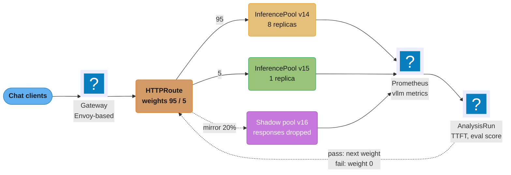
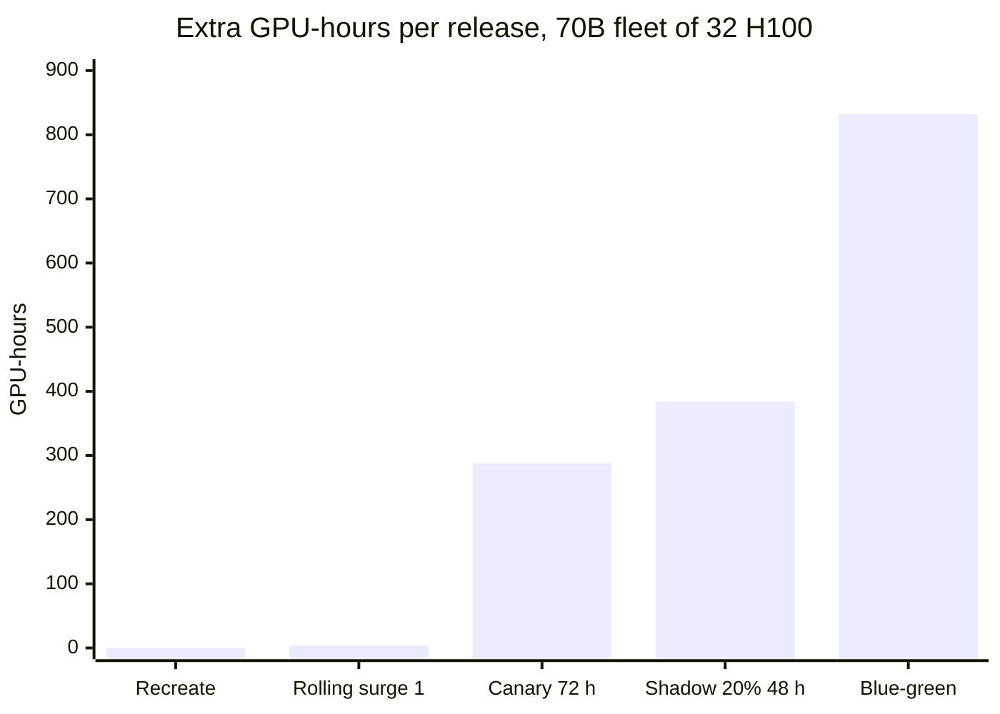

# Progressive Delivery for Model Servers

> **Version anchor (2026-10-18).** KServe v0.21.0 (2026-09-25): the `InferenceService`
> `spec.canary` list, its Standard-mode-only validation and the `LLMInferenceService`
> `rolloutStrategy`, route `group` and `weight` fields were read from the v0.21.0 source.
> Gateway API Inference Extension v1.6.2 (2026-09-17) supplies `InferencePool`.
> LeaderWorkerSet v1.0.0 (2026-10-16): `rolloutStrategy` and `partition` were read from the
> v1.0.0 API types. Kubernetes 1.37 (1.37.1, 2026-09-15). Argo Rollouts v1.10.1
> (2026-10-12) and Flagger v1.45.0 (2026-09-01) run the analysis steps. Metric names are from
> vLLM v0.32.0 (2026-10-18). Gateway API's `RequestMirror` `percent` field was read from the
> standard `v1` types. Istio and Envoy have no pin in this section and are described without a
> version.

## 1. Concept Overview

Progressive delivery for model servers is the set of mechanisms that move user traffic from one
model server version to another in controlled steps, measure each step, and move traffic back
when a step fails. The mechanism is the same one web services use (replica replacement, weighted
routes, mirrored requests), but a model server breaks four assumptions that web-service rollout
tooling makes:

- **A second copy does not fit.** A 70B model in BF16 is 140 GB of weights and needs 4 H100s per
  replica. A fleet of 8 replicas is 32 GPUs. Blue-green needs another 32 GPUs that most clusters
  do not have spare, so capacity, not risk appetite, picks the strategy.
- **Startup takes minutes.** A web pod is ready in seconds. A model server pulls weights, loads
  them to GPU memory, compiles kernels and captures CUDA graphs. Every step of a rolling update
  costs minutes, and a rollback that needs a fresh load costs the same.
- **Failure is often silent.** A candidate model returns HTTP 200 with a worse answer, a longer
  answer, or a malformed JSON object. The rollout gate has to read time to first token (TTFT),
  output length and online-eval scores, not only 5xx rates.
- **Requests and caches are long-lived.** A long streamed generation can run for one to two minutes. A
  multi-turn chat depends on a prefix cache that lives on one replica. Shifting a route weight
  cuts streams and drops cache hits unless the cutover drains and pins sessions.

This page holds the **deployment strategy matrix** for the whole `mlops/` section (§4.1), and the
mechanics of the strategies it owns: Recreate, rolling update, multi-host group rolling update
with LeaderWorkerSet (LWS), blue-green, weighted canary and shadow traffic, on KServe, on Gateway
API routes over an `InferencePool`, and under Argo Rollouts and Flagger.

The release decision (which bundle ships, the rollout ladder, approvals and rollback semantics per
artifact) belongs to
[AI Release Engineering](../ai_release_engineering/ai_release_engineering.md). The serving
platforms that host these servers are compared in
[Model Serving Platforms](../model_serving_platforms/model_serving_platforms.md), with KServe field
detail in [KServe Deep Dive](../model_serving_platforms/kserve_deep_dive.md). Replica counts and
headroom come from
[Inference Autoscaling and Capacity Planning](../inference_autoscaling_and_capacity_planning/inference_autoscaling_and_capacity_planning.md),
and weight load time from
[Model Storage, Loading and Cold Start](../model_storage_loading_and_cold_start/model_storage_loading_and_cold_start.md).

**Not here.** Generic Argo Rollouts and Flagger mechanics (Rollout CRD, AnalysisTemplate
providers, Flagger providers, feature flags for web services) live in
[Deployment Strategies](../../devops/deployment_strategies/deployment_strategies.md). The release
decision lives in [AI Release Engineering](../ai_release_engineering/ai_release_engineering.md).
GitOps sync of the manifests this page changes lives in
[GitOps with Argo CD and Flux](../../devops/gitops_argocd_flux/gitops_argocd_flux.md). Envoy
internals (listeners, clusters, xDS) live in [Envoy Proxy](../../technologies/envoy_proxy/envoy_proxy.md),
and the `InferencePool` object field by field in
[Gateway API and Inference Extension](../../technologies/envoy_proxy/gateway_api_and_inference_extension.md).

---

## 2. Intuition

**One-line analogy:** replacing a model server is like resurfacing a lane on a busy bridge: close
a lane (Recreate), build a temporary lane beside it (surge, blue-green), or send one car in twenty
over the new surface (canary); the bridge's width decides which you can afford.

**Mental model: three budgets.** Every strategy spends one of three budgets to save the others:

- **Spare GPUs** during the rollout (0 for Recreate, a full fleet for blue-green).
- **User exposure** to an unproven version (100% at once for Recreate, 1-5% for a canary, 0% for
  shadow).
- **Rollback time** (seconds when the old version is still running, minutes to tens of minutes
  when it has to load again).

A team that has no spare GPUs pays in exposure or rollback time. A team that wants seconds of
rollback pays in GPUs held warm. No strategy is free in all three.

**Why it matters.** Google's SRE book attributes roughly 70% of outages to changes in a live
system. A model server change adds a quality failure that no health check sees, and a capacity
failure the rollout itself causes: a surge pod that cannot schedule stalls the fleet half-replaced.

**Key insight.** Separate the number of pods from the share of traffic. A Deployment-only rolling
update ties them together (2 of 8 pods new means 25% of traffic new). A route weight over two
pools, or KServe's `spec.canary`, lets 1 replica take 5% of traffic, and lets the weight go to 0
in one API call while the pods stay up.

---

## 3. Core Principles

- **Capacity picks the strategy.** Count spare GPUs of the right type and zone first. A
  blue-green plan that needs 32 free H100s fails on a cluster with 8.
- **Ready means it generates.** A real generation returns within the latency target; `/health`
  answering is not enough.
- **Traffic moves on routes, not pod counts.** Weight lives on an `HTTPRoute`, a mesh route or
  the platform's canary field. Pod counts follow the weight.
- **Gate on model signals, canary against stable.** TTFT p95, error rate, output tokens,
  schema-valid rate and an online-eval score, over the same window.
- **The previous version stays warm until the rollback window closes.** Route rollback takes
  seconds; reload rollback takes a cold start.
- **Conversations stay on one version, and streams drain.** Pin by header; grace period above
  the longest generation.
- **Every metric carries the version.** Without a version label on `vllm:*` series, canary and
  stable cannot be compared.

---

## 4. Types / Architectures / Strategies

### 4.1 Deployment strategy matrix

This is the only strategy matrix in the section. Read the capacity column first: it rules out
more strategies than risk appetite does. Rows marked "this page" are explained in §6.

| Strategy | Mechanism | Extra GPU capacity during rollout | User exposure | Rollback time | Use when | Module with depth |
|---|---|---|---|---|---|---|
| Recreate (`maxSurge: 0`) | Stop every old pod, then start new ones (`strategy: Recreate`, or rolling with `maxSurge: 0` and `maxUnavailable: 100%`) | None | 100% at once, after an outage window | A full redeploy: one cold or cached load | The cluster cannot hold a second copy, and a queue or fallback route covers the outage | This page, §6.1 |
| Rolling update | Replace pods a few at a time under `maxSurge` and `maxUnavailable` | `maxSurge` replicas, or none with capacity lost per step | Grows with the replaced fraction, no per-request control | Another rolling update, same duration | Same weights, low-risk change: image patch, driver, sidecar | This page, §6.2 |
| Multi-host group rolling update (LWS) | Replace whole leader plus worker groups; `maxUnavailable` 1, `maxSurge` 0 by default; `partition` holds low ordinals back | None by default (one group out of service), or one group per surge | Per group fraction | One group reload per step | One replica spans nodes (405B BF16, wide expert parallel MoE) | This page, §6.8 |
| Blue-green | Full second fleet, then switch the route at once | 100% of the fleet | 0% until the switch, then 100% | Seconds while blue stays up | Small fleets with free capacity, or an atomic API or schema change | This page, §6.7 |
| Weighted canary | Route weight to a candidate pool (HTTPRoute weights, KServe `spec.canary`, Argo Rollouts or Flagger steps) | Canary replicas only, at least 1 | The weight, for example 1, 5, 25, 50% | Seconds: weight to 0 | Default for a new model, engine version or quantization | This page, §6.4-6.5 |
| Shadow / mirroring | Copy a share of requests to the candidate and drop its responses | Capacity for the mirrored share | 0% | Nothing to undo: stop the mirror | Production-load latency, cost and format before any exposure; never with side-effect tools | This page, §6.6 |
| A/B test | Sticky random assignment, measured on a product metric | The variant's share | The assigned share, for weeks | Seconds by flag | A causal answer on a product metric is needed | [Experimentation for Generative Features](../ai_release_engineering/experimentation_for_generative_features.md) |
| Interleaving | Merge two models' ranked results into one response | Both models per request | All users, mixed results | Seconds | Ranking and retrieval comparisons with fewer samples | [Experimentation for Generative Features](../ai_release_engineering/experimentation_for_generative_features.md) |
| Bandit allocation | Move traffic toward the better arm while the test runs | Per arm | Adaptive | Seconds | Many variants, and regret costs more than a clean estimate | [Experimentation for Generative Features](../ai_release_engineering/experimentation_for_generative_features.md) |
| Switchback | Alternate the whole system between variants by time window | Both versions kept up | All users, in alternating windows | Seconds | Units interfere (shared caches, marketplaces) | [Experimentation for Generative Features](../ai_release_engineering/experimentation_for_generative_features.md) |
| Champion-challenger | The challenger scores in parallel and is promoted by a rule over delayed labels | Challenger capacity | 0% until promotion | Move the champion alias back | Scoring models with label delay and continuous training | [Continuous Training and Refresh Policy](../continuous_training_and_refresh_policy/continuous_training_and_refresh_policy.md) |
| Dark launch behind a flag | Deploy with the flag off, then enable for staff or a cohort | The deployed capacity | 0% until the flag turns on | Seconds: flag off | Separate deploy from exposure; irreversible side effects | [AI Release Engineering](../ai_release_engineering/ai_release_engineering.md) |
| Prompt alias flip | Move a registry alias to a new prompt version | None | 100% at cache expiry, or by flag | Seconds to the alias cache TTL | Prompt-only change | [Prompt Lifecycle and Versioning](../prompt_lifecycle_and_versioning/prompt_lifecycle_and_versioning.md) |
| Ring or cohort rollout (tenants, devices) | Ordered rings: staff, beta, region, tenants, device classes | Per ring | The ring's size | Per ring; devices need an OTA push | Many tenants or devices; blast radius per ring | [Edge and On-Device Deployment](../edge_and_on_device_deployment/edge_and_on_device_deployment.md) |
| Kill switch and degradation mode | Turn the capability off, or route to a fallback model or a canned path | None; the fallback may cost | Not applicable | Seconds | An incident in progress | [AI Incident Response and Reliability](../ai_incident_response_and_reliability/ai_incident_response_and_reliability.md) |
| Rollback (route weight back, alias flip, redeploy the previous bundle digest) | Undo by the fastest mechanism the bundle allows | Depends on what is still warm | Not applicable | Seconds when warm, a cold load when not | Any failed release | [AI Release Engineering](../ai_release_engineering/ai_release_engineering.md) |

### 4.2 Where the split happens

| Layer | Object | Granularity | Notes |
|---|---|---|---|
| Pod count | Deployment `maxSurge`, `maxUnavailable` | 1 / N of traffic per pod | Weight tied to pods; no instant rollback |
| Gateway API route | `HTTPRoute` `backendRefs[].weight` over Services or `InferencePool`s | Proportional integer weights | Weights are proportional, not percentages: 95 and 5 equal 19 and 1 |
| Mesh | Istio `VirtualService` route weights and `mirror` | Percent, with subsets | Mesh sidecars or ambient waypoints on the data path |
| Serving platform | KServe `spec.canary[].trafficPercent`; `LLMInferenceService` route `group` and `weight` | Percent or proportional weight | Platform owns pods and routes together |
| Controller | Argo Rollouts canary steps, Flagger `stepWeights` | Step list | Adds analysis, pause and abort |
| Application gateway or flag | AI gateway route or feature flag | Per user, tenant or request attribute | Sticky by user; owned by [AI Release Engineering](../ai_release_engineering/ai_release_engineering.md) |

---

## 5. Architecture Diagrams

### 5.1 Weighted canary and shadow over two InferencePools



The route holds the only traffic decision. The canary pool runs 1 replica at 5% weight, the
shadow pool sees copies of 20% of requests and no user sees its output, and the analysis loop
changes one number on the route to advance or abort.

### 5.2 GPU occupancy per strategy

A fleet of 4 replicas of a 70B model, 8 GPUs each, on a cluster with 8 spare GPUs. Each column is
one replica-reload time (about 4 minutes).

```
 O = old replica serving   N = new replica serving   . = new replica loading   _ = slot empty

 step                  1       2       3       4       5       6     peak GPUs   serving min
 Recreate              OOOO    ____    ....    NNNN    NNNN    NNNN     32          0 of 4
 Rolling, surge 0      OOOO    OOO.    OON.    ONN.    NNN.    NNNN     32          3 of 4
 Rolling, surge 1      OOOO    OOOO.   OOON.   OONN.   ONNN.   NNNN     40          4 of 4
 Canary 1, then roll   OOOO.   OOOON   OOON.   OONN.   ONNN.   NNNN     40          4 of 4
 Blue-green            OOOO....        OOOONNNN        NNNN             64          4 of 4
                                                                       does not fit: 32 > 8 spare
```

Recreate is the only row with zero serving replicas. Blue-green is the only row whose peak
exceeds the cluster: it needs 32 spare GPUs, and this cluster has 8. The canary row holds the
fifth replica for its whole soak, which is the price of a rollback that only moves a weight.

### 5.3 LWS partition as a multi-host canary

A `LeaderWorkerSet` with 4 replicas, each a group of 1 leader and 1 worker (2 nodes, 16 GPUs). LWS
updates the groups from ordinal `partition` to `replicas - 1` and leaves the lower ordinals alone.

```
 ordinal                 0         1         2         3
 partition: 3            v1        v1        v1        v2        canary: 1 of 4 groups
 partition: 2            v1        v1        v2        v2        half
 partition: 0            v2        v2        v2        v2        done
                                                        ^
                                   updated first, so the canary is always the highest ordinal
```

Because the canary is a whole group, the smallest canary step on this fleet is 25% of capacity.
Route weight still decides how much traffic it gets, if the router can tell the groups apart.

### 5.4 Extra GPU-hours per strategy for one 70B release

Fleet: 8 replicas x 4 H100 (32 GPUs). Rolling update with surge 1 takes 8 steps of 8 minutes.
Blue-green holds 32 GPUs for a 2-hour soak plus 24 hours of warm blue. The canary holds 1 replica
for 72 hours. Shadow mirrors 20% of traffic for 48 hours on 2 replicas.



Recreate costs no GPUs and up to about 7 minutes of outage (§6.1). Blue-green costs about 200 times a rolling
update. Shadow costs more than the canary because it serves 20% of traffic a second time.

---

## 6. How It Works - Detailed Mechanics

### 6.1 Recreate when the cluster cannot hold a second copy

A team runs a 70B model on 1 replica of 8 H100s, the only 8 H100s in its quota. A rolling update
with the Kubernetes default (`maxSurge: 25%`, rounded up to 1) asks for a second 8-GPU pod. It
stays `Pending` forever, and the Deployment reports `ProgressDeadlineExceeded` after 600 seconds.

```yaml
spec:
  replicas: 1
  strategy:
    type: Recreate     # was RollingUpdate: maxSurge 25% rounds up to 1, maxUnavailable 25% rounds down to 0
```

On KServe in Standard mode the rollout API reference lists `RollingUpdate` as the only accepted
`deploymentStrategy.type`, so the same effect is written as no surge and full unavailability:

```yaml
spec:
  predictor:
    deploymentStrategy:
      type: RollingUpdate
      rollingUpdate:
        maxSurge: "0"
        maxUnavailable: "100%"
```

The KServe reference calls `maxSurge: "0"` the ResourceAware mode and `maxUnavailable: "0"` the
Availability mode. With no setting, KServe applies 25% and 25%.

**The outage is arithmetic.** Old pod termination (grace period, up to 180 s if streams drain) +
scheduling (10 s) + weight load (140 GB at 1.5 GB/s from object storage is 93 s; at 5 GB/s from a
node NVMe cache, 28 s) + engine start and CUDA graph capture (60-120 s) + warmup (30 s). That is
about 2 to 7 minutes with no server.

**Covering the gap**, cheapest first: async callers (batch scoring, document pipelines) write to a
queue and wait; sync callers go to a smaller model or a hosted API through a fallback route in the
AI gateway ([AI Gateway Operations](../ai_gateway_operations/ai_gateway_operations.md)); or the
restart runs at the traffic trough and returns `503` with `Retry-After` so clients back off.

### 6.2 Rolling update with surge

When the change carries no quality risk (an image rebuilt for a CVE, a sidecar, the same weights
digest), a rolling update is enough. Pick surge or unavailability by spare capacity:

```yaml
spec:
  replicas: 8
  strategy:
    type: RollingUpdate
    rollingUpdate:
      maxSurge: 1            # one extra replica's GPUs during the rollout
      maxUnavailable: 0      # never drop below 8 serving replicas
  minReadySeconds: 60        # a replica must stay ready 60 s before the next step
  progressDeadlineSeconds: 1800
```

Duration is steps times per-step time. With `maxSurge: 1` and 8 replicas there are 8 steps. Each
step is a weight load, warmup, the 60-second `minReadySeconds` and the old pod's drain, about 8
minutes, so about an hour. `progressDeadlineSeconds` must exceed one step, or the Deployment
marks itself failed during a normal slow load. Kubernetes does not roll back on that condition;
it only reports it, so the pipeline or controller has to act on it.

With `maxSurge: 0` and `maxUnavailable: 1`, capacity drops to 7 of 8 for the whole rollout, so run
it at a trough where 7 replicas hold the SLO; the arithmetic is in
[Inference Autoscaling and Capacity Planning](../inference_autoscaling_and_capacity_planning/inference_autoscaling_and_capacity_planning.md).

### 6.3 Warmup before traffic

**Broken.** A team used vLLM's `/health` as the readiness probe. `/health` answers once the engine
is up, but the first requests on a new replica paid for an empty prefix cache and first-call
paths, and the gateway sent the new pod its full share at once. TTFT p95 on new pods was 9 s for
the first 2 minutes against a 1.2 s target, every time a pod rolled.

**Fixed.** A startup probe that waits long enough for the load, then a readiness probe that runs a
real generation, plus `minReadySeconds` so the controller waits before the next step:

```yaml
containers:
  - name: vllm
    startupProbe:
      httpGet: {path: /health, port: 8000}
      periodSeconds: 10
      failureThreshold: 60            # up to 10 min for weight load and graph capture
    readinessProbe:
      exec:
        command: ["/bin/sh", "-c", "curl -sf -m 5 localhost:8000/v1/completions -H 'Content-Type: application/json' -d '{\"model\":\"llama-70b\",\"prompt\":\"ping\",\"max_tokens\":1}'"]
      periodSeconds: 15
      timeoutSeconds: 6
```

A warmup job can also replay 50 to 200 recorded production prompts (kept in the release bundle)
before the pod is marked ready, which fills the prefix cache for the shared system prompts.

### 6.4 Weighted canary: three ways to write the weight

**Gateway API over two `InferencePool`s.** Each version gets its own pool whose selector includes
a version label (`matchLabels: {app: llama-70b, version: v15}`), and the `HTTPRoute` splits by
weight:

```yaml
apiVersion: gateway.networking.k8s.io/v1
kind: HTTPRoute
metadata:
  name: llama-70b
spec:
  parentRefs:
    - name: inference-gateway
  rules:
    - backendRefs:
        - {group: inference.networking.k8s.io, kind: InferencePool, name: llama-70b-v14, weight: 95}
        - {group: inference.networking.k8s.io, kind: InferencePool, name: llama-70b-v15, weight: 5}
```

The `version` label in each selector is load-bearing. A pool that selects only `app: llama-70b`
picks up canary pods too, and the endpoint picker sends stable-route traffic to them, so the real
canary share is higher than 5%.

**KServe `InferenceService` canary (Standard mode).** In v0.21.0 the `InferenceService` has a
`spec.canary` list. Each entry has its own predictor, merged over the stable predictor, and a
`trafficPercent`; the controller creates a Deployment and Service named
`{isvc}-{name}-predictor` and, with Gateway API ingress, writes weighted `backendRefs` on the
predictor `HTTPRoute`:

```yaml
apiVersion: serving.kserve.io/v1beta1
kind: InferenceService
metadata:
  name: support-8b
  annotations:
    serving.kserve.io/deploymentMode: Standard
spec:
  predictor:
    name: v14
    minReplicas: 8
    model: {modelFormat: {name: huggingface}, storageUri: "oci://registry.internal/models/support-8b@sha256:51be..."}
  canary:
    - trafficPercent: 5
      predictor:
        name: v15
        minReplicas: 1
        model: {modelFormat: {name: huggingface}, storageUri: "oci://registry.internal/models/support-8b@sha256:9c41..."}
```

Rules from the v0.21.0 validation: canary is accepted only in Standard mode; `predictor.name` is
required and unique; the stable predictor must name a single model; the sum of `trafficPercent`
is at most 100; canary `minReplicas` may not exceed the stable `minReplicas`; a canary may not set
`maxReplicas`, `scaleTarget`, `scaleMetric` or `autoScaling` (fixed replicas only); and a canary
may not set `workerSpec`, so multi-node predictors cannot canary this way. Once the canary is Ready, its
replicas are taken out of the stable `minReplicas`, so the fleet above runs 7 stable and 1
canary. A canary without `minReplicas` gets `ceil(stable x trafficPercent / 100)` replicas. `trafficPercent: 0`
is a dark launch: deployed, ready, no traffic. Promotion sets `spec.predictor.name` to `v15` with
the canary's `storageUri` and removes the entry; the canary Deployment becomes stable without a
pod restart. Rollback removes the entry. In Knative mode the older `canaryTrafficPercent` field
splits between the latest and the previous ready revision instead.

**KServe `LLMInferenceService` route groups.** Two services that set the same
`spec.router.route.group` share one route, and each `weight` follows Gateway API proportional
semantics. The status lists the group members with their effective weights, and a stopped member
gets weight 0 whatever its spec says.

```yaml
# llama-70b-v15, the candidate; llama-70b-v14 sets weight: 95 in the same group
spec:
  router:
    route:
      group: llama-70b
      weight: 5
```

### 6.5 Argo Rollouts and Flagger gates on TTFT and online-eval scores

The generic Rollout and Canary objects are covered in
[Deployment Strategies](../../devops/deployment_strategies/deployment_strategies.md). What changes
for a model server is the metric set and the replica arithmetic.

**Replica arithmetic.** With traffic routing, Argo Rollouts keeps the stable ReplicaSet at full
scale and sizes the canary from the weight: 5% of 8 replicas rounds up to 1. At 25% weight the
canary would need 2. If the canary is pinned at 1 replica while the weight climbs to 25%, that one
replica carries twice its share, and TTFT rises because of load, not because of the model. Use
`setCanaryScale: {matchTrafficWeight: true}` or set the scale explicitly at each step.

```yaml
# Rollout llama-70b, replicas: 8
spec:
  strategy:
    canary:
      stableService: llama-70b-stable
      canaryService: llama-70b-canary
      trafficRouting:
        plugins:
          argoproj-labs/gatewayAPI:
            httpRoute: llama-70b
            namespace: llm
      steps:
        - setCanaryScale: {replicas: 1}
        - setWeight: 5
        - pause: {duration: 30m}          # let the canary's prefix cache fill
        - analysis: {templates: [{templateName: llm-guardrails}]}
        - setCanaryScale: {matchTrafficWeight: true}
        - setWeight: 25
        - analysis: {templates: [{templateName: llm-guardrails}]}
        - setWeight: 50
        - analysis: {templates: [{templateName: llm-guardrails}]}
      scaleDownDelaySeconds: 3600        # keep the old ReplicaSet one hour after promotion
```

The template compares canary against stable instead of against a fixed number, because traffic
mix changes by hour:

```yaml
apiVersion: argoproj.io/v1alpha1
kind: AnalysisTemplate
metadata:
  name: llm-guardrails
spec:
  args:
    - name: canary-hash
      valueFrom: {podTemplateHashValue: Latest}
    - name: stable-hash
      valueFrom: {podTemplateHashValue: Stable}
  metrics:
    - name: ttft-p95-ratio
      interval: 10m
      count: 3
      failureLimit: 1
      successCondition: result[0] <= 1.15
      provider:
        prometheus:
          address: http://prometheus.monitoring:9090
          query: |
            histogram_quantile(0.95, sum by (le) (rate(vllm:time_to_first_token_seconds_bucket{pod_template_hash="{{args.canary-hash}}"}[10m])))
            /
            histogram_quantile(0.95, sum by (le) (rate(vllm:time_to_first_token_seconds_bucket{pod_template_hash="{{args.stable-hash}}"}[10m])))
    - name: online-eval-ratio
      interval: 20m
      count: 3
      failureLimit: 0
      successCondition: result[0] >= 0.98
      provider:
        prometheus:
          address: http://prometheus.monitoring:9090
          query: |
            avg_over_time(online_eval_pass_ratio{variant_hash="{{args.canary-hash}}"}[40m])
            /
            avg_over_time(online_eval_pass_ratio{variant_hash="{{args.stable-hash}}"}[40m])
```

Three details decide whether this works:

- **The hash label must reach Prometheus.** vLLM's series carry `model_name`, not the pod template
  hash. The scrape config (a `PodMonitor` relabel) copies the pod's `rollouts-pod-template-hash`
  label to `pod_template_hash`. Without it the queries return no series and the measurement
  errors; a template that filters by `model_name` instead compares the fleet with itself.
- **Online-eval scores arrive late.** An LLM judge that samples 2% of turns and scores them within
  15 minutes needs a window longer than its lag. The eval metric uses a 40-minute window and a
  20-minute interval; a 5-minute window would read an empty series and, depending on the
  condition, pass or error. Judge design is in
  [Evaluation Gates and Eval Sets](../evaluation_gates_and_eval_sets/evaluation_gates_and_eval_sets.md).
- **Sample size.** At 5% of 40 requests per second, the canary gets 120 requests per minute, so a
  10-minute window has 1,200 TTFT samples, enough for a stable p95. A 1% canary on a 2 rps service
  gets 12 requests in 10 minutes, and its p95 is noise. Lengthen the window or raise the weight.
  The general per-window arithmetic is in
  [Deployment Strategies](../../devops/deployment_strategies/deployment_strategies.md).

**Flagger** wraps an existing Deployment instead of replacing it: a `Canary` with
`provider: gatewayapi:v1`, `service.gatewayRefs`, `analysis.stepWeights: [5, 25, 50]` and one
`MetricTemplate` per gate expresses the same plan. Its `analysis.sessionAffinity.cookieName` keeps a
browser session on one version, and `analysis.mirror: true` adds a shadow stage on Istio and
Gateway API. API clients that drop cookies need the header pinning in §6.10 instead.

### 6.6 Shadow traffic by mirroring

Mirroring copies a share of requests to the candidate and drops its responses; users see only the
stable answer. In the Gateway API standard `v1` types, the `RequestMirror` filter takes a `backendRef` and either
`percent` or `fraction`; with neither set it mirrors 100%.

```yaml
rules:
  - backendRefs:
      - {name: llama-70b-v14, kind: InferencePool, group: inference.networking.k8s.io}
    filters:
      - type: RequestMirror
        requestMirror:
          backendRef: {name: llama-70b-v16-shadow, port: 8000}
          percent: 20
```

Istio writes the same thing as `mirror` plus `mirrorPercentage: {value: 20.0}` on a
`VirtualService` route. Envoy itself uses `request_mirror_policies` with a runtime fraction, and by
default appends `-shadow` to the `Host` header of the copy, which lets the candidate tag shadow
requests in its logs.

What shadow costs and what it breaks:

- **GPU spend.** The mirrored share is served twice. Mirroring 20% of a 32-GPU fleet's traffic
  needs about 20% of the fleet again, here 2 replicas of 4 GPUs, for the whole shadow period.
  Mirroring 100% doubles spend. Mirror 10-20% for 24-72 hours.
- **Side effects.** A shadow agent that calls tools executes them: a shadow refund is a real
  refund. Shadow only stateless generation, or point the shadow's tool servers at a sandbox that
  records calls without executing them. The release-side story is in
  [AI Release Engineering](../ai_release_engineering/ai_release_engineering.md).
- **Comparing outputs.** The gateway drops the shadow response, so comparison happens offline.
  Both servers log the request id (propagated in a header), the output and token counts; a join
  job computes output-length deltas, schema-valid rate, refusal rate and a judge score per pair.
- **Rate limits and quotas.** A mirror to a hosted API counts against the same provider quota and
  bill as production.

### 6.7 Blue-green for 70B+ models

Blue-green runs the full green fleet next to blue, warms it, tests it with a preview route, then
moves all traffic at once. For a 70B fleet of 8 replicas x 4 H100 that is 32 extra H100s for the
soak plus the rollback window. A 2-hour soak and 24 hours of warm blue is
32 x 26 = 832 GPU-hours, or `832 x R` dollars at a rate of `R` per GPU-hour. For a 405B model at 16 GPUs per
replica and 4 replicas, it is 64 extra GPUs, often a whole reserved block.

Argo Rollouts writes it as a `blueGreen` strategy with `activeService`, `previewService`,
`autoPromotionEnabled: false`, a `prePromotionAnalysis` against the preview route, and
`scaleDownDelaySeconds: 86400` so blue stays up for 24 hours after the switch.

Use blue-green when the switch must be atomic for clients (a response schema change, a tokenizer
change that breaks client-side token counting) and the capacity exists, or when the fleet is small
enough that a second copy is cheap: an 8B model on 2 L40S GPUs. For large fleets, a canary that
grows to 100% gets the same safety with one extra replica.

### 6.8 LWS multi-host group rolling updates

A 405B model in BF16 is 810 GB of weights, more than the 640 GB of HBM in one 8 x H100 node, so a
replica is a group: 1 leader pod and 1 worker pod, 16 GPUs, deployed as a `LeaderWorkerSet` (the
group restart policy and topology placement are in
[Distributed Inference and Disaggregation](../distributed_inference_and_disaggregation/distributed_inference_and_disaggregation.md)).

LWS updates a whole group at a time. Its defaults are `maxUnavailable: 1` and `maxSurge: 0`: one
group goes down, all of its pods are replaced, and the next group starts only when the leader and
every worker are ready. A 4-group fleet loses 25% of capacity for the whole rollout.

```yaml
# LeaderWorkerSet llama-405b (leaderworkerset.x-k8s.io/v1)
spec:
  replicas: 4
  rolloutStrategy:
    type: RollingUpdate
    rollingUpdateConfiguration:
      partition: 3          # only ordinal 3 takes the new template
      maxUnavailable: 1
      maxSurge: 0
  leaderWorkerTemplate:
    size: 2
```

**Canary with `partition`.** Groups from `partition` to `replicas - 1` update, lower ordinals do
not. `partition: 3` updates one group. After analysis passes, set 2, then 0. A rollback sets the
template back and the updated groups reload. If `partition` and `maxSurge` are both set, the
surged groups stay until the rollout finishes and `partition` returns to 0.

**Routing to the canary group.** A pool or Service that selects all leaders sends the canary group
1/4 of traffic, which is the smallest step this fleet allows. For a smaller share, split the fleet
into two `LeaderWorkerSet`s (3 groups stable, 1 group candidate) behind two `InferencePool`s and
weight the route. KServe `LLMInferenceService` creates LWS for multi-node workloads, and its
`spec.rolloutStrategy` passes `maxUnavailable` and `maxSurge` through; with neither set, the LWS
defaults above apply.

### 6.9 Rollback with cached weights

Rollback time is set by what is still loaded:

| State of the previous version | Rollback action | Time |
|---|---|---|
| Pods running, weight 0 | Route weight back | Seconds |
| ReplicaSet scaled to 0, weights on node NVMe cache | Scale up, load from local disk | 1-3 minutes per replica, in parallel |
| Weights in a regional registry or object store | Pull and load | 2-10 minutes per replica, bandwidth-bound |
| Weights only in a remote region or deleted | Copy, then pull and load | Tens of minutes to hours |

Three rules follow. Keep the old pods running at weight 0 until the rollback window closes (Argo
`scaleDownDelaySeconds`, a `trafficPercent: 0` KServe canary entry, or simply not deleting the old
pool). Keep the previous weights on the nodes' local cache (KServe `LocalModelCache`, a node-local
OCI image cache, or a pre-pull DaemonSet). And never garbage-collect the previous bundle digest's
weights from the registry while a rollback to it is still possible. Storage tiers and load speeds
are in
[Model Storage, Loading and Cold Start](../model_storage_loading_and_cold_start/model_storage_loading_and_cold_start.md).

### 6.10 KV cache, sessions and draining during cutover

**Prefix cache.** A chat fleet with a 3,000-token shared system prompt and multi-turn history may
run at a 70-80% prefix-cache hit rate. Moving 50% of traffic to a new pool at once sends those
requests to replicas whose cache is empty, so prefill work for that half jumps and TTFT p95 rises
for 10-30 minutes. Step the weight (5, 25, 50, 100), compare canary against stable only after the
canary's cache has filled, and watch `vllm:prefix_cache_hits_total` over
`vllm:prefix_cache_queries_total` per version.

**Version pinning.** A conversation that moves from v14 to v15 between turns gets a different
tone, format or tool behavior mid-thread, and its cached prefix is on the old replica. A route
weight alone cannot prevent that: each turn is a new request, weighted independently, and a mesh
`consistentHash` only picks an endpoint inside the subset the weight already chose. Pin the version
instead. The application assigns a version when the conversation starts (hash of the conversation
id against the weight table in force), stores it with the conversation, and sends it on every turn;
the route obeys the header and weights only requests without one:

```yaml
rules:
  - matches:
      - headers: [{name: x-model-version, value: v14}]
    backendRefs: [{group: inference.networking.k8s.io, kind: InferencePool, name: llama-70b-v14}]
  - matches:
      - headers: [{name: x-model-version, value: v15}]
    backendRefs: [{group: inference.networking.k8s.io, kind: InferencePool, name: llama-70b-v15}]
  - backendRefs:                       # new conversations: weighted
      - {group: inference.networking.k8s.io, kind: InferencePool, name: llama-70b-v14, weight: 95}
      - {group: inference.networking.k8s.io, kind: InferencePool, name: llama-70b-v15, weight: 5}
```

Rollback then has two levels: weight 0 stops new conversations on v15, and removing the v15 header
rule moves existing ones too. Flagger's `sessionAffinity` cookie does the same for browser clients.

**Draining streams.** A pod that receives `SIGTERM` mid-stream cuts the user's answer. The grace
period must cover the longest generation: `max_tokens` of 4,096 at 35 tokens per second per stream
is 117 seconds, so set `terminationGracePeriodSeconds: 180`. A `preStop` hook first fails
readiness so the endpoint is removed, then polls `vllm:num_requests_running` on `/metrics` until
it reads 0 or the grace period ends.

```yaml
lifecycle:
  preStop:
    exec:
      command:
        - /bin/sh
        - -c
        - |
          touch /tmp/draining            # readiness must fail while this file exists
          for i in $(seq 1 170); do
            n=$(curl -s localhost:8000/metrics | awk '/^vllm:num_requests_running/ {s+=$2} END {print s+0}')
            [ "$n" = "0" ] && exit 0
            sleep 1
          done
terminationGracePeriodSeconds: 180
```

---

## 7. Real-World Examples

- **Netflix and Google, Kayenta (2018).** Netflix and Google open-sourced Kayenta, an automated
  canary analysis service integrated with Spinnaker. It compares canary metrics against a baseline
  deployed at the same time, rather than against the old fleet, which removes time-of-day and
  traffic-mix effects. The ratio queries in §6.5 apply the same idea: baseline and canary measured
  in the same window.
- **Intuit, Argo Rollouts.** Argo Rollouts came out of Intuit's Argo work as a drop-in replacement
  for a Deployment with canary steps, blue-green and analysis. Its traffic-routing plugins include
  one for Gateway API.
- **Flux, Flagger.** Flagger started at Weaveworks and is part of the Flux project. It wraps an
  existing Deployment rather than replacing it, which suits teams whose Helm charts already emit
  a Deployment for the model server.
- **Pattern: 70B chat fleet, canary over two pools.** A team serving a 70B chat model on 32 H100s
  moved from Deployment rolling updates to two `InferencePool`s behind one weighted route. Rollback
  went from an hour-long rolling update to a route write that took effect in under 10 seconds.

---

## 8. Tradeoffs

### Where to put the weight

| Option | Strength | Weakness |
|---|---|---|
| HTTPRoute over two `InferencePool`s | Engine-agnostic, works with the endpoint picker, one object to change | You build the analysis loop or use a controller that supports the backend |
| KServe `spec.canary` | Pods, routes and promotion in one CR; zero-restart promotion | Standard mode only; no multi-node canary; no built-in analysis |
| Argo Rollouts | Steps, analysis, abort, `setCanaryScale` | Replaces the Deployment; mirroring documented for Istio only |
| Flagger | Wraps existing Deployments; mirroring and session affinity on Gateway API | Primary and canary copies double the object count; less step control |
| AI gateway or flag | Per user, tenant or attribute; sticky | Both versions must be deployed and addressable; not a pod-level tool |

### Gate signals

| Signal | Catches | Misses | Lag |
|---|---|---|---|
| 5xx and timeout rate | Crashes, OOM, bad config | Quality loss | Seconds |
| TTFT and ITL p95 | Slower engine, missing kernels, cold cache, overload | Quality loss | Minutes |
| Output token count | Verbosity changes, runaway generations | Correct but worse answers | Minutes |
| Schema-valid rate | Broken structured outputs | Valid but wrong content | Minutes |
| Online-eval score (LLM judge) | Quality regressions on sampled traffic | Rare slices | 15-60 minutes |
| Product metric (task success) | User-visible impact | Small effects at small weights | Days; owned by A/B testing |

---

## 9. When to Use / When NOT to Use

| Strategy | Use when | Do NOT use when |
|---|---|---|
| Weighted canary | New model, quantization, engine version or decoding change; one spare replica; traffic gives a stable p95 per window | No spare replica at all (use `maxSurge: 0` or LWS `partition`) |
| Shadow | Latency, cost and format at production load are unknown; model is stateless or tools are sandboxed | The agent's tools write to production systems |
| Blue-green | Clients need an atomic switch (schema, tokenizer); the second copy is cheap | 70B+ fleets without reserved capacity: green pods sit `Pending` and the rollout stalls |
| Rolling update | Same weights, no quality risk (image patch, sidecar) | A new model version: no per-request control, no instant rollback |
| Recreate | No room for a second copy, and a queue, fallback route or window covers the outage | Synchronous traffic with no fallback |
| LWS `partition` | One replica spans nodes and a whole group is an acceptable step | A share smaller than one group is required (use two LWS and two pools) |

Two non-uses apply to every row: do not gate on fixed thresholds alone when traffic mix varies by
hour, and do not run a progressive rollout for a prompt-only change, which is an alias flip in
[Prompt Lifecycle and Versioning](../prompt_lifecycle_and_versioning/prompt_lifecycle_and_versioning.md).

---

## 10. Common Pitfalls

**The surge pod that never scheduled.** A team ran 2 replicas of a 70B model on a node pool sized
exactly to them and kept the Kubernetes defaults. `maxSurge: 25%` rounds up to 1 and
`maxUnavailable: 25%` rounds down to 0, so the controller created a surge pod that stayed `Pending`
and could not remove an old pod. The pipeline reported "deployed"; the Deployment reported
`ProgressDeadlineExceeded` 10 minutes later and nobody read it for 3 hours. Fix: set `maxSurge` and
`maxUnavailable` from a capacity check in the pipeline, and fail the pipeline on the Progressing
condition.

**The pool that selected the canary.** Two `InferencePool`s were created for v14 and v15, but the
v14 pool selected `app: llama-70b` only. The endpoint picker preferred the canary pods because
their queues were short, and the "5% canary" took 31% of traffic during its first hour. Fix: a
version label in every pool selector, and a dashboard of requests per pod by version.

**The canary that looked slow because it was cold.** A canary at 5% failed its TTFT gate three times
in a row. The cause was an empty prefix cache: stable ran at a 76% hit rate, the canary at 9% in
its first 20 minutes. Fix: a 30-minute pause after each weight change, and a TTFT comparison
restricted to requests with no prefix hit, or after the canary's hit rate is within 10 points of
stable.

**The analysis that compared nothing.** The AnalysisTemplate filtered TTFT by `model_name`, and
both versions served the name `llama-70b`. Both queries returned the fleet-wide p95, the ratio
read 1.0, and a canary with a 40% slower kernel path promoted to 100%. Fix: a version label copied
in by the scrape config, and a pipeline check that the canary query returns a series with fewer
samples than the stable query before the first analysis runs.

**The rollback that took 40 minutes.** The old ReplicaSet scaled to 0 30 seconds after promotion
(the default), and a cleanup job deleted the old weights from node cache. A regression found 2
hours later needed a full pull from object storage on 8 replicas. Fix: `scaleDownDelaySeconds` sized to the rollback window and a
cache eviction policy that keeps the previous digest.

**The LWS group that rolled with one worker short.** A multi-host update replaced a group whose
new worker landed on a node with a failing NIC. The leader passed `/health`, the group was marked
ready, and generation hung on the first collective. Fix: a readiness probe on the leader that runs
a real generation across the group, so the group is not ready until all ranks answer.

---

## 11. Technologies & Tools

| Tool | Role | Notes |
|---|---|---|
| KServe | Kubernetes model serving with canary and rollout fields | v0.21.0. `spec.canary` in Standard mode; `canaryTrafficPercent` in Knative mode; `LLMInferenceService` `rolloutStrategy` and route groups; CNCF incubating |
| Gateway API Inference Extension | `InferencePool` as an HTTPRoute backend | v1.6.2. Weighted `backendRefs` across pools split traffic by version |
| Gateway API | `HTTPRoute` weights and the `RequestMirror` filter | `percent` or `fraction` on the mirror; standard `v1` types |
| LeaderWorkerSet | Multi-host replicas with group rolling updates | v1.0.0. `partition`, `maxUnavailable` 1 and `maxSurge` 0 by default |
| Argo Rollouts | Canary and blue-green controller with analysis | v1.10.1. `setCanaryScale`, `AnalysisTemplate`, Gateway API traffic-routing plugin |
| Flagger | Progressive delivery around an existing Deployment | v1.45.0. Mirroring on Istio and Gateway API; `sessionAffinity` cookie |
| Istio | Service mesh routing, weights and mirroring | `VirtualService` `mirror` and `mirrorPercentage`; header match routes for version pinning |
| Envoy | Data-plane proxy under most Gateway API implementations | `request_mirror_policies`; mirrored `Host` gets a `-shadow` suffix |
| vLLM | Model server whose metrics drive the gates | v0.32.0. `vllm:time_to_first_token_seconds`, `vllm:num_requests_running`, `vllm:prefix_cache_hits` |
| Prometheus | Metric store queried by AnalysisRuns and MetricTemplates | Needs the version or pod template hash as a label |
| Kubernetes | Deployment strategies, probes, grace periods | 1.37. `Recreate`, `RollingUpdate`, `minReadySeconds`, `progressDeadlineSeconds` |

Argo CD or Flux applies the manifests these controllers change; see
[GitOps with Argo CD and Flux](../../devops/gitops_argocd_flux/gitops_argocd_flux.md).

---

## 12. Interview Questions with Answers

**Q: A release passed every canary gate, but a rollback two hours after promotion took 40 minutes. What went wrong?**
**Short:** The old version was no longer loaded: its pods had scaled to zero and its weights had left the node cache, so rollback became a full cold redeploy.

Rollback is fast only when the previous version still serves at weight 0. Argo Rollouts scales
the old ReplicaSet down 30 seconds after promotion by default, and cache cleanup can remove the
previous weights from node disks. A regression found hours later then needs a pull from object
storage and a full load on every replica. Size `scaleDownDelaySeconds` (or keep the old pool) to
the rollback window, keep the previous digest in the node cache, and never collect its weights
from the registry while rollback to it is possible.

**Q: Why is blue-green rarely used for a 70B fleet?**
**Short:** It needs a full second fleet of GPUs for the soak and rollback window, which for 32 H100s is hundreds of GPU-hours per release and often capacity that does not exist.

A 70B fleet of 8 replicas x 4 H100 needs 32 more H100s for green. With a 2-hour soak and 24 hours
of warm blue that is 832 GPU-hours, and many clusters do not have 32 spare GPUs of that type at
all, so green pods sit `Pending`. A canary that grows to 100% gives the same rollback speed with
one extra replica. Keep blue-green for small models or for changes that need an atomic switch,
such as a response schema or tokenizer change.

**Q: A canary at 5% fails its TTFT gate, but the same build is fine in staging. What do you check first?**
**Short:** Whether the canary is cold or overloaded: an empty prefix cache or one replica carrying more than its share raises TTFT without any model fault.

Compare prefix-cache hit rate per version: a new pool starts at 0% while stable may run at 70-80%,
so prefill work and TTFT are higher until the cache fills. Then check load per replica: if the
weight rose but canary replicas did not (Argo `setCanaryScale` pinned at 1), the canary is
overloaded. Pause 30 minutes after each weight change, compare TTFT on requests with no prefix hit,
and scale canary replicas with the weight.

**Q: How do you shadow-test an agent model that calls tools?**
**Short:** Mirror only stateless calls, or point the shadow's tool servers at a sandbox that records calls without executing them, because a mirrored tool call is a real tool call.

The gateway drops the shadow's response, not its side effects. A shadow refund, email or ticket
happens for real. Give the shadow deployment its own tool configuration that targets recording
stubs or a sandbox tenant, and compare the recorded tool calls offline against what the stable
agent did. If that is not possible, skip shadow and use a dark launch with writes fenced off.

**Q: Your cluster has exactly enough GPUs for one copy of the model. How do you deploy a new version?**
**Short:** Use Recreate, or rolling with `maxSurge: 0`, and cover the outage with a queue, a fallback route or a maintenance window.

The default rolling update asks for a surge pod that can never schedule, so it stalls. With one
replica, Recreate stops the old pod and starts the new one; the outage is termination plus load
plus warmup, about 2-7 minutes for a 70B model. Async callers queue; sync callers go to a
fallback model through the gateway or get `503` with `Retry-After`. With several replicas, use
`maxSurge: 0` and `maxUnavailable: 1` and run at a trough so the remaining replicas hold the SLO.

**Q: Why gate a canary on a canary-to-stable ratio instead of a fixed threshold?**
**Short:** Traffic mix and load change by hour, so a fixed threshold fails or passes for reasons unrelated to the build; a same-window ratio cancels those effects.

TTFT p95 at 09:00 with long prompts can be twice the 03:00 value on the same build. A fixed
`<= 1.2 s` gate then fails a good canary at peak and passes a bad one at night. Comparing canary
against stable over the same window, as Kayenta does with its baseline, removes the shared
factors. Keep a fixed ceiling as well, for the case where both versions breach the SLO.

**Q: What does a KServe `spec.canary` entry do, and what can it not do?**
**Short:** It deploys a named predictor with fixed replicas and a traffic percent in Standard mode; it rejects autoscaling fields and `workerSpec`, so no autoscaled or multi-node canary.

Each entry creates `{isvc}-{name}-predictor` as its own Deployment and Service; with Gateway API
ingress the predictor `HTTPRoute` gets weighted backends. Once the canary is Ready, its replicas
come out of the stable `minReplicas`. Promotion sets `spec.predictor.name` to the canary's name with its model and
removes the entry, with no pod restart. It is accepted only in Standard mode, the percentages sum
to at most 100, and there is no built-in analysis, so a pipeline or controller still moves the
percent.

**Q: How do you canary a model whose replica spans two nodes?**
**Short:** Use LWS `partition` to update only the highest-ordinal group, or run two LeaderWorkerSets behind two InferencePools and weight the route for a share smaller than one group.

LWS updates groups from `partition` to `replicas - 1`. With 4 groups, `partition: 3` updates one
group, so the smallest step is 25% of capacity. LWS defaults to `maxUnavailable: 1` and
`maxSurge: 0`, so each step takes one group out of service. For a 5% share, split the fleet into a
stable LWS and a candidate LWS, each with its own pool, and weight the route. KServe's `spec.canary`
rejects multi-node predictors.

**Q: Why does an InferencePool selector need a version label during a canary?**
**Short:** Without it the stable pool also selects canary pods, and the endpoint picker sends stable-route traffic to them, so the canary's real share exceeds its route weight.

An `InferencePool` selects pods by label. If both versions share `app: llama-70b` and the stable
pool selects only that, canary pods are members of both pools. The endpoint picker favors short
queues, and a fresh canary has the shortest, so it takes far more than its 5%. Put a `version`
label on pods and in every pool selector, and track requests per pod by version.

**Q: How long should `terminationGracePeriodSeconds` be for an LLM server?**
**Short:** Longer than the longest allowed generation, for example 180 s when 4,096 tokens at 35 tokens per second takes 117 s, with a preStop hook that drains first.

The Kubernetes default of 30 seconds cuts every stream longer than that during each rolled pod.
Compute the bound from `max_tokens` and per-stream decode speed, add margin, and use a `preStop`
hook that fails readiness, then waits until `vllm:num_requests_running` reaches 0. Without the
drain, a rollout of 8 replicas truncates answers 8 times.

**Q: What is the cost of shadow traffic, and how do you bound it?**
**Short:** The mirrored share is served twice, so mirroring 20% needs about 20% more GPUs for the shadow period; bound it by percent and an end date.

Mirroring 100% doubles serving spend and, to a hosted API, doubles quota use. Most of what shadow
finds (latency at production load, output length, schema errors, crashes on real inputs) shows up
in 24-72 hours at 10-20%. Set the mirror percent on the route, put an end date in the rollout
plan, and remove the shadow pool when it ends.

**Q: How do you keep a multi-turn conversation consistent during a cutover?**
**Short:** Assign the version when the conversation starts, send it as a header on every turn, and route on that header so only new conversations follow the weight.

Moving a conversation between versions mid-thread changes tone, format or tool behavior and loses
the prefix cache on the old replica. A weighted route alone re-rolls the version on every turn, and
a mesh consistent hash only picks an endpoint inside the version the weight chose. Store the
assigned version with the conversation, send `x-model-version`, and give the `HTTPRoute` header
match rules ahead of the weighted rule. Flagger's `sessionAffinity` cookie does the same for
browser clients.

**Q: What should the readiness probe of a model server test?**
**Short:** A real generation through the engine, with a timeout near the latency target, after a startup probe long enough for weight load and graph capture.

`/health` reports that the process and engine are up, not that a request returns in time. A
readiness exec that sends a one-token completion catches a server that loads but cannot generate.
Pair it with a `startupProbe` allowing up to 10 minutes, `minReadySeconds` so the rollout waits
before the next step, and optionally a warmup replay of recorded prompts to fill the prefix cache.
On a multi-host group, run the probe on the leader so it exercises every rank.

**Q: Argo Rollouts or Flagger for a model server?**
**Short:** Argo Rollouts for step control and `setCanaryScale`; Flagger to wrap an existing Deployment and to get mirroring and session affinity on Gateway API.

Argo Rollouts replaces the Deployment with a `Rollout`, gives explicit steps, pauses, analysis and
canary scaling decoupled from weight; its `setMirrorRoute` step is documented for Istio only.
Flagger leaves your Deployment in place, creates primary and canary copies, steps weights, and
supports mirroring and cookie affinity on Istio and Gateway API. Both read Prometheus. Pick by
whether your charts can change the workload kind and which mesh or gateway you run.

**Q: What labels must exist for canary analysis to compare versions?**
**Short:** A version or pod-template-hash label on every engine metric series, copied in by the scrape config, because engine metrics carry the model name, not the version.

vLLM series such as `vllm:time_to_first_token_seconds` carry `model_name`. Two versions serving
the same model name are indistinguishable unless the scrape adds a pod label (for Argo,
`rollouts-pod-template-hash`). Filtering by `model_name` instead makes both queries return the
fleet, the ratio reads 1.0, and every canary passes. Check before the first analysis that the
canary series exists and has fewer samples than stable.

---

## 13. Best Practices

- Run a capacity check in the pipeline before choosing a strategy; fail early if a surge pod or a
  green fleet cannot schedule.
- Ship model, quantization and engine changes through two pools and a weighted route, or KServe
  `spec.canary`; keep rolling updates for changes with no quality risk.
- Make readiness run a real generation, give startup the full load time, and set
  `minReadySeconds` for warmup.
- Gate on canary-to-stable ratios over the same window plus a fixed ceiling, after a 30-minute
  pause per weight change, with canary replicas scaled to the weight.
- Mirror 10-20% for 24-72 hours, only for stateless calls or with sandboxed tools.
- Keep the previous version at weight 0 and its weights in node cache for the rollback window.
- Pin conversations by header, drain with `preStop`, and set the grace period above the longest
  generation.
- Put a version label on pods, pool selectors and metric series.

---

## 14. Case Study

### Rolling a 70B chat model from v14 to v15 on a 40-GPU H100 pool

**Context.** A support platform serves a 70B chat model on 8 replicas of 4 H100 (TP 4), 32 GPUs,
from a reserved pool of 40 H100s. Peak load is 45 requests per second with a 1.2-second TTFT p95
target. Conversations average 6 turns over a 3,000-token system prompt, and the fleet runs at a
74% prefix-cache hit rate. v15 is a fine-tune of the same base with a new chat template; offline
gates passed. The release decision and the 7-day rollback window come from the bundle's rollout
plan in [AI Release Engineering](../ai_release_engineering/ai_release_engineering.md).

**Strategy choice.** 8 spare GPUs rule out blue-green (32 needed). A rolling update would give no
step below 12.5%, and its rollback would be another hour-long rolling update. The team picks two `InferencePool`s behind one weighted
`HTTPRoute`, with shadow first, and uses the 8 spare GPUs as 2 replicas: one shadow, then one
canary, then surge.

**Plan and results.**

| Step | Traffic | Duration | Result |
|---|---|---|---|
| Warmup | 0 | 15 min | Generation probe passes; 200 recorded prompts replayed |
| Shadow | 20% mirrored to 2 replicas | 48 h | Output tokens +6%, TTFT p95 ratio 1.04, schema-valid 99.9%, no crashes |
| Canary 5% | 1 replica | 24 h | First analysis failed on TTFT ratio 1.31; hit rate 11% vs 74% |
| Canary 5%, rerun | 1 replica | 24 h | 30-min pause added; ratio 1.06, eval ratio 0.995 |
| Canary 25% | 2 replicas | 12 h | Ratio 1.03; eval ratio 1.01 |
| Canary 50% | 4 replicas, stable at 6 | 12 h | Ratio 1.02; versions pinned by `x-model-version` |
| 100% | 8 replicas v15 | - | v14 held at 2 replicas, weight 0, for 7 days on the 8 spare GPUs |

**The failure that taught the pause.** The first 5% analysis compared a cold canary with a warm
stable fleet. The fix was not a looser threshold: a 30-minute pause after each weight change and
a second TTFT query restricted to requests with no prefix hit, which read 1.02 even in the first
run.

**Rollback drill.** On day 3, at the 50% step and off-peak, the team set the v15 weight to 0 and
removed the v15 header rule. Traffic returned to the 6 v14 replicas within 8 seconds, and no
stream was cut: in-flight v15 streams finished on the v15 pods, which stayed up. After 100%, a full
rollback routes to the 2 warm v14 replicas and scales v14 from node cache in 2-3 minutes, with
degraded TTFT for that window. The drill went into the runbook in
[AI Incident Response and Reliability](../ai_incident_response_and_reliability/ai_incident_response_and_reliability.md).

**Cost.** Shadow: 2 replicas x 4 GPUs x 48 h = 384 GPU-hours. Canary and ramp: about 380
GPU-hours. Holding 2 v14 replicas warm for 7 days on 8 GPUs: 1,344 GPU-hours, the largest item,
accepted as the price of a fast first rollback step for a week. Replica sizing came from
[Inference Autoscaling and Capacity Planning](../inference_autoscaling_and_capacity_planning/inference_autoscaling_and_capacity_planning.md).

**What changed afterwards.** The pipeline refuses a canary whose TTFT query has no
`pod_template_hash` series, the warmup replay set ships in the release bundle, and the default
step list is 5, 25, 50, 100 with a 30-minute pause after each weight change.
