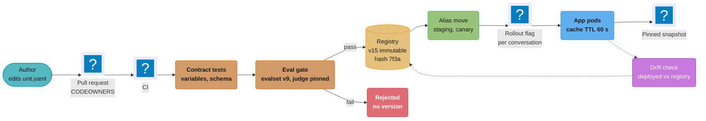
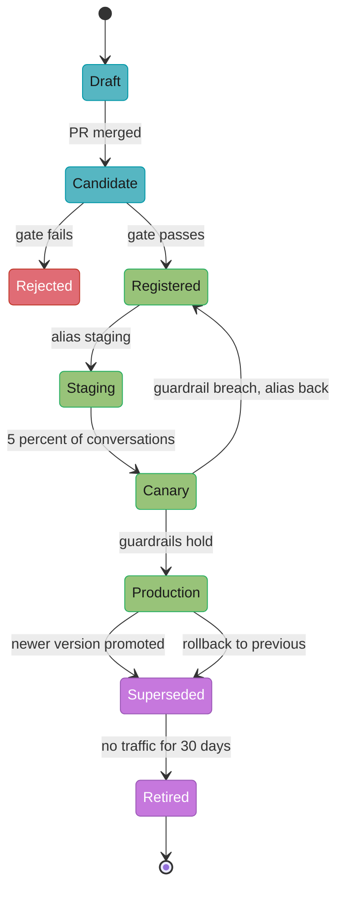
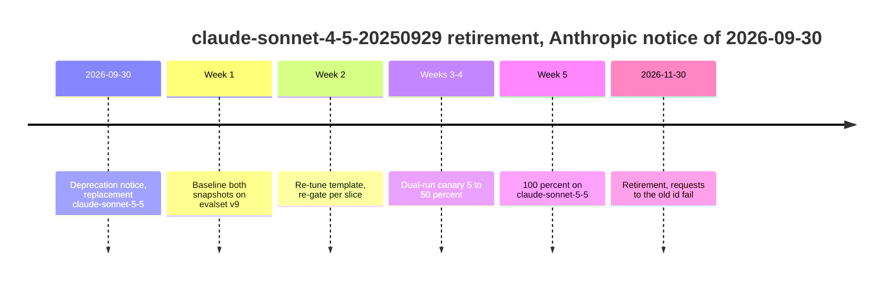

# Prompt Lifecycle and Versioning

> **Version anchor (2026-10-18).** **MLflow 3.17.1** (2026-10-13) ships the Prompt Registry
> used in this page: `mlflow.genai.register_prompt()`, `load_prompt("prompts:/<name>@<alias>")`,
> mutable aliases over immutable versions, and a per-version `model_config`. **Langfuse v4.63.0**
> (2026-10-16) ships prompt management with the built-in `production` and `latest` labels and a
> per-version `config` object. LaunchDarkly AI Configs has no public release page; it is
> described without a version. Provider facts (model ids, retirement dates, cache prices) were
> read from the Anthropic and OpenAI documentation on 2026-10-18 and carry that date where
> they appear.

## 1. Concept Overview

A prompt in production is not a string. It is a **release unit**: the template, the schema of
the variables it accepts, the model snapshot id it was tuned against, the decoding parameters
(temperature where the model accepts it, max output tokens, reasoning effort, response format),
and a reference to the tool set the model may call. Change any one of these and the behavior
changes. A prompt version that does not pin the model is not reproducible: the same template on
`claude-sonnet-4-5-20250929` and on `claude-sonnet-5-5` is two different products.

This module treats that unit as a release artifact with a lifecycle:

1. **Author** the change in a reviewed source (git or a registry with approvals).
2. **Contract-test** the template against its variable schema in CI.
3. **Gate** the candidate on a pinned eval-set version with a pinned judge, per slice, against
   the current champion.
4. **Register** an immutable version and move a per-environment alias (`staging`, `canary`,
   `production`).
5. **Roll out** by percentage with sticky assignment per conversation, and roll back by moving
   the alias back, which takes seconds when client caches are configured for it.
6. **Re-qualify** when the provider retires or replaces the pinned model snapshot.
7. **Watch for drift**: the version actually serving must match the version the registry says
   is serving, and every prompt must have an owner.

The release unit is one row of the wider release bundle described in
[Artifact Versioning and Lineage](../artifact_versioning_and_lineage/artifact_versioning_and_lineage.md).
Gate design and eval-set statistics belong to
[Evaluation Gates and Eval Sets](../evaluation_gates_and_eval_sets/evaluation_gates_and_eval_sets.md).
The rollout machinery shared by prompts, models and routes belongs to
[AI Release Engineering](../ai_release_engineering/ai_release_engineering.md). The policy for
when to re-tune after a provider change belongs to
[Continuous Training and Refresh Policy](../continuous_training_and_refresh_policy/continuous_training_and_refresh_policy.md),
and detecting a quality drop after release belongs to
[Production Quality Monitoring and Drift](../production_quality_monitoring_and_drift/production_quality_monitoring_and_drift.md).

**Not here.** Prompt writing techniques (few-shot design, chain-of-thought, role framing) live in
[Prompt Engineering](../../llm/prompt_engineering/prompt_engineering.md). Tooling and technique
detail, including parameterized templates, eval-gated CI code and alias hot-swap code, lives in
[Prompt Management and PromptOps](../../llm/prompt_management_and_promptops/prompt_management_and_promptops.md)
§6. Tool descriptions and schemas as API contracts live in
[Agent, Tool and MCP Server Lifecycle](../agent_tool_and_mcp_server_lifecycle/agent_tool_and_mcp_server_lifecycle.md).

---

## 2. Intuition

**One-line analogy:** a prompt version is a database migration that only runs correctly against
one schema version, and the schema here is the model snapshot.

**Mental model:** three layers move at different speeds. The **template** changes weekly; the
**model snapshot** changes on the provider's calendar; the **runtime config** (effort, max
tokens, response format, tool set) changes with both. A prompt version pins all three, and an
alias says which pinned triple each environment serves.

**Why it matters:** the failure modes are silent. A template that references `{{customer_tier}}`
when the caller sends `tier` renders an empty string and the model still answers. A vendor UI
edit at 23:00 changes production without a commit. A provider retirement turns a passing eval
into HTTP 400 on the retirement date. None of these throw in the application unless the
lifecycle is built to make them throw.

**Key insight:** most prompt incidents are not bad wording. They are identity failures: the
team cannot say which exact unit was serving, or the unit that was serving was not the one that
passed the gate.

---

## 3. Core Principles

- **The unit is the triple, not the text.** Hash the template, variable schema, model id,
  decoding parameters and tool-set reference together. A hash over the template alone misses
  every change that does not touch the text.
- **Versions are immutable, aliases are mutable.** A version never changes after it is
  registered. Promotion and rollback move an alias. Check what the registry actually freezes:
  MLflow freezes the template but allows `model_config` to be edited on an existing version.
- **Pin the model snapshot explicitly.** Use an id the provider documents as pinned. Anthropic
  states that every Claude model id is a pinned snapshot, including the dateless ids used from
  the 4.6 generation on. A moving alias such as a `-latest` name is a deploy you did not make.
- **Pin defaults you rely on.** Default reasoning effort is `high` on `claude-sonnet-5-5` and
  `medium` on `claude-opus-5-5` (Anthropic models overview, 2026-10-18); an unset field turns a
  model swap into a cost change.
- **Gate against a pinned eval set and a pinned judge.** A gate whose eval set or judge moved
  since the last run measures the change in the gate, not the change in the prompt.
- **Variables are a typed contract.** Unknown or missing variables fail the render; user input
  is escaped or placed in a delimited slot; the template engine version is pinned.
- **Assign per conversation.** A conversation keeps the prompt version it started with. This
  keeps the transcript coherent and keeps the provider prompt cache warm.
- **Production serves only what the registry says it serves**, checked by comparing deployed and
  registered unit hashes on a schedule.
- **Every prompt has an owner and a pinned-model retirement date.**

---

## 4. Types / Architectures / Strategies

### 4.1 Where the source of truth lives

| Placement | How it works | Who can change production | Rollback |
|---|---|---|---|
| Git only, baked into the image | Template and unit manifest in the repo, read at build time | Anyone who can merge and deploy | Redeploy the previous image (minutes) |
| Git as source, registry as distribution | CI registers a version from the merged commit and moves `staging`; promotion moves `production` | Reviewers plus the promotion job | Move the alias back (seconds plus cache TTL) |
| Registry as source with approvals | Edits happen in the registry UI; protected labels limit who moves `production` | Label owners (Langfuse protected labels: admins and owners) | Move the label back |
| Feature-flag AI config | A LaunchDarkly AI Config holds model settings plus messages (completion mode) or instructions (agent mode) per variation; targeting rules choose the variation per context | Flag owners | Change the targeting rule |

Teams with code review culture pick git as source and a registry as distribution: the diff is
reviewed like code and the runtime still gets instant rollback. Teams where product managers
iterate on copy pick a registry as source and compensate with protected labels and a drift check.

### 4.2 Version identity schemes

| Scheme | Example | Use it for |
|---|---|---|
| Registry counter | MLflow version `14`, Langfuse version `37` | UI and humans; says nothing about content |
| Content hash over the full unit | `sha256` of canonical template, schema, model id, decoding params, tool digest | Logs, traces and drift checks: same hash, same configuration |
| Semver | `2.3.0`: major breaks variables, minor changes behavior, patch is wording | Prompts whose variable schema is a contract with another team |

### 4.3 Rollout strategies

| Strategy | Mechanism | Use when |
|---|---|---|
| Alias flip | Move `production` from v14 to v15 | Low-risk wording change that passed the gate with margin |
| Percentage rollout | Flag assigns v15 to 5%, 25%, 50%, 100% of conversations | Behavior change, new model snapshot, new tool set |
| Shadow | Serve v14, also run v15 offline on a sample, compare | Unsure the offline eval covers production traffic |
| Dual-run snapshots | Same template on two model snapshots, split traffic | Provider retirement or model upgrade |

### 4.4 Model-pin strategies

| Strategy | Example | Behavior change without your deploy |
|---|---|---|
| Pinned snapshot id in the unit | `claude-sonnet-5-5` (Anthropic documents it as a pinned snapshot) | Only provider-side serving changes |
| Moving alias in the unit | a `-latest` style alias | Every time the provider moves the alias |
| Gateway route name in the unit | `support-default` resolved by the gateway | Every time someone edits the route |

A gateway route is fine when the gateway config is versioned and gated too (see
[AI Gateway Operations](../ai_gateway_operations/ai_gateway_operations.md)).

---

## 5. Architecture Diagrams

### Prompt release path



The gate sits before registration, so a failed candidate never gets a version number that an
alias could point at. The dotted drift loop is the only path that detects a unit serving in
production without going through the gate.

### Prompt version lifecycle



A version is never edited on the way through. "Rollback" moves the alias to an older version; the
newer version stays registered so the incident review can replay it.

### Alias table before and after a rollback

```
 prompt: support-answer           BEFORE (14:02)              AFTER (14:06)
 ---------------------------------------------------------------------------------
 alias        version   hash      model               version   hash      model
 production   v15       7f3a91    claude-sonnet-5-5   v14       c0de42    claude-sonnet-5-5
 canary       v15       7f3a91    claude-sonnet-5-5   v15       7f3a91    claude-sonnet-5-5
 staging      v16       e19b07    claude-sonnet-5-5   v16       e19b07    claude-sonnet-5-5
 ---------------------------------------------------------------------------------
 versions v14, v15, v16 unchanged. Only one pointer moved.
```

Rollback is a single pointer write; the alias column is the only thing that differs between the
two halves. Clients with a 60-second cache TTL converge on v14 within about a minute of 14:06.

### Prompt-cache prefix and what a change invalidates

```
 request order (Anthropic): tools -> system -> messages

 +---------------+----------------------+--------------------------------------+
 | tools  3,000  | system  5,000        | conversation history  24,000         |
 +---------------+----------------------+--------------------------------------+
 change tool definitions   XXXXXXXXXXXXXXX XXXXXXXXXXXXXXXXXXXXXX XXXXXXXXXXXXXX
 change system prompt                      XXXXXXXXXXXXXXXXXXXXXX XXXXXXXXXXXXXX
 change effort setting                                            XXXXXXXXXXXXXX
 append a user turn                                               (cache reused)

 X = cached prefix invalidated, rewritten at cache-write price on next request
 effort and thinking changes also invalidate tools and system on some models
```

A system-prompt change throws away everything to its right, which for a long conversation is
mostly history, not the prompt. That is why the §6.5 arithmetic counts 29,000 tokens per
conversation for a 5,000-token prompt edit.

### Retirement window for a pinned snapshot



Anthropic documents at least 60 days of notice for publicly released models; this notice gave 61.
A five-week campaign leaves about 26 days of buffer for a failed slice.

---

## 6. How It Works - Detailed Mechanics

### 6.1 The release unit and its hash

The unit lives in the repo next to the template. CI computes its hash and registers it.

```yaml
# prompts/support-answer/unit.yaml
name: support-answer
template_file: template.jinja
variables:
  customer_name: {type: string, required: true, max_len: 120}
  customer_tier: {type: enum, values: [free, pro, enterprise], required: true}
  ticket_text:   {type: string, required: true, max_len: 20000, untrusted: true}
  locale:        {type: string, required: false, default: en-US}
model:
  provider: anthropic
  id: claude-sonnet-5-5          # pinned snapshot per provider docs
decoding:
  max_tokens: 1200
  effort: medium                 # explicit: this model's default is high
  response_format: schemas/answer.v3.json
tools: toolsets/support@sha256:4be1...   # digest from the tool registry
template_engine: jinja2==3.1.6
evalset: support-evalset@v9
judge: {model: claude-opus-5-5, prompt: support-judge@v4}
owner: team-support-ai
```

Broken: hashing the template alone.

```python
import hashlib

def prompt_hash(template: str) -> str:
    return hashlib.sha256(template.encode()).hexdigest()[:12]
# model id, effort and response schema can all change; the hash does not.
```

Fixed: hash the canonical unit, including the bytes of every referenced file.

```python
import hashlib, json, pathlib, yaml

def unit_hash(unit_path: str) -> str:
    root = pathlib.Path(unit_path).parent
    unit = yaml.safe_load(pathlib.Path(unit_path).read_text())
    unit["template"] = (root / unit.pop("template_file")).read_text()
    fmt = unit["decoding"].get("response_format")
    if fmt:
        unit["decoding"]["response_format"] = (root / fmt).read_text()
    unit.pop("owner", None)                       # metadata, not behavior
    canonical = json.dumps(unit, sort_keys=True, separators=(",", ":"))
    return hashlib.sha256(canonical.encode()).hexdigest()[:12]
```

The `owner` field is excluded because changing the owning team does not change behavior. The
eval set and judge are included: a unit gated against a different eval set is a different claim.

Registering in MLflow 3.17.1 stores the template, the model config and the hash as a tag:

```python
import mlflow

v = mlflow.genai.register_prompt(
    name="support-answer",
    template=template_text,                      # uses {{customer_name}} style variables
    commit_message=f"PR #4812, unit {h}",
    tags={"unit_hash": h, "evalset": "support-evalset@v9", "git_sha": sha},
    model_config={"model_name": "claude-sonnet-5-5", "max_tokens": 1200},
)
mlflow.genai.set_prompt_alias("support-answer", alias="staging", version=v.version)
```

MLflow makes the template of a version immutable, but `set_prompt_model_config()` can change
`model_config` on an existing version, and every load after the edit gets the new config under the
same version number. The `unit_hash` tag is what lets a drift check notice that: recompute the hash from what the registry returns
and compare it with the tag.

### 6.2 Variables as a contract

Broken: a lenient template engine renders a missing variable as an empty string.

```python
from jinja2 import Template

t = Template("Customer tier: {{ customer_tier }}\nTicket:\n{{ ticket_text }}")
print(t.render(tier="enterprise", ticket_text="refund please"))
# "Customer tier: \nTicket:\nrefund please"  -> model treats enterprise as free tier
```

Fixed: strict undefined, schema validation before render, and user input in a delimited slot.

```python
from jinja2 import Environment, StrictUndefined
from jsonschema import validate

env = Environment(undefined=StrictUndefined, autoescape=False)

def render(unit: dict, template_text: str, variables: dict) -> str:
    unknown = set(variables) - set(unit["variables"])
    if unknown:
        raise ValueError(f"unknown variables: {sorted(unknown)}")
    validate(variables, unit_json_schema(unit))   # required, enum, max_len
    safe = dict(variables)
    for name, spec in unit["variables"].items():
        if spec.get("untrusted") and name in safe:
            safe[name] = safe[name].replace("</ticket", "&lt;/ticket")   # cannot close its slot
    return env.from_string(template_text).render(**safe)
```

The CI contract test renders every template with a fixture per caller and fails the build on
three conditions: a variable the template uses that no caller sends, a variable a caller sends
that the template ignores, and a rendered prompt over the token budget.

```python
def test_support_answer_contract(unit, template_text, caller_fixtures):
    used = jinja_variables(template_text)              # meta.find_undeclared_variables
    declared = set(unit["variables"])
    assert used == declared, f"template uses {used - declared}, ignores {declared - used}"
    for fixture in caller_fixtures:                     # one per calling service
        out = render(unit, template_text, fixture)
        assert count_tokens(out) < 9000
```

Schema changes follow expand and contract. Add the new variable as optional with a default,
ship every caller, make it required in the next version, then remove the old variable. A
required variable added in one step breaks every app pod still on the previous code.

### 6.3 Eval gate configuration for a prompt change

The gate is defined in the repo with the unit, so a gate change is also reviewed.

```yaml
# prompts/support-answer/gate.yaml
evalset: support-evalset@v9          # 1,200 cases, 6 slices
compare_to: alias:production          # champion, not the previous commit
repeats: 3                            # non-determinism: score the mean of 3 runs
judge:
  model: claude-opus-5-5
  prompt: support-judge@v4
  calibrated_against: human-labels@2026-09   # agreement measured before use
metrics:
  task_success: {min_delta: -1.0}      # points, overall
  schema_valid: {min: 0.995}
  p95_output_tokens: {max_ratio: 1.15} # cost guard
slices: [billing, refunds, outages, account, api, other]
slice_rule: {min_delta: -2.0, min_n: 150}
```

Three choices in this file are the ones that go wrong:

- **Compare to the champion**, the version behind `production`, not the previous commit. Ten
  small regressions that each pass against their parent add up to a large one against what users
  get.
- **Gate per slice.** A 1-point overall gain can hide a 5-point loss on refunds when refunds is
  15% of the eval set.
- **Pin the judge.** If the judge model or judge prompt moves, both champion and candidate scores
  move. Rescore the champion with the new judge before comparing, or the delta is meaningless.
  Judge calibration and scoring scales are in
  [Prompt Management and PromptOps](../../llm/prompt_management_and_promptops/prompt_management_and_promptops.md).

The statistics behind `min_delta`, `repeats` and `min_n` are in
[Evaluation Gates and Eval Sets](../evaluation_gates_and_eval_sets/evaluation_gates_and_eval_sets.md).

### 6.4 Rollout: sticky assignment per conversation

```python
import hashlib

def variant_for(conversation_id: str, rollout_pct: int, salt: str) -> str:
    bucket = int(hashlib.sha256(f"{salt}:{conversation_id}".encode()).hexdigest(), 16) % 100
    return "candidate" if bucket < rollout_pct else "champion"

def resolve_prompt(conv) -> PromptUnit:
    if conv.prompt_version:                    # stored on the first turn
        return registry.get_version(conv.prompt_version)
    variant = variant_for(conv.id, flags.pct("support-answer-v15"), salt="support-answer-v15")
    unit = registry.get_alias("canary" if variant == "candidate" else "production")
    conv.prompt_version = unit.version         # pinned for the life of the conversation
    return unit
```

Storing the version on the conversation means increasing the rollout percentage only affects new
conversations, and a rollback (alias move) also only affects new conversations unless the
rollback is flagged as forced. For a harmful version, the on-call sets a kill flag that ignores
`conv.prompt_version` and serves the champion to every turn.

**Rollback time**, with Langfuse or MLflow defaults:

| Component | Time |
|---|---|
| Alias or label move (API or UI) | under 1 s |
| SDK client cache TTL (Langfuse default `cache_ttl_seconds` 60; MLflow alias loads default 60 s) | up to 60 s |
| Stale-while-revalidate: the first request after expiry still gets the cached version | one request interval |
| Total for new conversations | about 61 s |

A team that raises the TTL to 3,600 s "to save registry calls" has set its rollback time to an
hour. Keep the TTL at 60 s and add a registry webhook that invalidates caches on alias moves.

Langfuse returns HTTP 404 when no version carries the requested label and does not fall back to
`production` or `latest`. If the call passes a `fallback`, the SDK serves it on that error and when
the cache is empty and the API is unreachable; without one, the error reaches the caller. Ship the
fallback text from the same unit version that was `production` at build time, and log a metric
when it is used, or a renamed label or a registry outage serves a months-old prompt without
anyone knowing.

### 6.5 Prompt-cache cost of a system-prompt change

Anthropic prices on 2026-10-18 for `claude-sonnet-5-5`: $2.00 per million input tokens; cache
reads at 5% of base ($0.10); 5-minute cache writes at 1.25x base ($2.50). The cache prefix order
is tools, system, messages, and a system change invalidates system and messages.

Support assistant: tools 3,000 tokens, system 5,000, average cached history 24,000. A system
edit invalidates 29,000 tokens for each active conversation it reaches. The table prices a flip
that reaches every active conversation: no per-conversation pinning, or the kill flag.

```
active conversations with warm cache:      12,000
tokens rewritten per conversation:          29,000
tokens rewritten in total:                 348,000,000  = 348 M
cost as cache writes:   348 M x $2.50 / M = $870.00
cost as cache reads:    348 M x $0.10 / M = $34.80
extra cost of one alias flip:                $835.20
flip plus rollback within the hour:        ~$1,670
```

The money is small; the latency is not. The next turn of each of those conversations pays an
uncached 29,000-token prefill.

Per-request random assignment is where the cost becomes large. At a 10% rollout, a turn lands on
a different variant from the previous turn with probability 2 x 0.1 x 0.9 = 0.18, and each switch
rewrites the 29,000-token prefix.

```
turns per day:                         2,000,000
prefix tokens per turn:                   29,000
tokens per day:                    58,000 M
switched share:                             0.18
rewritten tokens:                  10,440 M
extra cost per M (write minus read):       $2.40
extra cost per day:                     $25,056
```

Sticky assignment per conversation removes the switching term entirely. OpenAI documents the same
structure for GPT-5.6 and later models (cache reads 0.1x on most of them, writes 1.25x, minimum 1,024 visible
input tokens, prefix reusable for 30 minutes after last use), so the arithmetic carries over with
different constants.

### 6.6 Re-qualification after a provider model change

Trigger: a retirement notice for the pinned snapshot, or a decision to move to a newer one. On
2026-09-30 Anthropic announced that `claude-sonnet-4-5-20250929` retires on 2026-11-30, with
`claude-sonnet-5-5` as the recommended replacement. OpenAI lists GPT-4o snapshots
(`gpt-4o-2024-08-06`, `gpt-4o-2024-11-20`) for shutdown on January 14, 2027, with `gpt-6-luna` as
the replacement, and documents at least six months of notice for generally available models.

The campaign:

1. **Inventory.** Query the registry for every unit whose `model.id` is the retiring snapshot.
   Join with traffic so the order is by request volume.
2. **Baseline.** Run the current unit unchanged on both snapshots against the pinned eval set,
   3 repeats each. The judge and eval set stay fixed for the whole campaign.
3. **Diff by slice.** A table like the one below, never a single number.
4. **Re-tune** only the slices that fail. Keep each template change in its own version so the
   slice gain can be attributed.
5. **Fix the parameters the new model rejects.** Anthropic's deprecation page states that
   `temperature`, `top_p` and `top_k` return HTTP 400 when set to a non-default value on Claude
   4.7 and later models, and that its Python SDK v1.0 and later removes those parameters. A unit
   that carried `temperature: 0.2` on `claude-sonnet-4-5-20250929` fails on `claude-sonnet-5-5`
   until the field is removed and effort is set explicitly.
6. **Re-gate** the new unit against the champion on the old snapshot.
7. **Dual-run** with sticky per-conversation assignment: 5%, 25%, 50%, 100% across two to three
   weeks, with online quality and cost guardrails.
8. **Retire** the old unit version and remove the old model id from the gateway allow list before
   the provider does it for you.

```
 support-answer v14 on two snapshots, evalset v9, judge support-judge@v4, 3 repeats

 slice       n    sonnet-4-5-20250929   sonnet-5-5   delta   gate -2.0
 billing    240          91.3              92.1       +0.8       ✓
 refunds    180          88.9              84.2       -4.7       ✗
 outages    210          86.0              89.4       +3.4       ✓
 account    200          93.1              92.6       -0.5       ✓
 api        190          84.7              88.0       +3.3       ✓
 other      180          90.2              90.0       -0.2       ✓
 -----------------------------------------------------------------------
 overall   1200          89.1              89.6       +0.5       ✓
```

The overall delta passes and the refunds slice fails. The re-tune targets refunds only, then the
whole table is rerun so a refunds fix that costs another slice is caught. The numbers here are an
illustrative worked example of the method.

### 6.7 Drift detection and ownership

Every LLM call logs `prompt_name`, `prompt_version` and `unit_hash` on its trace span. A
scheduled job compares what served with what the registry says should serve.

```python
def check_drift(window_minutes: int = 15) -> list[str]:
    alerts = []
    served = traces.distinct(["prompt_name", "unit_hash"], since_minutes=window_minutes)
    for name, served_hash in served:
        allowed = {registry.alias_hash(name, a) for a in ("production", "canary")}
        if served_hash not in allowed:
            alerts.append(f"{name}: serving {served_hash}, registry allows {sorted(allowed)}")
    for name in registry.prompt_names():
        unit = registry.get_alias(name, "production")
        if recompute_unit_hash(unit) != unit.tags["unit_hash"]:
            alerts.append(f"{name}: version {unit.version} changed after registration")
    return alerts
```

The first loop catches a pod or a vendor UI edit serving an unregistered unit. The second catches
a registered version whose mutable fields (MLflow `model_config`) were edited after the gate ran.

Ownership is enforced at the review layer:

```
# .github/CODEOWNERS
/prompts/support-answer/   @acme/team-support-ai
/prompts/*/gate.yaml       @acme/ml-platform
/prompts/*/unit.yaml       @acme/team-support-ai @acme/ml-platform
```

`gate.yaml` belongs to the platform team so that a product team cannot loosen its own gate in
the same PR that needs the looser gate. In a registry-first setup, Langfuse protected labels
(Enterprise, Pro with the Teams add-on, and self-hosted Enterprise Edition) stop `viewer` and
`member` roles from moving `production`; admins and owners still can, so the drift check stays.

---

## 7. Real-World Examples

**Grok system-prompt change, May 2025.** For a few hours, the Grok chatbot on X answered
unrelated questions with text about "white genocide" in South Africa. The operator attributed it
to an "unauthorized modification" of the system prompt and began publishing Grok's system prompts
on GitHub. The lifecycle lesson: production behavior changed through a prompt edit that did not
go through a gate, and nothing compared the serving prompt with an approved one.

**Grok, July 2025.** The operator said a code update upstream of the bot had restored older
instructions. A deployed-hash check would have flagged a unit no approved version matched.

**OpenAI GPT-4o, April 2025.** OpenAI rolled back a GPT-4o update in ChatGPT after widespread
reports of sycophancy. Provider-side changes reach a product through moving aliases; a unit
pinned to a fixed snapshot changes only when the team changes it.

**Anthropic, August to September 2025.** Anthropic's postmortem describes three infrastructure
bugs that degraded responses with no model change: a context-window routing error that peaked at
16% of Sonnet 4 requests in the worst hour on August 31, an output-corruption bug, and an XLA:TPU
miscompilation in approximate top-k. Anthropic wrote that its evaluations "simply didn't capture
the degradation users were reporting". A pinned snapshot does not freeze serving behavior, so a
release gate is not a substitute for online monitoring on the same slices.

**Anthropic retirement calendar, 2026.** `claude-sonnet-4-20250514` and `claude-opus-4-20250514`
were deprecated on April 14, 2026 and retired on June 15, 2026; `claude-sonnet-4-5-20250929` was
deprecated on September 30, 2026 and retires on November 30, 2026.

---

## 8. Tradeoffs

### Source of truth

| Dimension | Git as source, registry distributes | Registry as source |
|---|---|---|
| Review | Pull request, CODEOWNERS | Registry approvals, protected labels |
| Who can iterate | Engineers, or PMs with repo access | PMs and engineers in a UI |
| Drift risk | Low, registry is written only by CI | Higher, UI edits are the normal path |
| Rollback | Alias move | Label move |
| Diff quality | Line diff with the unit manifest | Registry diff view, varies by product |

### Runtime fetch vs build-time bake

| Dimension | Runtime fetch with cache | Baked into the image |
|---|---|---|
| Rollback | Seconds plus TTL | Redeploy, minutes |
| Registry outage | Cached or fallback version serves | No dependency |
| Reproducibility | Need trace-level version logging | Image digest identifies the prompt |
| Change without deploy | Yes, which is also the risk | No |

### Rollout granularity

| Assignment unit | Coherence | Cache cost | Statistical power |
|---|---|---|---|
| Per request | Breaks mid-conversation | High (§6.5: $25,056 per day in the example) | Highest |
| Per conversation | Coherent | Low | Medium |
| Per user | Coherent across sessions | Low | Lowest, users are fewer than conversations |

---

## 9. When to Use / When NOT to Use

**Use the full lifecycle (unit hash, registry, gate, sticky rollout, drift check) when** the
prompt serves external users or decisions with money or compliance attached, more than one role
edits prompts, the provider retires snapshots on a calendar, or the system prompt is long enough
that cache invalidation shows up in latency or cost.

**Use a lighter version** (git, contract tests and a small gate, baked into the image) when one
team owns one or two prompts, deploys several times a day anyway, and a bad hour costs little.

**Do not:**

- Build a custom registry when MLflow or Langfuse already runs in the platform. The value is in
  the hash, the gate and the drift check, not in the storage.
- Use percentage rollout for a fix to an active incident. Flip the alias or set the kill flag.
- Let a prompt alias point at a unit with a moving model alias. The alias then promises a
  behavior it cannot hold.

---

## 10. Common Pitfalls

These are incident patterns seen across teams running LLM features; named public incidents are in
§7.

**Template-only hash hides a model swap.** A team hashed only the template text and logged it on
every trace. Someone moved the gateway default from one snapshot to another; every trace kept the
same hash. The quality review spent two days bisecting template versions that had not changed.
Fix: hash the full unit (§6.1) and log the model id that actually answered, from the provider
response, next to it.

**Mutable config on an "immutable" version.** In MLflow, `model_config` can be edited on an
existing version, with no new version number. An engineer raised `max_tokens` from 1,200 to
4,000 on the production version to fix a truncation bug; p95 output length rose 2.6x and the
monthly bill followed. No gate ran because no version was created. Fix: treat any edit to a
registered version as a drift alert; change config only by registering a new version.

**Missing variable rendered as empty.** A caller renamed `customer_tier` to `tier`. The lenient
template rendered "Customer tier: " and enterprise customers got free-tier answers for nine days.
Fix: `StrictUndefined`, schema validation, and a contract test with one fixture per caller.

**Rollback took an hour.** The alias moved in under a second; one service had set
`cache_ttl_seconds=3600` during a registry latency incident and never reverted it. Fix: TTL is
part of the platform config with a maximum, plus a webhook to invalidate caches on alias moves.

**Mid-conversation version switch.** A rollout assigned variants per request. Users saw the
assistant change tone between turns, and cache-read share fell from 82% to 67% at a 10% rollout.
Fix: assign at the first turn and store the version on the conversation.

**Vendor UI hotfix.** An on-call engineer edited the production prompt in the registry UI to stop
a jailbreak pattern. The fix worked and was never ported to git; the next CI promotion
overwrote it and the jailbreak returned. Fix: CI refuses to promote when the registry's
production hash is not one CI registered, and pages the owner.

**Judge moved under the gate.** The judge was referenced by a moving model alias. The provider
updated it, the judge became stricter, champion and candidate scores both fell 3 points, and the
gate passed a real 2-point regression because the threshold was absolute. Fix: pin the judge
snapshot and judge prompt; compare deltas against a champion rescored by the same judge.

**Retirement day 400s.** A unit pinned to a retired snapshot started returning errors on the
retirement date because the inventory had model ids but no retirement dates. In a second team, a
re-qualification swapped only the model id; on Claude Opus 4.7 and later models a non-default
`temperature` returns HTTP 400, so every canary request failed. Fix: join the inventory with the
providers' deprecation tables weekly, and validate decoding parameters against the target model
in CI.

**Prompt sprawl.** A platform team ran an inventory and found 340 registered prompts, 120 with no
traffic in 90 days and 45 with no owner. Three of the unowned ones still served production
traffic through an internal tool. Fix: owner is a required field, unowned prompts fail
promotion, and prompts with no traffic for 30 days are archived.

---

## 11. Technologies & Tools

| Tool | Role | Notes |
|---|---|---|
| MLflow Prompt Registry | Registry with immutable versions and aliases | MLflow 3.17.1. `register_prompt`, `load_prompt("prompts:/name@alias")`, `set_prompt_alias`, version tags, per-version `model_config` (editable), 60 s alias cache default |
| Langfuse | Prompt management with labels and versioned `config` | v4.63.0. `production` default label, automatic `latest`, protected labels on paid tiers, 60 s SDK cache with stale-while-revalidate. Part of ClickHouse since the acquisition announced 2026-01-16 |
| LaunchDarkly | AI Configs: prompt and model config served through flag targeting | Completion and agent modes; per-variation metrics |
| Promptfoo | CLI eval harness for prompt gates in CI | MIT license; OpenAI agreed to acquire it, announced 2026-03-09 |
| GitHub Actions | Runs contract tests and the eval gate on each prompt PR | Pair with CODEOWNERS so gate files have a different owner than templates |

Template rendering uses Jinja2 with `StrictUndefined`, with the engine version pinned in the
unit. Retirement calendars come from the Anthropic model deprecations page (at least 60 days of
notice for publicly released models) and the OpenAI deprecations page (at least 6 months for
generally available models, as little as 2 weeks for preview models).

Experiment tracking for prompts sits in
[Experiment Tracking and Versioning](../../ml/experiment_tracking_and_versioning/experiment_tracking_and_versioning.md);
cache mechanics in [LLM Caching](../../llm/llm_caching/llm_caching.md); the provider landscape in
[LLM Ecosystem and Landscape](../../llm/llm_ecosystem_and_landscape/llm_ecosystem_and_landscape.md).

---

## 12. Interview Questions with Answers

**Q: Is a prompt version reproducible if it pins the template but not the model?**
**Short:** No; the same template on two model snapshots is two products, so the version must pin the model id, decoding parameters and tool set as well.

No. The behavior of a prompt is a function of the template, the model snapshot, the decoding
parameters (effort, max tokens, response format) and the tools the model can call. Change the
model and the same text produces different refusals, lengths and formats. Pin a snapshot id the
provider documents as fixed, and hash the whole unit so two environments serving the same hash
are known to serve the same configuration. Log the model id from the provider response as well,
since a gateway can reroute.

**Q: MLflow prompt versions are immutable, so is the behavior of a registered version frozen?**
**Short:** Not fully; MLflow freezes the template but lets `model_config` change on an existing version, so a hash tag plus a drift check must cover config too.

Not fully. MLflow makes the template of a version immutable, but `set_prompt_model_config()` can
change the version's `model_config`, and every later load gets the new config. An edit to
`max_tokens` or the model name changes production with no new version and no gate run. Store a
hash of the full unit as a version tag at registration, recompute it on a schedule from what the
registry returns, and alert on mismatch. Only change config by registering a new version.

**Q: Why can rolling back a prompt alias take longer than the alias write?**
**Short:** Rollback time is the slowest client cache: an alias moves in under a second, but each SDK keeps serving its cached version until its TTL expires.

The alias write is under a second; the clients are the slow part. Langfuse SDKs cache prompts for
60 s by default and serve the stale version on the first request after expiry while refreshing in
the background, and MLflow alias loads also cache for 60 s by default. A service that raised the
TTL to an hour keeps serving the bad version for up to an hour. Cap the TTL in platform config,
add a webhook that invalidates caches on alias moves, and use a kill flag that overrides
per-conversation pinning for harmful versions.

**Q: Why assign prompt variants per conversation rather than per request?**
**Short:** Per-request assignment switches versions mid-conversation, which breaks coherence and invalidates the provider prompt cache on every switch.

Two reasons. A conversation that changes system prompt between turns changes tone and rules
mid-dialogue. And the provider cache prefix runs tools, system, messages, so a switch rewrites
the whole history at cache-write price. At a 10% rollout, 18% of turns switch (2 x 0.1 x 0.9); for
29,000 prefix tokens, 2 million turns a day and a $2.40 per million write-minus-read difference,
that is about $25,000 a day. Assign on the first turn, store the version on the conversation, and
let rollout percentages affect only new conversations.

**Q: What does changing a long system prompt cost beyond running the eval?**
**Short:** Each conversation that picks up the new prompt loses its cached prefix from the system block onward and rewrites it at cache-write price, with a slower next turn.

A system-prompt change invalidates the system block and all messages after it. If the change
reaches 12,000 warm conversations at 29,000 tokens each, 348 million tokens move from the read price ($0.10 per
million on `claude-sonnet-5-5`) to the 5-minute write price ($2.50), about $835 per flip. The
bigger effect is latency: the next turn of every conversation pays an uncached prefill. Batch
system-prompt edits, avoid flip-flopping, and prefer sticky rollout so only new conversations
take the hit.

**Q: A teammate hotfixed the production prompt in the vendor UI during an incident. What breaks and how do you catch it?**
**Short:** Production now serves an unreviewed, ungated unit that git does not know about, and the next CI promotion silently overwrites the fix; a deployed-hash check catches it.

Three things break: the change skipped review and the gate, the incident timeline loses the
exact text that served, and the next promotion from git overwrites the hotfix and brings the bug
back. Catch it by logging the unit hash on every trace and comparing served hashes with the hashes
CI registered; make CI refuse to promote when production's hash is unknown. Langfuse protected
labels restrict `viewer` and `member` roles, but admins and owners can still move them, so the
check stays.

**Q: What happens when a template references a variable the caller does not pass?**
**Short:** A lenient engine renders it as an empty string and the model answers anyway; use strict undefined, schema validation and a per-caller contract test.

With a default Jinja2 environment the missing variable renders as an empty string and nothing
fails; the model fills the gap with a guess. Use `StrictUndefined` so rendering raises, validate
the variables against the unit's schema (required, enum, length), and reject unknown variables.
In CI, render the template once per calling service's fixture and assert the set of variables the
template uses equals the declared set. Treat variable schema changes as expand and contract.

**Q: The provider announced retirement of your pinned model snapshot. Walk through the re-qualification.**
**Short:** Inventory affected units, baseline both snapshots on the pinned eval set by slice, re-tune failing slices, fix rejected parameters, re-gate, dual-run, then retire.

Find every unit pinned to the retiring id and order by traffic. Run the unchanged unit on both
snapshots against the same eval set and judge, three repeats, and diff by slice. Re-tune only
failing slices, one version per change. Check parameters the new model rejects; non-default
`temperature` returns HTTP 400 on Claude Opus 4.7 and later. Re-gate against the champion, dual-run
with sticky assignment from 5% to 100%, then remove the old id. Anthropic gives at least 60 days
of notice, so a five-week campaign leaves buffer.

**Q: What should a prompt eval gate compare the candidate against?**
**Short:** The champion currently behind the production alias, scored now with the same eval set and judge, not the previous commit's stored score.

Compare against the version production serves, rescored in the same run with the same eval set
version, judge and repeat count. Comparing against the parent commit lets small regressions
compound: ten changes that each lose 0.5 points pass a 1-point gate one by one and lose 5 points
in total. Rescoring in the same run also removes provider-side drift between the old score and
today.

**Q: Why gate per slice instead of on the overall score?**
**Short:** An overall gain can hide a large loss on a small slice; per-slice gates with a minimum sample size catch regressions the mean averages away.

The overall score is a traffic-weighted mean. A candidate that gains 3 points on outages and loses
4.7 on refunds can pass overall while refunds customers get worse answers. Define slices from
product categories and known failure classes, gate each with a delta threshold, and require a
minimum sample (for example 150) so a slice with 20 cases does not fail on noise. The slice table
is also what drives targeted re-tuning.

**Q: What belongs in the prompt release unit?**
**Short:** The template, variable schema, pinned model id, decoding parameters including effort and response format, tool-set digest, template-engine version, eval set and judge.

The template and its typed variable schema; the pinned model snapshot id; decoding parameters
(max output tokens, reasoning effort, temperature only where the model accepts it, response
format schema); a digest of the tool set; the template engine version; and the eval set and judge
the unit was gated against. Set defaults you depend on explicitly, because default effort differs
by model. Exclude metadata such as owner from the hash so a reorg does not look like a behavior
change.

**Q: Should prompts live in git or in a registry?**
**Short:** Use git as the reviewed source and a registry for distribution and aliases when engineers own prompts; use a registry with protected labels when non-engineers edit.

Git gives pull-request review, CODEOWNERS and a line diff; a registry gives runtime aliases and
rollback in seconds. The common design is git as source, with CI registering a version and moving
`staging` on merge and a promotion job moving `production`. When product managers edit prompts
directly, make the registry the source, restrict production labels, and run the drift check. A
registry with no review path and no drift check is the setup behind most unreviewed hotfixes.

**Q: How do you change a prompt's variable schema without breaking running app versions?**
**Short:** Expand and contract: add the new variable as optional with a default, ship every caller, then make it required and remove the old one in later versions.

App pods and prompt versions deploy independently, so a new required variable breaks every pod
still on the old code. Version N adds the variable as optional with a default. Once every caller
sends it, version N+1 makes it required. Version N+2 drops the old variable. The contract test
runs each prompt version against each live caller's fixture, which is what blocks a step taken
too early.

**Q: How do you dual-run two model snapshots safely?**
**Short:** Assign the snapshot per conversation, keep template and judge fixed, compare online metrics by slice, and keep a kill flag that returns all traffic to the old snapshot.

Register two unit versions that differ only in model id and the parameters the new model
requires. Assign per conversation with a salted hash so the split is stable and the cache stays
warm. Compare task success, escalation rate, output tokens and latency per slice; raise the split
from 5% to 25% to 50% to 100% with a hold at each step. Keep a kill flag that ignores conversation
pinning, and finish before the retirement date with buffer.

**Q: What does Langfuse do when the requested prompt label does not exist?**
**Short:** It returns 404 and does not fall back to production or latest; the SDK serves a configured fallback prompt instead, otherwise the error reaches the caller.

Fetching a label that no version carries returns HTTP 404, and Langfuse does not fall back to
`production` or `latest`. If the call passes a `fallback`, the SDK serves it on that error, and
also when the local cache is empty and the API cannot be reached; without one, the error
propagates. A renamed or deleted label therefore fails loudly only when no fallback is set. With a
fallback, a stale string baked into code serves silently. Generate the fallback from the unit
version that was `production` at build time and emit a metric when it serves.

**Q: How do you keep prompt sprawl under control?**
**Short:** Keep an inventory with owner, traffic, pinned model, retirement date and last gate run, and archive or block prompts missing an owner or traffic.

Make owner a required field and refuse promotion without it. Join the inventory with trace
traffic to find prompts with no calls in 30 days and archive them. Join it with provider
deprecation tables so every pinned model has a retirement date and a ticket opens on each notice.
Report the last gate run per prompt; a production prompt that has not been gated since its model
changed is the next incident.

**Q: When is a prompt change a code release rather than an alias flip?**
**Short:** When it changes the variable schema, tool set, response format or anything the calling code parses; those need coordinated code and prompt versions.

An alias flip is safe only when the calling code does not care which version answers. A new
variable, a changed response schema, a new tool, or a different output format the parser expects
all couple prompt and code. Ship those through the release pipeline with expand and contract, or
bundle the prompt version into the application release so both move together. Wording, ordering
and examples that keep the same output contract can move by alias.

---

## 13. Best Practices

- Hash the full unit; log the hash, prompt version and responding model id on every trace.
- Pin model snapshots by ids the provider documents as fixed, and set effort explicitly.
- Validate decoding parameters against the target model's accepted set in CI.
- Use `StrictUndefined`, schema validation and per-caller contract tests; change variable
  schemas by expand and contract.
- Gate against the rescored champion, per slice, with a pinned eval set and judge, and keep
  gate files under a different CODEOWNER than templates.
- Assign rollout variants per conversation; cap client cache TTL at 60 s; keep a kill flag.
- Run the drift check every 15 minutes and treat a vendor UI edit to production as an incident.
- Keep a prompt inventory with owner, traffic, pinned model and retirement date.

---

## 14. Case Study

### Re-qualifying a support assistant before a snapshot retirement

**Context.** A B2B SaaS company runs a support assistant with 14 prompt units: one answer prompt,
one triage classifier, one summarizer for handoff to humans, and 11 smaller extraction prompts.
Traffic is 2 million turns a day across about 400,000 conversations. All 14 units pin
`claude-sonnet-4-5-20250929`. On 2026-09-30 Anthropic announces its retirement on 2026-11-30,
with `claude-sonnet-5-5` as the recommended replacement.

**Week 1: inventory and baseline.** The registry query returns 14 units on the retiring id; three
carry 91% of traffic. The team runs each unit unchanged on both snapshots against its pinned eval
set with three repeats. Ten units fail immediately with HTTP 400: they carry `temperature: 0.0`
or `0.2`, which Claude Opus 4.7 and later models reject at non-default values. The fix is a new unit
version per prompt with `temperature` removed and `effort: medium` set explicitly, because the new
model's default effort is `high` and the cost model assumed less reasoning. After the fix, the
answer prompt passes overall (+0.5) and fails the refunds slice (-4.7).

**Week 2: re-tune.** The refunds failures cluster on partial refunds: the new model follows the
policy text more literally and refuses partial refunds the old model granted. The team adds the
partial-refund policy table to the system prompt as a separate block and registers v15. Refunds
moves to -0.9, inside the -2.0 gate; no other slice moves more than 0.6. The triage classifier
needs no template change. The summarizer's output grows 22% at the new default effort; with effort
pinned to `medium` it lands within 4% of baseline, inside the 15% cost guard.

**Weeks 3 and 4: dual-run.** v15 on `claude-sonnet-5-5` goes to 5% of new conversations, then
25%, then 50%, with a two-day hold at each step. Guardrails: escalation-to-human rate within 1
point of champion, schema-valid rate above 99.5%, p95 latency within 10%. The 25% step shows
escalation up 1.4 points on outages; the cause is a tool description that changed in the same
week, handled through the tool lifecycle in
[Agent, Tool and MCP Server Lifecycle](../agent_tool_and_mcp_server_lifecycle/agent_tool_and_mcp_server_lifecycle.md).
Reverting the tool description returns escalation to baseline and the rollout continues.

**Week 5: cutover and cleanup.** `production` moves to v15 for all new conversations. Because
assignment is per conversation, the old version drains as conversations end; after 72 hours less
than 0.5% of turns still use it, and the kill flag moves those too. The gateway allow list drops
`claude-sonnet-4-5-20250929` on 2026-11-05, 25 days before the provider retires it.

**What the team changed afterwards.**

- The unit schema now rejects decoding parameters the target model does not accept, so the
  week-one 400s would fail in CI.
- The inventory carries the provider retirement date for every pinned model, read weekly from
  the deprecation pages.
- Tool-set digests are part of the unit hash, so a tool description change shows up as a new
  unit version rather than as unexplained escalation.

The incident path for a failure in the middle of such a campaign is in
[AI Incident Response and Reliability](../ai_incident_response_and_reliability/ai_incident_response_and_reliability.md),
and the governance view of the prompt inventory is in
[AI Governance and Model Risk Operations](../ai_governance_and_model_risk_operations/ai_governance_and_model_risk_operations.md).
Test design for prompts beyond the gate is in
[LLM Testing Strategies](../../llm/llm_testing_strategies/llm_testing_strategies.md), and how
context assembly interacts with the system prompt is in
[Context Engineering](../../llm/context_engineering/context_engineering.md).
