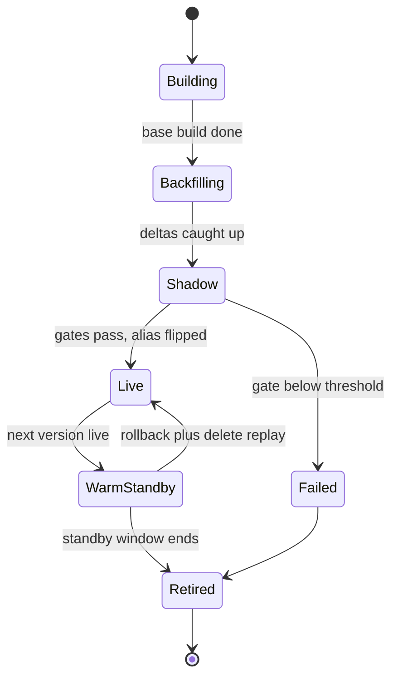
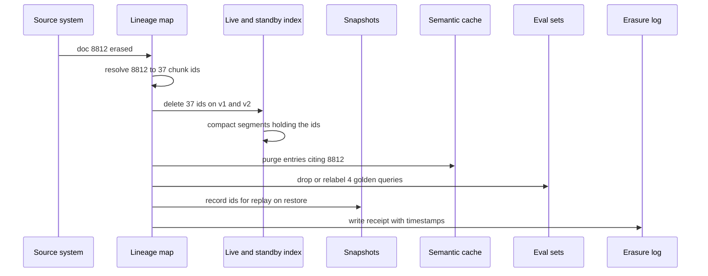
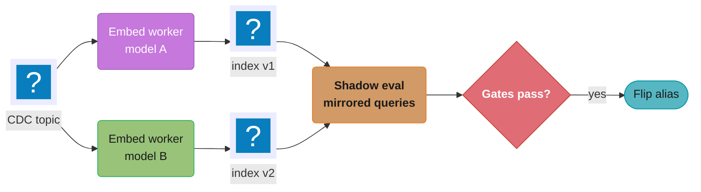

# RAG and Vector Index Lifecycle

> **Version anchor (2026-10-18).** No vector database is in the mlops pin table. The vector-database versions below were read from each project's GitHub releases on 2026-10-18 and are named only where this page describes a behavior of that project. **Qdrant v1.19.2** (2026-10-05): default optimizer `deleted_threshold: 0.2` and `vacuum_min_vector_number: 1000` in `config/config.yaml`. **pgvector v0.8.7** (tag 2026-10-01): HNSW defaults `m = 16`, `ef_construction = 64`, `hnsw.ef_search = 40`, iterative index scans since 0.8.0, `hnsw.max_scan_tuples` default 20,000. **FAISS v1.15.1** (2026-09-16): `IndexHNSWFlat` has no `remove_ids`. From the mlops pin table: **Ray 2.59.0** (Ray Data batch inference for re-embedding), **vLLM v0.32.0** (OpenAI-compatible embeddings endpoint), **lakeFS v1.88.0** and **DVC 3.67.1** (corpus snapshots).
>
> **On prices.** This page gives re-embedding cost in tokens and GPU-hours. Where a dollar figure appears, the per-token or per-GPU-hour rate is a stated assumption, not a quoted list price. Multiply by what your account pays.

---

## 1. Concept Overview

A RAG system is not one model. It is a set of separately versioned parts that must agree with each other at query time: the corpus snapshot, the parser and chunker, the embedding model, the vector index and its build parameters, the retriever config (k, filters, hybrid weights), the reranker, and the ACL metadata attached to every chunk. A change to any one of them changes what the generator sees. Most of them change without a code deploy.

The vector index is the part with the most operational state. It is built, then mutated by upserts and deletes for weeks, then snapshotted, rolled back, rebuilt with new parameters, or replaced entirely when the embedding model changes. Each of those operations has a failure mode that does not show up as an error: an HNSW graph that loses recall as tombstones pile up, an alias flipped to a new index while the query encoder still emits vectors from the old model, a rollback that brings erased documents back, an ACL that changed at the source but not in the index.

This module treats the index the way [model_registry_and_packaging](../model_registry_and_packaging/model_registry_and_packaging.md) treats weights: as a versioned artifact with a manifest, a build pipeline, an eval gate, a promotion path and a retirement date. It covers:

- The versioned parts of a RAG system and which change forces a re-embed, a rebuild, or nothing.
- Index lifecycle operations: build, upsert, tombstones and compaction, HNSW degradation after deletes, snapshot and rollback.
- Dual-index cutover for an embedding-model change, with re-embed cost arithmetic.
- Shadow retrieval eval and recall@k gates against exact kNN.
- Freshness SLAs, ACL sync and permission drift.
- Erasure propagation into the index, caches, snapshots and eval sets.
- Embedding drift, both query-distribution drift and model-version drift.

The corpus snapshot is a dataset and follows the same versioning rules as [dataset_and_label_versioning](../dataset_and_label_versioning/dataset_and_label_versioning.md). The retrieval gates plug into the gate framework in [evaluation_gates_and_eval_sets](../evaluation_gates_and_eval_sets/evaluation_gates_and_eval_sets.md). The index version ships inside the release bundle described in [ai_release_engineering](../ai_release_engineering/ai_release_engineering.md). Refresh cadence decisions belong to [continuous_training_and_refresh_policy](../continuous_training_and_refresh_policy/continuous_training_and_refresh_policy.md), and live retrieval quality signals belong to [production_quality_monitoring_and_drift](../production_quality_monitoring_and_drift/production_quality_monitoring_and_drift.md).

**Not here.** Chunking strategies, retrieval methods, hybrid search and reranking as techniques are in [RAG Fundamentals](../../llm/rag_fundamentals/rag_fundamentals.md) and [Advanced RAG](../../llm/advanced_rag/advanced_rag.md). HNSW, IVF, PQ internals and vector database selection are in [Vector Databases](../../database/vector_databases/vector_databases.md). The FAISS library itself, including `remove_ids` renumbering, is in [FAISS Deep Dive](../../llm/faiss_deep_dive/faiss_deep_dive.md). Embedding model choice is in [Embedding Models](../../llm/rag_fundamentals/embedding_models.md) and [Embeddings and Similarity Search](../../llm/embeddings_and_similarity_search/embeddings_and_similarity_search.md). This page is about operating those parts over time.

---

## 2. Intuition

> **One-line analogy**: A vector index is a library catalog whose card numbers were assigned by one specific librarian. Replace the librarian and every card must be rewritten, because the new librarian files "dog" in a different drawer. Keep the librarian but let books leave the shelves, and the cards for missing books stay in the drawers until someone clears them out.

**Mental model**: Treat each index as an immutable build output with a version id, like a container image. Mutations (upserts, deletes) are a log applied on top of that build. A rebuild produces a new version. Promotion is an alias flip. Rollback is an alias flip back plus a replay of every delete made since. The query path never talks to "the index", it talks to an alias that resolves to a manifest naming both the index and the query encoder that matches it.

**Why it matters**: Retrieval failures are silent. A generator given the wrong five chunks writes a fluent, confident, wrong answer. No HTTP 500, no exception, no latency spike. The only defenses are versioned parts that cannot be mixed, gates that compare against ground truth before promotion, and monitors that watch retrieval quality after it.

**Key insight**: Two different things are called "recall" in this domain, and confusing them breaks gates. ANN recall@k against exact kNN measures whether the index returns the true nearest neighbors of the query vector. Retrieval recall@k against labeled relevance measures whether the nearest neighbors are the right documents. An embedding-model change can raise the first to 0.99 while dropping the second by 10 points. A gate needs both.

---

## 3. Core Principles

- **Every vector belongs to exactly one embedding space.** A vector is meaningless without the model id, revision, dimension count, and normalization that produced it. Store all four in the index manifest and refuse writes that do not match.
- **The query encoder is part of the index version.** An index built with model B must be queried with model B. The retriever resolves both from one manifest so they cannot drift apart.
- **Keep a vector store of record outside the index.** Write every embedding to object storage keyed by `(chunk_hash, model_id)`. Index parameter changes then cost a rebuild from stored vectors, not a re-embed.
- **Deletes are not free.** Graph indexes mark deleted nodes as tombstones. Tombstones cost search work, reduce result counts, and keep erased data on disk until compaction.
- **Rollback is restore plus replay.** Restoring a snapshot without replaying deletes made since the snapshot reintroduces deleted, and possibly legally erased, documents.
- **Promotion is an alias flip, never an in-place rebuild.** In-place rebuilds have no rollback path and serve a half-built index during the rebuild.
- **Gate on two recalls.** ANN fidelity (index vs exact kNN on the same vectors) and retrieval quality (labeled relevance) are separate gates with separate thresholds.
- **ACLs are data with their own freshness SLA.** A permission change at the source does not change document content, so a content-change pipeline never sees it.
- **Erasure has a fan-out list.** The index, its snapshots, the vector store of record, the semantic cache, the embedding cache, eval sets, traces and fine-tuning sets all hold derived copies.

---

## 4. Types / Architectures / Strategies

### 4.1 Versioned parts of a RAG system

| Part | Example version id | Change forces | Typical change frequency |
|---|---|---|---|
| Corpus snapshot | lakeFS commit `a91f3c0` | Upsert or delete of changed docs only | Minutes to hours |
| Parser | `parser@2.4.1` (PDF table handling) | Re-parse, re-chunk, re-embed affected doc types | Monthly |
| Chunker | `chunker@3.0.0 size=512 overlap=64` | Re-chunk and re-embed everything | Quarterly |
| Embedding model | `bge-m3@rev-5617a9f`, 1024 dims, L2-normalized | Re-embed everything, new index | Once or twice a year |
| Index params | `hnsw m=32 ef_construction=200 int8` | Rebuild from stored vectors, no re-embed | Quarterly |
| Query-time params | `ef_search=128`, `k=40` | Nothing, config only | Weekly |
| Retriever config | hybrid `alpha=0.6`, RRF `k=60`, filters | Nothing, config only | Weekly |
| Reranker | `rerank@v2` | Nothing in the index | Monthly |
| ACL metadata | ACL watermark `2026-10-18T09:14Z` | Metadata update per affected chunk | Continuous |

The column that matters in an interview is "change forces". A team that cannot answer it for each row will either re-embed when it did not need to, or ship a mixed index when it did.

### 4.2 Index update strategies

| Strategy | Mechanism | Fits | Breaks when |
|---|---|---|---|
| Full rebuild per release | Build a new index from the full corpus, flip alias | Corpus under ~10M chunks, daily freshness is enough | Freshness SLA is minutes |
| Incremental upsert | CDC stream applies inserts, updates, deletes to the live index | Minute-level freshness | Tombstones pile up, no compaction |
| Base plus delta | Large immutable base index plus a small mutable delta index, merged at query time | High write rates on graph indexes | Merge logic or score scale differs between the two |
| Upsert plus scheduled compaction | Incremental upsert, engine or job compacts when tombstone share crosses a threshold | Most production systems | Threshold set too high for the filter selectivity |
| Blue/green index | Two full indexes, writes go to both during cutover, alias picks one | Embedding-model or chunker change | Writes reach only one side |

### 4.3 Cutover strategies for a new embedding space

- **Dual index with alias flip.** Build index v2 alongside v1, dual-write deltas, shadow-evaluate, flip the alias. Cost: 2x index memory for the cutover window. Default choice.
- **Lazy re-embed.** Re-embed documents as they are read or changed. Never correct for search: a query encoded with model B cannot score documents still in model A space, so un-migrated documents are unreachable. Valid only for a cache, not for an index.
- **Projection adapter.** Train a linear map from A space to B space, apply it to old vectors, re-embed in the background. Recovers part of the quality during migration. Adds a model to version and evaluate. Use only when the re-embed window is weeks.
- **Per-tenant migration.** Move tenants one at a time with a per-tenant alias. Limits blast radius for multi-tenant platforms, costs routing complexity.

---

## 5. Architecture Diagrams

### Versioned parts resolve through one manifest

```mermaid
flowchart LR
    classDef io      fill:#61afef,stroke:#2e86c1,color:#1a1a1a,font-weight:bold
    classDef frozen  fill:#c678dd,stroke:#9b59b6,color:#fff
    classDef train   fill:#98c379,stroke:#27ae60,color:#1a1a1a
    classDef mathOp  fill:#d19a66,stroke:#e67e22,color:#1a1a1a,font-weight:bold
    classDef lossN   fill:#e06c75,stroke:#c0392b,color:#fff,font-weight:bold
    classDef req     fill:#56b6c2,stroke:#0097a7,color:#1a1a1a
    classDef base    fill:#e5c07b,stroke:#f39c12,color:#1a1a1a

    snap(["Corpus snapshot<br/>lakeFS commit"])
    chunk("Parser + chunker<br/>versioned")
    emb("Embedding model<br/>id + revision")
    store@{ icon: "logos:aws-s3", form: "square", label: "Vector store of record", pos: "b", h: 44 }
    build("Index build<br/>m, ef_construction")
    man("Index manifest<br/>idx-2026-10-18")
    alias{"Alias<br/>kb-prod"}
    qenc("Query encoder<br/>same model id")
    ret(["Retriever"])

    snap --> chunk --> emb --> store --> build --> man
    alias --> man
    ret --> alias
    man --> qenc
    qenc --> ret

    class snap io
    class chunk,emb base
    class build mathOp
    class man frozen
    class alias req
    class qenc train
    class ret io
```



The retriever never names an index directly. It resolves the alias to a manifest, and the manifest names both the index and the query encoder, so an alias flip changes both together.

### Rebuild matrix: which change forces which work

```
                         re-parse  re-chunk  re-embed  rebuild   config
                                                       index     only
parser change               ✓         ✓         ✓         ✓
chunker change                        ✓         ✓         ✓
embedding model change                          ✓         ✓
index params (m, ef_c, PQ)                                ✓
ef_search, k, filters                                               ✓
hybrid alpha, RRF k                                                 ✓
reranker swap                                                       ✓
ACL change                  (metadata update per chunk, no re-embed)
doc added / edited          (that doc only: parse, chunk, embed, upsert)
```

Read the matrix left to right: every row to the left of the embedding column pays for the full re-embed. Index parameter changes stop at "rebuild" only if a vector store of record exists. Without it, the "index params" row also needs a re-embed.

### Index version lifecycle



A version in WarmStandby keeps receiving deletes. That is the only way a rollback to it does not resurrect erased documents.

### Tombstones in a graph index after deletes

```
segment   live vectors              tombstoned (deleted, still in graph)   share
seg-01    #################         ###                                     15%
seg-02    ############              ########                                40%  <- vacuum
seg-03    ####################                                               0%
seg-04    ########                  ############                            60%  <- vacuum

ef_search = 40 (pgvector default) candidates visited near the query in seg-04:
          ################          ########################
          16 live results           24 slots spent on tombstones
```

Qdrant's default optimizer vacuums a segment once more than 20% of its vectors are deleted and it holds at least 1,000 vectors, so seg-02 and seg-04 qualify and seg-01 does not. pgvector cleans HNSW tombstones in `VACUUM`, which the project's README says can take a while for HNSW and recommends `REINDEX INDEX CONCURRENTLY` first. A segment at 60% tombstones spends most of its candidate list on deleted nodes.

### Dual-index cutover timeline

```
time  ->  T0        T1             T2            T3          T4          T5
v1        live -----------------------------------------> standby --> retired
v2                  build base --> backfill ---> shadow --> live ------------>
writes    v1 only   v1 + v2 (dual write from watermark W at T1) ----------------->
deletes   v1        v1 + v2 ------------------------------------------> v1 dropped at T5
alias     kb-prod -> v1 -------------------------------> kb-prod -> v2
```

Dual writes start at T1, before the base build reads the snapshot, so no change can fall between the snapshot and the delta stream. Deletes keep going to v1 until it is retired at T5.

### Erasure propagation



The lineage map from document id to chunk ids is the piece most teams lack. Without it, an erasure request can delete the source row and leave 37 chunks searchable.

### Dual-index cutover with CDC



Each index has its own embed worker pinned to its own model. The v2 consumer group starts at watermark W, before the snapshot read, so v2 sees every mutation v1 sees from W on.

---

## 6. How It Works: Detailed Mechanics

### 6.1 The index manifest

The manifest is the release unit for retrieval. It is written once at build time and never edited. Eval results are attached as a separate signed record referencing the manifest digest.

```yaml
index_version: kb-idx-2026-10-18-01
corpus:
  snapshot: lakefs://kb/main@a91f3c0
  doc_count: 40210377
  chunk_count: 150384112
  cdc_offset: 512300771
parser: parser@2.4.1
chunker: {version: chunker@3.0.0, size_tokens: 512, overlap_tokens: 64}
embedding:
  model_id: bge-m3
  revision: 5617a9f
  dims: 1024
  normalize: l2
  query_prefix: ""
  vector_store: s3://kb-vectors/bge-m3@5617a9f/
index:
  engine: qdrant
  engine_version: v1.19.2
  collection: kb_v7
  hnsw: {m: 32, ef_construct: 200}
  quantization: int8_scalar
acl:
  source_watermark: 2026-10-18T09:14:00Z
  model: group_ids_on_chunk
erasure:
  log_offset: 88123004
gates:
  ann_recall_at_10_min: 0.95
  ndcg_at_10_min_delta: -0.01
```

Two fields are often missing and cause the worst incidents. `embedding.revision` (a model name alone does not pin weights pulled by tag), and `erasure.log_offset` (the position in the delete log the index has applied, which is what a rollback replays from).

### 6.2 Write path: content-addressed embeddings

Re-embedding is the expensive step, so the write path skips it whenever the chunk text and model are unchanged.

```python
def upsert_document(doc, manifest, vec_store, index):
    chunks = chunk(parse(doc), manifest.chunker)
    ids = []
    for c in chunks:
        key = (sha256(c.text), manifest.embedding.model_id, manifest.embedding.revision)
        vec = vec_store.get(key)
        if vec is None:
            vec = embed(c.text, manifest.embedding)
            vec_store.put(key, vec)
        ids.append(index.upsert(chunk_id(doc.id, c.ordinal), vec,
                                payload={"doc_id": doc.id, "acl": doc.acl_groups,
                                         "chunk_hash": key[0]}))
    stale = lineage.chunk_ids(doc.id) - set(ids)
    index.delete(stale)                       # a shorter doc leaves orphan chunks otherwise
    lineage.set(doc.id, ids)
```

Broken version: the same function without the `stale` delete. A document edited from 12 chunks to 9 leaves chunks 10, 11 and 12 searchable forever, with the old text. This is the most common source of "the bot quotes a policy we removed".

A typical edit touches one paragraph of a 20-chunk document. With content-addressed keys, 19 of 20 chunks hit the vector store and only one goes to the GPU.

### 6.3 Tombstones, compaction and HNSW degradation

HNSW search walks a proximity graph. Removing a node outright breaks the paths that went through it, so engines mark deleted nodes as tombstones: the node stays in the graph for traversal, and results are filtered before return. Three effects follow:

1. **Fewer results.** The candidate list (`ef_search`) holds tombstones that are then discarded. pgvector's README gives the filter version of the same arithmetic: a condition matching 10% of rows with the default `hnsw.ef_search` of 40 returns about 4 rows. Tombstones and selective filters compound.
2. **More work per query.** Each tombstone visited costs a distance computation that cannot contribute a result.
3. **Lower recall after repair.** Engines that physically remove nodes and repair neighbor lists produce a graph whose structure no longer matches what a fresh build would produce. Nodes whose neighbors were all deleted can become hard or impossible to reach.

Update-heavy workloads make it worse, because most engines implement an update as delete plus insert. A nightly job that re-upserts every document, changed or not, turns the whole index over every night.

| Engine | Delete mechanism | Cleanup |
|---|---|---|
| Qdrant | Points marked deleted in segment | Optimizer vacuums a segment past `deleted_threshold` (default 0.2) with at least `vacuum_min_vector_number` (default 1,000) vectors |
| pgvector HNSW | Dead heap tuples, index entries removed in vacuum | `VACUUM`, slow on HNSW, README suggests `REINDEX INDEX CONCURRENTLY` first |
| Lucene (Elasticsearch, OpenSearch) | Doc marked deleted in segment live-docs bitset | Segment merge rewrites the segment and builds a new HNSW graph for it |
| FAISS `IndexHNSWFlat` | No `remove_ids`, raises | Full rebuild |
| Hnswlib | `markDelete` tombstone | Rebuild, or reuse slots with `allow_replace_deleted` |

The operational control is a tombstone-share metric per segment or collection, an alert threshold below the engine's automatic one for filtered tenants, and a scheduled full rebuild as a backstop. The page in [Vector Databases](../../database/vector_databases/vector_databases.md) covers the graph structure itself, and [DiskANN and Filtered Search](../../database/vector_databases/disk_ann_and_filtered_search.md) covers graph deletes and the rebuild-versus-degrade trade.

### 6.4 Snapshot and rollback

```bash
# Qdrant: snapshot the live collection before a risky change
curl -X POST "http://qdrant:6333/collections/kb_v7/snapshots"

# Alias flip back to the previous collection, atomic
curl -X POST "http://qdrant:6333/collections/aliases" -H 'Content-Type: application/json' -d '{
  "actions": [
    {"delete_alias": {"alias_name": "kb-prod"}},
    {"create_alias": {"collection_name": "kb_v6", "alias_name": "kb-prod"}}
  ]}'
```

Broken rollback: restore `kb_v6` from a snapshot taken 9 days ago and flip the alias. Every document deleted in those 9 days is back, including any that were erased under a data-subject request.

Fixed rollback:

```python
def rollback(to_version, manifests, erasure_log, content_deletes, index_admin):
    target = manifests[to_version]
    coll = target.index.collection
    index_admin.restore_if_missing(target)
    for batch in erasure_log.read_from(target.erasure.log_offset):
        index_admin.delete(coll, batch.chunk_ids)
    for batch in content_deletes.read_from(target.corpus.cdc_offset):
        index_admin.delete(coll, batch.chunk_ids)
    assert erasure_log.head() == index_admin.applied_offset(coll)
    index_admin.flip_alias("kb-prod", coll)
```

The assertion is the gate: the alias does not move until the target has applied every delete up to the log head.

### 6.5 Dual-index cutover and re-embed arithmetic

Worked example: a support knowledge base moving from a 768-dim model A to a 1024-dim model B.

| Quantity | Value | Derivation |
|---|---|---|
| Documents | 40M | given |
| Chunks | 150M | 512-token chunks, 64 overlap |
| Mean tokens per chunk | 350 | many chunks are short tail chunks |
| Tokens to embed | 52.5B | 150M x 350 |
| GPU throughput | 40,000 tokens/s per GPU | assumption, measure your model on your GPU |
| GPU-seconds | 1,312,500 | 52.5B / 40,000 |
| GPU-hours | 364.6 | / 3,600 |
| Wall clock on 16 GPUs | 22.8 h | 364.6 / 16 |
| API alternative | 52,500 x P | 52.5B tokens / 1M, P = price per 1M tokens; at an assumed P of $0.10, $5,250 |
| Index write time | 8.3 h | 150M upserts / 5,000 per second |
| v1 raw vectors | 460.8 GB | 150M x 768 x 4 bytes |
| v2 raw vectors | 614.4 GB | 150M x 1024 x 4 bytes |
| v2 with int8 quantization | 153.6 GB | 150M x 1024 x 1 byte |
| HNSW layer-0 links, m=32 | 38.4 GB | 150M x 64 neighbors (2 x m) x 4 bytes |
| Peak during cutover | v1 + v2 both serving or warm | the cost of being able to roll back |

Two observations change the plan more than the GPU number. First, the 8.3-hour write time sits on top of the 22.8-hour embed time unless writes stream as embeddings finish. Second, peak memory is v1 plus v2. If the cluster cannot hold both, the migration needs new nodes or quantization on v2 before it starts, not halfway through.

A batch re-embed on Ray Data runs the encoder in an actor pool and writes parquet to the vector store of record:

```python
import ray

ds = ray.data.read_parquet("s3://kb-chunks/snapshot=a91f3c0/")
vecs = ds.map_batches(
    EmbedB,                       # class that loads model B once per actor
    batch_size=256,
    num_gpus=1,
    compute=ray.data.ActorPoolStrategy(size=16),
)
vecs.write_parquet("s3://kb-vectors/model-b@rev-5617a9f/")
```

The dual write must start before the job reads the snapshot. If the snapshot is read at T1 and the dual write starts at T2, every change between T1 and T2 is missing from v2.

### 6.6 Recall@k gate against exact kNN

ANN fidelity is measured on the same vectors the index holds. Pick a query sample, compute exact top-k by brute force, then compare.

```python
import numpy as np

def ann_recall_at_k(queries, corpus_vecs, index, k=10):
    per_query = []
    for q in queries:
        exact = set(np.argsort(-(corpus_vecs @ q))[:k])
        approx = set(index.search(q, k))
        per_query.append(len(exact & approx) / k)
    r = np.array(per_query)
    return r.mean(), r.std(ddof=1) / np.sqrt(len(r))
```

For 150M vectors, exact search over the whole corpus per query is expensive, so teams run it on GPU with a flat index, or on a uniform sample of the corpus with the ANN index rebuilt over the same sample using production parameters.

Sample size: per-query recall is a mean of bounded values. With a per-query standard deviation of 0.12 and 2,000 queries, the standard error is 0.12 / sqrt(2000) = 0.0027, so a 95% interval is about plus or minus 0.0053. A gate of "recall@10 at least 0.95" on 2,000 queries detects a real drop of about 0.01. With 200 queries the interval widens to about plus or minus 0.017, which is too wide to catch a tombstone regression early.

The query sample matters as much as its size. Sample from production query logs, not from corpus chunks used as queries. Corpus chunks sit exactly on indexed points and inflate recall.

Retrieval quality is a second gate on labeled data: nDCG@10 or recall@k against human or judge-labeled relevant documents, compared against the live index on the same queries. The [evaluation_gates_and_eval_sets](../evaluation_gates_and_eval_sets/evaluation_gates_and_eval_sets.md) module owns how those labels are built and how gate thresholds are set.

### 6.7 Shadow retrieval eval

Before the alias flip, mirror a share of production queries to the candidate index and log both result lists. No user sees the candidate's results.

| Metric | What it catches | Typical threshold |
|---|---|---|
| Top-10 overlap (Jaccard) live vs candidate | Size of the change, not its direction | Report only |
| Rank-biased overlap | Changes in the top positions | Report only |
| Judge-labeled win rate on the disagreement set | Direction of the change | Candidate not worse at p < 0.05 |
| Empty or low-score result rate | Coverage holes, filter breakage, ACL breakage | No increase |
| p99 retrieval latency | Bigger vectors, worse graph | Within SLO |

Judging only the disagreement set saves money: if two indexes agree on 70% of top-10 results, judging the 30% that differ gives the same verdict as judging everything, at 30% of the cost.

### 6.8 Freshness SLA

Freshness is the lag from a change at the source to that change being searchable. Measure it end to end with canary documents rather than inferring it from component metrics.

```python
def freshness_probe(source, retriever, now):
    token = f"canary-{uuid4().hex[:12]}"
    source.write_doc(f"Canary {token} written at {now.isoformat()}")
    t0 = time.monotonic()
    while time.monotonic() - t0 < 3600:
        hits = retriever.search(token, k=5, principal="svc-canary")
        if any(token in h.text for h in hits):
            return time.monotonic() - t0
        time.sleep(15)
    return None   # missed SLA by more than an hour
```

Run one probe per source connector every few minutes and alert on p95 lag. A connector that stops emitting changes shows up as a probe that never lands, which a "documents indexed per hour" metric does not show on a quiet weekend. The probe searches by an exact token, so the index needs a keyword path (hybrid search) or the probe must read the chunk by id instead.

Lag budget for a 15-minute p95 SLA:

| Stage | Budget |
|---|---|
| Source change event or poll | 5 min |
| Parse, chunk, embed | 3 min |
| Index write and segment refresh | 2 min |
| Queue and retry headroom | 5 min |

### 6.9 ACL sync and permission drift

Document-level permissions are copied onto each chunk as metadata at index time, then enforced as a filter at query time. The copy is a cache, and it goes stale.

Sources of drift:

- **Permission changes without content changes.** A folder shared with "All employees" is restricted to "Finance". No document changed, so a content CDC stream emits nothing, and 50,000 chunks keep the old ACL.
- **Group membership changes.** A user leaves the Finance group. Chunks that store group ids stay correct, but the user-to-group expansion on the query side must be fresh.
- **Inheritance.** A permission set on a parent folder applies to every child. The connector has to expand it.

```python
def search(query, user, index, acl_service, k=10):
    groups = acl_service.groups_for(user, max_age_s=300)      # fresh expansion
    if index.manifest.acl.source_watermark < now() - ACL_SLA:
        if index.manifest.sensitivity == "restricted":
            raise RetrievalUnavailable("ACL sync stale")        # fail closed
    hits = index.search(embed_query(query), k=k * 3,
                        filter={"acl_groups": {"any": groups}})
    if index.manifest.sensitivity == "restricted":
        hits = [h for h in hits if acl_service.can_read(user, h.doc_id)]   # late check
    return hits[:k]
```

The pattern has three parts: a separate permission-sync stream with its own freshness SLA and watermark, query-time expansion of the user's groups with a short cache, and a late-binding check against the source system for the final top-k on restricted corpora. Over-fetching (k x 3) compensates for results the late check removes.

Microsoft's deployment blueprint for Microsoft Copilot states that Copilot grounds responses in data the user already has permission to access, and its first remediation pillar is "Remediate oversharing". Permission-aware retrieval enforces the source ACL. It does not fix a source ACL that was too broad to begin with.

### 6.10 Erasure propagation

An erasure request names a person or a document. The derived copies live in at least eight places:

| Location | Holds | Action |
|---|---|---|
| Source system | Original | Delete |
| Chunk store and lineage map | Chunk text | Delete by doc id |
| Vector store of record | Embeddings | Delete by chunk hash, unless another live doc shares the hash |
| Live index and warm standby | Vectors and payload text | Delete ids, then force compaction on affected segments |
| Index snapshots | Full copies | Record ids for replay on restore, expire by retention policy |
| Semantic cache and embedding cache | Answers citing the doc, cached vectors | Purge by doc id tag |
| Eval sets | Golden queries whose expected docs include it | Drop or relabel, record the change in eval set version |
| Traces and logs | Retrieved chunk text in spans | Redact or expire by retention |

Embeddings are not anonymous. Morris et al. (EMNLP 2023, "Text Embeddings Reveal (Almost) As Much As Text") reported that their Vec2Text method recovered 92% of 32-token inputs exactly from their embeddings. A tombstoned vector that has not been compacted is still personal data on disk. The attack class and its controls are in [Privacy and Data Governance](../../llm/llm_security/privacy_and_data_governance.md). The erasure SLA has to include the compaction step, not stop at the delete call.

Eval sets are the location most teams miss. A golden query whose expected answer is a now-deleted document fails on every future index version, and the drop looks like a retrieval regression. The gate then blocks a good index, or the team learns to ignore the gate.

### 6.11 Embedding drift

Two separate phenomena share the name:

**Query-distribution drift.** Users start asking about things the corpus does not cover, or about new product names the embedding model has never seen. Signals: the distribution of top-1 similarity scores shifts down, the share of queries with no result above the relevance threshold rises, and the distance from query embeddings to their nearest corpus centroid grows. Track the share of queries whose top-1 cosine similarity falls below a calibrated floor, per day, per tenant. It reacts within a day to a product launch that the knowledge base has not caught up with.

**Model-version drift.** The vectors in one index came from more than one model version. Causes: an embedding container pulled by a mutable tag, a hosted embedding API that changed the model behind an alias, or a worker fleet half-rolled to a new revision. Similarity between vectors from different models is meaningless, but it is still a number, so nothing fails ([Embeddings and Similarity Search](../../llm/embeddings_and_similarity_search/embeddings_and_similarity_search.md) covers why). Prevent it at write time:

```python
def guarded_upsert(index, chunk_id, vec, producer):
    m = index.manifest.embedding
    if (producer.model_id, producer.revision, len(vec)) != (m.model_id, m.revision, m.dims):
        raise EmbeddingSpaceMismatch(chunk_id, producer, m)
    index.upsert(chunk_id, vec)
```

A dimension check alone does not catch a revision change: two revisions of the same model share a dimension count. Pin the revision.

---

## 7. Real-World Examples

### GitHub Copilot: embedding model change for code retrieval

On September 24, 2025, GitHub announced a new embedding model for Copilot code search in VS Code. GitHub reported a 37.6% relative lift in retrieval quality (average score from 0.362 to 0.498 on its multi-benchmark evaluation), about 2x higher embedding throughput, and an 8x smaller index. The model was trained with contrastive learning (InfoNCE loss), Matryoshka Representation Learning, and mined hard negatives. For lifecycle purposes the point is that a model swap of this size changes the index format and memory footprint, so the index has to be rebuilt, and the index-size change alters capacity planning on the serving side.

### Spotify Voyager: moving off a build-once index

On October 25, 2023, Spotify published Voyager, an HNSW library based on hnswlib, intended to succeed Annoy as its recommended nearest-neighbor library for production. Spotify reported more than 10x the speed of Annoy at equal recall, up to 50% more accuracy at equal speed, and up to 4x less memory with E4M3 8-bit floats. Annoy's README states that no items can be added after the index is built, which forces a full rebuild for every corpus change. Moving to a graph index that accepts inserts changes the lifecycle from "rebuild per change" to "upsert plus compaction".

### Microsoft Copilot: oversharing as the RAG permission problem

Microsoft's deployment blueprint for Copilot says Copilot grounds responses in data users already have permission to access, and organizes the work under three pillars, the first being "Remediate oversharing". It points administrators to SharePoint Advanced Management, included with the Copilot license, to find and restrict high-risk sites. The lesson for any enterprise RAG system: query-time ACL enforcement is necessary, and an audit of source permissions has to come before launch, because retrieval makes overshared documents findable.

### Pattern: alias-based index promotion

Elasticsearch and OpenSearch index aliases, Qdrant collection aliases and Milvus aliases all support moving an alias from one index to another in a single atomic request. Teams that run search at scale build every index under a versioned name (`kb_v7`) and point clients at an alias (`kb-prod`). The same pattern from text search transfers directly to vector indexes.

---

## 8. Tradeoffs

### Update strategy

| Dimension | Full rebuild per release | Incremental upsert | Upsert plus compaction | Base plus delta |
|---|---|---|---|---|
| Freshness | Hours to days | Seconds to minutes | Seconds to minutes | Seconds to minutes |
| Recall stability | Best, fresh graph | Degrades with tombstones | Stable if threshold fits | Stable, delta is small |
| Rollback | Alias flip | Snapshot plus replay | Snapshot plus replay | Drop delta, flip base |
| Compute cost | Full build each time | Proportional to churn | Churn plus compaction | Churn plus periodic merge |
| Complexity | Low | Low | Medium | High (score merge) |

### Cutover approach for an embedding-model change

| Dimension | Dual index, alias flip | Projection adapter | Per-tenant migration | In-place re-embed |
|---|---|---|---|---|
| Correctness during migration | Full | Partial (approximate map) | Full per tenant | Broken (mixed spaces) |
| Peak memory | 2x | 1x plus adapter | 1x plus one tenant | 1x |
| Rollback | Flip back | Remove adapter | Per tenant | None |
| Extra artifacts to version | Second index | Adapter model | Routing table | None |
| Use when | Default | Re-embed takes weeks | Large multi-tenant | Never for a served index |

### ACL enforcement

| Approach | Latency cost | Freshness | Failure mode |
|---|---|---|---|
| ACL metadata filter only | Low | ACL sync SLA | Stale ACL leaks after a permission change |
| Filter plus late check on top-k | One source call per query | Source of truth | Source outage blocks restricted search |
| Per-principal index | None at query time | Rebuild per change | Index count explodes with users |
| Per-tenant collection | None | Tenant-level only | Does not handle intra-tenant ACLs |

### Where to keep embeddings

| Option | Rebuild cost after index param change | Storage cost | Erasure surface |
|---|---|---|---|
| Index only | Full re-embed | 1x | Index only |
| Index plus vector store of record | Rebuild from parquet | 2x | Index plus store |
| Index plus store plus per-version stores | Rebuild any past version | 2x per version kept | Every kept version |

---

## 9. When to Use / When NOT to Use

**Use a full lifecycle (manifest, vector store of record, dual-index cutover, two gates) when:**

- The corpus is over about 1M chunks, or a re-embed takes more than an hour.
- Answers are customer-facing or regulated, so a silent retrieval regression has a cost.
- The corpus contains personal data subject to erasure requests.
- Source documents have per-user or per-group permissions.
- More than one team changes parts of the pipeline (platform owns the index, product owns the chunker).

**Use a lighter process when:**

- The corpus is small enough that a full rebuild takes minutes. Rebuild per release, keep the last two builds, flip an alias. Tombstones and compaction stop mattering.
- The corpus is public and static (product docs for one version). No ACLs, no erasure, freshness measured in releases.
- It is a prototype. Write the manifest anyway, because it costs nothing and makes the first migration possible.

**Do not:**

- Re-embed in place in a served index. There is no state during the migration in which queries are correct.
- Use a projection adapter as the permanent answer. It is a migration aid with its own eval cost.
- Use per-principal indexes for user-level ACLs. The index count grows with users and every share event becomes a rebuild.

---

## 10. Common Pitfalls

**1. Alias flipped, query encoder not.** A team built index v2 with a new embedding model, passed shadow eval (which encoded queries with the correct model inside the eval harness), and flipped the alias. The query service read the model id from its own config, which still named model A. Every query vector came from A space and searched B space. Results were near-random, latency was normal, and no alert fired. The answer-quality monitor caught it about 40 minutes later through a jump in "I could not find" responses. Fix: the retriever loads the query encoder from the manifest the alias resolves to, and refuses to start if they differ.

**2. Rollback brought back erased documents.** A bad chunker release was rolled back by restoring an 11-day-old snapshot. The snapshot predated 214 erasure requests. The restored index served chunks from those documents until an audit query found them. Fix: rollback replays the erasure log from the snapshot's recorded offset before the alias moves (§6.4), and the restore tool refuses a snapshot whose manifest lacks `erasure.log_offset`.

**3. Nightly full re-upsert turned the index over every night.** A sync job re-upserted every document daily "to be safe". Each upsert was a delete plus insert, so the tombstone share climbed until compaction ran, then climbed again. Filtered queries for small tenants returned 3 or 4 results instead of 10. Fix: upsert only documents whose content hash changed, and alert on tombstone share per collection.

**4. Chunker change shipped as a config change.** The chunk size was raised from 512 to 1,024 tokens in the ingestion config. New and edited documents were chunked at 1,024, the rest stayed at 512. The index held two chunk populations with different length distributions, and longer chunks scored systematically differently against short queries. Retrieval skewed toward one population depending on the query length. Fix: the chunker version is in the manifest, and a chunker change is a new index version with a full re-chunk.

**5. Edited documents left orphan chunks.** A policy document shrank from 12 chunks to 9 after a rewrite. Chunks 10 to 12 stayed indexed with the old wording, and the assistant quoted a removed refund rule for weeks. Fix: diff the lineage map on every upsert and delete chunk ids that the new version no longer produces (§6.2).

**6. ACL change without content change.** A folder was restricted from all staff to one department. The content CDC pipeline emitted nothing, so 50,000 chunks kept the broad ACL. Fix: a separate permission-sync stream with its own watermark, and fail-closed behavior for restricted sources when the watermark is older than the ACL SLA.

**7. Golden set rot looked like a regression.** A quarterly index rebuild failed the retrieval gate by 3 points of recall@10. Investigation found that 6% of golden queries expected documents that had been deleted from the corpus. The new index was correct. Fix: eval sets are versioned against corpus snapshots, and the gate drops or flags golden items whose expected documents are absent from the snapshot before scoring.

**8. Recall gate measured with corpus chunks as queries.** ANN recall@10 was measured using random corpus chunks as queries, and read 0.99. Production queries are short and land between clusters, where the graph is weaker. Measured on logged production queries, recall was 0.93. Fix: sample gate queries from production logs (with PII handling) and keep the sample versioned.

**9. Embedding container pulled by tag.** The embed worker image pulled a model by a mutable tag. A node restart pulled a newer revision with the same dimension count. For two days, 4% of new chunks were written in a different space. Fix: pin by revision hash and enforce `guarded_upsert` (§6.11).

**10. Semantic cache served answers from deleted documents.** After an erasure, the index was clean but the semantic cache still returned a cached answer that quoted the erased document for similar questions. Fix: tag cache entries with the doc ids they cite and purge by tag on erasure. See [LLM Caching](../../llm/llm_caching/llm_caching.md) for cache invalidation design.

---

## 11. Technologies & Tools

| Tool | Role in the lifecycle | Notes |
|---|---|---|
| Qdrant | Vector database with collections, aliases, snapshots, segment optimizer | Default vacuum above 20% deleted per segment |
| pgvector | Vector search in PostgreSQL | HNSW `m = 16`, `ef_construction = 64`, `ef_search = 40` by default; vacuum slow on HNSW |
| Elasticsearch / OpenSearch | Lucene-based search with vector fields and aliases | Deletes removed on segment merge |
| Milvus | Distributed vector database with aliases | Separate compaction for deleted entities |
| FAISS | In-process ANN library | `IndexHNSWFlat` has no `remove_ids`; see [FAISS Deep Dive](../../llm/faiss_deep_dive/faiss_deep_dive.md) |
| Hnswlib | In-process HNSW with `markDelete` | Tombstones without compaction |
| lakeFS | Versioned corpus snapshots over object storage | Commit id goes into the manifest |
| DVC | Versioned corpus and eval sets in git-tracked pointers | Fits smaller corpora |
| Ray Data | Distributed batch embedding | Actor pool with one model load per GPU |
| vLLM | Serves embedding models behind an OpenAI-compatible embeddings endpoint | Query and batch encoders from one image |
| Kafka / Debezium | CDC stream for content and permission changes | One topic, two consumers during dual write |
| Langfuse | Retrieval spans in traces | Retrieved chunk text in traces is in erasure scope |
| Arize Phoenix | Retrieval spans and retrieval evals | Same erasure scope as any trace store |
| Ragas | Retrieval and answer quality metrics | Use on labeled sets, not as the only gate |

---

## 12. Interview Questions with Answers

**Q: You flipped the alias to a new index built with a better embedding model and results became near-random. What happened?**
**Short:** The query encoder still used the old model, so query vectors from space A searched an index built in space B.

The query path kept encoding queries with the old model while the alias now pointed at an index built with the new one. Vectors from two different models live in unrelated spaces, so cosine similarity between them is a number with no meaning. Nothing errors: dimensions may even match, latency is normal, and the index returns k results. The fix is structural. The alias resolves to a manifest that names both the index and the query encoder, and the retriever loads the encoder from that manifest. A startup check refuses to serve when the loaded encoder's model id and revision differ from the manifest's.

**Q: Your index rollback restored a snapshot. Why is that a compliance incident?**
**Short:** Every document deleted after the snapshot, including erasure requests, became searchable again until deletes were replayed.

A snapshot is a point-in-time copy. Restoring it undoes every delete applied since, and some of those deletes were legally required erasures. The correct rollback is restore, then replay the erasure log and content-delete log from the offset recorded in the snapshot's manifest, then assert the applied offset equals the log head, and only then flip the alias. Keep warm-standby indexes receiving deletes so most rollbacks need no restore at all.

**Q: Recall@10 against exact kNN is 0.98 for the new embedding model, yet answer quality dropped. How is that possible?**
**Short:** ANN recall measures index fidelity to exact search on the same vectors, not whether the nearest neighbors are relevant documents.

Recall against exact kNN only checks that the approximate index returns the true nearest neighbors of each query vector. If the new model places relevant documents farther from queries than the old one did, exact search itself returns worse documents, and the ANN index faithfully reproduces that. Gate on both: ANN fidelity (index vs brute force on the same vectors) and retrieval quality (nDCG@10 or recall@k against labeled relevance, compared with the live index). They catch different failures: the first catches bad index parameters or tombstone damage, the second catches a worse model or chunker.

**Q: Which changes to a RAG pipeline force a full re-embed and which do not?**
**Short:** Parser, chunker and embedding-model changes force a re-embed; index params need only a rebuild; k, ef_search, filters and reranker are config.

A parser or chunker change produces different chunk text, so every chunk is new and must be embedded. An embedding-model change makes every stored vector incompatible. Index parameters such as HNSW `m`, `ef_construction` or quantization need a rebuild, but only from stored vectors, provided a vector store of record exists. Query-time settings (`ef_search`, k, filters, hybrid weights, RRF constants) and the reranker change nothing in the index. Without a vector store of record, index-parameter changes also cost a full re-embed, which is the main argument for keeping one.

**Q: Why do filtered queries on an HNSW index return fewer results than k after many deletes?**
**Short:** Tombstones occupy slots in the ef_search candidate list and are discarded after search, so fewer live results remain.

Graph indexes keep deleted nodes as tombstones so traversal paths stay intact, and drop them from the final results. The candidate list (`ef_search`, 40 by default in pgvector) fills with a mix of live nodes, tombstones and rows that fail the filter. pgvector's README gives the filter case: a filter matching 10% of rows with `ef_search` 40 returns about 4 rows. Add 30% tombstones and the number falls further. Remedies: compaction when the tombstone share crosses a threshold, iterative or filter-aware scans (`hnsw.iterative_scan` in pgvector 0.8.0 and later), and a higher `ef_search` for filtered tenants.

**Q: A document was edited and the assistant still quotes the old text. Where is the bug?**
**Short:** The upsert wrote the new chunks but never deleted chunk ids the shorter new version no longer produces.

If a document shrinks from 12 chunks to 9, upserting chunks 1 to 9 overwrites them, but chunks 10 to 12 keep their old text and stay searchable. The write path needs a lineage map from document id to chunk ids: compute the new set, delete the old ids not in it, then update the map. The same lineage map serves erasure. Test it with an edit that shortens a document, which is the case most ingestion tests skip.

**Q: How do you make a permission change at the source reach the index when the document content did not change?**
**Short:** Run a separate permission-sync stream with its own watermark and SLA, and fail closed on restricted sources when it is stale.

Content CDC emits events when content changes. A folder permission change emits nothing on that stream, so chunks keep the old ACL metadata. Subscribe to the source's permission events (or poll its ACL API), expand inherited permissions, and update chunk payloads. Store group ids on chunks and expand the user's groups at query time with a short cache, so membership changes take effect without touching the index. For restricted corpora, add a late check of the final top-k against the source's permission API and over-fetch to compensate for removed results.

**Q: Why is deleting the source row not enough for a GDPR erasure in a RAG system?**
**Short:** Derived copies live in the index, its snapshots, the vector store, caches, eval sets and traces, and each needs its own deletion step.

The source row is one of at least eight copies. The chunk store, vector store of record, live and standby indexes, snapshots, semantic and embedding caches, eval sets that reference the document, and traces that captured retrieved text all hold derived data. A tombstoned vector is still on disk until compaction, and embedding inversion work such as Vec2Text recovered 92% of 32-token inputs exactly, so vectors count as personal data. The erasure job resolves doc id to chunk ids through the lineage map, deletes from each location, forces compaction, records snapshot replay ids, and writes a receipt.

**Q: Your quarterly rebuild failed the retrieval gate by 3 points. What do you check before blaming the index?**
**Short:** Check whether golden queries expect documents that no longer exist in the corpus snapshot the new index was built from.

Golden sets rot as the corpus changes. A golden query whose expected document was deleted fails on every new index, and the drop looks like a regression. Version eval sets against corpus snapshots, and before scoring, drop or flag items whose expected documents are absent from the snapshot. Then compare the live and candidate indexes on the cleaned set. Also check the query sample: gate queries sampled from corpus chunks inflate recall compared with production queries.

**Q: Why sample recall-gate queries from production logs instead of from corpus chunks?**
**Short:** Corpus chunks sit exactly on indexed points and score near-perfect recall, while real short queries land between clusters.

Using a chunk as a query means its own vector is in the index at distance zero, and its neighbors are well connected, so recall reads high. Production queries are short, phrased differently from documents, and often land in sparse regions of the graph where HNSW makes more mistakes. A team that measured 0.99 on chunks measured 0.93 on logged queries. Sample from logs with PII handling, version the sample, and refresh it when the query mix shifts.

**Q: How many queries does a recall@10 gate need?**
**Short:** At a per-query SD of 0.12, about 2,000 queries give a 95% interval near plus or minus 0.005, enough to catch a 0.01 drop; 200 do not.

Per-query recall is bounded in [0, 1], so the mean's standard error is the per-query standard deviation divided by the square root of n. With a standard deviation of 0.12, 2,000 queries give 0.0027, a 95% interval of about plus or minus 0.0053. With 200 queries the interval is about plus or minus 0.017, wider than the regressions you care about. Compute the interval in the gate and fail on the lower bound, not the point estimate.

**Q: Walk through a zero-downtime embedding-model migration.**
**Short:** Start dual writes from a watermark, build v2 from the snapshot, backfill, shadow-evaluate, flip an alias that also switches the query encoder, keep v1 warm.

Start dual writes to v1 and v2 at watermark W before reading the corpus snapshot, so no change falls in a gap. Embed the snapshot with model B (Ray Data or a GPU batch job), write vectors to the store of record, and build v2. Let v2 catch up on the delta stream. Mirror production queries to v2, gate on ANN recall, retrieval quality on labeled data, and judge win rate on the disagreement set. Flip the alias to a manifest that names v2 and the model-B query encoder. Keep v1 receiving deletes as warm standby for a fixed window, then retire it and delete its vector store unless policy requires it.

**Q: Estimate the cost of re-embedding 150M chunks of 350 tokens.**
**Short:** 52.5B tokens; at an assumed 40,000 tokens/s per GPU that is about 365 GPU-hours, about 23 hours on 16 GPUs.

150M x 350 = 52.5B tokens. Divide by measured per-GPU throughput: at 40,000 tokens/s that is 1.31M GPU-seconds, or 364.6 GPU-hours, about 22.8 hours on 16 GPUs. On an API priced at P per 1M tokens it is 52,500 x P. Then add the parts people forget: 150M upserts at 5,000 per second is 8.3 hours of index writes, and 1024-dim float32 vectors take 614.4 GB, plus the old index still serving, so peak memory roughly doubles for the cutover. Measure throughput on your own model and hardware before committing to a window.

**Q: When does a projection adapter between embedding spaces make sense?**
**Short:** Only as a migration aid when re-embedding takes weeks, mapping old vectors into the new space until the real re-embed lands.

A linear map trained on pairs of (old vector, new vector) for a sample of chunks lets you apply model-B queries to approximately mapped model-A vectors. It recovers part of the quality, not all, and it is one more model to version and evaluate. Use it when the corpus is so large that a dual index would sit half-built for weeks. Re-embed in the background and replace mapped vectors as real ones arrive. Do not leave it as the steady state.

**Q: How do you measure a freshness SLA for a RAG index?**
**Short:** Write canary documents with unique tokens at the source and measure the time until a search returns them, per connector.

Component metrics (queue lag, documents per hour) miss a connector that silently stopped emitting changes. A canary document per connector every few minutes, searched by a unique token as a service principal, measures the full path: change detection, parse, chunk, embed, index write and segment refresh. Alert on p95 lag against the SLA, and on probes that never land. Split the SLA into stage budgets so the alert points at a stage.

**Q: What is model-version drift in an index and how do you prevent it?**
**Short:** Vectors from more than one model revision mixed in one index; prevent it by pinning revision and rejecting mismatched writes.

It happens when an embed worker pulls a model by a mutable tag, a hosted API changes the model behind an alias, or a worker fleet is half-rolled. Two revisions of one model usually share a dimension count, so a dimension check does not catch it. Store model id, revision and dims in the manifest and have every writer pass its producer identity, rejecting mismatches. Run a periodic check that re-embeds a sample of indexed chunks with the pinned model and compares vectors to the stored ones.

**Q: How do you detect query-distribution drift in a RAG system?**
**Short:** Track the daily share of queries whose top-1 similarity falls below a calibrated floor, per tenant, plus distance to corpus centroids.

When users ask about topics the corpus lacks, top-1 similarity scores fall and more queries have no result above the relevance threshold. Calibrate the floor on labeled data for your embedding model, since similarity scales differ by model. A rising low-score share after a product launch says the knowledge base needs content, not that retrieval broke. Feed it to [production_quality_monitoring_and_drift](../production_quality_monitoring_and_drift/production_quality_monitoring_and_drift.md) alongside answer-level signals.

**Q: When does an upsert-based index need a scheduled full rebuild anyway?**
**Short:** When tombstones and graph repairs have degraded recall below the gate, or after index parameter changes, a fresh build is the reset.

Compaction removes tombstones but does not rebuild the global graph structure in every engine, and update-heavy workloads leave a graph that differs from a fresh build of the same data. Run the ANN recall gate on the live index weekly. When it drifts toward the threshold, build a fresh index from the vector store of record and promote it through the normal alias flip. A monthly or quarterly rebuild also absorbs parameter changes and resets the warm-standby baseline.

**Q: What goes in a RAG index manifest?**
**Short:** Corpus snapshot id, parser and chunker versions, embedding model id and revision, index params, ACL watermark and erasure-log offset.

The manifest names every input that determines what a query retrieves: corpus snapshot (lakeFS commit or DVC hash), parser and chunker versions with parameters, embedding model id, revision, dims and normalization, the vector store path, engine version and index parameters, the ACL source watermark, and the erasure-log offset applied. It is immutable once built. Gate results attach as a separate record referencing the manifest digest. The release bundle in [ai_release_engineering](../ai_release_engineering/ai_release_engineering.md) references the manifest by digest.

**Q: Should each tenant get its own collection or share one with a tenant filter?**
**Short:** Share one collection for many small tenants, give large or regulated tenants their own, and plan migrations per tenant.

A shared collection with a tenant filter is cheap but makes every tenant's query a filtered query, which interacts badly with tombstones and post-filtering engines. Separate collections isolate compaction, rebuilds, erasure and embedding-model migrations, so a large tenant can migrate on its own schedule. The cost is per-collection overhead and more aliases to manage. Most platforms end up hybrid, with a size threshold that moves a tenant to its own collection.

---

## 13. Best Practices

- Build every index under a versioned name and serve it through an alias. Never rebuild in place.
- Resolve the query encoder from the same manifest as the index.
- Write every embedding to a vector store of record keyed by `(chunk_hash, model_id, revision)`.
- Reject writes whose producer model id, revision or dimension count differs from the manifest.
- Keep a lineage map from document id to chunk ids and diff it on every upsert.
- Upsert only documents whose content hash changed.
- Alert on tombstone share per collection, below the engine's automatic vacuum threshold for heavily filtered tenants.
- Record the erasure-log offset in every snapshot and replay deletes before any rollback flip.
- Keep the previous index in warm standby, receiving deletes, for a fixed window.
- Gate on ANN recall against exact kNN and on labeled retrieval quality, with intervals, on production-sampled queries.
- Judge only the disagreement set in shadow eval.
- Version eval sets against corpus snapshots and prune golden items whose expected documents are gone.
- Measure freshness with canary documents per connector.
- Run a separate permission-sync stream with its own watermark, and fail closed on restricted sources when it is stale.
- Include compaction, caches, eval sets and traces in the erasure SLA.
- Plan cutover capacity for two indexes at once before starting a migration.

---

## 14. Case Study

### Embedding-model migration for a 150M-chunk support knowledge base

**Context.** A B2B SaaS company runs a support assistant over 40M documents: help-center articles, internal runbooks, and customer-specific configuration notes. 150M chunks sit in Qdrant, embedded with a 768-dim model. Customer notes carry tenant ACLs and fall under erasure requests. The team wants a 1024-dim multilingual model after an offline eval showed nDCG@10 up 6 points on non-English queries.

**Constraints.** No downtime. Freshness SLA p95 15 minutes. Erasure SLA 30 days including compaction. Cluster memory holds the current index with about 40% headroom.

**Broken first plan.** Re-embed in place: point the ingestion workers at the new model and let a background job re-embed the corpus over 3 days. During those 3 days the index holds two spaces. Queries encoded with the new model cannot reach chunks still in the old space, and queries with the old model cannot reach migrated chunks. There is no setting of the query encoder that is correct, and no rollback. The plan was rejected in review.

**Capacity check.**

| Item | Value |
|---|---|
| Tokens to embed | 52.5B |
| GPU-hours at measured 40,000 tokens/s | 364.6 |
| Wall clock on 16 GPUs | 22.8 h |
| v2 raw float32 | 614.4 GB |
| v2 int8 scalar quantization | 153.6 GB plus originals on disk for rescoring |
| v1 serving | 460.8 GB raw |

Holding v1 and a float32 v2 in memory exceeded the headroom. The team chose int8 scalar quantization for v2 with rescoring from on-disk originals and gated the quantization separately on ANN recall.

**Executed plan.**

1. Start a second CDC consumer group for v2 at watermark W, writing to a staging queue.
2. Read the lakeFS snapshot committed after W and embed it with Ray Data on 16 GPUs, writing parquet to the vector store of record.
3. Build `kb_v8` from the parquet with `m=32`, `ef_construct=200`, int8 quantization.
4. Drain the staging queue into `kb_v8` until consumer lag is under one minute.
5. Replay the erasure log from the offset recorded at W into `kb_v8`.
6. Mirror 10% of production queries to `kb_v8` for 7 days.
7. Gate: ANN recall@10 at least 0.95 (lower bound of the 95% interval, 2,000 logged queries), nDCG@10 not below live minus 0.01, judge win rate on the disagreement set not worse at p < 0.05, empty-result rate not higher, p99 retrieval latency within SLO.
8. Flip `kb-prod` to a manifest naming `kb_v8` and the 1024-dim query encoder.
9. Keep `kb_v7` receiving deletes for 14 days, then retire it and delete its vector store.

**What the shadow week found.** The empty-result rate for one tenant rose from 0.4% to 3.1%. That tenant's chunks had been ingested before ACL group ids were normalized to lowercase, and the v2 build used the normalized ids from the ACL service while the stored v1 payloads did not. The fix was in the ACL sync, not the index, and it also corrected the same latent bug in v1. Without the empty-result metric in shadow eval, the cutover would have locked that tenant out of its own notes.

**Outcome.** Cutover by alias flip, no downtime. nDCG@10 on the labeled multilingual set rose 5.2 points, slightly below the offline estimate because production queries were shorter than the offline set. The warm-standby window ended without a rollback. The migration cost about 365 GPU-hours of embedding, 14 days of holding v1 and the quantized v2 in memory together, and one week of shadow judging on the disagreement set.

**What carries over.** The manifest, the vector store of record and the erasure-log offset made this a repeatable procedure. The next model change reuses the same steps and needs only the capacity check redone. A full system design for migrations at 2B chunks is in [Design an Embedding Model Migration](../case_studies/design_an_embedding_model_migration.md), and the vector platform underneath is in [Design a Vector Search Platform](../../database/case_studies/design_vector_search_platform/design_vector_search_platform.md).
