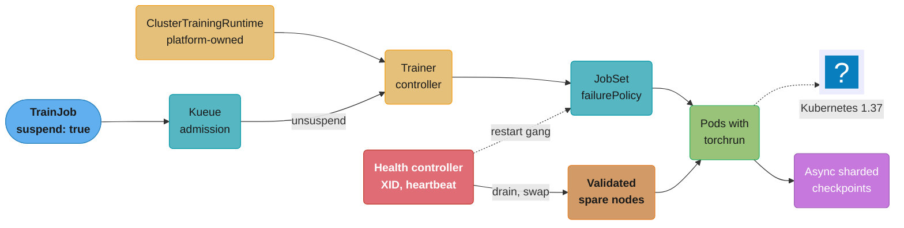
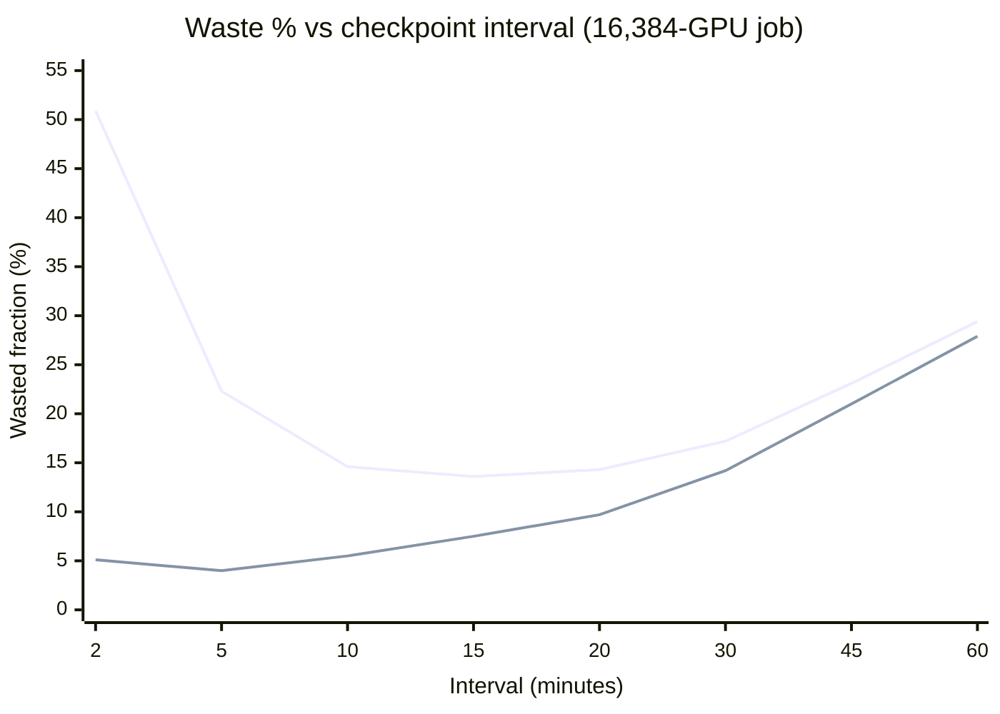
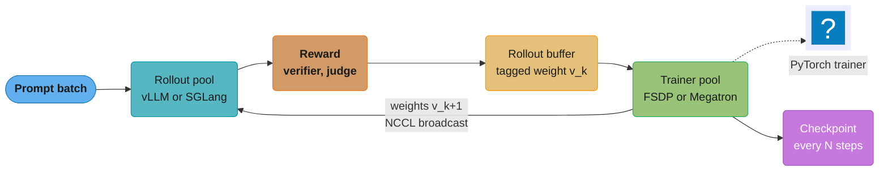
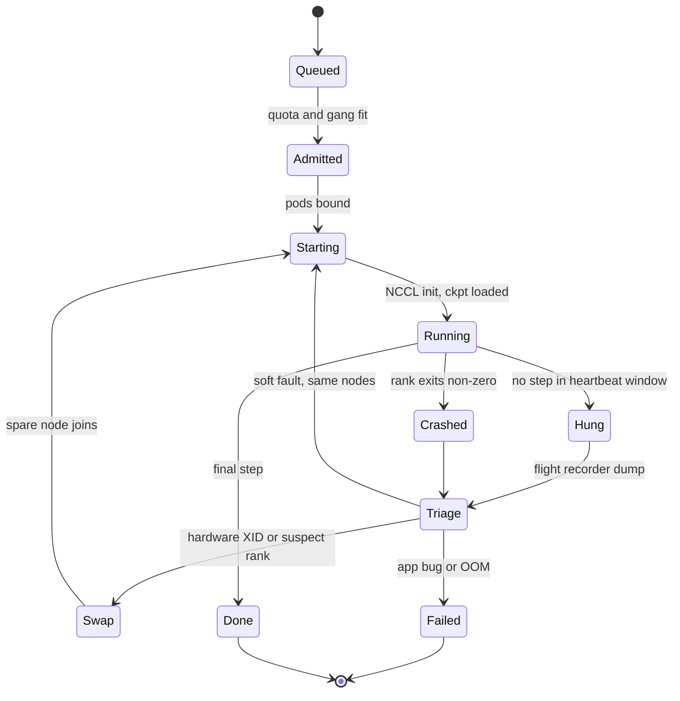
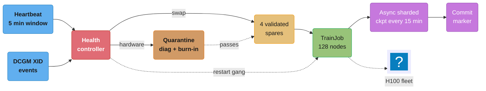

# Training Infrastructure Operations

> **Version anchor (2026-10-18).** Kubeflow Trainer v2.3.0 (2026-08-07): `TrainJob`, `TrainingRuntime` and `ClusterTrainingRuntime` in `trainer.kubeflow.org/v1alpha1`, built on JobSet; v2.3.0 adds the `OptimizationJob` CRD, a runtime snapshot mechanism, and `terminationGracePeriodSeconds` in the TrainJob pod patch, and a cluster on v2.0, v2.1 or v2.2 must upgrade to v2.3 before any later version. Ray 2.59.0 (2026-10-02). vLLM v0.32.0 (2026-10-18): sleep mode releases workspace scratch (up to 4.5 GiB per GPU) and KV-init state (about 4.6 GiB per GPU), outputs carry token-level weight-version spans, `POST /weight_checker` and weight-transfer metrics. SGLang v0.5.21 (2026-10-02): RL weight-update sessions and a fix for `pause_generation` deadlocking against weight updates. Kueue v0.20.2 (2026-10-15) no longer serves `kueue.x-k8s.io/v1beta1`. Slinky slurm-operator v1.2.3 (2026-09-30). Kubernetes 1.37. XID actions follow NVIDIA's Xid catalog and the `TORCH_NCCL_*` variables follow the PyTorch docs, both read on 2026-10-18. JobSet, torchrun, SkyPilot, verl, OpenRLHF and NeMo RL are named without a version.

A training job on a shared GPU fleet is a long-running distributed program that fails on a schedule set by its size. In Meta's cluster data a 1,024-GPU job sees a failure about every 8 hours, and a 16,384-GPU job is projected to see one about every 2 hours. This page is about keeping such jobs productive: which job API to submit through, how to detect each failure class, how often to checkpoint, how to restart in minutes instead of an hour, and how post-training (RL) changes the shape of the job.

---

## 1. Concept Overview

**Training infrastructure operations** is the work of running training and post-training jobs on a shared fleet so that most of the GPU-hours paid for turn into optimizer steps that are kept. It sits between the parallelism code (FSDP, tensor and pipeline parallel), which decides how one step runs, and the cluster scheduler, which decides which job gets which nodes.

The job kinds a platform runs, and what each one needs from operations:

| Job kind | Typical size | Duration | Dominant failure cost | Key operational need |
|---|---|---|---|---|
| Pre-training | 512 to 16,384+ GPUs | Weeks to months | Lost work and restart time per hardware fault | Fast detection, hot spares, frequent async checkpoints |
| Continued pre-training, long-context extension | 64 to 2,048 GPUs | Days | Same as pre-training, smaller scale | Resume with exact data position |
| Full fine-tune (SFT) | 8 to 256 GPUs | Hours to days | Preemption by higher-priority work | Checkpoint on SIGTERM, queue fairness |
| LoRA fine-tune | 1 to 8 GPUs | Minutes to hours | Queue wait, not failures | Bin-packing, quotas per team |
| RL post-training (GRPO, PPO, DPO variants) | 64 to 4,096 GPUs | Days to weeks | Idle GPUs during generation and weight sync | Rollout engine plus trainer, fast weight sync |

What makes this an operations problem rather than a code problem:

- **Synchronous collectives couple every GPU.** One rank that stops responding stalls all ranks inside the next all-reduce. The job does not crash; it hangs until a timeout fires.
- **Failure rate scales with size.** Meta's study of its RSC clusters measured a mean time to failure (MTTF) of 7.9 hours for 1,024-GPU jobs and projected 1.8 hours at 16,384 GPUs and 0.23 hours at 131,072 GPUs.
- **Every failure costs four things.** Time to detect, time to restart, work lost since the last checkpoint, and the checkpoint overhead paid all along to make the loss smaller.
- **Post-training mixes inference and training.** An RL step generates rollouts on an inference engine, scores them, trains on them, then ships new weights back to the engine.

**Not here.** Parallelism theory (data, tensor, pipeline, expert, context parallel, ZeRO and FSDP sharding) is in [Training Infrastructure](../../llm/training_infrastructure/training_infrastructure.md). DDP, `torchrun` launch basics and gradient synchronization are in [Distributed Training](../../ml/distributed_training/distributed_training.md). What happens inside one optimizer step is in [Training Loop Internals](../../llm/case_studies/cross_cutting/training_loop_internals.md). Node provisioning, drain, driver upgrades and DCGM fencing at the Kubernetes node level are in [GPU Node Lifecycle](../../devops/case_studies/cross_cutting/gpu_node_lifecycle.md). Data mixtures and scaling laws are in [Pre-Training](../../llm/pre_training/pre_training.md); RLHF and GRPO objectives are in [Alignment and RLHF](../../llm/alignment_and_rlhf/alignment_and_rlhf.md). Queues, quotas, gang admission and preemption policy are in [GPU Cluster Scheduling and Quotas](../gpu_cluster_scheduling_and_quotas/gpu_cluster_scheduling_and_quotas.md). NCCL topology, InfiniBand and checkpoint storage tiers are in [AI Networking and Storage Fabric](../ai_networking_and_storage_fabric/ai_networking_and_storage_fabric.md). DCGM fields, XID dashboards and MFU reporting are in [GPU Observability and Fleet Health](../gpu_observability_and_fleet_health/gpu_observability_and_fleet_health.md). The pipeline that wraps a training step (caching, eval gate, registration) is in [ML Pipelines and Orchestration](../ml_pipelines_and_orchestration/ml_pipelines_and_orchestration.md).

---

## 2. Intuition

> **One-line analogy**: a large training job is a rowing eight in which every rower must pull on the same stroke; when one rower stops, the boat does not slow down, it stops, and the crew waits until someone notices and swaps the rower out.

**Mental model**: the wall clock of a job splits into productive time and four kinds of waste. Draw a line for 30 days. Every few hours a failure lands. Before it, a stretch of work since the last checkpoint that will be thrown away. After it, a gap while nobody knows the job is dead, then a gap while nodes are replaced, pods start, NCCL initializes and the checkpoint loads. Along the whole line, small slices where training paused to write a checkpoint. The share of the line left over is the effective training time ratio (ETTR).

**Why it matters**: at an assumed $2.50 per H100-hour, a 2,048-GPU job costs about $123,000 a day. Each point of ETTR is about $1,230 a day. A job at 70% ETTR wastes about $37,000 a day compared with the same job at 100%, and the fix (async checkpoints, hot spares, a shorter hang timeout) is mostly configuration.

**Key insight**: you cannot make large-scale hardware stop failing, so the levers are the other three terms. Mean detection goes from 15.5 minutes to 3 with a step heartbeat and a 5-minute collective timeout. Restart goes from 40 minutes to 6 with a validated spare node. Mean lost work goes from 60 minutes to 7.5 with async checkpoints every 15 minutes, close to Young's interval. Those three changes move a 1,024-GPU job from about 72% to about 95% ETTR (worked in §6.1).

---

## 3. Core Principles

- **Measure goodput, not utilization.** MFU tells you how fast a step runs. ETTR tells you how many steps you kept. A job at 50% MFU and 95% ETTR beats one at 55% MFU and 75% ETTR.
- **Assume failure on a timer.** Size every recovery mechanism against the job's MTTF, which falls as GPU count rises (Meta: 7.9 hours at 1,024 GPUs, 1.8 hours projected at 16,384).
- **Detect hangs, not only crashes.** A crash ends the process and the controller sees it in seconds. A hang leaves every process alive and waiting. Only a watchdog or heartbeat sees it.
- **Classify before restarting.** An application XID (13, 31) means restart the job on the same nodes. A hardware XID (48, 79, 95) means drain the node and swap it. Retrying a hardware fault on the same node burns another restart cycle.
- **Checkpoint interval is a calculation.** Young's interval `sqrt(2 x C x M)` balances the checkpoint cost `C` against the expected lost work. For a 1,024-GPU job with a 10-second async checkpoint, Young's interval is about 13 minutes, so a habitual 2-hour interval is off by about 9x.
- **Make the checkpoint cheap before making it frequent.** Async and sharded checkpoints cut the blocking cost from minutes to seconds, which is what makes a short interval affordable.
- **Restart the whole gang, quickly.** Synchronous training cannot run with a hole in it. The job restarts as a unit, so restart time is a per-job budget item.
- **Resume must be exact.** Model, optimizer, LR scheduler, RNG states and the data loader position are all part of the checkpoint. Missing any one changes the run.
- **Keep spare capacity validated and warm.** A spare node that still has to pull a 20 GB image and pass a burn-in test is not a spare.
- **In RL, the inference engine is part of the training job.** Its startup time, memory release and weight-sync latency are on the critical path of every step.

---

## 4. Types / Architectures / Strategies

### 4.1 Job APIs

| API | Unit submitted | Restart model | Gang and queue | Fits |
|---|---|---|---|---|
| Kubeflow Trainer `TrainJob` | TrainJob referencing a `TrainingRuntime` or `ClusterTrainingRuntime` | Delegated to the JobSet the runtime renders | `suspend: true` plus a Kueue queue label, or the runtime's `podGroupPolicy` (coscheduling, Volcano) | Kubernetes platforms that want a per-framework template (torch, DeepSpeed, JAX, MLX, XGBoost) |
| JobSet | Group of replicated Jobs with one failure policy | `failurePolicy.maxRestarts` and rules with actions such as `RestartJobSet` and `FailJobSet` | Kueue integration, exclusive topology placement | Custom multi-role jobs, the substrate under TrainJob |
| Ray Train | Python `Trainer` on a Ray cluster | `FailureConfig(max_failures=...)` restarts workers from the last reported checkpoint (default 0, no retry) | KubeRay plus Kueue for the cluster | Python-first teams, RL frameworks built on Ray |
| `torchrun` elastic | One launcher per node with a rendezvous | `--max-restarts` restarts all local workers; `--nnodes=MIN:MAX` admits a changed node count | None; relies on the layer above | Inside any of the above, or bare metal |
| Slurm `sbatch`/`srun` | Batch script | `--requeue`, scripts that resubmit from the last checkpoint | Partitions, QOS, fair-share | HPC-style clusters; on Kubernetes through Slinky slurm-operator v1.2.3 |
| SkyPilot managed jobs | YAML task | Relaunches on preemption, across regions and clouds | Its own controller | Teams without a cluster, spot-heavy fine-tunes |
| Managed training services | Service job spec | Service-specific auto-resume | Service quota | SageMaker HyperPod, Vertex AI custom training |

The Kubeflow Trainer split is the useful idea even if you do not run it: a platform team owns the runtime (image, launcher, NCCL settings, volumes, failure policy), and a researcher's TrainJob supplies only the command, node count and resources.

### 4.2 Failure taxonomy

| Class | Example signal | Detection | Action | Restart scope |
|---|---|---|---|---|
| Application bug | Python exception, CUDA OOM, XID 13 or 31 | Process exit code in seconds | Fail the job; do not auto-retry OOM | None until fixed |
| GPU hardware | XID 48 (double-bit ECC), 64 (row remap failure), 79 (fallen off the bus), 95 (uncontained memory error) | DCGM, kernel log | Drain node, swap for spare | Whole job, new node |
| GPU soft fault | XID 94 (contained memory error), 119 or 120 (GSP timeout or error) | DCGM, kernel log | Restart app; reset GPU before reuse | Whole job, same or new node |
| Interconnect | XID 74 (NVLink), IB port flaps, link down | NCCL error or hang, fabric manager, subnet manager | Swap node or route around link | Whole job |
| Collective hang | All ranks alive, no progress | NCCL watchdog timeout, heartbeat stall | Dump flight recorder, find the rank, restart | Whole job, suspect node out |
| Straggler | One rank 10 to 30% slower | Per-rank step time and collective wait skew | Swap node at next checkpoint | Whole job at a chosen time |
| Silent data corruption | Loss spike or NaN with no error | Loss and grad-norm monitors, periodic checksum replays | Roll back to an earlier checkpoint, isolate node | Whole job, rollback |
| Node loss or preemption | Node NotReady, spot reclaim notice | Kubernetes, cloud event | Replace node | Whole job |
| Storage | Checkpoint write timeout, data read errors | Writer exceptions, loader stalls | Retry write to another tier, alert | Often none if caught |

XID 43 (GPU stopped processing) and 63 (memory remapping event) are listed by NVIDIA with an immediate action of IGNORE. Paging on them is noise; drain only on the codes above.

### 4.3 Checkpoint strategies

| Strategy | Blocking cost per checkpoint | Recovery source | Risk |
|---|---|---|---|
| Synchronous full state from rank 0 | Minutes (gather plus one writer) | Shared filesystem or object store | Rank 0 host memory, one-writer bandwidth |
| Sharded synchronous (each rank writes its shard, `torch.distributed.checkpoint`) | Tens of seconds | Same | Many small files, metadata load |
| Sharded async (copy to pinned host memory, upload in background) | Seconds | Same, plus the in-flight copy | A failure during upload loses that checkpoint; needs a commit marker |
| In-memory peer replica plus periodic durable copy | Sub-second to seconds | Peer host RAM, then storage | Correlated loss of a node and its peer |
| Reshardable checkpoint | Same as sharded | Any world size | Larger metadata, slower load |

### 4.4 RL post-training topologies

| Topology | Layout | Weight sync | GPU idle | Fits |
|---|---|---|---|---|
| Colocated (hybrid engine) | Rollout engine and trainer share the same GPUs and swap memory | In-process or CUDA IPC, seconds | Low, but phases serialize | Small and mid clusters, on-policy GRPO |
| Disaggregated synchronous | Separate rollout pool and trainer pool, step by step | NCCL broadcast across nodes | High: each pool waits for the other | Different hardware for each role |
| Disaggregated asynchronous | Rollouts generated by policy `k` while trainer builds `k+1` | NCCL broadcast, versioned | Low | Large scale, long rollouts, with a staleness bound |

### 4.5 Restart scopes

| Scope | What restarts | Time | Needs |
|---|---|---|---|
| Whole job, rescheduled | All pods deleted and re-admitted | 15 to 60 min | Nothing special; slowest |
| Whole job, in place | Processes restart on the same pods, failed node swapped | 3 to 10 min | Spare node, JobSet or torchrun restart, warm image |
| Elastic shrink | Continue on fewer nodes, grow back later | 2 to 5 min | Reshardable state, a batch-size and LR policy for the new world size |
| Process-level in-job recovery | Only the failed rank's process restarts | Under 1 min | Framework support for re-creating communicators; rare in practice |

---

## 5. Architecture Diagrams

### TrainJob control plane on Kubernetes



The researcher submits only the TrainJob. Everything that decides how the job survives a failure (the runtime template, the JobSet failure policy, the spare pool and the health controller) is owned by the platform team.

### One failure cycle on a 1,024-GPU job

```
minutes     0         30        60        90        120       150       180
            |---------|---------|---------|---------|---------|---------|
before      C=======================================C=================X
            ckpt every 120 min, 6 min blocking                        fault at 175
            after X: [detect 30 min hang timeout] [reschedule + load 40 min]
            lost work since last ckpt: 49 min                         total loss: 119 min

after       c====c====c====c====c====c====c====c====c====c====c====c==X
            ckpt every 15 min, 10 s blocking (async)                  fault at 175
            after X: [detect 3] [spare + load 6]
            lost work since last ckpt: 10 min                         total loss: 19 min
```

One character is 3 minutes. The fault (`X`) lands at minute 175 in both rows. The loss after it is the sum of three gaps, and every one of them shrinks: the hang timeout, the restart path and the work since the last checkpoint (`C` at minute 120 before, `c` at minute 165 after).

### Wasted fraction vs checkpoint interval, MTTF 1.8 h



The upper line is a 60-second blocking checkpoint; the lower line is a 5-second async one. Waste is `C/T + T/(2M)` with `M` = 108 minutes. The upper curve bottoms out at about 14.7 minutes and 13.6% waste; the lower one at about 4.2 minutes and 3.9%. Cheap checkpoints move the optimum left and down at the same time.

### RL post-training loop, disaggregated



Two loops run at once: the data loop (prompts to rollouts to rewards to the trainer) and the weight loop (trainer back to the rollout engines). The weight loop is the part ordinary pre-training does not have, and its latency is paid every step.

### Job lifecycle with recovery



`Triage` is the step most platforms skip. Without it, every failure takes the generic path (reschedule everything), and a deterministic bug burns the whole restart budget.

---

## 6. How It Works - Detailed Mechanics

### 6.1 Goodput and ETTR

Meta defines ETTR as "the ratio of productive runtime to available wallclock time of a job run". Google splits ML goodput into three factors that multiply: scheduling goodput (the job has all its resources), runtime goodput (the steps it runs are kept) and program goodput (the steps run near the hardware peak, close to MFU). This page owns the first two; MFU belongs to [GPU Observability and Fleet Health](../gpu_observability_and_fleet_health/gpu_observability_and_fleet_health.md).

A first-order model, per failure cycle of length `M` (the job MTTF):

```
loss per failure  = D + R + T/2          D detect, R restart, T checkpoint interval
checkpoint share  = C / (T + C)          C blocking time per checkpoint
ETTR              = (1 - (D + R + T/2) / M) x (T / (T + C))
```

Worked for a 1,024-GPU job with `M` = 7.9 hours (474 minutes):

| Term | Before | After | How |
|---|---|---|---|
| Detect `D` | 15.5 min (half the failures are hangs at a 30-min timeout) | 3 min | Heartbeat plus a 5-min collective timeout |
| Restart `R` | 40 min (reschedule, new node, image pull, load) | 6 min | Validated spare, cached image, parallel shard load |
| Interval `T` | 120 min | 15 min | Young's formula with async checkpoints |
| Blocking `C` | 6 min | 10 s | Async sharded checkpoint |
| ETTR | 72% | 95% | |
| Failures in 30 days | about 91 | about 91 | Unchanged: hardware still fails |

The failure count does not move. Every point of ETTR came from the three operational terms.

### 6.2 Submitting through Kubeflow Trainer and Kueue

The platform owns the runtime. The `torch-distributed` runtime that ships with v2.3.0 renders a JobSet with one replicated Job named `node` and a PyTorch image.

```yaml
apiVersion: trainer.kubeflow.org/v1alpha1
kind: TrainJob
metadata:
  name: llm-70b-cpt
  namespace: research
  labels:
    kueue.x-k8s.io/queue-name: pretrain
spec:
  suspend: true                        # Kueue flips this to false on admission
  runtimeRef:
    apiGroup: trainer.kubeflow.org
    kind: ClusterTrainingRuntime
    name: torch-distributed
  trainer:
    image: registry.example.com/train/llm@sha256:5f0c...
    numNodes: 128
    numProcPerNode: 8
    command: ["torchrun"]
    args: ["--max-restarts=0", "/app/train.py", "--config=/cfg/70b.yaml"]
    resourcesPerNode:
      limits:
        nvidia.com/gpu: 8
  runtimePatches:
    - manager: platform.example.com/training
      trainingRuntimeSpec:
        template:
          spec:
            replicatedJobs:
              - name: node
                template:
                  spec:
                    template:
                      spec:
                        terminationGracePeriodSeconds: 120
                        tolerations:
                          - key: nvidia.com/gpu
                            operator: Exists
                            effect: NoSchedule
```

`--max-restarts=0` is deliberate: the JobSet failure policy owns restarts, so a single node's torchrun does not loop on its own while the other 127 nodes wait. The 120-second grace period gives the SIGTERM handler time to finish an emergency checkpoint.

The LocalQueue the label points to must be written in the API version Kueue serves:

```yaml
# Broken on Kueue v0.20: v1beta1 is no longer served, so the apply fails
apiVersion: kueue.x-k8s.io/v1beta1
kind: LocalQueue
metadata: {name: pretrain, namespace: research}
spec: {clusterQueue: gpu-h100}
---
# Fixed
apiVersion: kueue.x-k8s.io/v1beta2
kind: LocalQueue
metadata: {name: pretrain, namespace: research}
spec: {clusterQueue: gpu-h100}
```

The Kueue example in the Kubeflow Trainer v2.3.0 repository still shows a `v1beta1` LocalQueue in a comment. Copying it onto a Kueue v0.20 cluster fails at apply time. Kueue ships a `migrate-to-v1beta2.sh` script for objects already stored as v1beta1.

### 6.3 JobSet failure policy: restart hardware faults, stop on bugs

```yaml
spec:
  failurePolicy:
    maxRestarts: 20
    rules:
      - name: appBugStops
        action: FailJobSet
        onJobFailureReasons: ["PodFailurePolicy"]   # exit code 42 from the trainer
      - name: infraRestartsFree
        action: RestartJobSetAndIgnoreMaxRestarts
        onJobFailureReasons: ["BackoffLimitExceeded"]
  replicatedJobs:
    - name: node
      template:
        spec:
          backoffLimit: 0
          podFailurePolicy:
            rules:
              - action: FailJob
                onExitCodes: {operator: In, values: [42]}
              - action: Ignore
                onPodConditions: [{type: DisruptionTarget}]
```

The trainer exits with code 42 after classifying an error as a code bug (config error, shape mismatch, CUDA OOM). That fails the whole JobSet without spending restarts. A preemption or node drain marks the pod with `DisruptionTarget`, which the Job ignores. Everything else restarts the gang. If no rule matches, JobSet applies `RestartJobSet`, which counts against `maxRestarts`. Rule names must match `^[A-Za-z]([A-Za-z0-9_,:]*[A-Za-z0-9_])?$`, so a hyphenated name fails validation. Kubernetes accepts a `podFailurePolicy` only when the pod template sets `restartPolicy: Never`.

### 6.4 Hang detection: NCCL watchdog and flight recorder

PyTorch's ProcessGroupNCCL runs a watchdog thread per process. When a collective exceeds the process-group timeout, the watchdog raises an error and, with the default `TORCH_NCCL_ASYNC_ERROR_HANDLING=3`, tears the process down. A separate monitor thread aborts the process if the watchdog itself stops heartbeating for `TORCH_NCCL_HEARTBEAT_TIMEOUT_SEC`. The defaults are sized for jobs that tolerate long stalls; large jobs shorten them and turn on the flight recorder.

```bash
# Set in the ClusterTrainingRuntime so every TrainJob inherits them
TORCH_NCCL_ASYNC_ERROR_HANDLING=3        # tear down the process on NCCL error (the default)
TORCH_NCCL_ENABLE_MONITORING=1           # abort if the watchdog itself stops heartbeating
TORCH_NCCL_HEARTBEAT_TIMEOUT_SEC=300
TORCH_NCCL_TRACE_BUFFER_SIZE=20000       # flight recorder ring buffer; 0 disables dumps
TORCH_NCCL_DUMP_ON_TIMEOUT=1             # write the buffer when a timeout fires
TORCH_NCCL_DEBUG_INFO_TEMP_FILE=/scratch/nccl_trace_rank_
NCCL_DEBUG=WARN
```

```python
import datetime, torch.distributed as dist

dist.init_process_group(backend="nccl", timeout=datetime.timedelta(minutes=5))
```

A 5-minute collective timeout is safe only if no legitimate collective takes that long. The first collective after a checkpoint load, and a barrier after a slow evaluation on rank 0, are the usual offenders. Move evaluation off the critical path, or give that one barrier its own process group with a longer timeout.

Reading the dumps: every rank records the sequence number of each collective it entered. The rank whose last entered sequence number is lower than everyone else's is the one that stalled. Llama 3 405B training relied on this mechanism (PyTorch's NCCL flight recorder) to diagnose hangs across 16,384 H100s.

### 6.5 Health controller: classify, then act

```python
DRAIN = {48, 64, 79, 95}           # hardware: swap the node
RESET = {94, 119, 120}             # soft: restart app, reset GPU before reuse
APP = {13, 31}                     # usually a code fault: restart on same nodes once
IGNORE = {43, 63}                  # NVIDIA immediate action: IGNORE

def on_job_fault(job, events):
    xids = {e.xid for e in events if e.kind == "xid"}
    nodes = {e.node for e in events if e.xid in DRAIN | RESET}
    if xids & DRAIN or any(e.kind == "link_down" for e in events):
        for n in nodes:
            cordon_and_label(n, reason="gpu-hw")          # out of rotation for burn-in
        swap_in_spares(job, count=len(nodes))
        return restart_gang(job)
    if xids & RESET:
        reset_gpus(nodes)
        return restart_gang(job)
    if xids & APP:
        if job.recent_restarts(reason="xid-app", window_h=2) >= 1:
            return fail_job(job, "repeat application XID; likely a code fault")
        return restart_gang(job)
    if any(e.kind == "hang" for e in events):
        suspect = lowest_seq_rank(job.flight_recorder_dumps())
        mark_suspect(suspect.node)                        # 2 strikes in 24 h: drain
        return restart_gang(job)
    return restart_gang(job)
```

Two details matter more than the code. A node pulled for a hardware XID goes to a burn-in queue (DCGM diagnostics plus an NCCL all-reduce test) before it rejoins the spare pool, never straight back. And a repeat application XID within two hours fails the job, because the same kernel fault on the same code is not going to clear on its own.

### 6.6 Checkpoint interval from MTTF

Young's approximation for the interval `T` between checkpoints, with blocking cost `C` and job MTTF `M`:

```
T_young = sqrt(2 x C x M)
T_daly  = sqrt(2 x C x M) x (1 + (1/3) x sqrt(C / (2M)) + (1/9) x (C / (2M))) - C     for C < 2M
```

```python
from math import sqrt

def young(c_s: float, mttf_s: float) -> float:
    return sqrt(2 * c_s * mttf_s)

def waste(t_s: float, c_s: float, mttf_s: float) -> float:
    return c_s / t_s + t_s / (2 * mttf_s)

M = 1.8 * 3600                                    # 16,384-GPU job
for c in (60, 5):
    t = young(c, M)
    print(f"C={c:>2}s  T={t/60:5.1f} min  waste={waste(t, c, M):.1%}")
# C=60s  T= 14.7 min  waste=13.6%
# C= 5s  T=  4.2 min  waste=3.9%
```

Daly's correction matters only when `C` is a sizable fraction of `M`; for `C` of seconds and `M` of hours, Young's value is within a few percent. Recompute `M` when the job size changes: at a constant per-node failure rate, doubling the node count halves `M` and cuts the best interval by about 30%.

### 6.7 Async checkpoint with a commit marker

```python
# Broken: async upload with no commit, resume picks the newest directory
def save(step):
    async_save(state, path=f"s3://ckpt/run7/step_{step}/")    # returns before upload ends

def latest():
    return max(list_dirs("s3://ckpt/run7/"))                   # may be half-written
```

A node fails 40 seconds into an upload. The restarted job lists the prefix, picks `step_14000/`, finds 3 of 1,024 shards missing and crashes on load. The operator then deletes the directory by hand and the job loses another restart cycle.

```python
# Fixed: commit only after every shard is durable, resume from the newest commit
import torch.distributed as dist
import torch.distributed.checkpoint as dcp

pending = None                                   # (future, step) of the upload in flight

def maybe_commit(block: bool = False):
    global pending
    if pending is None:
        return
    fut, step = pending
    if not (block or fut.done()):
        return
    fut.result()                                 # raises if any shard failed
    if dist.get_rank() == 0:
        write_commit_marker(step)                # conditional put of COMMITTED, the last write
    pending = None

def save(step, state):
    global pending
    maybe_commit(block=True)                     # never more than one upload in flight
    pending = (dcp.async_save(state, checkpoint_id=f"s3://ckpt/run7/step_{step}/"), step)

def latest():
    return max(s for s in list_steps("s3://ckpt/run7/") if has_commit_marker(s))
```

`dcp.async_save` stages the state to host memory and returns a future; the GPUs resume after the staging copy. The training loop calls `maybe_commit()` every step, so the marker lands as soon as the upload finishes, and `save` blocks only if the previous upload is still running. Rank 0 writes the marker after its future resolves, which is after the coordinator has gathered every rank's write result. Retention deletes uncommitted directories older than one interval and keeps the last three committed ones plus one per day.

Size arithmetic for the stage-and-upload path, 70B parameters with mixed-precision AdamW:

| Component | Bytes per parameter | 70B total |
|---|---|---|
| BF16 weights | 2 | 140 GB |
| FP32 master weights | 4 | 280 GB |
| Adam first and second moments (FP32) | 8 | 560 GB |
| Full checkpoint | 14 | 980 GB |

Sharded over 1,024 GPUs that is about 0.96 GB per GPU, matching the 1 MB to 4 GB per GPU range Meta reported for Llama 3. The staging copy to pinned memory takes well under a second per GPU. The upload is the real cost: 980 GB at 50 GB/s aggregate to object storage is about 20 seconds, at 10 GB/s about 98 seconds. Either is fine in the background with a 15-minute interval; neither is fine as a blocking write every 5 minutes.

### 6.8 Exact resume of the data stream

```python
# Broken: data position not in the checkpoint
loader = DataLoader(ds, sampler=DistributedSampler(ds, shuffle=True, seed=0), ...)
start = load_ckpt(model, optim)               # model and optimizer only
for step, batch in enumerate(loader, start):  # restarts epoch from sample 0
    ...
```

After every restart the job re-reads the first part of the epoch. With 91 restarts in a month, the earliest shards were read on almost every restart while the late shards were read once, and validation loss on the early domains fell faster than on everything else.

```python
# Fixed: loader state, sampler epoch and RNG states are part of the checkpoint
from torchdata.stateful_dataloader import StatefulDataLoader

loader = StatefulDataLoader(ds, sampler=sampler, batch_size=bs, num_workers=8)
state = {"model": model, "optim": optim, "sched": sched,
         "loader": loader, "rng": rng_states(), "step": step, "tokens_seen": tokens}
# save: dcp.async_save(to_state_dict(state), ...)
# load: loader.load_state_dict(ckpt["loader"]), restore_rng(ckpt["rng"])
```

Check it with a test, not a code review: train 200 steps, checkpoint, train 100 more and record the hashes of every batch; then restore from the checkpoint and train 100 steps again. The two lists of batch hashes must be identical.

Data loading bandwidth is rarely the problem for text. An 8B model at about 8,000 tokens per second per GPU on 2,048 GPUs consumes 16 million tokens per second; as `uint32` token ids that is about 66 MB/s for the whole job. What breaks is per-file overhead (listing millions of small objects at startup), CPU tokenization done online, and resume. Pre-tokenize into packed shards of 1 to 4 GB. Images and video are the exception: decoding and bandwidth both matter there.

### 6.9 RL weight sync from trainer to rollout engines

```python
# Broken: weight sync through the filesystem
trainer.save_pretrained("/shared/policy/latest")          # 140 GB for a 70B BF16 policy
for engine in rollout_engines:
    engine.reload("/shared/policy/latest")                 # each node reads 140 GB
```

Each sync writes 140 GB once and reads it once per rollout node. At 2 GB/s per node from the shared filesystem, each engine spends about 70 seconds loading, and the step is only 3 minutes long. The rollout pool sits idle for about 40% of wall clock.

```python
# Fixed: bucketed NCCL broadcast from trainer ranks straight into engine memory
group = init_weight_sync_group(trainer_ranks + engine_ranks)    # once, at startup
for engine in rollout_engines:
    engine.pause_generation()                                   # drain or abort in-flight
for name, bucket in bucket_params(policy, bucket_bytes=1 << 30):
    tensor = gather_full_param(bucket)                          # from FSDP shards
    group.broadcast(tensor, src=0)                              # engines receive in place
for engine in rollout_engines:
    engine.set_weight_version(step + 1)
    engine.resume_generation()
```

Sharded over 8 NICs at 400 Gb/s each, 140 GB moves in a few seconds. The engines must accept weights while their KV cache and CUDA graphs stay valid. SGLang v0.5.21 added RL weight-update sessions, so `update_weights_from_distributed` and `update_weights_from_tensor` must run between `begin_weight_update()` and `end_weight_update()`, and fixed a deadlock between `pause_generation` and weight updates. The algorithm-side effect of stale weights and engine-trainer probability mismatch is in [GRPO and RLVR](../../llm/alignment_and_rlhf/grpo_and_rlvr.md). vLLM v0.32.0 releases its weight-transfer communicators without stopping inference, adds weight-transfer metrics, and tags outputs with token-level weight-version spans, so the trainer knows which policy produced which tokens of a rollout that straddled an update. That tag is what an asynchronous setup uses to enforce a staleness bound (for example, drop rollouts more than one version old).

In a colocated setup the same GPUs alternate roles. The engine sleeps during training to free HBM for optimizer state and wakes for generation. In vLLM v0.32.0, sleep also releases workspace scratch (up to 4.5 GiB per GPU) and KV-init state (about 4.6 GiB per GPU); on an 80 GB GPU that 9 GiB decides whether the trainer fits a larger micro-batch.

### 6.10 Fine-tune platform queues

A shared fine-tune service runs hundreds of small jobs a day for many teams. The operational problems are queue wait and preemption, not hardware faults.

| Setting | Value | Why |
|---|---|---|
| LocalQueue per team, one ClusterQueue per GPU type | e.g. `ft-h100`, `ft-l40s` | Quota and borrowing per team |
| Priority classes | `prod-retrain` > `ft-interactive` > `ft-batch` | Production refresh jobs preempt experiments |
| `terminationGracePeriodSeconds` | 120 | SIGTERM handler writes an emergency checkpoint (LoRA state is MBs, full SFT state is GBs) |
| Minimum runtime before preemptable | 15 min | Prevents thrash where a job is preempted before its first checkpoint |
| Job size cap | 8 GPUs for LoRA, 64 for full SFT | Small jobs pack; large jobs go to the pre-training queue |
| Queue-wait SLO | p90 under 30 min for `ft-interactive` | Measured, reported per team |

Preemption cost is the work since the last checkpoint. A LoRA job that checkpoints every 200 steps at 2 steps per second loses at most 100 seconds; a full SFT job with a 1-hour interval loses up to an hour, so the scheduler should prefer preempting the job with the newest checkpoint. That preemption policy belongs to [GPU Cluster Scheduling and Quotas](../gpu_cluster_scheduling_and_quotas/gpu_cluster_scheduling_and_quotas.md); the job's obligation is to checkpoint on SIGTERM and report its last checkpoint time.

### 6.11 Hot spares

```
job: 128 nodes active + 4 spares (3%)            spare pool states
                                                  validated  = burn-in passed, image cached
node 0   ########  active                         warming    = image pull, NCCL test
node 1   ########  active                         quarantine = failed XID, in burn-in
...
node 127 ########  active
spare 0  ........  validated   <- replaces a drained node in about 1 min
spare 1  ........  validated
spare 2  ~~~~~~~~  warming
spare 3  xxxxxxxx  quarantine  (XID 48 on GPU 5, DCGM diag level 3 running)
```

Only `validated` spares count toward the pool size. A node in `quarantine` returns to `warming` after it passes diagnostics, never straight to `validated`.

Size the pool from the replacement rate. With about 3 failures a day and a 24-hour vendor or burn-in turnaround, 3 to 4 validated spares keep the job from ever waiting on a node. Spares are not idle cost when they run low-priority preemptible work (eval sweeps, small fine-tunes) that yields within a minute.

---

## 7. Real-World Examples

**Meta, Llama 3 405B on 16,384 H100s.** During a 54-day snapshot of pre-training the job had 466 interruptions: 47 planned (firmware upgrades and other automated maintenance) and 419 unexpected. About 78% of the unexpected ones were attributed to confirmed or suspected hardware issues, and GPU issues were the largest category at 58.7%; faulty GPUs (148) and HBM3 memory (72) led the list. Significant manual intervention was needed only three times, and the team reported higher than 90% effective training time. They also saw a diurnal 1 to 2% throughput swing tied to temperature, and power swings of tens of megawatts across the data center when all GPUs paused together, for example during checkpoints or collective waits.

**Meta, RSC reliability study.** Eleven months of data from two clusters (RSC-1, about 16,000 A100s for general ML; RSC-2, about 8,000 for vision) and 4 million jobs. RSC-1 saw 6.50 failures per thousand node-days. The paper defines ETTR, reports an MTTF of 7.9 hours for 1,024-GPU jobs, and fits a failure model that projects 1.8 hours at 16,384 GPUs. It also notes that small jobs are most of the jobs, so a platform tuned only for the hero run serves most users badly.

**ByteDance, MegaScale.** The NSDI 2024 paper describes training on more than 10,000 GPUs with a robust-training layer: heartbeats from every executor, automatic diagnostic tests on suspect nodes, eviction and fast checkpoint recovery, and tooling to find stragglers from per-rank collective timing.

**Meta, OPT-175B.** The published logbook for training OPT-175B on 992 A100s records dozens of manual restarts, hardware replacements and loss spikes handled by rolling back to an earlier checkpoint and lowering the learning rate. It is a public, day-by-day record of what training operations looked like before automated restart was routine.

**ByteDance Seed, verl.** verl (from the HybridFlow paper) runs the rollout engine and the trainer on the same GPUs and switches between them, with vLLM or SGLang as the rollout backend. It became one of the common open RL post-training frameworks alongside OpenRLHF and NVIDIA NeMo RL, which make different colocated vs disaggregated choices.

**Google, ML goodput.** Google Cloud's goodput framing (scheduling, runtime and program goodput multiplied) gave platform teams one number to report for a fleet, with each factor pointing to the team that owns it: capacity, reliability or performance.

---

## 8. Tradeoffs

### Checkpoint strategy

| Factor | Sync full | Sync sharded | Async sharded | In-memory peer replica |
|---|---|---|---|---|
| Blocking time, 70B model | 5 to 10 min | 30 to 90 s | 1 to 10 s | Under 1 s |
| Best interval at MTTF 7.9 h | 70 to 100 min | 22 to 38 min | 4 to 13 min | 1 to 3 min |
| Storage traffic | Low (rare) | Medium | High | Low durable, high network |
| Complexity | Low | Medium | Medium, needs commit protocol | High |
| Survives correlated loss | Yes | Yes | Yes, up to last commit | Only with a durable copy |

### Restart model

| Factor | Reschedule the job | In-place with spares | Elastic shrink |
|---|---|---|---|
| Restart time | 15 to 60 min | 3 to 10 min | 2 to 5 min |
| Idle capacity cost | None | 2 to 5% of nodes | None |
| Training semantics | Unchanged | Unchanged | Global batch or LR changes, needs a policy |
| Operational complexity | Low | Medium | High |

### RL topology

| Factor | Colocated | Disaggregated sync | Disaggregated async |
|---|---|---|---|
| GPU idle | Low | High | Low |
| Weight sync | Local, fast | Network, every step | Network, overlapped |
| On-policy | Yes | Yes | Bounded staleness |
| Memory pressure | High (both roles in one HBM) | Low | Low |
| Scaling rollout and train separately | No | Yes | Yes |

### Job API

| Factor | TrainJob | JobSet directly | Ray Train | Slurm |
|---|---|---|---|---|
| Platform vs user split | Built in (runtime vs job) | Manual | Manual | Partitions and QOS |
| Kubernetes-native quotas | Kueue, Volcano | Kueue | Through KubeRay | No; Slinky bridges it |
| Restart policy | From the JobSet | Full control | `FailureConfig` | Requeue scripts |
| Best for | Platform teams on Kubernetes | Custom multi-role jobs | Python-first, RL on Ray | Existing HPC estates |

---

## 9. When to Use / When NOT to Use

**Invest in full restart automation (health controller, spares, flight recorder) when:**
- Jobs run on 256 GPUs or more for longer than a day. MTTF is under a day and manual recovery costs hours each time.
- The fleet is shared and a hung job blocks other teams' quota.
- You run more than a handful of large jobs a month.

**Do not build it when:**
- Jobs are 1 to 8 GPU fine-tunes that finish in hours. Checkpoint on SIGTERM and let the queue retry. A failure costs minutes.
- You rent a managed service that already restarts jobs (SageMaker HyperPod, Vertex AI). Check its detection and restart times before adding a layer on top.

**Use async sharded checkpoints when** checkpoint blocking time exceeds about 1% of the interval Young's formula gives, or when the job is over 512 GPUs.

**Do not use elastic shrink when** the training recipe is tuned to an exact global batch size and you have no tested rule for the learning rate at a different size. Use spares instead.

**Use a colocated RL topology when** the cluster is under a few hundred GPUs and the policy fits alongside the engine. **Use disaggregated async when** rollouts are long (reasoning traces of tens of thousands of tokens) and the long tail of generation would otherwise idle the trainer.

**Use Slurm through Slinky when** the research team already writes `sbatch` scripts and the platform team wants Kubernetes underneath. Do not force a migration to TrainJob for its own sake.

---

## 10. Common Pitfalls

**30-minute progress check on a flaky InfiniBand link.** A 2,048-GPU job used the NCCL default process group timeout plus a launcher-level 30-minute progress check. A flaky InfiniBand cable caused about 40 hangs over a month; each cost 30 minutes before anyone noticed plus 35 minutes to reschedule. That was 43 hours of a 2,048-GPU job, about 89,000 GPU-hours. A heartbeat on step progress with a 5-minute window, plus the flight recorder pointing at the same two nodes every time, ended it in a day.

**Rank-0 full checkpoint blocking for 11 minutes.** A team checkpointed a 70B model every hour by gathering full state to rank 0 and writing one file. Blocking time grew from 4 to 11 minutes as the shared filesystem filled. They were paying 18% overhead to protect against a failure every 8 hours. Moving to sharded async checkpoints dropped blocking to 8 seconds and let them checkpoint every 15 minutes.

**Async checkpoint with no commit marker.** An async writer had no commit marker. A node died during upload, and the restarted job loaded the newest directory, found missing shards and crashed. The automation restarted it 6 times in a row before the restart budget ran out at 3 a.m. Fix: commit marker written last, resume only from committed steps (§6.7).

**Dataloader state missing from the checkpoint.** Dataloader state was not checkpointed. Every restart began the epoch again, so the first shards were overrepresented and one domain's eval loss dropped suspiciously fast. The batch-hash replay test in §6.8 catches this in CI.

**XID 79 node returned to the pool after a reboot.** A node with intermittent XID 79 was rebooted, passed the kubelet readiness check, and rejoined the pool. It took down the same job three times in a week. Fix: hardware XIDs send a node to quarantine and a DCGM level-3 diagnostic plus an NCCL all-reduce burn-in; two strikes send it to the vendor.

**CUDA OOM retried 20 times by a generic restart policy.** A config change raised the micro-batch, every rank hit CUDA OOM on step 1, and the generic restart policy retried 20 times over 9 hours. Fix: classify OOM and config errors in the trainer, exit with a distinct code, and map that code to `FailJobSet` (§6.3).

**GRPO trainer idle 60% of the time on long-tail rollouts.** A disaggregated GRPO job generated 16 rollouts per prompt with a 32K-token budget. Most rollouts ended under 4K tokens, but each batch waited for the longest. The trainer pool sat idle about 60% of the time. Moving to an asynchronous design with a one-version staleness bound, and capping generation per batch with partial rollouts carried to the next batch, brought trainer idle under 15%.

**Silent data corruption seen only in the loss curve.** A run showed a sudden loss spike with no error and no NaN. Replaying the same batch on a different node gave a different gradient norm on one rank. The cause was a GPU producing wrong results without an XID. The team rolled back two checkpoints, drained the node, and added a nightly determinism replay of a fixed batch per node.

---

## 11. Technologies & Tools

| Tool | Role | Notes |
|---|---|---|
| Kubeflow Trainer | TrainJob and TrainingRuntime APIs over JobSet | v2.3.0; runtimes for torch, DeepSpeed, JAX, MLX and XGBoost |
| JobSet | Group of Jobs with one failure policy | `failurePolicy.rules` with `RestartJobSet`, `FailJobSet` and related actions |
| Kueue | Queues, quota, gang admission for TrainJob | v0.20.2 serves `v1beta2` only |
| Volcano | Batch scheduler with gang scheduling | Alternative to Kueue for TrainJob |
| Ray Train | Distributed training on Ray | Ray 2.59.0; `FailureConfig`, `get_checkpoint()` |
| torchrun | PyTorch elastic launcher | `--nnodes=MIN:MAX`, `--max-restarts`, c10d rendezvous |
| Slinky | Slurm on Kubernetes | slurm-operator v1.2.3 |
| SkyPilot | Multi-cloud job launcher with managed spot recovery | Fits small teams without a cluster |
| PyTorch Distributed Checkpoint | Sharded, reshardable, async checkpoints | `dcp.async_save` |
| torchdata | `StatefulDataLoader` for exact resume | Loader state in the checkpoint |
| NCCL | Collective communication | Flight recorder via `TORCH_NCCL_*` variables |
| DCGM | GPU health and diagnostics | XID, ECC, diag levels; see the observability module |
| vLLM | Rollout engine for RL | v0.32.0; sleep mode, weight-version spans, weight-transfer metrics |
| SGLang | Rollout engine for RL | v0.5.21; RL weight-update sessions |
| verl | RL post-training framework | Colocated hybrid engine |
| OpenRLHF | RL post-training framework | Ray-based, disaggregated roles |
| NeMo RL | NVIDIA RL post-training library | Megatron and vLLM backends |

---

## 12. Interview Questions with Answers

**Q: A pre-training job reports 48% MFU, but the team finished 30% fewer tokens than planned in a month. What metric did they miss?**
**Short:** MFU measures speed while running; they missed ETTR or goodput, the share of wall clock that produced kept steps after hangs, restarts and lost work.

MFU only counts time when steps are executing. Detection gaps, restarts, recomputed work after rollback and checkpoint stalls are all invisible to it. Meta defines ETTR as productive runtime over available wall clock; Google multiplies scheduling, runtime and program goodput. A job at 48% MFU and 70% ETTR delivers about 34% of peak over the month. Report both, and break ETTR into detect, restart, lost-work and checkpoint terms so each has an owner.

**Q: One GPU on a 4,096-GPU job stops responding. Why does the whole job stop for exactly the length of a timeout instead of crashing?**
**Short:** Every rank blocks in the next collective waiting for the missing one, and nothing fails until the NCCL watchdog's process-group timeout or a step heartbeat fires and tears the job down.

Synchronous all-reduce needs every rank. When one stalls (driver fault, NVLink error, kernel hang), the others enter the collective and wait; their processes are alive, so the orchestrator sees healthy pods. The process-group timeout decides how long that wait lasts; `TORCH_NCCL_HEARTBEAT_TIMEOUT_SEC` covers the different case where the watchdog thread itself is stuck in a CUDA or NCCL call. Large jobs set a 5-minute collective timeout, enable `TORCH_NCCL_ENABLE_MONITORING`, add a step-progress heartbeat, and turn on the flight recorder so the dump names the rank that stopped advancing.

**Q: How do you pick a checkpoint interval for a training job?**
**Short:** Use Young's formula, interval = sqrt(2 x checkpoint blocking time x job MTTF), and recompute it when the job size or checkpoint cost changes.

Waste per unit time is about `C/T + T/(2M)`: frequent checkpoints pay blocking time, rare ones lose more work per failure. The minimum is `T = sqrt(2CM)`. For a 16,384-GPU job (MTTF about 1.8 hours) with a 60-second blocking checkpoint that gives about 15 minutes and 13.6% waste; with a 5-second async checkpoint, about 4 minutes and 3.9%. Daly's higher-order version only matters when `C` is a large fraction of `M`.

**Q: A team doubled checkpoint frequency to reduce lost work, and goodput went down. Why?**
**Short:** Their blocking checkpoint was expensive, so the added stall time exceeded the recomputed work saved; halving the interval raises waste whenever it starts below about 1.4 times Young's optimum.

With a blocking cost of several minutes, the waste curve rises steeply to the left of the optimum. Halving the interval doubles the checkpoint term `C/T` and halves the lost-work term `T/(2M)`; the sum goes up whenever `T` was below `sqrt(4CM)`, which is about 1.4 times Young's interval. The fix is to make the checkpoint cheaper first (sharded, async, staged to host memory), which moves the optimum to a shorter interval. Then shorten the interval.

**Q: Async checkpointing finished, but a resume crashed loading a checkpoint with missing shards. What was missing from the design?**
**Short:** A commit marker written after every shard is durable; resume must read only committed steps, never just the newest directory.

`async_save` returns once state is staged to host memory, and the upload continues in the background. A failure during upload leaves a partial directory that looks newest. Write a single commit object (conditional put) after the future completes, have resume pick the newest committed step, and let retention delete uncommitted directories older than one interval. Keep at most one upload in flight so host memory stays bounded.

**Q: How do you find a straggler GPU among 4,096?**
**Short:** Compare per-rank step and collective timings: the straggler's compute phase runs long while every other rank shows matching extra wait inside the collective.

In synchronous training the fast ranks wait for the slow one, so everyone's step time rises equally and the global metric hides the culprit. Record per-rank forward-backward time and time spent waiting in all-reduce; the straggler has the most compute and the least wait. Typical causes are thermal or power throttling, a degraded NVLink or NIC, or a noisy CPU neighbor in the data loader. Swap the node at the next checkpoint instead of killing the job immediately, unless the slowdown exceeds the restart cost.

**Q: Why keep hot spare nodes idle when the fleet is short on GPUs?**
**Short:** A validated spare turns a 30 to 60 minute reschedule into a few minutes, and on a 1,024-GPU job that time is worth far more than 3% idle nodes.

Without spares a hardware fault waits for a new node to boot, pull images and pass burn-in, while 1,000 other GPUs idle. With 3 to 4 validated spares on a 128-node job, the controller swaps the bad node in about a minute. Spares need not be idle: run preemptible eval or small fine-tunes on them that yield within a minute. Size the pool from failures per day times burn-in or vendor turnaround.

**Q: What does `torchrun --nnodes=MIN:MAX` buy you, and why do many large jobs not use it?**
**Short:** It lets the job restart with fewer nodes after a loss, but that changes world size, global batch and sharding, so most pre-training runs prefer spares and a fixed size.

On a membership change torchrun restarts all workers through rendezvous with the new node count. The training code must then reshard state and decide what happens to global batch size and learning rate. For a recipe tuned at one batch size, that is a training change hidden in an operations event. Elastic shrink fits fine-tunes and spot-heavy jobs where throughput matters more than an exact recipe. Large pre-training usually sets `--max-restarts=0` and lets JobSet restart the gang with a spare.

**Q: What does a Kubeflow Trainer TrainJob give you over writing a JobSet yourself?**
**Short:** It splits the platform-owned runtime (image, launcher, NCCL settings, failure policy) from the user's job (command, nodes, resources), with Kueue admission through `suspend`.

A `ClusterTrainingRuntime` holds the JobSet template, an ML policy (torch, MPI, JAX and others) and an optional pod-group policy for coscheduling or Volcano gang scheduling. A TrainJob references it and sets `numNodes`, `numProcPerNode`, `resourcesPerNode`, command and env; `runtimePatches` let a manager such as Kueue or a platform webhook patch a restricted set of pod fields. v2.3.0 added `terminationGracePeriodSeconds` to that patch, which is what lets a job finish its SIGTERM checkpoint. If you need roles the runtimes do not model, write the JobSet directly.

**Q: A TrainJob with a Kueue queue label applies, but its LocalQueue manifest fails on a Kueue v0.20 cluster. Why?**
**Short:** Kueue v0.20 no longer serves `kueue.x-k8s.io/v1beta1`; LocalQueue and other Kueue objects must use `v1beta2`, and stored v1beta1 objects need the migration script first.

The v0.20 release removed v1beta1 from the served versions and ships `migrate-to-v1beta2.sh` to rewrite existing objects before upgrading. Examples and Helm values written for older Kueue still carry v1beta1, including a comment in the Kubeflow Trainer v2.3.0 Kueue example. Pin the API version in your platform templates and run a dry-run apply in CI against the target Kueue version.

**Q: After 90 restarts, eval loss on one data domain fell much faster than on the others. What broke?**
**Short:** The dataloader position was not checkpointed, so every restart re-read the start of the epoch and oversampled its first shards.

A checkpoint is model, optimizer, scheduler, RNG states and data position. Without the last, each restart replays the same leading shards. Use a stateful loader (torchdata's `StatefulDataLoader` or a streaming dataset with resumable state), store it in the checkpoint, and verify with a replay test: checkpoint, run 100 steps recording batch hashes, restore, run again, compare.

**Q: In RL post-training, what is weight sync and why can it dominate step time?**
**Short:** It is copying the trainer's new policy weights into every rollout engine each step; a shared-filesystem reload takes about a minute per sync, a bucketed NCCL broadcast seconds.

A 70B BF16 policy is 140 GB. Saving it and having each rollout node reload it at 2 GB/s takes about 70 seconds, against a step of a few minutes. A bucketed NCCL broadcast from trainer ranks straight into engine memory over multiple NICs finishes in seconds. Engines must pause generation or accept updates mid-flight; SGLang v0.5.21 requires updates inside an RL weight-update session (`begin_weight_update()` to `end_weight_update()`), and vLLM v0.32.0 releases weight-transfer communicators without stopping inference and exposes weight-transfer metrics.

**Q: Colocated or disaggregated RL: how do you choose?**
**Short:** Colocate when the cluster is small and both roles fit in HBM; disaggregate, usually async with a staleness bound, when rollouts are long or the roles need different scaling.

Colocated (verl's hybrid engine) alternates roles on the same GPUs: weight sync is local and idle time is low, but generation and training serialize and compete for memory, so engine sleep modes matter. Disaggregated pools scale independently and can use different hardware, but in synchronous mode each pool waits for the other. Asynchronous disaggregation overlaps them by training on rollouts from the previous policy version, which needs per-token weight-version tags and a rule for dropping stale rollouts.

**Q: Why did a GRPO job's trainer GPUs sit idle 60% of the time even though generation was fast on average?**
**Short:** Each batch waited for its longest rollout; a few 32K-token traces held the batch while most ended early, so the trainer idled through the generation tail.

Generation length in reasoning RL has a heavy tail. A synchronous loop is gated by the maximum, not the mean. Fixes are partial rollouts (stop at a per-batch budget and carry unfinished sequences to the next batch), async training with a one-version staleness bound, and more rollout capacity per trainer GPU. Measure trainer idle time and rollout length percentiles as first-class job metrics.

**Q: A run shows a sudden loss spike with no error, no NaN and no XID. How do you check for silent data corruption?**
**Short:** Replay the same batch from the same checkpoint on different nodes and compare per-rank gradient norms; a rank that disagrees points at a GPU producing wrong results.

Silent data corruption returns wrong numbers without a fault. Keep a few earlier checkpoints, roll back past the spike, and replay deterministically. If the spike vanishes on other hardware, drain the suspect node. Prevent repeats with a scheduled determinism test per node (fixed inputs, known output checksum) and loss and grad-norm anomaly alerts. Loss spikes from data or optimizer instability reproduce on any hardware; that is how you tell them apart.

**Q: How should a fine-tune job behave when the scheduler preempts it?**
**Short:** Catch SIGTERM, write an emergency checkpoint within the grace period, exit with a preemption code, and resume from that checkpoint when readmitted.

Set `terminationGracePeriodSeconds` above the time to write the job's state: seconds for LoRA, a minute or two for full SFT on fast storage. Map pod disruption conditions to `Ignore` in the Job's pod failure policy so preemption does not consume restarts. Report the last checkpoint time so the scheduler can prefer preempting the job that loses least. A minimum runtime before preemption prevents a job being evicted before its first checkpoint.

**Q: When is data loading the bottleneck for LLM pre-training, and when is it not?**
**Short:** For text it rarely is on bandwidth (tens of MB/s per job); it breaks on per-file overhead, online tokenization and resume, while image and video loading is often truly bandwidth bound.

At 16 million tokens per second across 2,048 GPUs, 4-byte token ids are about 66 MB/s, trivial for any storage tier. Problems come from listing millions of small objects at startup, tokenizing on the fly with too few CPU workers, and non-resumable loaders. Pre-tokenize into packed 1 to 4 GB shards, cache on local NVMe, and checkpoint loader state. For multimodal data, decoding and bandwidth both scale with resolution and frame count, so measure them per GPU.

**Q: How many restarts should a JobSet allow, and should all failures count against the limit?**
**Short:** Infrastructure failures should restart without limit or with a high limit, while code faults should fail the job at once; classify failures with exit codes and JobSet rules.

A month-long 1,024-GPU job expects about 90 failures, so a small `maxRestarts` stops it within days. Map known infrastructure reasons to `RestartJobSetAndIgnoreMaxRestarts`, map the trainer's code-fault exit code to `FailJobSet` through a pod failure policy, and keep `maxRestarts` as a guard for unclassified failures. Alert when restarts per hour exceed the expected failure rate; that is a bad node or a bad build, not bad luck.

---

## 13. Best Practices

- Report ETTR per job with its four terms (detect, restart, lost work, checkpoint) next to MFU.
- Compute the checkpoint interval from Young's formula with the measured blocking time and the job's MTTF; recompute when either changes.
- Use sharded async checkpoints with a commit marker written last; resume only from committed steps.
- Put model, optimizer, scheduler, RNG states, loader state, step and tokens seen in every checkpoint; prove it with a batch-hash replay test in CI.
- Set a collective timeout of minutes, not half an hour, enable the NCCL watchdog monitor and the flight recorder, and add a step-progress heartbeat.
- Classify failures in the trainer and exit with distinct codes; map them to JobSet rules so code faults stop and infrastructure faults restart.
- Drain nodes on hardware XIDs only, and send drained nodes through DCGM diagnostics and an NCCL burn-in before they rejoin.
- Keep 2 to 5% validated spares for jobs over 256 GPUs, running preemptible work when idle.
- Let the platform own the training runtime; researchers submit only the job.
- Pin Kueue and Trainer API versions in templates and dry-run them in CI against the target cluster.
- In RL, sync weights over NCCL, tag rollouts with weight versions, bound staleness, and track trainer idle time and rollout length percentiles.
- For fine-tune queues, checkpoint on SIGTERM, set a grace period above the save time, and give each team a queue-wait SLO.

---

## 14. Case Study

**Scenario.** A foundation-model team continues pre-training a 70B dense model on 1,024 H100s (128 nodes) for 30 days, on a Kubernetes cluster shared with fine-tune and eval work. The fleet runs Kueue for quota and Kubeflow Trainer v2.3.0 for job submission.

**Before.**
- Checkpoints every 2 hours by gathering full state to rank 0 and writing one 980 GB file to a shared filesystem: 6 minutes blocking.
- Default NCCL timeout and a 30-minute progress check from the launcher.
- Any failure deleted and resubmitted the TrainJob through the queue. New nodes came from the general pool, with a fresh 18 GB image pull and the GPU Operator validator on each.
- No dataloader state in the checkpoint.

**Symptoms.**
- 91 failures in 30 days (in line with the 7.9-hour MTTF for 1,024-GPU jobs). About half were hangs.
- Average loss per failure about 116 minutes: 15.5 minutes to detect, 40 to reschedule and load, and an average of 60 minutes of recomputed work.
- ETTR about 72%. At an assumed $2.50 per GPU-hour that is about $516,000 of the $1.84 million month spent on waste.
- One code domain's eval loss dropped twice as fast as expected because of replayed shards.

**After.**



- The ClusterTrainingRuntime sets `TORCH_NCCL_ENABLE_MONITORING=1`, a 5-minute collective timeout, the flight recorder and a 120-second grace period. The trainer emits a step heartbeat and exits with code 42 on code faults.
- The JobSet failure policy restarts infrastructure failures without counting them and fails the job on code 42.
- Four spare nodes hold the image and have passed DCGM diagnostics and an NCCL all-reduce test. They run preemptible eval sweeps while waiting.
- Checkpoints are `dcp.async_save` every 15 minutes (Young's interval for 10 seconds of blocking at 474 minutes MTTF is about 12.6 minutes), with a commit marker and loader state.

**Numbers.**

| Metric | Before | After |
|---|---|---|
| Failures in 30 days | 91 | 91 |
| Mean detect time | 15.5 min | 3 min |
| Mean restart time | 40 min | 6 min |
| Mean recomputed work | 60 min | 7.5 min |
| Checkpoint blocking per checkpoint | 6 min | 10 s |
| ETTR | about 72% | about 95% |
| Waste at $2.50 per GPU-hour, 30 days | about $516,000 | about $84,000 |
| Spare node cost (4 nodes, partly reused for eval) | 0 | about $57,600 list, about $20,000 net |
| Manual interventions | 14 | 2 |

The arithmetic: ETTR after is `(1 - (3 + 6 + 7.5) / 474) x (15 / 15.17)`, about 0.955. The 4 spares are 3% extra nodes. The restart path they enable cuts 34 minutes from each of 91 restarts, about 52 hours of the 1,024-GPU job or about $132,000, against $57,600 list cost for the spares.

**What did not change.** The failure count. The team spent the first week of the project trying to get a "better batch" of nodes from the provider and found the failure rate matched Meta's published model. Every gain came from detection, restart and checkpointing.

**Follow-on.** The same runtime now backs the team's GRPO post-training jobs, with the rollout engines in a separate 256-GPU pool. Weight sync moved from a filesystem reload (about 70 seconds a step) to a bucketed NCCL broadcast (about 4 seconds), and the trainer idle share became the next number on the dashboard.
