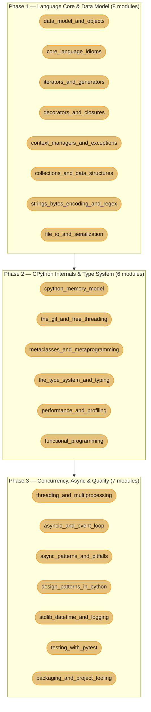

# Python — Senior Engineer & Interview Prep Guide

FastAPI now has its own section: [../fastapi/](../fastapi/README.md).

A comprehensive, one-stop reference for mastering **Python** — from CPython internals and the GIL through asyncio and the type system, to the pure-Python ecosystem (stdlib depth, testing, packaging, tooling). Covers everything a senior Python software engineer is expected to know in technical interviews.

> **No runtime application** — all content is Markdown with executable-shaped Python 3.14 code blocks.

---

## 1. Section Overview

This section covers:

- **Pure Python internals** — object model (everything is an object, dunder methods, `__slots__`, MRO/C3 linearization), CPython memory management (reference counting, generational GC, arenas/pools/blocks), the GIL and free-threading (PEP 703), metaclasses and descriptors, the type system (`Protocol`, `TypeVar`, `ParamSpec`, PEP 695 generics)
- **Concurrency and async** — `threading`, `multiprocessing`, `concurrent.futures`; `asyncio` event loop internals, coroutines, `TaskGroup` (3.11), structured concurrency; blocking-in-async pitfalls, backpressure, retries
- **Python ecosystem** — `itertools`, `collections`, `functools`, `contextlib`; `pytest` + `hypothesis`; `pyproject.toml`, `uv`, `ruff`, `mypy`; design patterns in Pythonic idioms

**Primary language:** Python 3.14 (the current stable release). Inline `[3.X]` tags mark the version each feature was introduced in; features that ship in 3.15 are tagged `[3.15]` and described as shipping, not current. Python 3.10 reaches end-of-life in October 2026, so 3.11 is the oldest version any example targets.

---

## 2. Module Table

| # | Module Directory | Phase | Difficulty | Key Topics |
|---|-----------------|-------|-----------|-----------|
| 1 | [data_model_and_objects](data_model_and_objects/data_model_and_objects.md) | 1 — Language Core | Intermediate | Dunder methods, `__slots__`, MRO/C3, operator overloading, hashing/equality contract |
| 2 | [core_language_idioms](core_language_idioms/core_language_idioms.md) | 1 — Language Core | Intermediate | Mutability vs identity, EAFP vs LBYL, comprehensions, walrus `:=` (3.8), `match` (3.10) |
| 3 | [iterators_and_generators](iterators_and_generators/iterators_and_generators.md) | 1 — Language Core | Intermediate | Iterator protocol, `yield`/`yield from`, lazy pipelines, `itertools`, generator coroutines |
| 4 | [decorators_and_closures](decorators_and_closures/decorators_and_closures.md) | 1 — Language Core | Intermediate | Closures, free variables, function/class/parametrized decorators, `functools.wraps/lru_cache/cached_property` |
| 5 | [context_managers_and_exceptions](context_managers_and_exceptions/context_managers_and_exceptions.md) | 1 — Language Core | Intermediate | `contextlib`, `ExitStack`, async CMs, `ExceptionGroup`/`except*` (3.11), traceback manipulation |
| 6 | [collections_and_data_structures](collections_and_data_structures/collections_and_data_structures.md) | 1 — Language Core | Intermediate | `list`/`dict`/`set` internals + Big-O, `collections` (deque/Counter/defaultdict), `heapq`, `bisect` |
| 7 | [strings_bytes_encoding_and_regex](strings_bytes_encoding_and_regex/strings_bytes_encoding_and_regex.md) | 1 — Language Core | Intermediate | `str` vs `bytes`, Unicode/codecs, `memoryview`, `re` engine, catastrophic backtracking |
| 8 | [file_io_and_serialization](file_io_and_serialization/file_io_and_serialization.md) | 1 — Language Core | Beginner | `pathlib`, text/binary I/O, `json`/`csv`, `pickle` security, `struct` |
| 9 | [cpython_memory_model](cpython_memory_model/cpython_memory_model.md) | 2 — CPython Internals | Advanced | Refcounting, generational GC, cyclic GC, `PyObject` header, arenas/pools/blocks, `sys.getsizeof` |
| 10 | [the_gil_and_free_threading](the_gil_and_free_threading/the_gil_and_free_threading.md) | 2 — CPython Internals | Advanced | GIL mechanics, GIL release points, contention profiling, PEP 703/779 free-threading, PEP 684/734 sub-interpreters |
| 11 | [metaclasses_and_metaprogramming](metaclasses_and_metaprogramming/metaclasses_and_metaprogramming.md) | 2 — CPython Internals | Advanced | `type()`, metaclasses, `__init_subclass__`, `__set_name__`, descriptors (non-data/data), `__getattr__` |
| 12 | [the_type_system_and_typing](the_type_system_and_typing/the_type_system_and_typing.md) | 2 — CPython Internals | Advanced | Type hints, generics, `Protocol` (structural), `TypeVar`/`ParamSpec`, variance, PEP 695 (3.12), mypy/pyright |
| 13 | [performance_and_profiling](performance_and_profiling/performance_and_profiling.md) | 2 — CPython Internals | Advanced | `cProfile`/`line_profiler`/`dis`, CPython 3.11+ speedups, Cython/mypyc/C extensions, slow patterns |
| 14 | [c_extensions_and_native_interop](c_extensions_and_native_interop/c_extensions_and_native_interop.md) | 2 — CPython Internals | Advanced | CPython C API, `ctypes`/`cffi`, Cython, PyO3, the GIL boundary, packaging native wheels |
| 14 | [functional_programming](functional_programming/functional_programming.md) | 2 — CPython Internals | Intermediate | `map`/`filter`/`reduce`, `functools`/`operator`, immutability, currying/partial, comprehension vs generator perf |
| 15 | [threading_and_multiprocessing](threading_and_multiprocessing/threading_and_multiprocessing.md) | 3 — Concurrency & Quality | Advanced | `threading`, GIL impact, `multiprocessing`, `concurrent.futures`, shared memory, pickling cost |
| 16 | [asyncio_and_event_loop](asyncio_and_event_loop/asyncio_and_event_loop.md) | 3 — Concurrency & Quality | Advanced | Coroutines, event-loop internals, tasks/futures, `gather`/`wait`, `TaskGroup` (3.11), `anyio` |
| 17 | [async_patterns_and_pitfalls](async_patterns_and_pitfalls/async_patterns_and_pitfalls.md) | 3 — Concurrency & Quality | Advanced | Blocking-in-async detection, `run_in_executor`, async generators, `Semaphore`, backpressure, retries |
| 18 | [design_patterns_in_python](design_patterns_in_python/design_patterns_in_python.md) | 3 — Concurrency & Quality | Intermediate | Pythonic GoF (singleton/strategy/observer/factory), anti-patterns — cross-links `lld/` |
| 19 | [stdlib_datetime_and_logging](stdlib_datetime_and_logging/stdlib_datetime_and_logging.md) | 3 — Concurrency & Quality | Intermediate | `datetime`/`zoneinfo`/tz pitfalls, structured `logging`, `argparse`, `subprocess`, `os`/`sys` |
| 20 | [testing_with_pytest](testing_with_pytest/testing_with_pytest.md) | 3 — Concurrency & Quality | Intermediate | pytest, fixtures/scopes, `parametrize`, `monkeypatch`, `hypothesis`, coverage, `pytest-asyncio` |
| 21 | [packaging_and_project_tooling](packaging_and_project_tooling/packaging_and_project_tooling.md) | 3 — Concurrency & Quality | Intermediate | `pyproject.toml`, `uv`/poetry/pip, venv, wheels/sdist, `ruff`/mypy, semantic versioning |

---

## 3. 3-Phase Learning Path



**Dependencies to note:**
- Phase 3 `asyncio` modules require Phase 1 generators/iterators (coroutines are generators under the hood).

---

<!-- study-paths
     THE source of truth for this section's file inventory and study-tier membership.
     Every module, every file it owns (module page AND deep-dive sub-files), and every
     case study is listed here with the tiers it belongs to; `-` means Full path only.
     Content files carry NO structural metadata -- a deep dive holds its topic, nothing
     else. Order is never declared here: it comes from STUDY_ORDER in game/app.js.
     The tier TABLES lower in this file are generated from this block by
     `python3 game/extract.py --write-paths`. A file on disk that is missing from this
     block, or listed here and absent from disk, FAILS `extract.py --strict`.
data_model_and_objects
  data_model_and_objects.md  senior
core_language_idioms
  core_language_idioms.md  senior
iterators_and_generators
  iterators_and_generators.md  senior
decorators_and_closures
  decorators_and_closures.md  senior
context_managers_and_exceptions
  context_managers_and_exceptions.md  senior
collections_and_data_structures
  collections_and_data_structures.md  senior
strings_bytes_encoding_and_regex
  strings_bytes_encoding_and_regex.md  senior
file_io_and_serialization
  file_io_and_serialization.md  -
cpython_memory_model
  cpython_memory_model.md  senior
the_gil_and_free_threading
  the_gil_and_free_threading.md  senior, principal
  subinterpreters_and_interpreter_pools.md  senior, principal
metaclasses_and_metaprogramming
  metaclasses_and_metaprogramming.md  senior
the_type_system_and_typing
  the_type_system_and_typing.md       senior, principal
  protocols_and_structural_typing.md  senior
performance_and_profiling
  performance_and_profiling.md  senior, principal
  the_modern_cpython_runtime.md  senior
functional_programming
  functional_programming.md  -
threading_and_multiprocessing
  threading_and_multiprocessing.md  senior
asyncio_and_event_loop
  asyncio_and_event_loop.md  senior
  event_loop_internals.md    senior
  structured_concurrency.md  senior
async_patterns_and_pitfalls
  async_patterns_and_pitfalls.md  senior, principal
design_patterns_in_python
  design_patterns_in_python.md  principal
stdlib_datetime_and_logging
  stdlib_datetime_and_logging.md  -
testing_with_pytest
  testing_with_pytest.md  senior, principal
packaging_and_project_tooling
  packaging_and_project_tooling.md  principal
  supply_chain_and_publishing.md  principal
the_import_system
  the_import_system.md  senior
dataclasses_enums_and_data_modeling
  dataclasses_enums_and_data_modeling.md  senior
c_extensions_and_native_interop
  c_extensions_and_native_interop.md  -
case_studies
  design_a_cpu_bound_batch_pipeline.md          senior, principal
  design_a_high_throughput_logging_pipeline.md  senior
  design_a_plugin_system.md                     principal
  design_a_streaming_etl.md                     senior
  design_a_validation_library.md                principal
  design_a_memory_efficient_cache.md  senior, principal

-->
## Learning Paths

This section is exhaustive by design — 21 modules spanning pure Python internals, concurrency, and the broader Python ecosystem. That is the right depth for a reference and the wrong shape for someone two weeks from an interview. So there are **two ways through it**; the browser learning game's **Study** view surfaces both as a **Full / Interview** toggle (Full is the default).

### Full Path (21 modules)

The complete curriculum in the order above — see [3-Phase Learning Path](#3-3-phase-learning-path). Use it for genuine mastery: deep CPython internals (metaclasses, descriptors, packaging/tooling, `dis`/profiling), the full concurrency toolkit (`threading`/`multiprocessing` alongside `asyncio`), stdlib depth (strings/bytes/regex, file I/O, datetime/logging), and Pythonic design patterns. Nothing is dropped.

<!-- study-path-table senior -->
### Senior Path (18 modules)

| # | Module | Files |
|---|--------|-------|
| 1 | [data_model_and_objects](data_model_and_objects/data_model_and_objects.md) | module page only |
| 2 | [core_language_idioms](core_language_idioms/core_language_idioms.md) | module page only |
| 3 | [the_import_system](the_import_system/the_import_system.md) | module page only |
| 4 | [iterators_and_generators](iterators_and_generators/iterators_and_generators.md) | module page only |
| 5 | [decorators_and_closures](decorators_and_closures/decorators_and_closures.md) | module page only |
| 6 | [context_managers_and_exceptions](context_managers_and_exceptions/context_managers_and_exceptions.md) | module page only |
| 7 | [collections_and_data_structures](collections_and_data_structures/collections_and_data_structures.md) | module page only |
| 8 | [dataclasses_enums_and_data_modeling](dataclasses_enums_and_data_modeling/dataclasses_enums_and_data_modeling.md) | module page only |
| 9 | [strings_bytes_encoding_and_regex](strings_bytes_encoding_and_regex/strings_bytes_encoding_and_regex.md) | module page only |
| 11 | [cpython_memory_model](cpython_memory_model/cpython_memory_model.md) | module page only |
| 12 | [the_gil_and_free_threading](the_gil_and_free_threading/the_gil_and_free_threading.md) | 2 files |
| 13 | [metaclasses_and_metaprogramming](metaclasses_and_metaprogramming/metaclasses_and_metaprogramming.md) | module page only |
| 14 | [the_type_system_and_typing](the_type_system_and_typing/the_type_system_and_typing.md) | 2 files |
| 15 | [performance_and_profiling](performance_and_profiling/performance_and_profiling.md) | 2 files |
| 18 | [threading_and_multiprocessing](threading_and_multiprocessing/threading_and_multiprocessing.md) | module page only |
| 19 | [asyncio_and_event_loop](asyncio_and_event_loop/asyncio_and_event_loop.md) | 3 files |
| 20 | [async_patterns_and_pitfalls](async_patterns_and_pitfalls/async_patterns_and_pitfalls.md) | module page only |
| 23 | [testing_with_pytest](testing_with_pytest/testing_with_pytest.md) | module page only |

**Not in this path** (6 of 24, Full Path only): `file_io_and_serialization`, `c_extensions_and_native_interop`, `functional_programming`, `design_patterns_in_python`, `stdlib_datetime_and_logging`, `packaging_and_project_tooling`
<!-- /study-path-table -->

A ruthless cut to what a **senior Python interview** actually probes, anchored on the modules this section already flags as highest-yield (language core, the GIL, and asyncio). Same learning order, a strict subset of the Full Path. Each group below says why it earns senior time.

| Group | Why it's tested |
|-------|-----------------|
| Language Core & Data Model | Dunder methods, `__slots__`, MRO/C3, EAFP vs LBYL, the iterator protocol, closures, `ExceptionGroup`/`except*`, and dict/list Big-O — the fundamentals nearly every Python interview opens with, screen or onsite |
| CPython Internals & Type System | Reference counting vs generational GC, the GIL's release points and PEP 703 free-threading, `Protocol`/`TypeVar`/variance, and functional idioms — the internals that separate mid from senior |
| Concurrency, Async & Testing | Event-loop internals, `TaskGroup` structured concurrency, blocking-in-async detection, and pytest fixtures/mocking — proof you can write and verify correct async code, not just describe it |

<!-- study-path-table principal -->
### Principal Path (7 modules)

| # | Module | Files |
|---|--------|-------|
| 12 | [the_gil_and_free_threading](the_gil_and_free_threading/the_gil_and_free_threading.md) | 2 files |
| 14 | [the_type_system_and_typing](the_type_system_and_typing/the_type_system_and_typing.md) | module page only |
| 15 | [performance_and_profiling](performance_and_profiling/performance_and_profiling.md) | module page only |
| 20 | [async_patterns_and_pitfalls](async_patterns_and_pitfalls/async_patterns_and_pitfalls.md) | module page only |
| 21 | [design_patterns_in_python](design_patterns_in_python/design_patterns_in_python.md) | module page only |
| 23 | [testing_with_pytest](testing_with_pytest/testing_with_pytest.md) | module page only |
| 24 | [packaging_and_project_tooling](packaging_and_project_tooling/packaging_and_project_tooling.md) | 2 files |

**Not in this path** (17 of 24, Full Path only): `data_model_and_objects`, `core_language_idioms`, `the_import_system`, `iterators_and_generators`, `decorators_and_closures`, `context_managers_and_exceptions`, `collections_and_data_structures`, `dataclasses_enums_and_data_modeling`, `strings_bytes_encoding_and_regex`, `file_io_and_serialization`, `cpython_memory_model`, `metaclasses_and_metaprogramming`, `c_extensions_and_native_interop`, `functional_programming`, `threading_and_multiprocessing`, `asyncio_and_event_loop`, `stdlib_datetime_and_logging`
<!-- /study-path-table -->

A different cut, not senior-plus-extras. The Principal Path probes the judgment behind a Python codebase at scale: where the runtime's guarantees actually bind, which concurrency model the workload demands, and what you standardise across teams. Roughly half of it is material the Senior Path never covers, and it is usually the smaller list -- depth of judgment, not depth of syllabus.

---

## Knowledge-Question Map

The highest-frequency Python *knowledge* questions mapped to the file that answers them.

| Interview question | Where the answer lives |
|--------------------|------------------------|
| How does Python's attribute lookup work (MRO, descriptors, data vs non-data), and when do you actually need `__slots__`? | [data_model_and_objects](data_model_and_objects/data_model_and_objects.md) |
| EAFP vs LBYL; comprehensions vs `map`/`filter`/`reduce` — which is idiomatic, and why? | [core_language_idioms](core_language_idioms/core_language_idioms.md), [functional_programming](functional_programming/functional_programming.md) |
| How do `yield`/`yield from` work, and what distinguishes an iterator from an iterable? | [iterators_and_generators](iterators_and_generators/iterators_and_generators.md) |
| What is a closure, and how does late binding cause the classic loop-variable bug? | [decorators_and_closures](decorators_and_closures/decorators_and_closures.md) |
| What changed with `ExceptionGroup`/`except*` in Python 3.11? | [context_managers_and_exceptions](context_managers_and_exceptions/context_managers_and_exceptions.md) |
| What's the time complexity of common `dict`/`list` operations, and how does a dict resize under the hood? | [collections_and_data_structures](collections_and_data_structures/collections_and_data_structures.md) |
| Explain CPython reference counting — when does the cyclic garbage collector have to step in? | [cpython_memory_model](cpython_memory_model/cpython_memory_model.md) |
| When exactly is the GIL released, and how does PEP 703 free-threading change that model? | [the_gil_and_free_threading](the_gil_and_free_threading/the_gil_and_free_threading.md) |
| What is a `Protocol`, and how does structural typing differ from nominal typing? | [the_type_system_and_typing](the_type_system_and_typing/the_type_system_and_typing.md) |
| Explain the async/await execution model, and what does `TaskGroup` (3.11) improve over `gather`? | [asyncio_and_event_loop](asyncio_and_event_loop/asyncio_and_event_loop.md) |
| What happens if you call a blocking call like `requests.get()` inside `async def`? | [async_patterns_and_pitfalls](async_patterns_and_pitfalls/async_patterns_and_pitfalls.md) |
| How do you mock an async dependency and assert on it with pytest? | [testing_with_pytest](testing_with_pytest/testing_with_pytest.md) |

---

## Study Plan

A 3-week plan over the Senior Path.

| Week | Focus | Modules |
|------|-------|---------|
| 1 | Language Core & Data Model | [data_model_and_objects](data_model_and_objects/data_model_and_objects.md), [core_language_idioms](core_language_idioms/core_language_idioms.md), [iterators_and_generators](iterators_and_generators/iterators_and_generators.md), [decorators_and_closures](decorators_and_closures/decorators_and_closures.md), [context_managers_and_exceptions](context_managers_and_exceptions/context_managers_and_exceptions.md), [collections_and_data_structures](collections_and_data_structures/collections_and_data_structures.md) |
| 2 | CPython Internals & Type System | [cpython_memory_model](cpython_memory_model/cpython_memory_model.md), [the_gil_and_free_threading](the_gil_and_free_threading/the_gil_and_free_threading.md), [the_type_system_and_typing](the_type_system_and_typing/the_type_system_and_typing.md), [functional_programming](functional_programming/functional_programming.md) |
| 3 | Concurrency, Async & Testing + drills | [asyncio_and_event_loop](asyncio_and_event_loop/asyncio_and_event_loop.md), [async_patterns_and_pitfalls](async_patterns_and_pitfalls/async_patterns_and_pitfalls.md), [testing_with_pytest](testing_with_pytest/testing_with_pytest.md) |

---

## 4. Python Version Matrix

| Feature | Version | Notes |
|---------|---------|-------|
| f-strings | 3.6 | Widely deployed baseline |
| `dataclasses` | 3.7 | `@dataclass`, `field()` |
| `asyncio.run()` | 3.7 | Stable public entry point |
| walrus operator `:=` | 3.8 | PEP 572, assignment expressions |
| Positional-only params `/` | 3.8 | PEP 570 |
| `TypedDict` | 3.8 | `typing.TypedDict` |
| `Union[X, Y]` as `X \| Y` | 3.10 | PEP 604 |
| `ParamSpec`, `Concatenate` | 3.10 | PEP 612 |
| `match`/`case` structural pattern matching | 3.10 | PEP 634 |
| `typing.TypeAlias` | 3.10 | PEP 613 |
| `tomllib` (stdlib TOML reader) | 3.11 | PEP 680 |
| Exception Groups + `except*` | 3.11 | PEP 654 |
| `asyncio.TaskGroup` | 3.11 | PEP 654, structured concurrency |
| `typing.Self` | 3.11 | PEP 673 |
| `typing.LiteralString` | 3.11 | PEP 675, SQL injection safety |
| CPython 3.11 speedup | 3.11 | ~25% faster than 3.10 (specializing adaptive interpreter, faster frame eval) |
| `typing.TypeVarTuple` | 3.11 | PEP 646, variadic generics |
| PEP 695 generics `type X[T] = ...` | 3.12 | New type alias syntax, inline TypeVar |
| `@override` decorator | 3.12 | PEP 698 |
| `asyncio.eager_task_factory` | 3.12 | Reduce event-loop overhead for short coroutines |
| Sub-interpreters (stable C API) | 3.12 | PEP 684, per-interpreter GIL |
| `sys.monitoring` low-overhead hooks | 3.12 | PEP 669, ~5% overhead vs ~2000% for `sys.settrace` debugging |
| `itertools.batched` | 3.12 | `strict=` added in 3.13 |
| Free-threading, experimental (`python3.13t`) | 3.13 | PEP 703, separate build via `--disable-gil` |
| JIT compiler (copy-and-patch) | 3.13 | PEP 744, experimental and opt-in at build time |
| `ReadOnly` for `TypedDict` | 3.13 | PEP 705, checker-enforced only |
| `warnings.deprecated()` | 3.13 | PEP 702, checkers flag callers |
| TypeVar defaults `[T = str]` | 3.13 | PEP 696 |
| `Path.full_match()` | 3.13 | |
| **Free-threading officially supported (`python3.14t`)** | **3.14** | **PEP 779.** Still an optional separate build. Single-thread overhead ~1% (macOS aarch64) to ~8% (x86-64 Linux) |
| `concurrent.interpreters` + `InterpreterPoolExecutor` | 3.14 | PEP 734, sub-interpreters from the stdlib |
| Deferred annotation evaluation + `annotationlib` | 3.14 | PEP 649/749. Annotations are lazily evaluated to real objects by default — `from __future__ import annotations` now means "keep them strings", which is usually the wrong choice for new code |
| t-strings `t"..."` | 3.14 | PEP 750, yields a `string.templatelib.Template` for safe interpolation |
| `SyntaxWarning` for `return`/`break`/`continue` in `finally` | 3.14 | PEP 765 |
| `multiprocessing` default start method → `forkserver` | 3.14 | On Unix other than macOS. macOS and Windows already defaulted to `spawn` |
| Tail-call interpreter | 3.14 | `--with-tail-call-interp`, Clang 19+, 3-5% geomean |
| `Path.copy()` / `Path.move()` | 3.14 | Also `copy_into` / `move_into` |
| `tarfile` extraction defaults to `filter='data'` | 3.14 | PEP 706 |
| `pickle` protocol 5 becomes the default | 3.14 | Protocol 5 itself is PEP 574, added in 3.8 |
| `compression.zstd` | 3.14 | PEP 784 |
| UTF-8 mode on by default | [3.15] | PEP 686, opt out with `PYTHONUTF8=0` |
| Explicit lazy imports | [3.15] | PEP 810, `lazy import json` / `lazy from pathlib import Path` |
| `profiling` package (`profiling.sampling`, "Tachyon") | [3.15] | PEP 799. Attaches to a live process, works on free-threaded builds. `profile` warns from 3.15, removed in 3.17 |
| JIT enabled in more builds | [3.15] | 8-9% geomean vs the standard interpreter on x86-64 Linux; 12-13% vs the tail-calling interpreter on AArch64 macOS. Marked not-yet-final |

Rows tagged `[3.15]` ship in Python 3.15 (rc1 2026-08-04, final due 2026-10-01) and are not
yet available on a stable interpreter. Python **3.10 reaches end-of-life on 2026-10-31**, so
3.11 is the oldest version worth targeting.

**On version claims in this section:** CPython publishes an official cumulative
pyperformance figure only for **3.11, at 25% faster than 3.10** (range 10-60%). There is no
official cumulative geomean for 3.12 through 3.15, and every "3.13 is N% faster" index number
in circulation is a third-party aggregation. Attribute a speedup to what it was measured
against, or do not state it.

---

## 5. Top Interview Topics by Category

### Python Object Model & Internals
1. **How does Python's attribute lookup work?** Python checks (in order): data descriptors on the class/MRO, then instance `__dict__`, then non-data descriptors and class attributes. `property` is a data descriptor (has `__set__`), so it always intercepts instance attribute access.
2. **Explain `__slots__` and when to use it.** `__slots__` replaces per-instance `__dict__` with a compact C-level array. Saves 50–200 bytes per instance, speeds attribute access, prevents accidental attribute creation. Use when creating millions of instances; trade-off is loss of dynamic attributes.
3. **What is C3 linearization?** The MRO algorithm ensuring consistency in multiple inheritance. It respects local precedence order and monotonicity. `ClassName.__mro__` shows the resolution order; `super()` follows it cooperatively.
4. **What is a descriptor?** An object implementing `__get__`/`__set__`/`__delete__`. Python's attribute machinery calls `__get__` on class attribute access. `property`, `classmethod`, `staticmethod` are all implemented as descriptors.
5. **How does Python's `__hash__` contract work?** Objects that compare equal (`__eq__`) must have the same hash. If you override `__eq__`, Python sets `__hash__ = None` (unhashable) unless you also define `__hash__`. Mutable objects should not be hashable.

### GIL, Concurrency & asyncio
1. **When is the GIL released?** CPython releases the GIL every `sys.getswitchinterval()` (default 5 ms) of bytecode execution, and on every blocking I/O system call (socket, file, `time.sleep`). Pure CPU-bound Python bytecode holds the GIL continuously.
2. **When does multi-threading help despite the GIL?** I/O-bound workloads. While one thread blocks on I/O, the GIL is released and other threads can run. For CPU-bound work, use `multiprocessing` (separate processes = separate GILs).
3. **Explain the async/await execution model.** `async def` defines a coroutine. `await expr` suspends the coroutine, yielding control to the event loop, which uses `select()`/`epoll`/`kqueue` to multiplex I/O readiness. No OS threads are involved; a single thread executes all coroutines interleaved.
4. **What does `asyncio.TaskGroup` improve over `gather`?** TaskGroup (3.11, PEP 654) provides structured concurrency: if any child task raises, remaining tasks are cancelled immediately, and ALL exceptions are collected into an `ExceptionGroup`. `gather` propagates only the first exception by default, leaving others silently swallowed.
5. **What happens if you call `requests.get()` inside `async def`?** It blocks the event loop thread for the entire network round-trip — all other coroutines stall. Fix: use `httpx.AsyncClient` or `await asyncio.get_event_loop().run_in_executor(None, requests.get, url)`.

---

## 6. Cross-Reference Map

| Module | Also See |
|--------|---------|
| `data_model_and_objects` | [`lld/behavioral/`](../lld/behavioral/behavioral.md) — observer/strategy as Python callables |
| `the_gil_and_free_threading` | [`java/concurrency/`](../java/concurrency/concurrency.md) — compare JVM threading vs CPython GIL |
| `asyncio_and_event_loop` | [`backend/async_and_concurrency_patterns/`](../backend/async_and_concurrency_patterns/async_and_concurrency_patterns.md); [`llm/case_studies/cross_cutting/streaming_at_scale.md`](../llm/case_studies/cross_cutting/streaming_at_scale.md) |
| `the_type_system_and_typing` | [`java/generics_and_type_system/`](../java/generics_and_type_system/generics_and_type_system.md) — erasure vs Python runtime generics |
| `design_patterns_in_python` | [`lld/creational/`](../lld/creational/creational.md); [`lld/structural/`](../lld/structural/structural.md); [`lld/behavioral/`](../lld/behavioral/behavioral.md) |

---

## 7. Build Status & Implementation Tracker

> **ALL BATCHES COMPLETE — Section fully built.** 21 modules + 3 sub-files. No pending work. (FastAPI's former modules, case studies, and sub-files were split into [../fastapi/](../fastapi/README.md) on 2026-07-07.)

### Batch Plan

| Batch | Files | Status |
|-------|-------|--------|
| **Batch 1 — Core** | `data_model_and_objects`, `the_gil_and_free_threading`, `asyncio_and_event_loop`, `decorators_and_closures`, `the_type_system_and_typing` | done |
| **Batch 2 — Phase 1 finish** | `core_language_idioms`, `iterators_and_generators`, `context_managers_and_exceptions`, `collections_and_data_structures`, `strings_bytes_encoding_and_regex`, `file_io_and_serialization` | done |
| **Batch 3 — Phase 2 finish** | `cpython_memory_model`, `metaclasses_and_metaprogramming`, `performance_and_profiling`, `functional_programming` | done |
| **Batch 4 — Phase 3 finish** | `threading_and_multiprocessing`, `async_patterns_and_pitfalls`, `design_patterns_in_python`, `stdlib_datetime_and_logging`, `testing_with_pytest`, `packaging_and_project_tooling` | done |
| **Batch 5 — Sub-files** | `asyncio_and_event_loop/event_loop_internals.md`, `asyncio_and_event_loop/structured_concurrency.md`, `the_type_system_and_typing/protocols_and_structural_typing.md` | done |

### All Files Status

| # | Module / File | Phase | Batch | Status | Q&As | Lines |
|---|--------------|-------|-------|--------|------|-------|
| 1 | `data_model_and_objects/data_model_and_objects.md` | 1 | 1 | done | 16 | 1,321 |
| 2 | `core_language_idioms/core_language_idioms.md` | 1 | 2 | done | 18 | 1,076 |
| 3 | `iterators_and_generators/iterators_and_generators.md` | 1 | 2 | done | 16 | 1,372 |
| 4 | `decorators_and_closures/decorators_and_closures.md` | 1 | 1 | done | 16 | 1,258 |
| 5 | `context_managers_and_exceptions/context_managers_and_exceptions.md` | 1 | 2 | done | 16 | 1,185 |
| 6 | `collections_and_data_structures/collections_and_data_structures.md` | 1 | 2 | done | 17 | 1,300 |
| 7 | `strings_bytes_encoding_and_regex/strings_bytes_encoding_and_regex.md` | 1 | 2 | done | 16 | 1,224 |
| 8 | `file_io_and_serialization/file_io_and_serialization.md` | 1 | 2 | done | 16 | 1,327 |
| 9 | `cpython_memory_model/cpython_memory_model.md` | 2 | 3 | done | 16 | 1,524 |
| 10 | `the_gil_and_free_threading/the_gil_and_free_threading.md` | 2 | 1 | done | 18 | 1,213 |
| 11 | `metaclasses_and_metaprogramming/metaclasses_and_metaprogramming.md` | 2 | 3 | done | 16 | 1,300 |
| 12 | `the_type_system_and_typing/the_type_system_and_typing.md` | 2 | 1 | done | 15 | 1,644 |
| 13 | `performance_and_profiling/performance_and_profiling.md` | 2 | 3 | done | 16 | 1,045 |
| 14 | `functional_programming/functional_programming.md` | 2 | 3 | done | 16 | 1,164 |
| 15 | `threading_and_multiprocessing/threading_and_multiprocessing.md` | 3 | 4 | done | 15 | 1,196 |
| 16 | `asyncio_and_event_loop/asyncio_and_event_loop.md` | 3 | 1 | done | 21 | 1,546 |
| 17 | `async_patterns_and_pitfalls/async_patterns_and_pitfalls.md` | 3 | 4 | done | 17 | 1,712 |
| 18 | `design_patterns_in_python/design_patterns_in_python.md` | 3 | 4 | done | 16 | 1,310 |
| 19 | `stdlib_datetime_and_logging/stdlib_datetime_and_logging.md` | 3 | 4 | done | 16 | 1,307 |
| 20 | `testing_with_pytest/testing_with_pytest.md` | 3 | 4 | done | 16 | 1,223 |
| 21 | `packaging_and_project_tooling/packaging_and_project_tooling.md` | 3 | 4 | done | 16 | 1,084 |
| SF1 | `asyncio_and_event_loop/event_loop_internals.md` | 3 | 5 | done | 16 | 1,314 |
| SF2 | `asyncio_and_event_loop/structured_concurrency.md` | 3 | 5 | done | 15 | 1,207 |
| SF3 | `the_type_system_and_typing/protocols_and_structural_typing.md` | 2 | 5 | done | 15 | 1,529 |

The **Q&As** and **Lines** columns are *measured*, not targets. They replaced a "Q&A Target"
column that advertised 10+ and 12+ — numbers **below** the repo's hard floor of 15. The
predictable result was that 20 of 24 files came to rest at exactly 15-16 Q&As: the floor
became the ceiling because the index said so. Verify a count with

```bash
awk '/^## .*[Ii]nterview [Qq]/{f=1;next} /^## /{f=0} f && /^\*\*Q/{c++} END{print c+0}' <file.md>
```

and confirm it against `python3 game/extract.py`, which prints the per-section bank total.

### Conventions Reminder (for future batch agents)

Root `CLAUDE.md` is the authority for every rule below; this block only restates the
Python-specific parts of it. **Where the two ever disagree, root `CLAUDE.md` wins.**

```
FILE NAMING — every content page is named for its folder:
  python/<module>/<module>.md          the module page
  python/<module>/<subfile>.md         a deep-dive sub-file (free-named)
  There is NO README.md below the section root. A page named README.md is
  invisible to extract.py and will not be found where a module page is expected.

MODULE TEMPLATE — 14-section canonical scheme:
  ## 1. Concept Overview
  ## 2. Intuition     ("> blockquote analogy" + **Mental model** + **Why it matters** + **Key insight**)
  ## 3. Core Principles
  ## 4. Types / Architectures / Strategies
  ## 5. Architecture Diagrams            (Mermaid preferred — see below)
  ## 6. How It Works — Detailed Mechanics   (real Python code, concrete numbers)
  ## 7. Real-World Examples
  ## 8. Tradeoffs                        (comparison tables)
  ## 9. When to Use / When NOT to Use
  ## 10. Common Pitfalls                 (# BROKEN / # FIX pattern, at least 1 required)
  ## 11. Technologies & Tools            (comparison table)
  ## 12. Interview Questions with Answers  (exact heading — see Q&A CONTRACT below)
  ## 13. Best Practices
  ## 14. Case Study   (scenario + diagram + real code + BROKEN/FIX + metrics + Discussion Qs)

Q&A CONTRACT (load-bearing — the game parses this):
  - The heading must match "interview q" — "## 12. Interview Questions with Answers".
    "## 12. Interview Tips" contributes ZERO questions to the bank, silently.
  - Every question is "**Q: <question>?**" starting at column 0 with "**".
    NEVER numbered as a Markdown list ("1. **...**" parses as prose, not a
    question, and silently loses the whole section).
    This section's existing Q&As use the older "**Qn:" label. extract.py strips
    both, so they are correctly in the bank -- but write NEW Q&As as "**Q: ",
    which is the repo-wide convention in root CLAUDE.md.
  - Every answer's FIRST non-blank line is an authored one-line summary:
        **Q: <question>?**
        **Short:** <one self-contained sentence, 15-220 chars, no code fence, no list>

        <the full answer — mechanism, example, gotcha, guidance>
    That line ships as the MCQ's correct option. Outside 15-220 chars it FAILS
    `extract.py --strict`. If you change an answer, update its Short in the same edit.
  - Answers state what is CURRENT — replace, do not annotate. Never "foo() is
    deprecated, use bar()"; just say bar().

QUALITY BAR:
  - Q&A minimum: 15+ per module page and per sub-file (hard floor, root CLAUDE.md).
    Deep modules run 18+: the_gil_and_free_threading, asyncio_and_event_loop,
    the_type_system_and_typing, threading_and_multiprocessing.
    This is a FLOOR, not a target — the section's files run 16-20 and should grow.
  - Module pages run ~1,000-1,700 lines. There is no line ceiling.
  - At least 1 BROKEN->FIX block in §10 and at least 1 in §14 (files here carry 5-7)
  - Python 3.14 is the primary target (3.15 is at rc; tag it "[3.15]" and say
    "ships in 3.15" rather than writing it as current). Mark every version-gated
    feature with an inline "[3.X]" tag. Python 3.10 is EOL — do not write to it.
  - Type hints on ALL function signatures (use X | None not Optional[X])
  - Concrete numbers everywhere (no "a few", "some", "significant")
  - Horizontal rules (---) between every top-level section
  - Em-dash in §6 heading: "## 6. How It Works — Detailed Mechanics"
  - No emojis in any content
  - Cross-link to the module PAGE, never a bare directory:
    ../backend/async_and_concurrency_patterns/async_and_concurrency_patterns.md
    (python/README.md sits one level under the section root, so a cross-section
    link needs exactly one ../ — not ../../)

DIAGRAMS — appeal-first, Mermaid preferred:
  - Pick the form whose topology matches the concept: flowchart (default LR),
    sequenceDiagram, stateDiagram-v2, xychart-beta, pie, quadrantChart, timeline.
  - Colour EVERY node with the One-Dark classDef palette, semantic-by-role;
    short labels wrapped with <br/>; rounded shapes.
  - ASCII stays only for constraint grids, alignment-critical layout maps, and
    vector geometry — shapes Mermaid cannot draw.
  - A fence that does not parse FAILS THE BUILD. Validate what you touch:
        node scripts/check_render.mjs <absolute-file.md>
  - Run /mermaid-diagrams before authoring a fence.

WIRING (structure lives in THIS file, never in a content file):
  1. New module -> python/<module>/<module>.md, and add the module dir to
     STUDY_ORDER.python in game/app.js at its phase position
  2. Add the module and EVERY file it owns to the <!-- study-paths --> block
     above, tagging each file with its tiers ("-" = Full path only). A file on
     disk missing from that block is FATAL under --strict, and so is the reverse.
  3. Run `python3 game/extract.py --write-paths` to regenerate the tier tables
     between the <!-- study-path-table --> markers. NEVER hand-edit those tables.
  4. Update the module table in §2, this tracker, python/CLAUDE.md, and root
     README.md + CLAUDE.md counts
  5. Verify with `python3 game/extract.py --strict`, then scripts/build_banks.sh
     (--strict passing does not mean CI passes)
```

---

## Getting Started

**Week 1 — Python Internals Foundation** (highest interview signal-to-noise)
- `data_model_and_objects` — covers ~30% of Python interview questions on its own
- `decorators_and_closures` — appears in almost every senior Python interview
- `the_gil_and_free_threading` — key differentiator for principal-level interviews

**Week 2 — Async and Type System** (the hard ones)
- `asyncio_and_event_loop` — deepest async module; study alongside `async_patterns_and_pitfalls`
- `the_type_system_and_typing` — `Protocol`, `TypeVar`, `ParamSpec` tested at FAANG+
- `cpython_memory_model` + `metaclasses_and_metaprogramming` for deep CPython questions

Once these are solid, move on to [../fastapi/](../fastapi/README.md) for the framework layer (ASGI, Pydantic v2, dependency injection) and its production concerns.

See each module page (`<module>/<module>.md`) for per-module learning objectives and cross-references.
