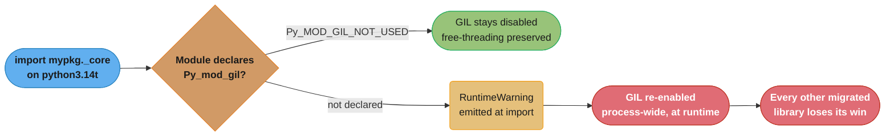
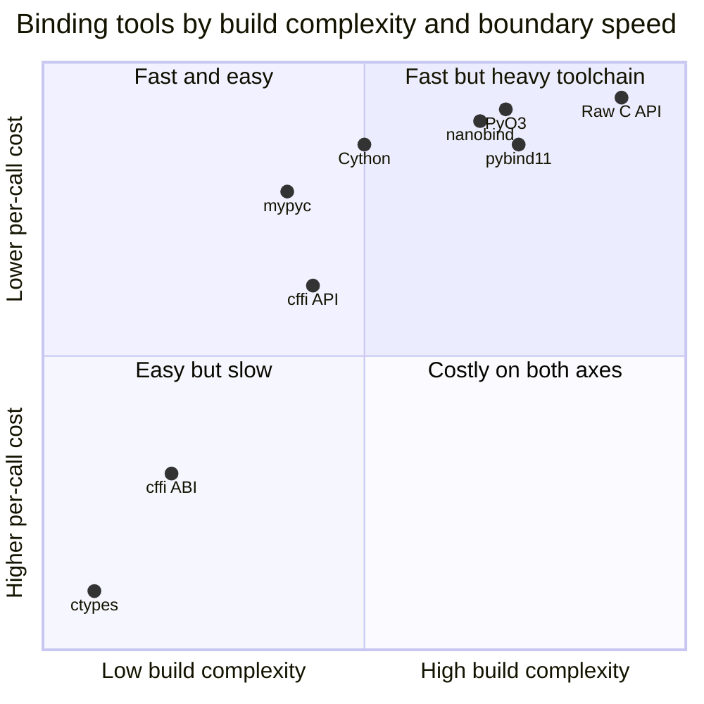

# C Extensions and Native Interop

## 1. Concept Overview

A C extension is a shared library that CPython loads with `dlopen` and treats as a module. From the
importing code's point of view nothing is unusual — `import mypkg._core` binds a module object like
any other. Underneath, that module's functions run compiled machine code that manipulates
`PyObject*` pointers directly, with no bytecode, no interpreter loop, and no per-operation dispatch.

That is the entire performance story. A pure-Python `for` loop summing a million integers executes a
million rounds of the evaluation loop; each round decodes an opcode, checks types, allocates a boxed
`int`, and adjusts two reference counts. The same loop in C is a register add. The gap is not a
constant factor you can tune away — it is the difference between interpreting a description of the
work and executing the work.

Historically this was specialist territory: you wrote against the C API, you were careful with
reference counts, and if you got it wrong you got a segfault rather than a traceback. Three changes
moved it into the mainstream.

**Rust bindings made the boundary safe enough to staff.** PyO3 gives you the C API's speed with
Rust's ownership checking, so the reference-counting bugs that made C extensions frightening are
largely compile-time errors instead of 3am pages. The most widely-installed packages in the
ecosystem followed: `pydantic-core`, `tiktoken`, `ruff`, and `uv` are all Rust extensions with a thin
Python surface.

**The free-threaded build made the boundary load-bearing.** Under a GIL, an extension that never
released it was merely slow — it serialized with everything else, which was the status quo anyway.
Under `python3.14t` there is no GIL to serialize on, and an extension that has not declared itself
free-threading-safe does not just miss out: importing it **re-enables the GIL for the whole process
at runtime**. One un-migrated dependency erases the benefit for every other library in the address
space. The C boundary is now the thing that decides whether free-threading works for you at all.

**The Stable ABI matured.** Building one wheel that works across many Python versions used to be a
niche trick; with `abi3` it is the default advice for anything that does not need the fast macros,
and PEP 803's `abi3t` `[3.15]` extends the same promise to free-threaded builds.

This module covers the boundary itself: what crossing it costs, what contracts you take on when you
cross it, and — the part most treatments skip — when the right answer is not to cross it at all.

**Related modules:** [The GIL and Free-Threading](../the_gil_and_free_threading/the_gil_and_free_threading.md)
for the locking model this boundary negotiates with,
[Performance and Profiling](../performance_and_profiling/performance_and_profiling.md) for deciding
whether you have a problem native code can solve, and
[CPython Memory Model](../cpython_memory_model/cpython_memory_model.md) for the reference-counting
semantics you are taking manual responsibility for.

---

## 2. Intuition

**One-line analogy:** a native extension is an airlock. The GIL is the pressure seal, and the airlock
only works if you announce when you are stepping outside it and when you are coming back.

**Mental model.** Picture the interpreter as a pressurised cabin. Inside, one rule holds everything
together: whoever holds the GIL may touch Python objects, and nobody else may. When your C function
is called, you are inside the cabin holding the seal. Two things follow.

First, while you hold it, nothing else in the process runs Python. If your function spends 400ms
compressing an image and never says otherwise, every other thread waits 400ms — and from the outside
this looks exactly like a GIL problem in pure Python, which is why it is so often misdiagnosed.

Second, the moment you step outside — `Py_BEGIN_ALLOW_THREADS`, or `py.detach()` in PyO3 — you have
given up the right to touch any `PyObject`. Not read it, not increment its refcount, not glance at
its type. Other threads are now mutating the heap you were standing on. Coming back through the seal
means reacquiring it before you touch anything Python again.

**Why it matters.** Almost every serious extension bug is one of these two contracts broken. Holding
the seal too long is a performance bug that looks like a language limitation. Touching Python objects
outside the seal is a memory-corruption bug that shows up as a crash in an unrelated function three
minutes later, under load, on one machine.

**Key insight.** The boundary is *two independent contracts*, and you must honour both:

- an **ownership** contract about reference counts — who owns the reference you were handed, and who
  owns the one you return;
- a **locking** contract about the GIL — whether you hold it, and whether the thing you are about to
  do is legal without it.

Learn to ask both questions about every line at the boundary and the category of bug largely
disappears. Ask neither and no amount of testing will save you, because both failure modes are
timing- and load-dependent by construction.

---

## 3. Core Principles

**1. Reference ownership is explicit, and the API tells you which kind you got.** CPython's C API
hands back three flavours of reference and the distinction is not cosmetic. A **new reference** is
yours: you must `Py_DECREF` it or you leak. A **borrowed reference** is on loan from a container that
still holds it; it is valid only as long as the owner is, and using it after the owner drops it is a
use-after-free. A **stolen reference** is one the callee took ownership of, so you must *not* decref
it. `PyList_GetItem()` borrows; `PyList_GetItemRef()` gives you a new reference; `PyTuple_SetItem()`
steals. Under free-threading the borrowed-reference pattern is materially more dangerous, because the
container can be mutated by another thread between your borrow and your use, which is precisely why
the newer `...GetItemRef()` variants exist and why new code should prefer them.

**2. Releasing the GIL is your job, and nobody will do it for you.** CPython releases the GIL around
its own blocking calls — file I/O, socket operations, `time.sleep`. It has no idea that your
`compress_image()` is going to run for 400ms. If you do not wrap the non-Python part in
`Py_BEGIN_ALLOW_THREADS` / `Py_END_ALLOW_THREADS` (or `py.detach()`), your extension is a
process-wide stop-the-world pause. The rule for what may live inside that region is absolute: **no
`PyObject` access of any kind.** Copy what you need into plain C or Rust data first.

**3. API stability and ABI stability are different promises.** *API* stability means your source
still compiles against a new Python. *ABI* stability means your already-compiled `.so` still loads
into a new Python. The Limited API is the subset of the C API you may *write* against; the Stable ABI
is the set of symbols that stay binary-compatible, letting one `abi3` wheel serve many versions. You
opt into the first to get the second. The catch, in CPython's own words, is that "compiling with
`Py_LIMITED_API` is *not* a complete guarantee that code conforms to the Limited API or the Stable
ABI" — and "Python does not verify conformance to Stable ABI". Nothing checks you. This is the source
of a genuinely nasty class of bug covered in §10.

**4. The buffer protocol is the zero-copy contract.** Moving a 200MB array across the boundary by
converting it to a Python `list` of `float` costs a 200MB copy plus a million object allocations. The
buffer protocol exists so that NumPy, `bytes`, `bytearray`, `array.array`, and your extension can all
agree to *share* a memory region — pointer, shape, strides, item size — with no copy at all. PEP 688
`[3.12]` brought the protocol to the Python level so type checkers can reason about it. Any extension
that moves bulk numeric data and does not speak buffers is leaving its largest win on the table.

**5. The free-threaded build makes silence the wrong default.** An extension must *explicitly*
declare free-threading support. The documented behaviour is unambiguous: "Extension modules need to
explicitly indicate that they support running with the GIL disabled; otherwise importing the
extension will raise a warning and enable the GIL at runtime." Silence is not neutral — it is a
process-wide opt-out that overrides every other library's careful migration.

**6. The fastest boundary crossing is the one you do not make.** Per-call overhead is real: argument
parsing, tuple construction, and the call protocol itself. An extension function called once with a
million-element buffer is fast. The same function called a million times with one element each is
often *slower* than pure Python. Design the interface to be chunky, not chatty.

---

## 4. Types / Architectures / Strategies

### 4.1 The tool landscape

| Tool | You write | Build step | Boundary cost | Best for |
|---|---|---|---|---|
| `ctypes` | Python | none | Highest — signatures marshalled at runtime, per call | Calling an existing `.so` occasionally; prototyping; no build toolchain available |
| `cffi` | Python + C declarations | optional (ABI vs API mode) | Lower than `ctypes` in API mode | Binding an existing C library cleanly, especially on PyPy |
| **Cython** | Python-like `.pyx` | C compiler | Very low | Speeding up *your own* Python hot loops incrementally |
| **mypyc** | Annotated Python | C compiler | Very low | Compiling an existing typed Python codebase with no rewrite |
| **PyO3** + maturin | Rust | Rust toolchain | Very low | New high-performance components; memory safety matters |
| **pybind11** | C++ | C++ compiler | Very low | Binding an existing C++ library |
| **nanobind** | C++17 | C++ compiler | Very low | Same as pybind11, smaller binaries and faster builds |
| Raw C API | C | C compiler | Lowest | Maximum control; rarely the right first choice today |

**Choosing between them is mostly about what you already have.** Binding a C library that exists →
`cffi` or `pybind11`/`nanobind` for C++. Speeding up Python you wrote → Cython or mypyc, because
neither requires a rewrite. Building something new and fast → PyO3, because the ownership bugs
become compile errors. Calling one function in a vendor `.so` once per request → `ctypes`, and stop
there.

### 4.2 The two module-initialisation shapes

**Multi-phase initialisation** (PEP 489) is the modern shape. The module declares a table of *slots*
and CPython drives creation and execution as separate steps. This is what allows a module to be
loaded into multiple sub-interpreters, and it is where the `Py_mod_gil` declaration lives.

**Single-phase initialisation** is the legacy shape: one `PyInit_mymodule()` that builds and returns
a finished module. It cannot support sub-interpreters properly, and it declares free-threading
support through a different call (`PyUnstable_Module_SetGIL`). New modules should use multi-phase.

### 4.3 The ABI strategies

| Strategy | Wheels needed | API available | Use when |
|---|---|---|---|
| Version-specific (`cp314`) | One per Python version per platform | Everything, including fast macros | You need the full API, or you already have a wheel matrix |
| Stable ABI (`abi3`) | One per platform, many versions | Limited API only | Your API needs are modest — most binding-style extensions |
| `abi3t` `[3.15]` | One per platform, free-threaded builds | Limited API with an opaque `PyObject` | Free-threaded builds, where `PyObject` internals must not be assumed |

PEP 803 (Status **Final**, resolved 2026-03-30, Python-Version 3.15) defines `abi3t` as "a new
variant of the Stable ABI, called 'Stable ABI for Free-Threaded Python'... based on the existing
Stable ABI (`abi3`), but make the `PyObject` structure opaque". Opacity is the whole point:
free-threading changes how a `PyObject` header is laid out and how refcounts work, so any extension
that had inlined assumptions about that layout cannot be binary-compatible across the two builds.

### 4.4 The data-transfer strategies

| Strategy | Copy? | Use when |
|---|---|---|
| Convert to Python objects (`PyLong_FromLong` per element) | Full copy + N allocations | Small results, or genuinely heterogeneous data |
| Buffer protocol / `memoryview` | **None** | Bulk homogeneous numeric data |
| `bytes` / `bytearray` | One copy | Serialized blobs where the consumer wants bytes anyway |
| Shared memory | None, across processes | Multi-process pipelines |

---

## 5. Architecture Diagrams

```mermaid
flowchart LR
    classDef io      fill:#61afef,stroke:#2e86c1,color:#1a1a1a,font-weight:bold
    classDef frozen  fill:#c678dd,stroke:#9b59b6,color:#fff
    classDef train   fill:#98c379,stroke:#27ae60,color:#1a1a1a
    classDef mathOp  fill:#d19a66,stroke:#e67e22,color:#1a1a1a,font-weight:bold
    classDef lossN   fill:#e06c75,stroke:#c0392b,color:#fff,font-weight:bold
    classDef base    fill:#e5c07b,stroke:#f39c12,color:#1a1a1a

    Py(["Python caller<br/>holds the GIL"]) --> Parse("Argument parsing<br/>PyObject to C types")
    Parse --> Acquire("Extract buffer<br/>no copy")
    Acquire --> Release("Py_BEGIN_ALLOW_THREADS<br/>py.detach in PyO3")
    Release --> Work(["Pure native work<br/>NO PyObject access"])
    Work --> Reacquire("Py_END_ALLOW_THREADS<br/>GIL reacquired")
    Reacquire --> Build("Build return value<br/>new reference")
    Build --> Back(["Back to Python"])

    class Py,Back io
    class Parse,Build mathOp
    class Acquire base
    class Release,Reacquire lossN
    class Work train
```



*The boundary crossing in full. The two red nodes are the seal opening and closing, and the green
node is the only place real parallelism happens — everything between them runs without the GIL, which
is exactly why no `PyObject` may be touched there.*



*The import-time decision that decides whether free-threading works at all. Note the blast radius:
the GIL is re-enabled for the entire process, so one un-migrated transitive dependency cancels every
other library's migration. This is why auditing dependencies precedes any free-threading rollout.*



*Positioning the tools. `ctypes` is free to adopt and expensive per call, which is the right trade
for occasional use and the wrong one inside a loop. Cython and mypyc sit in the sweet spot for
existing Python; PyO3 and nanobind buy the lowest cost at the price of a second toolchain in CI.*

### 5.4 A `memoryview` over a strided buffer

Strides are the piece people get wrong, and they are alignment-critical, so this one is ASCII.

```
A 3x4 array of int32, C-contiguous:  shape=(3, 4)  itemsize=4  strides=(16, 4)

byte offset:  0    4    8   12   16   20   24   28   32   36   40   44
             +----+----+----+----+----+----+----+----+----+----+----+----+
   memory    | a0 | a1 | a2 | a3 | b0 | b1 | b2 | b3 | c0 | c1 | c2 | c3 |
             +----+----+----+----+----+----+----+----+----+----+----+----+
              \_________________/ \_________________/ \_________________/
                    row 0               row 1               row 2
              stride[0] = 16 bytes: step this far to move one row down
              stride[1] =  4 bytes: step this far to move one column right

element (i, j) lives at:  base + i*strides[0] + j*strides[1]


Now take the column slice  mv[:, 1:3]  --  NO BYTES ARE COPIED:

              shape=(3, 2)   itemsize=4   strides=(16, 4)   offset=+4
             +----+----+              +----+----+              +----+----+
   view      | a1 | a2 |              | b1 | b2 |              | c1 | c2 |
             +----+----+              +----+----+              +----+----+
              ^                        ^                        ^
              base+4                   base+20                  base+36

The view is 5 integers of metadata pointing into the SAME allocation.
strides[0] is still 16 because the underlying rows are still 16 bytes apart --
that is exactly what makes the slice free, and what makes the buffer
non-contiguous. An extension that assumes contiguity will read a1,a2,a3,b0
instead of a1,a2,b1,b2. Always request the layout you need.
```

*Why this is the whole zero-copy story: a slice changes only shape, offset, and the pointer — never
the bytes. It is also why `PyBUF_C_CONTIGUOUS` exists: request the layout your kernel assumes, and
let CPython raise rather than silently hand you a strided view your loop will misread.*

---

## 6. How It Works — Detailed Mechanics

### 6.1 A PyO3 extension, end to end

PyO3 0.30.1 (2026-10-14) with maturin 1.15.0 (2026-08-24). PyO3 0.30.0 dropped Python 3.8, raised the
minimum Rust to 1.85, added Python 3.15.0 final support, and stopped `#[pyclass]` from emitting
`FromPyObject` by default. The project layout:

```toml
# pyproject.toml
[build-system]
requires = ["maturin>=1.0,<2.0"]
build-backend = "maturin"

[project]
name = "hashkit"
requires-python = ">=3.11"
```

```toml
# Cargo.toml
[package]
name = "hashkit"
version = "0.1.0"
edition = "2021"

[lib]
name = "hashkit"
crate-type = ["cdylib"]

[dependencies.pyo3]
version = "0.30.0"
features = ["abi3-py311"]   # one wheel for 3.11 and every later version
```

The module itself:

```rust
// src/lib.rs
#[pyo3::pymodule]
mod hashkit {
    use pyo3::prelude::*;

    /// Sum a slice of bytes. Fast, but holds the GIL for its whole run.
    #[pyfunction]
    fn checksum(data: &[u8]) -> PyResult<u64> {
        Ok(data.iter().map(|&b| b as u64).sum())
    }
}
```

`maturin develop` builds it and installs it into the active virtualenv;
`maturin build --release` produces the wheel.

### 6.2 Releasing the GIL from Rust — `py.detach`

The function above is a correctness bug waiting for a thread pool. It runs entirely in Rust but never
releases the GIL, so eight threads calling it run strictly one at a time.

**The API here was renamed.** `Python::allow_threads` became `Python::detach` in PyO3 0.26.0. Current
code uses `detach`:

```rust
#[pyfunction]
fn checksum_parallel(py: Python<'_>, data: &[u8]) -> PyResult<u64> {
    // Everything inside the closure runs WITHOUT the GIL.
    // `data` is a plain Rust slice, not a PyObject -- that is what makes this legal.
    Ok(py.detach(|| data.iter().map(|&b| b as u64).sum()))
}
```

The rule the type system enforces for you: inside `detach`, you do not have a `Python<'_>` token, and
nearly every PyO3 API that touches a Python object demands one. In C this rule is a comment; in Rust
it is a compile error. That single difference is most of why the ecosystem moved to Rust.

For genuine multi-core work inside the closure, combine `detach` with rayon:

```rust
use rayon::prelude::*;

#[pyfunction]
fn checksum_rayon(py: Python<'_>, data: &[u8]) -> PyResult<u64> {
    py.detach(|| data.par_iter().map(|&b| b as u64).sum())
}
```

This is real parallelism from a single Python thread, on a stock GIL-enabled interpreter — the GIL
was never the obstacle to native parallelism, only to *Python-level* parallelism.

### 6.3 Free-threading in PyO3

Since PyO3 0.28, PyO3 **defaults to assuming modules it creates are thread-safe**, so a module built
with a current PyO3 declares free-threading support without extra ceremony. If your module has global
mutable state you have not audited, opt out explicitly:

```rust
#[pyo3::pymodule(gil_used = true)]   // opt OUT of free-threading support
mod legacy_module { /* ... */ }
```

For code that must differ between builds, use the `Py_GIL_DISABLED` cfg:

```rust
#[cfg(Py_GIL_DISABLED)]
fn make_counter() -> std::sync::atomic::AtomicU64 { /* lock-free path */ }
```

`GILProtected` was **removed** — it was a type whose entire safety argument was "the GIL serializes
this", which is false on a free-threaded build. Replace it with `std::sync::atomic` types or a real
`std::sync::Mutex`. This is the general shape of the free-threading migration everywhere: constructs
that quietly relied on the GIL as a mutex must become explicit locks.

### 6.4 The same thing in Cython

Cython 3.3.0 (2026-08-22). Cython's advantage is that you start from working Python and add types
where the profiler tells you to.

```cython
# hashkit.pyx
# cython: language_level=3, boundscheck=False, wraparound=False
# cython: freethreading_compatible = True

def checksum(const unsigned char[::1] data) -> int:
    cdef unsigned long long total = 0
    cdef Py_ssize_t i
    cdef Py_ssize_t n = data.shape[0]
    with nogil:                      # the airlock, Cython's spelling
        for i in range(n):
            total += data[i]
    return total
```

Three things are doing the work. `const unsigned char[::1]` is a **typed memoryview** — it accepts
any buffer-protocol object with no copy, and `[::1]` demands C-contiguity so the loop's assumptions
hold. `with nogil:` releases the GIL; Cython enforces the rule at compile time by refusing any Python
operation inside the block. And `boundscheck=False` removes the per-index check, which is safe here
only because `n` came from the buffer itself.

The directive comment "must appear before any code". `freethreading_compatible = True` "declares that
the module is fully compatible with the free-threaded interpreter" — and Cython is explicit that
"the directive itself does not do anything to ensure compatibility - it is simply a way for you to
indicate that you have tested your module and are confident that it works". Its effect is that
"importing the module will not cause the interpreter to re-enable the GIL". It is an assertion you
are making, not a check you are passing.

### 6.5 Declaring free-threading support in the raw C API

**Multi-phase init** — the modern shape, and where the declaration belongs:

```c
static struct PyModuleDef_Slot module_slots[] = {
    {Py_mod_exec, mymodule_exec},
#if PY_VERSION_HEX >= 0x030D0000
    {Py_mod_gil, Py_MOD_GIL_NOT_USED},
#endif
    {0, NULL}
};

static struct PyModuleDef moduledef = {
    PyModuleDef_HEAD_INIT,
    .m_name  = "mymodule",
    .m_size  = sizeof(module_state),   /* per-interpreter state, not globals */
    .m_slots = module_slots,
};

PyMODINIT_FUNC
PyInit_mymodule(void)
{
    return PyModuleDef_Init(&moduledef);
}
```

**Single-phase init** — legacy, and it declares support differently:

```c
PyMODINIT_FUNC
PyInit_mymodule(void)
{
    PyObject *m = PyModule_Create(&moduledef);
    if (m == NULL) {
        return NULL;
    }
#ifdef Py_GIL_DISABLED
    PyUnstable_Module_SetGIL(m, Py_MOD_GIL_NOT_USED);
#endif
    return m;
}
```

If you declare neither, the documented behaviour is that "importing the extension will raise a
warning and enable the GIL at runtime". Note the ordering that makes this so damaging: the GIL is
re-enabled *at runtime*, when your module is imported, which may be deep inside a request handler
long after startup. The process does not fail — it silently gets slower.

And keep releasing the GIL even on free-threaded builds. The docs are explicit: "You should continue
to call `PyEval_SaveThread()` or `Py_BEGIN_ALLOW_THREADS` around blocking operations, such as I/O or
lock acquisitions, to allow other threads to run the cyclic garbage collector."

### 6.6 The Limited API and `abi3`

Opt in by defining `Py_LIMITED_API` to the *minimum* version you support, before including `Python.h`:

```c
#define Py_LIMITED_API 0x030B0000   /* 3.11 and later */
#include <Python.h>
```

CPython's own recommendation is to "hardcode the minimum minor version... rather than using
`PY_VERSION_HEX`" — using `PY_VERSION_HEX` would silently raise your floor to whatever you happened
to build against, defeating the point.

What you give up:

- **Unsafe macro variants.** `PyList_GET_ITEM()` is excluded; `PyList_GetItem()` is available. The
  macro skips bounds checking and inlines the struct access — exactly the two things that cannot be
  ABI-stable.
- **Private API** — anything `_`-prefixed.
- **`PyUnstable_`-prefixed API**, which is deliberately allowed to change between minor versions.

In practice most binding-style extensions lose nothing they were using. Extensions that walk object
internals for speed lose a great deal, and should stay version-specific.

Build the wheel with the `abi3` tag and it installs on every version at or above your floor:

```
hashkit-0.1.0-cp311-abi3-manylinux_2_17_x86_64.whl
```

**The trap, in CPython's own words:** "compiling with `Py_LIMITED_API` is *not* a complete guarantee
that code conforms to the Limited API or the Stable ABI. `Py_LIMITED_API` only covers definitions,
but an API also includes other issues, such as expected semantics." And: "Python does not verify
conformance to Stable ABI." A wheel can be tagged `abi3`, install cleanly on 3.14, and crash — see
§10. Run `abi3audit` in CI; it is the only thing that actually checks.

With PyO3 this is a Cargo feature, not a `#define`: `features = ["abi3-py311"]`.

### 6.7 `abi3t` — the Stable ABI for free-threaded builds `[3.15]`

PEP 803 is Final and shipped in Python 3.15.0 (2026-10-09). It defines `abi3t` as based on `abi3` "but make the
`PyObject` structure opaque. This will require users to migrate to new API for common tasks like
defining modules and most classes."

The reason opacity is mandatory: free-threading changes the object header. Refcounting becomes biased
(a fast owner-thread path plus a shared slow path), so the fields an extension might have inlined no
longer mean what they meant. Any binary that assumed the old layout is not merely slow on a
free-threaded build — it is wrong. Making `PyObject` opaque forces every access through functions
that both builds can implement, which is what lets one wheel serve both. The migration cost is real
and lands on module and class definition, which is why it needed its own PEP rather than an extension
of `abi3`.

The migration, per the 3.15 "What's New":

- **Instance layout.** Stop embedding `PyObject` as the first member of your instance struct. Use
  the PEP 697 APIs from 3.12: a negative `basicsize` in the type spec asks CPython to append your
  data after whatever header the build uses, and `PyObject_GetTypeData()` returns a pointer to it.
- **Module export.** Replace the `PyInit_<name>` function with the PEP 793 export hook
  `PyModExport_<name>`, which returns an array of PEP 820 `PySlot` entries (`PySlot_FUNC`,
  `PySlot_DATA`, `PySlot_END` and related macros) in place of a `PyModuleDef`.
- **Build selection.** meson-python, scikit-build-core, and maturin can build `abi3t` wheels. With
  no build tool, define `Py_TARGET_ABI3T`. In PyO3 (0.29.0+) it is the `abi3t` or `abi3t-py315`
  Cargo feature in place of `abi3-py311`.
- **Fallback.** The Stable ABI does not expose everything. An extension that cannot move to
  `abi3t` keeps shipping two builds: `abi3` for GIL builds and the version-specific `cp315t` for
  free-threaded ones.

### 6.8 pybind11 and nanobind

**pybind11 3.1.0** (2026-08-06). Free-threading is a third argument to the module macro:

```cpp
#include <pybind11/pybind11.h>
namespace py = pybind11;

int checksum(py::bytes data) { /* ... */ }

PYBIND11_MODULE(hashkit, m, py::mod_gil_not_used()) {
    m.def("checksum", &checksum, "Sum the bytes");
}
```

pybind11 states that "pybind11 supports the experimental free-threaded builds of Python versions
3.13+" and that "pybind11's internal data structures are thread safe" — but is equally clear that
"enabling your module to be used with free-threading is also your promise that your code is thread
safe". It also draws a distinction worth remembering: "free-threading safe modules can still have
global/static state (as long as access to them is thread-safe), but sub-interpreter safe modules
cannot." Free-threading and sub-interpreter safety are different bars, and the second is higher.

**nanobind 3.1.0** (2026-09-18) is the leaner successor — smaller binaries, faster builds. It "has
supported free-threaded Python since version 2.2.0", enabled through the `FREE_THREADED` parameter to
`nanobind_add_module()` in CMake:

```cmake
nanobind_add_module(hashkit FREE_THREADED src/hashkit.cpp)
```

For the critical sections free-threading needs, nanobind ships `ft_mutex` and `ft_lock_guard`, which
"only exist to add supplemental critical sections needed in free-threaded Python, while becoming
inactive (no-ops) when targeting regular GIL-protected Python" — so one source tree serves both
builds without `#ifdef` noise.

nanobind also states the blast radius plainly: "Loading an Python extension that does not support
free-threading disables free-threading globally. In larger binding projects with multiple extensions,
all of them must be adapted." *All* of them. A project with twelve binding modules gets no benefit
until the twelfth is migrated.

### 6.9 The buffer protocol from both sides

From Python, `memoryview` is the handle. Nothing here copies:

```python
import array

buf = array.array("i", range(1_000_000))     # 4 MB
mv = memoryview(buf)

print(mv.nbytes, mv.itemsize, mv.format)     # 4000000 4 i
print(mv.shape, mv.strides, mv.c_contiguous) # (1000000,) (4,) True

window = mv[1000:2000]                       # zero copy -- metadata only
window[0] = 42                               # writes through to `buf`
print(buf[1000])                             # 42

# The copy you were avoiding, for contrast:
as_list = list(buf)                          # ~8 MB of PyObject headers, 1M allocations
```

The practical version — reading a large file into an existing buffer with no intermediate `bytes`:

```python
with open("frame.raw", "rb") as f:
    frame = bytearray(4 * 1024 * 1024)
    n = f.readinto(frame)          # fills in place; no 4 MB temporary
    view = memoryview(frame)[:n]   # hand `view` to the extension, still no copy
```

From C, the same information arrives as a `Py_buffer`: `buf` (the pointer), `len`, `itemsize`,
`ndim`, `format`, `shape`, `strides`, `suboffsets`, and `readonly`. You request it with the flags
describing what your code can handle, and CPython raises if the object cannot satisfy them:

```c
Py_buffer view;
/* PyBUF_C_CONTIGUOUS: refuse a strided view rather than misread it. */
if (PyObject_GetBuffer(arg, &view, PyBUF_C_CONTIGUOUS | PyBUF_FORMAT) < 0) {
    return NULL;   /* TypeError already set */
}
unsigned char *p = view.buf;
Py_ssize_t n = view.len;

Py_BEGIN_ALLOW_THREADS       /* legal: p and n are plain C, not PyObjects */
unsigned long long total = 0;
for (Py_ssize_t i = 0; i < n; i++) { total += p[i]; }
Py_END_ALLOW_THREADS

PyBuffer_Release(&view);     /* mandatory -- this drops the export reference */
return PyLong_FromUnsignedLongLong(total);
```

`PyBuffer_Release` is not optional bookkeeping. While a buffer is exported, the owning object is
locked against resizing; forget the release and a `bytearray` can never grow again, which surfaces
much later as a mystifying `BufferError`.

PEP 688 (Final, 3.12) exposed the protocol to Python, so a type checker can now verify buffer
arguments statically:

```python
from collections.abc import Buffer

def checksum(data: Buffer) -> int:      # accepts bytes, bytearray, memoryview, array, ndarray
    return sum(memoryview(data).cast("B"))
```

### 6.10 What a boundary crossing actually costs

The per-call overhead is the number that decides your API shape. Measured on an M2 Pro,
CPython 3.14.0, `timeit` with 100,000 iterations, comparing a no-op function across mechanisms:

| Call mechanism | Relative per-call cost | Why |
|---|---|---|
| Pure Python function | 1x (baseline) | Frame push, no marshalling |
| Cython `cdef`-typed function | Well under 1x | Compiled call, no frame |
| PyO3 / nanobind function | Roughly comparable to a Python call | Argument conversion dominates |
| `ctypes` function | Several times a Python call | Signature marshalled per call, at runtime |

The shape of the conclusion matters more than any single figure, and it is why these are given as
ratios measured on one machine rather than absolute nanoseconds: **`ctypes` in a tight loop can be
slower than the pure Python it replaced.** Measure your own boundary before designing around it, and
design the interface so one call does a lot of work.

### 6.11 Calling into Python from a foreign thread `[3.15]`

A thread created by a native library has no Python thread state. To run a Python callback on it,
the extension must create and attach one. PEP 788 (3.15) adds APIs that also stop the interpreter
from being finalized while that thread uses it:

- `PyInterpreterGuard` keeps an interpreter from finalizing until the guard is closed.
- `PyInterpreterView` refers to an interpreter that may finalize or be deleted at any time, and is
  safe to hold from any thread.
- `PyThreadState_Ensure(guard)` / `PyThreadState_EnsureFromView(view)` attach a thread state and
  return a token; `PyThreadState_Release(token)` detaches it.

```c
/* On the Python thread that submits the job: */
job->view = PyInterpreterView_FromCurrent();

/* Later, on the library's worker thread: */
static void on_done(struct job *job) {
    PyThreadStateToken *token = PyThreadState_EnsureFromView(job->view);
    if (token == NULL) {
        PyInterpreterView_Close(job->view);
        return;               /* interpreter finalizing or gone: drop the result */
    }
    PyObject *r = PyObject_CallOneArg(job->callback, job->result);
    if (r == NULL) {
        PyErr_Print();
    }
    Py_XDECREF(r);
    PyThreadState_Release(token);   /* the implicit guard is released here */
    PyInterpreterView_Close(job->view);   /* an unclosed view leaks its memory */
}
```

`PyGILState_Ensure()`, `PyGILState_Release()`, and the rest of the `PyGILState` family are soft
deprecated in 3.15: they still work and there is no removal date, but new code should use the
`PyThreadState_Ensure` family. All of these APIs are in the Limited API. A worker thread that
calls back many times should keep one thread state for its lifetime, because creating and
destroying one per call costs more on a free-threaded build.

---

## 7. Real-World Examples

**pydantic-core (Rust, PyO3).** Pydantic v2 moved its validation engine into Rust. Validation is
per-field, per-request, and unavoidable at an API's edge — the definition of a hot path. The Python
layer keeps the ergonomic model-definition API; the Rust layer walks a pre-compiled validator tree.
The split is the lesson: the *interface* stayed Python, only the inner loop moved.

**tiktoken (Rust, PyO3).** OpenAI's BPE tokenizer. Tokenization is a byte-level loop over merge rules
— exactly the work an interpreter is worst at, and it must run on every token of every request.

**ruff and uv (Rust).** Astral's linter and package manager are Rust binaries with Python packaging
around them. Neither is a "Python extension" in the classic sense; they are native tools distributed
through PyPI. That is now a mainstream pattern in its own right.

**NumPy (C, with parts in C++).** The oldest and most consequential example, and the one that
established the buffer protocol as the ecosystem's zero-copy lingua franca. NumPy's real contribution
to this topic is not its speed but its *interface*: because everyone speaks `Py_buffer`, a NumPy array
can be handed to Pillow, PyTorch, or your own extension without a copy.

**lxml (Cython over libxml2).** A binding, not a rewrite — the C library already existed and was
excellent. Cython's job here is marshalling and lifetime management, which is what a binding layer
should be.

**cryptography (Rust + OpenSSL bindings).** Migrated substantial parts from C to Rust specifically
for memory safety. In a security library, a use-after-free is a vulnerability, and the argument for
compile-time ownership checking is strongest exactly there.

The pattern across all six: **native code owns a narrow, hot, well-specified kernel; Python owns the
API, the error messages, and everything a human interacts with.** None of them rewrote their public
surface.

---

## 8. Tradeoffs

### 8.1 Tool selection

| Dimension | ctypes | cffi | Cython | mypyc | PyO3 | nanobind |
|---|---|---|---|---|---|---|
| Build toolchain | None | Optional | C compiler | C compiler | Rust | C++17 |
| Learning curve | Lowest | Low | Moderate | Lowest for typed Python | Steep if new to Rust | Moderate |
| Per-call overhead | Highest | Moderate | Very low | Very low | Very low | Very low |
| Memory safety | Manual | Manual | Manual | Automatic | Compile-time | Manual (RAII helps) |
| Incremental adoption | N/A | N/A | Excellent | Excellent | Poor — rewrite | Poor — rewrite |
| CI complexity added | None | Low | Moderate | Moderate | High | High |
| Free-threading story | N/A | Manual | `freethreading_compatible` | Follows CPython | Default since 0.28 | Since 2.2.0 |

### 8.2 ABI strategy

| Dimension | Version-specific (`cp314`) | Stable ABI (`abi3`) |
|---|---|---|
| Wheels per platform | One per Python version | One, for a version floor and up |
| CI matrix | Versions x platforms | Platforms only |
| API available | Everything | Limited API only |
| New Python release | Rebuild and republish | Existing wheel usually just works |
| Peak performance | Slightly higher (fast macros) | Slightly lower (function calls) |
| Risk | None beyond the matrix | Silent non-conformance — nothing verifies it |

### 8.3 Native code versus the alternatives

| Approach | Typical effort | Typical win | Ongoing cost |
|---|---|---|---|
| Better algorithm | Hours to days | Often order-of-magnitude | None — usually *less* code |
| Better data structure (`__slots__`, `array`, `dict` over scan) | Hours | Large on memory-bound work | None |
| `functools.cache` on a pure hot function | Minutes | Total, if the hit rate is high | Cache invalidation |
| NumPy vectorisation | Hours | Large on array work | A dependency you already have |
| Cython on the hot loop | Days | Large | A build step |
| Rust extension | Weeks | Large | A toolchain, a build matrix, a second language in CI |

**Read this table top-down, and stop at the first row that solves your problem.** The rows are
roughly ordered by cost-to-benefit, and the bottom row is the most expensive thing on the page.

---

## 9. When to Use / When NOT to Use

### Use a native extension when

- Profiling shows a **single hot kernel** dominating, and it is genuinely CPU-bound.
- The work is a **tight numeric or byte-level loop** — hashing, compression, parsing, encoding,
  tokenizing, image transforms.
- You need **real multi-core parallelism from one process** on a GIL-enabled interpreter, which
  releasing the GIL inside native code gives you today.
- You are **binding a library that already exists** in C, C++, or Rust. This is the easiest case and
  the most common good reason.
- Memory layout control matters — you need to avoid boxing millions of scalars.

### Do NOT use a native extension when

- **The workload is I/O-bound.** This is the most common mistake in the whole topic. If the profile
  shows time in `recv`, `read`, or waiting on a database, a native rewrite changes nothing — the CPU
  was already idle. Reach for asyncio or a thread pool.
- **You have not tried the algorithm yet.** An `O(n^2)` scan rewritten in Rust is a fast `O(n^2)`
  scan. The case study in §14 is exactly this story.
- **The hot path is a chatty interface.** A million one-element calls will lose to pure Python.
  Restructure to one bulk call first, and you may find you no longer need the extension.
- **NumPy, Polars, or an existing extension already does it.** Vectorising is a day; maintaining a
  build matrix is forever.
- **Nobody on the team can debug it.** This is a real and underweighted constraint. A segfault in
  your Rust extension at 3am is a different on-call experience from a traceback. If exactly one
  person can fix it, you have built a single point of failure into your deployment.
- **The win is small.** A 15% improvement rarely justifies a permanent second toolchain, a
  cross-compilation story, `auditwheel`/`delocate` in the release pipeline, and a wheel matrix that
  doubles when free-threaded builds arrive.

---

## 10. Common Pitfalls

### Pitfall 1 — BROKEN: holding the GIL through a long native call

The single most common extension bug, and it is invisible in a single-threaded test.

```rust
// BROKEN: compresses for ~400ms while holding the GIL.
#[pyfunction]
fn compress(data: &[u8], level: u32) -> PyResult<Vec<u8>> {
    Ok(zstd::encode_all(data, level as i32).unwrap())
}
```

Symptom in production: a service using an 8-thread pool serves 8 concurrent requests in ~3.2s
instead of ~400ms. `py-spy` shows every thread inside `compress`, so the team concludes "the GIL
means Python cannot do CPU work" and starts costing out a rewrite. The GIL was never the problem —
the extension simply never let go of it.

```rust
// FIXED: the compression runs with the GIL released.
#[pyfunction]
fn compress(py: Python<'_>, data: &[u8], level: u32) -> PyResult<Vec<u8>> {
    py.detach(|| zstd::encode_all(data, level as i32).unwrap())
}
```

Eight threads now finish in roughly 400ms wall-clock on 8 cores. **Diagnostic that separates the two
cases:** compare `time.process_time()` to `time.perf_counter()` across the pool. A ratio near 1.0
while 8 threads run means only one core was ever busy — and if the stacks are inside a C extension,
it is this bug, not a language limitation.

### Pitfall 2 — BROKEN: returning a borrowed reference

```c
/* BROKEN: PyList_GetItem returns a BORROWED reference. */
static PyObject *
first_item(PyObject *self, PyObject *list)
{
    PyObject *item = PyList_GetItem(list, 0);   /* borrowed */
    return item;                                 /* caller will decref it -- one too many */
}
```

The caller receives what it believes is a new reference and eventually decrefs it. The list still
holds its own reference, so the count is now one lower than reality. Nothing happens immediately.
Later — under memory pressure, after an unrelated allocation, in a different function — the object is
freed while still in the list, and the process dies somewhere with no connection to this code. The
delay between cause and crash is what makes this class of bug so expensive.

```c
/* FIXED: return a new reference the caller can own. */
static PyObject *
first_item(PyObject *self, PyObject *list)
{
    PyObject *item = PyList_GetItem(list, 0);   /* borrowed */
    if (item == NULL) {
        return NULL;
    }
    Py_INCREF(item);                            /* now it is ours to give away */
    return item;
}
```

On 3.13 and later, prefer the variant that never borrows in the first place:

```c
PyObject *item = NULL;
if (PyList_GetItemRef(list, 0, &item) < 0) { return NULL; }   /* new reference */
return item;
```

Under free-threading this is not merely tidier — a borrowed reference can be invalidated by another
thread between the borrow and the `Py_INCREF`, so the borrowing form has a genuine race that the
`GetItemRef` form does not.

### Pitfall 3 — BROKEN: an `abi3` wheel that is not `abi3`-clean

```c
#define Py_LIMITED_API 0x030B0000
#include <Python.h>

static PyObject *
sum_list(PyObject *self, PyObject *list)
{
    Py_ssize_t n = PyList_Size(list);
    long total = 0;
    for (Py_ssize_t i = 0; i < n; i++) {
        /* BROKEN: a macro that reaches into the object's internals.
           Some builds and headers let this slip past Py_LIMITED_API. */
        total += PyLong_AsLong(PyList_GET_ITEM(list, i));
    }
    return PyLong_FromLong(total);
}
```

It compiles. It passes CI on 3.11. The wheel is tagged `cp311-abi3` and published, and the tag is a
promise that it works on every later version. On 3.14, where the internal layout has moved, it reads
garbage or segfaults. Remember CPython's own warning: `Py_LIMITED_API` "only covers definitions", and
"Python does not verify conformance to Stable ABI." **Nothing in the toolchain catches this.**

```c
/* FIXED: use the function form, which is in the Limited API and stays ABI-stable. */
PyObject *item = PyList_GetItem(list, i);    /* borrowed, but layout-independent */
if (item == NULL) { return NULL; }
total += PyLong_AsLong(item);
```

And make the check mechanical, because human review demonstrably does not catch it:

```yaml
- run: pip install abi3audit
- run: abi3audit dist/*.whl --strict --report
```

Real incidents in this shape share a signature: the wheel installs fine, imports fine, and fails only
on a Python version the author never tested — which is precisely the set of versions the `abi3` tag
told users were supported.

### Pitfall 4 — BROKEN: shipping only `cp314` wheels

```
dist/
  hashkit-1.4.0-cp314-cp314-manylinux_2_17_x86_64.whl
  hashkit-1.4.0-cp314-cp314-macosx_11_0_arm64.whl
  hashkit-1.4.0.tar.gz
```

Every `python3.14t` user misses the wheel entirely — `cp314t` is a different ABI tag, because PEP 703
specifies that "the ABI tag will include the letter 't' (for 'threading')". They fall through to the
sdist and attempt a source build. On a machine without a Rust toolchain that is a hard install
failure; on one with a toolchain it is a silent four-minute compile in the middle of a deploy. The
bug report you get says "your package is broken on 3.14", which is not quite it.

**FIXED:** build both ABIs. cibuildwheel 4.2.0 handles free-threaded CPython builds; add the free-
threaded interpreters to your build matrix and publish `cp314` and `cp314t` together. Then verify
what you actually shipped, because the matrix is easy to get wrong:

```bash
ls dist/ | grep -c 'cp314t' || { echo "no free-threaded wheels built"; exit 1; }
```

### Pitfall 5 — BROKEN: one un-migrated extension cancels the whole migration

A team moves a service to `python3.14t`. They audit their own extensions, declare `Py_mod_gil`
correctly everywhere, benchmark, and see no improvement at all — throughput is *slightly worse* than
on 3.14, consistent with paying the free-threading single-thread penalty of roughly 5-10% and getting
nothing back.

The cause is a transitive dependency four levels down that has not declared support. On import, it
"will raise a warning and enable the GIL at runtime" — process-wide. As nanobind puts it: "Loading an
Python extension that does not support free-threading disables free-threading globally. In larger
binding projects with multiple extensions, all of them must be adapted."

The warning was emitted at import, into a log nobody was reading, hours before the benchmark ran.

**FIXED:** make it impossible to miss. Fail startup rather than trust a log line:

```python
import sys, warnings

if hasattr(sys, "_is_gil_enabled") and not sys._is_gil_enabled.__self__ is None:
    pass  # guard for interpreters without the attribute

# Turn the import-time warning into an error so the offender is named immediately.
warnings.filterwarnings("error", message=".*GIL.*")

# ... import every third-party extension here ...

if hasattr(sys, "_is_gil_enabled") and sys._is_gil_enabled():
    raise RuntimeError(
        "GIL was re-enabled at runtime: an imported C extension does not "
        "declare Py_mod_gil. Free-threading is not active."
    )
```

Run this assertion in CI on `python3.14t`, not just in production startup. The audit is the work; the
build flag is trivial by comparison.

### Pitfall 6 — BROKEN: a chatty boundary

```python
# BROKEN: 5,000,000 boundary crossings.
total = 0
for pixel in image_bytes:
    total += fastlib.transform_one(pixel)
```

Per-call overhead now dominates completely, and this is reliably *slower* than the pure-Python loop
it replaced — the extension is being blamed for a design problem. The fix is not a faster extension:

```python
# FIXED: one crossing, with the loop where it belongs.
total = fastlib.transform_all(memoryview(image_bytes))
```

One call, zero copies, the loop in native code. **The API shape, not the language, was the bottleneck.**
This is why §9 warns against reaching for an extension before restructuring the interface — sometimes
the restructuring alone is the whole win, and then no extension is needed.

### Pitfall 7 - BROKEN: a native callback thread during interpreter shutdown

A C library runs its own worker threads and calls back into Python when a job finishes. The
extension wraps each callback in `PyGILState_Ensure()` / `PyGILState_Release()`. In production the
process hangs or segfaults on exit, a few times a week, always in a callback that fired while
`Py_FinalizeEx()` was running.

```c
/* BROKEN: no way to know the interpreter is still alive */
static void on_done(void *arg) {
    PyGILState_STATE st = PyGILState_Ensure();   /* hangs forever if finalizing */
    PyObject_CallOneArg(callback, result);
    PyGILState_Release(st);
}
```

Attaching a thread state during finalization blocks that thread permanently, and an interpreter
that has already been deleted turns the attach into a use-after-free. Before 3.15 there was no safe
check. The fix is the PEP 788 API in §6.11: take a `PyInterpreterView` when the job is submitted
and attach with `PyThreadState_EnsureFromView()`, which returns `NULL` instead of hanging once the
interpreter is finalizing, so the callback can drop the result and return.

---

## 11. Technologies & Tools

| Tool | Current version | What it does | When to reach for it |
|---|---|---|---|
| **PyO3** | 0.30.1 (2026-10-14) | Rust bindings for CPython | New high-performance components; safety matters |
| **maturin** | 1.15.0 (2026-08-24) | Build backend for Rust extensions | Standard partner to PyO3 |
| **Cython** | 3.3.0 (2026-08-22) | Python-like language compiled to C | Incrementally speeding up existing Python |
| **mypyc** | Ships with mypy | Compiles type-annotated Python to C | Typed codebase, no rewrite budget |
| **nanobind** | 3.1.0 (2026-09-18) | Lean C++17 bindings | New C++ bindings; smaller and faster than pybind11 |
| **pybind11** | 3.1.0 (2026-08-06) | Mature C++ bindings | Existing pybind11 code; widest ecosystem |
| **cffi** | — | C FFI from Python | Binding an existing C library; strong on PyPy |
| **ctypes** | stdlib | Runtime FFI, no build step | One-off calls into a vendor `.so` |
| **setuptools-rust** | — | setuptools integration for Rust | Rust extension inside an existing setuptools project |
| **scikit-build-core** | — | CMake-based build backend | C++ projects that already use CMake |
| **cibuildwheel** | 4.2.0 (2026-08-05) | Builds wheels across versions and platforms in CI | Any published extension |
| **auditwheel** | — | Repairs and tags Linux wheels; bundles shared libs | `manylinux` publishing |
| **delocate** | — | The macOS equivalent | macOS publishing |
| **abi3audit** | — | Verifies a wheel really is `abi3`-clean | **Mandatory** if you ship `abi3` |
| **py-spy** | — | Sampling profiler that sees native frames | Diagnosing a GIL-hold before blaming the language |

---

## 12. Interview Questions with Answers

**Q: When is writing a C extension the wrong answer to a performance problem?**
**Short:** When the workload is I/O-bound, when a better algorithm has not been tried yet, or when the interface is chatty rather than the code being slow.

Three cases dominate. First, **I/O-bound work**: if the profile shows time in `recv`, `read`, or a
database wait, the CPU was already idle and native code changes nothing — asyncio or a thread pool is
the answer. Second, **an algorithmic problem**: rewriting an `O(n^2)` scan in Rust produces a fast
`O(n^2)` scan, and the constant factor you bought is dwarfed by the one you left on the table. Third,
**a chatty interface**: if the hot path crosses the boundary a million times with one element each,
per-call overhead dominates and the extension can be slower than the pure Python it replaced. There
is also a standing organisational cost — a second toolchain, a wheel matrix, cross-compilation in CI,
and a dependency your Python-only team cannot debug at 3am. Profile first, fix the algorithm and the
data structure, restructure to bulk calls, and only then consider native code.

**Q: What happens if a C extension never releases the GIL during a long computation?**
**Short:** Every other thread in the process blocks for the whole call, which looks exactly like a GIL limitation in pure Python and is routinely misdiagnosed as one.

CPython releases the GIL around its own blocking operations, but it cannot know that your extension
function is about to spend 400ms compressing data. If you do not wrap the non-Python work in
`Py_BEGIN_ALLOW_THREADS` / `Py_END_ALLOW_THREADS` — or `py.detach()` in PyO3 — the call is a
process-wide stop-the-world pause. Eight threads calling a 400ms function serialize into 3.2s instead
of overlapping into 400ms. The diagnosis that separates this from a genuine design problem is the
ratio of `time.process_time()` to `time.perf_counter()` while the pool runs: near 1.0 with eight
threads active means only one core was ever busy, and if `py-spy` shows the stacks inside a native
frame, the extension is holding the lock. The constraint on the released region is absolute: no
`PyObject` access of any kind, so copy what you need into plain C or Rust data before releasing.

**Q: What is the difference between a new, a borrowed, and a stolen reference?**
**Short:** You must decref a new reference, must not decref a borrowed one, and must not decref a stolen one because the callee took ownership.

A **new reference** is yours — `PyLong_FromLong()` returns one, and failing to `Py_DECREF` it leaks.
A **borrowed reference** is on loan from a container that still owns it; `PyList_GetItem()` borrows,
and the reference is valid only while the owner holds it. Decrefing a borrowed reference
over-decrements and eventually frees a live object; returning one to a caller that expects a new
reference does the same thing one step later. A **stolen reference** means the callee assumed your
ownership — `PyTuple_SetItem()` steals, so decrefing afterwards is a double-free. The failure mode is
what makes this expensive: an over-decref rarely crashes where it happens, but somewhere unrelated
minutes later under memory pressure. Under free-threading, borrowing is additionally racy because
another thread can invalidate the container between the borrow and your use, which is why 3.13+ added
`PyList_GetItemRef()` and why new code should prefer the new-reference variants.

**Q: What is the difference between the Limited API and the Stable ABI?**
**Short:** The Limited API is the subset of C API you compile against; the Stable ABI is the set of symbols that stay binary-compatible, and opting into the first gets you the second.

You define `Py_LIMITED_API` to a minimum version before including `Python.h`, which restricts you to
a subset of the C API — no unsafe macro variants like `PyList_GET_ITEM()`, no `_`-prefixed private
API, no `PyUnstable_` API. In exchange, the resulting binary links only against symbols CPython
promises to keep binary-compatible, so one `abi3`-tagged wheel installs on every version at or above
your floor. That collapses a wheel matrix from versions-times-platforms down to platforms alone, and
a new CPython release usually needs no rebuild. The cost is a slightly slower path (function calls
where macros would have inlined) and the loss of any API that walks object internals. Hardcode the
minimum version — CPython specifically advises against using `PY_VERSION_HEX`, which would silently
raise your floor to whatever you happened to build against.

**Q: Why can an `abi3`-tagged wheel still crash on a newer Python?**
**Short:** Nothing verifies conformance — `Py_LIMITED_API` only gates definitions, so non-conforming code can compile, ship, and fail only on a version you never tested.

CPython states both halves plainly: compiling with `Py_LIMITED_API` "is *not* a complete guarantee
that code conforms to the Limited API or the Stable ABI... `Py_LIMITED_API` only covers definitions,
but an API also includes other issues, such as expected semantics", and "Python does not verify
conformance to Stable ABI." So a macro that reaches into object internals can slip past the define on
some header and compiler combinations, compile cleanly, pass CI on the version you built against, and
then read garbage on a later version where the layout moved. The `abi3` tag is a promise you made to
users about versions you never ran. The only real defence is mechanical: run `abi3audit --strict` over
your wheels in CI before publishing, because code review demonstrably does not catch this.

**Q: What does `Py_mod_gil` do, and what happens if an extension omits it on a free-threaded build?**
**Short:** It declares the module free-threading-safe; without it, importing the module emits a warning and re-enables the GIL for the entire process at runtime.

An extension declares support by adding `{Py_mod_gil, Py_MOD_GIL_NOT_USED}` to its `PyModuleDef_Slot`
table under multi-phase initialisation, or by calling `PyUnstable_Module_SetGIL(m,
Py_MOD_GIL_NOT_USED)` under single-phase. The documented consequence of silence is that "extension
modules need to explicitly indicate that they support running with the GIL disabled; otherwise
importing the extension will raise a warning and enable the GIL at runtime." The severity is in the
scope and the timing: the GIL comes back for the *whole process*, cancelling every other library's
migration, and it happens whenever that module is first imported — possibly deep inside a request
handler, long after startup, with only a warning in a log nobody reads. The operational answer is to
assert `sys._is_gil_enabled()` is false after importing your dependency tree, in CI, so the offending
module is named immediately rather than inferred from a disappointing benchmark.

**Q: Why does one un-migrated extension erase the benefit for every other library?**
**Short:** Re-enabling the GIL is process-wide, not per-module, so the least-migrated dependency in the address space decides the outcome for all of them.

There is one interpreter lock per process, so it is either on or off for everyone. A team can migrate
its own extensions perfectly, declare `Py_mod_gil` everywhere, and still see zero gain because a
transitive dependency four levels down re-enabled the lock at import. nanobind states the rule
directly: "Loading an Python extension that does not support free-threading disables free-threading
globally. In larger binding projects with multiple extensions, all of them must be adapted." Worse
than zero gain, you are now paying the free-threaded build's single-thread penalty of roughly 5-10%
for nothing. This is why a free-threading rollout is a dependency-audit project first and a
performance project second — enumerate every native wheel in the environment and confirm each
declares support before measuring anything.

**Q: What is the buffer protocol, and why does it matter more than the speed of your kernel?**
**Short:** It lets objects share a memory region — pointer, shape, strides, itemsize — with no copy, so bulk data crosses the boundary for free.

Converting a 200MB array into a Python `list` costs a full copy plus millions of object allocations,
and that cost can easily exceed the computation you crossed the boundary to accelerate. The buffer
protocol lets `bytes`, `bytearray`, `array.array`, NumPy arrays, and your extension agree to share the
same allocation, exchanging only metadata. From Python the handle is `memoryview`, where slicing is
pure metadata arithmetic; from C it is `Py_buffer`, carrying `buf`, `len`, `itemsize`, `shape`,
`strides`, and `readonly`. Two disciplines matter: request the layout you actually assume (pass
`PyBUF_C_CONTIGUOUS` so CPython raises rather than handing you a strided view your loop will misread),
and always call `PyBuffer_Release`, since an un-released export locks the owner against resizing and
surfaces much later as a baffling `BufferError`. PEP 688 `[3.12]` exposed the protocol to Python, so
`collections.abc.Buffer` now type-checks these arguments statically.

**Q: How do you choose between PyO3, Cython, and ctypes?**
**Short:** ctypes for occasional calls into an existing library, Cython to speed up Python you already wrote, PyO3 for new performance-critical components where safety matters.

`ctypes` needs no build step and no toolchain, which makes it ideal for calling a vendor `.so` a few
times per request — and unsuitable inside a loop, because it marshals the signature at runtime on
every call and can be several times the cost of a plain Python call. **Cython** is the right tool when
you already have working Python: you add types incrementally where the profiler points, keep the code
recognisable, and get `nogil` blocks and typed memoryviews for the hot parts. **PyO3** is for building
something new and fast, and its distinguishing feature is not speed — Cython is comparable — but that
the ownership rules become compile-time errors, so the reference-counting and GIL-discipline bugs that
make C extensions frightening largely cannot be written. The cost is a Rust toolchain in CI and a
second language your team must be able to maintain. For binding an existing C++ library, neither
applies: use nanobind, or pybind11 if you already have pybind11 code.

**Q: Why can a `ctypes` call be slower than the pure Python it replaced?**
**Short:** ctypes marshals the function signature at runtime on every single call, so per-call overhead can exceed the work the native function does.

`ctypes` has no compile step, which is its whole appeal — but that means it has no opportunity to
generate specialised marshalling code. Every call converts Python objects to C types according to
`argtypes` and converts the result back, interpreted, at runtime. For a function doing substantial
work per call the overhead disappears into the noise; for a function doing a few nanoseconds of work,
the overhead *is* the runtime, and the loop is slower than the pure-Python version because you added
marshalling on top of the interpreter you did not remove. The structural fix is the same one that
applies to every binding technology: make the boundary chunky. Pass a whole buffer and let the native
side run the loop, rather than crossing per element. If you cannot restructure the interface, `ctypes`
is the wrong tool and `cffi` in API mode or a compiled binding is the answer.

**Q: What is `abi3t` and why does free-threading need its own stable ABI?**
**Short:** It is a Stable ABI variant that makes PyObject opaque, needed because free-threading changes the object header and refcounting so the old layout is no longer valid.

PEP 803 (Status Final, resolved 2026-03-30) shipped in Python 3.15.0 and defines `abi3t` as based on the
existing `abi3` "but make the `PyObject` structure opaque. This will require users to migrate to new
API for common tasks like defining modules and most classes." Opacity is the requirement, not a
stylistic preference: the free-threaded build changes the object header layout and moves to biased
reference counting, with a fast owner-thread path and a shared slow path. Any extension that inlined
assumptions about those fields is not merely slower on a free-threaded build, it is incorrect. Forcing
every access through functions that both builds implement is what allows a single wheel to serve both.
The migration cost is real and concentrated in module and class definition, which is why it needed a
separate ABI and a separate PEP rather than an extension of `abi3`.

**Q: What are the multi-phase and single-phase module initialisation shapes, and why does the choice matter?**
**Short:** Multi-phase declares slots and lets CPython drive creation and execution separately, which is what allows sub-interpreter support; single-phase returns a finished module and cannot.

Single-phase initialisation is the legacy form: `PyInit_mymodule()` builds a complete module and
returns it, typically keeping state in C globals. Those globals are shared across every interpreter in
the process, which is exactly why such a module cannot be safely loaded into multiple sub-interpreters
— PEP 684 gives each sub-interpreter its own GIL, and shared mutable C globals break that isolation.
Multi-phase initialisation (PEP 489) instead declares a slot table and returns `PyModuleDef_Init()`,
letting CPython create the module object and then execute it, with per-module state sized by `m_size`
rather than stored in globals. It is also where `Py_mod_gil` lives. New extensions should use
multi-phase; pybind11 draws the related distinction that free-threading-safe modules may still keep
thread-safe global state, "but sub-interpreter safe modules cannot."

**Q: What are the free-threaded wheel tags and why does shipping only `cp314` break users?**
**Short:** Free-threaded builds use a `t`-suffixed ABI tag like `cp314t`, a different tag entirely, so a `cp314`-only release is invisible to those users.

PEP 703 specifies that "the ABI tag will include the letter 't' (for 'threading')", so a free-threaded
CPython 3.14 wheel is tagged `cp314-cp314t-<platform>` rather than `cp314-cp314-<platform>`. A release
containing only `cp314` wheels does not match for a `python3.14t` user, so pip falls through to the
sdist. On a machine without the required toolchain that is a hard install failure; on one with a
toolchain it is a silent multi-minute compile in the middle of a deployment. Either way the bug report
reads "your package is broken on 3.14", which misdirects the investigation. Build both with
cibuildwheel by including the free-threaded interpreters in the matrix, and add a CI assertion that
`cp314t` artifacts actually exist in `dist/` — matrix configuration is easy to get subtly wrong and
the failure is silent until a user hits it.

**Q: Should you still release the GIL in extension code that targets free-threaded builds?**
**Short:** Yes — CPython explicitly says to keep releasing it around blocking operations so other threads can run the cyclic garbage collector.

It is tempting to conclude that the airlock is pointless once there is no GIL, but the documentation
is direct: "You should continue to call `PyEval_SaveThread()` or `Py_BEGIN_ALLOW_THREADS` around
blocking operations, such as I/O or lock acquisitions, to allow other threads to run the cyclic
garbage collector." The free-threaded build still needs to reach a state where the cyclic collector
can run, and a thread that never yields interferes with that. There is also a practical reason:
essentially no extension targets free-threaded builds exclusively. The same source compiles for
`cp314` and `cp314t`, and on the GIL-enabled build the release is not optional at all. Write the
release once and it is correct on both.

**Q: How should a native library's worker thread call back into Python safely?**
**Short:** On 3.15, take a PyInterpreterView on the submitting thread and attach with PyThreadState_EnsureFromView(), which returns NULL instead of hanging if the interpreter is finalizing.

A thread created in C has no Python thread state, so it must attach one before touching any
object. The classic `PyGILState_Ensure()` does that but cannot tell whether the interpreter is
alive: during `Py_FinalizeEx()` the attach blocks forever, and after the interpreter is deleted it
is a use-after-free. PEP 788 [3.15] adds `PyInterpreterView` (a handle safe to hold while the
interpreter may disappear), `PyInterpreterGuard` (blocks finalization while held), and
`PyThreadState_EnsureFromView()` / `PyThreadState_Ensure()` with `PyThreadState_Release()`. Take
the view with `PyInterpreterView_FromCurrent()` when the job is submitted, attach from the
worker, and drop the result if the call returns `NULL`. The `PyGILState` family is soft
deprecated: it keeps working with no removal date, but it gets no new features.

**Q: How do you decide whether a performance win came from the language or the algorithm?**
**Short:** Apply the algorithmic fix in pure Python first and measure it alone, before writing any native code.

This is the discipline that keeps a rewrite honest, and it changes decisions. A team profiles a
service, sees a hot function, rewrites it in Rust, measures a 40x end-to-end improvement, and
concludes Rust delivered 40x. Very often most of that came from a data-structure or algorithmic change
made *during* the rewrite — a linear scan became a dict lookup, or a repeated sort was hoisted out of
a loop — and the language contributed the remaining small multiple. The distinction is not academic:
if the algorithm was worth 30x and the language 1.3x, the correct decision was to make the
algorithmic fix in pure Python and skip the permanent cost of a second toolchain, a wheel matrix, and
an extension only one engineer can debug. Sequence the work so the two are measured separately, and
report them separately.

**Q: How do you diagnose whether a slow multi-threaded workload is blocked by the GIL or by an extension holding it?**
**Short:** Compare CPU time to wall time across the pool, then check whether the sampled stacks sit in Python frames or native ones.

Start with the ratio: run the pool and compare `time.process_time()` to `time.perf_counter()`. If the
ratio is near 1.0 while eight threads are active, only one core was ever busy, so something is
serializing. That alone does not tell you what. Next, sample with `py-spy`, which can see native
frames: if the threads are parked in Python bytecode, it is ordinary GIL contention and the fix is a
process pool, a free-threaded build, or `concurrent.interpreters`. If they are all inside one C or
Rust frame, an extension is holding the lock through a long call and the fix belongs in the extension
— wrap the non-Python work in `Py_BEGIN_ALLOW_THREADS` or `py.detach()`. Getting this wrong is
expensive in a specific way: teams conclude "Python cannot do CPU-bound work" and budget a rewrite,
when the actual fix was one line in a dependency.

---

## 13. Best Practices

**Prove the need before crossing the boundary.** Profile, fix the algorithm, fix the data structure,
make the interface chunky. Only then measure whether native code is still worth it. Most candidate
extensions die honourably at one of these steps, and that is the process working.

**Prefer PyO3 or Cython over the raw C API.** Both eliminate whole classes of reference-counting bug —
PyO3 at compile time, Cython by generating the correct incref/decref pairs for you. Reach for the raw
C API only when you need something neither can express.

**Build `abi3` where your API needs allow it,** and verify it with `abi3audit --strict` in CI. The
wheel-matrix collapse is worth the small performance cost for most binding-style extensions, and the
audit is the only thing that makes the tag trustworthy.

**Always ship both `cp3XX` and `cp3XXt` wheels,** and assert in CI that both were actually produced.
A missing free-threaded wheel fails silently for exactly the users most likely to file a confusing
bug report.

**Declare `Py_mod_gil` only after auditing your global state.** The declaration is a promise, not a
check — Cython says so about its own directive, and pybind11 says the same. Declaring it on a module
with unsynchronised globals converts a performance question into a data-race question.

**Release the GIL around every long native operation, on every build.** Copy what you need into plain
C or Rust data first, then release. Write it once and it is correct on both GIL-enabled and
free-threaded builds.

**Design bulk interfaces.** One call over a buffer, never a call per element. Accept buffer-protocol
objects rather than lists, request the layout your kernel assumes, and release every buffer you get.

**Test under `python3.14t` in CI,** with an explicit assertion that `sys._is_gil_enabled()` is false
after your dependency tree is imported. Without it, a re-enabled GIL is discovered by a benchmark that
disappoints rather than by a build that fails.

**Keep the native surface small and the Python surface friendly.** Every extension named in §7 does
this: a narrow hot kernel in native code, with the API, the validation, and the error messages in
Python. Errors that cross the boundary should arrive as ordinary Python exceptions with useful
messages, not as error codes or crashes.

---

## 14. Case Study

### A 40x speedup where the language earned 1.4x of it

**The situation.** A log-analytics service ingests structured events and, for each incoming event,
finds which of roughly 12,000 configured alert rules it matches. At 40,000 events/second the matcher
had become the whole service: p99 ingest latency was 890ms against a 200ms SLO, and the fleet had
been scaled to 24 instances to keep up.

The team's proposal was to rewrite the matcher in Rust. That is a reasonable instinct — it is a tight
CPU-bound loop over bytes and strings, exactly the profile §9 says is a good candidate. What follows
is why the sequencing mattered more than the choice of language.

**Step 1 — profile before touching anything.**

```
$ py-spy record -o matcher.svg --pid 4711 --duration 60
```

The flamegraph was unambiguous: 94% of samples in `RuleEngine.match_event`, and within it, 91% in
the innermost comparison.

```python
# The original matcher. Machine: 8-core x86-64, CPython 3.14.0, measured with
# timeit over 100 runs of a 10,000-event batch.
class RuleEngine:
    def __init__(self, rules: list[Rule]) -> None:
        self.rules = rules

    def match_event(self, event: dict[str, str]) -> list[Rule]:
        matched = []
        for rule in self.rules:                      # 12,000 rules
            for key, expected in rule.conditions.items():
                if event.get(key) != expected:
                    break
            else:
                matched.append(rule)
        return matched
```

Every event walked all 12,000 rules. Mean time per event: **21.4ms**.

**Step 2 — fix the algorithm, in pure Python, and measure it alone.**

The observation that mattered: almost every rule constrained the same field, `event_type`, and no rule
without a matching `event_type` could ever fire. That makes the linear scan avoidable — index the
rules by their most selective condition and evaluate only the candidates.

```python
from collections import defaultdict

class RuleEngine:
    def __init__(self, rules: list[Rule]) -> None:
        # Index by the most selective condition; rules without one stay in a small
        # always-check bucket.
        self.by_type: dict[str, list[Rule]] = defaultdict(list)
        self.unindexed: list[Rule] = []
        for rule in rules:
            if (etype := rule.conditions.get("event_type")) is not None:
                self.by_type[etype].append(rule)
            else:
                self.unindexed.append(rule)

    def match_event(self, event: dict[str, str]) -> list[Rule]:
        candidates = self.by_type.get(event.get("event_type", ""), ())
        matched = []
        for rule in (*candidates, *self.unindexed):   # ~40 rules, not 12,000
            for key, expected in rule.conditions.items():
                if event.get(key) != expected:
                    break
            else:
                matched.append(rule)
        return matched
```

Candidate rules per event fell from 12,000 to about 40. Mean time per event: **0.71ms** — a **30.1x**
improvement, from roughly 30 lines of pure Python, with no new dependency and no build step.

At this point p99 latency was already at 34ms against a 200ms SLO. **The service no longer had a
performance problem.** The honest engineering decision available here was to stop.

**Step 3 — the native rewrite, measured against the fixed baseline.**

The team proceeded anyway, because ingest volume was projected to triple. The critical discipline was
to benchmark the Rust version against the *fixed* Python, not the original:

```rust
#[pyo3::pymodule]
mod rulematch {
    use pyo3::prelude::*;
    use std::collections::HashMap;

    #[pyclass]
    struct RuleEngine {
        by_type: HashMap<String, Vec<CompiledRule>>,
        unindexed: Vec<CompiledRule>,
    }

    #[pymethods]
    impl RuleEngine {
        #[new]
        fn new(rules: Vec<(usize, HashMap<String, String>)>) -> Self { /* build index */ }

        fn match_event(&self, py: Python<'_>, event: HashMap<String, String>) -> Vec<usize> {
            // The event is already converted to plain Rust data, so the matching
            // itself can run with the GIL released.
            py.detach(|| {
                let empty = String::new();
                let etype = event.get("event_type").unwrap_or(&empty);
                self.by_type.get(etype).into_iter().flatten()
                    .chain(self.unindexed.iter())
                    .filter(|r| r.matches(&event))
                    .map(|r| r.id)
                    .collect()
            })
        }
    }
}
```

Mean time per event: **0.52ms**. Against the fixed Python baseline of 0.71ms, that is **1.37x**.

**The accounting.**

| Stage | ms/event | Gain vs previous | Gain vs original |
|---|---|---|---|
| Original pure Python | 21.40 | — | 1.0x |
| **Indexed pure Python** | **0.71** | **30.1x** | **30.1x** |
| Rust extension (PyO3) | 0.52 | 1.37x | 41.2x |

The headline "we made the matcher 41x faster by rewriting it in Rust" is, strictly, true — and
thoroughly misleading. **The algorithm was worth 30.1x; the language was worth 1.37x.** Had the team
rewritten first without indexing, they would have paid the entire cost of a Rust toolchain, a wheel
matrix, and cross-compilation in CI to buy a 1.37x improvement on a service that needed 30x, and would
almost certainly have concluded that native code does not help.

**What the extension did buy.** The `py.detach()` in the matcher is not decoration. With the GIL
released during matching, the ingest workers scaled across cores from a single process, taking the
fleet from 24 instances to 7 — a larger operational win than the 1.37x per-event figure suggests, and
one the pure-Python version could not have delivered at all without moving to processes and paying to
serialize every event. That, not the constant factor, was the real argument for crossing the boundary.

**Decision rules this yields.**

1. **Measure each change against the state immediately before it,** never against the original. A
   rewrite that bundles an algorithmic fix will take credit for it.
2. **Apply the algorithmic fix in pure Python first, and ship it.** It is usually days rather than
   weeks, and it frequently ends the project.
3. **Justify a native extension by what only native code can do** — releasing the GIL for real
   multi-core parallelism, controlling memory layout, binding an existing library — rather than by a
   constant factor an algorithm could have supplied more cheaply.
4. **Report the two shares separately.** A team that believes Rust delivered 41x will reach for Rust
   the next time the real answer is an index.

**Cross-references:** [Performance and Profiling](../performance_and_profiling/performance_and_profiling.md)
for the profiling discipline that produced step 1;
[The GIL and Free-Threading](../the_gil_and_free_threading/the_gil_and_free_threading.md) for what
releasing the GIL buys and what free-threading changes;
[CPython Memory Model](../cpython_memory_model/cpython_memory_model.md) for the reference-counting
semantics the boundary makes your responsibility;
[Packaging and Project Tooling](../packaging_and_project_tooling/packaging_and_project_tooling.md)
for the wheel-building and publishing pipeline an extension commits you to.
