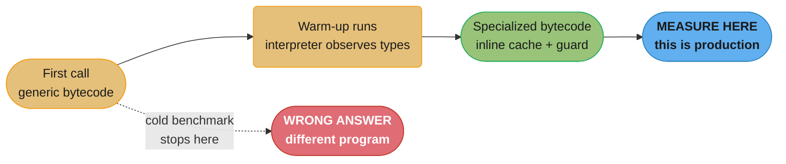
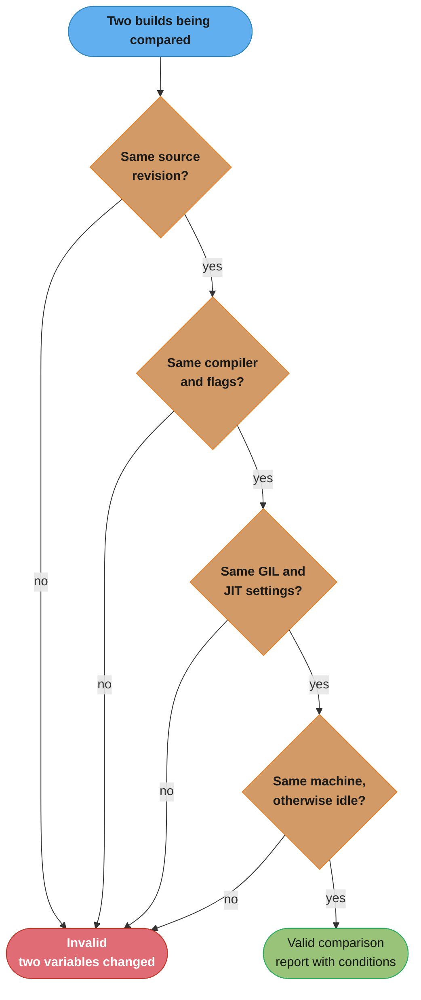

# Benchmarking Python Correctly

> **The interpreter will lie to you — and since 3.11 it lies in a new way.**
> A `time.time()` loop reports numbers that include GC pauses and OS scheduling jitter. A cold
> measurement misses the specializing adaptive interpreter entirely, so the code you benchmarked is
> not the code that runs in production. And a comparison between two interpreter builds is only
> valid if the builds differ by exactly the one variable you meant to test.

This is the shared measurement discipline for every case study in this section. When a study reports
a throughput or a latency, it is following the rules here.

---

## 1. Concept Overview

Benchmarking Python has always required care, but three changes since 3.11 made the old habits
actively wrong rather than merely imprecise.

**The interpreter now warms up.** CPython 3.11's specializing adaptive interpreter observes executed
bytecode and rewrites it into type-specialized variants after roughly eight consistent observations.
A benchmark that runs a function once, or a hundred times, may never reach the state production runs
in. The measurement is not noisy — it is measuring a different program.

**There are now multiple interpreters wearing the same version number.** `python3.14` and
`python3.14t` are different builds with different performance characteristics. A build with
`--with-tail-call-interp` differs again, and requires Clang 19 or newer. "We benchmarked on 3.14"
no longer identifies what was measured.

**Speedup numbers in circulation have inconsistent baselines.** CPython publishes an official
cumulative pyperformance figure for exactly one release — 3.11, at roughly 25% faster than 3.10.
There is **no official cumulative geomean for 3.12, 3.13, 3.14, or 3.15.** Every "Python 3.N is X%
faster" index beyond 3.11 is a third-party aggregation, and the individual measurements CPython does
publish each carry their own baseline. Quoting them as though they compose is the single most common
error in this area.

The discipline that follows from all three is the same: **measure warm, pin the build, and state the
baseline with every number.**

---

## 2. Intuition

**One-line analogy:** benchmarking a cold interpreter is timing a sprinter's first step out of bed.

**Mental model.** Picture the same function existing in several forms over its lifetime. On the first
call it runs generic bytecode: every `LOAD_ATTR` does a full dictionary lookup, every `BINARY_OP`
dispatches through `PyObject` protocol slots. After a handful of consistent-type executions, the
interpreter rewrites those instructions in place into specialized variants with an inline cache and
a cheap guard. If the JIT is enabled, hot regions may be compiled again beyond that.

Your benchmark chooses which of these forms it measures. A loop of ten iterations measures the first
form. Production measures the last. The gap between them is not experimental error — you asked a
different question than you meant to.

**Why it matters.** The failure is asymmetric and it flatters bad decisions. Cold benchmarks
systematically understate the optimizations that only appear when warm, so a change that helps warm
code can look useless, and a micro-optimization that only helps cold code can look like a win. Teams
ship the wrong change and then cannot reproduce the improvement in production.

**Key insight.** A benchmark result is not a number, it is a **number plus the conditions that
produced it**. `0.71 ms/event` is not a result. `0.71 ms/event, CPython 3.14.0, 8-core x86-64,
warm, minimum of 7 runs of 10,000 iterations, GC disabled` is a result. Every number in this
section's case studies carries its conditions, and any number that does not should be distrusted.

---

## 3. Core Principles

**1. Measure warm, always.** Run the code enough times to pass the specialization threshold — at
minimum a few hundred iterations, comfortably past the roughly eight consistent observations a call
site needs — then discard those and measure what follows. `timeit` and `pyperf` both do this if you
let them.

**2. Every percentage names its baseline.** "3-5% faster" is meaningless alone. "3-5% geomean faster
than the same source built with the same Clang 19 without `--with-tail-call-interp`" is a claim
someone can check. When you cannot name the baseline, you do not have a result.

**3. Change exactly one variable.** This is the rule that the tail-call interpreter episode violated
at scale, and it is the most expensive one to get wrong because the result still looks plausible.

**4. Report the distribution, not a single sample.** One run is noise. `timeit.repeat(repeat=7)` and
take the minimum, or use `pyperf`, which reports mean, standard deviation, and whether the difference
between two runs is statistically significant at all.

**5. Pin and publish the build.** Version, build flags, whether the GIL is enabled, whether the JIT
is enabled, the compiler, the CPU, and whether the machine was otherwise idle. Two of those change
silently in CI.

**6. Micro-benchmarks answer micro-questions.** A `timeit` comparison of two expressions tells you
about those two expressions. It does not tell you the service got faster. Always close the loop with
an end-to-end measurement before claiming a win.

**7. Prefer the measurement you can repeat over the one that is precise.** A benchmark nobody can
re-run six months from now is a story, not evidence.

---

## 4. Tools and Their Configuration

### 4.1 `timeit` — the standard-library micro-benchmark

Handles warm-up and repetition, and disables the garbage collector during the timed run by default.
Good for comparing two expressions; not sufficient for cross-build comparisons.

```python
import timeit

setup = "data = list(range(1_000))"

# repeat=7 gives a distribution; number=10_000 gets past warm-up comfortably.
times = timeit.repeat("sum(data)", setup=setup, repeat=7, number=10_000)
print(f"best of 7: {min(times) / 10_000 * 1e9:.1f} ns/call")
```

**Take the minimum, not the mean.** The minimum is the run least polluted by scheduling jitter and
background load; the mean is dragged by whatever else the machine was doing. The mean is the honest
statistic for *throughput under load*, which is a different question.

From the shell, `-o` prints the best raw timing and `-u` sets the unit:

```
$ python3 -m timeit -s "data = list(range(1000))" "sum(data)"
```

### 4.2 `pyperf` — when the difference is small

`timeit` cannot tell you whether a 3% difference is real. `pyperf` can: it spawns multiple worker
processes, calibrates the iteration count, and reports whether two results differ significantly.

```
$ python3 -m pyperf timeit -s "data = list(range(1000))" "sum(data)" -o before.json
$ python3 -m pyperf timeit -s "data = list(range(1000))" "sum(data)" -o after.json
$ python3 -m pyperf compare_to before.json after.json
```

`compare_to` will say "Not significant!" when the difference is inside the noise, which is exactly
the answer you need and the one a single `timeit` run will never give you. It also offers
`pyperf system tune`, which disables CPU frequency scaling and pins interrupts — worth running on a
dedicated benchmarking machine and worth *knowing you have not run* on a laptop.

### 4.3 `sys.monitoring` and profilers — a different question

Profiling and benchmarking answer different questions and should not be confused. A profiler tells
you *where* time goes and necessarily perturbs the measurement; a benchmark tells you *how long*
something takes and must not be perturbed. Never report a profiled runtime as a benchmark result.

`sys.monitoring` (PEP 669, Final, 3.12) is the modern low-overhead hook profilers and coverage tools
use, and its per-location `DISABLE` is what makes it much cheaper than `sys.settrace`. It is still a
profiling mechanism, not a benchmarking one.

PEP 799 (Final, 3.15) reorganizes the stdlib profilers: the `cProfile` implementation moves to
`profiling.tracing` with **`cProfile` remaining as an alias**, and the tachyon sampling profiler
arrives at `profiling.sampling`. The pure-Python `profile` module gets a DeprecationWarning on import
in 3.15, on all uses in 3.16, and is removed in 3.17.

### 4.4 What to use when

| Question | Tool |
|---|---|
| Is expression A faster than expression B? | `timeit`, minimum of 7 |
| Is this 3% difference real? | `pyperf compare_to` |
| Which function dominates? | `cProfile` / `profiling.tracing` `[3.15]` |
| What is a live production process doing? | py-spy, or `profiling.sampling` `[3.15]` |
| Where is the memory going? | `tracemalloc`, memray |
| Did the whole service get faster? | End-to-end load test |

---

## 5. Architecture Diagrams



*Where a benchmark must sample. The dotted path is the cold benchmark: it measures generic bytecode
that production never runs long enough to keep, and the error is systematic rather than random.*



*The one-variable checklist. The tail-call interpreter's widely-quoted 9-15% figure failed at the
second gate — the baseline build hit a compiler code-generation regression the treatment build
happened to avoid, so the comparison measured the compiler rather than the interpreter change.*

---

## 6. How It Works — Detailed Mechanics

### 6.1 Proving the warm-up effect to yourself

The specialization threshold is not folklore; you can watch it happen.

```python
import dis

def hot(a: int, b: int) -> int:
    return a + b

# Cold: the generic instruction.
dis.dis(hot, adaptive=True)      # ... BINARY_OP  0 (+)

for _ in range(1_000):
    hot(1, 2)

# Warm: specialized to the int fast path.
dis.dis(hot, adaptive=True)      # ... BINARY_OP_ADD_INT
```

`adaptive=True` is the part people miss — without it, `dis` shows you the original bytecode rather
than what is actually executing. The same lifecycle applies to `LOAD_ATTR` (which becomes
`LOAD_ATTR_INSTANCE_VALUE`), `CALL` (`CALL_PY_EXACT_ARGS`), and `COMPARE_OP` (`COMPARE_OP_INT`).

The corresponding measurement discipline:

```python
import timeit

# BROKEN: measures the cold, generic form.
cold = timeit.timeit("hot(1, 2)", globals=globals(), number=5)

# FIXED: warm the call site, then measure.
timeit.timeit("hot(1, 2)", globals=globals(), number=10_000)     # discard
warm = min(timeit.repeat("hot(1, 2)", globals=globals(),
                         repeat=7, number=100_000)) / 100_000
```

**A caution that keeps this honest:** specialization is per-call-site and per-type. A benchmark that
feeds one type warms a call site that production, feeding three types, never specializes at all. If
your production data is polymorphic, a monomorphic benchmark overstates the speed of *every*
alternative you are comparing — sometimes unequally.

### 6.2 Identifying the build you are actually on

Record this alongside every result. It is three lines and it prevents the most expensive class of
mistake.

```python
import sys, sysconfig

print(sys.version)                                     # version and compiler
print("GIL enabled:", sys._is_gil_enabled())           # [3.13] free-threaded builds
print("free-threaded build:", sysconfig.get_config_var("Py_GIL_DISABLED"))
print("platform:", sysconfig.get_platform())
```

`sys._is_gil_enabled()` matters more than it looks. On a free-threaded build the GIL can be
**re-enabled at runtime** by importing a C extension that has not declared `Py_mod_gil` support — so
a benchmark can run on `python3.14t` with the GIL quietly back on, paying the free-threaded build's
single-thread penalty of roughly 5-10% and receiving none of the benefit. Assert it, do not assume it.

### 6.3 Garbage collection

`timeit` disables the GC during the timed run by default, which is right for a micro-benchmark: you
want the cost of the operation, not the cost of whatever the allocator happened to do. It is wrong
for anything allocation-heavy, where GC cost is genuinely part of the workload.

```python
import gc, timeit

# Micro-benchmark: default (GC off) is correct.
t = timeit.repeat("sum(data)", setup="data = list(range(1000))", repeat=7, number=10_000)

# Allocation-heavy workload: GC is part of the cost, so measure it.
t = timeit.repeat("[Point(i, i) for i in range(1000)]",
                  setup="gc.enable()\nimport gc\nfrom __main__ import Point",
                  repeat=7, number=100)
```

Do not disable the GC and then report a throughput number for a service that allocates heavily. That
number is unreachable in production.

### 6.4 The comparison that must be end-to-end

Micro-benchmarks compose badly. A 40% improvement in a function that accounts for 3% of request time
is a 1.2% improvement, and every experienced reviewer will want that arithmetic shown.

```python
# The micro result
print(f"parse(): {before_ns} ns -> {after_ns} ns  ({before_ns/after_ns:.2f}x)")

# The share it actually occupies, from a profile
share = 0.03
speedup = 1 / ((1 - share) + share * (after_ns / before_ns))   # Amdahl
print(f"end-to-end: {speedup:.3f}x")
```

Run the end-to-end number before claiming the win. Where a case study in this section reports a
speedup, it reports both.

### 6.5 Regression testing in CI

The measurement that catches a regression is the one that runs automatically. The complication is
that CI runners are shared, throttled, and noisy, so absolute wall-clock thresholds produce constant
false alarms and get muted within a fortnight.

Two workable approaches. Compare against a baseline recorded on the same runner class and alert only
on a statistically significant change (`pyperf compare_to` will make that call for you). Or measure
something deterministic instead of time — allocation counts, or the number of queries issued — which
does not move with runner load at all:

```python
def test_no_n_plus_one(django_assert_num_queries):
    with django_assert_num_queries(3):
        render_dashboard(user)
```

That test is a performance test with zero variance. Prefer this shape wherever the thing you actually
care about can be counted rather than timed.

---

## 7. Real-World Examples

**CPython's own pyperformance suite** is the reference implementation of this discipline: a fixed
benchmark set, run against pinned builds, reported with the baseline named. It is also the source of
the one official cumulative figure that exists — 3.11 at roughly 25% faster than 3.10.

**The 3.14 tail-call interpreter** is the cautionary example, and it is worth knowing in detail
because it fooled a great many careful people. Early third-party benchmarks reported 9-15%. The
figure was wrong: the baseline build (Clang 19 without the flag) hit a tail-duplication
code-generation regression in LLVM 19 that the treatment build incidentally routed around, so most of
the measured gap was the compiler, not the interpreter. Against a corrected baseline the real gain is
1-5%, consistent with the 3-5% geomean CPython eventually published — measured explicitly against
"Python 3.14 built with Clang 19, without this new interpreter". Two variables moved; the number was
plausible; it circulated for months.

**The 3.15 JIT figures** show the discipline done correctly. The Python Insider RC1 announcement
reports "8-9% geometric mean performance improvement on x86-64 Linux over the standard interpreter,
and 12-13% speedup on AArch64 macOS" — note that each figure names its platform, and that the macOS
baseline has been stated differently in different posts across the release cycle. Tag such numbers
`[3.15]` and describe them as shipping in 3.15; 3.15 is at rc1.

**pytest-benchmark and codspeed** are the ecosystem's CI-integrated options, both built around
comparing against a stored baseline rather than an absolute threshold.

---

## 8. Tradeoffs

| Approach | Precision | Setup cost | Catches regressions | Reflects production |
|---|---|---|---|---|
| `time.time()` around a block | Very low | None | No | No |
| `timeit`, minimum of 7 | Good for large differences | Minimal | Manually | Only for that expression |
| `pyperf` with `compare_to` | High, with significance testing | Moderate | Yes | Only for that expression |
| Profiler (`cProfile`, py-spy) | N/A — attribution, not timing | Low | No | Shows real distribution |
| Deterministic counters (queries, allocations) | Exact, zero variance | Low | Yes | Proxy only |
| End-to-end load test | Moderate | High | Yes | Yes |

**The pairing that works in practice:** deterministic counters plus an end-to-end load test in CI,
with `pyperf` reserved for investigating a specific question. Micro-benchmarks are an investigation
tool, not a regression suite.

---

## 9. When to Use / When NOT to Use

### Benchmark when

- Two implementations have similar complexity and you need the constant factor.
- You are validating that an optimization actually helped, rather than felt faster.
- You are sizing something empirically — a pool, a batch size, a queue depth.
- You are comparing interpreter builds or versions and can control every other variable.

### Do NOT benchmark when

- **You have not profiled yet.** Benchmarking tells you how fast something is; profiling tells you
  whether it matters. Optimizing an unprofiled guess is how teams spend a week on 3% of runtime.
- **The difference is large and obvious.** `O(n^2)` versus `O(n log n)` at n=100,000 does not need a
  harness.
- **You cannot control the environment.** A benchmark on a shared, throttled CI runner measures the
  runner. Use deterministic counters there instead.
- **The number will be quoted without its conditions.** If a result will end up in a slide as a bare
  multiple, it will be wrong within two quarters. Either publish it with its conditions attached or
  do not publish it.

---

## 10. Common Pitfalls

### Pitfall 1 — BROKEN: measuring cold

```python
# BROKEN: five iterations, entirely inside the generic-bytecode phase.
import time
start = time.time()
for _ in range(5):
    process_batch(data)
print(f"{(time.time() - start) / 5:.4f}s per batch")
```

Two defects compound. `time.time()` includes scheduling jitter and GC pauses, so the reading can vary
by roughly plus or minus 30% run to run on identical hardware. And five iterations never reach
specialization, so this measures a form of the program production discards.

```python
# FIXED: warm, repeated, minimum of the distribution.
import timeit
for _ in range(200):            # warm-up, discarded
    process_batch(data)
runs = timeit.repeat(lambda: process_batch(data), repeat=7, number=50)
print(f"{min(runs) / 50:.4f}s per batch (best of 7, warm, CPython 3.14.0)")
```

### Pitfall 2 — BROKEN: comparing across builds without controlling the build

```
# BROKEN
$ python3.13 bench.py     # 1.42s
$ python3.14 bench.py     # 1.31s
# "3.14 is 8% faster"
```

Almost certainly not. Those two interpreters were probably built by different people with different
compilers and different optimization settings — one may have PGO and the other not. Any of those
differences can exceed the interpreter change you meant to measure.

```
# FIXED: same source, same compiler, same flags, one variable.
$ CC=clang-19 ./configure --enable-optimizations --prefix=/opt/py314-base
$ CC=clang-19 ./configure --enable-optimizations --with-tail-call-interp --prefix=/opt/py314-tc
# ... build both, then:
$ /opt/py314-base/bin/python3 -m pyperf timeit ... -o base.json
$ /opt/py314-tc/bin/python3   -m pyperf timeit ... -o tc.json
$ python3 -m pyperf compare_to base.json tc.json
```

Now the delta is attributable, and the report can name the baseline.

### Pitfall 3 — BROKEN: quoting a cumulative speedup that does not exist

> "Python 3.14 is about 60% faster than 3.10 — the gains compound across releases."

There is no such published figure. CPython publishes an official cumulative pyperformance geomean for
**3.11 only** (roughly 25% versus 3.10). The other measurements it publishes each carry a different
baseline: the tail-call interpreter's 3-5% is against a same-compiler build without the flag, and the
3.15 JIT figures are against the standard interpreter on a named platform. **Multiplying numbers with
different baselines produces a figure that means nothing.**

**FIXED:** state each measurement with its baseline, and say plainly that no cumulative figure exists
past 3.11. The honest answer to "how much faster is 3.14 than 3.11?" is "CPython has not published
that number; here is what has been measured and against what."

### Pitfall 4 — BROKEN: the benchmark the optimizer deleted

```python
# BROKEN: the result is never used.
def bench():
    for i in range(1_000_000):
        expensive_pure_function(i)
```

Less aggressive than the equivalent trap in JIT-compiled languages, but the same shape: a pure
function whose result is discarded may do far less work than you think, and under a JIT-enabled build
it can be optimized away outright. The measurement then reports the loop overhead.

```python
# FIXED: consume the result so it cannot be elided.
def bench():
    sink = 0
    for i in range(1_000_000):
        sink ^= expensive_pure_function(i)
    return sink
```

### Pitfall 5 — BROKEN: benchmarking on a laptop and deciding on the result

Thermal throttling, background sync, a browser, and CPU frequency scaling each move results by more
than the effect most benchmarks are trying to detect. A 5% difference measured on a laptop is not a
result.

**FIXED:** use a dedicated machine, run `pyperf system tune`, close everything, and let `pyperf`
decide whether the difference is significant. If a dedicated machine is not available, say so in the
report and restrict your claims to differences large enough to survive the noise.

### Pitfall 6 — BROKEN: a monomorphic benchmark for polymorphic production code

```python
# BROKEN: every call sees int, so the call site specializes perfectly.
for i in range(100_000):
    handle(i)
```

Production calls `handle()` with `int`, `str`, and `dict`. That call site never specializes, so the
benchmark's warm number is unreachable — and if you are comparing two implementations, the
monomorphic benchmark may favour the one that happens to specialize better, which is not the one that
will win in production.

```python
# FIXED: feed the benchmark the type mix production actually sees.
samples = load_representative_sample()      # the real distribution
for s in samples:
    handle(s)
```

**Representative input is not a nicety.** It is the difference between measuring your workload and
measuring a workload.

---

## 11. Technologies & Tools

| Tool | What it does | When to reach for it |
|---|---|---|
| `timeit` | Stdlib micro-benchmark; warm-up and GC handling built in | Comparing two expressions |
| `pyperf` | Multi-process benchmarking with significance testing; `system tune` | Any difference under ~10% |
| `dis` (with `adaptive=True`) | Shows the specialized bytecode actually executing | Confirming warm-up happened |
| `cProfile` / `profiling.tracing` `[3.15]` | Deterministic profiler — attribution, not timing | Finding the hot function |
| `profiling.sampling` `[3.15]` | Stdlib sampling profiler (tachyon); attaches to a live process | Production diagnosis |
| py-spy | Sampling profiler, sees native frames, no restart needed | Production diagnosis today |
| `sys.monitoring` (PEP 669) | Low-overhead instrumentation hooks with per-location `DISABLE` | Building a profiler or coverage tool |
| `tracemalloc` | Stdlib allocation tracking | Proving memory stays flat |
| memray | Allocation profiler with flamegraphs | Memory-growth investigations |
| scalene | CPU, GPU and memory profiler that separates Python from native time | Mixed Python/native workloads |
| pytest-benchmark | Benchmarks in the test suite with baseline comparison | CI regression detection |

---

## 12. Interview Questions with Answers

**Q: Why is a cold benchmark systematically wrong on modern CPython rather than just noisy?**
**Short:** The specializing adaptive interpreter rewrites hot bytecode after about eight consistent observations, so a cold run measures a form of the program production never keeps.

Since 3.11 the interpreter observes executed instructions and replaces them with type-specialized
variants — `BINARY_OP` becomes `BINARY_OP_ADD_INT`, `LOAD_ATTR` becomes `LOAD_ATTR_INSTANCE_VALUE` —
after roughly eight consistent-type executions of that call site. A benchmark running five or ten
iterations measures the generic form exclusively. The error is not random, it is directional: cold
measurement understates whatever the specializer would have improved, so changes that help warm code
appear worthless and changes that only help the cold path appear valuable. The fix is to run several
hundred warm-up iterations, discard them, and measure what follows. You can confirm warm-up actually
happened with `dis.dis(fn, adaptive=True)`, which shows the specialized opcodes — without
`adaptive=True` you see the original bytecode rather than what is executing.

**Q: Why is it wrong to say "Python 3.14 is N% faster than 3.11"?**
**Short:** CPython publishes an official cumulative pyperformance figure only for 3.11 versus 3.10; no such cumulative number exists for 3.12 through 3.15.

The one official cumulative geomean CPython publishes is 3.11 at roughly 25% faster than 3.10. Every
later measurement carries its own, different baseline: the 3.14 tail-call interpreter's 3-5% geomean
is against the same source built with the same Clang 19 *without* the flag, and the 3.15 JIT's 8-9%
on x86-64 Linux is against the standard 3.15 interpreter on that platform. These do not compose —
multiplying percentages measured against different baselines produces a number that corresponds to no
experiment anyone ran. Any "Python 3.N is X% faster" index beyond 3.11 is a third-party aggregation.
The honest answer names each measurement with its baseline and states that no cumulative figure has
been published.

**Q: What went wrong with the original 9-15% benchmark for the 3.14 tail-call interpreter?**
**Short:** The baseline build hit an LLVM 19 code-generation regression that the treatment build incidentally avoided, so most of the gap measured the compiler rather than the interpreter.

The comparison put a build with `--with-tail-call-interp` against one without it, which sounds like a
clean single-variable test. It was not: the baseline triggered a tail-duplication regression in
LLVM 19's code generation that the tail-call build happened to route around. So the measured gap was
mostly the compiler bug, not the interpreter change under test. Against a baseline controlling for
the regression the real gain is 1-5%, matching the 3-5% geomean CPython published, explicitly
measured against "Python 3.14 built with Clang 19, without this new interpreter". The general lesson
is the one-variable rule: a comparison between two builds is valid only if they differ by exactly the
thing you intend to measure, and "same compiler version" is not the same as "same code generation".

**Q: Should you take the minimum or the mean of repeated timing runs?**
**Short:** The minimum for a micro-benchmark, because it is least polluted by external noise; the mean when you are deliberately measuring throughput under realistic load.

The minimum is the run in which the OS interfered least — no scheduler preemption, no background
process, no unlucky cache state — so it best isolates the cost of the code itself, which is what a
micro-benchmark is for. The mean incorporates all that interference, which makes it the wrong
statistic for "how fast is this function" and the right one for "what throughput will this service
sustain". Report the distribution either way: `timeit.repeat(repeat=7)` and show min and spread, or
use `pyperf`, which reports mean and standard deviation and will tell you outright when a difference
is not statistically significant — the answer a single `timeit` run can never give.

**Q: When should the garbage collector be disabled during a benchmark, and when not?**
**Short:** Disable it for micro-benchmarks of non-allocating code, keep it enabled whenever allocation is genuinely part of the workload being measured.

`timeit` disables the GC during the timed run by default, which is correct for measuring an operation
in isolation: a collection triggered by unrelated allocation would otherwise land inside your
measurement window and be attributed to your code. But if the thing you are measuring allocates
heavily — building objects in a loop, parsing into a large structure — then GC cost is part of the
real cost, and disabling it produces a throughput number production can never reach. The rule is to
match the measurement to the claim. If you disable the GC, do not then quote the result as a service
throughput figure.

**Q: How do you pin down which interpreter build a benchmark actually ran on?**
**Short:** Record sys.version, whether the GIL is enabled, and whether it is a free-threaded build, alongside every result — the version number alone does not identify the build.

`python3.14` and `python3.14t` are different builds, and a build with `--with-tail-call-interp` is
different again. Capture `sys.version` (version plus compiler), `sys._is_gil_enabled()` `[3.13]`, and
`sysconfig.get_config_var("Py_GIL_DISABLED")`, plus the platform and whether PGO was used.
`sys._is_gil_enabled()` deserves special attention: on a free-threaded build, importing a C extension
that has not declared `Py_mod_gil` support re-enables the GIL at runtime, process-wide. A benchmark
can therefore run on `python3.14t`, pay the free-threaded build's roughly 5-10% single-thread penalty,
and receive none of the parallelism — and nothing but that assertion will tell you.

**Q: Why can a micro-benchmark improvement fail to show up end to end?**
**Short:** Amdahl's law — a large speedup in a function that occupies a small share of runtime produces a proportionally tiny overall gain.

A 40% improvement in a function accounting for 3% of request time yields about 1.2% end to end, which
is inside the noise of most production measurements. This is why profiling must precede benchmarking:
the profiler tells you the share, and the share bounds the payoff before you spend a week on it. The
discipline is to state both numbers together — the micro result and the end-to-end result with the
share shown — because the micro number alone reliably oversells the work. Where a change looks large
in isolation and vanishes in aggregate, that is not a measurement failure, it is the correct answer
that the optimization was not worth doing.

**Q: What makes a benchmark suitable for CI, given that CI runners are noisy?**
**Short:** Compare against a baseline from the same runner class with significance testing, or measure something deterministic like query or allocation counts instead of time.

Absolute wall-clock thresholds on shared, throttled runners produce constant false alarms and get
muted within weeks, at which point the suite catches nothing. Two things work. Store a baseline
measured on the same runner class and alert only on a statistically significant change — `pyperf
compare_to` will make that determination rather than leaving it to a threshold. Or sidestep timing
entirely by asserting on a deterministic counter: the number of database queries a view issues, or
the number of allocations a parse performs. Those have zero variance, catch the regressions that
actually matter (an N+1 query, an accidental materialization), and never fire spuriously. Prefer the
deterministic form wherever the thing you care about can be counted rather than timed.

**Q: Why does representative input matter as much as warm-up?**
**Short:** Specialization is per-call-site and per-type, so a monomorphic benchmark warms a call site that polymorphic production code never specializes at all.

Feeding a benchmark a single type lets every call site specialize perfectly and stay specialized. If
production calls the same function with `int`, `str`, and `dict`, that site repeatedly deoptimizes
and never settles, so the benchmark's warm number is unreachable. Worse, when comparing two
implementations, the monomorphic benchmark can favour whichever specializes better under artificial
conditions rather than whichever wins on the real type mix — so it does not merely inflate both
numbers, it can invert the ranking. Sample the actual production distribution of inputs, including
the awkward ones, and let the benchmark see the same variety the deployed code sees.

**Q: What is the difference between profiling and benchmarking, and why must the results not be mixed?**
**Short:** A profiler attributes time and necessarily perturbs the program; a benchmark measures duration and must not be perturbed, so a profiled runtime is never a benchmark result.

Profiling answers "where does the time go" by instrumenting or sampling the running program, which
adds overhead by construction — a deterministic profiler like `cProfile` adds a per-call cost that
falls hardest on exactly the small hot functions you are investigating. Benchmarking answers "how long
does this take" and requires the measurement not to disturb what is measured. Reporting a runtime
taken under `cProfile` as a performance figure inflates it, often unevenly across the alternatives
being compared. Use them in sequence rather than together: profile first to find where time goes and
whether it is worth attacking, then benchmark the specific change with no profiler attached, then
confirm end to end.

**Q: How should a benchmark result be reported so it remains useful in six months?**
**Short:** Publish the number with its conditions — interpreter build, machine, warm-up, repetition count, and the baseline it was measured against.

A bare number decays into folklore. `0.71 ms/event` becomes a slide, then an assumption, then a
requirement nobody can reproduce. `0.71 ms/event, CPython 3.14.0, GIL enabled, 8-core x86-64,
otherwise idle, warm, minimum of 7 runs of 10,000 iterations, GC disabled, versus 21.4 ms/event for
the previous implementation` can be checked, re-run, and correctly invalidated when a condition
changes. The baseline is the part most often dropped and the part that matters most: a percentage
without a baseline is not a measurement. Every case study in this section reports its conditions for
exactly this reason.

**Q: What does `pyperf` give you that `timeit` does not?**
**Short:** Multiple worker processes, automatic calibration, and a significance test that tells you when a difference is indistinguishable from noise.

`timeit` runs in one process and reports raw timings, leaving you to decide whether a 3% gap is real
— and it usually is not. `pyperf` spawns several worker processes to average out per-process effects
such as memory layout and hash randomization, calibrates the iteration count automatically, and
reports mean with standard deviation. Its `compare_to` subcommand explicitly says "Not significant!"
when two results overlap, which is the single most valuable output because it stops teams shipping
noise as an improvement. It also ships `pyperf system tune` to disable CPU frequency scaling and pin
interrupts. Use `timeit` for large, obvious differences and `pyperf` for anything under roughly 10%.

**Q: What is `sys.monitoring` and why is it cheaper than `sys.settrace`?**
**Short:** PEP 669 gives tools per-event, per-location callbacks that can be disabled individually, so instrumentation cost is confined to the locations a tool actually cares about.

`sys.settrace` installs a global hook called for every event everywhere, so a tool interested in a
handful of lines still pays on every line in the process. `sys.monitoring` (PEP 669, Final, 3.12)
instead registers a tool id with `use_tool_id`, selects events with `set_events`, and attaches
callbacks with `register_callback`. The decisive feature is that a callback can return
`sys.monitoring.DISABLE` to retire itself for that specific code location, so a coverage tool stops
paying for a line once it has recorded it. That is why coverage tools and debuggers migrated to it. It
remains a profiling and instrumentation mechanism, not a benchmarking one — never report a runtime
measured with monitoring active as a benchmark result.

**Q: What changes for stdlib profilers in Python 3.15 under PEP 799?**
**Short:** cProfile's implementation moves to profiling.tracing while cProfile stays as an alias, the tachyon sampler arrives at profiling.sampling, and the pure-Python profile module is deprecated for removal in 3.17.

PEP 799 (Final, 3.15) gathers the stdlib profiling tools under one `profiling` package. The `cProfile`
implementation relocates to `profiling.tracing`, and — the distinction that matters — **`cProfile`
remains available as a backwards-compatible alias rather than being removed**, so existing code keeps
working. The new sampling profiler, codenamed tachyon, is importable as `profiling.sampling`; it can
attach to a live process and works on free-threaded builds. Separately, the pure-Python `profile`
module gets a DeprecationWarning on import in 3.15, a DeprecationWarning on all uses in 3.16, and is
removed in 3.17. Confusing `profile` with `cProfile` here inverts the advice entirely — one is being
removed and the other is not.

**Q: When is benchmarking the wrong activity altogether?**
**Short:** Before profiling, when the complexity difference is already decisive, or when the environment cannot be controlled enough for the result to mean anything.

Three cases. Benchmarking before profiling optimizes a guess — you may make a function 40% faster and
discover it was 3% of runtime. A complexity difference that is already decisive needs no harness:
`O(n^2)` against `O(n log n)` at n=100,000 is not a close call, and building a harness to confirm it
is procrastination. And an uncontrollable environment — a shared, throttled CI runner, or a laptop
with a browser open — produces numbers that measure the environment; there, deterministic counters
such as query or allocation counts are the right instrument instead. There is a fourth, softer case:
if the result will be quoted without its conditions, it will be wrong within two quarters, so either
attach the conditions permanently or do not publish it.

---

## 13. Best Practices

**Warm up, then measure.** Several hundred iterations discarded, then the measured run. Confirm with
`dis.dis(fn, adaptive=True)` if the result surprises you.

**Take the minimum of at least 7 repetitions** for micro-benchmarks, and report the spread alongside
it. Use `pyperf compare_to` for anything under roughly 10%.

**State the baseline with every percentage.** A percentage without a baseline is not a measurement.
This is the rule that would have caught the tail-call interpreter episode.

**Pin and publish the build** — version, compiler, PGO, GIL state, free-threaded or not, machine.
Assert `sys._is_gil_enabled()` explicitly on free-threaded builds rather than assuming.

**Change one variable.** If you built two interpreters, they must differ by exactly the flag under
test. If you changed two things, you have no attributable result.

**Use representative input.** Match the type mix and the data distribution production actually sees,
including the awkward cases.

**Close the loop end to end.** Report the micro result, the share of runtime it occupies, and the
resulting overall change. Never claim a service win from a micro-benchmark alone.

**Prefer deterministic counters in CI.** Query counts and allocation counts have zero variance, catch
the regressions that matter, and never get muted for flakiness.

**Never quote a cumulative CPython speedup that CPython did not publish.** Past 3.11, no such
cumulative figure exists.

---

## 14. Case Study

### A 30% regression that was entirely the benchmark

**The report.** After upgrading a data-enrichment service from 3.13 to 3.14, the team's nightly
benchmark showed per-record processing rising from 4.2ms to 5.5ms — a 31% regression. The upgrade was
rolled back and an investigation opened. The initial hypothesis was that the free-threaded build's
single-thread penalty was to blame.

**Step 1 — reproduce, and find that it does not reproduce.** Run by hand on a developer machine, the
3.14 build measured *faster* than 3.13, not slower. The regression only appeared in the nightly CI
job. That divergence is the most useful early signal available: when a result depends on where it
runs, the environment is a variable, and it is usually the one that matters.

**Step 2 — read what the benchmark actually did.**

```python
# The nightly benchmark, as written.
import time

records = load_sample(500)          # only 500 records
start = time.time()
for r in records:
    enrich(r)
elapsed = time.time() - start
print(f"{elapsed / len(records) * 1000:.1f} ms/record")
```

Three defects, all covered above. `time.time()` includes scheduling jitter and GC pauses. There is no
warm-up and no repetition — a single pass over 500 records, with several call sites in `enrich()` on
polymorphic inputs that would never settle anyway. And the whole thing runs once, so there is no
distribution and no way to tell signal from noise.

**Step 3 — find the second variable.** The CI configuration had been updated in the same pull request
as the version bump. The 3.14 image was built from source without PGO; the 3.13 image was a
distribution build with PGO enabled. **Two variables moved at once** — exactly the failure the
one-variable checklist in §5 is drawn for, and the same shape as the tail-call interpreter episode.
The measurement was comparing build configurations, and attributing the difference to the version.

**Step 4 — measure properly.** Both interpreters rebuilt from source with the same compiler and the
same `--enable-optimizations`, and the benchmark rewritten:

```python
import pyperf

def bench(loops: int, records: list[Record]) -> float:
    # Warm-up outside the timed region.
    for r in records[:200]:
        enrich(r)
    t0 = pyperf.perf_counter()
    for _ in range(loops):
        for r in records:
            enrich(r)
    return pyperf.perf_counter() - t0

runner = pyperf.Runner()
runner.metadata["cpython_build"] = sys.version
runner.metadata["gil_enabled"] = str(sys._is_gil_enabled())
runner.bench_time_func("enrich_batch", bench, load_sample(500))
```

Results, both builds from the same source with the same compiler and PGO, on a dedicated 8-core
x86-64 runner, otherwise idle:

| Build | ms/record (mean of 7 workers) | Versus 3.13 |
|---|---|---|
| 3.13, PGO | 4.18 (±0.06) | baseline |
| 3.14, PGO | 4.02 (±0.05) | 3.8% faster |
| 3.14, no PGO | 5.47 (±0.11) | 31% slower |

**The regression was the missing PGO, and it was the whole of it.** The 31% figure in the nightly
report was real, precise, and reproducible — and it measured the build configuration, not the Python
version. `pyperf compare_to` confirmed the 3.8% improvement was statistically significant and the
apparent version effect was not.

**What it cost.** Four engineer-days of investigation, a rolled-back upgrade, and six weeks of delay
on a version bump that was in fact a small improvement. All of it downstream of a benchmark written
in five minutes with `time.time()` and never revisited.

**What changed afterwards.**

1. Every benchmark moved to `pyperf`, with `sys.version` and `sys._is_gil_enabled()` recorded as
   metadata on every result, so the build is attached to the number permanently.
2. The interpreter build became explicit and pinned in CI, with PGO asserted rather than assumed.
3. A rule that **a version bump and a build-configuration change may not share a pull request.**
4. The most-load-bearing check turned out to be the cheapest: a deterministic assertion on the number
   of database queries `enrich()` issues. Zero variance, no interpreter dependence, and it would have
   caught the actual regressions the timing benchmark was nominally there to find.

**The transferable lesson.** A benchmark is a measuring instrument, and an uncalibrated instrument
produces confident wrong answers rather than obviously wrong ones. The 31% was not noise — noise is
easy to recognise and discount. It was a precise, repeatable measurement of the wrong thing, which is
far more expensive, and it is the same failure that put a wrong tail-call interpreter number into
circulation for months.

**Cross-references:**
[The Modern CPython Runtime](../../performance_and_profiling/the_modern_cpython_runtime.md) for what
each interpreter layer actually changes and what it was measured against;
[Performance and Profiling](../../performance_and_profiling/performance_and_profiling.md) for the
profiling step that must precede any benchmark;
[The GIL and Free-Threading](../../the_gil_and_free_threading/the_gil_and_free_threading.md) for the
free-threaded build's single-thread penalty and the runtime GIL re-enable;
[CPython Memory Model](../../cpython_memory_model/cpython_memory_model.md) for the GC behaviour that
`timeit` disables and allocation-heavy benchmarks must not.
