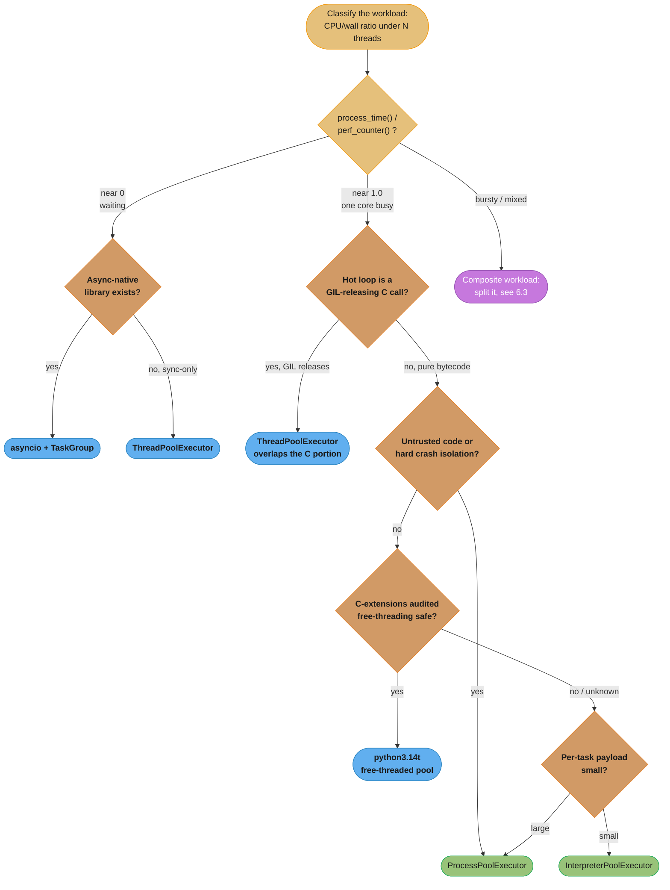
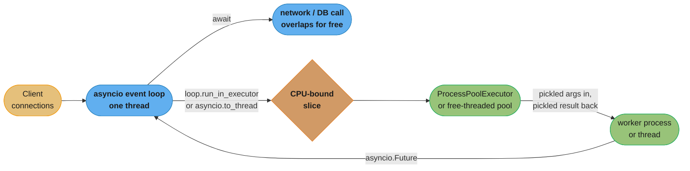

# Choosing a Concurrency Model

> **Five doors, one workload, and the wrong door still runs — it just runs at one core's
> speed while looking busy.** A thread pool that "helps" a CPU-bound loop may only be
> timing a NumPy call that already released the GIL. An `asyncio` service that "handles
> 10,000 connections" stalls all of them the moment one route calls a synchronous library.
> The question that ends the guessing is not "which model is fastest" — it is "what is this
> workload actually waiting on," measured, not asserted.

This is the shared decision document for every case study in this section: given a
workload, which of Python's five concurrency models applies, and what does that choice
cost you in memory, isolation, and the ability to change your mind later.

---

## 1. Concept Overview

As of CPython 3.14 there are five distinct ways to run Python code concurrently, and they
are not interchangeable defaults — each solves a different bottleneck and imposes a
different tax:

1. **`threading` / `ThreadPoolExecutor`** on the default (GIL-enabled) build — cooperative
   overlap of I/O waits and of any C code that releases the GIL.
2. **`asyncio`** and structured concurrency (`TaskGroup`) — single-threaded, callback-free
   overlap of I/O waits with no OS thread per connection.
3. **`multiprocessing` / `ProcessPoolExecutor`** — real multi-core parallelism, paid for
   with process startup and pickling every argument and result across a pipe.
4. **The free-threaded build** (`python3.14t`, PEP 703 / PEP 779) — real multi-core
   parallelism inside one process and one shared heap, paid for with a documented
   single-thread tax and an unaudited C-extension ecosystem.
5. **Subinterpreters** (`concurrent.interpreters`, `InterpreterPoolExecutor`, PEP 684 /
   PEP 734) — one GIL per interpreter inside one OS process, paid for with the same
   pickling cost as processes but a smaller memory footprint.

Four of the five exist because of one fact covered in depth in
[The GIL and Free Threading](../../the_gil_and_free_threading/the_gil_and_free_threading.md):
on the default build, one GIL serializes execution of Python bytecode across every thread
in the process, and it is released only around blocking I/O and inside specific C
extensions. Everything in this file is downstream of that one sentence — the five models
are five different answers to "what do I do about the GIL," and `asyncio` is the answer for
workloads where the GIL was never the problem in the first place.

**Scope.** This file does not re-derive GIL mechanics, event-loop internals, or
`fork`/`spawn`/`forkserver` semantics — those live in their own modules and are
cross-linked throughout. What this file adds is the layer above them: the classifying
question to ask first, the single table that puts all five models on the same axes, the
traps that make the wrong choice measure as the right one, and how real services compose
more than one model rather than picking exactly one.

---

## 2. Intuition

**One-line analogy:** picking a concurrency model without measuring is choosing a toll
road by its name instead of its traffic report.

**Mental model.** Every unit of work in your hot path spends its time in one of two
places: waiting (a socket read, a database round trip, a disk flush) or computing (bytecode
execution, either in the interpreter or inside a C extension). A concurrency model is a
policy for what happens to *everything else* while one unit is in one of those two states.
Threads and `asyncio` both let other work proceed while a unit waits — they differ only in
whether an OS thread and its GIL contention are part of the price. Processes,
subinterpreters, and free-threading all let other work proceed while a unit computes — they
differ only in what has to cross a boundary to make that true and how much isolation that
boundary buys you.

**Why it matters.** The failure mode is symmetric with the one in
[Benchmarking Python Correctly](benchmarking_python_correctly.md): a plausible number from
the wrong experiment. A thread pool measured against a NumPy-heavy workload looks like
proof that "threading works for CPU-bound Python" — it worked because NumPy's C layer
released the GIL, not because Python threads parallelize bytecode. Ship that same thread
pool against a pure-Python hot loop and throughput barely moves, and now the team is
debugging a "regression" that was never a regression, it was always the ceiling.

**Key insight.** The workload does not announce which door it needs. You measure it. A
single ratio — CPU time divided by wall time under concurrent load — separates "waiting"
from "computing" before you write a line of pool-selection code, and it is covered in
detail in §6. Everything downstream of that measurement is arithmetic; everything upstream
of it is a guess wearing a benchmark's clothes.

---

## 3. Core Principles

**1. Classify before you choose.** I/O-bound and CPU-bound are not vibes, they are a
measured ratio (§6.1). A workload assumed to be I/O-bound that is actually CPU-bound inside
a blocking call will defeat `asyncio` silently — the loop looks alive, latency is just bad.

**2. The GIL question is really a C-extension question.** Whether threading helps a
CPU-bound loop depends on whether the hot code is pure Python bytecode or a C extension
that calls `Py_BEGIN_ALLOW_THREADS`. Audit which half of the loop you are in before trusting
a thread-pool benchmark — see
[Design a CPU-Bound Batch Pipeline](../design_a_cpu_bound_batch_pipeline.md) §4.1 for the
measured split on one real workload.

**3. Isolation and speed trade against each other, in that order.** Processes give the
strongest isolation and the highest per-task cost. Free-threading gives the least isolation
(one shared heap, all the usual race surface) and the lowest per-task cost. Subinterpreters
sit in between. Pick isolation first when correctness or blast radius demands it; pick speed
first only once isolation is not a requirement.

**4. Composition is the normal case, not the exception.** A production service is rarely
"an asyncio service" or "a process pool" — it is an `asyncio` event loop handling
connections that delegates CPU-bound slices to a process pool at an explicit boundary (§6.3).
Treat the boundary placement as a design decision, not an afterthought.

**5. "It compiled and ran fast once" is not an audit.** A free-threaded build can silently
fall back to GIL-enabled behavior the moment an unaudited C extension is imported (§10,
Pitfall 3). Trust the assertion, not the absence of an error.

**6. Migration cost is not the same in both directions.** Moving from threads to `asyncio`
means rewriting call sites to be `await`-shaped; moving from a process pool to a
free-threaded thread pool means auditing every dependency for thread safety you used to get
for free from process isolation. Know which direction you can afford before committing (§13).

**7. Measure the choice, not just the workload.** Every claim in this file that carries a
number states its machine and build, following the discipline in
[Benchmarking Python Correctly](benchmarking_python_correctly.md) — a concurrency-model
comparison is exactly the kind of result that decays into folklore without its conditions.

---

## 4. The Five Concurrency Models

| Model | Solves | Minimum Python | Core primitive |
|---|---|---|---|
| `threading` / `ThreadPoolExecutor` | Overlapping I/O waits and GIL-releasing C calls | All | `threading.Thread`, `concurrent.futures.ThreadPoolExecutor` |
| `asyncio` + `TaskGroup` | Overlapping I/O waits without an OS thread per unit | 3.4 (mature 3.7+); `TaskGroup` 3.11 | `async`/`await`, `asyncio.TaskGroup` |
| `multiprocessing` / `ProcessPoolExecutor` | Real CPU parallelism with OS-level isolation | All | `multiprocessing.Pool`, `concurrent.futures.ProcessPoolExecutor` |
| Free-threaded build (`python3.14t`) | Real CPU parallelism inside one shared heap | 3.13 experimental (PEP 703, Phase I); 3.14 officially supported (PEP 779, Phase II) | `ThreadPoolExecutor` on a `python3.14t` interpreter |
| Subinterpreters | Real CPU parallelism without a new OS process | 3.14 (`concurrent.interpreters`, PEP 734; per-interpreter GIL landed 3.12 via PEP 684) | `concurrent.interpreters`, `concurrent.futures.InterpreterPoolExecutor` |

**`threading`.** Every thread shares one heap and, on the default build, one GIL. The GIL
releases around blocking I/O calls and inside C extensions that opt in
(`Py_BEGIN_ALLOW_THREADS`), so threads genuinely overlap during those windows and serialize
everywhere else. Zero data-movement cost — arguments and results are passed by reference.
Full mechanics: [The GIL and Free Threading](../../the_gil_and_free_threading/the_gil_and_free_threading.md).

**`asyncio`.** One thread, one event loop, cooperative scheduling at every `await`. No GIL
contention by construction — the cost model is entirely about which libraries are
async-native versus which block the loop when called from a coroutine. Full mechanics:
[Asyncio and the Event Loop](../../asyncio_and_event_loop/asyncio_and_event_loop.md) and
[Async Patterns and Pitfalls](../../async_patterns_and_pitfalls/async_patterns_and_pitfalls.md).

**`multiprocessing`.** Each worker is a separate OS process with its own interpreter, its
own heap, and its own GIL. Nothing is shared by default; every argument and every return
value crosses the process boundary through `pickle`. That is also what makes a process
crash contained to itself. Full mechanics:
[Threading and Multiprocessing](../../threading_and_multiprocessing/threading_and_multiprocessing.md).

**The free-threaded build.** `python3.14t` compiles CPython with the GIL removed (PEP 703,
Final, accepted by the Steering Council on 2023-10-24). PEP 779 (Final) moved this from
Phase I — experimental, 3.13 — to **Phase II — officially supported but still optional —
in 3.14**; Phase III, where it becomes the default build, has not happened. The tradeoff is
concrete: per the 3.14 "What's New," *"the performance penalty on single-threaded code in
free-threaded mode is now roughly 5-10%, depending on the platform and C compiler used"* —
paid by every thread in the process, whether or not it touches a pool.

**Subinterpreters.** `concurrent.interpreters` (PEP 734, Final, target 3.14; the module was
renamed from the PEP's original `interpreters` proposal during acceptance) exposes multiple
interpreters inside one OS process, each with its own GIL — a capability that has existed
in the C API since PEP 684 landed in 3.12. `InterpreterPoolExecutor` (new in 3.14) is the
`concurrent.futures`-shaped front door. Its own documentation is explicit about the cost:
*"the worker serializes the callable and arguments using pickle when sending them to its
interpreter,"* and *"the worker likewise serializes the return value when sending it back."*
Mutable objects cannot be shared directly — *"Isolation means a mutable object, or other
data, cannot be used by more than one interpreter at the same time"* — so `concurrent.interpreters`
provides `create_queue()` as the supported channel; immutable builtins (`None`, `bool`,
`bytes`, `str`, `int`, `float`, tuples of these) and `memoryview` are shared or copied
cheaply instead of pickled. What subinterpreters actually buy over processes is **no new OS
process and no re-import of the module tree** — the pickling cost does not go away.

---

## 5. Architecture Diagrams



*The classifying question comes first and the C-extension audit gates free-threading —
skipping either step is how a thread pool ships against pure-Python bytecode, or a
free-threaded build ships with the GIL silently back on (§10, Pitfalls 1 and 3).*



*The composition every real mixed-workload service needs: the event loop stays free by
handing CPU-bound work to `loop.run_in_executor` or `asyncio.to_thread`, and only that
boundary pays a serialization cost — see §6.3.*

---

## 6. How It Works — Detailed Mechanics

### 6.1 The classifying diagnostic

Before touching a pool class, measure what the workload is actually doing. Run it under
concurrent load and compare total CPU time consumed against wall-clock time elapsed:

```python
import threading
import time


def classify(work_fn, n_workers: int = 4, calls_per_worker: int = 50) -> float:
    """Returns the CPU/wall ratio under n_workers concurrent threads.
    Near 1.0: one core was busy the entire time -- CPU-bound, GIL-serialized.
    Near 0.0: threads spent most of the window waiting -- I/O-bound.
    In between: a mixed workload -- see 6.3."""
    t_wall_start = time.perf_counter()
    t_cpu_start = time.process_time()          # process_time sums ALL threads

    def runner():
        for _ in range(calls_per_worker):
            work_fn()

    threads = [threading.Thread(target=runner) for _ in range(n_workers)]
    for t in threads:
        t.start()
    for t in threads:
        t.join()

    wall = time.perf_counter() - t_wall_start
    cpu = time.process_time() - t_cpu_start
    return cpu / wall / n_workers               # normalized: 1.0 = fully CPU-bound
```

`time.process_time()` sums CPU time across every thread; `time.perf_counter()` is
wall-clock. A ratio near 1.0 means one core was saturated the entire window regardless of
thread count — a GIL problem, fixed by a model in §4 that gets around the GIL, not more
threads. A ratio near 0 means threads spent the window blocked on something external — the
GIL was never the bottleneck. This generalizes the GIL-thrashing diagnosis in
[The GIL and Free Threading](../../the_gil_and_free_threading/the_gil_and_free_threading.md)
§10 into the first step of picking a model at all, not just diagnosing a regression in one
already chosen. It tells you *whether* you are GIL-bound, not *which* of the four
GIL-avoiding models to reach for — that second decision is §5's remaining branches.

### 6.2 Confirming which build and mode you are actually measuring on

The same three-line assertion from
[Benchmarking Python Correctly](benchmarking_python_correctly.md) §6.2 applies here with
one addition specific to model selection — confirming a free-threaded build is not quietly
running with the GIL re-enabled:

```python
import sys
import sysconfig

print(sys.version)
print("free-threaded build:", sysconfig.get_config_var("Py_GIL_DISABLED"))
print("GIL currently enabled:", sys._is_gil_enabled())          # [3.13]
```

`Py_GIL_DISABLED` answers "was this interpreter *compiled* free-threaded"; `sys._is_gil_enabled()`
answers "is the GIL *currently* off" — and those can disagree. A free-threaded build's GIL
comes back on, process-wide, the moment it imports a C extension that has not declared
`Py_mod_gil = Py_MOD_GIL_NOT_USED`; CPython emits a runtime warning and leaves the GIL
enabled rather than refusing the import. Assert the second value in code that depends on
real parallelism — see §10, Pitfall 3.

### 6.3 Composing models: where the boundary belongs

A service handling 5,000 concurrent connections and occasionally needing to resize an
uploaded image should not become a thread-per-connection server just because one route is
CPU-bound. The event loop stays `asyncio`; the CPU-bound slice crosses an explicit boundary:

```python
import asyncio
from concurrent.futures import ProcessPoolExecutor

_cpu_pool = ProcessPoolExecutor(max_workers=4)


def resize_image(raw: bytes) -> bytes:
    ...  # CPU-bound; runs in a worker process, not on the event loop thread


async def handle_upload(raw: bytes) -> bytes:
    loop = asyncio.get_running_loop()
    # Only the boundary call pays pickling cost -- everything else on this
    # request (auth, the DB write) stays on the event loop, overlapped as usual.
    return await loop.run_in_executor(_cpu_pool, resize_image, raw)
```

`loop.run_in_executor(executor, func, *args)` schedules `func` on `executor`, returning an
`asyncio.Future`; `None` uses the loop's default, a lazily-created `ThreadPoolExecutor`.
`asyncio.to_thread()` (added 3.9) is the same mechanism specialized for the common case —
offload to the default thread pool, propagating `contextvars` automatically. **The rule for
placing the boundary:** anything that blocks the event-loop thread — a synchronous network
call, a CPU-bound loop, a library with no async API — must cross through `run_in_executor`
or `to_thread`; anything else stays a plain `await`. Full event-loop mechanics, including
why one blocking call stalls every other connection:
[Async Patterns and Pitfalls](../../async_patterns_and_pitfalls/async_patterns_and_pitfalls.md).

### 6.4 Migration cost is directional

Changing your mind later costs a different amount depending on which direction you move,
because the four models do not share an API shape:

- **`threading` → `ProcessPoolExecutor` or `InterpreterPoolExecutor`:** usually the smallest
  diff. `concurrent.futures` gives all three the same `submit`/`map` interface; the real work
  is auditing every closed-over object for picklability, since threads passed references and
  processes and subinterpreters do not.
- **`threading`/`asyncio` interop:** moving blocking calls into a coroutine-based service
  means rewriting call sites to `await`, not just swapping an import — `asyncio` is a
  different control-flow shape, not a drop-in pool.
- **`ProcessPoolExecutor` → free-threaded `ThreadPoolExecutor`:** looks like the cheapest
  migration (same `concurrent.futures` shape, same `.submit()`) and is the most deceptive
  one — it trades an OS-enforced isolation boundary for a shared heap, so every piece of
  state the process boundary was implicitly protecting now needs an explicit lock, and every
  C-extension dependency needs a free-threading audit before the migration is safe.
- **Any model → subinterpreters:** the mutable-state discipline is closer to processes than
  to threads (no shared heap, explicit queues only), so code already written for
  `ProcessPoolExecutor`'s isolation model ports with the least conceptual change, even though
  the runtime mechanism is entirely different.

---

## 7. Real-World Examples

**WSGI application servers** (Gunicorn with sync workers, uWSGI) are the canonical
thread-and-process shape: a fixed worker pool of OS processes, each single-threaded or
lightly multi-threaded, handling one request at a time per worker. The model is chosen for
isolation — one worker's crash or memory leak does not take down the fleet — at the cost of
a fixed concurrency ceiling per process.

**ASGI services** (FastAPI/Starlette on Uvicorn, aiohttp servers) run the `asyncio` model:
one event loop per worker process handling thousands of concurrent connections, because the
workload — proxying to a database, an upstream API, a cache — spends nearly all its time
waiting, which is exactly the ratio in §6.1 reading near zero.

**Batch and ML pipelines** (Dask, joblib, Celery/RQ workers processing a queue) default to
process pools precisely because the work is CPU-bound Python or C-extension code operating
on data too large or too sensitive to risk sharing a heap; [Design a CPU-Bound Batch
Pipeline](../design_a_cpu_bound_batch_pipeline.md) works one such pipeline in full, measuring
all four CPU-bound-relevant models against the same workload.

**The free-threaded ecosystem is mid-migration, not finished.** NumPy's 2.4 and 2.5 release
notes each list further free-threading fixes as ongoing work rather than a completed
milestone, and the community maintains live trackers precisely because the answer changes
month to month: `py-free-threading.github.io/tracking/` lists the projects with active
free-threading work, and `hugovk.github.io/free-threaded-wheels/` reports, per package,
whether a free-threaded wheel is on PyPI today. Do not carry a remembered figure for
ecosystem readiness into a design decision — the only number that matters is whether *your*
dependency set has `cp314t` wheels, and that is a query you run against your own lockfile.
This is the concrete shape of the audit requirement in §5's flowchart and §10's Pitfall 3:
the risk is not hypothetical, it is an active migration you must check per project.

---

## 8. Tradeoffs

| Cost axis | `threading` | `asyncio` | `multiprocessing` | Free-threaded (`python3.14t`) | Subinterpreters |
|---|---|---|---|---|---|
| What the GIL does | Serializes bytecode; releases for I/O and opted-in C calls | N/A — one thread, no contention | N/A — each process has its own | Removed entirely (PEP 703) | One GIL per interpreter (PEP 684) |
| Per-unit startup cost | ~0.1 ms (thread) | Near-zero (coroutine) | ~50-300 ms (process spawn/fork) | ~0.1 ms (thread, same as GIL build) | Interpreter creation cost (no OS process) |
| Per-unit memory | Small (thread stack) | Very small (coroutine frame) | Large (full interpreter + module tree) | Small (thread stack, shared heap) | Moderate (Python-level state per interpreter; shared C libs) |
| How state is shared | Directly — shared heap | Directly — single thread | Not shared — copy via pickle | Directly — shared heap, needs locks | Not shared — explicit queues, immutable types copied cheaply |
| How data crosses the boundary | By reference, free | By reference, free (all in one thread) | Pickled every call, both directions | By reference, free | Pickled every call (`InterpreterPoolExecutor`), or queues |
| Failure blast radius | Whole process | Whole process | One worker process | Whole process | Whole process (interpreters share it) |
| Debuggability | Standard debugger; GIL serializes so races are narrower | Standard debugger; single control flow, easiest to reason about | Standard debugger per process; cross-process state hardest to inspect | Hardest — real data races, no GIL to narrow the window | Standard per-interpreter; cross-interpreter state via queues only |
| Library compatibility | Universal | Needs async-native I/O libraries or a `to_thread` wrapper | Universal (args must pickle) | Needs each C extension audited for `Py_mod_gil` | Needs each C extension audited for multi-interpreter safety |
| Minimum Python | All | 3.4 (mature 3.7+), `TaskGroup` 3.11 | All | 3.13 experimental, 3.14 supported | 3.14 (`concurrent.interpreters`); C API since 3.12 |

**The row that decides most real cases is "how data crosses the boundary."** Processes and
subinterpreters both pay a pickling cost per task; threads and the free-threaded build pay
none because they share a heap; `asyncio` pays none because there is only one thread.
[Design a CPU-Bound Batch Pipeline](../design_a_cpu_bound_batch_pipeline.md) §5 works this
exact tradeoff for the three multi-core options on one measured workload — this table is the
superset that includes the I/O-bound and mixed cases that pipeline does not need to cover.

---

## 9. When to Use / When NOT to Use

### `threading` / `ThreadPoolExecutor`

- **Use** for I/O-bound work with synchronous-only libraries (a driver with no async
  version), or for CPU-bound work that is mostly inside a GIL-releasing C extension.
- **Do NOT use** for pure-Python CPU-bound loops expecting multi-core speedup — the GIL
  serializes them regardless of thread count (§6.1's ratio will read near 1.0).

### `asyncio`

- **Use** for high-connection-count I/O-bound services where async-native libraries exist
  for every blocking call on the hot path.
- **Do NOT use** as a way to parallelize CPU-bound work, and do not introduce it into a
  codebase whose I/O libraries are all synchronous-only without a `to_thread` boundary for
  every one of them — a single missed one stalls the whole loop (§10, Pitfall 2).

### `multiprocessing` / `ProcessPoolExecutor`

- **Use** for CPU-bound pure-Python work, when isolation (crash containment, untrusted code)
  matters, or when per-task payloads are small enough that pickling cost stays negligible.
- **Do NOT use** when per-task arguments or results are large relative to the work done per
  task — pickling can dominate before parallelism helps at all (§10, Pitfall 4).

### Free-threaded build (`python3.14t`)

- **Use** once every C-extension dependency on the hot path is confirmed to declare
  `Py_mod_gil = Py_MOD_GIL_NOT_USED`, isolation between tasks is not a requirement, and the
  workload's parallel speedup outweighs the documented single-thread tax.
- **Do NOT use** as a default swap-in for an existing GIL-enabled deployment without that
  audit — an unaudited extension silently re-enables the GIL process-wide and the deployment
  pays the single-thread tax for zero parallelism benefit (§10, Pitfall 3).

### Subinterpreters (`concurrent.interpreters` / `InterpreterPoolExecutor`)

- **Use** when process-level memory overhead is the binding constraint but pickling cost is
  already acceptable (i.e., you would otherwise reach for `ProcessPoolExecutor` and mainly
  want its RSS multiplier reduced).
- **Do NOT use** expecting it to avoid the pickling cost that motivated moving off processes
  in the first place — it does not (§4, §10 Pitfall 4).

---

## 10. Common Pitfalls

### Pitfall 1 — BROKEN: crediting threads for a GIL-releasing C call

```python
# BROKEN: "threading gave us a 6x speedup on our CPU-bound pipeline"
from concurrent.futures import ThreadPoolExecutor

def process(item):
    return numpy_heavy_transform(item)   # the ENTIRE workload, in one function

with ThreadPoolExecutor(max_workers=8) as pool:
    results = list(pool.map(process, items))
```

The speedup was real, the causal story was wrong. `numpy_heavy_transform` runs inside
NumPy's C layer, which releases the GIL — the threads overlapped there, not because
"Python threading works for CPU-bound work." Add a pure-Python post-processing step and
throughput barely improves, which the team reads as a regression rather than the ceiling.

```python
# FIXED: measure the split before crediting the model.
def process(item):
    t0, c0 = time.perf_counter(), time.process_time()
    transformed = numpy_heavy_transform(item)     # GIL released here
    post = pure_python_postprocess(transformed)   # GIL held here
    # Log or assert the cpu/wall ratio for THIS function specifically, not
    # the pool as a whole -- a mixed function needs a per-phase measurement.
    return post
```

Once the pure-Python phase is identified, either move it into the C extension, accept it as
the ceiling on threading's benefit, or offload it separately with a process pool. See
[Design a CPU-Bound Batch Pipeline](../design_a_cpu_bound_batch_pipeline.md) §4.1, where this
exact split is measured on a real workload: threads deliver 2.2x, not 8x, because 15 of every
35ms is pure-Python `phash()` that never releases the GIL.

### Pitfall 2 — BROKEN: one synchronous call stalling an entire asyncio service

```python
# BROKEN: requests.get() is synchronous; calling it inside a coroutine
# blocks the ONE thread the event loop runs on.
import requests

async def get_price(sku: str) -> float:
    resp = requests.get(f"https://pricing.internal/{sku}")   # blocks the loop
    return resp.json()["price"]
```

`async def` marks a function as a coroutine that *can* yield at an `await` — it does nothing
to the blocking call inside it. Every other coroutine on this loop, including ones with
nothing to do with pricing, freezes for the round trip's full duration — intermittent
latency spikes across unrelated endpoints, harder to diagnose than one slow endpoint.

```python
# FIXED: either an async-native client, or an explicit offload boundary.
import httpx

async def get_price(sku: str) -> float:
    async with httpx.AsyncClient() as client:
        resp = await client.get(f"https://pricing.internal/{sku}")
        return resp.json()["price"]

# When no async client exists for the library in question:
async def get_price_legacy(sku: str) -> float:
    return await asyncio.to_thread(requests.get, f"https://pricing.internal/{sku}")
```

Full detection and fix techniques, including `asyncio`'s debug mode and profiling under load:
[Async Patterns and Pitfalls](../../async_patterns_and_pitfalls/async_patterns_and_pitfalls.md).

### Pitfall 3 — BROKEN: assuming a free-threaded build has no GIL

```python
# BROKEN: no assertion, no audit -- just runs on python3.14t and assumes parallel.
from concurrent.futures import ThreadPoolExecutor
import some_unaudited_c_extension     # does not declare Py_mod_gil

def process(item):
    return some_unaudited_c_extension.transform(item)

with ThreadPoolExecutor(max_workers=os.cpu_count()) as pool:
    results = list(pool.map(process, items))   # "parallel" -- is it?
```

Importing `some_unaudited_c_extension` on a free-threaded build that has not declared
`Py_mod_gil = Py_MOD_GIL_NOT_USED` re-enables the GIL for the **entire process** — silent
except for a runtime warning easy to miss in noisy startup logs. The pool above now runs
fully serialized, on a build still paying the roughly 5-10% single-thread tax — the worst
of both: no parallelism, and a performance penalty.

```python
# FIXED: assert, don't assume.
import sys

with ThreadPoolExecutor(max_workers=os.cpu_count()) as pool:
    assert sys._is_gil_enabled() is False, (
        "GIL was re-enabled -- an imported C extension does not declare "
        "free-threading support; check the startup log for the warning"
    )
    results = list(pool.map(process, items))
```

Audit every C-extension dependency on the hot path *before* trusting the free-threaded row
of any benchmark, the way
[Design a CPU-Bound Batch Pipeline](../design_a_cpu_bound_batch_pipeline.md) §1 flags Pillow's
own free-threading support as an open upstream item, not something to assume from the wheel
tag alone.

### Pitfall 4 — BROKEN: a process pool whose pickling cost exceeds the work

```python
# BROKEN: reference_index is captured by a closure and re-pickled on every submit().
reference_index = load_reference_index()   # ~80 MB

def worker(item):
    return reference_index.get(item.key)   # captured, not passed -- still pickled per-call

with ProcessPoolExecutor(max_workers=8) as pool:
    futures = [pool.submit(worker, item) for item in items]
```

Every `submit()` call pickles the closure's free variables along with the task, so an 80 MB
object gets re-serialized on every one of millions of calls — measured at roughly 340ms per
call on one real machine in
[Design a CPU-Bound Batch Pipeline](../design_a_cpu_bound_batch_pipeline.md) §4.2, which is
slower than the work itself and backs up the submission queue before any worker even starts.
The fix there — load large shared state once per worker via `initializer`/`initargs` rather
than once per task — applies identically here and to `InterpreterPoolExecutor`, whose
`submit()`/`map()` pickle path is the same mechanism.

### Pitfall 5 — BROKEN: `fork()` after threads have started

```python
# BROKEN: a background thread (logging, a connection pool) is already running
# when Pool() forks -- if it held a lock at the instant of the fork, the
# child inherits the "held" state but not the thread that would release it.
import multiprocessing

start_background_logging_thread()          # now the process has 2+ threads
with multiprocessing.Pool(processes=4) as pool:   # forks here
    pool.map(cpu_bound_fn, items)           # can hang, intermittently
```

`fork()` copies the calling thread only, along with the full state of every lock in the
process — including one held by a thread that does not exist in the child. Any child code
that later needs that lock blocks forever, and the hang is intermittent because it depends
on the parent's exact thread-scheduling state at the moment of the fork. As of Python 3.14,
Unix platforms other than macOS default to `forkserver` instead of `fork` for exactly this
reason — its helper process is started once, kept deliberately single-threaded, and workers
fork from it rather than from the (possibly multi-threaded) caller; macOS and Windows were
already on `spawn` and are unaffected by the change. This is covered in full, including the
symptom of workers silently missing caller-process state under the new default, in
[Threading and Multiprocessing](../../threading_and_multiprocessing/threading_and_multiprocessing.md)
§9-10 — cross-linked here rather than restated, since it is not specific to model *choice*.

---

## 11. Technologies & Tools

| Tool | What it decides between | Notes |
|---|---|---|
| `time.process_time()` / `time.perf_counter()` ratio | I/O-bound vs. CPU-bound vs. mixed | The classifying diagnostic in §6.1 — zero install, first step always |
| `sys._is_gil_enabled()` `[3.13]` | Whether a free-threaded build's GIL is actually off | Assert in code, not once at startup — an import anywhere can flip it |
| `sysconfig.get_config_var("Py_GIL_DISABLED")` | Whether this interpreter was *compiled* free-threaded | Answers a build question; does not answer a runtime-state question |
| `py-spy record --gil` | Which stacks are holding the GIL right now | Attaches to a live process, no code changes; see the GIL module §11 for the full profiler roster |
| `concurrent.futures` (`ThreadPoolExecutor`, `ProcessPoolExecutor`, `InterpreterPoolExecutor`) | The execution model, behind one shared `submit`/`map` API | Same interface across three of the five models is what makes threading-to-process migration cheap (§6.4) |
| `loop.run_in_executor()` / `asyncio.to_thread()` `[3.9]` | Where the async/sync boundary sits in a mixed workload | §6.3 — the boundary that keeps an event loop from stalling on offloaded work |
| `concurrent.interpreters.create_queue()` | The supported channel for cross-interpreter communication | Not a substitute for shared memory — see §4's isolation description |
| `pickle` (implicitly, via `ProcessPoolExecutor` / `InterpreterPoolExecutor`) | What crosses the process/interpreter boundary and at what cost | Same serializer, same cost model, for both models — see §10 Pitfall 4 |

This table names the tools specific to **choosing among the five models**. The GIL module's
own §11 inventories the deeper diagnostic and profiling tool roster (`py-spy`, Cython
`nogil`, NumPy/SciPy's GIL-release behavior) at
[The GIL and Free Threading](../../the_gil_and_free_threading/the_gil_and_free_threading.md);
this table is not a restatement of it.

---

## 12. Interview Questions with Answers

**Q: A thread pool measurably sped up a CPU-bound Python function. Does that prove threading works for CPU-bound Python?**
**Short:** No — check whether the speedup came from a GIL-releasing C extension inside the function, not from Python bytecode itself.

Not necessarily — this is the section's most common misattribution. If the hot loop is a
NumPy or Pillow call, that call releases the GIL (`Py_BEGIN_ALLOW_THREADS`), so threads
overlap there; the win is real but has nothing to do with threading parallelizing bytecode.
Add a pure-Python phase to the same function and throughput barely moves, because that
phase holds the GIL regardless of thread count — measure the ratio per phase, not per pool,
before crediting the model. See the measured 2.2x-not-8x split in
[Design a CPU-Bound Batch Pipeline](../design_a_cpu_bound_batch_pipeline.md) §4.1.

**Q: Why can one synchronous library call inside an async route stall every concurrent request on that server?**
**Short:** asyncio runs on a single thread, and a blocking call occupies that thread with nothing to yield control back to the loop.

`async def` marks a function as a coroutine capable of yielding at an `await`; it does not
make anything inside it non-blocking. A synchronous call like `requests.get()` occupies the
one OS thread the loop runs on, so every other scheduled coroutine — including unrelated
requests — freezes until it returns, reading as intermittent latency spikes far harder to
diagnose than one slow endpoint. The fix: an async-native client, or offload with
`asyncio.to_thread()` / `loop.run_in_executor()` so it runs off the event-loop thread.

**Q: What does the CPU-time-to-wall-time ratio actually measure, and how do you compute it?**
**Short:** It's the fraction of wall-clock time a core was genuinely busy; compute it as time.process_time() divided by time.perf_counter() under concurrent load.

`time.process_time()` sums CPU time across every thread; `time.perf_counter()` is
wall-clock. Run under N concurrent threads and divide, normalizing by N: near 1.0 means one
core's worth of work happened across the whole window regardless of thread count — GIL
serialization on CPU-bound bytecode. Near 0 means threads spent the window blocked on
something external. It is the first diagnostic step because it separates "am I GIL-bound"
from "which non-GIL model" — the second question is meaningless before answering the first.

**Q: `InterpreterPoolExecutor` avoids starting a new OS process. Does it also avoid the pickling cost `ProcessPoolExecutor` pays?**
**Short:** No — its own documentation states the worker pickles the callable and arguments going in and the result coming back, same as a process pool.

It does not, and assuming otherwise is the trap this file exists to close. Per the
`concurrent.futures` docs, the worker "serializes the callable and arguments using pickle
when sending them to its interpreter," and "likewise serializes the return value when
sending it back" — the identical step `ProcessPoolExecutor` pays. What it actually saves is
the OS-level cost: no new process, no re-imported module tree, since each worker is a
sub-interpreter inside the already-running process. That is lower memory per worker, not
lower per-task serialization cost — the two are independent and easy to conflate.

**Q: What silently re-enables the GIL on a free-threaded build, and how do you catch it?**
**Short:** Importing a C extension that hasn't declared Py_mod_gil support turns the GIL back on process-wide; assert sys._is_gil_enabled() to catch it.

A free-threaded build leaves the GIL choice to the extensions it loads: the GIL stays off
only if every loaded extension declares `Py_mod_gil = Py_MOD_GIL_NOT_USED`; otherwise
CPython re-enables it process-wide and emits a runtime warning rather than refusing the
import. The program keeps running fully serialized on a build that still pays the roughly
5-10% single-thread tax — the worst combination available. `Py_GIL_DISABLED` only confirms
the interpreter was *compiled* free-threaded; assert `sys._is_gil_enabled()` in code that
depends on real parallelism rather than checking once at startup.

**Q: Why does forking a multi-threaded process risk a deadlock, and what changed about the default in Python 3.14?**
**Short:** fork() copies only the calling thread but the full state of every lock, so a lock held by another thread can never be released in the child.

`fork()` duplicates the parent's address space — including every lock's state — but starts
the child with exactly one thread: the one that called `fork()`. If another thread held a
lock at that instant, the child inherits it as held with no thread that could ever release
it, so any later acquire hangs — intermittently, since it depends on the parent's scheduling
state at the fork instant. As of 3.14, `multiprocessing` on Unix other than macOS defaults
to `forkserver` instead of `fork` to close this: its helper process is kept deliberately
single-threaded, so nothing it forks can inherit a stray held lock. Full mechanics:
[Threading and Multiprocessing](../../threading_and_multiprocessing/threading_and_multiprocessing.md).

**Q: In a service built on asyncio that occasionally needs CPU-bound work, where should the boundary between the two go?**
**Short:** Every call that would block the event loop's single thread — I/O or CPU — crosses through run_in_executor or to_thread; everything else stays a plain await.

Keep the event loop overlapping I/O waits on one thread, and hand only the CPU-bound slice
to an executor: `loop.run_in_executor(pool, func, *args)` for an explicit pool, or
`asyncio.to_thread(func, *args)` `[3.9]` as the shorthand for the default thread pool with
`contextvars` propagated automatically. The rule is mechanical: anything that would occupy
the event-loop thread without yielding must cross it; a call with an async-native client
should just be `await`ed directly, since routing it through an executor adds a thread-hop
for no benefit.

**Q: How do processes, subinterpreters, and free-threading compare on isolation strength?**
**Short:** Processes give OS-level isolation, subinterpreters give a strong no-shared-heap boundary, and free-threading gives the weakest — one shared heap with all the usual race surface.

`ProcessPoolExecutor` is strongest: each worker is a separate OS process, so a crash or
compromise in one cannot directly touch another. `InterpreterPoolExecutor` is next:
interpreters do not share a Python heap — mutable objects cannot cross at all, only
immutables are shared cheaply, everything else goes through pickle or an explicit
`concurrent.interpreters` queue — but they share the process, so a native crash still takes
everything down. The free-threaded build offers no such boundary: every thread reads and
writes the same heap, so shared mutable state needs its own lock, now genuinely concurrent
rather than GIL-serialized, which is what makes an unaudited data structure a live race.
Choose based on which failure the deployment cannot absorb, not on throughput alone.

**Q: Why does the free-threaded build's single-thread performance penalty matter even for code that never touches a thread pool?**
**Short:** The penalty is a property of the whole build, paid by every thread in the process, not something scoped to code that opts into parallelism.

The roughly 5-10% figure CPython's 3.14 release notes report is a characteristic of the
interpreter build itself — reference counting without a GIL needs additional
synchronization — so it applies to every thread on that build, including a request handler
that never touches a pool. A service that migrates to `python3.14t` for one CPU-bound
endpoint pays this tax on every other endpoint too, which is why adopting a free-threaded
build is a deployment-wide decision, not a per-code-path one.

**Q: When does a process pool's pickling cost exceed the value of parallelizing the work?**
**Short:** When per-task serialization time approaches or exceeds the task's own compute time, most visibly with a large object bound into every call.

Every `ProcessPoolExecutor` or `InterpreterPoolExecutor` task pays a pickle cost scaling
with the size of what crosses the boundary, not the compute done once it arrives. The worst
case is large shared state — a lookup table, a loaded model — captured by a closure or
`functools.partial` and re-serialized on every task instead of once: one measured case cost
roughly 340ms per call for an 80MB object, arriving faster than a single core could even
finish serializing it. The fix is not fewer workers, it is loading shared state once per
worker with `initializer`/`initargs` and passing only small per-task arguments to `submit()`.

**Q: What is the practical difference between how `multiprocessing` and `concurrent.interpreters` let you share data?**
**Short:** multiprocessing needs explicit shared-memory primitives for anything not pickled per call; interpreters share cheap immutable types automatically and require explicit queues for the rest.

`multiprocessing` processes share nothing by default — every argument and result is
pickled, and genuine shared state requires `shared_memory`, `Value`/`Array`, or a manager
process. `concurrent.interpreters` sits in between: immutable builtins (`None`, `bool`,
`bytes`, `str`, `int`, `float`, tuples of these) and `memoryview` are shared or copied
cheaply without pickling, everything else is pickled by default, and `create_queue()` is the
supported channel for deliberate communication. Neither gives a shared mutable heap the way
threads or free-threading do — that isolation is the point of both.

**Q: Why shouldn't a team default to the free-threaded build now that it removes the GIL?**
**Short:** It trades away process isolation and imposes a documented always-on performance tax, and much of the C-extension ecosystem has not finished auditing for it.

Three costs stack. It carries a roughly 5-10% single-thread penalty paid by every thread
regardless of whether it touches a pool, unlike a process pool whose cost is confined to
submitted tasks. It removes the isolation a process boundary provided — shared mutable
state now needs explicit locking, and an unaudited data structure becomes a live race. And
the C-extension migration is measurably incomplete — NumPy's own release notes list
free-threading work as ongoing across recent releases, and ecosystem tracking puts a
majority but not all of the most-downloaded native-wheel packages at free-threaded support.
PEP 779 itself reflects this: 3.14 is Phase II, "officially supported but still optional,"
not Phase III, the default build.

**Q: What does `asyncio.to_thread()` give you that calling `loop.run_in_executor(None, func, *args)` doesn't?**
**Short:** Automatic contextvars propagation into the worker thread, plus a shorter call for the common case of offloading to the default thread pool.

Functionally the two are identical when `run_in_executor`'s executor is `None` — both
submit to the loop's default (lazily created) `ThreadPoolExecutor`. `asyncio.to_thread()`
`[3.9]` is a thin wrapper over that call which additionally copies the calling context's
`contextvars` into the worker thread, so request IDs and tracing spans stay visible inside
the offloaded call without manual plumbing. Reach for `to_thread` for the common case, and
`run_in_executor` directly when a specific pool is needed, such as §6.3's process pool.

**Q: Why might a single production service legitimately need two concurrency models at once?**
**Short:** Because a mixed workload has both an I/O-bound majority and a CPU-bound minority, and no single model is efficient at both.

A service proxying most requests to a database but occasionally resizing an image is two
workloads sharing a process, not one wearing two hats. All-`asyncio` handles the I/O-bound
majority well but stalls the loop when the CPU-bound work runs inline; all-thread-or-process
handles the minority well but wastes a thread or process per idle connection. §6.3's answer
is composition: keep the loop for the majority, route the minority through
`loop.run_in_executor` to a dedicated pool. Treating "which model" as one service-wide
decision instead of a per-workload one is the mistake.

**Q: What is the actual minimum Python version for each of the five concurrency models?**
**Short:** Threading and multiprocessing work on any version; asyncio needs 3.4+ (mature 3.7+); free-threading needs 3.13 experimental or 3.14 supported; subinterpreters need 3.14.

`threading` and `multiprocessing` impose no version floor here. `asyncio` was introduced in
3.4 but is idiomatic from 3.7 onward, with `TaskGroup` structured concurrency arriving in
3.11. The free-threaded build exists starting 3.13 as experimental (PEP 703, Phase I) and
becomes officially supported, though optional, in 3.14 (PEP 779, Phase II). Subinterpreters
exist at the C-API level since PEP 684 landed in 3.12, but the Python-facing
`concurrent.interpreters` module and `InterpreterPoolExecutor` are new in 3.14 (PEP 734). A
codebase still targeting 3.11 or 3.12 has three of the five models available, not five.

---

## 13. Best Practices

**Measure the CPU/wall ratio before choosing a model.** It is the one diagnostic that turns
"I/O-bound or CPU-bound" from a guess into a number, and it costs nothing to run (§6.1).

**Audit before crediting a thread pool for CPU-bound work.** Confirm the hot path is inside
a GIL-releasing C extension, not pure-Python bytecode, before generalizing a benchmark result
to the rest of the codebase (§10, Pitfall 1).

**Assert `sys._is_gil_enabled()` in free-threaded code that depends on real parallelism.**
The compiled-build check (`Py_GIL_DISABLED`) is not the runtime-state check, and an
unaudited import can silently flip the runtime state (§6.2, §10 Pitfall 3).

**Route large, shared, mostly-read-only state through `initializer`/`initargs`, never
through a closure or a bound `functools.partial` argument.** The pickling cost of a closed-
over object recurs on every task, not once (§10, Pitfall 4).

**Place the async/sync boundary at every call that would block the event-loop thread, not
just the obviously CPU-bound ones.** A synchronous library call with no async equivalent
needs `to_thread` exactly as much as a genuine CPU-bound function does (§6.3).

**Treat isolation requirements as a hard constraint, not a tiebreaker.** If untrusted code or
crash-blast-radius containment is a requirement, `ProcessPoolExecutor`'s OS-level boundary is
non-negotiable regardless of which model measures faster — neither subinterpreters nor
free-threading offer it (§9).

**Prefer composition over a single service-wide model choice.** Real services mix an
I/O-bound majority with a CPU-bound minority; model choice is a per-workload decision made
at an explicit boundary, not a one-time architectural pick (§6.3, §12).

**State the machine and build with every comparative number**, following
[Benchmarking Python Correctly](benchmarking_python_correctly.md) — a concurrency-model
comparison is exactly the kind of claim that gets quoted without its conditions and becomes
wrong within two quarters.

---

## 14. Case Study

### A feature-flag service that migrated off threads, then partway back

**The setup.** A feature-flag evaluation service received a request, evaluated a rule tree
against request attributes (a handful of comparisons and hash lookups — a few microseconds
of pure Python), and made one synchronous call to a legacy audit-logging library with no
async client. Built originally on Gunicorn with synchronous worker processes and
`ThreadPoolExecutor` inside each worker to overlap the audit-log call, it plateaued around
1,800 requests/sec/worker under load, well short of the 6,000 the capacity plan assumed.

**Step 1 — classify, instead of assuming.** Applying §6.1's diagnostic to the request path in
isolation:

```python
ratio = classify(evaluate_and_log, n_workers=8, calls_per_worker=200)
# measured: 0.06
```

A ratio of 0.06 under 8 threads meant the workload was overwhelmingly waiting, not
computing — consistent with a few microseconds of rule evaluation plus one blocking network
call. This was never a GIL problem; the earlier fix attempt (more thread-pool workers per
process) had treated a waiting workload as a computing one, and bought almost nothing
because the audit-log call, not CPU contention, was the ceiling.

**Step 2 — move to the model the ratio actually points at.** With no async client for the
audit-logging library, the team wrote a thin async wrapper via `asyncio.to_thread` rather
than rewriting the whole service in one pass, and migrated the request path to `asyncio`
behind Uvicorn:

```python
async def evaluate_and_log(request: FlagRequest) -> FlagResult:
    result = evaluate_rules(request)                     # microseconds, stays inline
    await asyncio.to_thread(legacy_audit_client.log, result)   # offload the blocking call
    return result
```

Measured on the same machine and worker count, `pyperf`-backed load test, otherwise idle:

| Model | Requests/sec/worker | RSS/worker |
|---|---|---|
| Gunicorn sync + `ThreadPoolExecutor` (original) | 1,800 | ~140 MB |
| `asyncio` + `to_thread` for the audit call | 5,400 | ~65 MB |

A 3x throughput gain and roughly half the memory, because the event loop model does not pay
an OS thread per concurrent in-flight audit call the way the original did, and `to_thread`
confines the actual blocking work to exactly the slice that needs it.

**Step 3 — a second workload arrives that the same model handles badly.** Product added a
"bulk evaluate" endpoint: evaluate the same rule tree against up to 50,000 attribute sets in
one request, entirely CPU-bound, no I/O per item. Run inline on the `asyncio` service, this
endpoint stalled every other in-flight request for its duration — the same failure shape as
§10's Pitfall 2, self-inflicted this time by a genuinely CPU-bound loop rather than a missed
async client.

**Step 4 — compose, rather than re-litigating the whole service.** Rather than reverting the
single-request path, the bulk endpoint alone was routed through `loop.run_in_executor` to a
dedicated `ProcessPoolExecutor`, following §6.3:

```python
_bulk_pool = ProcessPoolExecutor(max_workers=4)

async def bulk_evaluate(requests: list[FlagRequest]) -> list[FlagResult]:
    loop = asyncio.get_running_loop()
    return await loop.run_in_executor(_bulk_pool, evaluate_rules_bulk, requests)
```

**Result:** the single-request path kept its 5,400 req/sec/worker on `asyncio`, and the bulk
endpoint's p99 latency dropped from "unbounded, blocks the whole worker" to a bounded
function of the batch size on a process pool sized independently of the request-handling
event loop.

**The transferable lesson.** No single model was wrong at any step — the original thread
pool, the `asyncio` migration, and the process-pool addition were each the right tool for the
workload measured at that step. The mistake that cost the most time was treating "which
concurrency model" as one decision made once for the whole service, instead of a
per-workload decision revisited every time a new workload with a different §6.1 ratio showed
up in the same process.

**Cross-references:**
[The GIL and Free Threading](../../the_gil_and_free_threading/the_gil_and_free_threading.md)
for full GIL mechanics and the GIL-thrashing diagnosis this file's classifier generalizes;
[Asyncio and the Event Loop](../../asyncio_and_event_loop/asyncio_and_event_loop.md) and
[Async Patterns and Pitfalls](../../async_patterns_and_pitfalls/async_patterns_and_pitfalls.md)
for event-loop internals and the full blocking-in-async catalog;
[Threading and Multiprocessing](../../threading_and_multiprocessing/threading_and_multiprocessing.md)
for `fork`/`spawn`/`forkserver` mechanics and process-pool internals;
[Design a CPU-Bound Batch Pipeline](../design_a_cpu_bound_batch_pipeline.md) for the
measured four-way comparison this file's §8 table generalizes;
[Benchmarking Python Correctly](benchmarking_python_correctly.md) for the measurement
discipline behind every number in this file.
