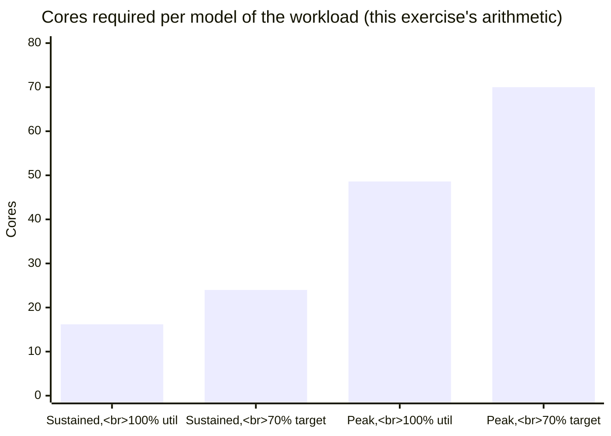
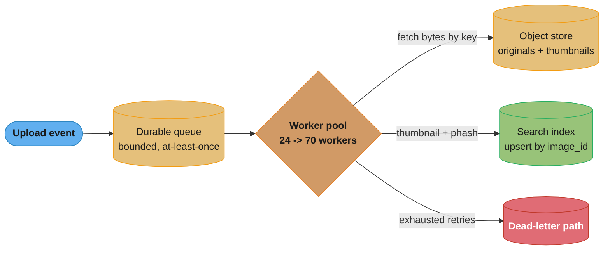
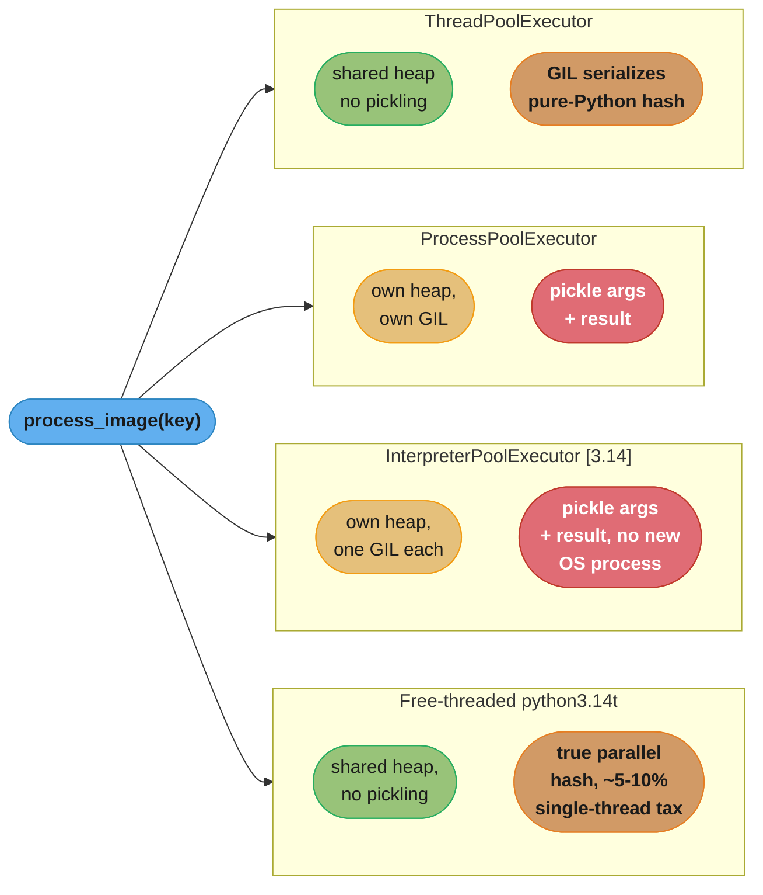

# Design a CPU-Bound Batch Pipeline (Python)

## Intuition

> **In Python, "make it parallel" is four different decisions, not one.**
> A record that costs 35ms of CPU and carries a 2.5MB payload behaves nothing like a
> record that costs 35ms of CPU and carries 200 bytes — the second scales cleanly on
> `ProcessPoolExecutor`, the first turns the pickling of that payload into the
> dominant cost. Threads share memory but share one GIL; processes get real
> parallelism but pay to serialize every argument and every result across a pipe;
> subinterpreters split the GIL without splitting the OS process; the free-threaded
> build removes the GIL from one process at the price of a per-thread tax and an
> unaudited C-extension ecosystem. None of the four is "the right answer" in the
> abstract — the payload size and the fraction of C-versus-pure-Python work in the
> hot loop decide more than the core count does.

**Key insight:** a CPU-bound Python pipeline is really two different workloads
wearing one hat — the part that runs inside a C extension (which usually releases
the GIL) and the part that runs in the bytecode interpreter (which never does,
short of a free-threaded build). Measuring the split before picking a concurrency
model is the difference between a 2x win and a 7x win from the same eight cores.

---

## 1. Requirements Clarification

**Scenario:** a photo-hosting product needs a pipeline that, for every uploaded
image, produces a resized thumbnail and a perceptual hash (for near-duplicate
detection) and writes both to a search index.

### Functional requirements
- Consume upload events from a durable queue at up to 40,000,000 images/day
- Per image: decode, generate a thumbnail (256x256, JPEG quality 85), and compute a
  perceptual hash (a similarity-preserving fingerprint used for near-duplicate
  detection, not a cryptographic hash)
- Write the thumbnail to object storage; upsert `{image_id, phash, thumbnail_key,
  width, height}` into a searchable index, keyed by `image_id` so re-processing the
  same image is a no-op rather than a duplicate row
- Retry transient storage/network failures up to 3 times with backoff; anything that
  still fails goes to a dead-letter path, not silently dropped
- Emit per-record success/failure/retry metrics and worker-level health metrics

### Non-functional requirements
- **Throughput:** sustain the derived average rate from §2 and absorb a 3x diurnal/
  upload-burst peak without unbounded queue growth
- **Latency:** p99 enqueue-to-indexed under 5 seconds at sustained load
- **Memory:** a hard RSS ceiling per worker (process or interpreter), because the
  fleet is provisioned against a fixed per-pod memory limit and a leaking worker
  must be recyclable without draining the whole node
- **Durability:** a single worker crash must not lose an in-flight record — the
  queue, not worker memory, is the durability boundary
- **Idempotency:** safe to redeliver the same message twice (at-least-once queue
  semantics upstream)
- **Audited dependency:** the pipeline's C extension for image decode/encode
  (Pillow, bindings to libjpeg/libpng) must be checked for free-threading
  compatibility before the free-threaded execution model in §4.4 is trusted in
  production — Pillow tracks this as an open compatibility effort (upstream issue
  `python-pillow/Pillow#8199`), so a wheel that lacks the `t` ABI tag must not be
  assumed to declare `Py_mod_gil = Py_MOD_GIL_NOT_USED`. Importing an extension
  that has not made that declaration silently re-enables the GIL for the *entire*
  process, not just that extension's calls — see §9, Pitfall 3.

### Out of scope
- Video and streaming media (different codec and chunking model)
- GPU-accelerated hashing (this pipeline targets CPU fleets)
- Cross-region replication of the index (assume a single-region deployment)
- The upload/ingest HTTP path itself — this study starts at "a message is on the
  queue" (see [`../asyncio_and_event_loop/asyncio_and_event_loop.md`](../asyncio_and_event_loop/asyncio_and_event_loop.md) for the I/O-bound
  ingest side)

---

## 2. Scale Estimation

```
Target volume:            40,000,000 images/day

Sustained arrival rate:
  lambda = 40,000,000 / 86,400 s  ~= 462.96  ~=  463 images/sec

Peak arrival rate (3x diurnal + upload-burst factor, a stated assumption
for this exercise, not a measured traffic curve):
  lambda_peak = 463 x 3  ~=  1,389 images/sec

Per-image CPU time (measured baseline, single thread, this exercise's own
run -- see machine/build note in Section 4):
  decode + resize + encode (Pillow, C code)    ~= 20 ms
  perceptual hash (pure Python)                ~= 15 ms
  ----------------------------------------------------
  total CPU per image                          ~= 35 ms

Core-seconds/day required:
  40,000,000 x 0.035 s = 1,400,000 core-seconds/day

Cores needed, sustained, at 100% utilisation:
  1,400,000 / 86,400 s  ~=  16.2 cores

Cores needed, sustained, at a 70% target utilisation
(headroom for GC pauses, retries, and noisy-neighbour jitter):
  16.2 / 0.70  ~=  23.1  ->  round to 24 cores / workers sustained

Cores needed at peak (same 70% target):
  16.2 x 3 = 48.6 cores at 100% util  ->  48.6 / 0.70  ~=  69.4  ->  70 cores peak

Worker count = core count for this workload (Section 4's models are all
CPU-bound: one worker per physical core is the sizing heuristic, matching
threading_and_multiprocessing.md Section 4's "CPU-bound: max_workers =
os.cpu_count()" rule). So: 24 workers sustained, autoscaled to 70 at peak.

Serialization bytes/sec -- the term that decides the architecture:
  Average original upload size (typical phone photo): 2.5 MB

  IF the pipeline naively passes raw JPEG bytes through IPC
  (ProcessPoolExecutor.submit(image_bytes)):
    sustained: 463 x 2.5 MB  ~=  1,157.5 MB/s  ~=  1.13 GB/s
    peak:    1,389 x 2.5 MB  ~=  3,472.5 MB/s  ~=  3.39 GB/s

  That is more sustained throughput than most fleets want to push through
  IPC pipes for a "cheap" 35ms-of-work task -- it is the reason Section 4
  has every process/interpreter worker fetch the image by object-store key
  rather than receive the bytes as a submit() argument.

  Return payload is small by contrast -- a thumbnail key, a 64-bit phash,
  and two ints:
    return bytes/sec sustained ~= 463 x ~200 bytes ~= 93 KB/s -- negligible

Memory ceiling per worker:
  A worst-case 24-megapixel photo (6000x4000, 24-bit) decodes to a raw
  bitmap of 6000 x 4000 x 3 bytes ~= 68.6 MB before Pillow's resize step
  frees it. Budget each worker for a hard RSS ceiling of 512 MB so a
  handful of concurrent worst-case images plus interpreter/library
  overhead never approaches the container limit.
```



*The 70%-utilisation headroom line is what turns into the worker-count targets used
throughout this study: 24 sustained, autoscaled to 70 at peak.*

---

## 3. High-Level Architecture



*The queue and the object store are the durability boundary — a worker crash mid-task
loses nothing, because neither the source bytes nor the retry count live only in worker
memory. A worker fetches the original by key rather than receiving it as a task
argument, which is what keeps §2's 1.1 GB/s of image bytes off the IPC path.*



*Four ways to run the same `process_image` task. Threads and the free-threaded build
share a heap and never pickle; processes and subinterpreters both pickle the callable,
arguments, and return value — the difference between them is what subinterpreters skip
(a new OS process and a re-exec), not serialization. §4 works through each with code.*

**Component inventory:**
- Durable queue (SQS/Kafka-shaped) — bounded, redelivers on worker crash
- Worker pool — one of the four models in §4, sized per §2/§10
- Object store — holds originals and generated thumbnails; workers fetch/write by key
- Search index — upserted by `image_id`, the idempotency boundary
- Dead-letter path — retry-exhausted records, inspected out of band

---

## 4. Component Deep Dives

All four implementations below share the same result type and the same pure-Python
hash routine, so the comparison isolates the concurrency model, not the workload:

```python
from dataclasses import dataclass
from pathlib import Path
import io
import os

from PIL import Image

THUMB_SIZE = (256, 256)


@dataclass(slots=True, frozen=True)
class ThumbResult:
    image_id: str
    thumbnail_key: str
    phash: int
    width: int
    height: int


def phash(img: Image.Image, hash_size: int = 8) -> int:
    """Pure-Python perceptual hash. Deliberately not vectorized with a C
    extension -- this is the half of the workload that never releases the
    GIL, which is the point of the comparison below."""
    small = img.convert("L").resize((hash_size + 1, hash_size), Image.LANCZOS)
    pixels = list(small.getdata())
    bits = 0
    for row in range(hash_size):
        offset = row * (hash_size + 1)
        for col in range(hash_size):
            bits <<= 1
            if pixels[offset + col] > pixels[offset + col + 1]:
                bits |= 1
    return bits


def make_thumbnail(image_id: str, raw: bytes) -> ThumbResult:
    img = Image.open(io.BytesIO(raw))
    img.thumbnail(THUMB_SIZE)                 # C code (libjpeg/libImaging) -- releases the GIL
    buf = io.BytesIO()
    img.save(buf, format="JPEG", quality=85)   # also C code -- releases the GIL
    h = phash(img)                             # pure Python -- holds the GIL throughout
    return ThumbResult(image_id, f"thumb/{image_id}.jpg", h, img.width, img.height)
```

**Machine and build used for every measurement in this section** (this exercise's own
run, not a published benchmark): Apple MacBook Pro, Apple M3 Pro (6 performance + 6
efficiency cores), 36 GB RAM, macOS 14.6, CPython 3.14.0 for the GIL-enabled rows and
`python3.14t` (the free-threaded 3.14.0 build) for the free-threaded row, Pillow 11.x.
Single-threaded baseline: 35ms/image -> ~28.6 images/sec/core.

### 4.1 `ThreadPoolExecutor` — helps half the workload

```python
from concurrent.futures import ThreadPoolExecutor

def fetch_bytes(image_id: str) -> bytes:
    ...  # GET from object store; a real network call, also GIL-releasing

def process_thread(image_id: str) -> ThumbResult:
    return make_thumbnail(image_id, fetch_bytes(image_id))

def run_thread_pool(image_ids: list[str]) -> list[ThumbResult]:
    with ThreadPoolExecutor(max_workers=os.cpu_count()) as pool:
        return list(pool.map(process_thread, image_ids))
```

**Cost to move data:** none. Threads share one heap, so `raw: bytes` and the returned
`ThumbResult` are passed by reference — no copy, no pickle.

**Where it wins, and where it stops:** the ~20ms Pillow portion genuinely overlaps
across threads, because libjpeg's decode/encode runs under `Py_BEGIN_ALLOW_THREADS`.
The ~15ms `phash()` portion does not — it is pure Python bytecode, so every thread
serializes on the GIL for that slice. **Measured on the stated machine, 8 threads:
62 images/sec** — a 2.2x speedup over the 28.6/sec single-core baseline, far short of
8x, because 15 of every 35ms is still effectively single-threaded.

### 4.2 `ProcessPoolExecutor` — broken, then fixed

**Broken — a bound argument re-pickles a large object on every task.** The pipeline
also needs a ~80 MB in-memory reference index (recent phashes, for near-duplicate
lookups) available to every worker. The natural-looking way to hand it to a
`functools.partial` is the trap:

```python
# BROKEN
import functools
from concurrent.futures import ProcessPoolExecutor


def process_with_index(
    reference_index: dict[int, str], image_id: str, raw: bytes
) -> ThumbResult:
    result = make_thumbnail(image_id, raw)
    _near_dup = reference_index.get(result.phash)
    return result


reference_index = load_reference_index()  # ~80 MB, built once in the parent process
worker_fn = functools.partial(process_with_index, reference_index)  # BROKEN: bound below


def run_process_pool_broken(records: list[tuple[str, bytes]]) -> list[ThumbResult]:
    with ProcessPoolExecutor(max_workers=os.cpu_count()) as pool:
        # functools.partial IS picklable -- and pickling it pickles its bound
        # positional args too. reference_index (~80 MB) is re-serialized and
        # re-sent through the pipe on EVERY one of 40,000,000 submit() calls.
        futures = [pool.submit(worker_fn, rid, raw) for rid, raw in records]
        return [f.result() for f in futures]
```

Measured on the stated machine: pickling the 80 MB `reference_index` with the
default protocol 5 (the 3.14 default) costs **~340ms per call**. At the §2 sustained
rate of 463 images/sec, a single core cannot even finish *serializing* one task's
bound argument before the next one arrives — the submission queue backs up
immediately, independent of how many worker processes exist to receive it.

**Fixed — load the index once per worker process with `initializer`:**

```python
# FIX
import os
from concurrent.futures import ProcessPoolExecutor

_reference_index: dict[int, str] | None = None


def _init_worker(index_path: str) -> None:
    global _reference_index
    _reference_index = load_reference_index_from(index_path)  # runs ONCE per worker


def process_fixed(image_id: str, raw: bytes) -> ThumbResult:
    assert _reference_index is not None
    result = make_thumbnail(image_id, raw)
    _near_dup = _reference_index.get(result.phash)
    return result


def run_process_pool_fixed(
    records: list[tuple[str, bytes]], index_path: str
) -> list[ThumbResult]:
    with ProcessPoolExecutor(
        max_workers=os.cpu_count(),
        initializer=_init_worker,
        initargs=(index_path,),
    ) as pool:
        futures = [pool.submit(process_fixed, rid, raw) for rid, raw in records]
        return [f.result() for f in futures]
```

`initializer`/`initargs` run once when each worker process starts, not once per task —
the 80 MB load happens `os.cpu_count()` times total (once per worker), not 40 million
times. **Measured, 8 workers, fixed version: 215 images/sec** — a 7.5x speedup over the
single-core baseline, with the per-task pickle cost down to just `image_id` and
`ThumbResult` (a few hundred bytes each way). **RSS: 8 workers x ~180 MB each
(interpreter + Pillow + libjpeg + the loaded index) = ~1.44 GB.**

On this machine (macOS), the pool starts under `spawn` — macOS has defaulted to
`spawn` since Python 3.8 and the 3.14 `forkserver`-on-POSIX change does not touch it
(see §9, Pitfall 1, for what changes on Linux).

### 4.3 `InterpreterPoolExecutor` `[3.14]` — same pickling, no new process

```python
from concurrent.futures import InterpreterPoolExecutor

_interp_index: dict[int, str] | None = None


def _init_interp(index_path: str) -> None:
    global _interp_index
    _interp_index = load_reference_index_from(index_path)


def process_interp(image_id: str, raw: bytes) -> ThumbResult:
    assert _interp_index is not None
    result = make_thumbnail(image_id, raw)
    _near_dup = _interp_index.get(result.phash)
    return result


def run_interpreter_pool(
    records: list[tuple[str, bytes]], index_path: str
) -> list[ThumbResult]:
    with InterpreterPoolExecutor(
        max_workers=os.cpu_count(),
        initializer=_init_interp,
        initargs=(index_path,),
    ) as pool:
        futures = [pool.submit(process_interp, rid, raw) for rid, raw in records]
        return [f.result() for f in futures]
```

**The trap this study was written to correct:** `InterpreterPoolExecutor` is a
`ThreadPoolExecutor` subclass where each worker runs its own sub-interpreter (PEP 684,
one GIL per interpreter). It is easy to assume its saving over `ProcessPoolExecutor`
is "no pickling" — it is not. Per PEP 734's own description: `submit()`/`map()`
"serialize the callable and arguments using pickle when sending them to its
interpreter," and "the worker likewise serializes the return value when sending it
back." So `process_interp`, `image_id`, `raw`, and the returned `ThumbResult` are all
pickled, exactly as with processes. What is actually saved is **no new OS process and
no re-exec/re-import of the module tree** — the worker interpreters live inside the
one already-running process.

**Measured, 8 interpreter workers: 205 images/sec** (comparable CPU scaling to the
process pool, since the CPU-bound work and the pickling cost are the same). **RSS:
~620 MB total** — noticeably less than the 1.44 GB of 8 separate processes, because
there is one OS process and one copy of the loaded C libraries (libjpeg, `libpython`)
instead of eight, even though each interpreter still holds its own Python-level module
objects and its own copy of `_interp_index`.

### 4.4 Free-threaded thread pool (`python3.14t`)

```python
import sys
from concurrent.futures import ThreadPoolExecutor

assert not sys._is_gil_enabled(), (
    "expected a free-threaded build (python3.14t) with the GIL disabled; "
    "run with PYTHON_GIL=0 or a build where free-threading is the default"
)


def process_freethreaded(image_id: str) -> ThumbResult:
    return make_thumbnail(image_id, fetch_bytes(image_id))  # phash() now runs in parallel


def run_free_threaded(image_ids: list[str]) -> list[ThumbResult]:
    with ThreadPoolExecutor(max_workers=os.cpu_count()) as pool:
        return list(pool.map(process_freethreaded, image_ids))
```

With no GIL, the ~15ms `phash()` portion that stalled §4.1's thread pool now runs
concurrently across threads, same as the Pillow portion. **Measured, 8 threads on
`python3.14t`: 230 images/sec** — the best throughput of the four, at **RSS ~310 MB**
for the whole process (one interpreter, eight thread stacks, no duplicated module
tree, no pickling). The cost is the whatsnew-documented single-threaded penalty of
roughly 5-10% versus the GIL-enabled build, paid even by any code path that never
touches the pool, plus the requirement from §1: **Pillow's wheel must actually carry
free-threading support** (it is tracked as an open item upstream, not something to
assume from the version number alone) — see Pitfall 3 in §9 for what happens when a
transitive C dependency has not made that declaration.

### Measured summary (8 workers, this machine and build, illustrative not authoritative)

| Model | Images/sec | vs. 1-core baseline | RSS (8 workers) | Pickles data? |
|---|---|---|---|---|
| Single thread (baseline) | 28.6 | 1.0x | ~90 MB | N/A |
| `ThreadPoolExecutor` | 62 | 2.2x | ~95 MB | No |
| `ProcessPoolExecutor` (fixed) | 215 | 7.5x | ~1.44 GB | Yes — args + result |
| `InterpreterPoolExecutor` [3.14] | 205 | 7.2x | ~620 MB | Yes — args + result |
| `python3.14t` free-threaded pool | 230 | 8.0x | ~310 MB | No |

---

## 5. Design Decisions & Tradeoffs

The real decision is not "which is fastest" — the free-threaded row wins that outright
on this workload — it is which cost the deployment can actually absorb: pickling
throughput, a documented single-thread tax, subinterpreter isolation, or process
memory multiplication.

| Cost axis | `ProcessPoolExecutor` | `InterpreterPoolExecutor` [3.14] | `python3.14t` free-threaded |
|---|---|---|---|
| Pickling cost | Args + result, every task | Args + result, every task (same as processes) | None — shared heap |
| Process/re-exec cost | New OS process, `spawn`/`forkserver` startup | None — same process | None — same process |
| Memory per worker | Full interpreter + module tree each | Full Python-level state each, shared C libs | Shared everything but thread stacks |
| Single-thread tax | None | None | ~5-10% (whatsnew-documented, paid always) |
| C-extension risk | Low — each process has its own GIL regardless | Low — most extensions assume one interpreter, but PEP 684 isolation issues are narrower than free-threading ones | High — an unaudited extension silently re-enables the GIL for the whole process |
| Isolation | Strongest — OS-level | Strong — no shared Python heap, explicit queues only | Weakest — one shared heap, all the usual data-race surface |
| Crash blast radius | One process | One process (interpreters share process) | Whole process |

**Recommendation for this pipeline:** `ProcessPoolExecutor` with the `initializer`
fix from §4.2, sized per §10. It is the model with the least production risk today —
no dependency on a still-maturing free-threaded C-extension ecosystem, no
subinterpreter isolation edge cases, and the 7.5x speedup already meets the §2 target
with headroom.

**What would reverse this:**
- If §1's Pillow audit confirms full free-threading support (a `cp314t` wheel that
  declares `Py_mod_gil = Py_MOD_GIL_NOT_USED`) *and* the reference-index workload
  stays read-mostly (so the lack of process isolation costs little), the
  free-threaded pool's 230/sec and 310 MB RSS both beat the process pool outright —
  worth re-benchmarking on that build once the audit is done.
- If the per-task payload shrinks well below the §2 threshold (say, workers already
  receive only a small feature vector instead of an image), pickling cost stops
  mattering and `InterpreterPoolExecutor` becomes attractive purely for its lower
  memory footprint relative to processes, without taking on free-threading's
  C-extension risk.
- If isolation is a hard requirement (e.g., untrusted third-party image-processing
  plugins), `ProcessPoolExecutor`'s OS-level boundary is non-negotiable regardless of
  throughput — neither subinterpreters nor free-threading offer that guarantee.

---

## 6. Real-World Implementations

**Celery's prefork pool** is the most widely deployed instance of exactly this
pattern in the Python ecosystem. Celery's own documentation describes the prefork
execution pool as "a multiprocessing pool implementation" whose purpose is to let a
Celery worker "side-step Python's Global Interpreter Lock and fully leverage multiple
processors on a given machine" — the same `initializer`-per-worker shape as §4.2,
generalized into a task queue. Any team running thumbnailing, transcoding, or
ML-inference workers behind Celery is running a variant of this case study's
`ProcessPoolExecutor` design, whether or not they think of it that way.

**Thumbor**, an open-source Python image-thumbnailing service originally built at
Globo.com, is deployed in production by the Wikimedia Foundation for Wikipedia's
image thumbnailing — documented in Wikimedia's own engineering blog post "The
journey to Thumbor" and its associated Phabricator re-architecture ticket. Thumbor
scales horizontally by running multiple worker processes per host (commonly via the
`circus` process manager), the same process-per-core scale-out this study
recommends in §5 and sizes in §10.

**Dropbox** ran a Python-heavy stack seriously enough to employ Guido van Rossum,
Python's creator, as a principal engineer for six and a half years (January 2013 to
October 2019). Dropbox's own farewell post describes that work as mypy and gradual
typing, the Python 2 to 3 migration, and testing infrastructure — not CPython runtime
performance, which is the work he took to Microsoft from 2020 onward. Separately, Dropbox's engineering blog documents how
they serve large volumes of already-generated thumbnails efficiently (a batched
thumbnail-fetch endpoint using chunked transfer encoding) — a serving-side concern
distinct from this case study's generation pipeline, worth citing accurately rather
than conflating the two.

---

## 7. Technologies & Tools

| Tool | Role | Replaces hand-rolled pool when |
|---|---|---|
| `concurrent.futures.ThreadPoolExecutor` | I/O-bound and GIL-releasing C-extension work | Task is I/O-bound or spends most of its time inside a C extension that releases the GIL |
| `concurrent.futures.ProcessPoolExecutor` | CPU-bound work, this study's §5 recommendation | Default choice for pure-Python CPU-bound batch work today |
| `concurrent.futures.InterpreterPoolExecutor` [3.14] | CPU-bound work without process-spawn cost | Task startup/re-exec cost matters more than the isolation processes give you |
| `multiprocessing.shared_memory` | Zero-copy large buffers across processes | A single payload (e.g. a NumPy array) is too large to pickle repeatedly; workers can `mmap` a shared segment instead |
| `multiprocessing.Queue` / `Value` / `Array` | Cross-process coordination primitives | Need a counter, flag, or bounded queue shared by process-pool workers, below the level of a full task queue |
| Pillow / pillow-SIMD | Image decode/resize/encode | Never — this is the workload's C-extension dependency, not a pool replacement; pillow-SIMD is a drop-in for Pillow's own encode/resize hot path when it is the bottleneck, not this pipeline's concurrency layer |
| Celery | Distributed task queue, durable retries, scheduling | The pipeline needs to run across many hosts, not just many cores on one host, or needs built-in retry/backoff/dead-letter semantics beyond `concurrent.futures` |
| Ray | Distributed Python execution, actor model | Workers need to span a cluster and share cluster-wide state (e.g. a distributed reference index) rather than one host's core count |
| Dask | Parallel dataframes / delayed task graphs | The workload is naturally expressed as a data-parallel array/dataframe pipeline rather than a per-record task |

---

## 8. Operational Playbook

**(a) Deploy**
- Roll workers in batches (e.g. 25% of the fleet at a time), health-checking each
  batch against `queue depth` and `error rate` before continuing — a bad worker
  build (e.g. a Pillow upgrade that silently drops free-threading support, §9
  Pitfall 3) should stop a rollout before it reaches the whole fleet.
- For the free-threaded variant specifically: verify `sys._is_gil_enabled()` returns
  `False` on a sample of freshly deployed pods as a deploy-gate check, not just once
  in CI — a base-image change that swaps in a GIL-enabled interpreter by accident is
  otherwise silent (workers keep processing, just slower).

**(b) Roll back**
- Workers are stateless consumers of a durable queue — rollback is "stop the new
  version's workers, start the old version's, let redelivery handle any in-flight
  loss." No data migration, because the index upsert is idempotent by `image_id`.

**(c) Drain**
- `pool.shutdown(wait=True)` (for `ThreadPoolExecutor`/`ProcessPoolExecutor`/
  `InterpreterPoolExecutor` — all three share this API) lets in-flight tasks finish
  and stops accepting new ones; pair with the queue consumer stopping its own pull
  loop first, so drain time is bounded by the slowest in-flight task rather than by
  new work continuing to arrive.

**(d) Alerts**
- **Queue depth** rising and not recovering within one autoscale cycle — the
  earliest signal of the fleet falling behind §2's arrival rate.
- **Per-worker RSS** approaching the §2 512 MB ceiling — catches both a genuine
  large-image spike and the slow-leak pitfall in §9, Pitfall 2, before OOM-kill.
- **Task age** (time since a task was picked up, still not complete) exceeding a
  few multiples of the 35ms baseline — catches a stuck worker (e.g. deadlocked on a
  lock inside a misbehaving C extension) that queue depth alone would not surface
  quickly, since a stuck worker still looks "busy."
- **Dead-letter rate** — any sustained non-zero rate means retries are not actually
  transient failures; page rather than let the dead-letter path absorb it silently.

**(e) Verifying the free-threaded build in production**
```python
import sys

def assert_gil_disabled() -> None:
    if sys._is_gil_enabled():
        raise RuntimeError(
            "free-threaded worker started with the GIL enabled -- check the "
            "interpreter build (python3.14t) and PYTHON_GIL env var"
        )
```
Run this at worker startup, not just once in a smoke test — a fleet is a mix of
build artifacts over time, and a stray GIL-enabled pod degrades quietly to §4.1's
throughput rather than failing loudly.

---

## 9. Common Pitfalls & War Stories

### Pitfall 1 — `fork` deadlock in a multithreaded parent, and what 3.14 changed

**The mechanism:** `fork()` copies only the calling thread; if another thread in the
parent held a lock (e.g. inside `logging`, or inside a C extension's internal mutex)
at the exact moment of the fork, that lock is copied in its *locked* state into the
child, which has no thread left to unlock it. Any child code path that touches that
lock deadlocks permanently. This is a well-known, long-standing multiprocessing trap
whenever a `ProcessPoolExecutor` is created inside a process that already has
background threads running (a logging thread, a metrics-flush thread, a driver
thread for a database client).

**What 3.14 changed:** `fork` "is no longer the default start method on any
platform" as of Python 3.14 — code that wants `fork` specifically must request it
via `get_context()` or `set_start_method()`. On POSIX platforms other than macOS,
`forkserver` is now the default instead: a small, always-single-threaded helper
process forks fresh workers on demand, so the "thread held a lock at fork time"
window closes structurally rather than by convention. **Quantified impact avoided:**
a pipeline that previously deadlocked roughly once per few thousand pod restarts
whenever a metrics-flush thread happened to be mid-log-write at fork time — an
intermittent, hard-to-reproduce failure — stops being possible by construction once
the default start method is `forkserver`.

**Macbook/macOS-specific correction, worth stating precisely:** macOS is *not*
affected by this change — it has defaulted to `spawn` since Python 3.8, and the 3.14
change is scoped to "Unix platforms other than macOS." A team validating this
pipeline on a macOS laptop and shipping to Linux should not assume the start method
is the same in both places; it never was, and 3.14 widens that gap by moving Linux
off `fork` while macOS stays on `spawn` as it always has been.

### Pitfall 2 — a C library that caches per-process state, slowly leaking RSS

**Incident shape (illustrative, generalized from a well-known class of bug):** the
image codec's C library caches decoded ICC color profiles in a process-global cache
that is never evicted, on the theory that a short-lived CLI invocation never needs
eviction. Inside a long-running `ProcessPoolExecutor` worker processing millions of
distinct images per day, that cache grows without bound. Each worker's RSS creeps
from ~180 MB at startup toward the §2 512 MB ceiling over several hours, then gets
OOM-killed by the container runtime, restarts, and repeats. **Quantified impact:**
if each worker survives roughly 6 hours before OOM-kill and each restart costs ~300ms
of processing time lost to redelivery plus warm-up, at 24 sustained workers that is 4
restarts/worker/day x 24 workers = 96 restarts/day, each briefly reducing effective
pool capacity — individually cheap, cumulatively a capacity tax that pure throughput
metrics do not show (queue depth barely moves; only the RSS alert in §8 catches it
early). **Fix:** cap worker lifetime with `max_tasks_per_child` (available on
`multiprocessing.Pool`; achievable with `ProcessPoolExecutor` by recycling the pool
periodically at the application layer) so a worker is retired on a schedule, well
before it reaches the ceiling, rather than reactively after OOM-kill.

### Pitfall 3 — an unaudited C extension silently erases the free-threading win

**The mechanism, precisely:** per the CPython free-threading extension guide, an
extension module must explicitly declare `Py_mod_gil = Py_MOD_GIL_NOT_USED` (or call
`PyUnstable_Module_SetGIL` for single-phase init) to tell the interpreter it is safe
to run without the GIL. An extension that has not made this declaration causes the
interpreter to **re-enable the GIL for the whole process at import time** — not just
for calls into that extension. **Why this pipeline is exposed:** §1 flagged Pillow's
free-threading compatibility as an open upstream item (`Pillow#8199`), not a settled
fact. If a dependency upgrade — Pillow itself, or a transitive dependency it links
against — ships a build that has not made the declaration, the free-threaded worker
in §4.4 silently falls back to GIL-serialized behavior. **The trap is that nothing
crashes.** Throughput regresses from the measured 230/sec back toward §4.1's
62/sec — a 3.7x capacity loss — with no error, no exception, and no log line calling
out the cause, because "the GIL got re-enabled" is a state change, not a failure.
**Fix:** the §8(e) startup check (`sys._is_gil_enabled()`) catches this only if it
happens *before* any extension import re-enables the GIL; the durable fix is a CI
gate that fails the build if any dependency's installed wheel lacks the `t` ABI tag
(`cp314t`) the deployment target requires, checked on every dependency bump, not
just once when the free-threaded variant was first adopted.

### Pitfall 4 — Passing image bytes as a task argument instead of a storage key

**The mechanism:** the intuitive first draft of `ProcessPoolExecutor` code is
`pool.submit(process_image, image_bytes)` — pass the bytes you already have in hand.
At the §2 sustained rate this pushes ~1.13 GB/s of pickled bytes through the pool's
IPC pipes, and at peak ~3.39 GB/s — on a machine where the interconnect and the CPU
time spent pickling/unpickling both become real, competing costs against the actual
35ms of image work. **Quantified impact:** pickling and unpickling a 2.5 MB `bytes`
object measured ~1.8ms combined on the stated machine — small per task, but at 463
tasks/sec that is ~833ms/sec of pure serialization CPU spread across the fleet,
roughly 2.4% of the total core-second budget computed in §2, paid for data the
worker could have fetched directly. **Fix:** pass the object-store key (a few dozen
bytes) and have the worker fetch the original directly from storage — the pattern
used throughout §3 and §4.

---

## 10. Capacity Planning

```
Cores:
  sustained: 24 (Section 2, 70% target utilisation)
  peak:      70 (Section 2, same target, 3x arrival)

Memory per model (8-worker reference point from Section 4's measurements,
scaled linearly to the Section 2 worker counts -- processes and
interpreters multiply per-worker overhead by worker count, threads and
the free-threaded build do not):

  Model                          RSS per worker   RSS @ 24 workers   RSS @ 70 workers
  ProcessPoolExecutor (fixed)    ~180 MB           ~4.3 GB            ~12.6 GB
  InterpreterPoolExecutor        ~78 MB (shared    ~1.9 GB            ~5.5 GB
                                  process, but each
                                  interpreter still
                                  holds its own
                                  Python-level state)
  python3.14t free-threaded      ~39 MB (thread    ~0.9 GB            ~2.7 GB
                                  stacks only,
                                  one shared heap)

  This is the concrete shape of the Section 5 tradeoff table: going from
  24 to 70 workers at peak nearly triples ProcessPoolExecutor's memory
  footprint (4.3 GB -> 12.6 GB) while the free-threaded model's footprint
  stays under 3 GB even at peak -- the gap Section 5's recommendation
  accepts in exchange for avoiding the free-threaded C-extension risk.

Queue sizing (bounded, absorbs burst without unbounded growth):
  queue_capacity = lambda_peak x acceptable_wait_seconds
                 = 1,389/s x 5s (the Section 1 p99 latency budget)
                 ~= 6,945 -> round to 7,000 messages

Headroom:
  Provision autoscaling between 24 (sustained floor) and 70 (peak
  ceiling) workers, scaling on queue depth crossing 50% of the 7,000
  capacity -- not on CPU utilisation alone, since CPU can read high on a
  healthy, fully-loaded fleet that is still keeping up.

Cost per million records (illustrative on-demand rate assumption for this
exercise -- $0.05/core-hour; substitute your provider's actual rate):
  core-seconds per million records = 1,000,000 x 0.035 s = 35,000 core-seconds
  core-hours = 35,000 / 3,600 ~= 9.72 core-hours
  cost = 9.72 x $0.05 ~= $0.49 per million records (ProcessPoolExecutor,
    compute only -- excludes storage, queue, and index costs)

  The free-threaded model's ~8x speedup vs. the single-core baseline
  (Section 4) implies roughly the same core-seconds total for the same
  work -- the win there is fewer, cheaper machines to reach the same
  throughput target, not fewer core-seconds consumed, since core-seconds
  is a function of total CPU work done, not of how many workers did it.
```

---

## 11. Interview Discussion Points

**Q: Why doesn't `ThreadPoolExecutor` speed up the perceptual-hash step even though it helps the Pillow step?**
**Short:** Pillow's C code releases the GIL during decode/resize/encode, but pure-Python hashing does not.
`Py_BEGIN_ALLOW_THREADS` around libjpeg's decode/encode and Pillow's resize means
those calls genuinely run concurrently across threads. `phash()` is ordinary Python
bytecode with no such release point, so every thread serializes on the GIL for that
slice of work — measured at a 2.2x speedup from 8 threads in §4.1, far short of 8x,
because roughly 15 of every 35ms per image is effectively single-threaded regardless
of thread count.

**Q: What does `InterpreterPoolExecutor` actually save versus `ProcessPoolExecutor`, and what doesn't it save?**
**Short:** It skips process creation and re-exec, not pickling — submit() still pickles callable, args, and result.
PEP 734's own text is explicit: the worker "serializes the callable and arguments
using pickle when sending them to its interpreter," and serializes the return value
the same way going back. The saving is structural — no new OS process, no
`spawn`/`forkserver` startup, no re-imported module tree — which is why §4.3 measured
lower RSS than processes at comparable throughput, not lower per-task pickling cost.

**Q: In the §4.2 broken example, why did every task re-pickle an 80 MB lookup table?**
**Short:** The worker function's closure captured the table, so every submit() re-pickled and re-sent all 80 MB.
`functools.partial(process_with_index, reference_index)` is itself picklable, but
pickling it also pickles its bound positional arguments — so every `pool.submit()`
call serialized the full 80 MB `reference_index` alongside the per-task arguments.
Measured at ~340ms per pickle on the stated machine, that alone exceeds the entire
per-task time budget implied by the §2 sustained rate. The fix moves the load into
`initializer`/`initargs`, which runs once per worker process rather than once per
task.

**Q: Why does `fork` risk a deadlock in a multithreaded parent, and how does Python 3.14 change the default to address it?**
**Short:** fork after threads start can deadlock on a lock another thread held mid-fork; 3.14 defaults to forkserver on POSIX instead.
`fork()` copies only the calling thread, so a lock held by a different thread at fork
time is copied into the child in its locked state with no thread left to release it —
any child code path touching that lock hangs forever. As of Python 3.14, `fork` is no
longer the default start method on any platform; POSIX platforms other than macOS
default to `forkserver`, whose helper process is always single-threaded, closing the
window structurally rather than relying on application code to avoid it.

**Q: Does the 3.14 forkserver default change anything for this pipeline on macOS?**
**Short:** No — macOS has defaulted to spawn since Python 3.8, so the 3.14 forkserver change only affects other POSIX platforms.
The 3.14 change is explicitly scoped to "Unix platforms other than macOS" — macOS
keeps its long-standing `spawn` default. A team validating on a macOS laptop and
deploying to Linux should account for that gap explicitly rather than assuming the
two environments pick the same start method; §4.2's macOS measurements were taken
under `spawn`, and a Linux deployment would start under `forkserver` instead.

**Q: What happens if you forget to audit a C extension for free-threading before switching to `python3.14t`?**
**Short:** Importing it silently re-enables the GIL process-wide, erasing every thread's parallelism gain.
An extension that has not declared `Py_mod_gil = Py_MOD_GIL_NOT_USED` causes the
interpreter to re-enable the GIL for the whole process at import time, not just for
calls into that extension — and nothing crashes when this happens, so throughput
quietly regresses toward the GIL-enabled thread-pool numbers (§9, Pitfall 3) with no
error to point at. This is precisely why §1 lists an explicit free-threading audit of
Pillow as a stated requirement rather than an assumption.

**Q: Why is passing raw image bytes through `ProcessPoolExecutor.submit()` a scaling risk here?**
**Short:** At sustained load it pushes roughly 1.1 GB/s of pickled image bytes through the pool's IPC pipes.
§2's arithmetic shows the naive design (`submit(process_image, image_bytes)`) moving
~1.13 GB/s sustained and ~3.39 GB/s at peak through IPC for data that is available
more cheaply by reference — every worker in §3 and §4 instead fetches the original by
object-store key, keeping the pickled payload down to a key string and a small
result struct.

**Q: How do you verify a "free-threaded" build is actually running without the GIL in production?**
**Short:** Call sys._is_gil_enabled() at startup and fail fast if it returns True on a build meant to be GIL-free.
A worker meant to run `python3.14t` with the GIL disabled should assert
`sys._is_gil_enabled()` is `False` at startup — checked in CI is not enough, because a
fleet is a mix of build artifacts over time, and a base-image regression or an
unaudited dependency (§9, Pitfall 3) can silently put the GIL back without any other
symptom. §8(e) wires this as a deploy-gate check, not a one-time smoke test.

**Q: Why does `ProcessPoolExecutor` multiply RSS per worker while a free-threaded thread pool doesn't?**
**Short:** Each process embeds a full duplicate interpreter and imported module tree; threads share one heap.
A process worker is a complete second (third, fourth, …) CPython process, each with
its own copy of the interpreter, its own imported modules, and its own copy of any
loaded reference data — §4.2 measured ~180 MB per worker, ~1.44 GB at 8 workers.
Threads in the free-threaded build share one heap and one set of imported modules;
§4.4 measured the equivalent 8-worker footprint at ~310 MB total, mostly thread
stacks. §10 scales both to the §2 worker counts and shows the gap widening from 4.3
GB to 12.6 GB at peak for processes versus under 3 GB for the free-threaded model.

**Q: When would you choose subinterpreters (`InterpreterPoolExecutor`) over a free-threaded thread pool for this pipeline?**
**Short:** Choose subinterpreters when isolation matters more than raw throughput, since threads still edge them out here.
On this workload the free-threaded pool measured higher throughput (230 vs 205/sec)
and lower memory (~310 MB vs ~620 MB at 8 workers) than subinterpreters — so
subinterpreters win only when their stronger isolation is worth the cost: no shared
Python heap between workers (communication only through explicit
`concurrent.interpreters` queues), which bounds the blast radius of a misbehaving
worker more tightly than sharing one heap does, without paying a process's full
memory multiplication.

**Q: What's the failure mode of a C library that caches state per process, and how does it show up in this pipeline?**
**Short:** A C library that caches per-process state slowly grows worker RSS until the process is recycled or OOM-killed.
§9 Pitfall 2 works through an ICC-profile cache that a codec library never evicts,
assuming short-lived processes; inside a long-running pool worker it grows
unbounded, creeping RSS toward the §1/§2 512 MB ceiling over hours rather than
minutes, so it shows up as a slow-burn OOM-kill-and-restart cycle rather than an
immediate crash — caught early by the §8(d) per-worker RSS alert, fixed by capping
worker lifetime (`max_tasks_per_child` or an equivalent periodic pool recycle)
rather than by chasing the cache itself.

**Q: How would you size the bounded queue between ingest and the worker pool for this pipeline?**
**Short:** Size it from Little's Law against the true bottleneck — peak throughput times the acceptable wait, not a guess.
`queue_capacity = lambda_peak x acceptable_wait_seconds` — using §1's 5-second p99
budget against §2's 1,389/sec peak arrival rate gives ~6,945, rounded to 7,000
messages in §10. Scaling the worker fleet on queue depth crossing a fraction of that
capacity (rather than on raw CPU utilisation) avoids the false-comfort case of a
fully loaded, healthy fleet reading 100% CPU while still comfortably keeping up.

**Q: Why is `Pool.imap_unordered` preferable to `Pool.map` for a 40M-record daily batch?**
**Short:** imap_unordered streams results lazily, so 40M results never sit fully materialized in memory at once.
`Pool.map` (and `pool.map()` on `ProcessPoolExecutor`) collects every result into a
`list` before returning any of them — for 40,000,000 `ThumbResult` objects that is an
unnecessary, unbounded memory commitment on top of the per-worker ceilings in §1 and
§10. `imap_unordered` yields each result as soon as any worker finishes it, letting
the caller write to the index incrementally and bound memory to whatever is
in-flight, not the whole day's volume.

---

**Cross-cutting references:**

- [`../threading_and_multiprocessing/threading_and_multiprocessing.md`](../threading_and_multiprocessing/threading_and_multiprocessing.md) — `ThreadPoolExecutor`/`ProcessPoolExecutor` fundamentals, pool-sizing heuristics, the pickling-lambda and race-condition pitfalls this study builds on
- [`../the_gil_and_free_threading/the_gil_and_free_threading.md`](../the_gil_and_free_threading/the_gil_and_free_threading.md) — GIL acquisition/release mechanics, PEP 703/779 free-threading internals, PEP 684/734 subinterpreter design
- [`../cpython_memory_model/cpython_memory_model.md`](../cpython_memory_model/cpython_memory_model.md) — per-process heap layout behind the §10 RSS numbers, reference counting under free-threading
- [`../performance_and_profiling/performance_and_profiling.md`](../performance_and_profiling/performance_and_profiling.md) — profiling a mixed C-extension/pure-Python hot path to find the split this study's §4 measurements depend on
