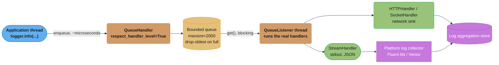
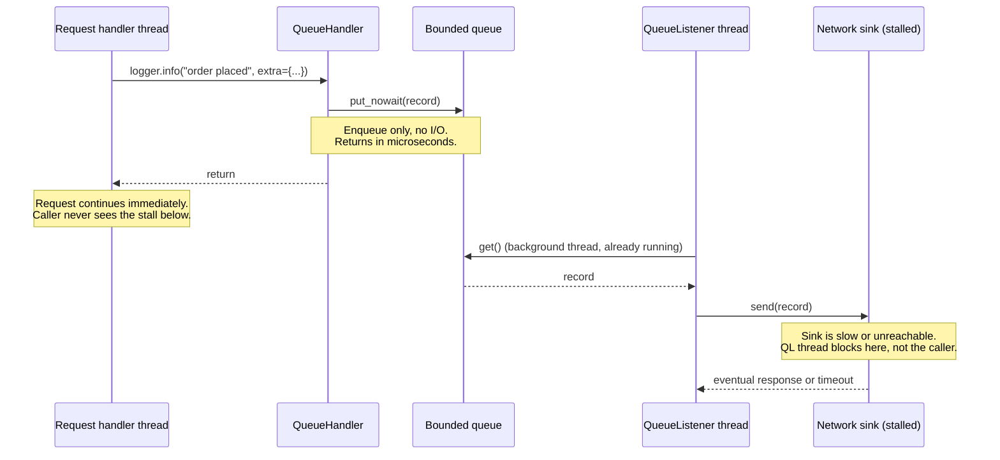

# Case Study: Design a High-Throughput Logging Pipeline in Pure Python

## Intuition

> A log call reads like a comment with side effects — `logger.info("order placed")` looks as free as `# order placed`. It is not. By default, that one line runs every attached handler synchronously, on the caller's own thread, before control returns. If one of those handlers writes to a file, opens a socket, or calls a network log collector, the request that logged it just paid for that I/O — and it pays for the *slowest* handler in the chain, not the average one.

**Key insight**: logging has a p50 and a p99, and they diverge for a reason invisible at the call site. Most of the time the disk write or the socket send is fast and the log call is cheap. The p99 is set by the one time the disk is busy, the log collector's TCP buffer is full, or a DNS lookup for the log endpoint stalls — and on a synchronous handler, that stall becomes the request's stall. This case study designs the fix: decouple the act of logging from the act of writing, so a slow sink can never again sit on a request's critical path. The honest cost of that fix is that every buffer added to protect latency is a buffer that can lose data if the process dies before the buffer drains — this design confronts that tradeoff rather than hiding it.

This is the applied companion to [`stdlib_datetime_and_logging`](../stdlib_datetime_and_logging/stdlib_datetime_and_logging.md), whose own §14 case study computes 5.76M records/day for a fintech audit trail and stops at a synchronous `RotatingFileHandler` plus a same-thread `StreamHandler` — correct for that service's traffic and durability needs, but never reaching for `QueueHandler`/`QueueListener`. This study starts from that exact volume figure and asks the next question: what happens when the sink itself is slow, or the fleet is bigger, and log calls start showing up in the request-latency histogram?

See also:
- [Threading & Multiprocessing](../threading_and_multiprocessing/threading_and_multiprocessing.md) — the background-thread model `QueueListener` is built on, and why `fork` breaks a running thread
- [Async Patterns & Pitfalls](../async_patterns_and_pitfalls/async_patterns_and_pitfalls.md) — blocking calls inside async code, the same failure shape as a synchronous log handler inside an `async def` route
- [Testing with pytest](../testing_with_pytest/testing_with_pytest.md) — `caplog`, fixtures for asserting on structured log output

---

## 1. Requirements Clarification

### Functional requirements

- **Structured output.** Every log record is a single-line JSON object with a stable, versioned schema (fixed field names and types) so downstream parsers never need a Grok pattern.
- **Contextual correlation.** Every record carries `request_id` and, where applicable, `trace_id`/`span_id`, without the call site threading those values through every function signature by hand.
- **Multiple sinks.** At minimum: stdout (for the platform's own log collector) and one network sink (a log-aggregation HTTP/gRPC endpoint) simultaneously, for services that must ship logs in-process rather than relying purely on the platform.
- **Level control without a redeploy.** Operators can raise a specific logger to `DEBUG` for one service instance during an incident and revert it, with no code change and no restart.
- **Sampling for high-volume, low-value lines.** A DEBUG-level line emitted once per loop iteration in a hot path must be reducible to a fixed rate without deleting the log statement from the code.
- **Redaction.** Fields tagged as sensitive (PII, secrets) are stripped or masked before a record leaves the process — not after it lands in a downstream store.

### Non-functional requirements

| Dimension | Target |
|-----------|--------|
| Latency budget a log call may consume on the caller's thread | **< 50 microseconds** p99 (an enqueue, not an I/O call) |
| Sustained throughput | Derived in §2 from daily volume — not a free choice |
| Durability | **Best-effort.** Records already flushed to a sink survive a crash; records still in the in-memory queue at the moment of a hard crash (`SIGKILL`, power loss) may be lost. A graceful shutdown (`SIGTERM` handled) must not lose any queued record. |
| Ordering | Per-process, per-logger ordering is preserved (the queue is FIFO); no ordering guarantee is made *across* processes or hosts — that is what timestamps and `trace_id` correlation are for |
| PII / redaction | Fields marked sensitive never reach the sink, not even the network sink, not even for one record |
| Retention | 30 days hot (searchable) in the aggregation store; long-tail archival (365 days, cold storage) is the aggregation platform's concern, not this pipeline's |

### Out of scope

- The log-aggregation backend itself (Elasticsearch/Loki/CloudWatch cluster sizing, index lifecycle) — this design produces well-formed input for one, it does not operate one.
- Metrics and traces as their own signal types — this design only covers the logs signal, though §4 covers *correlating* logs with an existing trace/span ID.
- Exactly-once delivery to the aggregation store — the design targets at-least-once from process to collector, matching the durability target above.

---

## 2. Scale Estimation

### Starting point: the companion case study's own number

[`stdlib_datetime_and_logging` §14](../stdlib_datetime_and_logging/stdlib_datetime_and_logging.md#14-case-study) derives **5,760,000 records/day** from one service at 4,000 requests/minute, one `"request completed"` line per request, at 265 bytes/record. That was one service. This design is for the fleet: assume that service is representative of the *average* service, and the fleet runs 20 such services around the clock.

```
Records/day, single representative service (from the companion study):  5,760,000
Fleet size:                                                              20 services
Fleet records/day:            5,760,000 x 20               = 115,200,000 records/day
Fleet records/sec, average:   115,200,000 / 86,400          = 1,333 records/sec
```

### Peak vs average

Request traffic is not flat across the day. Using a peak-to-average ratio of 4x (a
conservative daytime-vs-overnight swing for a B2C-shaped service, stated as an assumption,
not a measured figure):

```
Peak records/sec = 1,333 x 4 = 5,333 records/sec
```

### Bytes per record and bytes/sec

Using the companion study's own measured payload (264 bytes JSON + 1 byte newline = 265
bytes/record) as the baseline, and adding the two correlation fields this design requires
(`trace_id`, `span_id` — each a 32-hex-char string, ~36 bytes each with its JSON key):

```
Baseline record:              265 bytes  (companion study, §14 decoding section)
+ trace_id field:             ~46 bytes  ("trace_id": "<32 hex chars>",
+ span_id field:               ~30 bytes  "span_id": "<16 hex chars>",
Record size, this design:    ~341 bytes

Average bytes/sec = 1,333 x 341  = 454,553 B/s  = ~444 KiB/s
Peak bytes/sec    = 5,333 x 341  = 1,818,553 B/s = ~1.73 MiB/s

Daily bytes = 115,200,000 x 341 = 39,283,200,000 bytes = ~36.6 GiB/day (fleet-wide)
```

### Queue depth needed to absorb a sink stall

The whole point of this design is that a sink stall must not propagate to callers. Size the
in-memory queue for the worst tolerable stall duration per process, not per fleet — the
queue lives inside one process and absorbs that process's own peak rate:

```
Assume: single busiest process peaks at 400 records/sec (one hot service instance,
        not the fleet average)
Tolerable sink stall: 5 seconds (beyond this, treat it as a real outage, not a blip
        the queue should silently absorb)

Queue depth = 400 records/sec x 5 s = 2,000 records

Memory for that queue: 2,000 x (341-byte payload + ~120-byte LogRecord object
        overhead + queue.Queue node overhead ~56 bytes) ~= 2,000 x 517 B ~= 1.03 MiB

Negligible per process. The number that actually matters operationally is the
DEPTH THRESHOLD for alerting (§8), not the memory — 1 MiB is cheap; losing 2,000
records because the stall ran past 5 seconds is not.
```

This queue-depth arithmetic is the one this design's `maxsize=2000` (§4) is built from — a
concrete stall-tolerance budget, not a round number picked by feel.

---

## 3. High-Level Architecture



*The application thread only ever touches the bounded queue; every slow handler — stdout, network, or both — runs on the dedicated `QueueListener` thread, so a stall in either sink cannot block a request.*

### Sequence: one log call while the network sink is stalled



*The caller's thread is decoupled at the `put_nowait` boundary — everything below the dashed note happens on a thread the request never waits on. This is the exact mechanism a synchronous `HTTPHandler` on the request path would not give you.*

---

## 4. Component Deep Dives

### 4.1 `QueueHandler` + `QueueListener` wiring

```python
import atexit
import logging
import logging.handlers
import queue

log_queue: queue.Queue[logging.LogRecord] = queue.Queue(maxsize=2_000)

queue_handler = logging.handlers.QueueHandler(log_queue)

stdout_handler = logging.StreamHandler()
stdout_handler.setFormatter(JsonFormatter())  # see 4.3

listener = logging.handlers.QueueListener(
    log_queue,
    stdout_handler,
    # network_handler goes here too — see 4.7 for why it is NOT added by default
    respect_handler_level=True,
)

app_logger = logging.getLogger("app")
app_logger.addHandler(queue_handler)
app_logger.setLevel(logging.INFO)
app_logger.propagate = False  # this logger owns its own handler chain

listener.start()
atexit.register(listener.stop)
```

`respect_handler_level=True` matters because, without it, `QueueListener` ignores each
handler's own `level` and dispatches every record on the queue to every handler regardless
of the level that handler was configured with — a `WARNING`-only file handler would
silently receive and write `INFO` records too. `respect_handler_level=True` restores the
per-handler filtering a synchronous dispatch gives you for free.

`atexit.register(listener.stop)` is a safety net, not the primary shutdown path — see §8's
graceful-shutdown sequence for why an explicit `finally`/lifespan hook is still needed for a
`SIGTERM`.

### 4.2 BROKEN -> FIXED: the queue that has no bound

BROKEN — an unbounded queue turns a stalled sink into an unbounded memory leak:

```python
# BROKEN: default queue.Queue() has no maxsize (infinite).
# If the network sink stalls for an extended period, every enqueue still
# succeeds instantly — nothing pushes back on the application — and the
# queue grows without limit until the process is OOM-killed.
import queue
import logging.handlers

log_queue = queue.Queue()  # maxsize defaults to 0 == unbounded
queue_handler = logging.handlers.QueueHandler(log_queue)
# At 400 records/sec and a 341-byte payload, an hour-long sink outage
# accumulates 400 x 3600 x ~517 B (record + queue overhead) ~= 745 MB
# in ONE process, on top of whatever else that process holds. Multiply
# by however many worker processes the host runs and the box goes down
# from a logging bug during an outage that had nothing to do with logging.
```

FIX — a bounded queue with an explicit, chosen overflow policy:

```python
# FIX: bound the queue from the stall-tolerance budget in §2 (2,000 records
# absorbs a 5-second stall at this process's peak rate), and choose what
# happens when it fills rather than let the default behavior choose for you.
import logging
import logging.handlers
import queue

log_queue: queue.Queue[logging.LogRecord] = queue.Queue(maxsize=2_000)


class DropOldestQueueHandler(logging.handlers.QueueHandler):
    """On a full queue, drop the OLDEST buffered record to make room for
    the newest one, rather than blocking the caller or raising.

    This is a deliberate choice, not the only correct one — see the
    decision table in §5. Dropping the oldest record favors recency: an
    incident investigation almost always cares more about "what just
    happened" than about a record from seconds ago that a healthy sink
    would already have drained.
    """

    def enqueue(self, record: logging.LogRecord) -> None:
        try:
            self.queue.put_nowait(record)
        except queue.Full:
            try:
                self.queue.get_nowait()  # drop the oldest
            except queue.Empty:
                pass
            self.queue.put_nowait(record)


queue_handler = DropOldestQueueHandler(log_queue)
# Emit a counter every time this path is hit — see §8's "drop counter" metric.
# A full queue with no visible counter is the second half of this bug: the
# process no longer OOMs, but data loss is now silent instead of loud.
```

The unbounded version fails closed on the *process* (OOM kill takes everything down,
including in-flight requests that had nothing to do with logging); the bounded version fails
open on the *log stream* (a handful of log lines are lost, the process keeps serving
traffic). For almost every service, losing some debug-level context during a sink outage is
the far cheaper failure — but that choice must be explicit and monitored, not a queue with
no `maxsize` that nobody thought about.

### 4.3 Structured JSON formatter with a stable schema

```python
import json
import logging
from datetime import datetime, UTC
from typing import Any

_RESERVED = frozenset(logging.LogRecord(
    "", 0, "", 0, "", (), None,
).__dict__) | {"message", "asctime"}


class JsonFormatter(logging.Formatter):
    """Stable schema: base fields are always present with these exact
    names and types. Extra fields (from `extra=`) are merged in but never
    override a base field name.
    """

    SCHEMA_VERSION = 1

    def format(self, record: logging.LogRecord) -> str:
        payload: dict[str, Any] = {
            "schema_version": self.SCHEMA_VERSION,
            "timestamp": datetime.now(UTC).isoformat(),
            "level": record.levelname,
            "logger": record.name,
            "message": record.getMessage(),
            "module": record.module,
            "lineno": record.lineno,
        }
        for key, value in record.__dict__.items():
            if key not in _RESERVED and key not in payload:
                payload[key] = value
        if record.exc_info:
            payload["exception"] = self.formatException(record.exc_info)
        return json.dumps(payload, default=str)
```

A **versioned** schema (`schema_version`) is what lets a downstream parser evolve — add a
field, and old parsers ignore it; remove or rename one, and the version bump is the signal
that a parser update is required, instead of a silent field-name mismatch discovered weeks
later in a broken dashboard.

### 4.4 Contextual fields via `LoggerAdapter` + `contextvars`

```python
from contextvars import ContextVar
import logging

request_id_var: ContextVar[str] = ContextVar("request_id", default="")
trace_id_var: ContextVar[str] = ContextVar("trace_id", default="")


class CorrelationAdapter(logging.LoggerAdapter):
    def process(self, msg: object, kwargs: dict[str, Any]) -> tuple[object, dict[str, Any]]:
        extra = kwargs.setdefault("extra", {})
        extra["request_id"] = request_id_var.get()
        extra["trace_id"] = trace_id_var.get()
        return msg, kwargs


logger = CorrelationAdapter(logging.getLogger("app"), extra={})
```

`contextvars.ContextVar` (not `threading.local`) is required here because `asyncio` copies
the current context into every new `Task`, so `request_id_var.set(...)` at the top of a
request handler is automatically visible to every `await`ed call inside that request's task
tree, and automatically invisible to a *concurrent* request's task tree — no manual
threading of `request_id` through every function signature.

### 4.5 Sampling and rate-limiting a hot log line

```python
import logging
import random


class SamplingFilter(logging.Filter):
    """Keep a fixed FRACTION of records that carry a given `extra` marker,
    identically at every level check — this runs regardless of the
    logger's own level, so pair it with a level check at the call site
    for genuinely hot lines (see 9.3).
    """

    def __init__(self, marker: str, keep_fraction: float) -> None:
        super().__init__()
        self.marker = marker
        self.keep_fraction = keep_fraction

    def filter(self, record: logging.LogRecord) -> bool:
        if not getattr(record, self.marker, False):
            return True  # unmarked records are never sampled
        return random.random() < self.keep_fraction


# One line in a hot loop, sampled to 1%:
# logger.debug("cache lookup", extra={"hot_path": True, "key": key})
hot_path_logger = logging.getLogger("app.cache")
hot_path_logger.addFilter(SamplingFilter("hot_path", keep_fraction=0.01))
```

A `Filter` runs after the level check but before formatting and handler dispatch, so a
sampled-out record still pays the cost of message construction unless it is also guarded by
`isEnabledFor` (§9.3) — sampling controls sink volume, it does not by itself control CPU
cost at the call site.

### 4.6 OpenTelemetry trace/span correlation

```python
import logging
from opentelemetry import trace


class OtelCorrelationFilter(logging.Filter):
    """Stamp the active OpenTelemetry span's trace/span IDs onto every
    record that passes through, so a log line and the distributed trace
    it belongs to can be joined in the aggregation store.
    """

    def filter(self, record: logging.LogRecord) -> bool:
        span = trace.get_current_span()
        ctx = span.get_span_context()
        if ctx.is_valid:
            record.trace_id = format(ctx.trace_id, "032x")
            record.span_id = format(ctx.span_id, "016x")
        else:
            record.trace_id = ""
            record.span_id = ""
        return True  # a Filter used for enrichment, not exclusion, always returns True
```

Attach this filter at the handler that runs closest to the source (or on the logger itself)
so `trace_id`/`span_id` are already on the `LogRecord` before it reaches the queue —
`opentelemetry.instrumentation.logging` ships an equivalent instrumentor for auto-wiring this
without hand-writing the filter, described qualitatively in §6.

### 4.7 `dictConfig`: the one place all of it is declared

```python
import logging.config

LOGGING_CONFIG: dict[str, Any] = {
    "version": 1,
    "disable_existing_loggers": False,
    "filters": {
        "otel_correlation": {"()": "app.logging_setup.OtelCorrelationFilter"},
    },
    "formatters": {
        "json": {"()": "app.logging_setup.JsonFormatter"},
    },
    "handlers": {
        "queue": {
            "()": "app.logging_setup.DropOldestQueueHandler",
            "queue": {"()": "queue.Queue", "maxsize": 2_000},
        },
        # These two are NOT attached to a logger directly — they are
        # handed to the QueueListener constructed in code below, never
        # to `app_logger.addHandler()`. A handler on the request-facing
        # logger runs SYNCHRONOUSLY on the caller's thread; putting the
        # real sinks there instead of behind the queue is the single
        # mistake this whole design exists to prevent.
        "stdout": {
            "class": "logging.StreamHandler",
            "formatter": "json",
        },
        "network": {
            "class": "logging.handlers.HTTPHandler",
            "host": "log-collector.internal:4318",
            "url": "/v1/logs",
            "method": "POST",
            "secure": True,
        },
    },
    "loggers": {
        "app": {
            "level": "INFO",
            "handlers": ["queue"],
            "filters": ["otel_correlation"],
            "propagate": False,
        },
    },
    "root": {"level": "WARNING", "handlers": ["queue"]},
}

logging.config.dictConfig(LOGGING_CONFIG)

# Build the real handlers and the listener that owns them explicitly —
# dictConfig has no first-class way to say "these handlers belong to a
# QueueListener, not to a logger."
_stdout = logging.StreamHandler()
_stdout.setFormatter(JsonFormatter())
_network = logging.handlers.HTTPHandler(
    "log-collector.internal:4318", "/v1/logs", method="POST", secure=True
)
listener = logging.handlers.QueueListener(
    log_queue, _stdout, _network, respect_handler_level=True
)
listener.start()
```

The comment inline above names the single most common mistake this section closes: a
`dictConfig` that lists `HTTPHandler` under `loggers.app.handlers` directly reintroduces the
synchronous network call on the request path that this entire design exists to remove.

---

## 5. Design Decisions & Tradeoffs

| Decision | Chosen | Alternatives | Rationale |
|----------|--------|--------------|-----------|
| Handler dispatch model | `QueueHandler` + `QueueListener` | Synchronous handlers on the request-facing logger | Decouples I/O latency from request latency; the entire point of this design |
| Queue bound | Bounded (`maxsize=2_000`, from §2's stall budget) | Unbounded `queue.Queue()` | Bounded fails open on log data during an outage; unbounded fails closed on the whole process (OOM) — see §4.2 |
| Overflow policy | Drop-oldest | Drop-newest (reject the incoming record) / Block the caller | Drop-oldest favors recency for incident investigation; blocking the caller reintroduces the exact coupling this design removes |
| Log destination | stdout + platform collector (Fluent Bit/Vector) | In-process shipping to the aggregation store directly | stdout is the twelve-factor default and needs zero in-process durability logic; reserve in-process shipping for services the platform collector cannot reach |
| Record format | JSON | Plain text | JSON is machine-parseable without a Grok pattern; ~5 microseconds/record extra CPU (companion study §12, Q16) is negligible against the parsing win |
| Hot-line volume control | Sampling (`Filter` + `isEnabledFor` guard) | Full fidelity always | Full fidelity on a hot DEBUG line multiplies volume and cost for a line that is valuable in aggregate, not per-occurrence |

**Recommendation.** Default to **stdout, plain synchronous handlers, no queue at all** for
any service under roughly a few hundred records/sec — the companion case study's own fintech
service is a fine example, since its sink (local disk via `RotatingFileHandler`) is fast and
its volume is modest. Reach for the `QueueHandler`/`QueueListener` design in this study only
once one of two things is true: a handler in the chain does real I/O that can stall (a
network sink, a database append), or profiling shows logging calls actually appearing in the
request-latency histogram. Adding the queue, the drop policy, and the bounded-memory
reasoning is real complexity — it earns its place only when a synchronous handler has
already been shown, not assumed, to be a latency risk.

**Log-to-stdout-and-let-the-platform-collect vs ship-from-the-process, explicitly.** The
twelve-factor default is correct for the large majority of services: write JSON lines to
stdout, let a node-level agent (Fluent Bit, Vector, the cloud provider's own log driver) pick
them up, batch them, and forward them — the *process* durability concern (what survives a
crash) then becomes the agent's problem, which is exactly what it is built for. In-process
shipping (an `HTTPHandler`/`SocketHandler` sink, still behind the queue from this design) is
the exception: worker processes with no co-located collector, a lambda/serverless
environment where nothing runs alongside the process, or a compliance requirement that the
application itself prove delivery. Do not default to in-process shipping "to be safe" — it
adds a network dependency, a retry policy, and a durability story the application now owns,
for a problem the platform usually already solves.

---

## 6. Real-World Implementations

**`structlog`.** A processor-chain library that composes context-binding, filtering, and
rendering as explicit pipeline steps (`log = log.bind(request_id=rid)`, then a chain of
processors ending in a JSON renderer) rather than subclassing `Formatter` and stitching
`LoggerAdapter`/`ContextVar` together by hand, as §4.3-4.4 do here. It can render through the
stdlib's own handler chain, so a project can adopt `structlog`'s ergonomics for building
records while still routing everything through the `QueueHandler`/`QueueListener` pipeline
this study designs.

**`python-json-logger`.** A drop-in `Formatter` subclass that serializes a `LogRecord` to
JSON, functionally similar in shape to the hand-written `JsonFormatter` in §4.3 — worth
using instead of a hand-rolled formatter when a project does not need the schema-versioning
behavior shown here.

**`logging.handlers`.** The stdlib module this whole design is built on: `QueueHandler` and
`QueueListener` (§4.1) are the asynchronous-logging primitives; `RotatingFileHandler` and
`TimedRotatingFileHandler` are the size- and time-based local-file sinks the companion case
study uses directly (and that this design would place behind the queue, not on the request
path); `SysLogHandler` is the traditional syslog-protocol sink for hosts still feeding a
syslog-based pipeline.

**OpenTelemetry Python logging.** The OpenTelemetry Python SDK ships a logging
instrumentation package that injects trace/span correlation into stdlib `LogRecord`
instances automatically, the same outcome §4.6's hand-written filter produces, and can export
records via the OTLP protocol to a collector — worth adopting instead of a hand-rolled
correlation filter once a service already has OpenTelemetry tracing wired in, so both
signals share one instrumentation surface.

**Fluent Bit / Vector as node collectors.** Both are lightweight agents commonly deployed as
a sidecar or DaemonSet that tail stdout/log files from every process on a host, batch
records, and forward them to an aggregation backend (Elasticsearch, Loki, a SaaS log
platform) — the concrete implementation of "stdout + platform collector" in this design's
recommended default (§5), and the reason that path needs no in-process network-sink code at
all.

**The twelve-factor "logs as event streams" convention.** The twelve-factor app
methodology's logging factor treats an application's own log output as an unbuffered stream
written to stdout, with the *execution environment* responsible for capture, storage,
rotation, and routing — never the application itself. This design's recommended default (§5)
is a direct application of that convention; the `QueueHandler`/`QueueListener` machinery
exists for the cases that convention does not cover.

---

## 7. Technologies & Tools

| Tool | Role | Worth adopting when |
|------|------|---------------------|
| `logging.handlers.QueueHandler`/`QueueListener` (stdlib) | Async dispatch primitives (§4.1) | Any handler in the chain does I/O that can stall |
| `contextvars.ContextVar` (stdlib) | Per-async-task correlation state (§4.4) | Any service that logs `request_id`/`trace_id` and uses `asyncio` |
| `orjson` (third-party) | Faster JSON serialization than stdlib `json` | Serialization itself, not I/O, shows up in profiling as the bottleneck — rare, but real at the high end of §2's throughput range |
| `structlog` | Processor-chain structured logging API | The team wants declarative context-binding instead of the `LoggerAdapter`/`Filter` combination in §4.3-4.5 |
| Loki | Log aggregation store, label-indexed | Volume is high and full-text indexing (Elasticsearch-style) is more than the query patterns need |
| Elasticsearch | Log aggregation store, full-text indexed | Free-text search across message bodies is a first-class requirement |
| CloudWatch Logs | Managed log aggregation store | Already running on AWS and want to avoid operating a log store |

---

## 8. Operational Playbook

### a) Changing log level without a redeploy

```python
# An admin endpoint (protected, internal-only) that flips a single
# logger's level at runtime — no restart, no redeploy.
from fastapi import APIRouter
import logging

router = APIRouter()


@router.post("/internal/log-level/{logger_name}")
def set_log_level(logger_name: str, level: str) -> dict[str, str]:
    numeric_level = logging.getLevelNamesMapping().get(level.upper())
    if numeric_level is None:
        return {"error": f"unknown level {level!r}"}
    logging.getLogger(logger_name).setLevel(numeric_level)
    return {"logger": logger_name, "level": level.upper()}
```

`logging.getLevelNamesMapping()` [3.11] is the supported way to resolve a level name to its
numeric value; do not hand-roll a `{"DEBUG": 10, ...}` dict that drifts from the stdlib's own
mapping.

### b) What to alert on

| Metric | Alert condition | What it means |
|--------|-----------------|----------------|
| `log_queue.qsize()` (sampled periodically) | Sustained > 80% of `maxsize` | The listener thread cannot keep up with enqueue rate — a slow sink, or genuine volume growth past §2's sizing |
| Drop counter (incremented in `DropOldestQueueHandler.enqueue`, §4.2) | Any non-zero rate sustained > 60s | Records are being lost; correlate with the queue-depth metric to distinguish a blip from an ongoing sink outage |
| `listener._thread.is_alive()` (or a heartbeat record logged by the listener itself every N seconds) | Thread not alive / heartbeat missing | The listener thread died — every subsequent record silently vaporizes into a queue nothing ever drains |
| Sink-specific: HTTP handler request duration / error rate | p99 above the sink's normal baseline | Early warning before the queue itself starts backing up |

### c) Verifying nothing is being silently dropped

The drop counter in §8b is necessary but not sufficient — it only catches the overflow path
this design built. Verify end-to-end by periodically emitting a canary record with a unique,
predictable ID (`"canary_id": "<uuid>"`, one per minute) and asserting, from the aggregation
store side, that every emitted canary ID actually arrived within an expected window. A gap
in canary IDs catches failure modes the in-process counter cannot see: the network sink
silently rejecting records the listener thinks it sent successfully, or a collector-side
parsing failure that drops a record after it left the process.

### d) Graceful-shutdown sequence

```python
import signal
import sys


def _shutdown(signum: int, frame: object) -> None:
    # 1. Stop accepting new work at the application level FIRST (e.g., stop
    #    accepting new HTTP connections) — this bounds how many more
    #    records can still be enqueued after this point.
    # 2. Drain and stop the listener LAST, so everything already queued
    #    gets a chance to flush before the process exits.
    listener.stop()  # blocks until the queue is drained and the
                      # background thread's final get()/dispatch loop exits
    sys.exit(0)


signal.signal(signal.SIGTERM, _shutdown)
```

`QueueListener.stop()` puts a sentinel on the queue and joins the background thread, so it
blocks until every record already enqueued at the moment `.stop()` was called has been
dispatched — but it does **not** stop new records from being enqueued concurrently by other
threads unless the application has already stopped producing them (step 1 above). Ordering
matters: stop admitting new work before draining, or the drain can chase a moving target.
[3.14] adds context-manager support to `QueueListener` (`with QueueListener(...) as
listener:`), which runs `.stop()` automatically on the `with` block's exit — including via
an exception — and is worth using in new code for exactly that guarantee.

---

## 9. Common Pitfalls & War Stories

### 9.1 The unbounded queue OOM

**Scenario**: a service added an `HTTPHandler` sink pointed at a new log-aggregation
endpoint, using the default `queue.Queue()` with no `maxsize`. The endpoint had a
misconfigured DNS entry that intermittently resolved to a dead host.

BROKEN / FIXED code: see §4.2 in full.

**Root cause**: no bound on the queue meant no backpressure and no visible failure signal —
records just accumulated.

**Impact**: over a 40-minute partial DNS outage, three worker processes on the busiest host
accumulated enough queued `LogRecord` objects to push RSS past the container's memory limit;
the container orchestrator OOM-killed all three, taking down roughly a sixth of that
service's capacity during what should have been an invisible, log-only blip.

### 9.2 Losing the tail of the log on `SIGTERM`

**Scenario**: a deployment rolled a new version. The old process received `SIGTERM`, and the
container runtime gave it a 10-second grace period before `SIGKILL`. The process had a
`QueueListener` running but no signal handler calling `.stop()` — only the process's normal
exit path, which did not wait for the queue to drain.

**Root cause**: `QueueListener`'s background thread is not a daemon-vs-non-daemon-thread
problem here — `.start()` runs it as a non-daemon thread by default in most configurations,
but the process's own shutdown path returned before ever calling `.stop()`, so the queue's
contents at the moment of exit were simply abandoned along with the process.

**Impact**: the last ~200-400 log lines before every rolling deploy — the exact window most
likely to contain a shutdown-time error, a final request's outcome, or a stack trace from an
in-flight failure — were missing from the aggregation store for months before anyone
noticed the pattern, because a *missing* log line produces no error of its own; it is a
silence, not a signal. Fixed by the graceful-shutdown sequence in §8d.

### 9.3 `logging.info(f"...")` doing eager string formatting

**Scenario**: a hot loop processing several thousand items/second logged a DEBUG-level line
per item using an f-string: `logger.debug(f"processed item {item.to_dict()}")`. Production
ran at `INFO` level, so none of these lines were ever emitted.

**Root cause**: an f-string is evaluated by the Python interpreter *before* `logger.debug()`
is even called — the string, including the `item.to_dict()` call, is built unconditionally
regardless of whether the DEBUG level is active. The lazy alternative defers that work:

```python
# BROKEN: item.to_dict() runs on every call, even when DEBUG is disabled
logger.debug(f"processed item {item.to_dict()}")

# FIX: %-style lazy formatting — args are only interpolated if the
# record actually gets emitted
logger.debug("processed item %s", item.to_dict())

# FIX (stronger, for genuinely expensive construction): guard explicitly
if logger.isEnabledFor(logging.DEBUG):
    logger.debug("processed item %s", item.to_dict())
```

`%s`-style lazy formatting avoids the string-interpolation cost when the level is disabled,
but it does **not** avoid evaluating the *arguments themselves* — `item.to_dict()` in the
first fix still runs unconditionally, because Python evaluates function arguments before the
function call. Only the explicit `isEnabledFor` guard defers argument construction too;
reach for it specifically when an argument, not just the format string, is expensive to
build.

**Impact**: profiling attributed roughly 8% of that service's CPU time in the hot loop to
`to_dict()` calls whose output was discarded on every single call in production — pure waste
paid on every item processed, invisible until someone profiled the loop directly, because no
log line ever appeared to hint that logging was involved.

### 9.4 A `fork` inheriting a queue and a listener thread that does not exist in the child

**Scenario**: a service used `multiprocessing` to fan out CPU-bound work, calling
`multiprocessing.get_context("fork").Process(...)` explicitly (relevant since [3.14] made
`forkserver` the POSIX default — this bug requires `fork` specifically, whether chosen
explicitly or inherited from pre-3.14 defaults). The parent process had already set up the
full `QueueHandler`/`QueueListener` pipeline from §4.1 before spawning children.

**Root cause**: `fork()` clones the parent's entire memory image, including the `queue.Queue`
object and its internal lock — but it does **not** clone running threads. The child process
starts with exactly one thread (the one that called `fork()`), so the `QueueListener`'s
background thread simply does not exist in the child, even though the child's `log_queue`
object looks fully initialized. Records enqueued in the child accumulate forever with no
listener thread on that side of the fork to drain them, and if `fork()` happened while the
parent's queue lock was held mid-operation, the child can even deadlock on its first log
call.

**Impact**: worker processes silently stopped logging entirely — no crash, no error, just
zero log output from every forked child, and a slowly growing unread queue inside each one
until the worker was recycled. **Fix**: never share a `logging` setup constructed before a
`fork()` across the fork boundary — call `logging.config.dictConfig(...)` and
`listener.start()` *inside* each child process (e.g., in the `Process` target function, or an
`initializer=` for a `ProcessPoolExecutor`), never in the parent before spawning. This is
also why 3.14's default POSIX start method moved to `forkserver`, which forks from a clean,
single-threaded server process rather than from a live application process carrying
arbitrary open threads and locks.

### 9.5 Duplicated records from a handler attached at two levels

**Scenario**: a module added `logging.getLogger("app.payments")` with its own
`QueueHandler`-backed setup for a compliance-mandated separate audit stream, while `"app"`
(the parent logger) already had its own `QueueHandler` attached from the shared setup in
§4.7. Neither logger set `propagate = False`.

**Root cause**: a record emitted on `"app.payments"` is dispatched to that logger's own
handlers, then — because `propagate` defaults to `True` — walked up to the parent `"app"`
logger and dispatched to *its* handlers too. Both handler chains eventually reach the same
aggregation store, so every payments-related record was written twice.

**Impact**: the payments audit log's record count silently ran roughly 2x actual transaction
volume for weeks; a reconciliation job comparing log-derived counts against the payments
database flagged the mismatch, at which point the duplication (not a data-integrity issue)
was the actual finding. **Fix**: set `propagate = False` on any logger that has its own
handler chain and is not meant to also feed a parent logger's handlers — the same rule
[`stdlib_datetime_and_logging` Q12](../stdlib_datetime_and_logging/stdlib_datetime_and_logging.md#12-interview-questions-with-answers) already states for the single-logger case, restated
here because it is exactly as easy to reintroduce with a second logger as with a
misconfigured first one.

### 9.6 PII reaching the sink because redaction lived in the formatter

**Scenario**: a `JsonFormatter` (§4.3-shaped) included a redaction step: any field named
`ssn`, `card_number`, or `password` was masked before serialization. A new handler was added
directly to the `QueueListener` for a debugging tool that read raw `LogRecord` objects off a
secondary queue, bypassing the formatter entirely.

**Root cause**: redaction implemented inside `Formatter.format()` only ever runs for
handlers that call that formatter — it protects the *rendered string*, not the `LogRecord`
object itself. Any code path that consumes `LogRecord` instances directly (a custom handler,
a debugging tool, a second formatter someone adds later) sees the raw, unredacted fields,
because nothing upstream of formatting ever touched them.

**Impact**: a debugging utility briefly persisted un-redacted `LogRecord` objects, including
several containing card numbers, to a local scratch file during an incident investigation —
caught in the next security review before any external exposure, but the fix could not be
"redact harder in the formatter" since the bypass didn't go through the formatter at all.
**Fix**: implement redaction as a `logging.Filter` attached to the *logger* (or the earliest
possible handler), not inside a `Formatter` — a `Filter` runs against the `LogRecord` itself,
before any handler-specific rendering, so every consumer of that record downstream —
formatted or not — only ever sees the already-redacted version.

---

## 10. Capacity Planning

### Queue sizing from the stall-absorption requirement

Restating §2's derivation as the general formula for any process:

```
maxsize = peak_records_per_sec_this_process x tolerable_stall_seconds

This design's example:
  maxsize = 400 records/sec x 5 s = 2,000 records
```

Widen `tolerable_stall_seconds` for a service whose sink has historically longer transient
outages; widen it too far and the memory cost (still cheap per §2: ~517 bytes/queued record)
stops being the constraint and staleness of the eventually-drained backlog becomes the real
one — records from 5 minutes ago landing in the aggregation store all at once, the moment the
sink recovers, is its own investigative confusion.

### Listener throughput

The `QueueListener` thread must drain records at least as fast as the process enqueues them,
averaged over any window longer than the queue's stall-absorption budget:

```
Listener throughput needed >= peak enqueue rate (400 records/sec, this design's example)

If the network sink itself can sustain, say, 600 records/sec of write throughput
(measured against that sink, not assumed), the listener keeps up with headroom.
If the sink can only sustain 300 records/sec, the listener falls behind ANY
time enqueue rate exceeds 300/sec, and the queue depth alert (§8b) fires
continuously — the fix in that case is scaling the sink, not enlarging the queue,
because a bigger queue only delays the same overflow, it does not remove it.
```

### Storage and retention cost, fleet-wide

Extending §2's fleet-wide daily volume (~36.6 GiB/day) to a 30-day hot retention window:

```
Hot retention storage = 36.6 GiB/day x 30 days = ~1,098 GiB (~1.07 TiB)

Per-million-records storage, at this design's 341-byte record size:
  1,000,000 x 341 bytes = 341,000,000 bytes = ~325 MiB per million records
```

An aggregation platform's ingest/storage pricing (per-GB or per-record) turns this arithmetic
directly into a monthly cost line — the number worth carrying into that conversation is the
per-million-records figure above, since most vendor pricing pages quote in exactly that unit.

### The sampling ratio that keeps it affordable

If a cost review finds the 30-day hot retention figure above is not affordable at the current
vendor's per-GB rate, sampling (§4.5) is the lever, applied selectively rather than globally
— dropping `INFO`-level request-completion lines is rarely acceptable (they are the audit
trail), but a `DEBUG`-level hot-path line contributes volume without contributing much
individual value:

```
If DEBUG-level hot-path lines are, say, 40% of fleet-wide daily volume, and they are
sampled to keep_fraction = 0.01 (1%):

  New DEBUG contribution = original_DEBUG_volume x 0.01
  Fleet daily volume, post-sampling ~= (0.60 x 36.6 GiB) + (0.40 x 36.6 GiB x 0.01)
                                     ~= 21.96 GiB + 0.146 GiB ~= 22.1 GiB/day

  ~40% reduction in daily volume from sampling ONLY the hot-path DEBUG
  lines, while INFO/WARNING/ERROR — the lines an incident investigation
  actually depends on — keep full fidelity.
```

Compute the actual DEBUG-vs-other-levels split from the real fleet before committing to a
sampling ratio — the 40%/1% figures above are illustrative inputs to the formula, not a
published benchmark.

---

## 11. Interview Discussion Points

**Q: Why does adding `QueueHandler`/`QueueListener` change a log call's latency profile, and what exactly moves off the caller's thread?**
**Short:** `QueueHandler.emit()` only enqueues; the real handlers run later on the listener's own background thread.
Without it, `logger.info(...)` walks every attached handler synchronously and returns only after each one finishes — a `RotatingFileHandler` write or an `HTTPHandler` POST happens on the calling thread, so that I/O's latency is directly added to whatever request or task made the log call. `QueueHandler.emit()` instead does a single bounded `put()` and returns in microseconds; the actual handlers (stdout, network, file) run later, on a dedicated `QueueListener` thread that the caller never waits on. What moves is everything except the enqueue itself — formatting, filtering, and dispatch to every real handler all happen on the listener thread, off the request's critical path.

**Q: Why must the queue be bounded, and what is the real cost of choosing unbounded instead?**
**Short:** An unbounded queue turns a stalled sink into unconstrained memory growth instead of a visible, controlled loss.
A default `queue.Queue()` has no `maxsize`, so every enqueue succeeds instantly even while the listener thread is stuck on a stalled sink — nothing pushes back on the application, and the queue grows without limit for as long as the stall lasts. That converts a sink outage, which should be an isolated logging problem, into a process-wide memory problem that can OOM-kill the whole process, including in-flight request handling that has nothing to do with logging. A bounded queue sized from a stated stall-tolerance budget (§2, §10) fails predictably instead — a handful of log records lost, the process otherwise unaffected.

**Q: Given a bounded queue, what is the actual tradeoff between drop-oldest, drop-newest, and blocking the caller when it fills?**
**Short:** Drop-oldest favors recency, drop-newest favors continuity, and blocking the caller reintroduces the coupling the queue exists to remove.
Drop-oldest evicts the longest-buffered record to make room for the newest one — it favors "what just happened," which is usually what an incident investigation cares about most. Drop-newest instead rejects the incoming record and keeps the existing backlog intact — it favors preserving whatever was already queued, at the cost of losing the freshest context. Blocking the caller until space frees up is the one option that is not really "bounded" from the caller's perspective — it just moves the stall from the sink directly onto the request thread, which is precisely the coupling this whole design exists to eliminate; it is only defensible when the caller itself must never silently lose a record, and even then a bounded wait (`put(timeout=...)`) with an explicit fallback is safer than an indefinite block.

**Q: Why can't a f-string be used as the message argument to `logger.debug()` in a hot path, even though the level is disabled in production?**
**Short:** An f-string is evaluated by Python before the logging call runs, so it always pays the formatting cost regardless of level.
`logger.debug(f"item {expensive_call()}")` builds the interpolated string — including calling `expensive_call()` — as an ordinary Python expression before `logger.debug()` is ever invoked, so the cost is paid unconditionally even when DEBUG is disabled and the record is immediately discarded. `%s`-style lazy formatting (`logger.debug("item %s", expensive_call())`) still evaluates `expensive_call()` eagerly, since Python evaluates arguments before any function call, but defers the *string interpolation* itself until the logging module confirms the record will actually be emitted. Only an explicit `logger.isEnabledFor(logging.DEBUG)` guard around the whole call defers evaluating the argument too — reach for it when the argument, not just the formatting, is the expensive part.

**Q: What breaks when a process using `fork()` has already set up a `QueueHandler`/`QueueListener` pipeline before spawning children?**
**Short:** `fork()` clones the queue object but not the running listener thread, so the child never drains what it enqueues.
`fork()` duplicates the parent's entire memory image — including the `queue.Queue` object and its internal lock — but does not clone any running threads; the child starts with exactly one thread, the one that called `fork()`. The `QueueListener`'s background thread that was draining the queue in the parent simply does not exist in the child, so records enqueued there accumulate with nothing to read them, and a fork that lands mid-lock-acquisition can even deadlock the child on its first log call. The fix is to construct the logging setup (`dictConfig` + `listener.start()`) inside each child process rather than sharing one built before the fork — which is also why 3.14 made `forkserver` (forking from a clean, single-threaded server process) the POSIX default for `ProcessPoolExecutor` rather than `fork`.

**Q: How do you propagate `request_id` into log lines across an `asyncio`-based service without threading it through every function signature?**
**Short:** A `contextvars.ContextVar` set once per request is automatically visible to every awaited call inside that request's task tree.
Set a `contextvars.ContextVar` at the start of request handling (a middleware, typically) and read it inside a `logging.LoggerAdapter.process()` override that injects it into every record's `extra`. `asyncio` copies the current `contextvars.Context` into every new `Task`, so a value set in the request handler is visible to any coroutine `await`ed from within that task tree without being passed as a parameter anywhere — and a concurrent request's task tree, with its own copied context, never sees a different request's value. `threading.local` does not have this property: it is keyed by OS thread, not by async task, so multiple concurrently-running coroutines sharing one thread would see whichever value was set last, not their own.

**Q: What does `respect_handler_level=True` actually control on `QueueListener`, and what happens without it?**
**Short:** It restores per-handler level filtering on the listener thread; without it every handler sees every queued record regardless of its own level.
By default, `QueueListener` dispatches every record it pulls off the queue to every handler it was constructed with, ignoring each handler's individually configured `level` — a handler set to `WARNING` would still receive and process `INFO` and `DEBUG` records that happened to be on the queue. `respect_handler_level=True` makes the listener check each handler's own level before dispatching to it, restoring the filtering behavior a synchronous handler chain gives for free. Omitting it is a subtle bug: it does not crash or error, it just silently sends more records to a handler than that handler's own configuration says it should receive — for example, a cost-sensitive network sink configured for `WARNING`-only suddenly ingesting (and billing for) every `INFO` line too.

**Q: Why does redaction belong in a `Filter` rather than in the `Formatter`?**
**Short:** A `Filter` runs against the raw `LogRecord` before any handler-specific rendering, so every consumer is protected, not just formatted output.
Implementing redaction inside `Formatter.format()` only protects the rendered string that formatter produces — any other code path that consumes the `LogRecord` object directly (a second handler with a different formatter, a debugging tool, a custom sink added later) sees the raw, unredacted fields, because nothing upstream of formatting touched them. A `logging.Filter` attached at the logger (or the earliest handler) runs against the `LogRecord` itself before any formatter is invoked, so it can strip or mask sensitive fields once, upstream of every downstream consumer — formatted or not. The lesson generalizes: put a cross-cutting guarantee at the layer every path is forced through, not at a layer some paths can bypass.

**Q: When is stdout-plus-platform-collector the right default over shipping logs from the process directly, and when is it not?**
**Short:** Stdout-plus-collector is the default because the platform already solves capture and durability; ship in-process only where no collector is co-located.
The twelve-factor convention treats an application's log output as an unbuffered stream to stdout, with the execution environment (a node agent like Fluent Bit or Vector, or the platform's own log driver) responsible for capture, batching, and forwarding — which means the application never has to own a network dependency, a retry policy, or an in-process durability story for its logs. That default breaks down for workloads with no co-located collector — a bare serverless function, a worker with no sidecar — where in-process shipping (an `HTTPHandler`/`SocketHandler`, still routed behind the `QueueHandler`/`QueueListener` pipeline from this design) becomes the only option, or for a compliance requirement that the application itself prove delivery rather than delegating that proof to infrastructure it does not control.

**Q: How do you size the bounded queue in this design, concretely?**
**Short:** Multiply the process's own peak enqueue rate by how many seconds of sink stall should be absorbed without loss.
`maxsize = peak_records_per_second_for_this_process x tolerable_stall_seconds` — a per-process figure, not a fleet-wide one, since the queue lives inside one process and only ever needs to absorb that process's own rate. In this design's numbers, a process peaking at 400 records/sec with a 5-second stall-tolerance budget needs `maxsize=2_000`, costing roughly 1 MiB of memory at ~517 bytes per queued record (payload plus `LogRecord` and queue-node overhead) — cheap enough that the real sizing question is almost never memory, it is choosing the stall-tolerance duration itself: too short and routine sink hiccups start dropping records; too long and a genuine outage buffers a backlog so large that draining it, once the sink recovers, floods the aggregation store with stale-timestamped records all at once.

**Q: Why is a canary record a better signal than the in-process drop counter alone for verifying nothing is being silently lost?**
**Short:** The drop counter only sees loss inside the process; a canary catches loss anywhere downstream of it too.
The drop counter incremented in the overflow path (§4.2, §8b) only catches records this process's own queue discarded — it says nothing about a record the listener thread believes it sent successfully but that the network sink silently rejected, or one that a downstream collector failed to parse and dropped after it already left the process. A canary record — a predictable, unique ID emitted on a fixed cadence — closes that gap by verifying the full path end to end: check from the aggregation store side that every emitted canary ID actually arrived within an expected window, and a gap in the sequence localizes loss to somewhere between "left the process" and "landed in the store," a failure surface the in-process counter cannot see at all.

**Q: Two services both log 5 million records/day, but one needs the full `QueueHandler`/`QueueListener` pipeline and the other is fine with plain synchronous handlers. What's the actual variable that decides it, and why isn't it volume?**
**Short:** Whether a handler in the chain does I/O that can stall, not the record volume, decides whether async dispatch is needed.
Volume alone does not create the latency risk this design solves — a synchronous `RotatingFileHandler` writing to fast local disk, as the companion case study's own fintech service does at 5.76M records/day, rarely stalls long enough to matter, because local disk writes are consistently fast and bounded. The actual trigger is whether any handler in the chain performs I/O whose latency is variable and occasionally large: a network sink subject to DNS hiccups, connection pool exhaustion, or a downstream collector's own backpressure. A service logging the same volume entirely to fast local disk can stay on the simpler synchronous design in [`stdlib_datetime_and_logging`](../stdlib_datetime_and_logging/stdlib_datetime_and_logging.md); the moment a network handler enters the chain, or profiling shows logging calls in the request-latency histogram, is the moment to reach for the pipeline this study builds — adding it earlier is complexity paid for a risk that has not actually materialized yet.
