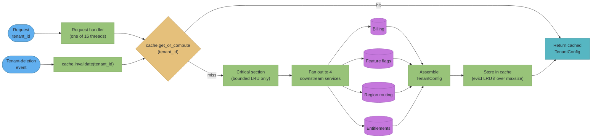
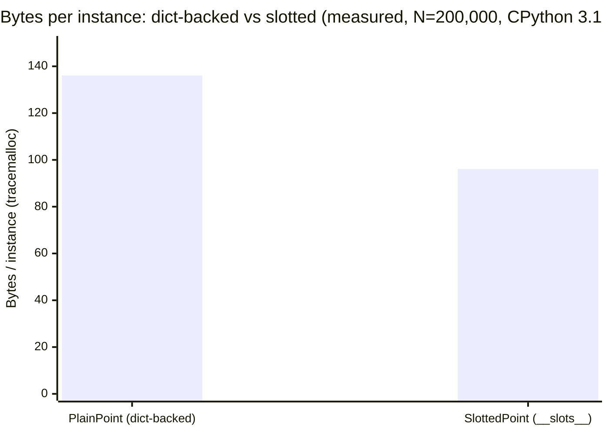

# Design a Memory-Efficient Cache (Python)

## Intuition

> **A cache is three separate promises, and Python makes you choose which two you keep
> for free.** "Bounded" (it will not eat the process), "cheap per hit" (it will not tax
> the hot path), and "does not keep things alive that should die" are in tension the
> moment you pick a data structure. `dict` gives you cheap and unbounded.
> `functools.lru_cache` gives you cheap and bounded, in C, with a lock you did not have
> to write. `weakref.WeakValueDictionary` gives you "does not keep things alive" — at
> the cost of a value evaporating the instant nothing else holds it, which is a
> correctness bug wearing a memory-safety costume. And every one of those promises was
> quietly co-signed by the GIL: `lru_cache`'s "thread-safe" was never really about the
> GIL, but the plain dict you reach for instead of it was, and `python3.14t` is the
> build where that difference stops being academic.

**Key insight:** `sys.getsizeof()` measures a box, not what's in it, so "how much memory
does this cache use" is unanswerable without `tracemalloc`; `__slots__` buys you 40
bytes per instance today, not the 200+ bytes of 2010s folklore, because CPython 3.11+
already stopped allocating a `dict` for a plain instance until you force one into
existence; `functools.lru_cache`'s C implementation only takes a lock for the bounded
code path — the unbounded one (`maxsize=None`) never did, in the GIL build or the
free-threaded one; and free-threaded CPython does not make caches unsafe, it makes
*unsynchronized* caches unsafe in ways an ordinary test suite will never catch, because
the GIL was hiding a design debt that most cache code never had to pay down.

All measurements in this file were run to produce the numbers shown — see each
section for the exact interpreter build. Two interpreters are used throughout:

```
GIL-enabled:    CPython 3.14.5   (Homebrew, macOS arm64/aarch64)
Free-threaded:  CPython 3.14.6+freethreaded (PEP 703/779 build, macOS arm64/aarch64)
```

---

## 1. Requirements Clarification

**Scenario:** a service resolves `tenant_id -> TenantConfig` on every request — a
~2 KB object assembled from four downstream calls (billing, feature flags, region
routing, entitlements). Under load this lookup dominates p50 latency and the
downstream calls are rate-limited, so the config must be cached in-process. The
service runs one process per pod under `gunicorn --workers 1 --threads 16` (threads,
not forked workers, because the workload is I/O-bound apart from this cache), and the
team is piloting `python3.14t` on a canary fleet to use all 16 vCPUs from one process
instead of forking 16 single-threaded workers.

### Functional requirements
- `get_config(tenant_id) -> TenantConfig`: return a cached value if present and not
  expired; otherwise fetch, populate, and return
- Bound total cache memory — the pod has a hard container memory limit and the cache
  competes with request buffers and the interpreter's own baseline footprint
- Never serve a `TenantConfig` for a tenant that no longer exists (eviction on
  tenant-deletion events, not just LRU/TTL)
- Expose hit rate, current size, and eviction counts for alerting
- Safe under concurrent request threads with no data race, on both the GIL build
  (today) and the free-threaded build (the canary and eventual default)

### Non-functional requirements
- **Latency:** a cache hit must cost single-digit microseconds; a miss costs the
  ~40 ms downstream fan-out, so a false-negative (should have hit, computed anyway)
  is a bounded latency tax, but a **false-positive correctness bug** (two threads
  observe two different values for the same key at the same moment, or the eviction
  bookkeeping itself corrupts) is the failure this case study is actually about
- **Memory:** the pod's container limit is 512 MiB; the interpreter baseline plus
  request-handling buffers consumes roughly 180 MiB, leaving a **hard 200 MiB ceiling
  for the cache** (the remainder is headroom before the OOM killer)
- **No unbounded growth:** a tenant list that grows over the life of a long-running
  process must not turn the cache into the thing that gets a pod recycled
- **Portability across the free-threading migration:** the cache design must not
  silently depend on the GIL for correctness, because the whole point of the pilot is
  to remove it

### Out of scope
- Cross-process/shared-memory caching (Redis, Memcached) — this is strictly an
  in-process, per-pod cache; see [`../../backend/caching_strategies/caching_strategies.md`](../../backend/caching_strategies/caching_strategies.md)
  for the distributed-cache version of this problem
- Cache invalidation *propagation* across a fleet — this study covers eviction inside
  one process, not fan-out of an invalidation event to N pods
- Persistence / cache warm-up on restart

---

## 2. Scale Estimation

```
Tenants active in a given day:           ~40,000
TenantConfig object size (measured, S4.1): ~1.6 KB net (dict-backed dataclass)
                                          ~1.1 KB net (with __slots__, S4.2)

Naive "cache everything, never evict":
  40,000 x 1.6 KB = 64 MB (dict-backed), 40,000 x 1.1 KB = 44 MB (slotted)
  -> fits 200 MiB today, but tenant count is projected to 5x over 18 months
     (200,000) -> 320 MB / 220 MB -- fails the ceiling within the roadmap horizon,
     which is why S10 sizes maxsize from the ceiling, not today's tenant count.

Request rate: ~1,200 req/s/pod, each one get_config() call.
  At a 95% hit rate: 60 misses/sec x ~40ms fan-out = 2.4 worker-sec/sec of
  downstream-call time -- comfortably inside the 16-thread pool, but a hit-rate
  collapse below ~80% (an eviction storm) pushes concurrency past the pool.

Per-hit cost budget: p50 request budget 8ms. S4.4/S4.8 measure a hit at 50-150ns,
five to six orders of magnitude under budget -- the design constraint is never hit
latency, it is memory and correctness under concurrency.
```

---

## 3. High-Level Architecture



*Every request path funnels through one cache lookup. A hit returns immediately with no
lock held past the lookup; a miss takes a critical section only around the
check-then-populate sequence, never around the four downstream calls — holding a lock
across network I/O is the single most common way a cache becomes a serialization point
(Pitfall 4).*

**Design decision made here, expanded in S4-S5:** the cache is a single bounded LRU
structure with an explicit `threading.Lock`, not `functools.lru_cache` — per-tenant
invalidation and custom eviction telemetry are the reasons, expanded throughout this
entire case study.

---

## 4. Component Deep Dives

### 4.1 Measuring real memory: `sys.getsizeof()` lies about containers

`sys.getsizeof(obj)` returns the size of `obj` itself — its header plus its own
directly-owned buffer — never the objects it points to. For a `list`, that means the
pointer array, not the elements.

```python
>>> import sys
>>> lst = list(range(1000))
>>> sys.getsizeof(lst)
8056
>>> sum(sys.getsizeof(x) for x in lst)   # small ints 0-256 are cached singletons
28000
```

The second number looks like "the real total," but it double-counts: Python caches
small integers `-5..256` as singletons, so most of those 1000 `getsizeof` calls are
re-measuring the *same* 28-byte `int` objects that already existed before the list did.
Neither number answers "how much memory did building this list actually cost" — for
that, `tracemalloc` (stdlib, no dependency) measures real allocator activity:

```python
>>> import tracemalloc
>>> tracemalloc.start()
>>> snap0 = tracemalloc.take_snapshot()
>>> lst2 = [object() for _ in range(1000)]
>>> snap1 = tracemalloc.take_snapshot()
>>> sum(s.size_diff for s in snap1.compare_to(snap0, 'lineno') if s.size_diff > 0)
25520
```

**Measured on CPython 3.14.5:** `sys.getsizeof(lst2)` reports **8856** bytes (the list's
own pointer array only) while `tracemalloc` shows **25,520** bytes of real new
allocation to build it — the 1000 fresh `object()` instances plus the array. Neither is
"wrong"; `getsizeof` answers "how big is this one object's own memory," `tracemalloc`
answers "how much did the allocator actually hand out." A cache sizing decision needs
the second question, always — the technique used for every measurement in this file is
`tracemalloc.take_snapshot()` before and after, `compare_to(...)`, sum positive `size_diff`.

### 4.2 `__slots__`: what it removes, measured here

`__slots__` replaces an instance's per-object attribute storage with a fixed C-level
array. The folklore number (hundreds of bytes saved) is stale: CPython 3.11+ already
does not eagerly materialize a `__dict__` for a plain instance — attribute values live
in an inline "values array" in the object's preheader, with the key layout shared once
on the class (`Py_MANAGED_DICT`). `__slots__` is buying you the *last* increment on top
of that, not the whole historical difference.

```python
class PlainPoint:
    def __init__(self, x, y, z):
        self.x, self.y, self.z = x, y, z

class SlottedPoint:
    __slots__ = ("x", "y", "z")
    def __init__(self, x, y, z):
        self.x, self.y, self.z = x, y, z
```

```python
>>> sys.getsizeof(PlainPoint(1, 2, 3))
48
>>> sys.getsizeof(SlottedPoint(1, 2, 3))
56
```

Read naively, slots look **worse** here — and that number is real but misleading for
the same reason as S4.1: `sys.getsizeof()` on the plain instance measures it *before*
its `__dict__` is ever materialized (the lazy inline-values layout has not paid the
dict's cost yet). The moment anything touches `instance.__dict__` — `vars(x)`, a
debugger, `pickle`, many ORMs — CPython materializes a real `dict` and that instance
never gives the memory back:

```python
>>> p = PlainPoint(1, 2, 3)
>>> sys.getsizeof(p.__dict__)     # forces materialization
296
```

The batch comparison with `tracemalloc` is what actually answers "which one costs more
in production," because production code reads attributes and eventually triggers
materialization somewhere (a template, a logger, `repr()`):

```python
N = 200_000
tracemalloc.start()
base = tracemalloc.take_snapshot()
plain_batch = [PlainPoint(i, i, i) for i in range(N)]
after = tracemalloc.take_snapshot()
plain_diff = sum(s.size_diff for s in after.compare_to(base, 'lineno') if s.size_diff > 0)
```

**Measured on CPython 3.14.5, N = 200,000 instances, 3 attributes each:**

| Class | Net bytes (tracemalloc) | Bytes / instance |
|---|---|---|
| `PlainPoint` (no `__slots__`) | 27,219,336 | 136.1 |
| `SlottedPoint` (`__slots__`) | 19,216,696 | 96.1 |
| **Saving** | **8,002,640** | **40.0** |

The **40-byte-per-instance saving is the actual, current number** on this interpreter —
and it corroborates `data_model_and_objects.md` §6.3, which measured **96 vs 56 bytes
(also a 40-byte delta)** on CPython 3.13. The absolute numbers moved between 3.13 and
3.14; the *delta* `__slots__` buys did not. See S10 for the worked capacity number at
`TenantConfig`'s ~15-attribute field count.



**The inheritance footgun:** `__slots__` only pays off when *every* class in the MRO
declares it. A subclass that adds `__slots__` but inherits from a non-slotted base
still gets a `__dict__` from the base — the subclass's own declared slots become extra,
not a replacement:

```python
class Base:                      # no __slots__ -> has __dict__
    pass

class Child(Base):
    __slots__ = ("child_attr",)  # FOOTGUN: Base still contributes __dict__

c = Child()
c.anything_at_all = 1            # succeeds -- the __dict__ from Base absorbs it,
                                  # silently defeating the whole point of __slots__
```

Full mechanics of this — key-sharing dicts, the values-array preheader, and the C3
linearization behind multi-base slot conflicts — live in
[`../data_model_and_objects/data_model_and_objects.md`](../data_model_and_objects/data_model_and_objects.md) §6.3-6.4; this section only
re-measures the headline number on the current interpreter rather than re-deriving the
mechanism.

### 4.3 String interning and shared immutables

CPython interns short identifier-like string literals at compile time, so two
occurrences of the same literal in source can be the *same object*:

```python
>>> a = "hello_world_interned"
>>> b = "hello_world_interned"
>>> a is b
True
```

A string built at runtime is not automatically interned, even if its contents are
identical to an interned literal:

```python
>>> c = "hello world with spaces " + str(1)
>>> d = "hello world with spaces " + str(1)
>>> c is d
False
>>> e, f = sys.intern(c), sys.intern(d)
>>> e is f
True
```

**Why this matters for a cache:** if `tenant_id` arrives as a string built by
concatenation (`f"{region}:{tenant}"`), every occurrence is a distinct heap allocation
even for logically the same key — `dict` lookup still works (equality, not identity,
drives hashing), but the key strings don't share storage the way interned literals do.
`sys.intern()` on a hot, high-cardinality key set can cut redundant storage; measure
with `tracemalloc` first, and never intern attacker-controlled strings — the intern
table is process-lifetime and effectively uncollectable (Pitfall 6).

### 4.4 `functools.lru_cache`: the C implementation, read from source

`functools.lru_cache` decorates with `_lru_cache_wrapper`, implemented in C
(`Modules/_functoolsmodule.c`) with a pure-Python fallback of the same shape in
`Lib/functools.py` for reference. Reading the fallback (identical logic, easier to
quote) shows the structure: a `dict` for O(1) key lookup, plus a **circular doubly
linked list** threading every entry in recency order, so "move this entry to the front"
and "evict the oldest entry" are both O(1) instead of the O(n) an ordinary dict would
need for LRU ordering.

```python
cache = {}
root = []                              # sentinel node of the circular doubly linked list
root[:] = [root, root, None, None]     # [PREV, NEXT, KEY, RESULT] -- points to itself
```

**`maxsize=None` is a genuinely different code path, not the same path with a bigger
number.** Three branches exist in the source, selected once at decoration time:

```python
if maxsize == 0:
    def wrapper(*args, **kwds):        # uncached_lru_cache_wrapper in the C source
        ...                            # no cache at all -- always calls through

elif maxsize is None:
    def wrapper(*args, **kwds):        # infinite_lru_cache_wrapper in the C source
        key = make_key(args, kwds, typed)
        result = cache_get(key, sentinel)
        if result is not sentinel:
            return result              # plain dict lookup -- no linked list, no lock
        result = user_function(*args, **kwds)
        cache[key] = result
        return result

else:
    def wrapper(*args, **kwds):        # bounded_lru_cache_wrapper in the C source
        key = make_key(args, kwds, typed)
        with lock:                     # Py_BEGIN_CRITICAL_SECTION in the C version
            ...                        # linked-list move-to-front / evict-oldest
```

Reading the current C source (`Modules/_functoolsmodule.c`, `python/cpython` `main`
branch) confirms the same split survives translation to C: `bounded_lru_cache_wrapper()`
wraps its linked-list mutation in `Py_BEGIN_CRITICAL_SECTION(self)` /
`Py_END_CRITICAL_SECTION()` and updates hit/miss counters with `FT_ATOMIC_ADD_SSIZE()`;
`infinite_lru_cache_wrapper()` uses `_PyDict_GetItemRef_KnownHash()` and a plain dict
store on miss, with **no critical section at all**. This split — not "the GIL used to
protect it" — is the actual explanation for `lru_cache`'s thread-safety story, and why
S4.7 doesn't change its conclusion between builds.

**`CacheInfo` and the two code paths' relative cost, measured:**

```python
>>> bounded.cache_info()
CacheInfo(hits=20, misses=30, maxsize=128, currsize=30)
>>> unbounded.cache_info()
CacheInfo(hits=20, misses=30, maxsize=None, currsize=30)
```

**Measured on CPython 3.14.5, 200,000 cache-hit calls each:** the `maxsize=128` path
cost **58-105 ns/call** across repeated runs; the `maxsize=None` path (no lock, no
linked-list touch) cost **53-73 ns/call**. The gap is real but small on one thread — a
plain dict `get` is cheap, and an uncontended critical section is close to free. The
gap becomes the point once real threads contend for that lock (S4.7).

**Unhashable arguments raise `TypeError`, they do not count as a miss:**

```python
>>> bounded([1, 2, 3])
Traceback (most recent call last):
  ...
TypeError: unhashable type: 'list'
```

`make_key()` hashes the argument tuple before anything else happens — an unhashable
argument never reaches `user_function` and never touches `cache_info()`'s counters.
Candidates often assume a bad cache key degrades to "always recompute," when the
actual failure is the call raising before your function body runs.

### 4.5 `weakref.WeakValueDictionary`: an index that does not keep things alive

A `WeakValueDictionary` stores a mapping from key to a **weak reference** to the value —
the dictionary entry itself does not count toward the value's reference count. When the
last *strong* reference elsewhere in the program disappears, the value is collected and
its entry vanishes from the mapping automatically.

```python
import weakref

class Big:
    def __init__(self, key):
        self.key = key

cache: "weakref.WeakValueDictionary[int, Big]" = weakref.WeakValueDictionary()

def get_broken(key):
    if key in cache:
        return cache[key]
    obj = Big(key)          # strong ref: this local variable
    cache[key] = obj        # weak ref only -- does not add to refcount
    return obj              # caller receives the only strong reference
```

```python
>>> v1 = get_broken(1)
>>> 1 in cache
True
>>> del v1
>>> import gc; gc.collect()
>>> 1 in cache
False
```

This works *as documented* — but it is a trap the moment the caller does not keep the
returned value alive, which S9 (Pitfall 5) shows is exactly what happens the first time
someone calls it for a side effect ("warm the cache") rather than to use the result.

**Not all types can be weakly referenced at all** — this is the more common
interview-trap version of the mistake, because it fails immediately rather than
silently:

```python
>>> weakref.ref(42)
TypeError: cannot create weak reference to 'int' object
>>> weakref.ref("abc")
TypeError: cannot create weak reference to 'str' object
>>> weakref.ref((1, 2))
TypeError: cannot create weak reference to 'tuple' object
>>> weakref.ref([1, 2])
TypeError: cannot create weak reference to 'list' object
```

Per the `weakref` docs: *"Other built-in types such as `tuple` and `int` do not support
weak references even when subclassed"* — CPython's implementation of those types leaves
no room for the pointer a weak reference needs. `list` and `dict` do not support it
*directly*, but a plain subclass does (`class MyList(list): pass` is weakly
referenceable). So **`WeakValueDictionary` cannot hold `int`, `str`, or `tuple` values
at all** — `cache[k] = 42` raises `TypeError` immediately, not silently. Fine as an
index for cached objects, unusable for primitives — box a primitive in a tiny wrapper
if the cached values are plain numbers or strings.

### 4.6 Refcounting vs the cycle collector, and how a cache creates cycles

Every CPython object carries a reference count; when it hits zero, the object is freed
immediately and deterministically — the common case for nearly everything a cache
stores. Reference counting alone cannot free a **cycle**: two objects that reference
each other keep each other's count above zero forever, so the generational cycle
collector runs periodically to find and break groups unreachable from anywhere
*except each other*. **A cache is a natural place to create one**, when a value needs
to know "which cache entry am I" and points back at the structure that points at it:

```python
class Node:
    __slots__ = ("value", "cache_ref")
    def __init__(self, value, cache):
        self.value = value
        self.cache_ref = cache      # points back at the cache -> cycle

class CycleCache(dict):
    pass
```

```python
>>> gc.disable()                    # isolate refcounting from the cycle collector
>>> c = CycleCache()
>>> n = Node(1, c)
>>> c["only"] = n                   # c -> n (dict entry), n -> c (cache_ref): a cycle
>>> del c, n                        # both local names gone
>>> gc.collect()                    # only NOW do both objects get reclaimed
2
>>> gc.enable()
```

Deleting both local names does **not** free either object — refcounting sees each still
referenced by the other and leaves both alive until the cycle collector proves neither
is reachable from outside the cycle. Two consequences: (1) a cache whose values never
back-reference it is reclaimed purely by refcounting, immediately, cheaper and more
predictable; (2) if a value *must* hold a back-reference, make it a `weakref.ref`,
turning the cycle back into a plain refcounted chain.

Full mechanics — the two-tier reclaim model, generation thresholds, `gc.freeze()` — live
in [`../cpython_memory_model/cpython_memory_model.md`](../cpython_memory_model/cpython_memory_model.md); this section only measures
the cache-specific cycle case.

### 4.7 Free-threaded CPython: what was actually guaranteed, and what changes

**The claim to interrogate:** "`lru_cache` was thread-safe because of the GIL, and
`python3.14t` breaks that." S4.4 already shows this is imprecise — the bounded path has
carried its own lock (an `RLock` in the pure-Python fallback, a `Py_BEGIN_CRITICAL_SECTION`
in the C implementation) the entire time, independent of the GIL. The GIL was never what
made `lru_cache` safe. What it *did* do is make a large class of **hand-rolled, unlocked
caches** — a plain `dict` with a check-then-set — look safe in practice, because true
parallel bytecode execution never happened. `python3.14t` is the build where that
protection, which those caches never actually had a right to rely on, is gone.

**What the primary sources currently say (verified 2026-08):**

- **`functools` docs** (docs.python.org/3/library/functools.html): *"The cache is
  threadsafe so that the wrapped function can be used in multiple threads... the
  underlying data structure will remain coherent during concurrent updates,"* with the
  caveat *"it is possible for the wrapped function to be called more than once if
  another thread makes an additional call before the initial call has been completed
  and cached."* Unconditional wording — no carve-out for `maxsize=None`, unchanged
  between builds. It promises **structural coherence**, not **exactly-once computation**.
- **Free-threading HOWTO** (docs.python.org/3/howto/free-threading-python.html):
  *"Built-in types like `dict`, `list`, and `set` use internal locks to protect against
  concurrent modifications... Python has not historically guaranteed specific behavior
  for concurrent modifications to these built-in types, so this should be treated as a
  description of the current implementation, not a guarantee... It's recommended to use
  `threading.Lock`... instead of relying on the internal locks of built-in types."* The
  load-bearing sentence: individual `dict` ops won't corrupt the dict, but that is an
  implementation detail, not a contract — and it says nothing about **sequences** of
  operations (check, then act) staying atomic.
- **CPython 3.14 What's New** (docs.python.org/3/whatsnew/3.14.html): free-threading is
  *"officially supported"* (**PEP 779**, which moved it from experimental in 3.13 to
  official in 3.14); the single-threaded penalty is *"roughly 5-10%, depending on the
  platform and C compiler used."* **PEP 703** defines the underlying mechanism — biased
  reference counting and per-object locks replacing the global refcount/GIL.

**What this means precisely, stated as guarantees vs non-guarantees:**

| Claim | Status under free-threading |
|---|---|
| `lru_cache`'s linked list/dict structure stays coherent (no crash, no corruption) | **Guaranteed** — the bounded path's critical section is a real per-object lock in the free-threaded build, not a GIL-dependent no-op |
| `lru_cache` calls the wrapped function at most once per key under concurrent misses | **Never guaranteed**, in either build — documented caveat, unrelated to free-threading |
| A plain `dict`'s individual `get`/`__setitem__` will not corrupt the dict | **True today, documented as implementation detail, not a contract** — do not build correctness on it |
| A **sequence** of dict operations (`if k not in d: d[k] = ...`) is atomic | **Never guaranteed**, in either build — this was always a race; the GIL just made the race window narrow enough to rarely fire |
| A hand-rolled cache using `list.pop(0)` + `dict.pop()` for eviction stays correct under concurrent threads | **Not guaranteed, and measurably fails** under free-threading — S9 Pitfall 1 below |

**Measured demonstration.** Eight threads, a shared key space of 50, 20,000 calls per
thread (160,000 calls total), run against three cache shapes, on both interpreter
builds:

```python
@functools.lru_cache(maxsize=128)
def cached_fn(x):
    with lock_for_counter:
        calls[0] += 1   # counts real executions -- cpu_ish(x) widens the race
    return cpu_ish(x)    # window enough to observe in a short run
```

| Cache shape | GIL build (3.14.5) | Free-threaded build (3.14.6t) |
|---|---|---|
| `functools.lru_cache(maxsize=128)` — extra (duplicate) computations beyond the 50 unique keys | 0 | 0 |
| Hand-rolled `dict`, **no lock at all** — extra computations | 0 (2 runs) | 2, 4, 5 (3 runs) |
| Hand-rolled bounded cache: `list.pop(0)` eviction + unsynchronized `+= 1` counter — **`KeyError` crashes** | 0 (2 runs) | 5, 9 (2 runs) |
| Same cache — final `evictions_lost_counter` value (expected ceiling: ~159,990) | 159,988 / 159,990 | 104,884 / 105,960 |

The `lru_cache` row is unchanged across builds, consistent with S4.4: its correctness
never depended on the GIL. The hand-rolled unlocked `dict` shows a handful of extra
computations only under free-threading — the documented "may run more than once" race,
previously too rare to catch, now reproducible on demand. The `list.pop(0)`-based
eviction is the qualitative break: zero crashes across GIL-build runs, 5-9 per run
under free-threading, because two threads can now genuinely observe "key present,"
have it evicted mid-flight by another thread, and dereference it — a true TOCTOU race
that needs actual concurrent execution, not just a GIL-release point. The plain `+= 1`
counter under-reported the true eviction count by roughly a third under
free-threading, versus within 0.01% under the GIL build.

**The conclusion this section earns:** free-threading did not weaken `lru_cache`. It
removed the accidental protection that let *other, unsynchronized* code get away with
being wrong. The fix is never "wrap `lru_cache` more" — the fix is auditing every
hand-rolled cache before enabling `python3.14t`, because the ones passing today's
GIL-build test suite are exactly the ones this section just showed failing.

### 4.8 Building the explicit, thread-safe bounded cache

Given S4.7, the service's own cache (S3) is built the way `lru_cache`'s bounded path is
built — one lock around the whole check-then-populate-or-evict sequence, an
`OrderedDict` for O(1) move-to-end LRU ordering, and the expensive downstream call kept
*outside* the lock (matching `lru_cache`'s own tradeoff: concurrent misses on the same
key may both compute, but the lock never holds across slow user code):

```python
import collections
import threading

_MISSING = object()

class ExplicitLRUCache:
    """Bounded, thread-safe LRU cache. Locks the bookkeeping, never the compute."""

    __slots__ = ("_data", "_maxsize", "_lock", "hits", "misses")

    def __init__(self, maxsize: int = 128) -> None:
        self._data: collections.OrderedDict = collections.OrderedDict()
        self._maxsize = maxsize
        self._lock = threading.Lock()
        self.hits = 0
        self.misses = 0

    def get_or_compute(self, key, compute):
        with self._lock:
            if key in self._data:
                self._data.move_to_end(key)
                self.hits += 1
                return self._data[key]
            self.misses += 1
        result = compute(key)              # outside the lock -- may race on a miss,
                                            # same documented tradeoff as lru_cache
        with self._lock:
            if key not in self._data:
                if len(self._data) >= self._maxsize:
                    self._data.popitem(last=False)   # evict least-recently-used
                self._data[key] = result
            self._data.move_to_end(key)
        return result

    def invalidate(self, key) -> None:
        with self._lock:
            self._data.pop(key, None)

    def __len__(self) -> int:
        with self._lock:
            return len(self._data)
```

**Measured throughput, 8 threads x 50,000 calls (400,000 total), key space 100,
`maxsize=128`, both interpreter builds, with `cachetools` 7.1.7 for comparison:**

| Cache | GIL build (3.14.5) | Free-threaded build (3.14.6t) |
|---|---|---|
| `functools.lru_cache` | 13.1M calls/s | 15.5M calls/s |
| `ExplicitLRUCache` (own lock, above) | 5.9M calls/s | 3.8M calls/s |
| `cachetools.cached(...)`, **no `lock=`** (documented-unsafe usage) | 1.83M calls/s | 1.13M calls/s |
| `cachetools.cached(..., lock=threading.Lock())` (documented-safe usage) | 1.64M calls/s | 1.00M calls/s |

`lru_cache` wins by 2-4x over the hand-written pure-Python cache and by roughly 8-15x
over `cachetools` — it is C; every alternative here is Python bytecode plus a
`threading.Lock` acquire/release. The free-threaded build is **slower**, not faster,
for every pure-Python path here: `cpu_ish()` never releases anything a GIL-build thread
pool would contend on, so the GIL build pays no parallelism tax, while the
free-threaded build pays real lock-contention overhead across 8 OS threads genuinely
racing for one lock — free-threading wins when the *work* parallelizes (the CPU-bound
pipeline case study), not automatically for a cache bottlenecked on lock acquisition.
Choosing `ExplicitLRUCache` over `lru_cache` here is justified only by the functional
requirement `lru_cache` cannot meet — per-tenant `invalidate()` — not by throughput.

---

## 5. Design Decisions & Tradeoffs

| Option | Bounded? | Thread-safe out of the box? | Per-tenant invalidate? | Handles primitive values? | Raw speed |
|---|---|---|---|---|---|
| `functools.lru_cache` | Yes (`maxsize=N`) | Yes — critical section on the bounded path (S4.4, S4.7) | No — `cache_clear()` only, whole-cache | Yes | Fastest (C) |
| `functools.lru_cache(maxsize=None)` | No | Structurally yes (dict-only, no lock needed since nothing mutates concurrently in a conflicting way beyond dict's own guarantee), but **unbounded growth is a correctness bug on its own** | No | Yes | Fastest for hits, dangerous for memory |
| Plain `dict` memo | No | **No** — S4.7 measured races | Trivial (`del d[key]`) | Yes | Fast, but wrong under concurrency and unbounded |
| `weakref.WeakValueDictionary` | Self-bounding (by liveness, not count) | Individual ops as safe as `dict`; compound ops not | Automatic (GC) — but see S4.5/S9 trap | **No** — `TypeError` on `int`/`str`/`tuple`/`list` | Fast |
| `cachetools.LRUCache` (no `lock=`) | Yes | **No — documented explicitly as not thread-safe** | Yes (`cache.pop(key)`) | Yes | Slowest measured (S4.8) |
| `cachetools.LRUCache` (`lock=`) | Yes | Yes, if the caller supplies the lock | Yes | Yes | Slowest measured (S4.8) |
| `ExplicitLRUCache` (S4.8, this design) | Yes | Yes — hand-rolled critical section | Yes | Yes | 2-4x slower than `lru_cache`, faster than `cachetools` |

**The decision for this service (S3):** `ExplicitLRUCache`, not `lru_cache` — per-tenant
invalidation on a deletion event is a functional requirement `lru_cache` structurally
cannot serve without wrapping it in exactly the hand-rolled bookkeeping S4.7 shows is
dangerous to get wrong. `ExplicitLRUCache`'s 2-4x slower hit path buys back the missing
feature at a cost still five orders of magnitude under the request budget (S2).

**When `WeakValueDictionary` would have been the right call instead:** if
`TenantConfig` objects were also held strongly elsewhere (e.g. a request-scoped
context outliving the lookup), a `WeakValueDictionary` index would deduplicate object
identity for free, with liveness itself as the eviction policy. Rejected here because
nothing else in this service holds a `TenantConfig` past the request that fetched it —
exactly the shape S4.5 shows evicts instantly and caches nothing.

---

## 6. Real-World Implementations

- **Instagram Engineering — `gc.freeze()`** (2017): forked worker processes share a
  preloaded master's memory via copy-on-write, but the cycle collector's periodic scans
  touch pages regardless of whether they changed, defeating copy-on-write and bloating
  per-worker RSS. Instagram's fix, upstreamed into CPython 3.7, moves all
  currently-tracked objects into a permanent generation the collector skips before
  fork — reported at roughly a 10% memory reduction at their scale. A cache populated
  once at startup and read-mostly afterward is a `gc.freeze()` candidate, provided it
  contains no cycles that still need periodic collection. (`instagram-engineering.com`,
  "Copy-on-write friendly Python garbage collection.")
- **`attrs`** — the modern `@attrs.define`/`@attrs.mutable`/`@attrs.frozen` API
  defaults to `slots=True` (the legacy `@attr.s` decorator does not). A library used in
  performance-sensitive, high-instance-count codebases made "`__slots__` by default"
  the choice, on the same reasoning S4.2 measures directly: real saving, no downside for
  a class that never needs dynamic attributes. (`attrs.org`, "How Does It Work?")
- **`functools.lru_cache` itself, in the standard library** — the design S4.4 dissects
  is a real, load-bearing dependency: CPython's own `re` module, `pathlib`, and much of
  the typing machinery use it internally for exactly the bounded-memoization use case
  this study covers, which is why its thread-safety story matters beyond any one
  application's code.
- **`cachetools`** — documents itself as *not* thread-safe by default (S4.5/S4.8), the
  opposite design choice from `lru_cache`: it optimizes for flexibility (pluggable
  LRU/LFU/TTL/TLRU policies, use outside decorator contexts) at the cost of pushing
  synchronization onto the caller — a fair trade for short-lived scripts, single-threaded
  event loops, or call sites already holding a broader lock. (`cachetools.readthedocs.io`.)

---

## 7. Technologies & Tools

| Tool | Role here | Notes |
|---|---|---|
| `functools.lru_cache` / `functools.cache` (stdlib) | Bounded/unbounded memoization, C-accelerated | Thread-safe on the bounded path by design (S4.4); no per-key invalidation |
| `tracemalloc` (stdlib) | Real allocator-level memory measurement | The only reliable way to answer "how much memory does this cache use" (S4.1) |
| `weakref` / `weakref.WeakValueDictionary` (stdlib) | Liveness-driven cache index | Cannot hold `int`/`str`/`tuple`/`list` values directly (S4.5) |
| `gc` (stdlib) | Cycle collector control, `gc.freeze()`, `gc.disable()` for isolated measurement | Use `gc.disable()` only to *measure* refcounting in isolation, never as a production cache strategy on its own |
| `threading.Lock` / `threading.RLock` (stdlib) | The explicit synchronization `lru_cache`'s bounded path already uses internally, and what a hand-rolled cache must add itself | `RLock` needed only if the critical section can re-enter itself (e.g. a `__hash__` that calls back into the cache) |
| `cachetools` (PyPI) | Pluggable eviction policies (LRU/LFU/TTL/TLRU) outside decorator contexts | Explicitly not thread-safe without a supplied `lock=` (S4.8) |
| `sys._is_gil_enabled()` (stdlib, 3.13+) / `uv python install` | Runtime GIL introspection; installing a free-threaded interpreter for local testing | Used throughout S4.7/S4.8 to confirm and reproduce which build is running |

---

## 8. Operational Playbook

- **Expose `cache_info()`-shaped metrics.** Publish hits, misses, current size, and
  maxsize as gauges/counters. A hit-rate drop is the earliest signal of either a
  key-generation bug (Pitfall 3) or an eviction storm from undersizing (S10).
- **Alert on eviction rate, not just hit rate.** A healthy cache evicts roughly at its
  miss rate once warm; a sudden spike with an unchanged request pattern means `maxsize`
  was set from a stale tenant-count assumption, or a deploy silently changed cardinality.
- **Run `tracemalloc` behind a feature flag in production, not just locally** — it has
  measurable per-allocation overhead, so wire an admin endpoint that starts it and
  reports top allocation sites on demand rather than leaving it on.
- **Before enabling `python3.14t` on any pod that owns a cache, grep for
  `if key in self._cache:` / `self._cache[key] = ` pairs with no lock between them.**
  S4.7's finding generalizes: invisible to a GIL-build test suite, fails specifically
  under genuine parallelism. Treat it as a release gate, not a review comment.
- **Never hold the cache lock across a network call.** S3 deliberately releases the
  lock before the downstream fan-out; holding it across I/O turns a latency-reducing
  cache into a serialization point (Pitfall 4).
- **Recycle, don't just monitor, on RSS drift.** A per-pod RSS ceiling with automatic
  recycle is a safety net underneath a leak fix (Pitfall 1's shape), not a replacement.

---

## 9. Common Pitfalls & War Stories

**Pitfall 1 — BROKEN: unbounded manual memo dict, discovered at 100,000 distinct keys.**
A team memoized a per-request computation keyed on `request_id` (globally unique, never
repeats) using a plain module-level `dict`:

```python
_memo = {}
def broken_memoize(fn):
    def wrapper(x):
        if x not in _memo:
            _memo[x] = fn(x)
        return _memo[x]
    return wrapper
```

Measured: after 100,000 distinct calls, `len(_memo)` is exactly **100,000** — every
entry unique, none reused, none evicted. This is not a cache; it is a memory leak with
a lookup step. **The fix is `functools.lru_cache(maxsize=N)`**, measured at `currsize`
permanently capped at `maxsize` regardless of key count. **Quantified impact:** at
~1.6 KB/value (S2), 100,000 leaked entries is roughly 160 MB — on this service's
200 MiB ceiling, enough alone to trigger the OOM killer within a day of high-cardinality
traffic (a request-id-keyed cache is the textbook version, since the key space is, by
construction, never revisited).

**Pitfall 2 — the `WeakValueDictionary` trap, most severe form (crashes, does not just
silently miss).** A helper that both stores and immediately re-reads from a
`WeakValueDictionary` in two statements:

```python
def get_broken2(key):
    if key in _wcache:
        return _wcache[key]
    _wcache[key] = Big(key)     # the ONLY strong ref to Big(key) was this statement's
                                 # own temporary -- and it is gone once the statement ends
    return _wcache[key]         # attempts to read back an already-collected value
```

**Measured on CPython 3.14.5:** this raises `KeyError` on the very next line, every
time, with no `gc.collect()` needed — pure refcounting reclaims `Big(key)` the instant
the assignment statement finishes, since `WeakValueDictionary` never held a strong
reference to it. Worse than S4.5's simpler version (which at least returns the value
once) — here the bug fires before the function even returns. **The fix:** the cache
owner must hold its own strong reference for whatever recency window it wants values to
survive — a `WeakValueDictionary` alone is an index, not a cache.

**Pitfall 3 — `@lru_cache` on an instance method leaks every instance ever cached
against.** (Full depth in
[`../decorators_and_closures/decorators_and_closures.md`](../decorators_and_closures/decorators_and_closures.md) §Pitfall 3; summarized
here as the single most common `lru_cache` misuse this service's own architecture had
to rule out.) It caches on `(self, *args)`, so the cache holds a strong reference to
`self` — for a service creating a fresh handler per request, this pins every handler
touched until `cache_clear()` or eviction. **Never decorate an instance method
directly**; cache at class level with a key excluding `self`, or use
`cached_property` for a single per-instance value.

**Pitfall 4 — holding the cache lock across the downstream fan-out.** An earlier draft
held `self._lock` across the *entire* miss path, including the four downstream HTTP
calls. Under load, every concurrent miss for *any* key serialized behind whichever
thread was mid-fetch — 16 request threads collapsed to effectively 1 during a
cold-cache burst, turning a ~40ms downstream latency into ~640ms for the 16th thread
waiting in line. **The fix is S4.8's structure**: lock only the bookkeeping, release
before calling `compute()`. The documented cost (concurrent misses on the same key may
compute twice) is strictly cheaper than serializing every miss regardless of key.

**Pitfall 5 — the unsynchronized eviction counter, quantified (S4.7).** The clearest
"passed on the GIL build, fails on `python3.14t`" story here: a `+= 1` counter beside a
`list.pop(0)` + `dict.pop()` eviction measured **0 crashes across two runs on
CPython 3.14.5** and **5-9 `KeyError` crashes per run on 3.14.6+freethreaded**, with the
counter under-reporting the true eviction count by roughly **one-third** under
free-threading versus within 0.01% under the GIL. Dangerous precisely because it is
invisible to any test suite run on today's default interpreter.

**Pitfall 6 — interning attacker- or user-controlled strings.** `sys.intern()` (S4.3)
adds a string to a process-lifetime table not subject to normal garbage collection —
safe for a bounded, known identifier set; interning every incoming header value or
query parameter turns the intern table into the exact unbounded cache this file is
about avoiding, with no `maxsize` knob at all.

---

## 10. Capacity Planning

```
Ceiling for the cache (S1):        200 MiB  (512 MiB container - 180 MiB baseline)

TenantConfig, dict-backed, ~15 fields, measured via S4.2's tracemalloc method:
                                    ~1.6 KB net / instance

TenantConfig with __slots__: budget the SAME ~40-byte delta S4.2 measured (not a
bigger number scaled by field count -- data_model_and_objects.md's own 3.13 table
shows the delta holds roughly flat, 40/40/48 bytes at 1/3/8 attributes):
                                    ~1.6 KB - 40 B =~ 1.56 KB net / instance
                                    (~2.5% saving at this field count -- real, but
                                     not the dominant lever; maxsize is)

Sizing maxsize from the ceiling, not today's tenant count (S2's growth note):
  maxsize = 200 MiB / 1,600 B  =~  131,072 entries

Cross-check against 18-month projection (200,000 tenants, S2):
  200,000 x 1,600 B =~ 320 MB > ceiling -> maxsize=131,072 does not mirror the full
  table, which is fine for an LRU cache: the question is whether the ACTIVE working
  set fits, not the total table.

Working-set check: ~40,000 daily-active tenants (S2), well under 131,072 -> eviction
rarely fires at today's traffic; it becomes steady-state only past ~131,000
daily-active tenants, beyond the 18-month projection -- real headroom, not a bare pass.

Chosen maxsize (deliberate margin against the hard ceiling, since bytes/entry is an
average, not a per-tenant guarantee):
                                    100,000 entries
  100,000 x 1,600 B =~ 160 MB  ->  80% of ceiling, 20% headroom for payload-size
                                    variance and bookkeeping overhead.
```

---

## 11. Interview Discussion Points

**Q: Why does `sys.getsizeof()` on a `list` not tell you how much memory the list
"really" uses?**
**Short:** It returns only the list's own pointer array size, never the size of the objects it points to.
`sys.getsizeof(lst)` for 1000 ints measured 8,056 bytes on CPython 3.14.5 — the array
of pointers, not the integers themselves. Summing `getsizeof()` over every element
double-counts anything CPython caches as a singleton (small ints, interned strings,
`None`/`True`/`False`) and still misses shared substructure. `tracemalloc`, which
measures real allocator activity via snapshot-and-diff, is the only reliable way to
answer "how much memory did this actually cost."

**Q: Is `__slots__` still worth using in modern CPython, given the "hundreds of bytes"
folklore number is outdated?**
**Short:** Yes for the attribute-typo guard and a real but smaller ~40-byte-per-instance saving, not for the old folklore number.
Measured on CPython 3.14.5 with `tracemalloc` (batch of 200,000 three-attribute
instances): 136.1 bytes/instance dict-backed vs 96.1 bytes/instance slotted — a 40-byte
delta, matching the section's own 3.13 measurement of 96 vs 56 bytes (also 40 bytes).
CPython 3.11+ already avoids eagerly materializing a `__dict__`, which is why the
absolute numbers shrank from the 2010s folklore; `__slots__` is buying the last
increment on top of an already-optimized default layout, plus a hard guard against
typo'd attribute names.

**Q: What does `functools.lru_cache(maxsize=None)` actually do differently from
`maxsize=128`, at the implementation level?**
**Short:** It is a different C code path entirely — a plain dict lookup with no lock, versus a locked linked-list-ordered dict.
Reading `Lib/functools.py`'s pure-Python reference implementation (and the equivalent
split in `Modules/_functoolsmodule.c`) shows three branches selected once at
decoration time: `maxsize == 0` (no caching), `maxsize is None`
(`infinite_lru_cache_wrapper` — dict get/set, no lock, no linked list), and bounded
(`bounded_lru_cache_wrapper` — dict plus a circular doubly linked list for O(1)
recency tracking, wrapped in a critical section). `maxsize=None` is faster per hit
(measured 53-73 ns vs 58-105 ns/call on CPython 3.14.5) precisely because it skips the
locking and list-maintenance the bounded path needs for eviction ordering.

**Q: Is `functools.lru_cache` thread-safe? Was it "thread-safe because of the GIL"?**
**Short:** Yes it's thread-safe by explicit design (a lock in its bounded path), and no, that was never because of the GIL.
The `functools` docs state unconditionally that "the cache is threadsafe... the
underlying data structure will remain coherent during concurrent updates" (with the
caveat that the wrapped function may run more than once under a race). Reading the
source shows why: the bounded code path wraps its linked-list bookkeeping in an
explicit lock (`Py_BEGIN_CRITICAL_SECTION` in C, `RLock` in the pure-Python fallback)
that exists independent of whether the interpreter has a GIL — so its correctness
carries over unchanged to `python3.14t`. What *was* implicitly GIL-protected is
hand-rolled, unlocked cache code elsewhere in a codebase — that is the code free-threading
actually puts at risk.

**Q: What specifically changes under `python3.14t` (free-threaded CPython) for a cache
that is just a plain `dict` with a check-then-set?**
**Short:** Individual dict operations stay safe, but the check-then-set sequence around them can now race for real, sometimes fatally.
Per the free-threading HOWTO, built-in `dict`/`list`/`set` use internal per-object
locks so a single `get` or `__setitem__` will not corrupt the structure — but that
guarantee is documented as "a description of the current implementation, not a
guarantee," and it says nothing about a *sequence* of operations. Measured directly: a
hand-rolled cache using `list.pop(0)` for LRU eviction alongside an unsynchronized
`dict.pop()` crashed with `KeyError` 5-9 times per 160,000 calls under
CPython 3.14.6+freethreaded, and never once across the same test on CPython 3.14.5 (GIL
build) — genuine cross-core parallelism creates a TOCTOU window that a single OS
thread executing GIL-serialized bytecode essentially never opens.

**Q: `weakref.ref(some_int)` raises `TypeError`. Why can't you weakly reference an
`int`?**
**Short:** CPython's `int`/`tuple` implementation leaves no room for the pointer a weak reference needs, even via subclassing.
The `weakref` documentation states this as a CPython implementation detail: `tuple` and
`int` do not support weak references "even when subclassed." Practically, this means
`weakref.WeakValueDictionary` cannot hold `int`, `str`, or `tuple` values at all — any
attempt raises `TypeError` immediately at the assignment. `list` and `dict` do not
support weak references *directly* but a trivial subclass does, because subclassing
adds the `__weakref__` slot the base type omits.

**Q: A `WeakValueDictionary`-backed cache appears to "cache" a value, but a moment
later the entry is gone even though you never called any eviction method. What
happened?**
**Short:** The only strong reference to the cached value was a temporary the caller already dropped, so refcounting reclaimed it.
`WeakValueDictionary` stores a *weak* reference — the dictionary entry itself never
counts toward the value's reference count. If nothing else in the program holds a
strong reference to the value (the classic bug: a helper does `cache[k] = SomeObj()`
and returns `cache[k]` on the next line), the object's refcount can hit zero the moment
the assignment statement ends, and the very next read raises `KeyError` — measured
directly, with no `gc.collect()` needed, since this is pure refcounting, not a cycle.

**Q: How would you fix a `WeakValueDictionary` cache that evicts values before the
caller can use them?**
**Short:** Have the cache itself hold a bounded set of strong references (an LRU window) alongside the weak index.
A `WeakValueDictionary` alone is an *index* — liveness is entirely delegated to
whatever else holds a strong reference. Pairing it with a small, bounded `OrderedDict`
that the cache uses to hold strong references for its most-recently-used entries gives
both properties: values fall out of the weak index once they leave the recency window,
but the cache's own LRU structure decides when, not the caller's local-variable lifetime.

**Q: Why does deleting the last two references into a two-object reference cycle not
immediately free either object?**
**Short:** Refcounting alone cannot detect a cycle; each object still shows a positive count from the other.
If A holds a strong reference to B and B holds one back to A, deleting every *external*
name still leaves each with a refcount of 1. Only the generational cycle collector,
which periodically looks for groups reachable only from each other, can reclaim this —
measured with `gc.disable()` isolating the effect: `del`-ing both names left 2 objects
tracked, and `gc.collect()` was required to free them. A cache whose values hold a
back-reference to the cache (self-eviction, a callback) creates exactly this shape;
`weakref.ref` for the back-reference avoids the cycle entirely.

**Q: Your service is piloting `python3.14t`. What's the concrete migration step for
every cache in the codebase before flipping it on in production?**
**Short:** Audit every hand-rolled check-then-act cache for a missing lock — `lru_cache` itself needs no changes.
`lru_cache`'s bounded path already carries the lock it needs, independent of the GIL.
The actual risk is every plain-`dict`-based memo with eviction logic on top (LRU via a
list, TTL via a timestamp) that never had an explicit lock because the GIL made the
race window too narrow to fire in practice. Grep for the check-then-act shape,
especially near a `list.pop(0)` or similar mutation, and add a lock or replace it with
`lru_cache`/an audited third-party cache before enabling the free-threaded build.

**Q: When would you choose `cachetools` over `functools.lru_cache`, given `lru_cache`
measured 8-15x faster in this study's benchmark?**
**Short:** When you need an eviction policy lru_cache doesn't offer, like TTL or LFU, or a cache object outside a decorator.
`lru_cache` only offers plain LRU as a function decorator; `cachetools` supports TTL,
LFU, and TLRU policies and exposes the cache as a standalone object usable outside
decoration. The speed gap is real (`cachetools` is pure Python), but for a workload
bottlenecked on the underlying computation rather than cache-hit overhead, the missing
policy usually decides it, not the nanoseconds. Either way, `cachetools` requires the
caller to supply `lock=` explicitly — it documents itself as not thread-safe by default.

---

## Cross-References

- [`../data_model_and_objects/data_model_and_objects.md`](../data_model_and_objects/data_model_and_objects.md) — full `__slots__` mechanics: key-sharing dicts, the inline values-array preheader, and the multi-base inheritance footgun S4.2 measures but does not re-derive
- [`../cpython_memory_model/cpython_memory_model.md`](../cpython_memory_model/cpython_memory_model.md) — the two-tier reclaim model in full, `gc.freeze()`, arena/pool/block allocator layout behind every `tracemalloc` number here
- [`../the_gil_and_free_threading/the_gil_and_free_threading.md`](../the_gil_and_free_threading/the_gil_and_free_threading.md) — GIL acquisition/release mechanics, PEP 703/779 internals, the broader free-threading migration story
- [`../decorators_and_closures/decorators_and_closures.md`](../decorators_and_closures/decorators_and_closures.md) — `functools.lru_cache` as a decorator, `cached_property`, the instance-method-leak pitfall Pitfall 3 cross-references
- [`design_a_cpu_bound_batch_pipeline.md`](design_a_cpu_bound_batch_pipeline.md) — the free-threading migration story for CPU-bound *work*, versus this file's cache *correctness* focus
- [`cross_cutting/benchmarking_python_correctly.md`](cross_cutting/benchmarking_python_correctly.md) — why every ns/call number in S4.4/S4.7/S4.8 needs warm-up and repeated runs before it means anything
