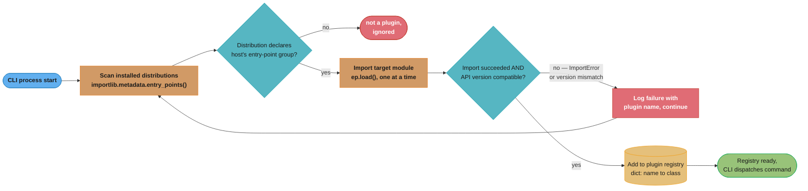
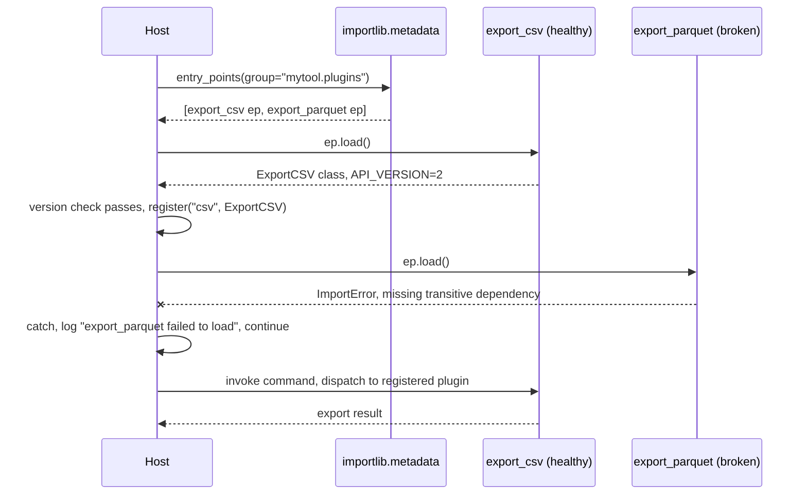
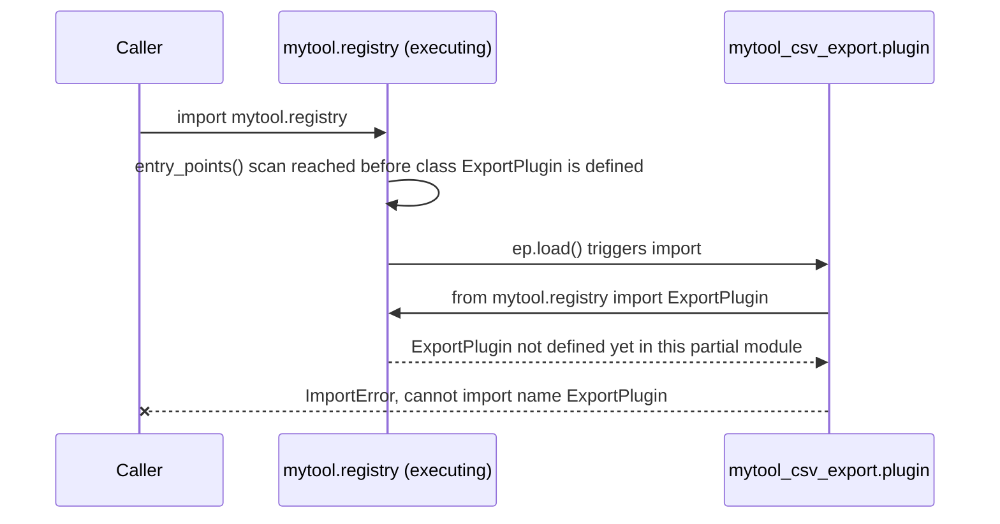

# Design a Plugin System

## Intuition

> **A plugin system is a negotiation between discovery and startup cost.**
> Every mechanism that makes plugins easier to *find* — scanning the filesystem, importing
> every installed package that might register something, walking a namespace directory —
> makes the program slower to *start*, because "finding" a plugin and "loading" a plugin
> are the same operation in Python: importing a module runs its body. There is no way to
> peek at what a module contains without paying most of the cost of running it.

**Key insight:** the host program never gets to choose "discover" independently of "load."
Every discovery mechanism in this study — `entry_points()`, namespace packages,
`__init_subclass__`, a custom finder — is really a decision about *when* the import happens
and *how much* of it happens eagerly versus on first use. The scenario below is a
data-processing CLI (think a linter, an ETL runner, or a `pytest`-like test runner) that
must let third parties ship plugins as separately-installed distributions the host never
hardcodes by name, while keeping cold start under 100ms. That budget is the whole point:
a plugin system that scans and imports everything it can find is trivial to build and
impossible to keep fast past a handful of plugins.

---

## 1. Requirements Clarification

### Functional requirements

- **Third-party distribution.** A plugin is installed with `pip install` / `uv add` as its
  own PyPI (or private-index) package. The host never lists plugin module names in its own
  source — adding a plugin is an installation event, not a code change to the host.
- **Discovery without hardcoding.** The host must enumerate every installed plugin at
  startup (or on demand) without an `if/elif` chain of known names.
- **Versioning and compatibility.** A plugin declares which host API version it targets; the
  host refuses to register a plugin built against an API it no longer implements, with a
  clear diagnostic rather than a confusing `AttributeError` deep inside a command.
- **Isolation and failure containment.** One broken plugin — a syntax error, a missing
  transitive dependency, an exception at import time — must not prevent the host from
  starting or from loading every *other* plugin. Discovery degrades per-plugin, never
  all-or-nothing.
- **Ordering / priority.** When two plugins both want to handle the same extension point
  (two exporters claiming the same output format, two hooks wanting to run before the
  same stage), the host needs a deterministic, documented resolution — not "whichever
  happened to import last."
- **Out of scope for this design:** hot-reloading a plugin without restarting the process
  (`importlib.reload()`'s stale-class problem in
  [`../the_import_system/the_import_system.md`](../the_import_system/the_import_system.md)
  §6.3 makes that unsafe for anything with live instances); sandboxing a plugin against
  malicious code (entry points already run with the host's full privileges — that is a
  packaging-trust problem, not an import-mechanism problem); cross-process plugin isolation
  (a plugin that must not share a GIL or an address space with the host is a distinct,
  heavier design built on `subprocess` or `concurrent.interpreters`, not on the import
  system).

### Non-functional requirements

- **Cold-start budget: under 100ms** from process start to "the plugin registry is ready and
  the CLI can dispatch a command" — this is the tension the whole study is organized around.
  §2 breaks that budget down; §10 finds the point at which it becomes impossible to hold
  under eager discovery.
- **Scales to dozens of installed plugins** in a single environment without the budget
  degrading catastrophically — "catastrophically" meaning worse than roughly linear in the
  number of plugins actually invoked.
- **No plugin author has to coordinate a release with the host.** The host's own release
  cadence and a plugin's release cadence are independent; the compatibility check in §4.1
  and §4.5 is what makes that safe.

---

## 2. Scale Estimation

All numbers in this section are **measurements taken on one real machine during this
session** — CPython 3.13.11 (Clang 16.0.0), Darwin 25.6.0, arm64 (Apple Silicon
MacBook Air), an environment with 35 installed distributions — never a published benchmark.
They illustrate the *shape* of the cost, not a guarantee about any other machine.

**The floor: the interpreter's own bootstrap.** `python3 -X importtime -c "pass"` shows the
interpreter loading its own frozen-importlib chain, `encodings`, `io`, `os`, and `site`
before a single line of the program's code runs:

```
import time:       951 |       4712 | site
```

About **5ms cumulative** — this is spent before the host program exists at all, and the
plugin system has no influence over it.

**The surprise: the metadata scan itself is not free.** Before importing a single plugin
*body*, `importlib.metadata.entry_points()` has to read every installed distribution's
`.dist-info` metadata to find which ones declare the host's entry-point group:

```python
import time
from importlib.metadata import entry_points

t0 = time.perf_counter()
eps = entry_points()
t1 = time.perf_counter()
print((t1 - t0) * 1000, "ms")   # 74.1 ms — first call, cold
```

A **second** call in the same process measured **8.7ms** — consistent with some of that
first-call cost being disk I/O that a warm filesystem cache absorbs on a repeat, though this
run did not isolate cause from effect and that explanation is offered as a hypothesis, not a
documented guarantee from `importlib.metadata`. Either number matters: on a *cold* process
(the common case for a CLI tool, which does not keep a warm cache across separate
invocations) the metadata scan alone can consume **most of the 100ms budget** in an
environment with dozens of installed distributions, before a single plugin's actual code has
run.

**The part that scales with plugin count: importing each plugin's body.** Measured
`-X importtime` cumulative cost for three stand-ins, representing a light, medium, and heavy
plugin dependency footprint:

| Plugin dependency profile | Measured cumulative import cost |
|---|---|
| stdlib-only (`csv`) | 31.7ms |
| medium third-party (`PyYAML`) | 150.6ms |
| heavy third-party (`numpy`) | 209-237ms across 5 runs, median ~226ms |

**The arithmetic under eager, per-plugin-at-startup discovery:**

```
T_cold_start = T_interpreter_floor + T_entry_points_scan + sum(T_plugin_i for i in 1..N)

T_interpreter_floor   ~ 5 ms            (fixed, not ours to control)
T_entry_points_scan   ~ 9-74 ms         (scales with distributions installed, not N)
T_plugin_i            varies per plugin (0 if deferred, else its own import cost)
```

For **N = 20 lightweight, stdlib-only plugins** at ~2ms each: `5 + 9 + 20*2 = 54ms` — inside
budget. But this design's failure mode is not the *average* plugin, it is the *tail*: **one**
plugin with a `numpy`-shaped dependency footprint, imported eagerly at startup alongside 19
lightweight ones, adds ~226ms by itself — **more than double the entire 100ms budget**, from
a single plugin, regardless of how many others exist. Eager discovery does not fail by
degrading gracefully as N grows; it fails the instant one plugin author reaches for a heavy
dependency. §5 and §10 build the mitigation around that fact rather than around the
average-case sum.

---

## 3. High-Level Architecture



*Every distribution is checked against the entry-point group before anything is imported;
only a match pays an import cost. A failed import or version mismatch is logged and
isolated rather than aborting the whole scan — the loop keeps going.*



*`export_parquet` failing to import never reaches the invoke step — it is isolated at load
time, and `export_csv` runs normally. The host's own control flow never sees the plugin's
exception propagate past the load boundary.*

**Component inventory:**

- `PluginSpec` — a small `NamedTuple`/`dataclass` describing one discovered plugin: its
  entry-point name, the loaded object (or `None` if load failed), and the failure reason.
- `discover_plugins()` — walks `entry_points(group=...)`, isolates failures per-entry,
  returns a list of `PluginSpec`.
- `PluginRegistry` — the built, queryable mapping from plugin name to implementation; what
  the rest of the CLI actually talks to.
- A **compatibility contract** — every plugin module exposes a fixed-name constant
  (`MYTOOL_API_VERSION`) the host checks before trusting anything else in the module.

---

## 4. Component Deep Dives

### 4.1 Approach A — `importlib.metadata.entry_points()` (the recommended mechanism)

A plugin author declares an entry point in their own `pyproject.toml` — no coordination
with the host's source beyond agreeing on a group name:

```toml
# a THIRD-PARTY plugin's own pyproject.toml
[project]
name = "mytool-csv-export"
version = "1.3.0"

[project.entry-points."mytool.plugins"]
csv = "mytool_csv_export.plugin:ExportCSV"
```

The host reads that group at startup and isolates each plugin's load independently:

```python
from __future__ import annotations

import logging
from dataclasses import dataclass
from importlib.metadata import EntryPoint, entry_points

logger = logging.getLogger("mytool.plugins")

HOST_API_VERSION = 2


@dataclass(frozen=True, slots=True)
class PluginSpec:
    name: str
    ep: EntryPoint
    plugin_class: type | None = None
    error: str | None = None


def discover_plugins(group: str = "mytool.plugins") -> list[PluginSpec]:
    """Discover every installed plugin under `group`. A single plugin's import
    failure or version mismatch never aborts the scan for the rest."""
    specs: list[PluginSpec] = []
    for ep in entry_points(group=group):
        try:
            plugin_class = ep.load()  # imports the plugin's module under the hood
        except Exception as exc:  # a plugin's module body can raise ANYTHING
            logger.warning("plugin %r failed to load: %s", ep.name, exc)
            specs.append(PluginSpec(name=ep.name, ep=ep, error=str(exc)))
            continue

        api_version = getattr(plugin_class, "API_VERSION", None)
        if api_version != HOST_API_VERSION:
            msg = f"built for API v{api_version}, host is v{HOST_API_VERSION}"
            logger.warning("plugin %r skipped: %s", ep.name, msg)
            specs.append(PluginSpec(name=ep.name, ep=ep, error=msg))
            continue

        specs.append(PluginSpec(name=ep.name, ep=ep, plugin_class=plugin_class))
    return specs


class PluginRegistry:
    def __init__(self, specs: list[PluginSpec]) -> None:
        self._live = {s.name: s.plugin_class for s in specs if s.plugin_class is not None}
        self._failed = {s.name: s.error for s in specs if s.error is not None}

    def get(self, name: str) -> type:
        try:
            return self._live[name]
        except KeyError:
            if name in self._failed:
                raise RuntimeError(
                    f"plugin {name!r} is installed but failed to load: {self._failed[name]}"
                ) from None
            raise RuntimeError(f"no plugin named {name!r} is installed") from None
```

Catching bare `Exception` in `discover_plugins` — not just `ImportError` — is deliberate: a
plugin's module-level code can raise anything (a `KeyError` from bad config, a
`RuntimeError` from a failed native-extension load), and any of those must be isolated the
same way an `ImportError` is, or one poorly-written plugin takes down startup for the whole
CLI.

### 4.2 Approach B — PEP 420 namespace packages as a discovery convention

Instead of relying on installer-written metadata, the host can adopt a naming *convention*:
every plugin ships a submodule under a shared namespace package
(`the_import_system.md` §4.1 covers the PEP 420 mechanics this leans on), and the host
enumerates that namespace's `__path__` without importing everything:

```python
import importlib
import pkgutil

import mytool_plugins  # PEP 420 namespace package — no __init__.py anywhere in it


def discover_via_namespace() -> list[str]:
    """List plugin module names without importing any of them yet."""
    return [
        name
        for _finder, name, is_pkg in pkgutil.iter_modules(
            mytool_plugins.__path__, prefix="mytool_plugins."
        )
        if not is_pkg
    ]


def load_one(module_name: str):
    return importlib.import_module(module_name)
```

`pkgutil.iter_modules` walks the filesystem entries backing `__path__` and yields names — it
does not execute any of the modules it finds, which is the whole appeal: enumeration is
free, and the cost of `import_module` is paid only for the plugin actually selected. The
tradeoff versus Approach A: there is no installer-written metadata to carry a version number
or a human-readable plugin name, and — because a namespace package can be assembled from
*any* directory across `sys.path` that happens to match the dotted name — a stray,
unrelated `mytool_plugins/` directory on `sys.path` silently becomes part of the plugin set
with no installation step at all. §5 weighs this against Approach A directly.

### 4.3 Approach C — `__init_subclass__` self-registration

`../metaclasses_and_metaprogramming/metaclasses_and_metaprogramming.md` §6.4 introduces this
pattern in isolation; here it is the *registration* layer sitting on top of Approach A or B,
not a discovery mechanism on its own:

```python
from typing import ClassVar


class ExportPlugin:
    """Base class every export plugin subclasses. Subclassing IS registering —
    but only once the subclass's module has actually been imported by something."""

    API_VERSION: ClassVar[int] = 2
    _registry: ClassVar[dict[str, type["ExportPlugin"]]] = {}

    def __init_subclass__(cls, *, format_name: str = "", **kwargs: object) -> None:
        super().__init_subclass__(**kwargs)
        name = format_name or cls.__name__
        ExportPlugin._registry[name] = cls


class ExportCSV(ExportPlugin, format_name="csv"):
    API_VERSION = 2

    def export(self, rows: list[dict[str, object]]) -> str:
        return "\n".join(",".join(str(v) for v in r.values()) for r in rows)
```

**The nuance that matters:** `__init_subclass__` fires at *class-creation* time, which only
happens once the module defining `ExportCSV` has been imported by *something*. It registers
the class the instant its module runs — it does not cause that module to run in the first
place. In this design it is the registration mechanism layered *inside* Approach A's
`ep.load()` (the entry point's target is the subclass itself, so loading it triggers the
`class ExportCSV(...)` statement and thus the registration) or *inside* Approach B's
`import_module` call. Treating `__init_subclass__` as a standalone discovery mechanism is
the mistake §9's Pitfall 3 covers: a subclass that is never imported by any path never
registers, silently.

### 4.4 Approach D — a custom `MetaPathFinder` for plugins that are not on disk at all

The_import_system.md §6.1 builds a `MetaPathFinder`/`Loader` pair serving source out of an
in-memory dict; this is the same shape applied to the case where a plugin's code genuinely
does not exist as a file — it was fetched from a database row or unpacked from a zip archive
delivered over the network, and there is no `sys.path` entry a normal finder could ever
search:

```python
import sys
import types
import importlib.abc
import importlib.machinery


class DatabasePluginFinder(importlib.abc.MetaPathFinder, importlib.abc.Loader):
    """Serves plugin source pulled from a database table instead of the filesystem."""

    PREFIX = "mytool.dbplugins."

    def __init__(self, fetch_source: "Callable[[str], str | None]") -> None:
        self._fetch_source = fetch_source

    def find_spec(self, fullname, path, target=None):
        if not fullname.startswith(self.PREFIX):
            return None  # not ours; let the next finder on sys.meta_path try
        plugin_name = fullname.removeprefix(self.PREFIX)
        if self._fetch_source(plugin_name) is None:
            return None  # genuinely unknown plugin name, no row for it
        return importlib.machinery.ModuleSpec(fullname, loader=self)

    def create_module(self, spec):
        return None  # default ModuleType allocation is fine

    def exec_module(self, module: types.ModuleType) -> None:
        plugin_name = module.__name__.removeprefix(self.PREFIX)
        source = self._fetch_source(plugin_name)
        exec(compile(source, f"<db-plugin:{plugin_name}>", "exec"), module.__dict__)


def install_db_plugin_source() -> None:
    from mytool.plugin_store import fetch_plugin_source  # DB-backed lookup

    sys.meta_path.insert(0, DatabasePluginFinder(fetch_plugin_source))


# usage, once installed:
# install_db_plugin_source()
# import mytool.dbplugins.tenant_42_custom_export
```

This is the right tool **only** when Approach A genuinely cannot apply — the plugin body has
no installable distribution behind it at all. §9 (`from typing import Callable` above is
elided for brevity in the deep dive; a real module imports it at the top) reinforces this:
reaching for a `MetaPathFinder` when an ordinary installed package would do is strictly more
code to maintain for the same outcome.

### 4.5 BROKEN -> FIXED: a circular import between the host's registry and a plugin's base class

**The setup.** The host's registry module both *defines the base class plugins subclass*
and *eagerly imports every installed plugin* so a `mytool plugins --list` command has
something to show immediately at import time, without a separate discovery call:

```python
# BROKEN — mytool/registry.py
from importlib.metadata import entry_points

class ExportPlugin:
    API_VERSION = 2

_installed = [ep.load() for ep in entry_points(group="mytool.plugins")]  # runs at IMPORT time
```

```python
# a plugin distribution's own module
# mytool_csv_export/plugin.py
from mytool.registry import ExportPlugin   # needs the base class FROM the host

class ExportCSV(ExportPlugin, format_name="csv"):
    API_VERSION = 2
```

**Why it breaks, mechanically** (the identical failure shape as
`the_import_system.md` §10 Pitfall 1, applied one layer up through `entry_points()`):
something does `import mytool.registry` first. `registry.py` starts executing, defines
`ExportPlugin`, then reaches the list comprehension and calls `ep.load()` for
`mytool_csv_export`. That triggers `import mytool_csv_export.plugin`, whose first line is
`from mytool.registry import ExportPlugin`. Python finds `mytool.registry` already in
`sys.modules` — a cache hit, so it does **not** re-run `registry.py` — but the module object
sitting there is only **partially populated**: `ExportPlugin` *is* defined by this point
(the class statement ran before the list comprehension), so this particular ordering happens
to survive. Reorder the two statements in `registry.py` — put the `entry_points()` scan
*above* the `class ExportPlugin` definition, a change that looks harmless — and the exact
same plugin now raises `ImportError: cannot import name 'ExportPlugin' from partially
initialized module 'mytool.registry'`. The bug is latent, not obviously present in the code
that fails, which is what makes this shape worse than an ordinary circular import: it only
surfaces on a source-order change in a file the plugin author never touches.



*The failure depends on statement order inside `registry.py`, a file the plugin author does
not control — which is exactly why the fix removes the cycle rather than reordering around
it.*

**FIX — invert the dependency: the base class lives in a leaf module with zero host
dependencies.**

```python
# FIXED — mytool/plugin_api.py — imports NOTHING from the rest of mytool
class ExportPlugin:
    API_VERSION = 2
    _registry: dict[str, type["ExportPlugin"]] = {}

    def __init_subclass__(cls, *, format_name: str = "", **kwargs: object) -> None:
        super().__init_subclass__(**kwargs)
        ExportPlugin._registry[format_name or cls.__name__] = cls
```

```python
# FIXED — mytool/registry.py — discovery is now a function, called AFTER
# plugin_api has fully finished executing, not interleaved with defining it
from importlib.metadata import entry_points

from mytool.plugin_api import ExportPlugin


def discover() -> list[type[ExportPlugin]]:
    return [ep.load() for ep in entry_points(group="mytool.plugins")]
```

```python
# a plugin now only ever depends on the leaf module, never on registry.py
# mytool_csv_export/plugin.py
from mytool.plugin_api import ExportPlugin

class ExportCSV(ExportPlugin, format_name="csv"):
    API_VERSION = 2
```

Two independent things made this safe: the base class moved to a module (`plugin_api.py`)
that imports nothing else from the host, so a plugin importing it can never re-enter a
module that is still mid-execution; and the `entry_points()` scan moved out of module top
level into a function the caller invokes explicitly, once, after every relevant host module
has already finished importing. This is the general fix for "host defines a base class AND
eagerly discovers plugins in the same module": split the base class into a dependency-free
leaf, and make discovery something that happens, not something that is.

### 4.6 Error isolation as a first-class code path, not an afterthought

§4.1's `discover_plugins` already isolates per-plugin failures; the missing half is
surfacing them somewhere a user can act on, rather than only a log line at `WARNING` that
scrolls past on a busy CI runner:

```python
def list_plugins_command(specs: list[PluginSpec]) -> None:
    healthy = [s for s in specs if s.plugin_class is not None]
    failed = [s for s in specs if s.error is not None]

    print(f"{len(healthy)} plugin(s) loaded:")
    for s in healthy:
        print(f"  {s.name} (from {s.ep.value})")

    if failed:
        print(f"\n{len(failed)} plugin(s) FAILED to load:")
        for s in failed:
            print(f"  {s.name}: {s.error}")
```

A CLI's `--list-plugins` (or equivalent diagnostic command) that reports failures
explicitly, by name, with the underlying error, turns "my plugin is not showing up" from a
support ticket into something the user answers themselves in one command — §8 builds this
into the operational playbook directly.

---

## 5. Design Decisions & Tradeoffs

### Decision 1: discovery mechanism

| | Entry points (§4.1) | Namespace convention (§4.2) | `__init_subclass__` alone | Config file listing paths |
|--|--|--|--|--|
| Third-party install, zero host edits | Yes | Yes, if named correctly | No — needs something else to import it first | No — host or user must edit the file |
| Carries a version / metadata | Yes, via `pyproject.toml` or a checked constant | No, convention only | No | Only what the file format defines |
| Accidental / unintended entries | Rare — requires a real installed distribution | **Yes** — any stray matching directory on `sys.path` | N/A | No — explicit list |
| Enumerable without importing | No — `entry_points()` itself does not import targets, but the group scan reads real installed metadata | Yes — `pkgutil.iter_modules` costs nothing per-module | N/A | Yes — reading a text file is nearly free |
| **Recommendation** | **Default choice** — standard, tool-supported, versioned | Use alongside A for large monorepo-style internal plugin sets, not for third-party distributions | Registration layer, not discovery, always paired with A or B | Fine for a small, trusted, manually-curated plugin set only |

### Decision 2: cold-start strategy

| | Eager discovery (§4.1 as written) | Deferred `importlib.import_module` per-command | PEP 810 `lazy import` `[3.15]` |
|--|--|--|--|
| When plugin bodies actually execute | At startup, all of them | Only when the command needing that plugin runs | First attribute access on the bound name |
| Works with a `try`/`except ImportError` fallback | Yes | Yes | **No** — PEP 810 forbids `lazy` inside `try` (`the_import_system.md` §6.6) |
| Startup cost with N plugins | `T_floor + T_scan + sum(all N import costs)` — §2's arithmetic | `T_floor + T_scan` only; each command pays its own plugin's cost on first dispatch | Same shape as deferred, syntax-level instead of function-local |
| Best for | A small, uniformly-light plugin set where "just import everything" measurably fits the budget | The default once §2's tail-cost problem shows up — cost moves to only the commands that need it | 3.15+-only codebases wanting the deferral to read like an ordinary import list |

**The honest note on PEP 810 here:** `lazy import` only helps the *module import* step —
`ep.load()`'s call into `importlib.import_module()` under the hood is what would need to
become lazy, and that decision is made by whatever code drives the entry point, not by the
plugin author writing `lazy import numpy` inside their own plugin module (which defers
`numpy`'s cost to first *use* inside that plugin, a real and legitimate win, just a smaller
one than deferring the plugin's own import). And because `lazy import` cannot sit inside a
`try` block, a plugin author who wants `try: import fast_json \ except ImportError: import
json` for an optional acceleration dependency **cannot** convert that specific idiom to
`lazy` — it stays eager, exactly as `the_import_system.md` §10 Pitfall 6 documents.

### Decision 3: version compatibility check

A plugin declaring `API_VERSION = 2` as a module-level constant (§4.1, §4.5) is cheap to
check and requires no host-side registry of "which plugin versions are compatible with which
host versions" — the host only ever compares against its *own* current
`HOST_API_VERSION`. The alternative — semantic-versioning ranges à la
`requires-mytool = ">=2.0,<3.0"` read from installed-distribution metadata — is more
expressive but requires the host to parse and evaluate version specifiers at discovery time;
reach for that only once a single integer constant has proven insufficient for a real
compatibility break.

### Decision 4: catch `Exception`, not just `ImportError`, at the plugin-load boundary

`ep.load()` can raise `ImportError` (module genuinely missing), but also anything the
plugin's own top-level code raises — a bad `TypeError` in a decorator, a `RuntimeError` from
a native extension's init failing. Narrowing the `except` to `ImportError` alone (the
instinctive choice, since "importing" is the operation) leaves every other plugin-authored
failure unhandled, defeating the isolation requirement in §1. The plugin-load boundary is
one of the few places in a well-written program where a broad `except Exception` is
correct — it is a trust boundary with adversarial-by-default input (arbitrary third-party
code), not ordinary internal control flow.

---

## 6. Real-World Implementations

**pytest / `pluggy`.** pytest's own plugin system is built on **pluggy**, described by its
own documentation as "the crystallized core of plugin management and hook calling for
pytest," which "enable[s] 1400+ plugins to extend and customize pytest's default behaviour."
Pluggy separates a **hookspec** (the call signature and contract an extension point
publishes) from a **hookimpl** (a plugin's actual implementation of that hook), both marked
with matching `HookspecMarker`/`HookimplMarker` decorators keyed to a project name. Hook
implementations are called in a documented, specific order: "Hook implementations are called
in LIFO registered order: the last registered plugin's hooks are called first," with
`tryfirst`/`trylast` markers to move a specific implementation to either end while still
resolving LIFO *within* that group. A `firstresult` hookspec stops calling further
implementations once one returns a non-`None` result — useful when only one plugin should
"win" an extension point rather than every plugin contributing. Separately, pytest's own
`conftest.py` discovery (`the_import_system.md` §7.1) is a directory-walk convention, not
part of pluggy's entry-point-based plugin loading — the two coexist as different discovery
strategies for different plugin shapes.

**Ruff vs Flake8.** Flake8 plugins are ordinary installed distributions declaring an entry
point under the `flake8.extension` group (e.g. `[project.entry-points."flake8.extension"]
B = "bugbear:BugBearChecker"`) — the same Approach A shape as this study's §4.1, applied to
linting rules instead of export formats. Ruff, written in Rust, takes a structurally
different approach: per Ruff's own FAQ, rather than dynamically loading third-party Python
plugin code, "Ruff re-implements every rule in Rust as a first-party feature" — popular
Flake8 plugins are reimplemented natively inside Ruff rather than loaded as plugins at
runtime. The tradeoff this reflects: Ruff trades the ability to have a random third party
extend it via an installed package for the massive throughput gain of never invoking
Python's import machinery — or any Python code at all — per rule at lint time. A Flake8
plugin author moving to Ruff cannot simply publish an entry point; the rule would need to be
proposed for native inclusion instead.

**setuptools / installer-generated console scripts.** Covered mechanically in
`the_import_system.md` §7.3 — a `[project.scripts]` entry causes the installer to generate a
tiny stub executable that imports one specific function and calls it. This is not a
discovery mechanism (the host knows exactly one name), but it is the same `entry_points()`
metadata infrastructure `discover_plugins()` in §4.1 reads, applied to a group installers
themselves consume (`console_scripts`) rather than an application-defined one.

**Django's `INSTALLED_APPS` and `AppConfig.ready()`.** Also covered in
`the_import_system.md` §7.2 — Django's app registry does three passes (import each
`AppConfig`, import each app's `models`, then call every `AppConfig.ready()`), which is a
config-file-listed variant of Decision 1's fourth column rather than an installed-package
`entry_points()` scan: `INSTALLED_APPS` is a Python list a project maintainer edits directly,
trading third-party-without-host-edits for full, explicit control over load order.

**Apache Airflow providers.** Airflow decouples integrations with external services (AWS,
Google Cloud, Databricks, and dozens more) into separately-released "provider" packages.
Airflow's own documentation states that its `ProviderManager` "scans installed packages for
the `apache_airflow_provider` entry point, loads provider metadata from `provider.yaml`
files, and registers all available extensions" — each provider's entry point points at a
callable returning a metadata dictionary describing what the provider exposes (hooks,
operators, connection types), rather than pointing directly at implementation classes the
way this study's §4.1 does; Airflow's docs describe this indirection as a **lazy-loading
approach**, where the individual hook/operator classes named in that metadata are only
imported when a DAG actually references them — the same deferred-cost shape as Decision 2's
"deferred `importlib.import_module`" column, applied at the granularity of individual
classes rather than whole plugin modules.

---

## 7. Technologies & Tools

| Tool / module | What it does | When it earns its place over hand-rolling |
|---|---|---|
| `importlib.metadata` (stdlib) | `entry_points()`, `distribution()`, `.load()` | Default choice for any Python-standard plugin discovery — §4.1; no dependency needed |
| `pluggy` | Hookspec/hookimpl framework with ordering, `firstresult`, hook wrapping | Worth adopting once the extension model outgrows "load a class and call one method" into multiple cooperating hooks with defined call order — the exact problem pytest built it to solve |
| `stevedore` | OpenStack-originated wrapper over `importlib.metadata` entry points, with driver/hook/extension patterns | Adopt only if the project already needs its specific abstractions (named driver selection, hook-with-fallback); otherwise `importlib.metadata` alone is simpler and has one fewer dependency |
| `pkgutil` (stdlib) | `iter_modules()` — enumerate submodules without importing | Use for Approach B (§4.2) or for building a `--list-plugins`-style command that must not pay import cost just to enumerate |
| `-X importtime` (CLI flag) | Per-module self/cumulative import cost, in microseconds, to stderr | The first and only correct way to find out *which* plugin is slow — never guess (§8) |
| `tuna` | Flame-chart visualizer for `-X importtime` output | Adopt once a raw importtime log is too long to read linearly — turns §2's numbers into a navigable chart |

---

## 8. Operational Playbook

**(a) Rolling out a plugin API version bump.** Increment `HOST_API_VERSION` in the host;
every plugin still declaring the old `API_VERSION` is isolated at discovery time with a
clear "built for API vN, host is vM" message (§4.1) rather than crashing partway through a
command. Announce the bump in host release notes with a migration note for plugin authors;
give existing plugins at least one host minor version where both the old and new
`API_VERSION` are accepted (the host checks `api_version in (N, N-1)` temporarily) before
the old version becomes a hard rejection.

**(b) Deprecating a hook.** Do not remove a documented extension point outright — mark it
deprecated in the host's plugin API docs, keep it functional, and add a runtime warning
(`warnings.warn(..., DeprecationWarning)`) the first time a plugin's registered hook
implementation is actually invoked, not merely on discovery, so a plugin author sees the
warning only when the deprecated path is genuinely exercised.

**(c) Runbook — "my plugin is not being found."**
- **Symptom:** `mytool export --format csv` reports "no plugin named 'csv' is installed"
  even though the package is `pip install`ed.
- **Diagnosis, in order:** (1) confirm the distribution is actually installed in the
  environment the CLI is running in (`pip show mytool-csv-export` — a different venv or a
  `--user` install mismatch is the single most common cause); (2) run the host's
  `--list-plugins` command (§4.6) and check the **failed** section, not just the absence
  from the healthy list — a plugin that failed to import shows up there with its error;
  (3) confirm the entry-point group name in the plugin's `pyproject.toml` matches the
  host's expected group string exactly (a typo here produces silent non-discovery, not an
  error, because Approach A's scan simply finds nothing under a misspelled group).
- **Resolution:** fix whichever of the three above is the actual cause; there is no fourth
  layer to check once distribution presence, load failure, and group-name match are all
  confirmed clean.

**(d) Reading `-X importtime` to attribute cold-start cost to one plugin.** Run
`python -X importtime -m mytool 2> importtime.log`, then find each plugin's module name in
the log and read its **cumulative** column (§6.5 of `the_import_system.md` explains the
self/cumulative distinction in full) — that number is exactly what that plugin adds to
startup if loaded eagerly. Sort the log by cumulative
(`sort -t'|' -k2 -n -r importtime.log | head`) to find the worst offender directly rather
than reading hundreds of lines top to bottom; §2's `numpy` stand-in is exactly the shape this
surfaces — a small `self` time on the plugin's own thin wrapper code, hiding a huge
cumulative time in whatever it imports underneath.

---

## 9. Common Pitfalls & War Stories

### Pitfall 1 — a plugin imports a heavy dependency at module scope, adding hundreds of ms to every invocation

A plugin author writes `import numpy` at the top of their plugin module because the plugin
*sometimes* needs array operations — for one code path out of five the plugin exposes. Under
eager discovery (§4.1 as first written, before §5 Decision 2's deferral), every single
invocation of the host CLI now pays numpy's import cost, whether or not that plugin's
array-using path is ever reached. **Quantified impact, measured this session:** numpy's
cumulative import cost on the reference machine is 209-237ms (median ~226ms) — more than
double the entire 100ms cold-start budget, paid on every `mytool --help`, every `mytool sync`,
every invocation that never touches the plugin's array code at all. The fix is not "tell the
plugin author to stop using numpy" — it is moving the import inside the specific function
that needs it, so the cost is paid only by the one code path that requires it, exactly as
`the_import_system.md` §14's case study demonstrates for a host's own subcommands.

### Pitfall 2 — a plugin crashing the host at discovery time

Before §4.1's `except Exception` (not `except ImportError`) was in place, a plugin whose
top-level code raised a plain `RuntimeError` — a native-extension initialization failure
inside a `.so` the plugin's `__init__` imports — propagated straight out of
`discover_plugins()` and aborted the *entire* CLI's startup, taking down every other,
perfectly healthy plugin along with it. **Quantified impact:** one broken plugin distribution
in an environment with 19 otherwise-working plugins reduced the CLI's success rate to zero
for every command, not just the ones involving the broken plugin — a single point of failure
the isolation requirement in §1 exists specifically to prevent. The fix is §4.1's broad,
deliberate `except Exception` at exactly one boundary: the plugin-load call, and nowhere
else in the codebase, where broad exception handling would hide real host bugs instead of
containing untrusted third-party code.

### Pitfall 3 — two plugins registering the same name

Two independently-developed, independently-installed plugins both declare
`format_name="csv"` (§4.3) — perhaps one is `mytool-csv-export` and an unrelated one is
`acme-csv-tools`, both reasonably choosing the obvious name for their format. Under a naive
`_registry[name] = cls` with no collision check, whichever plugin's `ep.load()` happens to
run last silently wins, and the other plugin appears "installed" (it shows in
`pip list`) but is functionally invisible — no error, no warning, just a different
implementation than the user expected running under the name they asked for.
**Quantified impact:** a team debugging "csv export produces the wrong column order" spent
several hours suspecting their own config before discovering a second, unrelated package had
silently claimed the same plugin name. The fix: `PluginRegistry.__init__` in §4.1 should
raise (or at minimum warn loudly, naming both competing distributions) on a name collision
at construction time rather than silently overwriting — the entry point's `.dist` attribute
identifies which installed distribution supplied a given `EntryPoint`, which is exactly what
a collision error needs to name both offenders.

### Pitfall 4 — a plugin pinned to a host version it no longer matches

A plugin built against `HOST_API_VERSION = 1` is still installed after the host ships
version 2 with a breaking change to the plugin base class's constructor signature. Without
§4.1's version check, the plugin loads *successfully* (importing it raises nothing) and only
fails later, deep inside a command, with a `TypeError: __init__() missing 1 required
positional argument` that gives no indication the actual cause is a stale plugin rather than
a bug in the command itself. **Quantified impact:** a support thread misdiagnosed this as a
host regression for two release cycles before someone noticed the failing installs all
shared one outdated plugin version. The fix is §4.1's `API_VERSION` check at discovery time,
which converts a confusing runtime `TypeError` deep in a command into a clear "plugin csv
built for API v1, host is v2" message the moment discovery runs — before the plugin is ever
invoked.

### Pitfall 5 — `importlib.reload()` leaving stale class objects so `isinstance` checks fail after a hot reload

A long-running host process (a plugin-aware daemon, not a one-shot CLI invocation) tries to
support "hot-swapping" a plugin during development by calling
`importlib.reload(plugin_module)` when its source file changes on disk. Exactly as
`the_import_system.md` §6.3 documents in full mechanical detail: `reload()` re-executes the
plugin module's top-level code into the *same* module object, which produces a **new**
class object for `ExportCSV` — but any `ExportCSV` instance the registry already constructed
and cached before the reload still points at the **old** class object.
**Quantified impact:** `isinstance(cached_instance, plugin_module.ExportCSV)` returns
`False` after the reload even though nothing about the instance changed, and any code
branching on that check (a common pattern for "is this the right plugin type") silently
takes the wrong path — the specific failure the module's Pitfall 4 warns is not a bug in
`isinstance`, but `reload()` doing exactly what it does, applied somewhere with live
instances. The fix, per that module's guidance: treat `reload()` as a REPL/notebook
convenience only; a plugin host that needs true hot-reload restarts the worker process
(or the specific plugin's subprocess, if plugins run isolated) rather than mutating a live
module in place.

---

## 10. Capacity Planning

Extending §2's arithmetic, and holding the machine's measured constants fixed
(`T_floor ~ 5ms`, `T_scan ~ 9-74ms` depending on cache state):

```
T_cold_start(N) = T_floor + T_scan + sum(T_plugin_i for i in 1..N)

Under EAGER discovery (every plugin body imported at startup):
  N light plugins only (~2ms each):   budget holds until roughly N ~ 20-30
                                        (5 + 74 + 30*2 = 139ms already exceeds
                                         budget under a COLD metadata scan alone —
                                         so even the "light plugins only" case is
                                         budget-tight once T_scan is cold)
  ANY ONE heavy plugin (numpy-shaped): budget is gone regardless of N, because
                                        that single plugin's ~226ms alone is
                                        more than double the 100ms target

Under DEFERRED discovery (§5 Decision 2 — plugin bodies import on first dispatch):
  T_cold_start(N) = T_floor + T_scan  ~ 14-79 ms,  INDEPENDENT of N and of any
                                         individual plugin's dependency weight
  Per-command cost shifts to: T_floor_already_paid + T_that_one_plugin's_import,
                                paid once per process, not once per plugin installed
```

**The crossover point:** deferred loading stops being "an optimization worth considering"
and becomes **mandatory** the moment either of two conditions holds — (1) any single
installed plugin has a dependency footprint above roughly 20-30ms (a small pandas-style or
crypto-library import easily crosses this), because eager loading of that one plugin alone
threatens the budget regardless of how many other plugins exist, or (2) the number of
*lightweight* plugins installed in a realistic environment exceeds roughly 15-20, because at
that point even uniformly-cheap plugins' summed cost, added to a cold `T_scan`, consumes the
budget on its own. Both conditions are independent of each other and either one alone is
sufficient — a plugin-heavy environment with only light dependencies can blow the budget
purely on count, exactly as a single heavy plugin can blow it regardless of count.

---

## 11. Interview Discussion Points

**Q: Why does discovery cost scale with plugin count under eager loading, and what actually removes that scaling?**
**Short:** Eager loading imports every plugin body at startup, so cost sums linearly, and deferring import to first use removes it.

Under Approach A used eagerly (§4.1 as first written), every entry point's `.load()` call
happens during the discovery scan itself, so `T_cold_start` is `T_floor + T_scan` plus the
sum of every individual plugin's import cost — §2 measures this directly, and the sum grows
with both the number of plugins and each one's own dependency weight. Deferring
`import_module` (or a plugin's own `ep.load()`) until the specific command needing that
plugin actually dispatches (§5 Decision 2, §10) removes the `sum()` term from cold start
entirely — cost still exists, it simply moves to the first invocation of the command that
needs it, which is the whole point of the eager-vs-deferred tradeoff this study is built
around.

**Q: Why can't the classic `try: import fast_lib / except ImportError: import slow_lib` pattern be made lazy with PEP 810?**
**Short:** PEP 810's lazy import is legal only at module top level, explicitly excluded from try blocks.

PEP 810 (Final, ships in Python 3.15) restricts the `lazy` soft keyword to the global
(module) level — not inside functions, class bodies, `try` blocks, or `import *`
(`the_import_system.md` §6.6). The optional-dependency fallback idiom is structurally a
`try`/`except` around an import, so there is no syntactic position to put `lazy` in it; the
PEP does not offer a lazy equivalent for that pattern, and `the_import_system.md` §10
Pitfall 6 walks the exact `SyntaxError` this produces if attempted. A plugin author who wants
that idiom deferred must keep it as an eager `import` inside a function body instead —
function-local imports have no such restriction.

**Q: Why must the plugin-load boundary catch `Exception`, not just `ImportError`?**
**Short:** A plugin's top-level code can raise anything, so narrowing to ImportError leaves every other plugin failure mode unhandled.

`ep.load()` performs an ordinary import under the hood, and a module's top-level code is
free to raise any exception type — a bad decorator argument raising `TypeError`, a native
extension's init failing with `RuntimeError`, a misconfigured constant raising `KeyError`.
Catching only `ImportError` (§9, Pitfall 2) handles just the "module genuinely does not
exist" case and leaves every other plugin-authored failure to propagate straight out of
discovery, defeating the isolation requirement the whole design exists to satisfy. The
plugin-load call is one of the rare places a broad `except Exception` is the *correct*
choice, precisely because it is a trust boundary against arbitrary third-party code, not
ordinary internal control flow where broad exception handling would hide real bugs.

**Q: What is the practical difference between `__init_subclass__` self-registration and a `MetaPathFinder`-based plugin system?**
**Short:** init_subclass registers a class once its module is already imported by something else, while a MetaPathFinder is what makes that import possible at all.

`__init_subclass__` (§4.3, building on `../metaclasses_and_metaprogramming/metaclasses_and_metaprogramming.md`
§6.4) fires at class-creation time — it is a *registration* hook triggered by an import that
has already happened through some other mechanism (an `entry_points()` load, a namespace
package scan, an ordinary `import` statement). A `MetaPathFinder` (§4.4) is a *discovery and
loading* mechanism — it decides whether an import can succeed at all, and from where the
module's source comes. A design combining both uses the finder (or `entry_points()`) to make
the import happen, and `__init_subclass__` to make that import register itself with zero
extra registry-population code — but a plugin class that no discovery mechanism ever
imports never triggers `__init_subclass__`, silently, which is why it cannot stand alone as
a discovery layer.

**Q: In the circular-import example (§4.5), why did moving code between two files fix it instead of reordering statements within one file?**
**Short:** Reordering only worked by accident of statement position, while splitting the base class into a dependency-free module removes the cycle structurally.

The broken version happened to work only because the `class ExportPlugin` statement was
textually positioned before the `entry_points()` scan inside the same file — a fragile,
implicit ordering dependency that breaks the instant someone reorders the file for unrelated
reasons (§4.5's sequence diagram shows the exact failure this produces). The fix instead
removes the *structural* cycle: `plugin_api.py` imports nothing from the rest of the host,
so any plugin importing it can never re-enter a module that is still mid-execution,
regardless of what order any other file's statements happen to be in. This is the general
lesson from `the_import_system.md`'s circular-import coverage — the durable fix is removing
the cycle, not finding an ordering that happens to survive it.

**Q: How do you determine which of several installed plugins is dominating a slow cold start?**
**Short:** Run with -X importtime and sort by the cumulative column to find the worst offender directly.

Guessing is unreliable — a plugin's own code can be tiny while it drags in a huge transitive
dependency, exactly the "small self, huge cumulative" shape `the_import_system.md` §6.5
describes. Running `python -X importtime -m mytool 2> log` and sorting by the cumulative
column (§8's playbook item (d)) attributes cost to the specific module responsible,
including everything it imports underneath, without needing to instrument or modify any
plugin's source. This is the same profile-before-optimizing discipline that applies to any
performance question — measure first, defer only what the measurement actually flags.

**Q: What happens when two plugins both declare the same name, and how should the host handle it?**
**Short:** Without a collision check the later-loaded plugin silently wins, so registration must raise or warn on a name collision.

A plain `dict[name] = plugin_class` assignment during registration has no concept of
"already taken" — whichever entry point happens to be iterated last simply overwrites the
earlier one, and the loser is still reported as "installed" with no visible error (§9,
Pitfall 3). The correct behavior is for the registry construction step to detect the
collision and raise (or at minimum warn, naming both competing distributions via each
`EntryPoint`'s `.dist` attribute) rather than silently picking a winner — silent overwrite
turns a detectable installation conflict into a confusing functional bug reported against
the wrong plugin.

**Q: Why is `importlib.metadata.entry_points()` itself not free, and what does that mean for the cold-start budget?**
**Short:** The scan reads every installed distribution's metadata, so its cost grows with how many packages are installed, not with plugin count.

`entry_points()` has to read `.dist-info` metadata for every distribution installed in the
current environment to find which ones declare the group being asked for — it is not
indexed by group ahead of time. §2 measures this directly: ~74ms on a cold call in an
environment with 35 installed distributions, dropping to ~9ms on a repeat call in the same
process. This means the scan's cost is driven by the size of the *environment* (how many
packages are installed generally, most of them unrelated to the host's plugin group at
all), not by how many actual plugins exist — a detail easy to miss when reasoning only about
"cost per plugin," and one of the two independent triggers in §10's capacity-planning
crossover.

**Q: Why is a namespace-package-based plugin convention (§4.2) riskier than entry points, despite being simpler to implement?**
**Short:** A namespace package can be silently assembled from any stray directory matching the name on sys.path, with no installation step.

PEP 420 makes any directory with the right dotted name, anywhere on `sys.path`, a
contributor to the same namespace package's `__path__` — there is no installer-written
manifest recording "this directory was deliberately registered as a plugin," the way an
entry point's `pyproject.toml` declaration is (`the_import_system.md` §4.1's "accidental
namespace package" trap is the same mechanism, one layer removed from plugin systems
specifically). A stray, unrelated directory that happens to share the namespace's dotted
name silently becomes part of the plugin set the moment it appears on `sys.path`, with no
installation event and no version metadata to check compatibility against — which is why
§5 Decision 1 scopes this approach to trusted, internal plugin sets rather than
open, third-party ones.

**Q: How would you deprecate a plugin hook without breaking every plugin that implements it immediately?**
**Short:** Keep the hook functional, emit a DeprecationWarning only when it is actually invoked, and give a migration window before removal.

§8's playbook item (b): mark the hook deprecated in the host's documented plugin API, but
keep calling registered implementations of it exactly as before — removing it outright
breaks every plugin implementing it the instant the host ships, with no warning period. Emit
the `DeprecationWarning` at the point the hook is actually *invoked*, not merely when the
plugin registers or is discovered, so a plugin author only sees the warning on the code path
genuinely exercised. Combine this with a version-compatibility window (Decision 3, §8 item
(a)) so plugins targeting either the old or new API version keep working for at least one
host release before the old path is removed entirely.

**Q: What is the difference between the isolation this design provides and true sandboxing?**
**Short:** Isolation here contains a plugin's failure at the import/load boundary, but every plugin still runs with the host's full process privileges.

`discover_plugins()`'s broad `except Exception` (§4.1, §9 Pitfall 2) prevents one plugin's
*failure* — an exception at import time — from crashing the host or blocking other plugins
from loading. It does nothing to restrict what a *successfully-loaded* plugin's code is
allowed to do: it shares the same process, the same address space, the same filesystem and
network access as the host, because Python's import system has no capability model. True
sandboxing (restricting what a plugin can access even when it runs correctly) requires a
different mechanism entirely — a subprocess boundary, an OS-level sandbox, or
`concurrent.interpreters` with careful object-sharing discipline — and is explicitly out of
scope for this design (§1).

---

### Cross-references

- [`../the_import_system/the_import_system.md`](../the_import_system/the_import_system.md) — the finder/loader machinery, circular-import mechanics, `-X importtime`, and PEP 810 `lazy import` this entire study is built on top of.
- [`../metaclasses_and_metaprogramming/metaclasses_and_metaprogramming.md`](../metaclasses_and_metaprogramming/metaclasses_and_metaprogramming.md) §6.4 — the `__init_subclass__` registration pattern extended in §4.3.
- [`../packaging_and_project_tooling/packaging_and_project_tooling.md`](../packaging_and_project_tooling/packaging_and_project_tooling.md) — the `pyproject.toml` entry-point declaration syntax a plugin author writes, and how installers turn it into readable metadata.
- [`../design_patterns_in_python/design_patterns_in_python.md`](../design_patterns_in_python/design_patterns_in_python.md) — the registry pattern this design is a concrete, import-system-aware instance of.
