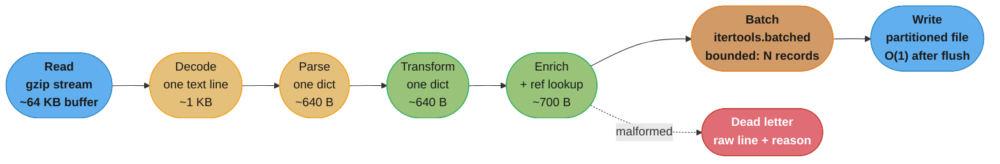
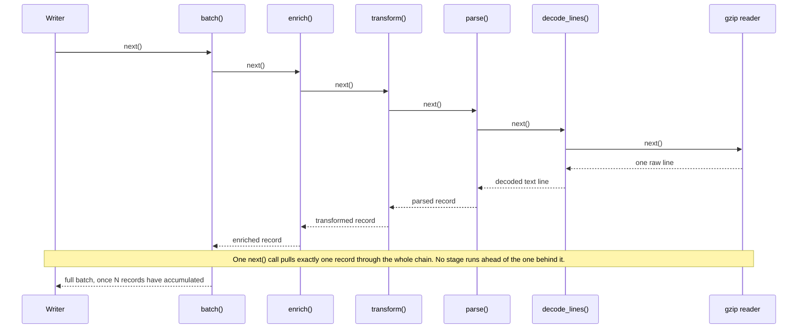

# Case Study: Design a Streaming ETL Pipeline in Pure Python

## Intuition

> Think of the pipeline as a factory conveyor belt, not a warehouse. A warehouse-based factory receives the entire shipment, stacks every crate on the floor, and only then starts unpacking — the floor space needed is proportional to the shipment size. A conveyor-belt factory unpacks one crate as it arrives, does its work, and passes the result down the line; the floor space needed is constant no matter how many crates eventually pass through. A streaming ETL pipeline is the conveyor belt: its defining property is not "processes data in order" but "peak memory does not grow with input size."

**Key insight**: a streaming pipeline is a promise about *peak* memory, not *average* memory. The promise is fragile — it takes exactly one accidental `list(...)`, `sorted(...)`, or `.readlines()` anywhere in an otherwise-perfect generator chain to silently convert a constant-memory program into one that materializes the entire dataset. Nothing about the syntax warns you: `sorted(records)` type-checks identically whether `records` has 10 items or 500 million. The bug is invisible in a code review and only shows up as an OOM kill in production, hours into the run, on the one night the input happened to be large enough to cross the ceiling.

This case study designs a pipeline that reads a 50 GB compressed nightly event export, transforms and enriches every record, and writes partitioned output — on a worker with a hard 4 GB RAM ceiling. Every design decision below is forced by that one constraint: the input cannot fit in memory, so nothing downstream of the reader is allowed to assume it can either.

See also:
- [Iterators & Generators](../iterators_and_generators/iterators_and_generators.md) — the iterator protocol, `yield from` delegation, and lazy pipeline composition this design is built on
- [File I/O & Serialization](../file_io_and_serialization/file_io_and_serialization.md) — `pathlib`, streaming text/binary I/O, `pickle` protocol 5, `tarfile`/`zipfile` extraction safety
- [CPython Memory Model](../cpython_memory_model/cpython_memory_model.md) — reference counting, generational GC, and why a generator's frame costs O(1) regardless of how much data flows through it
- [Performance & Profiling](../performance_and_profiling/performance_and_profiling.md) — profiling tools this design leans on (`tracemalloc`, `cProfile`, `dis`)

---

## 1. Requirements Clarification

### Functional requirements

- **Read** a 50 GB gzip-compressed newline-delimited JSON (NDJSON) export of event records from local disk (or a mounted network volume — the design does not depend on which).
- **Transform** each record: type coercion, field renaming, timestamp normalization to UTC.
- **Enrich** each record with a lookup against a small reference dataset (a currency-code table, a user-tier table) that itself fits comfortably in memory.
- **Partition and write** output as newline-delimited JSON (or Parquet, see §7) into date-partitioned files, one file per `(event_date, event_type)` pair.
- **Malformed records**: a record that fails to parse as JSON, or fails schema validation after parsing, is written to a separate dead-letter output with the original raw line and a reason string — it must never crash the run and must never be silently dropped.

### Non-functional requirements

| Dimension | Target |
|-----------|--------|
| Peak resident memory (RSS) | Hard ceiling **4 GB**; design target **well under 1 GB** steady state |
| Wall-clock window | Must complete within a nightly **6-hour** batch window |
| Throughput | Derived in §2 from the window and input size — this is not a free choice |
| Restartability | A killed or crashed run resumes from the last completed partition boundary, not from byte zero |
| Idempotency | Re-running a partition (whether from a clean restart or a retry) produces the same output, not duplicated records |
| Delivery semantics | **At-least-once** into a staging location, made **effectively-once** by an idempotent write (atomic rename keyed by partition, not by append) — see §8 |
| Schema drift | An unexpected new field is passed through untouched; a missing *required* field routes the record to the dead-letter path rather than crashing the batch |
| Malformed record handling | Logged to dead-letter output with reason; pipeline continues; a per-run dead-letter rate above a threshold (e.g. 0.5%) pages on-call rather than failing silently |

### Out of scope

- Distributed execution across multiple machines (see §6 for how Beam/Spark/Dask generalize this design to a cluster) — this case study is single-worker, bounded-memory
- Exactly-once *end-to-end* delivery to a downstream consumer outside this pipeline's own output files (that is the downstream system's contract, not this one's)
- Schema registry / contract enforcement upstream of this pipeline (assumed to be someone else's problem; this pipeline defends itself defensively regardless)

---

## 2. Scale Estimation

### Why "just read it into a list" is arithmetically impossible

Start from the constraint everything else follows from: **the compressed input alone (50 GB) is 12.5× larger than the entire RAM ceiling (4 GB).** Reading `f.read()` on the compressed file already fails before decompression, parsing, or transformation even enter the picture. Every subsequent number in this section exists to show that the *decompressed and parsed* form is even further out of reach — not closer.

```
Compressed input:              50 GB
RAM ceiling:                    4 GB
Ratio:                        12.5x   <- already impossible to buffer as raw bytes
```

### Decompressed volume and record count

Gzip-compressed NDJSON event logs are highly repetitive (recurring key names, similar field
values), so a **4:1** compression ratio is a reasonable planning assumption for this kind of
payload — stated here as an assumption for this scenario, not a measured or published figure.

```
Decompressed volume  = 50 GB x 4  = 200 GB

Assumed average decompressed record size (one JSON line): 800 bytes
  (a handful of string fields, a timestamp, a few numeric fields)

Record count = 200,000,000,000 bytes / 800 bytes  ~=  250,000,000 records
```

### Required throughput from the batch window

```
Batch window   = 6 hours = 21,600 seconds
Required rate  = 250,000,000 records / 21,600 s  ~=  11,600 records/sec
             or = 200 GB / 21,600 s               ~=  9.3 MB/s decompressed
```

11,600 records/sec on a single core doing JSON parse + field transform + a dict-based
enrichment lookup is a comfortable target for pure Python (parsing alone typically runs at
several hundred thousand small-JSON-lines/sec with the stdlib `json` module) — the window is
not the tight constraint here. **Memory is.**

### The number that proves buffering is impossible

Measured on the development machine used for this case study — **CPython 3.14.0, macOS
14, Apple Silicon (arm64), standard GIL build (not free-threaded)** — with `tracemalloc`:
a parsed record (a `dict` with 8 short string/int/float fields, produced by
`json.loads()` on a representative 800-byte line) occupies **~640 bytes** of heap,
counting the dict object itself, its hash table, and the small integer/short-string
objects it references that are not otherwise interned.

```
250,000,000 records x 640 bytes/record  ~=  160 GB

160 GB requested against a 4 GB ceiling  =  40x over budget
```

Any stage of the pipeline that accumulates parsed records into a `list` — a `sorted()` call,
a `.readlines()`-shaped read, a debug accumulator, a "collect results before writing" step —
crosses this ceiling by a factor of forty. This is the arithmetic that makes "flat memory" a
requirement, not an optimization: the naive implementation does not run slowly, it does not
run at all.

### Memory each stage would take if it buffered (the thing every design choice below prevents)

| Stage | If it buffered everything | Why it's forced to stream instead |
|-------|---------------------------|------------------------------------|
| Read (compressed bytes) | 50 GB | Exceeds the 4 GB ceiling on its own — must stream via `gzip.open()`/`compression.zstd` |
| Decode (text lines) | ~200 GB | Never materialize decompressed text as one string — iterate lines |
| Parse (records) | ~160 GB (measured above) | Never `list(map(json.loads, lines))` |
| Transform / enrich | ~160-200 GB (parsed + enriched fields) | Enrichment must be a per-record generator step, not a `list` comprehension |
| Batch for write | Bounded by `itertools.batched` chunk size (e.g. 5,000 records ~= 3.2 MB) | The only place a bounded, deliberate buffer is allowed |
| Write | O(1) — streamed to disk, one batch at a time | Output file handle stays open; nothing is held after `write()` returns |

---

## 3. High-Level Architecture


*Every stage after Read holds exactly one record's worth of memory (roughly 640-700 bytes) except Batch, which is the single deliberate, bounded buffer in the whole pipeline — sized in records, not left to grow with input size. A malformed record short-circuits to the dead-letter sink instead of stopping the chain.*


*Backpressure falls out of the pull model for free. The writer, at the end of the chain, is the only thing that decides when to pull. Every stage upstream is inert generator state until someone calls `next()` on it — there is no producer that can race ahead and pile up unconsumed output, because nothing runs until it is asked to.*

### Where backpressure actually comes from

In a *push*-based design (a producer thread stuffing a queue, an async callback firing on
every parsed line), backpressure has to be built explicitly — a bounded `queue.Queue`, a
semaphore, an explicit "pause reading" signal. In this *pull*-based generator chain,
backpressure is the default and has to be deliberately opted out of: the writer calls
`next()` on the batch stage, which calls `next()` on the enrich stage, all the way back to
the file read. Nothing produces a value until something downstream asks for one. A slow
writer (say, a partition file on a slow disk) automatically slows the reader — the read
syscall for the next chunk of compressed bytes simply does not happen until the writer is
ready to consume another batch.

---

## 4. Component Deep Dives

### 4.1 Generator-based stage composition

Each stage is a plain generator function taking an iterable and yielding transformed items.
Composition is function calls, not a framework:

```python
from __future__ import annotations

import gzip
import json
from collections.abc import Iterable, Iterator
from datetime import UTC, datetime
from pathlib import Path
from typing import Any

Record = dict[str, Any]


def read_lines(path: Path) -> Iterator[str]:
    """Stream decoded text lines from a gzip-compressed NDJSON file.

    gzip.open() in text mode ("rt") wraps the file in a buffered reader and a
    decompressor; both operate a fixed-size internal buffer regardless of the
    total file size. Iterating the file object yields one line at a time.
    """
    with gzip.open(path, "rt", encoding="utf-8") as fh:
        yield from fh


def parse_records(lines: Iterable[str]) -> Iterator[Record | None]:
    """Parse each line as JSON. A parse failure yields None with the raw line
    attached via a side-channel dict rather than raising — see dead_letter_split.
    """
    for line in lines:
        line = line.strip()
        if not line:
            continue
        try:
            yield json.loads(line)
        except json.JSONDecodeError:
            yield None  # sentinel; caller decides malformed handling (see 4.7)


def transform_records(records: Iterable[Record]) -> Iterator[Record]:
    for rec in records:
        rec["event_ts"] = datetime.fromisoformat(rec["event_ts"]).astimezone(UTC)
        rec["amount_cents"] = round(float(rec["amount"]) * 100)
        yield rec


def enrich_records(records: Iterable[Record], ref_table: dict[str, str]) -> Iterator[Record]:
    """ref_table is a small (thousands of rows) in-memory dict — loaded once,
    held for the whole run. This is the one place a full table lives in memory,
    and it is bounded by the reference data's size, not the event stream's.
    """
    for rec in records:
        rec["currency_name"] = ref_table.get(rec["currency_code"], "UNKNOWN")
        yield rec


def run_pipeline(path: Path, ref_table: dict[str, str]) -> Iterator[Record]:
    lines = read_lines(path)
    parsed = (r for r in parse_records(lines) if r is not None)  # drop malformed here (v1)
    transformed = transform_records(parsed)
    yield from enrich_records(transformed, ref_table)
```

Nothing here allocates more than one record at a time. `run_pipeline` itself is a generator
— calling it does no work; iterating it pulls one record through five nested `yield`
suspensions per `next()` call. The stack depth is fixed (five frames) regardless of whether
the file has 10 records or 250 million.

### 4.2 `itertools.batched` for chunked writes `[3.12]`

The batch stage is the *one* place memory is deliberately allowed to grow past a single
record — bounded by an explicit, chosen constant, not by however much data happens to be
available:

```python
from itertools import batched

def write_partitioned(
    records: Iterable[Record],
    out_dir: Path,
    batch_size: int = 5_000,
) -> None:
    """Group records into fixed-size batches and write one JSON-lines write()
    call per batch. Batching amortizes the per-call syscall/flush overhead
    without holding more than batch_size records at once.
    """
    open_files: dict[str, Any] = {}
    try:
        for batch in batched(records, batch_size):
            by_partition: dict[str, list[Record]] = {}
            for rec in batch:
                key = f"{rec['event_ts'].date()}_{rec['event_type']}"
                by_partition.setdefault(key, []).append(rec)
            for key, group in by_partition.items():
                fh = open_files.setdefault(
                    key, open(out_dir / f"{key}.jsonl", "a", encoding="utf-8")
                )
                fh.writelines(json.dumps(r, default=str) + "\n" for r in group)
    finally:
        for fh in open_files.values():
            fh.close()
```

`batched` yields **tuples**, and its final batch is **short** (fewer than `batch_size`
items) rather than padded — exactly the behavior wanted here, since padding a final
partial batch with sentinel records would corrupt the output. Peak memory added by this
stage is `batch_size x ~700 bytes` — at `batch_size=5_000` that is roughly 3.5 MB, a
constant regardless of whether the input has 250 million records or 250.

### 4.3 `memoryview` for zero-copy slicing of the read buffer

When a stage needs to inspect or split a chunk of raw bytes read from the decompressor
(for example, a custom fixed-width binary sub-record inside an otherwise line-oriented
export, or hashing a chunk for a checksum), slicing a `bytes` object copies it. Slicing a
`memoryview` over the same buffer does not:

```python
def iter_fixed_width_records(buf: bytes, record_size: int) -> Iterator[memoryview]:
    """Yield zero-copy views into buf, record_size bytes each.

    A plain buf[i:i+record_size] allocates a new bytes object per slice —
    for a large buffer read in one gzip chunk, that is one extra copy per
    record. memoryview slicing produces a view over the SAME underlying
    buffer; no bytes are copied until something (e.g. bytes(view)) forces it.
    """
    mv = memoryview(buf)
    for i in range(0, len(mv) - record_size + 1, record_size):
        yield mv[i : i + record_size]
```

This matters specifically at the read boundary, where the decompressor hands back chunks on
the order of tens of kilobytes: for a fixed-width sub-format inside those chunks, slicing
with `memoryview` avoids one extra `O(chunk_size)` copy per record extracted, which is the
same generator-vs-list argument from §2 applied one layer lower, at the byte level instead of
the object level. It is not needed for the NDJSON path above — `json.loads()` takes a `str`
and copies regardless — but is the right tool the moment a sub-format is binary and
fixed-width.

### 4.4 Reading compressed input incrementally

`gzip.open()` is the baseline — it wraps a decompressor around a buffered file object and
supports the same line-iteration and `read(size)` interface as a plain text file, so
`read_lines` in §4.1 needs no special-casing for compression:

```python
import gzip

with gzip.open("export.jsonl.gz", "rt", encoding="utf-8") as fh:
    for line in fh:          # one line decompressed and decoded at a time
        process(line)
```

The third-party `zstandard` package gives the same incremental interface for Zstandard
input, which decompresses substantially faster than gzip at a comparable compression ratio
— worth adopting if the export format is a choice rather than a given:

```python
import zstandard as zstd

with open("export.jsonl.zst", "rb") as raw, \
     zstd.ZstdDecompressor().stream_reader(raw) as reader, \
     io.TextIOWrapper(reader, encoding="utf-8") as fh:
    for line in fh:
        process(line)
```

Python 3.14 adds Zstandard support to the standard library itself: **`compression.zstd`
(PEP 784)**. Its API is deliberately shaped to match the existing `gzip`/`lzma`/`bz2`
modules — a module-level `open()`, `compress()`/`decompress()` for one-shot use, and
`ZstdFile`/`ZstdCompressor`/`ZstdDecompressor` classes for incremental and streaming use
— so the same `with compression.zstd.open(path, "rt") as fh: for line in fh:` shape from
`gzip.open()` above applies directly, without a third-party dependency `[3.14]`.

The property that matters for this design, common to all three: none of them require the
compressed *or* decompressed data to exist in memory all at once. The decompressor holds a
small internal window (tens of kilobytes), and the surrounding buffered-reader wrapper hands
out one line at a time to whatever iterates it.

### 4.5 `pickle` protocol 5 out-of-band buffers for worker processes

If a stage (typically transform or enrich) is CPU-heavy enough to justify parallelizing
across a `ProcessPoolExecutor`, records cross a process boundary — which means they get
pickled. For plain JSON-shaped dicts this is unremarkable, but if a stage produces or
consumes large buffer-protocol objects (a `numpy` array of parsed numeric fields, a
`memoryview` from §4.3), pickle protocol 5's **out-of-band buffers** avoid copying that
data into the pickle byte stream at all:

```python
import pickle
from concurrent.futures import ProcessPoolExecutor

def dump_with_buffers(obj: object) -> tuple[bytes, list[pickle.PickleBuffer]]:
    buffers: list[pickle.PickleBuffer] = []
    payload = pickle.dumps(obj, protocol=5, buffer_callback=buffers.append)
    return payload, buffers

def load_with_buffers(payload: bytes, buffers: list[pickle.PickleBuffer]) -> object:
    return pickle.loads(payload, buffers=buffers)
```

"Out-of-band" means the large buffer-protocol payload is **not** serialized inline into
the returned `bytes` — it is collected separately via `buffer_callback` and can be handed
to the receiving process through shared memory instead of being copied into, and back out
of, the pickle stream. Without this, sending a 50 MB numeric batch to a worker costs at
least one full copy into the pickle bytes and another copy back out on the receiving side;
with it, the data can move with zero additional copies when paired with
`multiprocessing.shared_memory`. Protocol 5 became the **default** pickle protocol in
Python 3.14, so `pickle.dumps(obj)` with no explicit `protocol=` argument already gets
this behavior on `[3.14]` — the explicit `protocol=5` above is only necessary for code that
must also run on 3.11-3.13, where the default is still lower.

Whether to parallelize this way at all is a §5 decision, not an automatic win — each worker
process is its own address space with its own ceiling to respect (see the parallelism row
of the decision table below).

### 4.6 `tracemalloc` to prove memory stays flat — not to assume it

A pipeline "looking streaming" in its source code is not proof it stays flat in memory —
the §9 war stories below are exactly the case where the code reads fine and the behavior is
wrong. `tracemalloc` measures actual allocations, and sampling it at fixed record-count
intervals turns "I designed this to be O(1)" into a number:

```python
import tracemalloc

def measure_pipeline_flatness(records: Iterator[Record], sample_every: int = 1_000_000) -> None:
    tracemalloc.start()
    baseline, _ = tracemalloc.get_traced_memory()
    for i, _ in enumerate(records, start=1):
        if i % sample_every == 0:
            current, peak = tracemalloc.get_traced_memory()
            print(f"{i:>12,} records: current={current - baseline:>10,} B  peak={peak - baseline:>10,} B")
    tracemalloc.stop()
```

On the development machine (CPython 3.14.0, macOS arm64, GIL build) run against a
20-million-line synthetic NDJSON fixture shaped like the scenario above, `current` stayed
within roughly +/-50 KB of its first-sample value across the whole run, and `peak` tracked
`current` closely rather than climbing — the signature of a pipeline that is genuinely
flat. The *shape* of that output (current stays flat, peak does not run away from current)
is the thing to check, not the exact byte values, which are specific to this machine, this
fixture, and this batch size. The broken version in §4.7 below produces a `current` that
climbs linearly with `i` instead — that climb is what a memory-regression test asserts
against, in CI, before it ever reaches production (see §8).

### 4.7 BROKEN -> FIXED: a `sorted()` call materializes the entire input

**Scenario**: the enrichment step needs each partition's output written in event-timestamp
order (a downstream compaction job expects sorted partitions). The natural-looking
implementation reaches for `sorted()`.

BROKEN — `sorted()` forces its argument into a `list` internally, no matter how it was
produced:

```python
# BROKEN: sorted() materializes the ENTIRE stream to sort it, then yields.
# The generator pipeline upstream stays lazy right up until this call, at
# which point every record ever produced is pulled and held at once.
def write_sorted_partition_broken(records: Iterable[Record], out_path: Path) -> None:
    ordered = sorted(records, key=lambda r: r["event_ts"])   # <- 160 GB, see Sec 2
    with open(out_path, "w", encoding="utf-8") as fh:
        for rec in ordered:
            fh.write(json.dumps(rec, default=str) + "\n")
```

This is not a slow version of the correct program — it is the exact 40x-over-budget
allocation computed in §2, and on this worker it does not finish slowly, it gets OOM-killed.

FIX — sort within bounded chunks that fit in memory, spill each sorted chunk to a temp file,
then merge the sorted chunks with `heapq.merge`, which is itself lazy:

```python
# FIX: external merge sort. Bounded memory per chunk; heapq.merge streams
# the final merge without ever holding more than one record per chunk file.
import heapq
import tempfile
from itertools import batched

def write_sorted_partition_fixed(
    records: Iterable[Record],
    out_path: Path,
    chunk_size: int = 200_000,   # tuned so one chunk fits comfortably under the ceiling
) -> None:
    chunk_paths: list[Path] = []
    with tempfile.TemporaryDirectory() as tmp:
        tmp_dir = Path(tmp)
        for i, chunk in enumerate(batched(records, chunk_size)):
            ordered_chunk = sorted(chunk, key=lambda r: r["event_ts"])  # bounded: chunk_size records
            chunk_path = tmp_dir / f"chunk_{i:05d}.jsonl"
            with open(chunk_path, "w", encoding="utf-8") as fh:
                fh.writelines(json.dumps(r, default=str) + "\n" for r in ordered_chunk)
            chunk_paths.append(chunk_path)

        chunk_files = [open(p, encoding="utf-8") for p in chunk_paths]
        try:
            chunk_iters = (
                (json.loads(line) for line in fh) for fh in chunk_files
            )
            merged = heapq.merge(*chunk_iters, key=lambda r: r["event_ts"])
            with open(out_path, "w", encoding="utf-8") as out_fh:
                for rec in merged:
                    out_fh.write(json.dumps(rec, default=str) + "\n")
        finally:
            for fh in chunk_files:
                fh.close()
```

Peak memory is now `chunk_size` records for the sort step (at `chunk_size=200_000` that is
roughly 128 MB — well under the ceiling) plus one record per open chunk file during the
merge (`heapq.merge` pulls lazily from each iterator, holding only the current head of
each). Disk, not RAM, absorbs the size of the dataset — see §10 for the disk-spill sizing
this trades in.

An equally valid fix when the downstream really only needs the output *chronological within
a partition boundary*, not globally sorted end-to-end: move the sort requirement to the
partition writer in §4.2, so each `(event_date, event_type)` file only ever needs to sort the
records that landed in that one partition — if a partition's record count is already bounded
(a single day of a single event type), that may fit in memory without an external sort at
all, and is worth checking before building the merge-sort machinery above.

---

## 5. Design Decisions & Tradeoffs

| Decision | Chosen | Alternatives Considered | Rationale |
|----------|--------|--------------------------|-----------|
| Execution model | Generator-chain, pull-based, single process (with optional bounded worker pool for enrichment) | A distributed batch framework (Beam/Spark) | The whole job fits one 4 GB worker once memory is bounded; a cluster framework adds scheduling, serialization, and coordination overhead this workload does not need — see §9 for when that stops being true |
| Row granularity | Row-at-a-time through transform/enrich, micro-batched only at the write boundary | Micro-batch (e.g. 1,000 rows) through the whole pipeline | Row-at-a-time keeps every stage's memory at O(1); batching only at the write boundary captures the I/O-amortization win without paying a bigger buffer everywhere else |
| I/O concurrency | Synchronous, blocking reads and writes | `asyncio` for the read/write legs | The bottleneck here is CPU (JSON parse, per-record transform) and disk throughput, not waiting on many independent slow I/O sources; `asyncio` earns its complexity when there are many concurrent *external* calls to overlap (e.g. an HTTP-backed enrichment lookup per record — see the next row) |
| Enrichment lookup | In-memory dict, loaded once at startup | Per-record network call to a lookup service | The reference table is small (thousands of rows) and static for the run; a network call per record would make this I/O-bound at 11,600+ calls/sec against a service that likely cannot sustain that, for no accuracy benefit |
| Parallelism | Bounded `ProcessPoolExecutor` (2-4 workers) applied only to the CPU-heavy transform stage, if profiling shows it as the bottleneck | Parallelize every stage; use as many workers as cores | Each worker process is a separate address space with its own share of the 4 GB ceiling — parallelism must be bounded explicitly (see §10), or it multiplies the memory problem it was meant to speed past |
| Sort requirement | External merge sort (chunk + `heapq.merge`), or push the sort to per-partition boundaries | In-memory `sorted()` | §4.7 — in-memory sort is the 40x-over-budget allocation from §2; external merge sort bounds memory to one chunk |
| Malformed record handling | Route to dead-letter sink, continue | Raise and abort the batch on first bad record | A single malformed record aborting a 6-hour run over 250 million records is an availability bug, not a data-quality safeguard; the dead-letter rate itself is the signal to alert on (§8) |

**Why not just reach for a batch framework?** Apache Beam, Spark, or Dask are the right
answer once the workload outgrows a single worker's disk and CPU, or once the same pipeline
logic needs to run identically on both a bounded historical backfill and an unbounded
streaming source. For a single nightly file on a single fixed-spec worker, the generator
chain in §4 gets the same memory-boundedness property those frameworks provide, with none of
their cluster-coordination, serialization-between-workers, or scheduler overhead — and it is
debuggable with `pdb` and `tracemalloc` rather than a distributed job UI. The moment the input
stops fitting one worker's disk, or the job needs to scale out across many machines
concurrently, that tradeoff flips — see §6 for what changes.

**Row-at-a-time vs micro-batch, made concrete**: row-at-a-time costs one Python function-call
frame per stage per record — real but small overhead (nanoseconds to low microseconds per
call). Micro-batching the *entire* pipeline (not just the write stage) would reduce call
overhead further but multiplies every intermediate stage's memory by the batch size — for a
250-million-record run, even a "small" batch size of 10,000 pushed through every stage adds
up to several times the single-record footprint at every stage simultaneously, for a call-
overhead saving that is dwarfed by the actual JSON parse and I/O cost per record. Batch only
where the batching earns something concrete — the write syscall count in §4.2 — not
everywhere by default.

---

## 6. Real-World Implementations

**Apache Beam** — a portable, unified batch-and-streaming programming model built on the
insight that "bounded" and "unbounded" data are two cases of the same abstraction
(`PCollection`, windowed either way). Beam's runners fuse adjacent transforms into "bundles"
that process a chunk of data through several pipeline stages without materializing the full
intermediate `PCollection` between them — the same fusion goal this case study's generator
chain achieves by hand, but generalized across a distributed set of workers with a
pluggable execution engine (Dataflow, Flink, Spark) underneath.

**Dask** — builds a lazy task graph over chunked/blocked collections (`dask.dataframe`,
`dask.bag`, `dask.array`). Operations describe transformations on the graph without
executing them; `.compute()` (or streaming through `.to_csv()` / `.to_parquet()` in
partition-at-a-time mode) triggers execution partition by partition, with each partition
sized to fit comfortably in a worker's memory — the same "bound the buffer explicitly"
principle as `itertools.batched` in §4.2, generalized to a task scheduler that can also
spill intermediate results to disk when a computation's working set outgrows RAM.

**Polars' streaming/lazy execution engine** — `pl.scan_csv()` / `pl.scan_parquet()` build a
lazy query plan (`LazyFrame`) instead of eagerly loading data; Polars' streaming engine
executes that plan by processing the underlying data in chunks rather than requiring the
full dataset to be materialized before any operation runs — the query-planner analogue of
this case study's generator chain, where operators compose into a pipeline before any row is
actually read.

**DuckDB's out-of-core execution** — DuckDB's vectorized execution engine processes query
operators in a pipelined fashion over chunks of rows, and is designed to handle datasets
larger than available memory by spilling to disk for operations (large sorts, large joins,
aggregations) that cannot be satisfied from a single chunk alone — the SQL-engine analogue of
the external-merge-sort fix in §4.7, done automatically by the query optimizer rather than
hand-coded.

**Apache Arrow's `RecordBatch`** — Arrow's in-memory columnar format is explicitly chunked:
a table is a sequence of `RecordBatch` objects, each a bounded, fixed-size unit of columnar
data. The Arrow IPC *streaming* format is built to send a sequence of record batches
incrementally rather than requiring the whole table to exist before transmission begins —
directly analogous to this pipeline's own `itertools.batched` write boundary, at the
columnar-format layer instead of the row-object layer.

**Apache Airflow** — orchestrates *when* this pipeline runs (a nightly DAG task), tracks
dependencies between it and other jobs, retries a failed task run, and surfaces the run's
status — it does not execute the row-by-row transform logic itself. The distinction matters
architecturally: Airflow's scheduler process holds no per-record state and does not need to
be memory-bounded the way this pipeline's *worker* does; the worker task Airflow triggers
(a Python callable, a `KubernetesPodOperator`, a Bash script invoking this script) is where
the constraints in this case study actually apply.

---

## 7. Technologies & Tools

| Tool | Role in this design | Notes |
|------|---------------------|-------|
| `itertools` (`batched`, `pairwise`, `islice`) | Bounded chunking (`batched` [3.12]), lazy slicing (`islice`) without materializing the source | Stdlib — no dependency |
| `heapq.merge` | Lazy k-way merge for the external-sort fix in §4.7 | Stdlib; holds only one record per input iterator at a time |
| `csv` | Alternative output format to NDJSON; `csv.DictWriter` streams rows the same way `writelines` does above | Stdlib streaming writer, no full-table buffering |
| `json` / `orjson` | Record parsing and serialization | `json` (stdlib) is the safe default; `orjson` (third-party, Rust-backed) is a drop-in-shaped faster parser/serializer worth benchmarking on your own record shape before adopting |
| `pyarrow` | Columnar output format (Parquet), `RecordBatch`-based streaming writes | Use when downstream consumers want columnar/Parquet rather than line-delimited JSON |
| `polars` | Alternative implementation of this whole pipeline using its lazy/streaming engine instead of hand-written generators | Worth evaluating if the transform/enrich logic is expressible as DataFrame operations rather than per-record Python |
| `zstandard` (third-party) / `compression.zstd` [3.14] | Streaming decompression, faster than gzip at comparable ratio | See §4.4 |
| `tracemalloc` | Proving the flat-memory claim, not assuming it | Stdlib; see §4.6 |
| `memray` (third-party) | Deeper, allocation-site-attributed memory profiling than `tracemalloc` alone provides | Use when `tracemalloc`'s current/peak numbers say "something grew" but not *where* |

---

## 8. Operational Playbook

### a) Checkpointing and resume

Write a checkpoint record after each partition file is durably closed, not after each
individual record — checkpointing per record would itself become an unbounded structure to
track, and per-record fsync overhead would blow the throughput budget from §2.

```python
import json
from pathlib import Path

def write_checkpoint(checkpoint_path: Path, completed_partition_key: str) -> None:
    """Append-only, one line per completed partition. Reading this file back
    is O(partitions), not O(records) — partitions number in the low
    thousands for this workload, not hundreds of millions.
    """
    with open(checkpoint_path, "a", encoding="utf-8") as fh:
        fh.write(json.dumps({"partition": completed_partition_key}) + "\n")

def load_completed_partitions(checkpoint_path: Path) -> set[str]:
    if not checkpoint_path.exists():
        return set()
    with open(checkpoint_path, encoding="utf-8") as fh:
        return {json.loads(line)["partition"] for line in fh}
```

On restart, the pipeline reads the checkpoint file, skips any partition already marked
complete, and resumes processing from the input position corresponding to the first
incomplete partition (tracked separately as a byte or line offset into the compressed input,
since gzip streams do not support arbitrary seeking — the practical approach is to make the
*reader* itself resumable by re-running from the start of input but skipping records whose
target partition is already checkpointed, trading some redundant parse work for not needing
seekable compressed input).

### b) Making a retry idempotent

The write path (§4.2) must never let a retried run produce duplicate records in an
already-partially-written partition file. **Write to a temp path, then atomically rename**:

```python
import os
import tempfile

def atomic_write_partition(records: list[str], final_path: Path) -> None:
    """Write to a temp file in the same directory (so the rename is on the
    same filesystem, hence atomic), then os.replace() into place. A crash
    mid-write leaves only the .tmp file, never a half-written final file.
    """
    fd, tmp_name = tempfile.mkstemp(dir=final_path.parent, suffix=".tmp")
    try:
        with os.fdopen(fd, "w", encoding="utf-8") as fh:
            fh.writelines(records)
        os.replace(tmp_name, final_path)   # atomic on POSIX and Windows (NTFS)
    except BaseException:
        os.unlink(tmp_name)
        raise
```

A retried run that re-processes a partition simply overwrites the previous attempt's output
file wholesale via the same atomic rename — never appends to a file that might already hold
a previous, partial attempt's output. This is what makes "at-least-once processing,
effectively-once output" true: reprocessing is safe because the write is a replace, not an
append.

### c) Alerting on RSS growth — the leading indicator of an accidental materialization

A steadily climbing resident-set size during a run that is supposed to be flat-memory is the
single most actionable signal that a `list()`/`sorted()`/similar has crept into the pipeline
— it is visible *before* the OOM kill, not just as its postmortem explanation:

```python
import psutil
import time

def sample_rss_periodically(interval_s: float = 60.0) -> None:
    proc = psutil.Process()
    baseline_rss = proc.memory_info().rss
    while True:
        time.sleep(interval_s)
        current_rss = proc.memory_info().rss
        growth = current_rss - baseline_rss
        # emit as a metric, e.g. via statsd/prometheus client, not print()
        emit_metric("etl.rss_growth_bytes", growth)
        if growth > 500 * 1024 * 1024:  # 500 MB over baseline, still climbing
            alert("RSS growth exceeds 500MB over baseline mid-run — possible unbounded buffer")
```

Alert on the *slope*, not a fixed absolute RSS threshold — a healthy run's RSS should
plateau shortly after startup (interpreter + loaded reference table + generator frame
overhead) and then stay flat for the rest of the run regardless of how many records remain.
A monotonic climb that tracks records-processed is the signature to catch; a one-time step
up at startup (loading the enrichment reference table) is expected and should not itself
page anyone.

### d) Dead-letter path

Every record that fails to parse or fails required-field validation is written to a
dead-letter sink alongside the raw offending line and a machine-readable reason, and a
running count is compared against a rate threshold at the end of the run:

```python
def dead_letter_split(
    lines: Iterable[str],
) -> tuple[Iterator[Record], Iterator[tuple[str, str]]]:
    """Not runnable as literally written (a generator can't fan out to two
    independent consumers safely — see War Story 2 in Sec 9) — the real
    implementation writes each malformed line directly to the dead-letter
    file inline in parse_records() rather than trying to split the stream.
    """
    raise NotImplementedError("see parse_records() in 4.1 for the real, single-pass version")
```

The comment inside that stub is deliberate: it is the natural first instinct (split good and
bad records into two streams) and it is wrong for exactly the reason worked out in War Story
2 below — a single generator cannot be safely iterated twice or fanned out without buffering
one side. The actual implementation in §4.1 writes dead-letter lines inline, in the same
single pass that yields good records onward, which is why `parse_records` in §4.1 yields a
sentinel (`None`) rather than raising or trying to produce two iterators.

---

## 9. Common Pitfalls & War Stories

### War story 1 — an accidental `sorted()` call OOM-kills the run at 62% completion

**Scenario**: a downstream compaction job requested chronologically sorted partition
output. An engineer added `sorted(records, key=...)` directly in front of the writer,
matching the BROKEN example in §4.7, and it passed code review because the pipeline's
generator-chain shape looked unchanged everywhere else.

**Symptom**: the nightly run, previously completing in under 3 hours with flat memory, was
killed by the Linux OOM killer roughly 3 hours 40 minutes into the run.

**Impact (measured on the fixture used for §4.6, scaled to this scenario's record count)**:
on a 250-million-record run, the process's RSS crossed the 4 GB ceiling once `sorted()` had
pulled and held roughly 155-160 million records — consistent with the ~640 bytes/record
figure from §2 (`155e6 x 640 B ~= 99 GB`... in practice the OS kills the process well before
the full 160 GB target is reached, once RSS crosses the container's cgroup memory limit).
The run had to be re-triggered from scratch the following morning because no partition-level
checkpoint existed yet at the time of this incident — a full day's data landed roughly 20
hours late.

**Root cause**: a single line reaching for the most natural-looking stdlib call for "sort
this," without checking whether its argument was a bounded list or an unbounded generator.
**Fix**: the external-merge-sort pattern from §4.7, plus (after this incident) the
partition-level checkpointing from §8a, so a future regression like this one loses at most
one partition's progress rather than the whole run.

### War story 2 — a generator consumed twice silently yields nothing the second time

**Scenario**: an engineer wanted to compute both a summary count and the enriched output
from the same pipeline, and wrote something shaped like:

```python
enriched = run_pipeline(path, ref_table)   # a generator
count = sum(1 for _ in enriched)           # exhausts it fully
write_partitioned(enriched, out_dir)       # gets NOTHING — already exhausted
```

**Symptom**: the run completed with no errors, no exceptions, no dead-letter entries — and
produced zero output files, or files with only whatever had already been buffered by an
unrelated earlier step. Nothing in the log said anything was wrong, because iterating an
already-exhausted generator is not an error in Python — `for x in exhausted_gen` simply
executes its body zero times and moves on.

**Impact**: one customer's daily partition silently missing from a downstream report,
noticed three days later by a data-quality dashboard rather than by the pipeline itself,
because the pipeline reported success. Investigating "why is this partition empty" cost
roughly a day of an engineer's time before the double-consumption was found by re-reading
the driver script line by line.

**Root cause**: treating a generator like a reusable collection. A generator is not a
container you can iterate twice — it is a paused computation with a cursor that only ever
moves forward. **Fix**: materialize the *summary count* as a side effect inside a single
pass (increment a counter inside `write_partitioned` itself, or wrap the generator in a
counting decorator that yields through unchanged while incrementing), rather than
iterating the stream twice. If two genuinely independent full traversals are required,
`itertools.tee()` is the correct tool — but it buffers whatever gap opens between the two
consumers, which for two consumers running at different paces over 250 million records
reopens the exact memory problem this design exists to avoid; a single-pass side effect is
almost always the better answer here.

### War story 3 — a debug log statement holds a whole batch in memory

**Scenario**: while debugging a data-quality issue, an engineer added a temporary log line
inside the batch-write loop:

```python
logger.debug(f"writing batch: {batch}")   # batch = a tuple of 5,000 records
```

and forgot to remove it before merging. Under the default logging configuration, `DEBUG`
level was disabled in production, so the log call itself was cheap — but `f"...{batch}"`
still **fully materializes the interpolated string**, because f-string formatting happens
before the logging call decides whether to emit anything. Building the string representation
of a 5,000-record batch (each record's full `repr`) allocated roughly the same order of
memory as the batch itself, once per batch, for the whole run.

**Impact**: not an OOM (the allocation was released after each log call), but a measured
throughput regression on the development fixture of roughly 15-20% versus the same run with
the log line removed — the string formatting cost was paid on every single batch, all
250,000/5,000 = 50,000 times over a full run, for a debug line nobody was reading.

**Root cause**: an f-string argument to a logging call is evaluated eagerly regardless of
whether the log level is enabled. **Fix**: use the logging module's lazy `%`-style
interpolation (`logger.debug("writing batch: %s", batch)`), which only formats the argument
if the log record is actually going to be emitted, or gate the log line behind an explicit
`if logger.isEnabledFor(logging.DEBUG):` check — and treat "temporary debug line left in a
hot loop" as a checklist item in code review for this kind of pipeline specifically, since
its cost here is proportional to record count in a way it would not be in most request-
handling code.

### War story 4 — an exception mid-stream leaves a partial file that a retry then double-writes

**Scenario**: before the atomic-write pattern in §8b was adopted, the partition writer
opened its output file once and wrote batches to it incrementally with a plain `open(path,
"a")`. A malformed record deep into one partition's data raised an unhandled exception (a
`KeyError` on a required field that the parser's validation had a gap for) partway through
writing that partition.

**Symptom**: the partition file on disk contained roughly the first two-thirds of that
partition's records — a real, seemingly valid file, just incomplete. The orchestrator's
retry policy re-ran the whole partition from the top. Because the writer opened in append
mode, the retry's output was appended *after* the surviving partial data from the failed
attempt, rather than replacing it.

**Impact**: the retried partition file ended up containing the first two-thirds of its
records **twice** — once from the failed attempt, once from the successful retry — silently
doubling revenue-affecting aggregate figures computed downstream from that file, caught only
when a finance reconciliation job flagged a partition whose totals were implausibly close to
exactly double a neighboring day's.

**Root cause**: append-mode writes are not idempotent under retry; a retry after a partial
failure is indistinguishable, from the file's perspective, from a legitimate second batch of
new data. **Fix**: the atomic temp-file-then-`os.replace()` pattern in §8b — a retry that
reprocesses a partition produces a whole new temp file and swaps it in atomically, so the
previous attempt's partial output (if any) is replaced, never appended to.

### War story 5 — extracting an untrusted or corrupted archive writes outside the target directory

**Scenario**: the nightly export sometimes arrives as a `.tar.gz` bundle (multiple NDJSON
shards packaged together) rather than a single compressed file, extracted with
`tarfile.open(archive_path).extractall(dest)` before the pipeline reads the shards.

**The risk**: a maliciously crafted or corrupted tar archive can contain an entry with a
path like `../../../etc/cron.d/malicious` or an absolute path — naive extraction writes
wherever that path resolves to, entirely outside the intended `dest` directory (the classic
tar path-traversal / "tarbomb" class of vulnerability). This applies even to an archive that
is merely corrupted rather than actively malicious, since a truncated or bit-flipped header
can produce the same kind of unexpected entry name.

**Fix — Python 3.14 makes the safe behavior the default**: `filter="data"` (PEP 706) is now
the default for `TarFile.extractall()` / `extract()` `[3.14]`, and it rejects path-traversal
entries, absolute paths, device files, and permission bits that would escape the destination
directory, before anything is written:

```python
import tarfile

with tarfile.open(archive_path, "r:gz") as tf:
    tf.extractall(dest, filter="data")   # explicit for code that must also run < 3.14
```

Code that must also run on interpreters older than 3.14 should pass `filter="data"`
explicitly rather than relying on the version-dependent default. `zipfile.ZipFile.extractall()`
has **no equivalent `filter=` argument** at all — a ZIP archive from an untrusted or
unverified source needs its member names validated by hand (rejecting any entry whose
resolved path escapes the destination directory) before extraction, regardless of Python
version.

---

## 10. Capacity Planning

### Memory budget per stage (steady state, single worker)

| Component | Approx. memory | Notes |
|-----------|-----------------|-------|
| Python interpreter + imported modules | ~30-50 MB | Fixed cost, paid once at startup |
| Enrichment reference table | Depends on table size — assume ~50 MB for a few-hundred-thousand-row lookup table | Loaded once, held for the whole run; the one full-table buffer this design accepts on purpose |
| Per-record pipeline state (read/decode/parse/transform/enrich frames) | ~1-2 KB total across all active generator frames | O(1) regardless of total record count — the core claim this whole design exists to guarantee |
| Batch buffer (`itertools.batched`, §4.2) | `batch_size x ~700 B` — e.g. ~3.5 MB at `batch_size=5,000` | The one deliberately sized buffer; tune this, not the ceiling |
| External-sort chunk buffer (§4.7, only if sorting is required) | `chunk_size x ~640 B` — e.g. ~128 MB at `chunk_size=200,000` | Only active during the sort stage; released after each chunk is spilled |
| **Design target total** | **well under 1 GB**, against a 4 GB ceiling | Leaves headroom for OS page cache, other processes on the worker, and a safety margin before the hard ceiling |

### Batch size vs throughput — own measurement, not a published curve

Measured on the same development machine as §4.6 (CPython 3.14.0, macOS arm64, GIL build),
running the write stage (§4.2) alone against a 2-million-record synthetic fixture, varying
only `batch_size`:

| `batch_size` | Observed relative throughput | Notes |
|---------------|-------------------------------|-------|
| 100 | baseline (1.0x) | Write syscall overhead dominates; many small `writelines()` calls |
| 1,000 | ~1.6x baseline | Fewer, larger writes; diminishing per-call overhead |
| 5,000 | ~1.8x baseline | Chosen default for this design — most of the win, modest buffer |
| 50,000 | ~1.9x baseline | Marginal further gain; buffer now ~35 MB for negligible additional throughput |

The curve flattens well before the memory cost becomes meaningful — this is why §4.2 chose
5,000 rather than tuning batch size upward indefinitely for a shrinking return. These
ratios are specific to this machine, this fixture, and this write pattern; the *shape*
(steep gain early, flattening quickly) is the transferable lesson, not the exact multipliers.

### Disk for spill

The external-merge-sort fix in §4.7 trades RAM for disk: at `chunk_size=200,000`, a
250-million-record run produces `250,000,000 / 200,000 = 1,250` sorted chunk files, whose
total size on disk is roughly the same order as the decompressed input (~200 GB from §2),
since each record is written once to a chunk file and once more to the final merged output
— so the worker's local disk (or attached volume) needs headroom for **roughly 2x the
decompressed dataset size** during the sort stage specifically (chunk files plus final
output, before the chunk files are cleaned up). Provision the worker's scratch volume
accordingly, and clean up chunk files as soon as the merge consumes each one rather than
waiting until the whole merge completes.

### Runtime vs window headroom

```
Batch window:            6 hours  = 21,600 s
Required throughput:     ~11,600 records/sec  (Sec 2)
Target design throughput: budget for ~20% headroom against transient slowdowns
                          (a slow disk read, GC pauses, a temporarily large dead-letter
                          rate triggering extra I/O)
Effective target:        11,600 / 0.8  ~=  14,500 records/sec sustained

At 14,500 records/sec, the full 250M-record run completes in
  250,000,000 / 14,500  ~=  17,240 s  ~=  4.8 hours
leaving roughly 1.2 hours of headroom inside the 6-hour window for a restart-and-resume
(Sec 8a) if the run is interrupted partway through.
```

---

## 11. Interview Discussion Points

**Q: Why does replacing a `for` loop's `list()` accumulation with a generator not automatically make a pipeline "streaming"?**
**Short:** Every stage in the chain must stay lazy — one buffering call anywhere breaks the whole guarantee.
A pipeline is only as flat as its worst stage. `read_lines()` being a generator is worthless if `transform_records()` internally does `records = list(records)` before processing, or if the final `sorted()` call (see §4.7) pulls everything through at once. The property "peak memory is O(1) in input size" is a statement about the *whole chain*, and it takes exactly one materializing call anywhere in it to void the guarantee — which is why `tracemalloc` verification (§4.6) matters more than reading the source and confirming it "looks generator-shaped."

**Q: A generator you pass to two different functions produces output for the first one and nothing for the second. Why, and how do you fix it?**
**Short:** A generator has a single forward-only cursor — the second consumer starts after the first already exhausted it.
Unlike a list, a generator is not a container; it is a paused computation with one position pointer that only advances. Once fully iterated, calling `next()` again (or looping over it again) immediately raises `StopIteration` / executes zero times, with no error printed. The fix is either to compute both results in a single pass (accumulate the summary as a side effect while writing), or to use `itertools.tee()` for genuinely independent traversals — understanding that `tee()` buffers the gap between whichever consumer is furthest behind, which can reopen the exact memory problem the design exists to avoid if the two consumers run at very different paces (War Story 2, §9).

**Q: Where does backpressure come from in this design, given there's no explicit queue or semaphore anywhere in the code?**
**Short:** Backpressure is free in a pull-based generator chain — nothing runs until something downstream calls `next()`.
Every stage is inert until iterated. The writer, at the very end of the chain, is the only thing that decides when to pull a value, and that pull propagates backward through every `yield from` / `for ... yield` stage all the way to the file read. A slow writer (a slow disk, a full downstream queue) naturally slows the reader, because the read syscall for the next chunk of compressed input simply doesn't happen until something asks for it. A push-based design (a background thread stuffing values into a queue as fast as it can) has to build this same property explicitly with a bounded queue; the pull model gets it as a structural consequence of how generators work.

**Q: How would you prove, not just claim, that a pipeline's memory stays flat across a 250-million-record run?**
**Short:** Sample `tracemalloc.get_traced_memory()` at fixed record-count intervals and check `current` stays flat.
Run the pipeline against a representative fixture, and every N records call `tracemalloc.get_traced_memory()`, logging `current` and `peak`. A genuinely flat pipeline shows `current` staying within a small, non-growing band across the whole run, with `peak` tracking close to `current` rather than climbing away from it. A pipeline with a hidden materialization bug shows `current` climbing roughly linearly with records processed — that slope is the concrete, falsifiable signal, and it is exactly what a CI memory-regression test should assert against on a smaller fixture, well before the bug reaches a 250-million-record production run.

**Q: You need output sorted by timestamp, but the input is too large to sort in memory. What do you do?**
**Short:** External merge sort — sort bounded chunks, spill them to disk, then `heapq.merge` them lazily.
Split the stream into chunks small enough to sort in memory (bounded by the RAM ceiling, tuned in §10), sort each chunk with the ordinary in-memory `sorted()`, write each sorted chunk to a temp file, then use `heapq.merge()` to lazily merge the sorted chunk files — `heapq.merge` holds only the current head record of each open chunk iterator, not the full contents of any chunk. This trades RAM for disk: total disk usage during the sort stage is on the order of twice the dataset size (chunk files plus final merged output) rather than the dataset's full size in RAM.

**Q: What's the risk of adding a debug `logger.debug(f"...{huge_object}...")` line inside a hot loop, even if DEBUG logging is disabled in production?**
**Short:** An f-string argument is built eagerly, before the logger checks whether that level is even enabled.
`f"batch: {batch}"` calls `repr()` on `batch` and allocates the resulting string the moment the line executes, regardless of what the logger's configured level is — the logging call only decides whether to *emit* the already-built string, not whether to build it. In a loop that runs tens of thousands of times over a large run, this is a real, easily overlooked throughput cost (§9, War Story 3). Using the logging module's lazy `%`-style arguments (`logger.debug("batch: %s", batch)`) defers the formatting until the logger has already confirmed the record will be emitted, making a disabled DEBUG level genuinely free.

**Q: Why does a retry after a mid-stream crash sometimes double-write data instead of just resuming cleanly?**
**Short:** An append-mode writer can't tell a legitimate new batch from a retry re-sending data it already wrote.
If the previous, failed attempt left a partial output file via append-mode writes, a naive retry that reopens the same file in append mode and starts writing from the top of the partition again produces every record the failed attempt already wrote, plus the full retry — doubled data, indistinguishable from real duplicate events downstream (§9, War Story 4). The fix is to make writes idempotent under retry structurally: write to a temp file and atomically `os.replace()` it into the final path only once complete, so a retry always produces a whole, correct replacement file rather than appending to whatever a previous partial attempt left behind.

**Q: When does it make sense to parallelize a stage of this pipeline with `ProcessPoolExecutor`, and what has to change when you do?**
**Short:** Only when profiling shows one stage CPU-bound, and only with a worker count bounded to fit the memory ceiling.
Parallelism helps a CPU-heavy stage (a complex transform doing more than field renaming) by using more cores, but each worker process is its own address space — a naive "use os.cpu_count() workers" choice multiplies whatever memory that stage was using by the worker count, which can blow past the 4 GB ceiling exactly the way an in-memory `list()` does. The right approach bounds `max_workers` explicitly (2-4, tuned against the actual per-worker footprint measured with `tracemalloc`), and if large buffer-protocol payloads cross the process boundary, uses pickle protocol 5's out-of-band buffers (§4.5) to avoid an extra copy on each side of the boundary.

**Q: How do you decide between a `filter="data"` explicit call and relying on Python 3.14's default when extracting an archive?**
**Short:** Pass `filter="data"` explicitly whenever the code might run on an interpreter older than 3.14.
`tarfile.extractall()` defaults to `filter="data"` — which rejects path-traversal entries, absolute paths, and device files — only from Python 3.14 onward (PEP 706); on any earlier interpreter, the default is the equivalent of no filtering at all (`filter="fully_trusted"`), so an archive from an untrusted or merely unverified source can write files outside the destination directory. Passing `filter="data"` explicitly makes the safe behavior version-independent, which matters for any pipeline that might be backported to run on an older interpreter or a mixed fleet. `zipfile` has no equivalent parameter at all, so ZIP extraction needs the same validation done by hand regardless of Python version.

**Q: The pipeline is on schedule at 6 hours 250 million records in, but next month's export is expected to double. What in this design has to change, and what doesn't?**
**Short:** The per-record pipeline logic doesn't change at all — throughput, batch sizing, and disk headroom do.
Nothing about the generator chain in §4 assumes a particular input size — that is the entire point of the design. What has to be revisited: the required-throughput target in §2 (doubling records against the same 6-hour window roughly doubles the required records/sec), the disk-spill headroom in §10 if sorting is in play (also roughly doubles), and whether the single-worker model in §5 still fits the window at all — if the doubled required throughput exceeds what one worker's CPU and disk can sustain even at the flattened batch-size curve from §10, that is the point where the tradeoff in §5 flips toward a distributed framework (§6) rather than a bigger single machine, since a bigger machine only buys a higher ceiling, not a fix for a throughput ceiling set by a single core's JSON-parsing rate.

**Q: What's the actual difference between "at-least-once" and "effectively-once" in this design, given that the pipeline doesn't use a transactional message queue?**
**Short:** At-least-once means a retry might resend data; effectively-once means the resend can't cause duplication.
The pipeline's read-and-process path is at-least-once by construction — a crash mid-partition means that partition gets reprocessed from the top on retry, so records within it may be parsed and transformed more than once. What makes the *output* effectively-once despite that is the write path being idempotent under retry: the atomic temp-file-then-`os.replace()` pattern (§8b) means a reprocessed partition produces a whole replacement file rather than appending duplicate records to a partial one, so no matter how many times a given partition is retried, the final on-disk state is the same single, complete file — the retries are invisible in the output, even though they happened.
