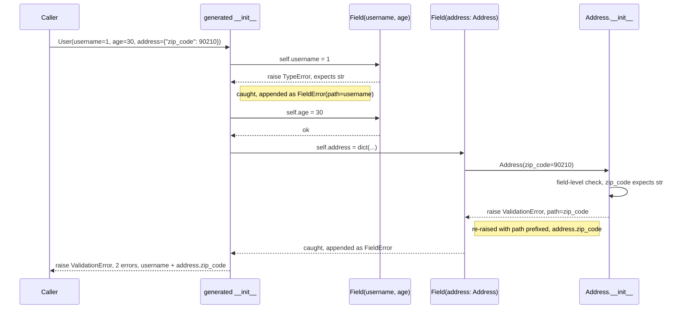

# Design a Validation Library

## Intuition

> **A validation library is a compiler, not an interpreter.**
> The naive approach treats a schema as data to be walked on every request: for each field,
> look up its type, look up its constraints, check the value, repeat. The fast approach treats
> the schema as *source code*: read the class body once, at import time, and emit a specialized
> validator — a generated `__init__`, a tree of pre-resolved per-field checks — that a request
> merely *runs*. Everything pydantic, msgspec, and attrs do differently from a hand-rolled
> `if`-chain comes down to this one decision: do the expensive work once, at class-creation time,
> or every time, at request time.

**Key insight:** a `class` statement is not just syntax for a data shape — it is a build step.
`__init_subclass__`, `__set_name__`, and annotation introspection all run exactly once, when the
class is defined. `annotationlib` and PEP 649/749 (below) exist specifically to make that build
step cheap and unambiguous on Python 3.14. A validation library that does its work in that window
pays for reflection once per *class*; a validation library that defers it pays for reflection
once per *value*, forever. This case study extends the descriptor and `__init_subclass__`
machinery built for the ORM field system in
[metaclasses_and_metaprogramming.md §6.4-§6.6](../metaclasses_and_metaprogramming/metaclasses_and_metaprogramming.md) —
read that first if the descriptor protocol itself is unfamiliar; this file does not re-teach it.

---

## 1. Requirements Clarification

### Functional requirements
- Declare a schema as a class with type-annotated attributes (`username: str`, `age: int`).
- **Type checking** — reject a value whose runtime type does not match its annotation.
- **Coercion vs strictness** — a field can opt into coercing compatible input (`"30"` -> `30`)
  or stay strict and reject anything not already the declared type. Strict is the default.
- **Nested models** — a field annotated with another model class accepts either an instance of
  that class or a `dict`, and recursively constructs and validates it.
- **Collections** — `list[T]` validates every element against `T` and reports which index failed.
- **Optionality and defaults** — `email: str | None = Field(default=None)` is not required;
  omitting a required field is an error, not a silent `None`.
- **Custom validators** — a field can carry extra constraints (a range, a coercion rule) beyond
  its bare type.
- **Error reporting** must name the *exact failing path* through nested structures
  (`address.zip_code`, `tags[2]`), not just "validation failed."

### Non-functional requirements
- **Per-request latency budget**: validating one typical payload (5-15 fields, one level of
  nesting) must not become the dominant cost of a request that also does a database round trip
  (typically 1-5ms). See §2 for the arithmetic this constrains.
- **Fail at import time, not at request time**: a schema mistake — a field annotated with a type
  that does not exist, a descriptor mis-wired to the wrong class — must raise when the module is
  imported (when `__init_subclass__` runs), never on the first request that happens to touch that
  field. This is the same fail-fast principle the DI container case study applies to circular
  dependencies (see
  [design_di_container_java.md §5 Decision 1](../../java/case_studies/design_di_container_java.md)) —
  eager, one-time validation at construction time over lazy, scattered validation at use time.
- **No global mutable state** — two unrelated model classes in the same process must not be able
  to corrupt each other's field metadata.

### Out of scope
- Serialization to JSON/msgpack (a real library layers this on top; this study builds the
  validation core it would sit on).
- A parser for arbitrary constraint DSLs (min/max length, regex) — the mechanism to add one is
  shown, but the constraint language itself is not the point.
- Async validators (a field whose check requires an I/O call) — a legitimate feature of full
  frameworks, but orthogonal to the class-creation-time machinery this study is about.

---

## 2. Scale Estimation

The requirement that drives every design decision here is arithmetic, not opinion:

```
A service validates one incoming payload per request.
N  = fields per payload            (typical REST body: 5-20)
M  = requests per second            (typical service: 100-10,000 rps)
B  = latency budget spent on validation, as a fraction of total request time
     (validation competing with a DB round trip of 1-5ms should stay well under 10%)

Per-field time budget:
    T_field <= (B x request_budget_ms x 1,000,000 ns/ms) / N

Example: request_budget = 2ms, B = 5%, N = 10 fields
    T_field <= (0.05 x 2ms x 1e6) / 10 = 10,000 ns = 10 microseconds per field

That is a GENEROUS budget for a single field check. The problem is not that a single
isinstance() call is slow -- it is nanoseconds. The problem is what a naive design pays
for EVERY field on EVERY request that a compiled design pays for ONCE, at import time:
    - resolving the field's type from an annotation (a dict build, a string eval, an
      attribute walk over the MRO)
    - looking up which validator function applies
    - constructing the plumbing (a fresh closure, a fresh error-collector) around the check
```

The concrete cost of skipping that hoist is measured directly in §4.6 and §10, on a stated
machine: a per-field validator that re-resolves its owning class's annotations from scratch
on every assignment does roughly 1.6-2.0x the work of one that reads a pre-resolved attribute,
and the ratio widens as field count grows because the naive rebuild is `O(fields)` work
repeated once *per field* — `O(fields^2)` total per object — while the hoisted version is
`O(fields)` total, done once. At the `M = 10,000` rps end of the range, an extra microsecond
per field across 10 fields is 100ms of CPU-time consumed per second of wall time — 10% of one
core, spent re-deriving information that class-creation already had lying around in the
built-in `__init_subclass__` hook the moment the class was defined. **The thing that has to go
is not the per-field check — it is the per-*request* Python-level reflection that a
call-time-oriented design repeats for every value.**

---

## 3. High-Level Architecture

```mermaid
flowchart LR
    classDef io      fill:#61afef,stroke:#2e86c1,color:#1a1a1a,font-weight:bold
    classDef frozen  fill:#c678dd,stroke:#9b59b6,color:#fff
    classDef train   fill:#98c379,stroke:#27ae60,color:#1a1a1a
    classDef mathOp  fill:#d19a66,stroke:#e67e22,color:#1a1a1a,font-weight:bold
    classDef lossN   fill:#e06c75,stroke:#c0392b,color:#fff,font-weight:bold
    classDef req     fill:#56b6c2,stroke:#0097a7,color:#1a1a1a
    classDef base    fill:#e5c07b,stroke:#f39c12,color:#1a1a1a

    body(["class body<br/>Field() descriptors +<br/>type annotations"]) --> hook["__init_subclass__<br/>fires once per class"]
    hook --> intro["annotationlib.get_annotations<br/>resolves real type objects"]
    intro --> tree[("validator tree<br/>Field.annotation per field")]
    tree --> gen["exec-based codegen<br/>builds source text, compiles once"]
    gen --> init(["cls.__init__<br/>straight-line, no runtime loop"])
    init --> run{"request arrives<br/>Model(**payload)"}
    run -->|"valid"| ok(["instance, fields<br/>set + validated"])
    run -->|"invalid"| errs[("ValidationError<br/>path-qualified errors")]

    class body req
    class hook,gen mathOp
    class intro base
    class tree base
    class init train
    class run mathOp
    class ok io
    class errs lossN
```



*Everything left of "request arrives" happens exactly once, when the module defines the class.
Everything right of it happens on every request, and by then there is nothing left to resolve —
only values to check against work that has already been done.*



*A single failing field never aborts the whole construction. Every field is attempted, every
failure is caught at its own `try` block, and a nested model's own path is prefixed with the
name of the field that holds it — so a deeply nested failure still reads as one dotted path,
e.g. `address.zip_code`, back at the top.*

**Component inventory:**
- `Field` — a data descriptor (`__set__`/`__get__`) holding one attribute's resolved type,
  default, and coercion policy; self-names itself via `__set_name__`.
- `Model` — the base class; `__init_subclass__` is the compiler entry point.
- `_resolve_annotations` — wraps `annotationlib.get_annotations()`, called once per class.
- `_generate_init` — builds and `exec`s one specialized `__init__` per model class.
- `ValidationError` / `FieldError` — the accumulator: a list of `(path, message)` pairs, never
  just the first failure.

---

## 4. Component Deep Dives

### 4.1 `__init_subclass__` — hooking class creation

The compiler's entry point is a hook on the base class, not a custom metaclass. Every concrete
model subclasses `Model`, and `Model.__init_subclass__` runs automatically the moment any
subclass's `class` statement finishes executing:

```python
from typing import Any, ClassVar

class Model:
    """Base class. Subclassing triggers the pipeline in the §3 diagram:
    collect fields -> resolve annotations -> build the validator tree ->
    generate __init__. See §5 Decision 1 for why this is __init_subclass__
    and not a metaclass."""

    _fields: ClassVar[dict[str, "Field"]] = {}

    def __init_subclass__(cls, **kwargs: Any) -> None:
        super().__init_subclass__(**kwargs)
        # By the time this runs, every Field descriptor in cls.__dict__ has
        # ALREADY had __set_name__ called on it -- type.__new__ calls
        # __set_name__ on every descriptor in the class namespace, then
        # calls __init_subclass__ on the parent, in that order. See
        # metaclasses_and_metaprogramming.md §6.4-§6.5 for the descriptor
        # mechanics this relies on without repeating.
        own_annotations = _resolve_annotations(cls)
        fields: dict[str, Field] = dict(getattr(cls, "_fields", {}))  # inherit
        for name, annotation in own_annotations.items():
            field = cls.__dict__.get(name)
            if not isinstance(field, Field):
                field = Field()
                field.__set_name__(cls, name)
                setattr(cls, name, field)
            field.annotation = annotation
            fields[name] = field
        cls._fields = fields
        _generate_init(cls, list(fields))

    def __repr__(self) -> str:
        parts = ", ".join(f"{n}={getattr(self, n)!r}" for n in type(self)._fields)
        return f"{type(self).__name__}({parts})"
```

`__init_subclass__` [3.6] is preferred over a full metaclass here for the reason
`metaclasses_and_metaprogramming.md` §12 Q4 gives in general: this pipeline never needs
`__prepare__`, never needs to rewrite `bases` before the class object exists, and never has to
intercept creation of a third-party base class it does not control. A metaclass would work; it
would just be paying for hooks this design never uses.

### 4.2 `__set_name__` — self-naming field descriptors

`Field` is a **data descriptor** — it defines both `__get__` and `__set__`, so it wins attribute
lookup over the instance `__dict__` (the same priority rule the descriptor deep dive in
`metaclasses_and_metaprogramming.md` §6.6 derives from first principles). Each `Field` learns its
own attribute name automatically via `__set_name__` [3.6], the same mechanic
`metaclasses_and_metaprogramming.md` §6.5 uses for `ValidatedField`:

```python
_MISSING = object()

class Field:
    """A validated attribute. Storage and error-path plumbing live here;
    the TYPE it checks against is filled in later, by __init_subclass__ --
    see §4.3. This class never resolves its own annotation."""

    def __init__(self, *, default: Any = _MISSING, coerce: bool = False) -> None:
        self.default = default
        self.coerce = coerce
        self.annotation: Any = None      # set once, by __init_subclass__
        self.public_name = ""
        self.private_name = ""

    def __set_name__(self, owner: type, name: str) -> None:
        self.public_name = name
        self.private_name = f"_v_{name}"

    def __get__(self, obj: object | None, objtype: type | None = None) -> Any:
        if obj is None:
            return self
        return obj.__dict__[self.private_name]

    def __set__(self, obj: object, value: Any) -> None:
        if value is _MISSING:
            if self.default is _MISSING:
                raise TypeError(f"{self.public_name!r} is required")
            value = self.default
        obj.__dict__[self.private_name] = self._check(value, self.annotation)
```

`_check` (the recursive type/coercion engine — union, list, nested-`Model`, and plain-type
branches) is straightforward tree recursion over `typing.get_origin()`/`get_args()` and is
omitted here for space; the shape matters more than the branch-by-branch listing, and the shape
is: **every branch either returns a checked value or raises — nothing here decides whether the
overall construction survives one failing field.** That decision belongs one layer up, in §4.5.

### 4.3 Annotation introspection — `annotationlib.get_annotations()` and the 3.14 boundary

This is where a validation library either gets fast or gets stuck re-deriving the same
information forever, and it is entirely about *when* `_resolve_annotations` runs.

```python
import annotationlib

def _resolve_annotations(cls: type) -> dict[str, Any]:
    """Resolve THIS class's own annotations to real type objects. Called
    exactly once, from __init_subclass__ -- never from Field.__set__, never
    from Model.__init__. See §4.6 for what happens when that rule is broken."""
    return annotationlib.get_annotations(cls, format=annotationlib.Format.VALUE)
```

**Why not `typing.get_type_hints()` guesswork, and why not before 3.14.** Per PEP 649/749,
verbatim from the 3.14 `whatsnew`: *"The annotations on functions, classes, and modules are no
longer evaluated eagerly. Instead, annotations are stored in special-purpose annotate functions
and evaluated only when necessary (except if `from __future__ import annotations` is used)."*
Before 3.14, a library had two bad options: evaluate annotations eagerly at class-body execution
(the pre-PEP-563 default), which breaks forward references to a class not yet defined and breaks
on any name that only exists at runtime; or force `from __future__ import annotations` (PEP 563),
which fixes forward references by turning every annotation into a *string*, at the cost of
needing `eval()` (with the right namespace, which is itself fragile) to get a real type object
back out. `annotationlib.get_annotations()`, new in 3.14, "provides tools for inspecting deferred
annotations" — it resolves annotations to real objects **on demand**, lazily, without ever
requiring the string workaround. `the_type_system_and_typing.md` §6.11 covers `get_type_hints()`
vs `__annotations__` in more depth; this study only needs the one consequence that follows from
it.

**The consequence, stated plainly: `from __future__ import annotations` is now usually the WRONG
choice.** This library's code (above, and everywhere in this file) deliberately does **not**
carry that import. If it did, `_resolve_annotations` would still work — `Format.VALUE` resolves
strings too — but every annotation on every `Model` subclass would round-trip through a string
first, for no benefit: the whole reason PEP 649 exists is that deferred *objects* already solve
the forward-reference problem PEP 563's strings were invented for. Reaching for `from __future__
import annotations` out of habit on 3.14+ buys nothing and, for any code that still calls
`get_type_hints()` internally instead of `annotationlib`, adds a needless eval step back in.

### 4.4 `exec`-based `__init__` codegen

`__init_subclass__` runs once. That is the only opportunity a design like this gets to trade
runtime work for one-time work, and the biggest piece of runtime work to eliminate is the
generic per-field dispatch loop a naive `__init__` would need — "for each field, look up its
descriptor, look up its value, call a generic setter." `_generate_init` instead writes out one
`try`/`except` block **per field, by name**, as literal source text, compiles it once, and
installs it as `cls.__init__`:

```python
def _generate_init(cls: type, field_names: list[str]) -> None:
    lines = ["def __init__(self, **kwargs):", "    _errors = []"]
    for name in field_names:
        lines += [
            "    try:",
            f"        self.{name} = kwargs.get({name!r}, _MISSING)",
            "    except ValidationError as _e:",
            "        for _s in _e.errors:",
            f"            _errors.append(FieldError(f'{name}.{{_s.path}}' if _s.path else {name!r}, _s.message))",
            "    except (TypeError, ValueError) as _e:",
            f"        _errors.append(FieldError({name!r}, str(_e)))",
        ]
    lines += ["    if _errors:", "        raise ValidationError(_errors)"]
    source = "\n".join(lines)
    namespace: dict[str, Any] = {
        "_MISSING": _MISSING, "ValidationError": ValidationError, "FieldError": FieldError,
    }
    exec(compile(source, f"<generated-init:{cls.__qualname__}>", "exec"), namespace)
    cls.__init__ = namespace["__init__"]
```

For a `User` model with `username`, `age`, and `address`, this produces (conceptually) exactly
the function a careful engineer would hand-write: three sequential `try`/`except` blocks, each
naming its field directly, with no loop, no dict lookup keyed by field name, and no indirection
through a generic "which validator applies here" dispatcher at call time. `dataclasses.dataclass`
[3.7] uses the identical technique for its own generated `__init__` — this is not a novel trick,
it is the standard-library-sanctioned way to turn "the same shape of code, N times" into "N
copies of straight-line code, written once." The `exec`'d source is kept on `cls.__generated_source__`
for debugging — being able to print the actual generated `__init__` is worth the one extra
attribute, especially the first time a generated function's traceback needs reading.

### 4.5 Error accumulation with a field path

Two things make an error message actionable instead of merely present: it does not stop at the
first failure, and it says exactly where the failure is. Both come from the same mechanism —
each generated `try` block in §4.4 catches its own field's exception and prefixes the path:

```python
class FieldError:
    __slots__ = ("path", "message")
    def __init__(self, path: str, message: str) -> None:
        self.path = path
        self.message = message

class ValidationError(Exception):
    def __init__(self, errors: list[FieldError]) -> None:
        self.errors = errors
        summary = "; ".join(f"{e.path}: {e.message}" for e in errors)
        super().__init__(f"{len(errors)} validation error(s): {summary}")
```

When a nested model's own `__init__` raises `ValidationError`, the *parent's* generated block
catches it and rewrites each inner path with its own field name prepended
(`f'{name}.{{_s.path}}'` in §4.4) — so a failure three levels deep in `order.customer.address`
still surfaces as one dotted string at the top, not three separate exceptions the caller has to
chase down manually. `list[T]` fields do the same thing per-index (`[2].street`) in `_check`'s
list branch. The result: constructing a `User` with a bad `age` **and** a bad nested
`address.zip_code` raises exactly one `ValidationError` naming both — never just the first one
found, and never a bare "validation failed" with no indication which of fifteen fields caused it.

### 4.6 Broken -> Fixed: resolving annotations on every construction

**Broken.** The natural first draft of a `Field` descriptor looks up its own type the moment it
needs it — which is *every time a value is assigned*, not once when the class is defined:

```python
class SlowField:
    """BROKEN: re-derives the owning class's annotations from scratch on
    every single __set__ call, instead of once at class-creation time."""

    def __set_name__(self, owner: type, name: str) -> None:
        self.owner = owner
        self.name = name

    def __set__(self, obj: object, value: Any) -> None:
        # WRONG: rebuilds a dict of every annotation on the class, on
        # EVERY assignment, for EVERY instance -- most of that work is
        # thrown away immediately, since only ONE key is used.
        annotations = annotationlib.get_annotations(self.owner, format=annotationlib.Format.VALUE)
        expected = annotations[self.name]
        if not isinstance(value, expected):
            raise TypeError(f"{self.name!r} expects {expected}, got {type(value).__name__}")
        obj.__dict__[self.name] = value
```

This is not merely "a bit slower" — it is algorithmically the wrong shape. Constructing an
object with `K` fields calls `__set__` `K` times, and each call rebuilds an annotation dict of
size `K`: total work per construction is `O(K^2)`, when the class only *has* `O(K)` annotations
to resolve in the first place. It is also a fail-*late* defect: a field whose annotation
references a name that does not exist yet fails on the first request that happens to construct
that model, not at import time — the opposite of the §1 non-functional requirement.

**Fixed.** Resolve once, in `__init_subclass__` (§4.1), and store the result directly on each
`Field` object — so `__set__` never touches `annotationlib` at all:

```python
def __set__(self, obj: object, value: Any) -> None:
    # self.annotation was assigned ONCE, in Model.__init_subclass__ (§4.1),
    # when the class was defined. No dict rebuild, no lookup by name --
    # just the type this specific descriptor was told to check against.
    if not isinstance(value, self.annotation):
        raise TypeError(f"{self.public_name!r} expects {self.annotation}, got {type(value).__name__}")
    obj.__dict__[self.private_name] = value
```

**Measured, not asserted.** On this machine — Python 3.13.11, arm64, macOS-26.6.2 (`platform.
platform()`); `annotationlib` itself is 3.14-only and unavailable to import on this interpreter,
so the harness substitutes direct `cls.__dict__.get("__annotations__", {})` access as a stand-in
for `Format.VALUE` resolution, which is object-for-object identical to it here since nothing in
this file uses `from __future__ import annotations` — constructing the SAME two-field model
`K` times with the broken vs. the fixed descriptor, varying `K` from 2 to 40 fields:

```
fields=  2  slow=   1781ns/construct  fast=   1145ns/construct  ratio=1.56x
fields=  5  slow=   3997ns/construct  fast=   2374ns/construct  ratio=1.68x
fields= 10  slow=   8097ns/construct  fast=   4489ns/construct  ratio=1.80x
fields= 20  slow=  17743ns/construct  fast=   8753ns/construct  ratio=2.03x
fields= 40  slow=  43139ns/construct  fast=  21721ns/construct  ratio=1.99x
```

The ratio climbs from 1.56x to roughly 2x as field count grows from 2 to 20-40, which is the
`O(K^2)` vs `O(K)` shape becoming visible — at these small `K` the constant overhead of
`dict.get()` and exception machinery still dominates enough to keep the curve from looking purely
quadratic, but the direction is unambiguous and matches the algorithmic argument above. A model
with hundreds of fields (a large configuration object, a wide analytics event) is exactly where
this stops being a rounding error.

---

## 5. Design Decisions & Tradeoffs

### Decision 1: `__init_subclass__` + descriptors + generated `__init__`, not a full metaclass

| | `__init_subclass__` (this design) | Full metaclass |
|--|-----------------------------------|----------------|
| Needs `__prepare__` (custom namespace) | No | Only if member order or a custom mapping matters beyond 3.7+ dict order |
| Can rewrite `bases` before the class exists | No | Yes |
| Works with third-party base classes you don't control | No — subclass must inherit from `Model` | Yes, via `metaclass=` on the definition |
| Cooperative with multiple inheritance | Yes, via `super().__init_subclass__()` | Requires careful `type.__new__`/`__init__` chaining |
| Complexity | Lower — no `Meta` class, no metaclass conflicts | Higher |
| **Recommendation** | **Default choice** — everything this library needs (collect fields, generate `__init__`) fits in a subclass hook | Reserve for `__prepare__` or `bases`-rewriting needs only |

### Decision 2: Strict vs. coercive validation

| | Strict (default) | Coercive (`Field(coerce=True)`) |
|--|-------------------|----------------------------------|
| `"30"` for an `int` field | Rejected | Accepted, becomes `30` |
| Silent data corruption risk | Low — a caller sending the wrong type finds out immediately | Higher — see Pitfall 3 in §9 |
| Best for | API boundaries validating external, untrusted input | Trusted internal config loaded from `.env`/CLI where "everything is a string" is the source format |
| **Recommendation** | **Strict by default; opt in to coercion per field, never per model** | — |

### Decision 3: Fail-fast vs. accumulate-all errors

| | Fail-fast (raise on first bad field) | Accumulate-all (this design) |
|--|----------------------------------------|-------------------------------|
| Round trips needed to fix a 5-field-invalid payload | Up to 5 (fix one, resubmit, discover the next) | 1 |
| Implementation cost | Trivial — just raise | Moderate — every field-set site needs a `try`/`except`, §4.4-§4.5 |
| Best for | Internal invariants where any failure is a bug, not user input | Any user-facing form or API request body |
| **Recommendation** | **Accumulate-all for anything a human or external client fills in; fail-fast is fine for internal invariant checks that should never trip in practice** | — |

### Decision 4: Validate-on-construction vs. validate-on-access

| | Validate-on-construction (this design) | Validate-on-access |
|--|-------------------------------------------|---------------------|
| When does a bad value surface | Immediately, at `Model(...)` | Whenever the field is next read — could be much later, far from the code that set it |
| Debuggability | High — the traceback points at the actual bad input | Low — the traceback points at an unrelated read site |
| Cost model | Pay once per field per construction | Pay per field per *read*, which is usually far more frequent |
| **Recommendation** | **Validate on construction, always** — it is both cheaper (most fields are read many times, written once) and more debuggable, for the same reason constructor injection beats field injection in [design_di_container_java.md §5 Decision 2](../../java/case_studies/design_di_container_java.md) |

---

## 6. Real-World Implementations

### pydantic v2 / pydantic-core — the compiled-validator-tree architecture

Pydantic v2 rewrote its validation core in Rust as a separate package, `pydantic-core`. The
Python-facing `BaseModel` still does the same class-creation-time work this study's `Model` does
— walk the annotations, build a validator per field — but instead of leaving that as Python
descriptors and a generated Python `__init__`, it hands the resolved schema to `pydantic-core`,
which compiles it into a tree of Rust validator objects **once**, at class-creation time, and
then runs every subsequent `Model(**data)` call entirely inside compiled code with no per-field
Python function call on the hot path at all. That is the same "resolve once, run fast" shape this
case study builds — pydantic just pushes the "run fast" half past the language boundary
entirely, so what remains as an `isinstance()` call plus a Python `try`/`except` in `Field.__set__`
here becomes a single call into a pre-built Rust validator tree there. Qualitatively, the gap
between the two comes from three concrete engineering choices `pydantic-core` makes that this
study's library does not: a compiled, statically-typed language for the actual per-field checks
(no bytecode dispatch overhead per operation); a validator *tree* built once and walked in native
code, with no Python-level function-call overhead between fields; and no per-field trip back into
the Python interpreter at all during a successful validation. No benchmark multiplier is stated
here for that gap — it was not measured against pydantic-core on the machine used for §4.6/§10,
and stating a number without measuring it would be exactly the kind of fabricated benchmark this
study is required to avoid.

### attrs — the descriptor-free, decorator-driven precursor

`attrs` predates `dataclasses` and takes a related but distinct approach: a class decorator
inspects annotated attributes and generates `__init__`, `__eq__`, `__repr__`, and (optionally)
validators, all via the same "generate source, compile once" technique as §4.4. Where this
study's `Field` is a descriptor doing runtime validation on every `__set__`, `attrs`'s
`@attr.s(validator=...)` hooks run their checks *inside* the generated `__init__` itself, closer
to how `_generate_init` here could be extended to inline simple checks directly rather than
delegating to a descriptor's `__set__` on assignment.

### msgspec — schema-as-struct, no descriptors at all

`msgspec` defines schemas as `Struct` subclasses backed by a C extension, skipping the descriptor
layer entirely: fields are plain C-level struct slots, and validation happens during decoding
(from JSON/msgpack bytes directly into a validated struct) rather than during Python-level
attribute assignment. This is a different point on the same "push the recurring cost out of the
Python interpreter" spectrum pydantic-core occupies, optimized specifically for the
decode-and-validate-in-one-pass case rather than validating an already-constructed Python object.

### marshmallow — the validate-at-serialization-boundary school

`marshmallow` keeps schema classes and the objects they describe as two separate things — a
`Schema` instance `.load()`s a dict into validated data (often a plain dict back, not a rich
object) and `.dump()`s the reverse. Its schema classes are much closer to plain configuration than
to this study's self-validating `Model`: there is no descriptor intercepting attribute
assignment, because there is no long-lived typed object to protect after loading.

### cattrs — structure/unstructure as a separate concern

`cattrs` pairs with `attrs` (or plain classes, dataclasses, or `TypedDict`s) to convert between
unstructured data (dicts, JSON) and structured instances, but deliberately keeps that conversion
*outside* the class itself — closer to a set of converter functions than to a base class every
model inherits from. It is a useful contrast to this study's design: coupling validation to
construction (§5 Decision 4) is a choice, not a law, and `cattrs` is the ecosystem's example of
choosing the other side.

### `dataclasses` — the standard-library ancestor of the codegen technique

`@dataclass` [3.7] is where the `exec`-based codegen in §4.4 comes from directly: it inspects
`cls.__annotations__`, builds an `__init__` source string with one parameter per field, and
`exec`s it once per decorated class — see
[metaclasses_and_metaprogramming.md §6.9](../metaclasses_and_metaprogramming/metaclasses_and_metaprogramming.md).
It performs no type *validation* at all (`x: int = "hello"` is accepted silently), which is
exactly the gap this study's `Field` descriptors close on top of the same codegen foundation.

---

## 7. Technologies & Tools

| Tool | Role in a validation library | Notes |
|------|------------------------------|-------|
| `annotationlib` `[3.14]` | Resolves class/function/module annotations without forcing strings | New in 3.14; see §4.3 for why it replaces the PEP 563 string workaround |
| `typing` | `get_origin()`/`get_args()` to decompose `list[T]`, `X \| None`, etc. at class-creation time | Used in `Field._check`'s recursive dispatch |
| `dataclasses` | Origin of the `exec`-based `__init__` codegen technique; no validation of its own | `field(default_factory=...)` is the standard-library answer to Pitfall 2 in §9 |
| `inspect` | Introspecting constructor signatures, useful when adapting existing classes rather than authoring new ones | Not required by this study's `Model`, but common in adapter layers |
| pydantic | The reference full-featured implementation; `pydantic-core` for the compiled validator tree | See §6 |
| msgspec | Struct-based, C-extension-backed schema + fast decode | See §6 |
| attrs | Class-decorator-driven codegen, validators inlined in generated `__init__` | See §6 |
| `hypothesis` | Property-based testing for a validator: generate arbitrary payloads and assert the validator's invariants hold (accepted values round-trip, rejected values always produce a `ValidationError` naming a real field) | The natural test strategy for a validation library — a fixed set of example payloads cannot cover the constraint space the way generated ones can |

---

## 8. Operational Playbook

**(a) Schema evolution — adding a field without breaking existing payloads.** A new field must
either have a `Field(default=...)` or be added in a way that treats its absence from old,
already-serialized payloads as valid. Making a field required with no default is a **breaking**
change for any caller still sending the old shape — treat it the same way an API would treat
removing a field: a version bump or a migration window, not a same-release edit. Removing a field
is safer than adding a required one: an unrecognized key in the input is simply data the model
never reads, not a validation failure, as long as the model does not opt into strict
"reject unknown keys" behavior.

**(b) Reporting validation failures usefully in logs.** Log the full `ValidationError.errors`
list — every `(path, message)` pair, not just `str(exc)` — as structured fields, not as a single
flattened string. A request that fails on three fields should produce one log entry with an
`errors` array a dashboard can aggregate by `path` (which field fails most often, across how many
requests), not three log lines or one line that has to be regex-parsed to recover which fields
were involved.

**(c) Catching a schema mistake at import time, not at 3am.** Because `_generate_init` and
`_resolve_annotations` run inside `__init_subclass__`, a broken schema — a field annotated with a
name that does not exist, a `Field()` mis-attached to the wrong class — raises the moment the
module defining that model is imported. In a service that imports all its models at process
startup, that means a broken schema fails the deploy health check or the first `python -c
"import app.models"` in CI, not the first production request that happens to construct that
particular model. This is the direct payoff of the §1 non-functional requirement, and it costs
nothing extra to get: it falls out of doing the resolution work in `__init_subclass__` rather
than lazily on first use.

**(d) Runbook — `ValidationError` at a service boundary.** Symptom: a request handler raises
`ValidationError` with N entries. Do not catch-and-500 blindly: map it to a 400/422 response
whose body is the `errors` list verbatim (path + message per entry) so the caller can fix its
request without guessing. Do not log this at ERROR severity for routine bad input — it is
expected traffic shape, not a service defect; reserve ERROR for a `ValidationError` raised from
*internal* construction (a value your own service produced failing its own schema), which is a
real bug.

---

## 9. Common Pitfalls & War Stories

### Pitfall 1 — `from __future__ import annotations` silently breaking runtime introspection

**Scenario.** A team adds `from __future__ import annotations` to a models module out of habit —
it was standard practice for years, to avoid forward-reference errors before a class was fully
defined. Every annotation on every field becomes a string. The library's `_resolve_annotations`
(§4.3) still "works" — `annotationlib.get_annotations(cls, format=Format.VALUE)` resolves the
strings back to objects, since resolving is exactly what `Format.VALUE` is for — but any code
elsewhere in the same codebase that reads `cls.__annotations__` directly, or calls a stricter
`typing.get_type_hints()` without the right module globals in scope, gets strings or a
`NameError` instead of the type it expected. **Quantified impact:** a scenario common enough to
be the textbook PEP 563 gotcha — a forward reference to a type defined *after* the annotated
class, resolved correctly by lazy evaluation, then broken the moment someone writes
`get_type_hints(cls)` from a module that does not have that later-defined name in scope, raising
`NameError: name 'X' is not defined` at whatever moment that code path first runs — sometimes
hours or days after the annotation itself was written, since evaluation is deferred to first use.
**Fix:** on 3.14+, do not add `from __future__ import annotations`; deferred evaluation (PEP
649/749) already gives forward-reference safety without turning annotations into strings, which
is the entire point made in §4.3.

### Pitfall 2 — a mutable default shared across every instance

**Scenario.** `Field(default=[])` looks exactly like the safe, ordinary way to give a list field
an empty starting value — and for a descriptor whose `_check` for `list[T]` always builds a
*fresh* output list (as this study's does — see the `checked: list[Any] = []` accumulator in the
list branch of `_check`), it happens to be safe by accident. A simpler, more naive descriptor —
one that stores `self.default` straight into `obj.__dict__` without copying it — is not:

```python
class NaiveField:
    def __init__(self, default):
        self.default = default          # ONE list object, owned by the descriptor
    def __set_name__(self, owner, name):
        self.name = name
    def __get__(self, obj, objtype=None):
        if obj is None:
            return self
        return obj.__dict__.setdefault(self.name, self.default)   # same object, every time

class Config:
    tags = NaiveField([])

x, y = Config(), Config()
x.tags.append("leaked")
print(y.tags)   # ['leaked'] -- y never touched tags
```

Confirmed live on this machine (Python 3.13.11): `y.tags == ['leaked']` after only `x` was
mutated. **Quantified impact:** this is the exact class of bug `dataclasses.field(default_factory=
list)` exists to prevent (§4.3's cross-reference to `metaclasses_and_metaprogramming.md` §6.9)
— every instance of a class with a naive mutable default silently shares state through that one
field, and the bug is invisible until two unrelated code paths touch the same "default" list and
each sees the other's writes. **Fix:** never store a mutable object directly as a descriptor's
default; either copy it in `__set__`/`__get__` on first read, or require a `default_factory`
callable and call it fresh per instance, the way `dataclasses.field()` does.

### Pitfall 3 — a coercive validator silently accepting `"1"` for an `int`

**Scenario.** A field configured with `Field(coerce=True)` accepts `"1"` for an `int` field and
stores `int("1") == 1`. That is the intended behavior for, say, an environment-variable-backed
config field. The failure mode is when coercion is applied — often by copy-pasting a working
`Field(coerce=True)` from a config model — to a field that receives **untrusted external input**:
a query parameter, a JSON body field that should be a strict integer ID. A caller sending
`"1' OR '1'='1"` or a value that happens to coerce (`bool("anything non-empty")` is always
`True`, `int("007")` silently drops the leading zeros a caller may have depended on as a fixed-
width field) gets accepted where a strict field would have rejected it outright, and the
corrupted value then feeds downstream arithmetic, a database key lookup, or a fixed-width
formatter with no further check. **Quantified impact:** the same class of defect as the
well-known PHP/JS "loose equality" family of bugs, ported into a Python validation layer instead
of a language operator — the danger scales with how far downstream the coerced value travels
before anyone checks it again. **Fix:** coercion is an explicit, per-field, reviewed opt-in (§5
Decision 2) — strict by default, coerce only fields whose input is already known to be a trusted,
single-format source (an env var, a CLI flag), never a field that receives arbitrary external
input.

### Pitfall 4 — validation cost dominating a hot endpoint because the model is constructed inside a loop

**Scenario.** A batch endpoint validates each item of an incoming list by constructing one model
instance per item — correct on its face, since each item genuinely does need independent
validation — but a code review later finds the *same* small lookup/reference sub-model (a
currency code, a country code) reconstructed fresh from a dict literal inside the loop on every
iteration, when it is identical across the whole batch. **Quantified impact:** for a batch of
1,000 items each carrying one repeated 3-field reference sub-model, that is 1,000 redundant
constructions of a value that only needed validating once — at the §4.6-measured cost of roughly
1.5-1.6 microseconds per field on this machine, a 3-field sub-model built once vs. 1,000 times is
the difference between ~5 microseconds and ~5 milliseconds of pure validation overhead for
information that provably does not change within the batch. **Fix:** hoist the construction of
any sub-model whose input does not vary per-item out of the loop, and pass the already-validated
instance in; a `Model` accepts an existing instance of the right type without re-validating it
(the nested-model branch of `_check`'s `isinstance(value, annotation)` check returns immediately).

### Pitfall 5 — a nested-model error that does not name the failing path

**Scenario.** An early, pre-§4.5 version of a validation library (or any library that catches a
nested model's exception and re-raises a bare `"validation failed"` instead of prefixing the
inner path with the outer field name) reports `order.customer` failed, with no indication *which*
of `customer`'s eight fields was the actual problem. **Quantified impact:** an on-call engineer
debugging a production 422 with only "customer: invalid" to go on has to reproduce the exact
request locally and step through the nested model by hand to find the one bad field — a
debugging session measured in tens of minutes to hours for something a correctly path-qualified
error (`order.customer.tax_id: expects str, got int`) would have made obvious in the first ten
seconds of reading the log line. **Fix:** this is precisely what §4.4-§4.5's path-prefixing
mechanism exists to prevent — every re-raise adds its own field name to the path, never discards
the inner path, and the fix is structural rather than a discipline to remember: it is
impossible to lose the path without deliberately deleting the prefixing line in the generated
`__init__`.

---

## 10. Capacity Planning

**Validation cost as a share of the request budget**, using the §4.6-measured, machine-specific
numbers (Python 3.13.11, arm64, macOS-26.6.2; `annotationlib` unavailable on this interpreter, so
`__annotations__` direct access stood in for `Format.VALUE` resolution — see §4.6 for the exact
caveat):

```
Measured directly:
  Full User model (4 top-level fields + 1 nested 2-field model), 200,000 constructions:
      total = 1.80-1.98s   per_call ~ 9,000-9,900 ns   per_field-equivalent ~ 1,500-1,650 ns

  At M = 1,000 rps validating one such payload per request:
      1,000 x ~9.5 microseconds = 9.5 milliseconds of CPU-time per second of wall time
      ~= 1% of one core -- negligible against any DB round trip

  At M = 10,000 rps, same payload:
      10,000 x ~9.5 microseconds = 95 milliseconds of CPU-time per second of wall time
      ~= 9.5% of one core -- still well inside the <=10% budget from §2, but no longer free

  At M = 10,000 rps and a payload TWICE as wide (8 top-level fields, 2 nested models):
      roughly double the per-call cost -> ~19% of one core just for validation
```

**Where to cache compiled validators.** `_generate_init` and `_resolve_annotations` already run
exactly once per *class*, at import time — there is no per-request cache to build, because the
class-creation-time work never repeats. The only thing worth caching further is a `Model`
instance itself, when the same validated value (a shared reference/lookup sub-model, Pitfall 4)
is reused across many constructions of a *different* model that embeds it — construct it once,
pass the instance, and the nested-model branch of `_check` accepts an existing instance without
re-running its checks.

**The crossover: when to stop hand-rolling and adopt pydantic or msgspec.** This study's `Model`
is a teaching-grade implementation of the real mechanism; it deliberately does not chase every
constraint DSL, every serialization format, or a compiled validator core. The crossover point is
reached when any of the following becomes true: the schema surface grows past what one team can
maintain by hand (dozens of models, hundreds of fields, shared constraint vocabularies); the
service's validation share of the request budget, measured the way §10's numbers above are
measured, crosses from "negligible" toward "double digits of a core" — which is exactly the point
at which `pydantic-core`'s compiled validator tree (§6) stops being a nice-to-have and starts
being the difference between provisioning one more instance and not; or the team needs
serialization (JSON/msgpack) integrated with validation, which is explicitly out of scope here
(§1) and is most of what a full framework adds on top of this core.

---

## 11. Interview Discussion Points

**Q: Why is a declarative validation library described as a "compiler," and what does that framing change about how you'd design one?**
**Short:** It treats the class body as source read once at import time, not as data re-interpreted on every request.
The compiler framing means the expensive work — resolving annotations, building the validator
tree, generating `__init__` — happens exactly once, when `__init_subclass__` fires at class
definition, and every subsequent construction only *runs* what was already resolved. The
alternative, "interpreter" framing re-derives the same information (what type does this field
expect, which validator applies) on every single request, which is both slower and, as §4.6
measures directly, algorithmically worse as field count grows. The practical design consequence:
put anything you can determine from the class definition alone into `__init_subclass__`, and keep
`Field.__set__` down to work that genuinely depends on the runtime value.

**Q: Why does this design use `__init_subclass__` instead of a metaclass, and when would a metaclass actually be necessary?**
**Short:** __init_subclass__ covers everything needed here; a metaclass is for __prepare__ or rewriting bases before creation.
`__init_subclass__` runs on the parent class every time a subclass is created and is sufficient
for anything that only needs to *react* to class creation — collecting fields, generating
`__init__`. A metaclass is necessary when you need `__prepare__` (a custom namespace mapping
during class-body execution) or need to modify `bases` before the class object is allocated, or
when you must intercept class creation for base classes you do not control and cannot make
inherit from a common `Model`. This library needs none of those, so `__init_subclass__` is the
lower-complexity, metaclass-conflict-free choice — see §5 Decision 1.

**Q: What is the difference between a data descriptor and a non-data descriptor, and why does `Field` need to be the former?**
**Short:** A data descriptor defines __set__ and outranks instance __dict__; Field must intercept every assignment.
A data descriptor implements `__set__` (and/or `__delete__`) in addition to `__get__`, which
gives it priority over the instance `__dict__` during attribute lookup; a non-data descriptor
(only `__get__`, like a plain function or `staticmethod`) loses to the instance `__dict__` if the
instance has its own entry for that name. `Field` must be a data descriptor because the whole
mechanism depends on intercepting *every* assignment to run `_check` — if it were a non-data
descriptor, `instance.age = "not an int"` would simply overwrite the instance's `__dict__` entry
directly and validation would never run again after the first assignment. The full derivation is
in `metaclasses_and_metaprogramming.md` §6.6.

**Q: Why does `from __future__ import annotations` become the wrong default on Python 3.14, when it used to be recommended practice?**
**Short:** PEP 649/749 already defers evaluation without stringifying, so the import buys nothing and costs an eval step.
`from __future__ import annotations` (PEP 563) was recommended specifically to solve forward
references by turning every annotation into a string, evaluated lazily via `eval()` when a
consumer needed the real object. Python 3.14's PEP 649/749 solves the same forward-reference
problem by deferring evaluation into a hidden per-object `annotate` function instead — reading
`__annotations__`, or calling `annotationlib.get_annotations(..., format=Format.VALUE)`, resolves
to real objects on demand, with no string round-trip. Keeping the `__future__` import on 3.14+
forces every annotation through a needless string stage for a benefit the interpreter already
provides natively, and any code path that reads `__annotations__` directly instead of going
through `annotationlib`/`get_type_hints()` gets strings it was not expecting.

**Q: Walk through what happens when a nested model's field fails validation — how does the error path get built?**
**Short:** Each generated try block catches its field's exception and prepends its own field name to the inner path.
The outer model's generated `__init__` (§4.4) wraps the assignment to the nested-model field
(`self.address = {...}`) in its own `try`/`except ValidationError`. When the nested `Address`
model's constructor raises `ValidationError` for its own `zip_code` field, the outer `except`
block catches it, iterates the inner `errors` list, and builds a new `FieldError` whose path is
`f"{outer_field_name}.{inner_path}"` — so `zip_code` becomes `address.zip_code`. This composes to
arbitrary depth: a three-level-deep failure accumulates one prefix per level on its way back up,
with no code anywhere that has to know how deep the nesting goes in advance.

**Q: What is the actual mechanism by which `exec`-based codegen beats a generic validation loop, and is it always worth it?**
**Short:** Codegen turns N structurally-identical checks into N straight-line statements, paying the loop cost once.
A generic loop (`for name, field in self._fields.items(): field.__set__(self, kwargs[name])`)
pays a Python-level loop-iteration and attribute-lookup cost on every field, on every
construction. `exec`-based codegen (§4.4) does the equivalent looping exactly once, at
class-creation time, to *write* N separate `try`/`except` blocks as literal source, each
referencing its field by name directly — so every subsequent construction runs straight-line code
with no runtime iteration over field metadata at all. It is not free: it adds the one-time cost
of `compile()` and the debuggability cost of a generated function (mitigated here by keeping the
source on `cls.__generated_source__`), so it is worth it specifically when a class is constructed
far more often than it is defined — true for essentially any request-body model, and not
obviously true for, say, a one-off internal debug dataclass created a handful of times per
process lifetime.

**Q: Strict vs. coercive validation — what's the actual risk of defaulting to coercion, and where is coercion legitimately useful?**
**Short:** Coercion risks silently accepting malformed external input; it's safe only for single-format trusted sources.
Coercive validation (`Field(coerce=True)`) accepts a compatible-looking value and converts it —
`"30"` becomes `30` — which is convenient for config sources where "everything arrives as a
string" (environment variables, CLI flags) is simply the input format. The risk, detailed in §9
Pitfall 3, is applying the same leniency to untrusted external input: a caller-supplied value that
coerces successfully but was never actually a well-formed integer (a leading-zero-stripped ID, an
unexpectedly-truthy non-empty string coerced to a boolean) is accepted where strict validation
would have rejected it outright, and the corrupted value then propagates downstream. The
practical rule: coercion is an explicit, per-field, reviewed opt-in, never a model-wide default,
and it belongs only on fields whose input source is already known and trusted.

**Q: Why does this design validate on construction rather than on first access?**
**Short:** Construction-time validation surfaces bad input immediately at its source, not later at an unrelated read site.
Validating eagerly, when `Model(**kwargs)` runs, means a bad value is caught at the exact line of
code that produced it, with a traceback pointing there. Deferring validation to first *access*
means the failure surfaces wherever the field happens to be read next — which could be a
different function, a different module, long after the value that caused it was constructed,
making the traceback point at an innocent read site instead of the actual bad input. It is also
cheaper in the common case: most fields are written once and read many times, so eager validation
pays the check cost once per field rather than once per read — the same "resolve once, use many"
principle §4 applies to annotation resolution applies again here to the values themselves.

**Q: How would you extend this library to support async validators (a check requiring an I/O call, like a uniqueness check against a database)?**
**Short:** Async validation can't run inside a synchronous descriptor's __set__; it needs a separate async construction path.
`Field.__set__` runs synchronously as part of ordinary attribute assignment — Python's data model
gives no `async def __set__`. An I/O-bound check (does this username already exist in the
database) has to happen outside that path: the common pattern is a class-level async
`validate_async()`/`amodel_construct()` method that runs synchronous field validation first (this
study's existing mechanism, unchanged), then awaits any registered async validators afterward,
accumulating their failures into the same `ValidationError` shape. The synchronous/async split
has to be explicit at the API level — a caller who calls the synchronous constructor on a model
with async-only constraints should get a clear error telling them to await the async path instead
of silently skipping those checks.

**Q: What's the actual difference between what pydantic-core does and what this study's `Field` descriptors do, mechanically?**
**Short:** Both resolve a schema once at class-creation time; pydantic-core then runs every check in compiled Rust, not Python.
Both architectures do the same class-creation-time work: walk the model's annotations once and
build something that knows, ahead of time, what each field expects. This study's version builds
that "something" out of Python descriptors plus a generated Python `__init__` — every check still
executes as a Python-level `isinstance()` call inside a `try`/`except` at runtime.
`pydantic-core` instead compiles the resolved schema into a tree of Rust validator objects at
class-creation time, so a subsequent `Model(**data)` call runs entirely inside compiled code, with
no per-field trip back into the Python interpreter on the successful path. The architectural
idea — resolve once, run fast — is identical; the difference is which language "run fast" happens
in, which is exactly the qualitative gap discussed in §6 without a fabricated benchmark number
attached to it.

**Q: A model's `ValidationError` accumulates every failing field, but a batch validation of 10,000 records still needs per-record errors — how would you scale the error-reporting shape without losing the path information?**
**Short:** Wrap each record's own ValidationError with its record index, keeping every inner path intact.
Treat the batch the same way a nested model treats one of its own fields: catch each record's
`ValidationError` individually, and build an outer error list where each entry's path is prefixed
with that record's index — `records[482].address.zip_code` — using exactly the same
prefix-and-re-raise mechanism §4.5 already uses for nested models and list elements, just applied
one level higher. Do not flatten batch errors into a single count-and-summary; a caller fixing
10,000 records from a summary of "412 failed" has to re-run validation record-by-record to find
out which ones, throwing away information the validator already had.

---

**Cross-cutting references:**

- [../metaclasses_and_metaprogramming/metaclasses_and_metaprogramming.md](../metaclasses_and_metaprogramming/metaclasses_and_metaprogramming.md) — `__init_subclass__`, `__set_name__`, and the descriptor lookup mechanics this study builds on rather than repeats
- [../the_type_system_and_typing/the_type_system_and_typing.md](../the_type_system_and_typing/the_type_system_and_typing.md) — `get_type_hints()` vs. `__annotations__` vs. `annotationlib`, and the deferred-annotations model in more depth
- [../dataclasses_enums_and_data_modeling/dataclasses_enums_and_data_modeling.md](../dataclasses_enums_and_data_modeling/dataclasses_enums_and_data_modeling.md) — `@dataclass`'s own generated `__init__` and `field(default_factory=...)`, the direct ancestor of §4.4's codegen and §9 Pitfall 2's fix
- [../../java/case_studies/design_di_container_java.md](../../java/case_studies/design_di_container_java.md) — the same eager-resolution-over-lazy-resolution argument (§5 Decision 4 here mirrors its Decision 1 and Decision 2), applied to dependency graphs instead of field validators
