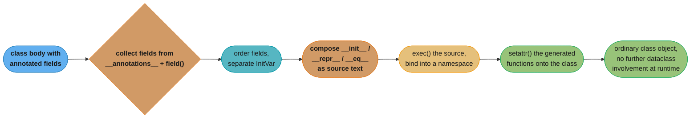
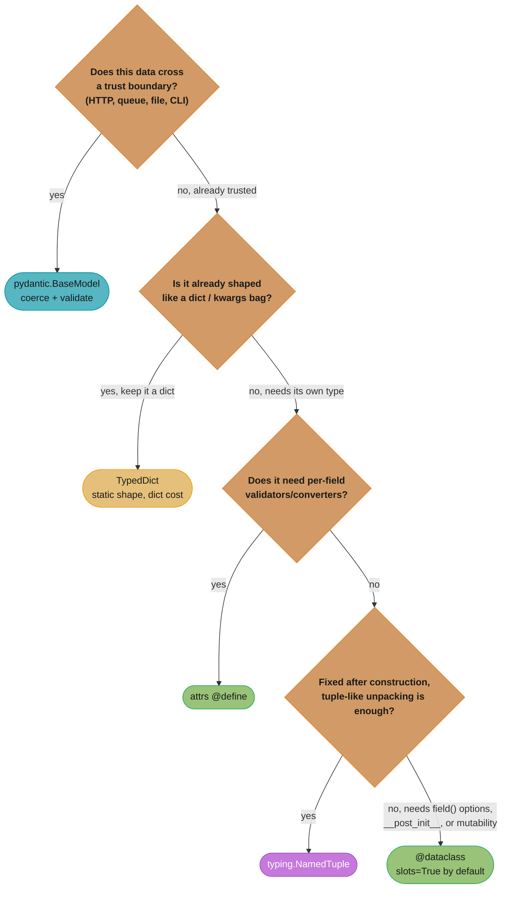
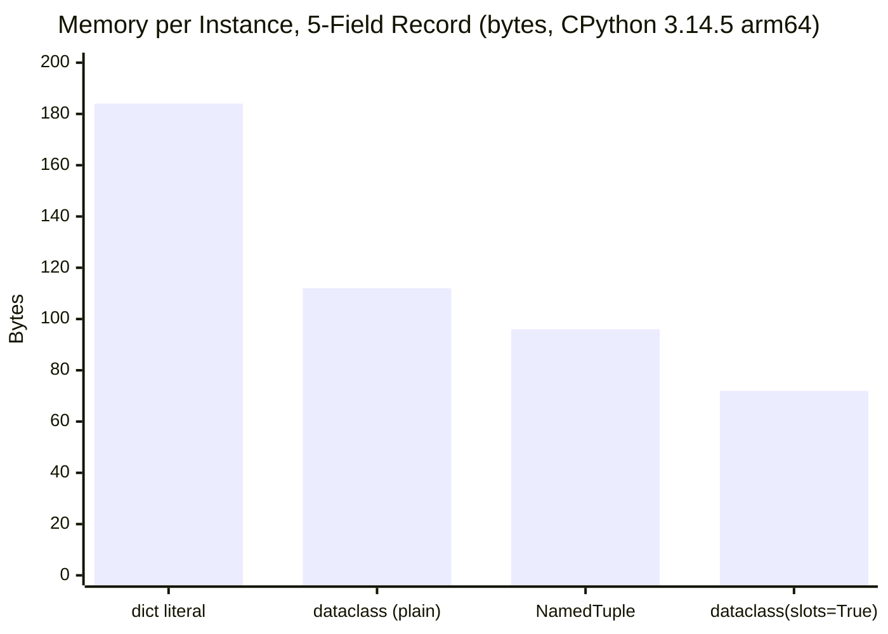

# Dataclasses, Enums & Data Modeling

## 1. Concept Overview

Every non-trivial Python program spends most of its structure deciding how to represent
records: a config object, a database row, an API response, a domain event, a fixed set of
named states. Python offers a wide spectrum of tools for this — `dict`, `tuple`,
`collections.namedtuple`, `typing.NamedTuple`, `typing.TypedDict`, a plain class, a plain
class with `__slots__`, `@dataclass`, `attrs`, and `pydantic.BaseModel` — and the choice is
not cosmetic. It changes how much memory each record costs, whether it can be mutated after
construction, whether two records compare equal by value or by identity, whether it can be
used as a `dict` key or a `set` member, and whether malformed input is caught at the
boundary or discovered three call frames later as an `AttributeError`.

`../data_model_and_objects/data_model_and_objects.md` covers the underlying contract these
tools all build on: `__eq__`/`__hash__`, `__slots__`, and the descriptor protocol. This
module is the home for the layer built *on top of* that contract — the code generators and
declarative tools a senior engineer reaches for instead of hand-writing `__init__`,
`__repr__`, and `__eq__` for every record type. `../metaclasses_and_metaprogramming/metaclasses_and_metaprogramming.md`
§6.9 introduces `@dataclass` as one example of declarative metaprogramming; this module is
where `@dataclass` and `enum` are actually owned — field mechanics, the `frozen`/`eq`/`hash`
interaction, `slots=True`, `kw_only`, `InitVar`, `copy.replace()`, and the full `enum`
family (`Enum`, `IntEnum`, `StrEnum`, `Flag`, `IntFlag`).

The chapter closes at the boundary against `pydantic`, whose validation and coercion
machinery is covered in full in
`../../fastapi/pydantic_v2_deep_dive/pydantic_v2_deep_dive.md`. That module owns *how*
pydantic validates; this module owns *when* to reach for it instead of a dataclass.

---

## 2. Intuition

> `@dataclass` is not a new kind of class. It is a code generator: given an annotated class
> body, it writes the source text of `__init__`, `__repr__`, and `__eq__` as strings and
> hands them to `exec()`, then attaches the resulting functions to your class. Everything
> that looks surprising about dataclasses — a field that "disappears", a hash that goes
> missing, a decorator that swaps out your class object underneath you — follows from that
> one fact: **the methods are generated once, at class-creation time, from whatever
> `__annotations__` says at that moment.**

**Mental model.** Read a dataclass body the way you would read a form specification, not a
class body. Each annotated name is a field declaration — its type, its default, whether it
participates in `__init__`, `__repr__`, `__eq__`, ordering, and hashing. The decorator reads
that specification once and writes ordinary Python methods from it. Nothing about a
dataclass instance is special at runtime; `isinstance(x, SomeDataclass)` and
`type(x).__init__` behave exactly like any other class, because they *are* an ordinary
class by the time `@dataclass` has finished running.

**Why it matters.** Interview questions about dataclasses are really questions about
generated-code mechanics: why does a mutable default still break dataclasses the same way
it breaks a hand-written `__init__` (Section 10, Pitfall 1)? Why does `slots=True` return a
*different* class object than the one the decorator was handed (Section 6.3)? Why does
adding `__eq__` silently delete `__hash__` unless the class is frozen (Section 6.4)? Every
one of these has the same answer: the decorator generated the method it was told to
generate, from the annotations it saw, at the moment it ran — no more, no less.

**Key insight.** `enum` is a sibling tool solving an adjacent problem: not "generate the
boilerplate for a record", but "give a fixed, closed set of named values real identity, so
`Status.ACTIVE` cannot silently collide with the string `"active"` from an unrelated part of
the system." Both tools trade a small amount of runtime cost for eliminating a whole class
of hand-written-boilerplate bugs; both fail in specific, memorizable ways when their
contract is violated.

---

## 3. Core Principles

**A data model is a contract, not a convenience.** Choosing `dict` vs. `@dataclass` vs.
`pydantic.BaseModel` is choosing what the type *promises*: does it promise a fixed shape,
value equality, immutability, hashability, runtime-validated input? State the contract in
the type, once, rather than re-defending it in every function that touches the record.

**Declare the invariant; do not defend it ad hoc.** `frozen=True` states "this value never
changes after construction" as a class-level fact enforced by a generated `__setattr__`,
instead of a comment above every mutation site promising nobody will mutate it. `Enum`
states "this variable holds one of exactly these five values" as a type, instead of a
docstring listing five magic strings that a future call site can still misspell.

**Validation belongs at the trust boundary, not in every constructor.** Data crossing from
outside the process — an HTTP body, a queue message, a CLI argument, a config file — needs
runtime validation and coercion; that is `pydantic`'s job (Section 9). Data moving between
functions you already control, constructed from values your own code already validated,
does not need to pay that cost again on every hop; that is `@dataclass`'s job. Conflating
the two either pays validation cost everywhere or validates nowhere.

**Equality and hashing are a pair, not two independent switches.** `__eq__` defines what
"the same record" means; `__hash__` must be consistent with it or the type breaks silently
in a `set` or as a `dict` key (Section 6.4, Section 10 Pitfall 3). A dataclass and an `Enum`
member both generate this pair correctly by default — but only as long as nothing mutates a
field that participates in either.

**Mutability and hashability are in tension by design.** A value that can change after
construction cannot safely be a `dict` key or `set` member, because its hash would drift out
from under the container that indexed it (Section 10, Pitfall 7). `frozen=True` is the
dataclass answer to that tension; `NamedTuple` and `StrEnum`/`IntEnum` members get it for
free because their underlying types (`tuple`, `str`, `int`) are already immutable.

---

## 4. Types / Architectures / Strategies

### 4.1 The Spectrum

| Idiom | Mutable | Value equality | Hashable | Runtime validation | Static-check support |
|---|---|---|---|---|---|
| `dict` | Yes | Yes (dict equality) | No | None | Weak — `TypedDict` needed for shape |
| `tuple` | No | Yes | Yes | None | Weak — positional only |
| `collections.namedtuple` | No | Yes | Yes | None | Weak — no type hints |
| `typing.NamedTuple` | No | Yes | Yes | None | Good — annotated fields |
| `typing.TypedDict` | Yes (it's still a `dict`) | Yes (dict equality) | No | None (checker-only) | Good — checker-enforced shape |
| plain class | Yes | No (identity, unless hand-written) | Yes (identity-based) | None | Weak, unless typed by hand |
| plain class + `__slots__` | Yes (fixed attribute set) | No (identity, unless hand-written) | Yes (identity-based) | None | Weak |
| `@dataclass` | Yes (unless `frozen=True`) | Yes (generated `__eq__`) | Conditional — see §6.4 | None | Good |
| `@dataclass(frozen=True, slots=True)` | No | Yes | Yes | None | Good |
| `attrs` (`@define`) | Configurable | Yes | Configurable | Validators/converters, opt-in | Good |
| `pydantic.BaseModel` | Configurable (`frozen=True`) | Yes | Configurable | Yes — coercion + validation on construction | Good |

Read this table as a decision, not a ranking: no row dominates every column, and the right
choice is whichever row matches the contract the call site actually needs. A config object
loaded once at startup wants `pydantic` (validate untrusted YAML, fail fast). The millions
of in-memory event records it configures want `@dataclass(slots=True)` (cheap, already
trusted, constructed by your own code).

### 4.2 `dict` — the zero-ceremony default

No import, no declaration, arbitrary shape. Costs the most per instance of any option here
(Section 5) because a `dict` literal builds an independent hash table per instance rather
than sharing a key layout across instances of "the same shape" — because to `dict` there is
no such thing as "the same shape", only individual mappings.

### 4.3 `tuple` / `typing.NamedTuple`

A `tuple` is the cheapest immutable, hashable container, but positional-only access
(`record[2]`) is unreadable and fragile under reordering. `typing.NamedTuple` keeps the
tuple's cost and hashability while adding named, typed, dot-accessed fields — the best
choice when you want an immutable value with tuple semantics (unpacking, iteration,
equality-by-position) and do not need `@dataclass`'s field-level customization (`field()`,
`__post_init__`, `slots=True` combined with mutability toggles).

### 4.4 `typing.TypedDict`

A `TypedDict` is a `dict` at runtime — same mutability, same lack of hashability, same
identity-free equality — with a shape that a type checker enforces statically and erases at
runtime. Choose it when the boundary you are modeling is *already* a `dict` (a JSON payload,
a `**kwargs` bag, a third-party API response) and you want static checking without paying
for a conversion step. `../the_type_system_and_typing/the_type_system_and_typing.md` §4.13
covers `ReadOnly[...]` — a `TypedDict`-specific way to mark one field immutable without
making the whole mapping immutable.

### 4.5 `@dataclass`

The default choice for an in-process record built from already-validated data: generated
`__init__`/`__repr__`/`__eq__`, opt-in ordering and hashing, opt-in `frozen=True` and
`slots=True`, and full customization per field via `field()`. Section 6 covers its mechanics
in depth.

### 4.6 `attrs`

Predates `@dataclass` (which was modeled on it) and remains ahead of it on three axes:
validators and converters run at construction time (`@field.validator`, `converter=`),
`slots=True` is the *default* on the modern `@attrs.define` API rather than opt-in, and
`__init__` generation is measurably faster to import at scale because `attrs` caches
generated code more aggressively. Choose it over `@dataclass` when you want stdlib-adjacent
ergonomics but need per-field validators without hand-rolling `__post_init__` checks, and do
not want pydantic's parsing/coercion machinery.

### 4.7 `pydantic.BaseModel`

Not a code generator for boilerplate — a validation and coercion engine. Every field
assignment (at construction, and on later mutation if configured) runs through
`pydantic-core`'s Rust validator, which means untyped or wrongly-typed input is *coerced or
rejected* rather than silently stored. See Section 9 for the explicit boundary rule, and
`../../fastapi/pydantic_v2_deep_dive/pydantic_v2_deep_dive.md` for how it is built.

### 4.8 Plain class with `__slots__`

The manual version of `@dataclass(slots=True)` — same memory layout, but every method is
hand-written. Reach for it only when you need behavior a dataclass cannot express directly
(a custom metaclass, a non-standard `__init__` signature that field declarations cannot
model); otherwise `@dataclass(slots=True)` gives the identical layout for less code.

### 4.9 `enum.Enum` and its variants

A closed, named set of values with real type identity — not a data record, but the other
half of "data modeling": constraining what a field is allowed to *be*. `StrEnum` [3.11],
`IntEnum`, `Flag`, and `IntFlag` each trade a different amount of "acts like the underlying
primitive" against "is a distinct type the checker can reason about." Section 6.9 through
6.13 cover the full family.

---

## 5. Architecture Diagrams

### What `@dataclass` generates

The decorator runs once, at class-creation time, over whatever `__annotations__` holds at
that moment — collecting field order and defaults, composing method source as text, handing
it to `exec()`, and attaching the results back onto the class object. There is no per-call
overhead once this has run: a dataclass instance's `__init__` is an ordinary Python function
by the time your code calls it.



This is why `slots=True` must produce a *new* class object (Section 6.3): the fields were
already collected and the methods already generated against the first class; adding
`__slots__` requires a fresh `type.__new__` call, so the decorator builds a second class and
copies everything over.

### Choosing a data-modeling idiom



Every leaf in this tree still shares the same underlying dunder-method contract from
`../data_model_and_objects/data_model_and_objects.md` — the tree decides which tool
*generates* that contract for you, not which contract applies.

### Memory per instance, same 5-field record

Measured directly on **CPython 3.14.5, arm64 (Apple Silicon), macOS 26.6.2** — 200,000
instances of a five-field record (`int, int, str, int, float`-shaped), `tracemalloc`
diffed around the allocation loop, divided by instance count (methodology matches Section
6 of `../data_model_and_objects/data_model_and_objects.md`, repeated here on a five-field
shape rather than three, and on 3.14 rather than 3.13):



A plain `dict` literal costs the most because every instance carries its own independent
hash table; `@dataclass(slots=True)` costs the least because it is a fixed-size C array of
pointers with no hash table and no dict object at all. `NamedTuple` sits between the two
plain-`dataclass` and `slots` numbers because a tuple stores values inline but still pays a
per-object `ob_size` field and 16-byte allocation granularity that the pointer-array layout
does not.

---

## 6. How It Works — Detailed Mechanics

### 6.1 Field Collection from `__annotations__`

`@dataclass` walks the class's `__annotations__` in **declaration order** — the same order
you wrote them — building the parameter list for the generated `__init__`. A bare
annotation with no assigned value is a required field; `name: type = value` is a field with
a default; `name: type = field(...)` hands the decorator explicit per-field configuration.
`typing.ClassVar[...]`-annotated names are skipped entirely — they stay class attributes,
never become instance fields, and never appear in `__init__`, `__repr__`, or `__eq__`.

```python
from dataclasses import dataclass, field
from typing import ClassVar


@dataclass
class Employee:
    name: str
    department: str = "unassigned"
    id_prefix: ClassVar[str] = "EMP-"      # class attribute, not a field
    reports: list[str] = field(default_factory=list)


e = Employee("Priya")
print(e)                       # Employee(name='Priya', department='unassigned', reports=[])
print(Employee.id_prefix)      # EMP-  -- shared class attribute, never per-instance
```

**PEP 649/749 deferred annotations `[3.14]` change what field collection can see, not
whether it works.** On 3.14's default (no `from __future__ import annotations`), a
self-referential unquoted annotation that used to require string quoting now just works,
because annotation evaluation is deferred to first access instead of running eagerly while
the class body executes:

```python
# On CPython 3.13 (pre-PEP 649 default), this line raises NameError at class-body
# execution time: "Node" does not exist yet while its own class body is running.
#     next: Node | None = None
#
# On CPython 3.14, PEP 649 defers annotation evaluation, so the unquoted
# self-reference is legal:
@dataclass
class Node:
    value: int
    next: Node | None = None            # unquoted self-reference -- fine on 3.14

n2 = Node(2, Node(1))
print(n2)                                # Node(value=2, next=Node(value=1, next=None))

from dataclasses import fields
for f in fields(Node):
    print(f.name, repr(f.type))
# value <class 'int'>
# next ForwardRef('Node | None', is_class=True, owner=<class '__main__.Node'>)
```

Verified directly: on 3.13 the unquoted form raises `NameError: name 'Node' is not defined`
at class-definition time; on 3.14 it succeeds, and `fields(Node)` reports the unresolved
field as a `ForwardRef` rather than eagerly resolving it. Call `typing.get_type_hints(Node)`
when you need the fully resolved type object — it still returns `{'value': <class 'int'>,
'next': Node | None}`. `from __future__ import annotations` still forces every annotation to
a bare string and is now usually the *wrong* choice on 3.14+, since it throws away exactly
the resolved-object behavior PEP 649 gives you for free (see
`../the_type_system_and_typing/the_type_system_and_typing.md` §6.11 for the full resolution
picture across all three annotation modes).

### 6.2 `field()` in Full

```python
from dataclasses import dataclass, field


@dataclass
class Order:
    order_id: str
    items: list[str] = field(default_factory=list)   # fresh list per instance
    _internal_token: str = field(default="", repr=False)   # hidden from __repr__
    priority: int = field(default=0, compare=False)         # excluded from __eq__/order
    created_by: str = field(default="system", kw_only=True) # 3.10 -- keyword-only, this field alone
    metadata: dict = field(default_factory=dict, hash=False)


o = Order("A-1", created_by="alice")
print(o)   # Order(order_id='A-1', items=[], priority=0, created_by='alice', metadata={})
#            _internal_token omitted -- repr=False
```

| `field()` parameter | Controls |
|---|---|
| `default` | A literal default value — must be immutable-safe; a mutable literal raises `ValueError` at class-definition time |
| `default_factory` | A zero-arg callable invoked fresh per instance — the fix for the mutable-default trap (Section 10, Pitfall 1) |
| `init` | Whether the field appears in the generated `__init__` |
| `repr` | Whether the field appears in the generated `__repr__` |
| `compare` | Whether the field participates in `__eq__` and ordering |
| `kw_only` [3.10] | Whether *this one field* must be passed by keyword, independent of the class-level `kw_only=` |
| `hash` | Whether the field participates in the generated `__hash__` (defaults to following `compare`) |
| `metadata` | An arbitrary read-only mapping attached to the field, for third-party tooling (not used by `dataclasses` itself) |

### 6.3 `slots=True` `[3.10]` — a New Class Object

```python
@dataclass
class Point:
    x: int
    y: int


PointRef = Point               # captured before the slots decorator runs, below

@dataclass(slots=True)
class Point:                   # same name, DIFFERENT class object
    x: int
    y: int


print(PointRef is Point)       # False -- verified: slots=True cannot add __slots__
                                # to an existing class, so it builds a fresh one and
                                # copies methods/fields onto it, then rebinds the name
```

Because `__slots__` must be present in `type.__new__`'s namespace argument at class
*creation* time — it cannot be bolted onto an already-created class — `@dataclass(slots=True)`
cannot mutate the class object it was handed. It builds an entirely new class with the same
name, same fields, same generated methods, and same `__slots__`, then returns that new
object. Anything that captured a reference to the class *before* the decorator ran (a
registry dict populated by `__init_subclass__`, a module-level alias, a previously created
subclass) is left holding the stale, un-slotted class — see Section 10, Pitfall 5.

### 6.4 `frozen=True`, `eq`, and the `__hash__` Truth Table

Verified directly on CPython 3.14.5 for all four `eq`/`frozen` combinations:

| `eq=` | `frozen=` | `__hash__` on the generated class |
|---|---|---|
| `True` (default) | `False` (default) | Explicitly set to `None` — **instances become unhashable** |
| `True` | `True` | Generated from the same fields as `__eq__` — instances are hashable |
| `False` | `False` | Left untouched — inherits `object.__hash__` (identity-based) |
| `False` | `True` | Left untouched — inherits `object.__hash__` (identity-based) |

```python
from dataclasses import dataclass


@dataclass                          # eq=True, frozen=False (both defaults)
class Mutable:
    x: int

print(Mutable.__hash__)             # None -- confirmed

@dataclass(frozen=True)             # eq=True, frozen=True
class Frozen:
    x: int

print(Frozen.__hash__ is not None)  # True
print(hash(Frozen(1)) == hash(Frozen(1)))   # True -- consistent with __eq__
```

`frozen=True` generates a `__setattr__` and `__delattr__` that both unconditionally raise
`dataclasses.FrozenInstanceError` (a `AttributeError` subclass) — the class becomes
immutable by construction, which is exactly the condition under which it is safe to also
generate a stable `__hash__`. This is the same `__eq__`/`__hash__` consistency rule from
`../data_model_and_objects/data_model_and_objects.md` §3, applied automatically by the
decorator instead of by hand.

`frozen=True` guards only *attribute assignment on this instance* — it says nothing about
what a field's own value can do. Section 10, Pitfall 2 covers the resulting shallow-only
immutability.

### 6.5 `order=True`

```python
from dataclasses import dataclass, field


@dataclass(order=True)
class Version:
    major: int
    minor: int
    patch: int
    label: str = field(default="", compare=False)   # excluded from ordering


versions = [Version(1, 2, 0), Version(1, 0, 5), Version(2, 0, 0, "rc")]
print(sorted(versions))
# [Version(major=1, minor=0, patch=5, label=''), Version(major=1, minor=2, patch=0, label=''),
#  Version(major=2, minor=0, patch=0, label='rc')]
```

`order=True` generates `__lt__`, `__le__`, `__gt__`, `__ge__` by building a tuple from every
field where `compare=True` (in field-declaration order) on both operands and comparing the
tuples — lexicographic, field-by-field, exactly like comparing `(1, 2, 0)` to `(1, 0, 5)`.
Combining `order=True` with a hand-written `__lt__` raises `TypeError` at class-definition
time; the decorator refuses to silently overwrite a method you defined yourself.

### 6.6 `kw_only=True` `[3.10]`

```python
from dataclasses import dataclass


@dataclass
class Base:
    name: str = "unnamed"

try:
    @dataclass
    class Child(Base):
        id: int              # BROKEN: no default, follows Base's defaulted field
except TypeError as e:
    print(e)
    # non-default argument 'id' follows default argument 'name'


@dataclass(kw_only=True)
class Base2:
    name: str = "unnamed"

@dataclass(kw_only=True)
class Child2(Base2):
    id: int                  # fine -- kw_only fields have no positional order to violate

print(Child2(id=5))           # Child2(name='unnamed', id=5)
```

Without `kw_only`, the generated `__init__`'s parameter list is positional, in field
declaration order across the whole MRO base-first — so a subclass that adds one required
field after an inherited defaulted one hits the exact same restriction Python enforces for
any function signature: a non-default parameter cannot follow a default one. `kw_only=True`
sidesteps the restriction entirely by making every field keyword-only, where argument order
is irrelevant. `field(kw_only=True)` (Section 6.2) applies the same fix to a single field
without changing the whole class.

### 6.7 `__post_init__` and `InitVar`

```python
from dataclasses import dataclass, field, fields, InitVar


@dataclass
class Rectangle:
    width: float
    height: float
    scale: InitVar[float] = 1.0                  # accepted by __init__, NOT stored
    area: float = field(init=False, default=0.0)  # computed, not passed in

    def __post_init__(self, scale: float) -> None:
        self.area = self.width * self.height * scale


r = Rectangle(2, 3, scale=2.0)
print(r.area)                          # 12.0 -- verified
print([f.name for f in fields(r)])     # ['width', 'height', 'area'] -- scale is NOT a field
```

`InitVar[T]` declares a name that `__init__` accepts and passes to `__post_init__`, but that
`dataclasses` never stores as an instance attribute and never lists in `fields()`. Use it for
construction-time-only parameters — a scale factor, a "should I validate" flag, a raw
payload to parse into other fields — that have no business existing as persistent state.
`__post_init__` itself runs automatically as the last step of the generated `__init__`,
receiving every `InitVar` in declaration order as extra positional-or-keyword parameters; it
is the correct place for cross-field validation and derived-field computation that `field()`
alone cannot express.

### 6.8 `copy.replace()` `[3.13]` and `dataclasses.replace()`

```python
import copy
from dataclasses import dataclass, replace


@dataclass(frozen=True, slots=True)
class Point:
    x: int
    y: int


p = Point(1, 2)
p2 = copy.replace(p, y=99)      # stdlib-generic entry point, 3.13+
p3 = replace(p, y=5)            # dataclasses-specific, works on all supported versions

print(p2, p3)                    # Point(x=1, y=99) Point(x=1, y=5) -- both verified
print(p)                         # Point(x=1, y=2) -- original untouched
```

Both construct a new instance with every field copied from `p` except the ones passed as
keyword overrides — the standard "update" pattern for an immutable value, since `frozen=True`
forbids in-place mutation entirely. `copy.replace()` [3.13] is the newer, type-generic
entry point (it also dispatches to `NamedTuple._replace` and to any type implementing
`__replace__`); `dataclasses.replace()` is the original, dataclass-specific function and
remains equivalent for dataclass instances. Both re-run `__post_init__` on the new instance,
so derived fields recompute correctly rather than being copied stale.

### 6.9 `dataclasses.asdict()` — the Deep-Copy Cost

```python
from dataclasses import dataclass, field, asdict


@dataclass
class Address:
    city: str
    zip_code: str

@dataclass
class Customer:
    name: str
    address: Address
    tags: list[str] = field(default_factory=list)


c = Customer("Priya", Address("Pune", "411001"), tags=["vip"])
d = asdict(c)
print(d)   # {'name': 'Priya', 'address': {'city': 'Pune', 'zip_code': '411001'}, 'tags': ['vip']}

d["tags"].append("mutated")
print(c.tags)   # ['vip'] -- unaffected; asdict() deep-copies every nested value
```

`asdict()` recurses through nested dataclasses, lists, tuples, and dicts, calling
`copy.deepcopy()` on every value that is not itself a dataclass, list, tuple, or dict field.
That deep copy is real cost on a large or deeply nested record — for a hot path that only
needs a *shallow* view (e.g. handing fields to an ORM insert), iterate `dataclasses.fields()`
and build the mapping by hand instead of calling `asdict()`.

### 6.10 `enum.Enum` — the Base Case

```python
from enum import Enum


class Status(Enum):
    ACTIVE = 1
    ENABLED = 1     # same value as ACTIVE -- becomes an ALIAS, not a distinct member
    INACTIVE = 2


print(list(Status))                       # [<Status.ACTIVE: 1>, <Status.INACTIVE: 2>]
                                           # verified: aliases are excluded from iteration
print(Status.ENABLED is Status.ACTIVE)    # True -- alias binds to the canonical member
print(Status(1))                          # Status.ACTIVE -- lookup by value
print(Status["ACTIVE"])                   # Status.ACTIVE -- lookup by name
print(str(Status.ACTIVE))                 # Status.ACTIVE -- plain Enum's __str__
```

Each member is a singleton instance of the enum class itself — `Status.ACTIVE is Status.ACTIVE`
is always `True`, and members compare by identity, never by their underlying value against
an unrelated type: `Status.ACTIVE == 1` is `False` for a plain `Enum`. Two names assigned the
same value do not create two members; the second becomes an *alias* for the first, and
`list(Status)` reports only canonical members. `@enum.unique` (Section 6.12) turns a
duplicate value into a build-time `ValueError` instead of a silent alias.

### 6.11 `IntEnum` — When Implicit Int-Ness Is the Point (or the Bug)

```python
from enum import IntEnum


class HttpStatus(IntEnum):
    OK = 200
    NOT_FOUND = 404


print(HttpStatus.OK == 200)          # True -- verified: IntEnum IS an int subclass
print(isinstance(HttpStatus.OK, int))# True
print(str(HttpStatus.OK))            # 200 -- 3.11+: str()/format() use int's __str__,
                                      # not "HttpStatus.OK" the way plain Enum does
```

`IntEnum` members are genuine `int` subclass instances — they compare equal to, hash equal
to, and can be used anywhere a raw `int` is expected (a status-code comparison, a bit
position, a legacy API that only accepts `int`). Since 3.11, `str()`/`f-string` formatting
of `IntEnum` (and `IntFlag`) uses the mixed-in type's own `__str__`, so `f"{HttpStatus.OK}"`
prints `200`, not `HttpStatus.OK` — verified directly against a plain `Enum`, which still
prints `Status.ACTIVE`. Reach for `IntEnum` specifically when interop with code that expects
a raw integer is the point; reach for it accidentally and it is the bug in Section 10,
Pitfall 6 — a value that was supposed to be *rejected* by a type check instead sails through
because `isinstance(HttpStatus.OK, int)` is `True`.

### 6.12 `StrEnum` `[3.11]` — Why It Exists

```python
from enum import StrEnum


class Mode(StrEnum):
    READ = "read"
    WRITE = "write"


print(Mode.READ == "read")      # True -- verified: StrEnum IS a str subclass
print(f"{Mode.READ}")           # read -- verified: prints the value directly
print(isinstance(Mode.READ, str))  # True
```

`StrEnum` gives string-typed constants the same "closed set with a real type" benefit
`IntEnum` gives integers — without the historical footgun of hand-rolling
`class Mode(str, Enum)`, which produced inconsistent `str()`/`repr()` output across Python
versions before 3.11 standardized it. Prefer `StrEnum` over bare string module-level
constants (`MODE_READ = "read"`) any time the set of legal values is closed and a type
checker should be able to catch `Mode.WRTIE` — the typo does not exist as a name — where a
bare string constant would let `"wrtie"` through as a perfectly valid, perfectly wrong `str`.

### 6.13 `Flag` / `IntFlag` and `auto()`

```python
from enum import Flag, auto


class Permission(Flag):
    READ = auto()
    WRITE = auto()
    EXECUTE = auto()


rw = Permission.READ | Permission.WRITE
print(rw)                            # Permission.READ|WRITE -- verified
print(Permission.READ in rw)         # True
print(Permission.EXECUTE in rw)      # False
print(rw.value)                      # 3 -- READ=1, WRITE=2, combined bitmask
```

`Flag` members combine with the bitwise operators (`|`, `&`, `^`, `~`) into new `Flag`
values representing a *set* of members, backed by `auto()` assigning successive powers of
two (1, 2, 4, ...) so every combination is a unique bitmask. `in` tests membership within a
combined flag correctly (`Permission.READ in rw`), which a plain `Enum` cannot express at
all — a plain `Enum` member is one value, never a set of them. `IntFlag` is to `Flag` what
`IntEnum` is to `Enum`: the combined value is also usable as a raw `int` (bitwise ops with a
plain integer, C-extension interop) at the cost of the same implicit-int-equality risk as
Section 6.11.

### 6.14 `@unique` and `_missing_`

```python
from enum import Enum, unique

try:
    @unique
    class Dup(Enum):
        A = 1
        B = 1                      # duplicate value
except ValueError as e:
    print(e)   # duplicate values found in <enum 'Dup'>: B -> A -- verified


class Fallback(Enum):
    RED = 1

    @classmethod
    def _missing_(cls, value: object) -> "Fallback":
        return cls.RED             # any unrecognized value maps to RED

print(Fallback(999))               # Fallback.RED -- verified, no ValueError raised
```

`@unique` turns the alias-on-duplicate-value behavior from Section 6.10 into a hard failure
at class-definition time — use it whenever every member is supposed to represent a genuinely
distinct value and a duplicate would indicate a copy-paste error, not an intentional alias.
`_missing_` is the enum lookup's escape hatch: it runs when `Enum(value)` finds no matching
member, and can return a fallback member, construct a new one, or re-raise; without it, an
unrecognized value raises `ValueError` by default.

---

## 7. Real-World Examples

**A config object.** Load once at process startup from environment variables or a YAML file
through `pydantic.BaseModel` (untrusted input, needs coercion and validation), then pass the
*validated* result around the rest of the program as a `@dataclass(frozen=True, slots=True)`
— cheap to construct millions of derived views from, and immutable so nothing downstream can
accidentally mutate shared configuration.

**An API response DTO.** A `@dataclass(slots=True)` built from an already-validated
pydantic model or an ORM row — the shape is fixed, the source is trusted, and the DTO exists
purely to decouple the wire/DB shape from the internal one without paying pydantic's
per-field validation cost on data that was already checked once.

**A domain event.** `@dataclass(frozen=True, slots=True)` with a `kind: EventKind` field
where `EventKind` is a `StrEnum` — immutable (an event that already happened cannot change),
hashable (safe to deduplicate in a `set`), and its `kind` field is a closed, typo-proof set
of names rather than a bare string.

```python
from dataclasses import dataclass
from enum import StrEnum, auto
from datetime import datetime, UTC


class EventKind(StrEnum):
    ORDER_PLACED = auto()
    ORDER_CANCELLED = auto()
    PAYMENT_FAILED = auto()


@dataclass(frozen=True, slots=True)
class DomainEvent:
    kind: EventKind
    order_id: str
    occurred_at: datetime


evt = DomainEvent(EventKind.ORDER_PLACED, "A-1001", datetime.now(UTC))
print(evt.kind)          # order_placed -- StrEnum auto() lowercases the member name
```

**A state machine keyed by `StrEnum`.** A workflow's states (`StrEnum`) and a transition
table (`dict[tuple[State, Event], State]`) give a checker-visible, typo-proof alternative to
string-keyed dispatch — an unrecognized state literal is a `NameError` at authoring time
instead of a silent no-op at runtime.

**A `Flag` permission set.** File or API permissions modeled as `IntFlag` combine naturally
with POSIX-style bitmasks (`stat.S_IRUSR`-style interop) while still supporting `in` tests
and readable `repr()` output — strictly better than hand-maintained bitwise constants for
any permission set with more than two or three bits.

---

## 8. Tradeoffs

| Dimension | `dict` | `NamedTuple` | `@dataclass` | `@dataclass(slots=True)` | `pydantic.BaseModel` |
|---|---|---|---|---|---|
| Memory / 5-field instance (3.14.5, arm64) | 184 B | 96 B | 112 B | 72 B | Higher — carries validator state, `__pydantic_fields_set__`, extra bookkeeping |
| Validation cost | None | None | None | None | Real, on every construction — Rust `pydantic-core`, but not zero |
| Construction cost | Cheapest | Cheap | Cheap | Cheap | Highest of this row — coercion + validation runs every time |
| Mutability | Always | Never | Configurable (`frozen=`) | Configurable | Configurable (`model_config["frozen"]`) |
| Static shape checking | None (or `TypedDict`) | Strong | Strong | Strong | Strong |
| Dynamic attribute addition | N/A (it's a dict) | No | No (`slots=True`) / Yes (plain) | No | No by default |

**`@dataclass` vs. `pydantic` is a validation-cost decision, not a features decision.** A
dataclass trusts its caller; a pydantic model verifies its caller. Paying pydantic's
construction cost on data your own code already produced and already trusts is pure
overhead with no corresponding safety gained — the input was never going to be malformed in
a way validation would catch, because nothing external touched it.

**`slots=True` vs. dynamic attributes is a closed-shape decision.** A slotted dataclass
raises `AttributeError` the instant code tries to set an attribute that was not declared —
which is a feature (typo protection, no silent drift) until something legitimately needs
per-instance dynamic attributes (a plugin attaching metadata, `unittest.mock.patch.object`
on an instance), at which point it is a hard blocker with no partial opt-out per instance.

**`frozen=True` vs. mutable is an ownership decision.** A frozen dataclass cannot be
built incrementally (no "construct empty, fill in fields as they arrive" pattern) — every
field must be known at `__init__` time, and updates go through `copy.replace()`/`replace()`
building a new instance rather than mutating in place. That is exactly right for a value
object passed across boundaries (nothing downstream can mutate what you handed it) and
exactly wrong for a builder-pattern object under active construction.

---

## 9. When to Use / When NOT to Use

**Use a plain `dict` when:**
- The shape is genuinely dynamic (arbitrary keys from user input, a JSON blob you pass
  through without touching most of it).
- You need `dict`-specific operations (`.get()` with a default, `**` merging) more than you
  need named-field access.

**Use `typing.TypedDict` when:**
- The data is already a `dict` (a JSON payload, `**kwargs`) and you want static shape
  checking without a runtime conversion step or construction cost.

**Use `typing.NamedTuple` when:**
- The value is immutable, tuple-like (unpacking, iteration, positional equality is fine),
  and does not need `field()`-level customization, `__post_init__`, or per-field validators.
- It beats `@dataclass(frozen=True)` specifically when tuple-unpacking ergonomics
  (`x, y = point`) matter to the call sites.

**Use `@dataclass` when:**
- The record is built from already-trusted, already-validated data moving through your own
  process — function arguments, internal pipeline stages, DTOs derived from a validated
  source.
- Default to `slots=True` for anything constructed in bulk (Section 5), and `frozen=True`
  for anything that represents a fact that already happened or a value passed to code you
  do not control.

**Use `attrs` when:**
- You want per-field validators/converters without pydantic's full coercion machinery, or
  you are working in a codebase that already standardized on it.

**Reach for `pydantic.BaseModel` instead — do not validate untrusted input with a
dataclass — when:**
- The data crosses a trust boundary: an HTTP request body, a message off a queue, a config
  file, a CLI argument, anything typed as `str`/`bytes`/`dict` on arrival that needs to
  become a real type with real invariants.
- You need coercion (`"42"` → `42`), not just shape checking — a dataclass's type hints are
  documentation to a checker; nothing enforces them at runtime. See
  `../../fastapi/pydantic_v2_deep_dive/pydantic_v2_deep_dive.md` for the validation engine
  itself.
- **Do NOT** reach for pydantic for the millions of already-trusted in-memory records
  downstream of that boundary — validate once at the edge, then use a cheap `@dataclass` for
  everything the validated value flows into.

---

## 10. Common Pitfalls

### Pitfall 1: Mutable Default (Still Applies to Dataclasses)

```python
from dataclasses import dataclass

# BROKEN: raises ValueError at class-definition time -- dataclasses actively
# reject a mutable literal default, which is strictly better than the plain-class
# version of this bug (Section 10 Pitfall 1 in data_model_and_objects.md), because
# it fails LOUD instead of silently sharing state across instances.
try:
    @dataclass
    class BadOrder:
        items: list = []
except ValueError as e:
    print(e)   # mutable default <class 'list'> for field items is not allowed

# FIX: default_factory calls the constructor fresh, once per instance
from dataclasses import field

@dataclass
class GoodOrder:
    items: list = field(default_factory=list)

a, b = GoodOrder(), GoodOrder()
a.items.append("x")
print(b.items)   # [] -- independent
```

### Pitfall 2: `frozen=True` Is Shallow — Contained Mutables Still Mutate

```python
from dataclasses import dataclass, field, FrozenInstanceError

@dataclass(frozen=True)
class Config:
    tags: list[str] = field(default_factory=list)

c = Config()
try:
    c.tags = ["new"]           # blocked -- reassigning the attribute
except FrozenInstanceError as e:
    print(e)                    # cannot assign to field 'tags'

c.tags.append("mutated")        # NOT blocked -- verified: frozen only guards
print(c.tags)                   # ['mutated']   the instance's own __setattr__,
                                 # not the list object the field points at

# FIX: use an immutable container for the field, or a frozen custom type
@dataclass(frozen=True)
class SafeConfig:
    tags: tuple[str, ...] = ()   # tuple has no .append -- mutation is a TypeError
```

`frozen=True` generates `__setattr__` on `Config` itself; it says nothing about `list`'s own
mutating methods. Use an immutable container (`tuple`, `frozenset`) for any field on a
frozen dataclass where "truly immutable" — not just "the attribute can't be reassigned" — is
the actual requirement.

### Pitfall 3: `eq=True` Without `frozen=True` Silently Deletes `__hash__`

```python
from dataclasses import dataclass

@dataclass                      # eq=True (default), frozen=False (default)
class BrokenKey:
    value: int

try:
    {BrokenKey(1): "x"}          # TypeError -- verified: __hash__ is None
except TypeError as e:
    print(e)   # unhashable type: 'BrokenKey'

# FIX 1: freeze it, if it should never mutate
@dataclass(frozen=True)
class FrozenKey:
    value: int

# FIX 2: keep it mutable but accept identity-based hashing explicitly
@dataclass(eq=False)
class IdentityKey:
    value: int
    # __hash__ inherited from object -- hashes by id(), not by value
```

The generated `__eq__` and the automatic `__hash__ = None` are a matched pair (Section 6.4)
— this is not a dataclass-specific quirk, it is `../data_model_and_objects/data_model_and_objects.md`
§3's `__eq__`/`__hash__` contract enforced automatically. A dataclass that needs to go in a
`set` or be a `dict` key must be either frozen (value-based hash) or explicitly opted out of
`eq` (identity-based hash) — there is no third option that is both mutable and value-hashed
safely.

### Pitfall 4: `slots=True` Returns a New Class — Stale References Persist

```python
from dataclasses import dataclass

_registry: dict[str, type] = {}

@dataclass
class Handler:
    name: str

_registry["handler"] = Handler          # BROKEN: captured BEFORE slots is applied

@dataclass(slots=True)
class Handler:                          # rebinds the module-level name...
    name: str

print(_registry["handler"] is Handler)  # False -- registry still holds the un-slotted class

# FIX: register AFTER every decorator (including slots=True) has finished running
@dataclass(slots=True)
class Handler2:
    name: str

_registry2 = {"handler2": Handler2}     # captured after the final class object exists
print(_registry2["handler2"] is Handler2)   # True
```

Any pattern that captures a class reference *inside* the class body or immediately after a
bare `@dataclass` — an `__init_subclass__`-based registry evaluated at each intermediate
decoration step, a module-level alias written between two stacked decorators — is exposed to
this. `slots=True` is not unique in principle (any decorator that returns a different object
than it was handed has the same issue), but it is the one every dataclass user hits, because
nothing about the syntax signals that the class identity changed.

### Pitfall 5: Non-`kw_only` Inheritance — Defaulted Field Blocks a Later Required One

```python
from dataclasses import dataclass

@dataclass
class Base:
    name: str = "unnamed"

try:
    @dataclass
    class Child(Base):
        id: int              # BROKEN: required field after Base's defaulted one
except TypeError as e:
    print(e)   # non-default argument 'id' follows default argument 'name'

# FIX: kw_only=True removes positional ordering entirely
@dataclass(kw_only=True)
class Base2:
    name: str = "unnamed"

@dataclass(kw_only=True)
class Child2(Base2):
    id: int                  # fine

print(Child2(id=5))          # Child2(name='unnamed', id=5)
```

### Pitfall 6: `IntEnum`'s Implicit Int-Equality Slips Past a Validation Check

```python
from enum import IntEnum

class Role(IntEnum):
    GUEST = 0
    ADMIN = 1

def grant_if_admin(role: object) -> bool:
    # BROKEN: intended to gate on the Role type, but IS an int subclass, so
    # any raw 1 -- not just Role.ADMIN -- satisfies this check.
    return role == Role.ADMIN

print(grant_if_admin(1))            # True -- verified: a bare int slips through
print(grant_if_admin(Role.ADMIN))   # True -- intended case

# FIX: check the type explicitly when the point is to reject anything
# that is not actually a Role member, not merely equal to one
def grant_if_admin_strict(role: object) -> bool:
    return isinstance(role, Role) and role is Role.ADMIN

print(grant_if_admin_strict(1))            # False -- correctly rejected
print(grant_if_admin_strict(Role.ADMIN))   # True
```

This is `IntEnum`'s defining tradeoff (Section 6.11) working exactly as documented, not a
bug in `IntEnum` — the fix is to reach for `Enum` (no implicit int-equality) or `StrEnum`
(no implicit numeric coercion at all) whenever the type boundary itself is the thing being
enforced, and reserve `IntEnum` for call sites that genuinely need raw-int interop.

### Pitfall 7: A Dataclass Used as a Dict Key Where a Field Mutates After Insertion

```python
from dataclasses import dataclass, field

@dataclass(unsafe_hash=True)     # mutable AND hashable -- the dangerous combination
class MutableKey:
    tag: str
    items: list = field(default_factory=list, compare=False, hash=False)

k = MutableKey("a")
d = {k: "found"}
print(d.get(MutableKey("a")))    # 'found'

k.tag = "b"                      # mutates the field the hash was computed from
print(k in d)                    # False -- verified: same object, now in the WRONG bucket
print(list(d.keys()))            # [MutableKey(tag='b', items=[])] -- it is still IN the dict,
                                  # just unreachable by any key that hashes correctly now

# FIX: freeze it, so the field the hash depends on cannot change after insertion
@dataclass(frozen=True)
class SafeKey:
    tag: str
```

`unsafe_hash=True` exists precisely to let a dataclass author *override* the default
`eq=True, frozen=False → __hash__ = None` rule from Section 6.4 and generate a hash anyway
— the name is a warning, not a suggestion. The moment a hashed field mutates after the
instance has been inserted into a `dict` or `set`, the object becomes unreachable by its own
current value while still occupying a slot the garbage collector will not reclaim (nothing
still references the stale hash bucket, but nothing removes the entry either) — the
container silently leaks the entry and silently fails every future lookup for it. The only
safe fix is `frozen=True`, which makes mutation of a hash-participating field a hard error
instead of a hash-table corruption.

---

## 11. Technologies & Tools

| Tool | Purpose |
|---|---|
| `dataclasses` (stdlib) | Code-generates `__init__`/`__repr__`/`__eq__`/optional `__hash__`/`__lt__` from annotated fields; `slots=True` [3.10], `kw_only=True` [3.10], `field()` |
| `enum` (stdlib) | Closed, named value sets — `Enum`, `IntEnum`, `StrEnum` [3.11], `Flag`, `IntFlag`, `auto()`, `@unique` |
| `attrs` | Predecessor and superset of `@dataclass` — validators, converters, `slots=True` by default on the modern API |
| `pydantic` v2 | Runtime validation and coercion via a Rust core (`pydantic-core`); the trust-boundary tool — see `../../fastapi/pydantic_v2_deep_dive/pydantic_v2_deep_dive.md` |
| `typing.NamedTuple` | Typed, immutable, tuple-based records with named field access |
| `typing.TypedDict` | Checker-enforced shape over a plain `dict`, zero runtime cost/enforcement |
| `msgspec` | High-performance struct/schema library (Rust-adjacent C implementation) aimed at serialization throughput; an alternative to pydantic when validation speed on the hot path dominates the decision |
| `cattrs` | Structuring/unstructuring (serialization) library built to pair with `attrs` and plain dataclasses |
| `copy` (stdlib) | `copy.replace()` [3.13] — type-generic immutable-update helper that dispatches to dataclasses, `NamedTuple`, and any `__replace__`-implementing type |
| `tracemalloc` (stdlib) | The correct way to measure real per-instance memory in bulk — see Section 5's methodology |

---

## 12. Interview Questions with Answers

**Q: What happens when you give a dataclass field a mutable default value like `[]`, and how does `field(default_factory=...)` fix it?**
**Short:** `@dataclass` raises `ValueError` at class-definition time for a mutable literal default; use `default_factory` instead.
Unlike a hand-written `__init__(self, items=[])`, `@dataclass` actively detects a mutable literal default (`list`, `dict`, `set`) and refuses to build the class, raising `ValueError: mutable default <class 'list'> for field items is not allowed` at decoration time. The fix is `field(default_factory=list)`, which stores a zero-argument callable and invokes it fresh for every new instance, so no two instances ever share the same default list object. This is strictly safer than the plain-class version of the same bug, which fails silently by sharing state instead of failing loud at definition time.

**Q: Does `frozen=True` make a dataclass instance's contents fully immutable?**
**Short:** No — `frozen=True` only blocks attribute reassignment; a mutable field's own contents can still change.
`frozen=True` generates a `__setattr__`/`__delattr__` pair that raises `FrozenInstanceError` on any attempt to reassign `instance.field = value`, but it has no effect on what that field's value can do internally — `frozen_instance.some_list.append(x)` succeeds because it never touches the instance's own `__setattr__` at all. To get true immutability for a field, store an immutable container (`tuple`, `frozenset`) rather than a mutable one, or freeze the contained type as well.

**Q: Why does defining `__eq__` (or leaving `eq=True`, the default) on a dataclass without `frozen=True` make instances unhashable?**
**Short:** `eq=True` without `frozen=True` sets `__hash__` to `None`, the same rule `../data_model_and_objects/data_model_and_objects.md` documents for plain classes.
Python's `__eq__`/`__hash__` contract requires equal objects to hash equal; a mutable object cannot safely guarantee a stable hash across its lifetime, so the language convention — and `@dataclass`'s automatic behavior — is to set `__hash__ = None` whenever `__eq__` is generated but the object can still change. `frozen=True` is what unlocks a generated `__hash__`, because only then is the value guaranteed not to drift after insertion into a `set` or as a `dict` key. `eq=False` is the other way out: it leaves `__hash__` untouched, inheriting `object`'s identity-based hash on a class that stays mutable.

**Q: Why does `@dataclass(slots=True)` return a different class object than the one you wrote, and what breaks because of it?**
**Short:** `slots=True` builds an entirely new class object, because `__slots__` must exist at class-creation time, not be added afterward.
`__slots__` has to be present in the namespace passed to `type.__new__()` — CPython cannot retrofit a `__dict__`-based class into a slotted layout after the fact — so the decorator constructs a brand-new class with the same name and fields and rebinds the module-level name to it. Anything that captured a reference to the class before this rebinding — a registry populated inside `__init_subclass__`, an alias assigned between two stacked decorators — keeps pointing at the stale, un-slotted class, silently missing the memory savings and any behavior the final class carries. The fix is to only capture class references after every class-level decorator, `slots=True` included, has finished running.

**Q: How does `kw_only=True` [3.10] fix the "non-default argument follows default argument" error in dataclass inheritance?**
**Short:** `kw_only=True` makes every field keyword-only, removing the positional ordering that the error is about.
Without it, the generated `__init__`'s parameters are positional in field-declaration order across the whole MRO, base-class fields first — so a subclass adding one required field after an inherited field with a default hits the same restriction any Python function signature enforces: a non-default parameter cannot follow a default one, and `@dataclass` raises `TypeError` at class-definition time. `kw_only=True` (class-level, or `field(kw_only=True)` per-field) removes positional order from the equation entirely, since keyword-only parameters have no left-to-right ordering constraint, letting a subclass freely add a required field after an inherited defaulted one.

**Q: What is the difference between `__post_init__` and `InitVar`, and how do they work together?**
**Short:** `InitVar` declares a constructor-only parameter that is never stored; `__post_init__` runs last and receives every `InitVar` value.
`InitVar[T]` marks a name that the generated `__init__` accepts as a parameter but that `dataclasses` never turns into a stored field — it does not appear in `fields()`, `__repr__`, or `__eq__`. `__post_init__` is called automatically as the final step of the generated `__init__`, receiving every declared `InitVar` (in declaration order) as extra arguments, and is the designated place to run cross-field validation or compute a derived field from data that should not persist as its own attribute — for example, a `scale` factor used once to compute a stored `area` field.

**Q: What is the practical difference between `@dataclass`, `typing.NamedTuple`, `typing.TypedDict`, and `pydantic.BaseModel`, and how do you choose?**
**Short:** The axes are mutability, hashability, and whether the data crosses a trust boundary needing coercion — not raw capability.
`NamedTuple` is the cheapest immutable, hashable, tuple-semantics option; `TypedDict` is a checker-only shape layered on a real, mutable `dict` with zero runtime enforcement; `@dataclass` is the general-purpose in-process record generator, configurable for mutability, ordering, and hashing, but assumes its input is already trusted; `pydantic.BaseModel` is the only one of the four that actually validates and coerces its input at construction time, at real per-instance cost. The decision in practice: pydantic at a trust boundary (parsing untrusted input), `@dataclass` for everything downstream built from already-validated data, `NamedTuple` when the value is naturally tuple-shaped and immutable, `TypedDict` when the data is going to stay a `dict` anyway and you just want static shape checking.

**Q: What is the real difference between `StrEnum`, `IntEnum`, and a plain `Enum`?**
**Short:** `StrEnum`/`IntEnum` members ARE the underlying primitive type; a plain `Enum` member never equals a raw value of that type.
`StrEnum` and `IntEnum` members are genuine subclass instances of `str`/`int` respectively — `Mode.READ == "read"` and `HttpStatus.OK == 200` are both `True`, and `isinstance()` against the primitive type succeeds. A plain `Enum` member is never equal to a raw value of its underlying type; `Status.ACTIVE == 1` is `False` even though `Status.ACTIVE.value` is `1`. Since 3.11, `str()`/formatting of `IntEnum`/`IntFlag`/`StrEnum` also prints the underlying value directly (`200`, `read`) rather than `ClassName.MEMBER`, which is how a plain `Enum` still formats. Choose `StrEnum`/`IntEnum` specifically when interop with raw strings/ints is the point; choose plain `Enum` when you want the type boundary itself enforced and do not want a raw value slipping past an equality check (Section 10, Pitfall 6).

**Q: How does `enum.Flag` differ from a plain `Enum`, and what does `auto()` give you?**
**Short:** `Flag` members combine with bitwise operators into sets of members; a plain `Enum` member is always exactly one value.
`Flag` members can be OR'd together (`Permission.READ | Permission.WRITE`) into a new `Flag` value representing a *combination* of members, and `in` correctly tests whether one flag participates in a combined value — something a plain `Enum` has no concept of, since each of its members is a single, indivisible value. `auto()` assigns successive powers of two (1, 2, 4, 8, ...) to each member automatically, guaranteeing every possible combination produces a unique bitmask without the author hand-maintaining the bit positions. `IntFlag` adds the same raw-int interop `IntEnum` gives `Enum`, at the same implicit-equality risk.

**Q: What is the difference between `copy.replace()` [3.13] and `dataclasses.replace()`?**
**Short:** `copy.replace()` is a type-generic entry point dispatching to dataclasses, NamedTuple, or `__replace__`; `dataclasses.replace()` is dataclass-only.
Both construct a new instance with the given keyword fields overridden and every other field copied from the original — the standard update pattern for a `frozen=True` dataclass, which cannot be mutated in place. `dataclasses.replace()` predates `copy.replace()` and works only on dataclass instances; `copy.replace()`, added in 3.13, is the newer stdlib-generic version that also dispatches to `NamedTuple._replace()` and any type implementing `__replace__`, making it the one to reach for in code that should not assume its argument is specifically a dataclass. Both re-run `__post_init__` on the new instance, so derived fields stay consistent rather than being copied stale.

**Q: What does PEP 649/749 [3.14] change about how `@dataclass` collects field annotations?**
**Short:** Annotation evaluation is deferred to first access, so an unquoted self-referential field annotation now works without a string or `__future__` import.
Before 3.14, an annotation like `next: Node | None` inside `Node`'s own class body raised `NameError` at class-definition time, because `Node` did not exist yet while its own body was executing — forcing either a quoted string annotation or `from __future__ import annotations`. Under 3.14's PEP 649 default, annotations compile into a hidden `__annotate__` function evaluated lazily on first access rather than eagerly during class-body execution, so the same unquoted self-reference now succeeds; `dataclasses.fields()` reports the field's `.type` as an unresolved `ForwardRef` until something calls `typing.get_type_hints()`, which still resolves it to the real `Node | None` type object. `from __future__ import annotations` is now usually the wrong choice on 3.14+, since it forces every annotation to a bare string and throws away this resolved-object behavior.

**Q: When should `dataclasses.asdict()` be avoided even though it is the "obvious" way to convert a dataclass to a dict?**
**Short:** `asdict()` deep-copies every nested value, which is real, avoidable cost on a large or hot-path record.
`asdict()` recursively walks nested dataclasses, lists, tuples, and dicts and calls `copy.deepcopy()` on every leaf value that is not itself one of those container types, guaranteeing the returned dict shares no mutable state with the original instance. That correctness guarantee costs a full deep copy on every call, which is wasted work when the caller only needs a shallow, read-only view of the top-level fields — for a hot path (building an ORM insert, logging structured fields), iterate `dataclasses.fields()` and build the mapping by hand instead.

**Q: What is the actual memory difference between `dict`, `@dataclass`, `@dataclass(slots=True)`, and `NamedTuple` for the same record shape?**
**Short:** Measured on CPython 3.14.5 for a 5-field record: dict 184 bytes, plain dataclass 112, NamedTuple 96, slotted dataclass 72.
Measured with `tracemalloc` diffed around a bulk allocation loop (200,000 instances, divided out), on CPython 3.14.5, arm64 macOS: a `dict` literal costs the most because each instance builds an independent hash table; `@dataclass` without `slots=True` shares the class's inline-values layout (see `../data_model_and_objects/data_model_and_objects.md` §6.3) at 112 bytes; `NamedTuple` comes in lower at 96 bytes because a tuple stores values inline but still pays a per-object size field and allocation-granularity overhead; `@dataclass(slots=True)` is cheapest at 72 bytes, a fixed C array of pointers with no hash table and no dict object at all. The ranking holds regardless of exact field count, but the specific byte values are shape- and version-specific — remeasure rather than quoting these numbers for a different field count.

**Q: Why does `@dataclass(order=True)` combined with a hand-written `__lt__` raise an error?**
**Short:** The decorator refuses to overwrite a method you defined yourself rather than silently discarding it.
`order=True` generates `__lt__`, `__le__`, `__gt__`, and `__ge__` from the class's comparable fields; if any of those methods already exists on the class body, `@dataclass` raises `TypeError` at class-definition time instead of silently overwriting your hand-written version — the same "do not silently clobber user-defined methods" behavior the decorator applies to `__init__`, `__repr__`, and `__eq__` when they are explicitly written and `init=`/`repr=`/`eq=` are left at their defaults expecting generation.

**Q: How does `enum.auto()` interact with `StrEnum` versus a plain `Enum` or `IntEnum`?**
**Short:** `auto()` assigns increasing integers for `Enum`/`IntEnum` but the lowercased member name itself for `StrEnum`.
For `Enum` and `IntEnum`, `auto()` assigns successive integers starting at 1 by default (`Enum._generate_next_value_`). For `StrEnum`, `auto()`'s generation is overridden to produce the member's own name lowercased — `EventKind.ORDER_PLACED` assigned via `auto()` becomes the string `"order_placed"` — which is why `StrEnum` with `auto()` is a common idiom for turning a set of Python identifier names directly into their natural string representation without retyping each value.

**Q: What does `@enum.unique` protect against, and what happens without it?**
**Short:** `@unique` turns a duplicate member value into a `ValueError` at class-definition time instead of a silent alias.
Without `@unique`, two enum names assigned the same value do not create two distinct members — the second name becomes an alias bound to the first member, and `list(EnumClass)` reports only the canonical one, which can silently hide a copy-paste mistake where a new member was meant to have its own value. `@unique` makes that situation fail loudly with `ValueError: duplicate values found in <enum '...'>: B -> A` at class-definition time, and should be applied to any enum where every member is genuinely supposed to be a distinct value, reserving unmarked classes for the cases where an intentional alias (a deprecated name kept for compatibility, pointing at its replacement's value) is the actual design.

---

## 13. Best Practices

- **Default new value objects to `@dataclass(frozen=True, slots=True)`.** Immutable and
  memory-efficient by default; relax `frozen` only when the object genuinely needs
  incremental in-place construction, and relax `slots` only when it needs dynamic
  attributes.
- **Reach for `kw_only=True` once a class passes roughly four fields.** Positional
  construction beyond that point is an unreadable, order-dependent call site — `Order(1,
  "A", True, None, 3)` — that keyword-only fields turn into self-documenting keyword
  arguments and free from the inheritance-ordering trap in Section 10, Pitfall 5.
- **Prefer `StrEnum` over bare string module-level constants** for any closed set of string
  values a type checker should be able to validate — the cost is one import, the benefit is
  every typo becoming a `NameError` instead of a silent wrong string.
- **Validate at the boundary; keep interior models plain dataclasses.** Parse untrusted
  input into a `pydantic.BaseModel` once, at the edge of the system, then convert to (or
  directly construct) `@dataclass` instances for everything the validated value flows into
  — do not pay pydantic's construction cost on data your own code already trusts.
- **Always use `field(default_factory=...)` for a mutable default**, never rely on catching
  the `ValueError` `@dataclass` raises for a literal mutable default as your safety net —
  write the correct form the first time.
- **Measure memory claims with `tracemalloc` in bulk, never `sys.getsizeof()` on a single
  instance** — see Section 5's methodology and
  `../data_model_and_objects/data_model_and_objects.md` §6.3's measurement-trap writeup for
  why a single-instance `getsizeof()` call is actively misleading.
- **Capture a class reference only after every class-level decorator has run**, `slots=True`
  included — a registry or alias built between two stacked decorators is a Section 10,
  Pitfall 4 waiting to happen.
- **Freeze anything used as a `dict` key or `set` member.** `unsafe_hash=True` on a mutable
  dataclass is a documented footgun, not a shortcut — see Section 10, Pitfall 7.

---

## 14. Case Study

### Scaling an Event-Ingestion Service from Dicts to Slotted Dataclasses

**Scenario.** An ingestion service buffers incoming events in memory before a periodic
flush to storage — five fields per event (an integer id, a float timestamp, a string kind, an
integer user id, a float value), the exact shape measured in Section 5. At low volume the
representation does not matter; the question is what happens as buffered volume grows into
the millions, and where the win from switching representations stops being worth the
tradeoff.

**Step 1 — start with dicts.** The simplest thing that works: `records.append({"id": i,
"ts": ..., "kind": "click", "user_id": ..., "value": ...})`. Measured directly — 1,000,000
records, fresh Python 3.14.5 process, `resource.getrusage(RUSAGE_SELF).ru_maxrss` (bytes on
macOS) read once after the ingestion loop completes:

```python
import resource

records = []
for i in range(1_000_000):
    records.append({"id": i, "ts": float(i), "kind": "click",
                     "user_id": i % 5000, "value": i * 0.1})

peak = resource.getrusage(resource.RUSAGE_SELF).ru_maxrss
print(peak)   # 345,620,480 bytes -- verified, ~329.6 MB peak RSS
```

**Step 2 — move to `@dataclass`.** Same field shape, same 1,000,000 records, same
measurement method, run as a fresh subprocess to avoid any interpreter warm-up skew between
runs:

```python
from dataclasses import dataclass

@dataclass
class Event:
    id: int
    ts: float
    kind: str
    user_id: int
    value: float

records = [Event(i, float(i), "click", i % 5000, i * 0.1) for i in range(1_000_000)]
# peak RSS: 267,730,944 bytes -- verified, ~255.3 MB, a 22.5% reduction from dict
```

**Step 3 — move to `slots=True`.** Identical field list, one decorator argument added:

```python
@dataclass(slots=True)
class Event:
    id: int
    ts: float
    kind: str
    user_id: int
    value: float

records = [Event(i, float(i), "click", i % 5000, i * 0.1) for i in range(1_000_000)]
# peak RSS: 235,044,864 bytes -- verified, ~224.2 MB, a further 12.2% reduction,
# ~32.0% below the original dict baseline
```

All three numbers measured on **CPython 3.14.5, arm64 (Apple Silicon), macOS 26.6.2**, each
variant run as its own fresh process, `ru_maxrss` read once after the ingestion loop:

```
                                 peak RSS, 1M records     vs. dict
    dict literal                    329.6 MB                --
    @dataclass (plain)              255.3 MB              -22.5%
    @dataclass(slots=True)          224.2 MB              -32.0%
```

Peak-RSS deltas run somewhat smaller than the pure per-instance `tracemalloc` deltas from
Section 5, because RSS also includes fixed interpreter overhead, the list object holding the
records, and allocator fragmentation that per-instance accounting excludes — the *direction*
and rough *magnitude* of the win match Section 5's isolated measurement, which is the useful
takeaway, not the exact percentage.

**Step 4 — decide where pydantic earns its cost, and where it does not.** The five fields
here arrive already well-formed from an internal producer the service controls — `id` is
generated locally, `ts` comes from `time.time()`, `kind` is chosen from a fixed enum by the
producer's own code. There is no untrusted boundary at the point these 1,000,000 records are
constructed, so wrapping `Event` in a `pydantic.BaseModel` at this stage would add
validation cost against input that cannot actually be malformed — pure overhead, no safety
gained. The boundary that *does* need pydantic is one layer earlier: wherever an external
producer's raw payload (an HTTP webhook body, a message off an external queue) first enters
the process. Validate that payload once into a pydantic model at the edge, extract the five
already-verified fields, and construct the cheap `Event(slots=True)` dataclass from them —
the trust boundary is crossed exactly once, and the million-record buffer downstream of it
never pays for a check that already happened.

**Outcome.** For this service, the dict-to-slotted-dataclass migration recovered roughly a
third of peak memory at 1,000,000 buffered events with no loss of functionality — a real
result at that scale, but one that (per Section 8's break-even discussion) would be noise at
10,000 buffered events and would not, on its own, justify the migration's engineering cost
below a few hundred thousand records held in memory at once.
