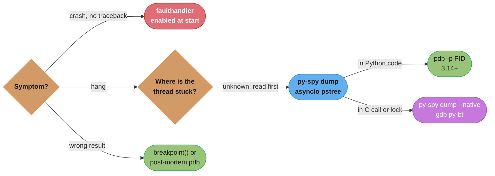
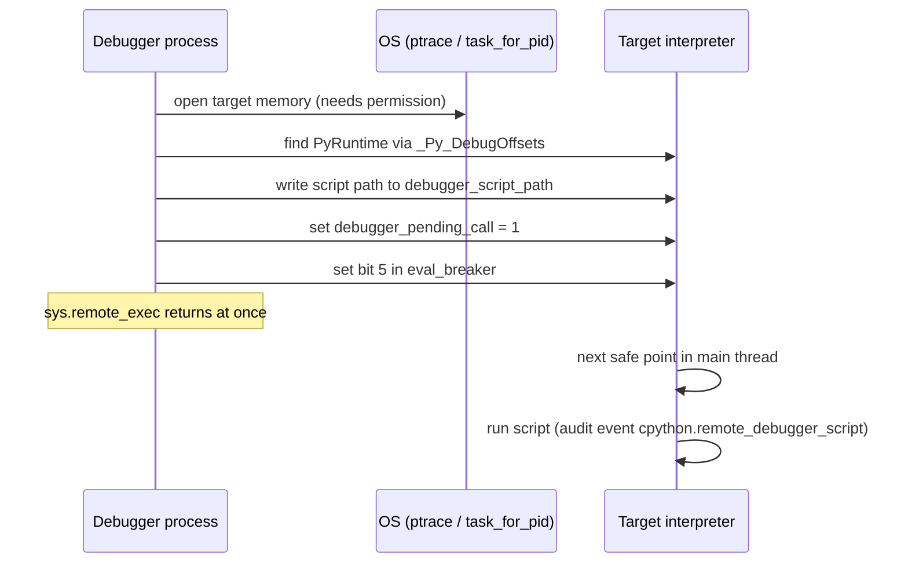
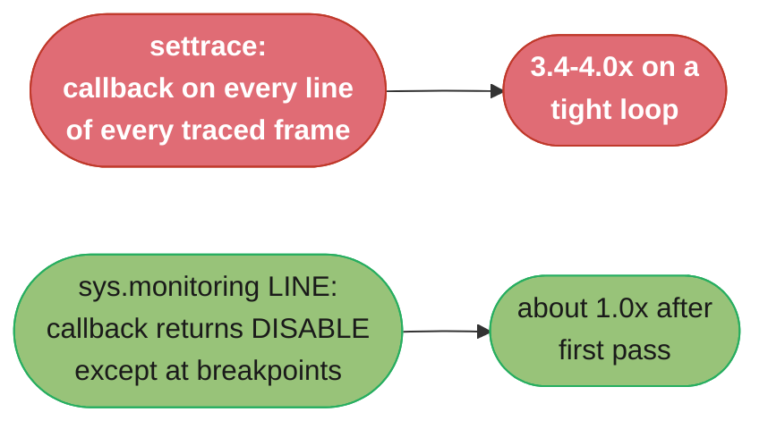

# Debugging and Introspection

---

## 1. Concept Overview

Debugging a Python process means answering three questions: where is the code right now, how
did it get here, and what does it do over time. CPython ships a tool for each, and since 3.14
it can also answer them for a process that is already running in production.

- **Interactive debugging:** `pdb`, entered with `breakpoint()` (PEP 553, `[3.7]`). The hook
  reads `PYTHONBREAKPOINT` on each call, so one environment variable swaps the debugger or
  turns every `breakpoint()` into a no-op.
- **Post-mortem debugging:** `pdb.pm()` opens the debugger on the frames of the last
  unhandled exception (`sys.last_exc`, `[3.12]`); `pdb.post_mortem(exc)` takes an exception
  object (`[3.13]`); `python -m pdb script.py` enters post-mortem on any crash.
- **Crash and hang dumps:** `faulthandler` (`[3.3]`) installs signal handlers that print every
  thread's Python traceback on `SIGSEGV`, `SIGFPE`, `SIGABRT`, `SIGBUS`, and `SIGILL`, without
  needing the interpreter to be in a healthy state. From 3.14 it also prints the C stack.
- **Execution events:** `sys.monitoring` (PEP 669, `[3.12]`) is the event API under modern
  debuggers and coverage tools. It replaces the per-frame `sys.settrace` callback with
  per-tool, per-location events that a tool can switch off where it does not need them.
- **Remote attach:** PEP 768 (`[3.14]`) adds `sys.remote_exec(pid, script)` and
  `python -m pdb -p PID`, so a debugger can attach to a running process without a restart and
  without the process having been started under a debugger.

This module covers the debugger, crash, and attach tools. CPU and memory profilers are in
[Performance and Profiling](../performance_and_profiling/performance_and_profiling.md), and
`tracemalloc` and the GC are in
[CPython Memory Model](../cpython_memory_model/cpython_memory_model.md).

---

## 2. Intuition

**One-line analogy.** `pdb` stops the plane on the ground and lets you walk the cabin;
`faulthandler` is the flight recorder that still writes when the plane hits the ground;
remote attach is a radio link to a plane that is already in the air.

**Mental model.** Every Python-level debugging tool runs Python code, and Python code runs
only when the interpreter reaches a safe point between bytecode instructions (the "eval
breaker" check). A thread in a pure-Python loop reaches one within microseconds. A thread
blocked inside a C call, a lock, or a `recv()` does not reach one until that call returns.
A segfault never reaches one. So the toolkit splits into two families: tools that need the
interpreter to cooperate (`pdb`, `breakpoint()`, `sys.remote_exec`, `sys.monitoring`) and
tools that do not (`faulthandler`'s C signal handler, `py-spy dump` and
`python -m asyncio pstree`, which read the target's memory from outside, and `gdb`).

**Why it matters.** The two incidents that cost the most time in production Python are a
process that hangs with no log line and a process that dies with no traceback. Both are
cheap to diagnose if `faulthandler` was enabled at start and the container allows `ptrace`,
and very expensive if neither was set up before the incident.

**Key insight.** Pick the tool by the state of the interpreter, not by habit. A hung process
whose main thread is in Python code can take `pdb -p`. A process stuck in C needs an
outside reader first (`py-spy dump --native`), and a crashing process needs a handler that
was installed before the crash.

---

## 3. Core Principles

1. **Install crash handlers before you need them.** `faulthandler` must be enabled at
   start (`-X faulthandler` or `PYTHONFAULTHANDLER=1`). It cannot be added after a segfault.
2. **Prefer tools that do not stop the process.** In production, read state first
   (`py-spy dump`, `python -m asyncio pstree`, `faulthandler` on `SIGUSR1`), and only then
   attach something that pauses execution.
3. **Make `breakpoint()` safe by default.** Set `PYTHONBREAKPOINT=0` in every production
   image and lint for stray calls (ruff rule `T100`).
4. **Debug the exception you have, not a re-run.** Post-mortem debugging inspects the exact
   frames that failed. A re-run may not reproduce a race or a data-dependent bug.
5. **Pay only for the events you watch.** With `sys.monitoring`, return `DISABLE` from a
   local callback at every location you do not care about; that is how a debugger with a few
   breakpoints runs at close to full speed.
6. **Treat remote attach as a privilege.** `sys.remote_exec` runs arbitrary code in the target.
   Gate it with OS permissions (`ptrace_scope`, `CAP_SYS_PTRACE`) and switch it off with
   `PYTHON_DISABLE_REMOTE_DEBUG=1` where nobody should attach.

---

## 4. Types / Architectures / Strategies

### 4.1 In-process interactive debugging

`breakpoint()` calls `sys.breakpointhook()`, which calls `pdb.set_trace()` by default. Since
3.13 `set_trace()` stops at the calling line at once instead of on the next line. Since 3.14,
`await pdb.set_trace_async()` stops inside a coroutine and lets you `await` at the prompt,
and `breakpoint()` and `set_trace()` always use the `sys.monitoring` backend. Third-party
front ends (`ipdb`, `pudb`, `debugpy` for VS Code) plug in through the same hook.

### 4.2 Post-mortem debugging

The debugger opens on a finished traceback: all frames of the failure are still alive, so
`up`, `down`, and `p` work on the real locals. Entry points: `pdb.pm()` in a REPL after an
unhandled error, `pdb.post_mortem(exc)` in an `except` block, `python -m pdb -c continue
script.py`, and `pytest --pdb` for a failing test. The `exceptions` command (`[3.13]`) walks
a chained exception (`__cause__` and `__context__`).

### 4.3 Crash and hang dumps

`faulthandler` writes tracebacks from a C signal handler with only async-signal-safe calls.
It covers fatal signals (`enable()`), a watchdog timer (`dump_traceback_later(timeout)`),
and an on-demand signal (`register(signal.SIGUSR1)`, not on Windows).

### 4.4 Event hooks: `sys.settrace` vs `sys.monitoring`

`sys.settrace` installs one callback per thread that receives `call`, `line`, `return`, and
`exception` events for every traced frame. `sys.monitoring` gives six tool slots
(`DEBUGGER_ID = 0`, `COVERAGE_ID = 1`, `PROFILER_ID = 2`, `OPTIMIZER_ID = 5`), lets each slot
turn on events globally or for one code object, and lets a callback return `DISABLE` to
switch an event off at one location.

### 4.5 Out-of-process inspection and attach

| Tool | How it reads the target | Runs code in target |
|------|-------------------------|---------------------|
| `py-spy dump --pid` | Reads memory over `ptrace` / `process_vm_readv` | No |
| `python -m asyncio ps` / `pstree` `[3.14]` | Reads interpreter structures from outside | No |
| `gdb` with `python-gdb.py` (`py-bt`) | Native debugger plus CPython's gdb helpers | No (stops the process) |
| `sys.remote_exec(pid, path)` `[3.14]` | Writes a script path into the target | Yes, at the next safe point |
| `python -m pdb -p PID` `[3.14]` | Built on `sys.remote_exec` | Yes, a full `pdb` session |

### 4.6 In-process introspection

`sys._current_frames()` maps every thread ID to its top frame and needs no cooperation from
a deadlocked thread. `traceback.format_stack(frame)` turns a frame into text. `inspect`
reads signatures, source, and closures. `asyncio.print_call_graph()` (`[3.14]`) prints the
await chain of the current task.

---

## 5. Architecture Diagrams

### 5.1 Tool choice by process state



*Read the stack from outside before attaching anything that runs code. `pdb -p` only helps once
the stuck thread is in Python code, because it needs the interpreter to reach a safe point.*

### 5.2 PEP 768 remote attach



*The debugger never runs code itself. It flips a flag that the interpreter already checks
between bytecodes, which is why a main thread blocked in `recv()` runs the script only after
the call returns or a signal arrives.*

### 5.3 Where the cost of a breakpoint goes



*Measured on CPython 3.14.7, macOS arm64, a 5,000,000-iteration loop with a no-op callback
(Section 6.5). The `settrace` cost never goes away; the `DISABLE` cost is paid once per line.*

---

## 6. How It Works — Detailed Mechanics

### 6.1 `breakpoint()` and `PYTHONBREAKPOINT`

```python
def reconcile(batch: list[dict[str, int]]) -> int:
    total = 0
    for row in batch:
        if row["amount"] < 0:
            breakpoint()          # sys.breakpointhook() -> pdb.set_trace() by default
        total += row["amount"]
    return total
```

The default `sys.breakpointhook()` reads `PYTHONBREAKPOINT` on each call:

| `PYTHONBREAKPOINT` | Effect |
|--------------------|--------|
| unset or empty | `pdb.set_trace()` |
| `0` | returns at once, no-op |
| `ipdb.set_trace` | imports `ipdb` and calls `set_trace` with the `breakpoint()` arguments |
| a name that fails to import | `RuntimeWarning`, breakpoint ignored |

If code replaces `sys.breakpointhook` itself, the variable is no longer read. Because the
lookup happens per call, `os.environ["PYTHONBREAKPOINT"] = "0"` at runtime disables later
calls.

### 6.2 `pdb` commands that matter

| Command | Does |
|---------|------|
| `w` (`where`) | Print the stack, current frame marked |
| `u` / `d` | Move up or down one frame |
| `p expr` / `pp expr` | Print / pretty-print an expression in the current frame |
| `display expr` | Re-print `expr` whenever it changes at a stop in this frame |
| `b file.py:42, cond` | Breakpoint with a condition |
| `commands 1` | Attach commands to breakpoint 1 (for example `p x` then `continue`) |
| `until` | Run until a line greater than the current one, which exits a loop |
| `retval` | Show the last return value of the current function |
| `interact` | Open a full REPL with the frame's globals and locals |
| `exceptions` `[3.13]` | List chained exceptions and jump between them |

3.14 changes: `pdb.set_trace(commands=[...])` runs commands on entry, `colorize=True`
highlights source, `$_asynctask` names the current task, and inline breakpoints ignore the
`skip` pattern. `pdb.set_default_backend("monitoring")` makes new `Pdb` instances use
`sys.monitoring`; the default for a bare `Pdb()` is `"settrace"`.

### 6.3 Post-mortem debugging

```python
import pdb
import sys

def load(path: str) -> dict[str, str]:
    try:
        return parse(open(path).read())
    except Exception as exc:
        if sys.stdin.isatty():
            pdb.post_mortem(exc)      # exception object accepted since 3.13
        raise
```

```bash
# Run a script; on an unhandled exception, drop into pdb at the failing frame
python -m pdb -c continue job.py

# Same for a failing test, on the first failure only
pytest -x --pdb tests/test_job.py
```

`pdb.pm()` reads `sys.last_exc`, which the interpreter sets when it prints an unhandled
traceback in a REPL. `sys.last_type`, `sys.last_value`, and `sys.last_traceback` are the
deprecated pre-3.12 form of the same data.

### 6.4 `faulthandler`

```python
import faulthandler
import signal
import sys

faulthandler.enable(file=sys.stderr, all_threads=True)   # c_stack=True default in 3.14
faulthandler.register(signal.SIGUSR1, all_threads=True)  # kill -USR1 <pid> dumps stacks
faulthandler.dump_traceback_later(timeout=300, repeat=True)  # watchdog: dump every 5 min
```

On a fatal signal it prints, most recent call first:

```
Fatal Python error: Segmentation fault

Current thread 0x00007f3a1c9ff700 (most recent call first):
  File "/app/codec.py", line 88 in decode_frame
  File "/app/worker.py", line 41 in handle
  ...
```

Limits, because it runs inside a signal handler: ASCII only (`backslashreplace`), each
string cut at 500 characters, no source lines, at most 100 frames and 100 threads. It keeps
the file descriptor of `file`, so passing a file object that later closes makes it write to
whatever reuses that descriptor. `python -X dev` turns `faulthandler` on together with the
other development-mode checks. On a free-threaded build (GIL disabled) 3.14 dumps only the
current thread on a fatal error, to avoid races.

### 6.5 `sys.settrace` vs `sys.monitoring` `[3.12]`

```python
import sys
from types import CodeType

mon = sys.monitoring
TOOL = mon.DEBUGGER_ID
BREAKPOINTS: set[tuple[str, int]] = {("/app/billing.py", 57)}

def on_line(code: CodeType, line: int) -> object:
    if (code.co_filename, line) in BREAKPOINTS:
        print(f"hit {code.co_qualname}:{line}")
        return None
    return mon.DISABLE           # never call me again for this line

mon.use_tool_id(TOOL, "mini-debugger")
mon.register_callback(TOOL, mon.events.LINE, on_line)
mon.set_events(TOOL, mon.events.LINE)
```

`DISABLE` switches the `LINE` event off for that one location; `mon.restart_events()` turns
all disabled locations back on, which a debugger calls when the user adds a breakpoint.
`sys.settrace` has no such switch: the callback runs on every line of every traced frame for
as long as the tracer is installed.

A 5,000,000-iteration arithmetic loop on CPython 3.14.7 (macOS arm64):

| Hook | Time vs untraced |
|------|------------------|
| `sys.settrace` with a no-op local tracer | 3.4-4.0x |
| `sys.monitoring` `LINE`, callback returns `None` | 3.4-3.5x |
| `sys.monitoring` `LINE`, callback returns `DISABLE` | about 1.0x |

The second row matters: `sys.monitoring` is not cheaper per event. It is cheaper because it
lets a tool stop receiving events it does not need. coverage.py uses the same API when run
with `COVERAGE_CORE=sysmon`: once a line is recorded, its callback returns `DISABLE`.

### 6.6 PEP 768 remote attach `[3.14]`

```bash
# Full pdb session in a running process (same user, ptrace permitted)
python -m pdb -p 4127

# Run one script in the target's main thread at its next safe point
cat > /tmp/dump.py <<'EOF'
import faulthandler, sys
faulthandler.dump_traceback(file=sys.stderr, all_threads=True)
EOF
python -c 'import sys; sys.remote_exec(4127, "/tmp/dump.py")'
```

`sys.remote_exec` returns at once and gives no signal when the script has run, so the
script file must stay in place until you see its effect. Both interpreters must have the same
major and minor version (exact version for a pre-release). The calling process raises the
audit event `sys.remote_exec`; the target raises `cpython.remote_debugger_script`.

| Platform | What permits the attach |
|----------|-------------------------|
| Linux | Same user and `kernel.yama.ptrace_scope` 0, or `CAP_SYS_PTRACE`, or `setpriv --ptracer any` (util-linux 2.41+) on the target |
| Containers | Seccomp must allow `ptrace` (Docker 19.03+ and containerd 1.6.7+ do on kernel 4.8+); Yama still applies |
| macOS | `sudo`, or a Python binary signed with `com.apple.security.get-task-allow` |
| Windows | Administrator; some processes need `SeDebugPrivilege` |

Switch it off with `PYTHON_DISABLE_REMOTE_DEBUG=1`, `-X disable-remote-debug`, or a build
configured `--without-remote-debug`. These close only the interpreter's side; `ptrace` and
`/proc/<pid>/mem` keep their own permission model, so `py-spy` still works.

### 6.7 Thread and task dumps from inside the process

```python
import sys
import threading
import traceback

def thread_dump() -> str:
    names = {t.ident: t.name for t in threading.enumerate()}
    out: list[str] = []
    for ident, frame in sys._current_frames().items():
        out.append(f"--- {names.get(ident, '?')} ({ident})")
        out.extend(traceback.format_stack(frame))
    return "".join(out)
```

Wire this to an admin-only HTTP route or a signal handler. For asyncio, `asyncio.all_tasks()`
plus `asyncio.format_call_graph(task)` (`[3.14]`) gives each task's await chain; from outside,
`python -m asyncio pstree PID` prints the same tree without running code in the target and
reports an error if the await graph contains a cycle.

---

## 7. Real-World Examples

**Gunicorn worker timeouts.** Gunicorn kills a worker silent for longer than `timeout`
(default 30 s) with `SIGABRT` and calls the `worker_abort(worker)` server hook first. Calling
`faulthandler.dump_traceback(all_threads=True)` in that hook logs the stack of the request
that hung, which the default log line ("WORKER TIMEOUT") does not include.

**Kubernetes pods and `py-spy`.** `py-spy dump --pid 1` from `kubectl exec` fails with a
permission error under the default Yama `ptrace_scope=1`, because the shell is not a parent of
PID 1. Adding `SYS_PTRACE` to the container's `securityContext.capabilities.add` is the
documented fix; the same capability makes `python -m pdb -p 1` work on 3.14 images.

**Segfaults in native extensions.** A crash inside a C extension with `faulthandler` off
leaves only `exit code 139` in the orchestrator. With it on, 3.14 prints the Python frames and
the C stack (`c_stack=True`) of the faulting thread, which usually names the extension.

**Test suites.** `pytest --pdb` opens post-mortem on a failure; `pytest --trace` stops at the
start of each test; pytest's own `faulthandler_timeout` option uses
`dump_traceback_later` to print stacks of a test that runs too long.

---

## 8. Tradeoffs

| Tool | Stops the process | Needs a safe point | Runs code in target | Production use |
|------|-------------------|--------------------|---------------------|----------------|
| `breakpoint()` / `pdb` | Yes | Yes | Yes | No |
| Post-mortem `pdb` | After the failure | Yes | Yes | Local or staging |
| `faulthandler` | No (prints and continues, or dies on fatal signal) | No | No Python code | Yes, always on |
| `py-spy dump` | Pauses for microseconds per sample | No | No | Yes |
| `asyncio pstree` `[3.14]` | No | No | No | Yes |
| `sys.remote_exec` `[3.14]` | No | Yes | Yes | With care, audited |
| `pdb -p` `[3.14]` | Yes, while at the prompt | Yes | Yes | Last resort |
| `gdb` + `py-bt` | Yes | No | No | Last resort, needs debug symbols |

| Hook | Granularity | Off-switch per location | Typical user |
|------|-------------|-------------------------|--------------|
| `sys.settrace` | Per thread, every line of traced frames | No | Older debuggers, `pdb` `settrace` backend |
| `sys.setprofile` | Calls and returns | No | `cProfile`-style tools |
| `sys.monitoring` | Per tool, per event, per code object | Yes (`DISABLE`) | `pdb` monitoring backend, coverage.py `sysmon` |

---

## 9. When to Use / When NOT to Use

**Use `breakpoint()` and `pdb`** for a bug you can reproduce locally, and post-mortem when
the failure is already on screen.

**Use `faulthandler`** in every long-running service and CI job. The cost when no signal
arrives is zero, and the payoff is the only traceback a segfault or a hang will ever give you.

**Use `py-spy dump` or `asyncio pstree` first** on a hung production process, because they
read without running code and do not depend on the stuck thread.

**Use `pdb -p` or `sys.remote_exec`** when you need to evaluate expressions in the live
process (a cache size, a feature-flag value) and the main thread is running Python code.

**Do NOT use `pdb -p` as the first move on a hang.** If the main thread is blocked in C, the
attach waits for the same thing the process is waiting for.

**Do NOT leave `sys.settrace` tracers on in production** (a coverage run, a home-made
tracer): every traced line pays the callback.

---

## 10. Common Pitfalls

### Pitfall 1: A stray `breakpoint()` in a deployed service

```python
# BROKEN: left in after a debugging session
@app.post("/refund")
async def refund(req: RefundRequest) -> RefundResponse:
    breakpoint()
    return await process(req)
```

With stdin attached to a terminal (`docker run -it`, a dev VM) the event loop stops at the
prompt and every request on that worker hangs. With stdin at EOF (the usual case under a
process manager), 3.14's `pdb` reads `EOF` as `quit`, and quitting an inline breakpoint
raises `SystemExit`. asyncio does not catch `SystemExit` in a task, so the event loop stops
and the worker process exits on the first request that reaches the line (3.13 raised
`bdb.BdbQuit` in the handler instead).

```dockerfile
# FIX: make every breakpoint() a no-op in the image, and lint for them in CI
ENV PYTHONBREAKPOINT=0
```

```toml
[tool.ruff.lint]
extend-select = ["T10"]   # T100: debugger import or breakpoint() call
```

### Pitfall 2: Enabling `faulthandler` on a file that closes

```python
# BROKEN: the file object is garbage-collected, its fd is reused by a socket
def setup() -> None:
    faulthandler.enable(file=open("/var/log/app/crash.log", "w"))
```

`faulthandler` stores the descriptor number, not the object. When the file closes, a later
crash writes the traceback into whatever now owns that descriptor, such as a database socket.

```python
# FIX: keep a module-level reference for the life of the process
CRASH_LOG = open("/var/log/app/crash.log", "a", buffering=1)
faulthandler.enable(file=CRASH_LOG, all_threads=True)
```

### Pitfall 3: `pdb -p` "does nothing" on a hung process

The process is blocked in `socket.recv()` with no timeout. `python -m pdb -p` writes the
script path and sets the eval-breaker bit, then waits; the main thread never reaches a safe
point, so no prompt appears. Read the stack from outside first:

```bash
py-spy dump --pid 4127 --native     # shows the recv() frame and the Python caller
```

Then fix the cause (a timeout on the socket) rather than attaching harder. Sending a signal
the process handles also wakes the call with `EINTR` so the pending script can run.

### Pitfall 4: `ptrace` denied inside a container

`py-spy dump --pid 1` or `pdb -p 1` from `kubectl exec` fails with "Operation not permitted".
The cause is Yama `ptrace_scope=1` (only an ancestor may trace) plus a missing capability,
not a py-spy bug. Add `SYS_PTRACE` to the pod's capabilities for the debug deployment, or run
the tool from an ephemeral debug container that shares the process namespace and has it.

### Pitfall 5: `dump_traceback_later(exit=True)` in a service

`exit=True` calls `_exit(1)` after the dump, which skips `atexit` handlers, `finally` blocks,
and buffered log flushes. Use it in a CI job that must not hang forever, not in a service
whose shutdown commits work.

---

## 11. Technologies & Tools

| Tool | Kind | Notes |
|------|------|-------|
| `pdb` | Stdlib debugger | `-p PID` attach, `set_trace_async`, `monitoring` backend in 3.14 |
| `breakpoint()` | Builtin `[3.7]` | Routed through `sys.breakpointhook` and `PYTHONBREAKPOINT` |
| `faulthandler` | Stdlib | Fatal-signal, watchdog, and on-demand tracebacks; C stack in 3.14 |
| `sys.monitoring` | Stdlib API `[3.12]` | Six tool IDs; `DISABLE` per location; `BRANCH_LEFT`/`BRANCH_RIGHT` replace `BRANCH` in 3.14 |
| `sys.remote_exec` | Stdlib `[3.14]` | PEP 768; runs a script file in a target's main thread |
| `python -m asyncio ps` / `pstree` | Stdlib CLI `[3.14]` | Task table and await tree of another process, read-only |
| `ipdb` / `pudb` | PyPI | IPython-style and full-screen front ends for the same machinery |
| `debugpy` | PyPI | Debug Adapter Protocol server used by VS Code |
| `py-spy` | PyPI (Rust) | `dump` and `--native` read stacks without running code in the target |
| `gdb` + `python-gdb.py` | Native | `py-bt`, `py-list`, `py-locals`; needs CPython debug symbols |
| `pytest --pdb` / `--trace` | Test runner | Post-mortem on failure / stop at test start |

---

## 12. Interview Questions with Answers

**Q: A service hangs with no log output. What do you run first, and why not `pdb -p`?**
**Short:** Read the stack from outside with py-spy dump or asyncio pstree first, because pdb -p needs the stuck thread to reach a safe point.

Start with a tool that reads the target's memory without running code in it: `py-spy dump
--pid PID` (add `--native` to see C frames) or, for asyncio, `python -m asyncio pstree PID`
on 3.14. These work even when the main thread is blocked in `recv()`, a lock, or a C
extension. `python -m pdb -p PID` is built on `sys.remote_exec`, which only sets a flag the
interpreter checks between bytecodes; a thread blocked in C never checks it, so the attach
waits on the same thing the process is waiting on. Once the dump shows the main thread is
running Python code, `pdb -p` is the right next step for evaluating live state.

**Q: What happens when a `breakpoint()` call reaches production?**
**Short:** With a terminal on stdin the worker hangs at a pdb prompt; with stdin at EOF, 3.14 pdb quits and raises SystemExit; PYTHONBREAKPOINT=0 makes it a no-op.

`breakpoint()` calls `sys.breakpointhook()`, which calls `pdb.set_trace()` unless
`PYTHONBREAKPOINT` says otherwise. With a TTY on stdin, the thread (and in an async service the
whole event loop) waits at the prompt, so every request on that worker hangs. With stdin at
EOF, 3.14's `pdb` treats EOF as `quit`, and quitting an inline breakpoint raises
`SystemExit`; in an asyncio server that stops the loop and the worker exits (3.13 raised
`bdb.BdbQuit` in the caller instead). Set `ENV PYTHONBREAKPOINT=0` in production images, since
the hook reads the variable on every call, and enable ruff's `T100` rule to stop the call
reaching review.

**Q: Why must `faulthandler` be enabled before a crash, and how do you enable it with no code change?**
**Short:** It installs C signal handlers that must exist when the fatal signal arrives; enable it with -X faulthandler or PYTHONFAULTHANDLER=1.

A segfault, `abort()`, or bus error is delivered as a signal, and the default action kills the
process with no Python traceback. `faulthandler.enable()` installs handlers for `SIGSEGV`,
`SIGFPE`, `SIGABRT`, `SIGBUS`, and `SIGILL` that print every thread's Python stack (and, from
3.14, the C stack) using only async-signal-safe calls. A handler installed after the signal
cannot help. `PYTHONFAULTHANDLER=1` or `python -X faulthandler` turns it on at interpreter
start without touching the code, and `python -X dev` includes it.

**Q: You passed a file to `faulthandler.enable()` and a crash trace ended up in a database socket. Why?**
**Short:** faulthandler keeps the file descriptor number, so when the file object closed, the fd was reused and the crash dump went to the new owner.

`enable()`, `register()`, and `dump_traceback_later()` store the integer descriptor of
`file`, because a signal handler cannot safely touch Python objects. If the file object is
garbage-collected or closed, the operating system hands that number to the next `open()` or
`socket()`, and a later crash writes into it. Keep a module-level reference to the file for
the life of the process, or pass `sys.stderr`, and call `enable()` again after any `os.dup2()`
that replaces the descriptor.

**Q: Why does `sys.monitoring` make a debugger with a few breakpoints almost free when `sys.settrace` cannot?**
**Short:** A monitoring callback can return DISABLE to switch an event off at one location, so only breakpoint lines keep firing; settrace fires on every line.

`sys.settrace` calls the tracer on every line of every traced frame for as long as it is
installed. `sys.monitoring` (PEP 669, 3.12) lets a tool turn on `LINE` events and return
`sys.monitoring.DISABLE` from the callback at each location that is not a breakpoint; the
interpreter then stops emitting that event there. On CPython 3.14.7 a no-op `LINE` callback on
a tight loop costs 3.4-3.5x, the same as `settrace`, but with `DISABLE` the loop runs at about
1.0x after the first pass. The saving comes from not receiving events, not from cheaper
events. `restart_events()` re-arms every disabled location when the user adds a breakpoint.

**Q: How does PEP 768 remote attach work without the target starting under a debugger?**
**Short:** The debugger writes a script path into the target's PyThreadState and sets an eval-breaker bit; the target's main thread runs the script at its next safe point.

The debugger process uses OS memory access (`ptrace` on Linux, `task_for_pid` on macOS,
`ReadProcessMemory` on Windows) to find `PyRuntime` through the `_Py_DebugOffsets` table that
CPython places in a named binary section, writes the script's path into `debugger_script_path`, sets
`debugger_pending_call`, and sets bit 5 of `eval_breaker`. The interpreter already checks
`eval_breaker` between bytecodes for signals and GIL drops, so the main thread picks up the
request like a pending signal and runs the file. `sys.remote_exec` returns before that
happens and gives no completion signal. `python -m pdb -p PID` uses this to inject a script
that connects the target back to the `pdb` client over a local socket.

**Q: What permissions does `python -m pdb -p` need on Linux, and how do you block it?**
**Short:** It needs ptrace rights (same user with ptrace_scope 0, or CAP_SYS_PTRACE); PYTHON_DISABLE_REMOTE_DEBUG=1 or -X disable-remote-debug blocks it.

On Linux the attach is a `ptrace`-class operation, so Yama's `kernel.yama.ptrace_scope`
applies: at 1 (the common default) only an ancestor process may attach, so a shell started by
`kubectl exec` cannot. Options are `CAP_SYS_PTRACE`, `ptrace_scope=0`, or
`setpriv --ptracer any` on the target (util-linux 2.41+); a process you do not own needs root.
To refuse attaches, set `PYTHON_DISABLE_REMOTE_DEBUG=1`, run with `-X disable-remote-debug`, or
build with `--without-remote-debug`. Those switches close only the interpreter's script hook;
`py-spy` reads memory through `ptrace` and still works under its own permissions.

**Q: Why might `sys.remote_exec` never run your script?**
**Short:** It runs only when the target's main thread reaches a safe point, so a main thread blocked in a C call or a syscall never picks it up.

The request is a flag checked by the evaluation loop, and only the main thread executes it.
If the main thread is blocked in `select()`, `recv()`, a `threading.Lock.acquire()` with no
timeout, or a long C extension call, it does not evaluate bytecode and does not see the flag.
The docs state an attach to a process waiting on I/O works "once the next bytecode
instruction is executed or when the process receives a signal". Other causes: the script file
was deleted before the target read it, the versions differ (major.minor must match), or remote
debugging was disabled in the target.

**Q: What is the difference between `pdb.pm()` and `pdb.post_mortem(exc)`?**
**Short:** pdb.pm() debugs the last unhandled exception stored in sys.last_exc; post_mortem(exc) debugs any exception object or traceback you pass it.

`pdb.pm()` is for a REPL: after an unhandled error, the interpreter stores it in
`sys.last_exc` (3.12; the older `sys.last_traceback` is deprecated) and `pm()` opens the
debugger on its frames. `pdb.post_mortem(exc)` takes an exception object (since 3.13) or a
traceback, or with no argument the exception being handled, so it works inside an `except`
block of a script or test. Both inspect the original failing frames rather than a re-run,
which is what matters for bugs that depend on timing or input.

**Q: How do you get a thread dump of a running Python process without any debugger?**
**Short:** Register faulthandler on SIGUSR1 at startup and send kill -USR1, or call sys._current_frames() and format each frame with traceback.

At start, call `faulthandler.register(signal.SIGUSR1, all_threads=True)`; then
`kill -USR1 PID` prints every thread's stack to stderr without stopping the process (not
available on Windows). Inside the process, `sys._current_frames()` returns each thread's top
frame, and `traceback.format_stack(frame)` renders it; this works for deadlocked threads
because it needs no cooperation from them. The signal route is better for a wedged process,
since the `_current_frames()` route needs some thread, such as an admin HTTP handler, to still
run Python code.

**Q: How do you see which asyncio task is stuck and what it is awaiting?**
**Short:** On 3.14, run python -m asyncio pstree PID for the await tree from outside, or asyncio.format_call_graph(task) inside the process.

`python -m asyncio pstree PID` reads the target's task structures without running code in it
and prints each task with its coroutine stack nested under the task that awaits it, so the
leaf that is blocked (a `sleep`, a lock, a queue `get`) is visible. `python -m asyncio ps PID`
prints the same data as a flat table with the awaiter of each task. `pstree` refuses to draw a
tree when the await graph has a cycle and prints the cycle, which usually means two tasks
await each other. Inside the process, `asyncio.all_tasks()` with
`asyncio.format_call_graph(task)` (3.14) gives the same chains.

**Q: What does `PYTHONBREAKPOINT=ipdb.set_trace` do, and when is the variable read?**
**Short:** It makes breakpoint() import ipdb and call ipdb.set_trace; the default hook reads the variable on every call, so runtime changes take effect.

`breakpoint()` passes its arguments to `sys.breakpointhook()`. The default hook reads
`PYTHONBREAKPOINT` each time: `0` returns immediately, unset or empty calls `pdb.set_trace()`,
and a dotted name is imported and called. If the import fails the hook emits a
`RuntimeWarning` and continues instead of raising. Replacing `sys.breakpointhook` in code
bypasses the variable entirely. The same mechanism is how `debugpy` and IDEs route
`breakpoint()` into their own debugger.

**Q: Why does 3.14's `pdb` add `set_trace_async`?**
**Short:** Plain set_trace cannot run await at the prompt; await pdb.set_trace_async() stops inside a coroutine and lets you await expressions there.

A `pdb` prompt opened with `set_trace()` inside a coroutine runs synchronously on the event
loop thread; typing `await queue.get()` there is a syntax error, because the prompt is not a
coroutine. `await pdb.set_trace_async()` (3.14) enters the debugger as an awaitable, so
`await` statements are allowed at the prompt and `$_asynctask` shows the current task. The
event loop is still paused while you are at the prompt; other tasks do not run until you
continue.

**Q: When do you reach for `gdb` with `py-bt` instead of a Python-level tool?**
**Short:** Use gdb when the process is stuck or crashed in native code, or is a core dump, where no Python-level tool can run.

`gdb` attaches with no help from the interpreter and can open a core file after the process is
gone. CPython's `python-gdb.py` extension adds `py-bt` (Python stack), `py-list`, and
`py-locals`, which read frame objects from memory. It needs CPython debug symbols (a
`-dbg` package or debuginfod) and stops the process while attached. Reach for it for a core
dump from a segfault in an extension, or a deadlock inside C code where `py-spy --native` shows
the frames but you need registers or C locals.

**Q: How does `faulthandler.dump_traceback_later` help with a CI job that hangs?**
**Short:** It arms a watchdog timer that dumps all thread stacks after N seconds, optionally exiting, so a hung job leaves a traceback instead of a timeout.

`dump_traceback_later(timeout, repeat=False, exit=False)` starts a C-level watchdog thread. If
`cancel_dump_traceback_later()` is not called within `timeout` seconds, it writes every
thread's stack; with `repeat=True` it writes again every `timeout` seconds; with `exit=True`
it calls `_exit(1)` after the dump. For CI, `exit=True` with a timeout below the runner's limit
turns a silent 6-hour runner kill into a stack trace, and pytest's `faulthandler_timeout`
option wraps the same call per test. Do not use `exit=True` in a service, because `_exit`
skips `finally` blocks and log flushing.

**Q: What does `python -m pdb script.py` do on an unhandled exception?**
**Short:** It drops into post-mortem debugging at the failing frame, and after you leave the debugger it restarts the script.

Run as a module, `pdb` starts the script under the debugger (stopping before the first line
unless you pass `-c continue`) and, if the program exits with an unhandled exception, opens
post-mortem on the traceback so `w`, `u`, and `p` work on the real frames. After post-mortem or
a normal exit, it restarts the program, which is useful for retrying with a breakpoint set.
`python -m pdb -m package.module` does the same for a module. `-p PID` (3.14) attaches to a
running process instead.

---

## 13. Best Practices

- **Enable `faulthandler` in every service image.** `ENV PYTHONFAULTHANDLER=1` plus
  `faulthandler.register(signal.SIGUSR1)` at start costs nothing until a signal arrives.
- **Disable `breakpoint()` in production.** `ENV PYTHONBREAKPOINT=0` and ruff `T100` in CI.
- **Keep a debug variant of the deployment.** Same image, plus `SYS_PTRACE`, so `py-spy` and
  `pdb -p` work when needed, without granting the capability to every pod.
- **Read before you attach.** `py-spy dump` or `asyncio pstree` first; `pdb -p` only when the
  main thread is in Python code.
- **Disable remote debug where nobody should attach.** `PYTHON_DISABLE_REMOTE_DEBUG=1` on
  multi-tenant hosts, and log the `cpython.remote_debugger_script` audit event where attach is
  allowed.
- **Write tools on `sys.monitoring`, not `sys.settrace`.** Use a tool ID, set events per code
  object, and return `DISABLE` from local callbacks.
- **Use post-mortem for crashes you already have.** `pytest --pdb`, `pdb.post_mortem(exc)`.
- **Pin a watchdog on CI.** `faulthandler_timeout` in pytest or `dump_traceback_later` with a
  timeout under the runner's limit.

---

## 14. Case Study

### Hung asyncio worker in a Kubernetes deployment

**Setup.** A FastAPI service on `python:3.14-slim`, 12 pods, 4 Uvicorn workers each. Twice a
week one worker stops answering: the pod's liveness probe on `/healthz` times out after 3
failures at 10 s intervals, Kubernetes restarts the container, and nothing is in the logs.
Mean time to restart is about 40 s, and every request routed to that worker in that window
fails.

**Step 1: make the next hang leave evidence.** Add to the image and entrypoint:

```dockerfile
ENV PYTHONFAULTHANDLER=1 PYTHONBREAKPOINT=0
```

```python
import faulthandler
import signal

faulthandler.register(signal.SIGUSR1, all_threads=True)
```

and give a 2-pod canary deployment `securityContext.capabilities.add: ["SYS_PTRACE"]`.

**Step 2: on the next hang, read first.** With the canary pod wedged, from `kubectl exec`:

```bash
python -m asyncio pstree 7
```

```
└── (T) Task-1
    └──  serve uvicorn/server.py:71
        ...
            ├── (T) Task-918
            │   └──  refund app/payments.py:44
            │       └──  fetch_rate app/fx.py:23
            ├── (T) Task-919
            │   └──  refund app/payments.py:40
            ...
```

Two runs 30 s apart print the same 140 pending tasks with the same leaves, and every leaf
except `fetch_rate` is an `await` that should finish in milliseconds, so the event loop is
not turning. `fetch_rate` is a leaf with no awaitable below it, which means its coroutine is
running synchronous code. `py-spy dump --pid 7` shows what: the main thread sits in
`ssl.SSLSocket.recv` called from `app/fx.py:23`, a synchronous `requests.get(...)` with no
timeout inside an `async def` helper that a recent change added as a fallback path.

**Step 3: confirm the trigger in the live process.** The main thread is blocked in C, so
`pdb -p 7` would wait. Instead, `kill -USR1 7` prints all thread stacks to the pod log for the
incident record, which matches the dump.

**Fix.** Replace the blocking call with the existing `httpx.AsyncClient` and a 2 s timeout,
and add `asyncio` debug mode in staging (`PYTHONASYNCIODEBUG=1`), whose slow-callback warning
(default threshold 100 ms) would have flagged a 10 s blocking call on the first run.

**Outcome arithmetic.**

```
before: 2 hangs/week x 40 s unavailable worker x 1/48 of capacity
        failed requests per hang = 40 s x 1,200 req/s / 48 workers = 1,000
after the fix: 0 hangs over the next 4 weeks
time to root cause, first hang with evidence: under 10 minutes
```

The lesson is the order of tools: the evidence came from two read-only commands that do not
need the stuck thread, and the only setup cost was an environment variable and one
capability on a canary.
