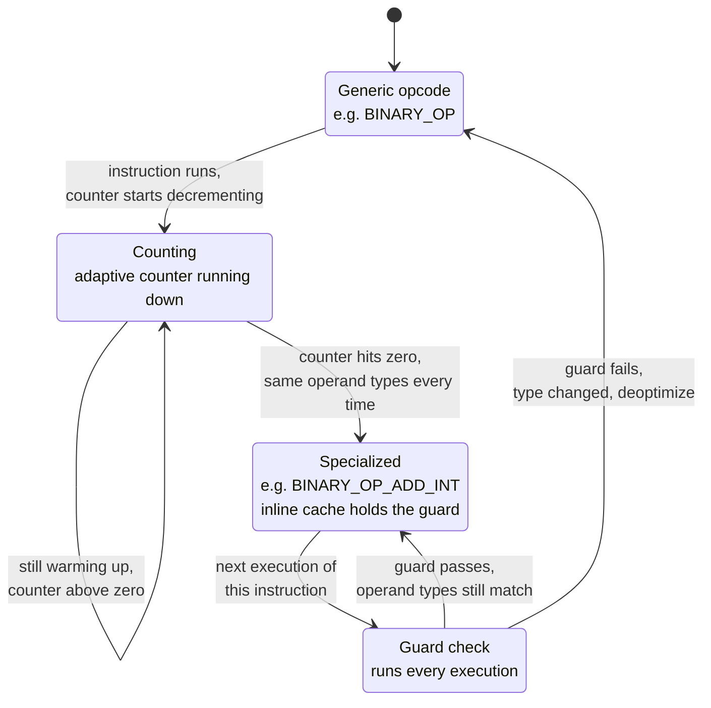
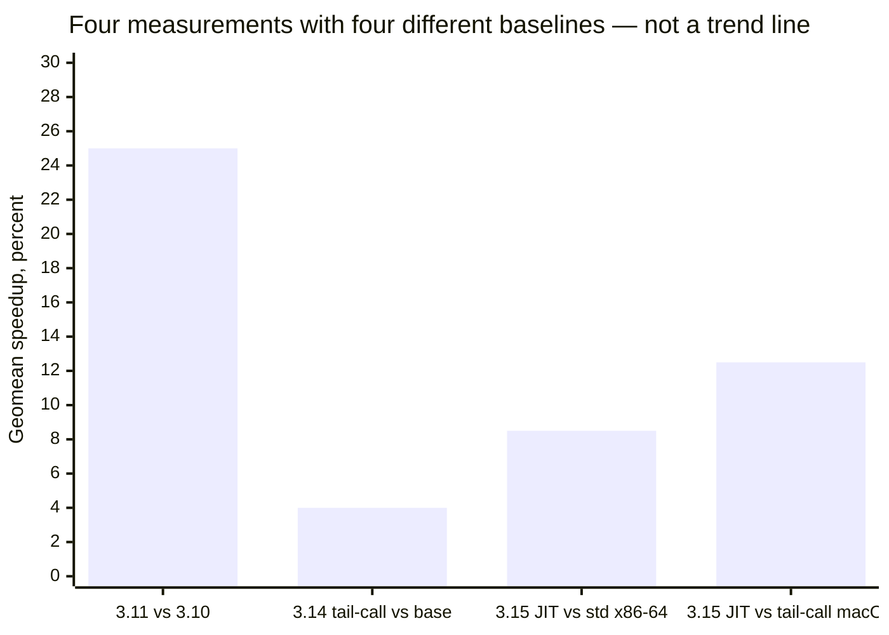

# The Modern CPython Runtime

---

## 1. Concept Overview

"Python got faster" is not one fact — it is four independent, separately-baselined engineering
changes to the interpreter, each shipped in a different release, each measured against a
different comparison point, and each governed by a different build-time switch. Conflating
them into a single number is the most common factual error in any conversation about modern
CPython performance.

The four changes, in the order they shipped:

1. **The specializing adaptive interpreter [3.11]** — always on, no build flag, no opt-in.
   CPython watches which type-specific path a bytecode instruction actually takes and rewrites
   that instruction to a faster, type-specialized variant after it has seen the same pattern
   repeatedly. This is the only one of the four with an official cumulative pyperformance
   figure: **~25% faster than Python 3.10** (range 10-60%, hot integer loops 2-3x).
2. **The copy-and-patch JIT [PEP 744, Status Draft]** — experimental since 3.13, with Windows
   and macOS binary releases carrying it starting in 3.14. It is opt-in and, as of the PEP text
   itself, was "about as fast as the existing specializing interpreter on most platforms" —
   i.e. not yet a clear win. There is no official CPython-published percentage for the 3.14 JIT.
3. **The tail-call interpreter [3.14]** — an alternate bytecode dispatch loop enabled by
   `--with-tail-call-interp` at build time, requiring Clang 19 or newer on x86-64 or AArch64.
   CPython's own published number is a geometric mean of **3-5% faster**, measured against a
   same-compiler build of 3.14 *without* the flag — not against 3.10, not against 3.13.
4. **The free-threaded build [PEP 779, Final in 3.14]** — `python3.14t`, the GIL genuinely
   removable. This one is not a speedup at all for single-threaded code; the documented cost is
   a **5-10% single-thread performance penalty**, the price paid for making the reference-count
   machinery thread-safe without a global lock. Its payoff is parallel throughput on
   multi-core workloads, not raw interpreter speed.

This file is the deep-dive on how those four layers actually work inside the interpreter loop —
the specialization mechanism, the JIT's compilation technique, the tail-call dispatch change,
and the modern low-overhead instrumentation API (`sys.monitoring`) that replaces `sys.settrace`
for anyone building a tool on top of this runtime. It assumes you have read
[Performance & Profiling](performance_and_profiling.md) — this file does not re-teach
`cProfile`, `py-spy`, `timeit`, or the slow-Python-pattern catalogue; it goes one layer deeper,
into what the interpreter itself is doing while your code runs.

---

## 2. Intuition

> Picture a machine operator who does not just run the machine — they stand beside it, watch
> which lever gets pulled the same way over and over, and quietly re-machine that one lever
> into a shape that does exactly that motion faster. The moment someone pulls it a different
> way, they swap the old generic lever back in. Nobody told them to do this; they inferred it
> from watching.

**Mental model.** The specializing adaptive interpreter is CPython *observing itself run* and
*rewriting its own bytecode* to match what it observed — mid-execution, without recompiling
your source, without you asking. That is a fundamentally different kind of optimization than
"the compiler emitted better code": no compiler pass ever saw your program as a whole; the
rewrite happens one instruction site at a time, live, based on runtime evidence.

**Key insight — everything in this file is a *warm* optimization.** A specialized opcode does
not exist until the interpreter has watched that instruction execute the same way repeatedly.
A JIT trace does not exist until a loop has run enough to justify compiling it. A cold
measurement — run the function once, time it, throw away the process — sees none of this
machinery engage. It measures the compiler-front-door bytecode, the same generic dispatch path
CPython has always had, and it will report that "3.14 isn't any faster," which is true of that
specific cold measurement and false as a claim about the interpreter.

---

## 3. Core Principles

**Specialize, then warm up, then measure warm.** Every number in this file describes steady-
state behavior after the interpreter has had a chance to observe and adapt. A benchmark that
does not warm up the code path under test is not measuring the thing this file describes.

**Every speedup number is meaningless without its baseline.** "25% faster" answers nothing
until you also know: faster than *what version*, on *what platform*, with *what compiler*, and
whether the comparison build differed from the baseline in exactly one variable. Section 6 and
Section 12 both return to this because it is the single most common way this material gets
misquoted.

**A build flag is a property of the interpreter binary, not of your code.** `--with-tail-call-
interp`, `--enable-experimental-jit`, and `--disable-gil` are all compile-time decisions made
once when CPython itself was built. Your source code runs identically regardless of which
combination is active; what changes is how fast the *same* bytecode executes. This is why
"pin and report the exact interpreter build" (Section 13) is not bureaucratic caution — two
processes running the identical `.py` file can differ by double-digit percentages purely
because they were built differently.

**Specialization is per call site, not per function.** The interpreter does not decide "this
function is hot" and specialize the whole thing; it decides "this specific bytecode instruction,
at this specific location, has consistently seen the same operand types" and specializes just
that instruction. A single function can be half-specialized and half-generic depending on which
of its instructions saw consistent types and which did not.

---

## 4. Types / Architectures / Strategies

Four layers, kept strictly distinct — a build can combine any subset of them, because each is
controlled by an independent switch (a language-level behavior that is always on, versus three
separate build-time configure flags), but no official CPython benchmark exists for any
*combination* of them, so do not imply their gains stack arithmetically.

### 4.a Specializing Adaptive Interpreter `[3.11]`

Not a build flag — this is the default `ceval.c` dispatch loop in every CPython 3.11+ binary,
including the one you already have installed. Bytecode instructions carry an adaptive counter;
once an instruction has been executed with the same observed types enough times (Section 6.1
covers the exact threshold and mechanism), CPython rewrites that instruction in place to a
specialized opcode with an inline type guard. There is nothing to enable and nothing to check —
if you are on 3.11 or later, this is running right now.

### 4.b Copy-and-Patch JIT `[PEP 744, Status: Draft]`

Experimental since 3.13; Windows and macOS binary releases began shipping the JIT starting in
3.14 (per the 3.14 "what's new" build-changes section), but it remains opt-in and is not the
default configuration on any platform. The compilation technique — **copy-and-patch** — is
detailed in Section 6.4; the short version is that it stitches together small pre-built
machine-code templates rather than running a traditional optimizing compiler backend, which is
why it compiles cheaply but does not (yet) deliver a large win. The PEP text itself, describing
the state at the time it was written, says the JIT was "about as fast as the existing
specializing interpreter on most platforms" — and sets the bar for graduating out of
experimental status at roughly a 5% win on a popular platform, a bar not yet met when that text
was written. **There is no official CPython-published speedup percentage for the 3.14 JIT.**

### 4.c Tail-Call Interpreter `[3.14]`

An alternate implementation of the bytecode dispatch loop itself — not a JIT, not
specialization, just a different way of writing the C `switch`-based interpreter core so that
each opcode handler tail-calls directly into the next one instead of looping back through a
central dispatch point. Enabled with `--with-tail-call-interp` at build time; requires Clang 19
or newer, and currently only works on x86-64 and AArch64. CPython's own published number:
**"a geometric mean of 3-5% faster on the standard pyperformance benchmark suite... The
baseline is Python 3.14 built with Clang 19, without this new interpreter"** — a same-compiler,
same-version comparison, which is exactly what makes it trustworthy where the earlier
unofficial 9-15% figure was not (Section 6.6, Q3).

### 4.d Free-Threaded Build `[PEP 779, Status: Final]`

`python3.14t` — officially supported since 3.14, no longer the `python3.13t` experimental
label from PEP 703. This layer is orthogonal to the other three in a specific sense: it does
not touch bytecode dispatch or compilation at all. It changes what backs `Py_INCREF` /
`Py_DECREF` — the reference-counting machinery covered in
[CPython Memory Model](../cpython_memory_model/cpython_memory_model.md) — so that it is safe
without a global lock. The documented cost on single-threaded code is
**"roughly 5-10%, depending on the platform and C compiler used"** (3.14 what's new, verbatim).
Whether that cost is worth paying is a question about your workload's actual parallelism and
your dependency tree's free-threading readiness — see
[The GIL and Free Threading](../the_gil_and_free_threading/the_gil_and_free_threading.md) for
the concurrency side of this story; this file only covers its cost to raw interpreter speed.

**Why "orthogonal" and not "combinable" as a benchmarked claim.** All three build flags —
tail-call interpreter, experimental JIT, free-threading — can in principle be selected together
in one `configure` invocation, because they touch different subsystems (dispatch loop shape,
optional trace compilation, reference-count representation). But CPython does not publish a
benchmark for that combined configuration, so do not claim their percentages add or multiply.
Report what you measured, on the exact build you measured it on — not an inferred composite.

---

## 5. Architecture Diagrams

```mermaid
flowchart LR
    classDef io      fill:#61afef,stroke:#2e86c1,color:#1a1a1a,font-weight:bold
    classDef frozen  fill:#c678dd,stroke:#9b59b6,color:#fff
    classDef train   fill:#98c379,stroke:#27ae60,color:#1a1a1a
    classDef mathOp  fill:#d19a66,stroke:#e67e22,color:#1a1a1a,font-weight:bold
    classDef lossN   fill:#e06c75,stroke:#c0392b,color:#fff,font-weight:bold
    classDef req     fill:#56b6c2,stroke:#0097a7,color:#1a1a1a
    classDef base    fill:#e5c07b,stroke:#f39c12,color:#1a1a1a

    Src(["Python Source"]) --> Compile("compile call<br/>bytecode generation")
    Compile --> Bytecode("Code Object<br/>bytecode array")
    Bytecode --> Adaptive("Specializing Adaptive<br/>Interpreter [3.11]<br/>always on")
    Adaptive --> TailChoice{"Build flag:<br/>tail-call loop?"}
    TailChoice -->|"--with-tail-call-interp"| TailCall("Tail-Call<br/>Interpreter [3.14]<br/>Clang 19+ only")
    TailChoice -->|"default build"| StdLoop("Standard ceval<br/>dispatch loop")
    TailCall --> JITCheck{"Build flag:<br/>JIT enabled?"}
    StdLoop --> JITCheck
    JITCheck -->|"experimental,<br/>opt-in"| JIT("Copy-and-Patch<br/>JIT [PEP 744, Draft]")
    JITCheck -->|"default, off"| Exec(["Bytecode Execution"])
    JIT --> Exec

    class Src io
    class Compile,Adaptive mathOp
    class Bytecode base
    class TailChoice,JITCheck req
    class TailCall,StdLoop train
    class JIT frozen
    class Exec io
```



*Every CPython 3.11+ process runs the specializing adaptive interpreter unconditionally; the
tail-call loop and the JIT are each a separate build-time fork in the road, chosen once when
the binary was compiled, and either can be present, absent, or (in principle) combined. The
free-threaded build is not on this diagram at all — it changes reference counting, not bytecode
dispatch, so it sits beside this pipeline rather than inside it.*



*One bytecode instruction's lifecycle at one call site: roughly eight consistent-type
observations turn a generic opcode into a specialized one with an inline type guard, and the
very next mismatched type sends it straight back to generic — specialization is earned slowly
and lost instantly, per Section 6.2.*



*Read the x-axis labels, not just the bar heights: each bar was measured against a different
comparison interpreter (3.10 for the first; a same-compiler, flag-off 3.14 for the second; the
standard 3.15 interpreter for the third; the 3.15 *tail-calling* interpreter — already ahead by
the previous bar's margin — for the fourth). A single connected trend line across these four
bars would silently claim they share one baseline, which is exactly the error this whole file
exists to prevent; drawn as an unconnected bar comparison, the differing baselines stay visible
in the labels instead of being erased by the geometry.*

---

## 6. How It Works — Detailed Mechanics

### 6.1 Reading Specialization With `dis`

`dis.dis(fn, adaptive=True)` shows the specialized opcodes a function's bytecode has actually
been rewritten to, not just the generic opcodes the compiler originally emitted. The two views
diverge only after the function has been called enough times to warm up:

```python
import dis

class Point:
    def __init__(self, x: int, y: int) -> None:
        self.x = x
        self.y = y

def manhattan(p: Point, q: Point) -> int:
    return abs(p.x - q.x) + abs(p.y - q.y)

p, q = Point(1, 2), Point(4, 6)

# Cold — before warm-up, adaptive=True shows the generic family only
dis.dis(manhattan, adaptive=True)
#   LOAD_FAST_LOAD_FAST     p, q
#   LOAD_ATTR               x  (generic, not yet specialized)
#   LOAD_ATTR               x
#   BINARY_OP               -
#   CALL_INTRINSIC_1        abs
#   ...

for _ in range(30):
    manhattan(p, q)

# Warm — the same call, adaptive=True now shows the rewritten instructions
dis.dis(manhattan, adaptive=True)
#   LOAD_FAST_LOAD_FAST     p, q
#   LOAD_ATTR_INSTANCE_VALUE  x   <- specialized: x lives at a known __dict__ offset
#   LOAD_ATTR_INSTANCE_VALUE  x
#   BINARY_OP_SUBTRACT_INT     <- specialized: both operands observed as int
#   CALL_PY_EXACT_ARGS       abs  <- specialized: exact argument count, pure-Python callee
#   ...
```

The specialized names carry the win in their own naming: `LOAD_ATTR_INSTANCE_VALUE` means "skip
the general attribute-resolution machinery — this attribute has consistently been found at a
fixed offset in the instance `__dict__`, so go straight there." `BINARY_OP_ADD_INT` and
`BINARY_OP_SUBTRACT_INT` mean "skip the generic `PyNumber_Add`/`PyNumber_Subtract` dispatch —
both operands have consistently been `int`, so do the C-level integer arithmetic directly."
`CALL_PY_EXACT_ARGS` means "skip general call-argument marshaling — this call site has
consistently invoked a pure-Python function with exactly the expected number of positional
arguments."

### 6.2 The Inline Cache and the Guard

Every specialized instruction carries an **inline cache** — extra bytes embedded directly in
the instruction stream, sitting immediately after the opcode, that hold what the interpreter
last observed (a cached type, a cached attribute offset, a cached function pointer). On every
single execution of a specialized instruction, before taking the fast path, the interpreter
runs a **guard check**: does the operand actually appearing right now still match what the
inline cache assumed?

A guard check costs a handful of cheap comparisons — typically a type-pointer comparison and,
for attributes, an offset/version check — always paid on every execution, specialized or not.
The win is not "no check ever happens again"; the win is "the check is cheap and, when it
passes, the rest of the operation skips the generic dispatch machinery entirely." A guard
failure costs strictly more than the generic path would have: the interpreter discovers the
mismatch, falls through to the generic implementation for that one call, and — as covered next
— may deoptimize the site back to generic for future calls too.

### 6.3 Deoptimization and Why Polymorphic Sites Never Specialize

A **polymorphic call site** — one bytecode instruction that regularly sees more than one
operand type — is the case the specializing interpreter cannot help. Concretely:

```python
def describe(x: int | str) -> str:
    return str(x) + "!"          # BINARY_OP + at this line

for i in range(1_000):
    describe(i)                   # this call site sees only int
for s in ("a", "b", "c"):
    describe(s)                   # now the *same* call site sees only str
```

Watching `describe`'s `+` instruction across its whole lifetime: it warms up on `int` during
the first loop and specializes to a string-concatenation-free integer path (there is no such
path here since `str(x)` always returns `str`, but the general point holds for a genuinely
mixed-type site) — the moment a call site's operand types actually alternate call-to-call, the
guard fails on almost every execution, the instruction deoptimizes back to generic, and the
interpreter stops attempting to re-specialize a site that keeps disagreeing with itself. The
practical consequence: a function whose hot loop calls a helper with a genuinely polymorphic
argument — a duck-typed dispatch, an `Any`-typed container mixing numeric and string entries —
pays full generic-dispatch cost on every call, and no amount of warm-up time fixes that,
because the problem is not insufficient observation, it is that there is no single stable
pattern to observe. A monomorphic site (same type, every call, forever) is what specialization
is built for; a call site that flips type every few calls is the one case this whole mechanism
cannot touch.

### 6.4 Copy-and-Patch, Explained Properly

The 3.13/3.14 experimental JIT (PEP 744) does not work the way a "JIT compiler" usually
implies — it does not build an intermediate representation, run register allocation across a
whole trace, or inline callees into the compiled unit. Instead, CPython pre-compiles a small
machine-code **template** for each bytecode instruction, generated from the same DSL that
generates the rest of the interpreter's dispatch table. At runtime, once a code path is judged
hot enough to compile, the JIT walks the sequence of bytecode instructions and **stitches**
their pre-built templates together end to end, **patching** the placeholder operands in each
template with the actual values for that specific call site (a constant, a jump target, a
cached attribute offset) — hence "copy-and-patch."

This is why the technique compiles fast (no optimization pass runs — it is closer to assembling
prefabricated parts than compiling from source) and also why the win is modest compared to a
tracing JIT such as PyPy's: there is **no cross-instruction optimization**. Two adjacent
templates are simply glued together; nothing merges redundant loads between them, nothing keeps
a value in a register across a template boundary instead of round-tripping it through memory,
nothing inlines a small callee's template into the caller's trace. A tracing JIT that builds and
optimizes a whole trace as one unit can eliminate exactly this kind of boundary waste; copy-and-
patch, by construction, cannot — that structural limitation, not an implementation bug, is why
PEP 744's own text describes the JIT as "about as fast as the existing specializing interpreter
on most platforms" rather than as a decisive win.

### 6.5 Telling Whether the JIT (or the Tail-Call Loop) Is Actually Enabled

There is a real, current gap here worth naming rather than papering over: **CPython's official
documentation does not describe a runtime check — no `sys` attribute, no `sysconfig` variable —
for whether the experimental JIT or the tail-call interpreter is active in the build you are
running.** Both are purely build-time decisions (`--enable-experimental-jit` /
`--with-tail-call-interp`, plus the Clang 19+ requirement for the latter), and the reliable way
to know is to know how the binary in front of you was built: read the release notes for the
specific distribution (the 3.14 "what's new" build-changes section states Windows and macOS
official binary releases carry JIT support; a Linux distro package, a Docker base image, or a
`uv python install`-managed build may or may not, and that has to be checked against that
build's own notes rather than assumed from the version number alone). CPython 3.14's own docs
add one more detail worth knowing before turning the tail-call interpreter on: *"Enabling
profile-guided optimization is highly recommended when using the new interpreter, as it is the
only configuration that has been tested and validated for improved performance"* — i.e. the
3-5% figure was itself measured on a PGO build, and skipping PGO is an untested configuration.

Free-threading is the one exception to this gap: it has a documented, public runtime check.
`sys._is_gil_enabled()` — added in 3.13 — returns `True` if the GIL is active and `False` if it
is disabled, which is the one reliable way to confirm from inside a running process whether you
are actually on a `t`-suffixed free-threaded build with the GIL off, versus a normal build that
merely has the free-threading *code paths* compiled in but the GIL still active by default.

### 6.6 `sys.monitoring` `[3.12]` — the Tool-ID Event Model in Depth

[Performance & Profiling §6.8](performance_and_profiling.md) already covers why
`sys.monitoring` (PEP 669) exists and its rough overhead numbers; this section goes into the
API shape itself, because it is what you actually write against when building a tracer.

`sys.monitoring` is organized around **tool IDs** — small integers, 0 through 5, that let
multiple instrumentation tools coexist without colliding. A handful of IDs carry reserved,
conventional meanings so well-behaved tools do not fight over the same slot:

| Constant | Value | Conventional owner |
|---|---|---|
| `sys.monitoring.DEBUGGER_ID` | 0 | Debuggers |
| `sys.monitoring.COVERAGE_ID` | 1 | Coverage tools |
| `sys.monitoring.PROFILER_ID` | 2 | Profilers |
| `sys.monitoring.OPTIMIZER_ID` | 5 | Optimizers |

A tool claims an ID with `use_tool_id(tool_id, name)`, subscribes to specific events with
`set_events(tool_id, event_set)` (a bitwise-OR of constants from `sys.monitoring.events` —
`PY_START`, `PY_RESUME`, `PY_RETURN`, `PY_YIELD`, `CALL`, `LINE`, `INSTRUCTION`, `JUMP`,
`BRANCH_LEFT`/`BRANCH_RIGHT`, `STOP_ITERATION`, `C_RAISE`, `C_RETURN`, `PY_THROW`, `PY_UNWIND`, `RAISE`,
`EXCEPTION_HANDLED`), attaches a Python function to any of them with `register_callback`, and
releases the ID with `free_tool_id` when done:

```python
import sys

TOOL_ID = sys.monitoring.PROFILER_ID
LINE = sys.monitoring.events.LINE

hot_lines: dict[tuple[str, int], int] = {}

def on_line(code: object, line_number: int) -> object:
    key = (code.co_filename, line_number)  # type: ignore[attr-defined]
    hot_lines[key] = hot_lines.get(key, 0) + 1
    # Returning DISABLE turns off future callbacks for THIS specific
    # (code, line) location only — every other monitored location is untouched.
    if hot_lines[key] > 10_000:
        return sys.monitoring.DISABLE
    return sys.monitoring.MISSING

sys.monitoring.use_tool_id(TOOL_ID, "hot-line-sampler")
sys.monitoring.register_callback(TOOL_ID, LINE, on_line)
sys.monitoring.set_events(TOOL_ID, LINE)

# ... run the code under observation ...

sys.monitoring.set_events(TOOL_ID, sys.monitoring.events.NO_EVENTS)
sys.monitoring.free_tool_id(TOOL_ID)
```

The `DISABLE` return value is the mechanism that actually makes this cheap where
`sys.settrace` is not. `sys.settrace` is one global function invoked on essentially every line
of every frame, for as long as tracing is on, with no way to say "stop calling me about this
one line, I've learned everything I need from it." `sys.monitoring` callbacks can retire
themselves **per location** — a specific `(code object, line number)` pair, or a specific call
site — the instant they stop being interesting, while every other monitored location keeps
firing normally. A coverage tool, for instance, only needs to see each line execute *once* to
mark it covered; with `DISABLE` it can turn itself off for every line the moment that line has
fired once, converging toward zero overhead as the run proceeds, which a single global trace
function structurally cannot do.

### 6.7 PEP 799 `[3.15]` — the `profiling` Package and the `profile` Module's Exact Timeline

Python 3.15 introduces a new stdlib package, `profiling`, that reorganizes the profiling
toolchain into two purpose-named submodules:

- **`profiling.tracing`** — the deterministic, call-count-and-cumulative-time profiler; this is
  where `cProfile`'s implementation itself now lives. **`cProfile` is not removed** — it remains
  importable as a backwards-compatible alias to `profiling.tracing`, so existing
  `import cProfile` code keeps working unmodified.
- **`profiling.sampling`** — a statistical sampling profiler, code-named "tachyon," that can
  attach to an already-running process by PID (the same production-safe workflow `py-spy`
  popularized) and explicitly supports free-threaded builds, sampling across threads without
  the GIL serializing what gets observed.

Separately, and this is the detail worth getting exactly right because the wording inverts the
advice: the older, **pure-Python** `profile` module (the one `cProfile` itself was originally
written to replace, predating it in the stdlib) has a **published, staged removal**, not an
immediate one:

| Python version | What happens to `profile` |
|---|---|
| 3.15 | Importing it raises `DeprecationWarning` |
| 3.16 | Every *use* of it raises `DeprecationWarning`, not just the import |
| 3.17 | Removed from the stdlib entirely |

`cProfile` is untouched by this timeline — the schedule above applies only to the older,
slower, pure-Python `profile` module. Confusing the two — treating `cProfile`'s relocation to
`profiling.tracing` as if it were the same event as `profile`'s deprecation — is the exact kind
of one-word (`profile` vs `cProfile`) mistake this section exists to prevent (see Section 10,
Pitfall 5, and Q8 in Section 12).

---

## 7. Real-World Examples

**Free upgrade, no code change.** The most common way teams actually capture the 3.11
specializing-interpreter win is the least glamorous: bump the base image's Python version, run
the existing test and load-test suite, ship. No source line changes, because the specialization
mechanism requires none — it is entirely a property of the interpreter, not the program.

**Most teams do not turn the JIT on.** Because there is no official percentage attached to it,
and because — as Section 6.4 explains — the technique's own structure caps its ceiling below a
tracing JIT's, most production deployments stay on JIT-off builds and treat it as something to
benchmark on their own workload before adopting, not something to enable on the strength of a
version bump.

**A free-threaded build is a dependency audit before it is a performance decision.** As
[the C-extension boundary discussion](performance_and_profiling.md#610-the-cnative-extension-boundary)
already covers, one native dependency that has not declared `Py_mod_gil = Py_MOD_GIL_NOT_USED`
silently re-enables the GIL for the entire process on import. A team considering `python3.14t`
in production has to inventory every compiled dependency — ORM drivers, crypto libraries, ML
runtimes — and confirm free-threading support for each before the 5-10% single-thread cost buys
anything at all; skipping that audit is how a team pays the tax and gets none of the payoff.

**A performance-sensitive numeric library benchmarks each toggle independently.** Rather than
turning on the tail-call interpreter, the JIT, and free-threading together and reporting one
combined number, a careful benchmark suite runs the same workload across each build
configuration in isolation, against its own correct baseline, precisely because — as Section
4's closing note says — CPython does not publish (and a team should not assume) that the gains
compose.

---

## 8. Tradeoffs

| Layer | Measured gain (with baseline) | Build cost | Dependency risk | Who it is for |
|---|---|---|---|---|
| Specializing adaptive interpreter [3.11] | ~25% vs 3.10 (official, cumulative) | None — default in every 3.11+ build | None | Everyone; automatic |
| Copy-and-patch JIT [PEP 744, Draft] | No official percentage; PEP text says "about as fast as" the specializing interpreter | Opt-in build flag; Windows/macOS official binaries carry it in 3.14 | Low functional risk, uncertain payoff | Teams benchmarking their own hot loops before adopting |
| Tail-call interpreter [3.14] | 3-5% geomean vs same-compiler, flag-off 3.14 | `--with-tail-call-interp`, Clang 19+, x86-64/AArch64 only, PGO recommended | Portability: unavailable outside that compiler/arch combination | Teams building their own CPython who can pin the toolchain |
| Free-threaded build [PEP 779, Final] | -5 to -10% single-thread (a cost, not a gain) | `python3.14t`; every native dependency must opt in | High — one non-opted-in C extension re-enables the GIL globally | CPU-bound, genuinely parallel multi-core workloads after a full dependency audit |

*Reading this table honestly means noticing that only one row is a fact you can bank on for
free — the rest are decisions to make deliberately, each with a cost that has to be paid before
any benefit shows up.*

---

## 9. When to Use / When NOT to Use

**A runtime/build-flag change is the right lever when:**
- You are on Python 3.10 or older and have not yet captured the free, automatic 3.11
  specializing-interpreter win — this one has no downside worth naming.
- Your workload is a genuinely parallel, CPU-bound, multi-core problem, your dependency tree
  has been audited for free-threading support, and you have measured the single-thread penalty
  against the actual concurrency win on your hardware.
- You control your own build toolchain (able to pin Clang 19+, run PGO) and pyperformance-style
  benchmarks on your actual workload show the tail-call interpreter or JIT genuinely helps it.

**A build flag is the wrong lever entirely when:**
- The workload is **I/O-bound** — waiting on a network call, a database round trip, a disk
  read. None of the four layers in this file touch wait time; a request spending 95% of its
  latency in a socket read will not be meaningfully faster on any interpreter build, because
  there is almost no interpreter work happening during that wait in the first place.
- **One `O(n^2)` (or worse) algorithm dominates the runtime.** Section 8 of the parent module's
  Amdahl's Law walkthrough applies directly here: a 25% interpreter-wide speedup applied to a
  function whose complexity class is wrong is still the wrong complexity class, just marginally
  cheaper per operation. Fix the algorithm first; an interpreter upgrade is a multiplier on
  whatever complexity class you already have, not a substitute for choosing a better one.
- You cannot control or pin the exact build your production fleet runs. A tail-call or
  JIT-specific gain measured on a developer's Homebrew build tells you nothing reliable about a
  fleet running a different distro's package, built with a different compiler.

---

## 10. Common Pitfalls

### Pitfall 1: Benchmarking cold and concluding the specializing interpreter does nothing

```python
# BROKEN: single call, no warm-up — the adaptive counter never reaches
# threshold, so the specialized opcodes never get installed, and this
# benchmark measures the generic dispatch path on every version tested
import timeit

def dot(a: list[int], b: list[int]) -> int:
    return sum(x * y for x, y in zip(a, b))

a, b = list(range(1000)), list(range(1000))
elapsed = timeit.timeit(lambda: dot(a, b), number=1)
print(f"3.10: ... 3.14: ...")  # near-identical numbers, wrongly read as "no progress"
```

```python
# FIX: warm the call site up first, matching how the interpreter actually
# behaves in a long-running process, THEN measure the steady state
import timeit

def dot(a: list[int], b: list[int]) -> int:
    return sum(x * y for x, y in zip(a, b))

a, b = list(range(1000)), list(range(1000))
for _ in range(50):        # cross the specialization threshold first
    dot(a, b)

elapsed = timeit.timeit(lambda: dot(a, b), number=10_000)
print(f"warm steady-state: {elapsed/10_000*1e6:.1f}us per call")
# now the BINARY_OP_MULTIPLY_INT / specialized-zip path is actually engaged
```

A benchmark harness that measures "first call" latency is measuring something real —
interpreter startup and import-time cost matter for CLI tools — but it is not measuring
anything this file describes, and reporting it as evidence about interpreter speedups
conflates two different questions.

### Pitfall 2: Comparing a 3.13 number to a 3.14 number as though the baseline were shared

```python
# BROKEN: two numbers from two different reports, subtracted as if they
# came from the same experiment
# report A (3.13 release): "JIT is about as fast as the interpreter" (PEP 744 text)
# report B (3.14 release): "tail-call interpreter is 3-5% faster than flag-off 3.14"
# WRONG conclusion: "so 3.14 with both flags is 3-5% faster than the 3.13 JIT baseline"
```

```python
# FIX: state each number against its own named baseline, and stop the
# moment a comparison would require a baseline nobody published
# - 3.11 specializing interpreter: ~25% faster than 3.10 (official, cumulative)
# - 3.14 tail-call interpreter: 3-5% faster than a same-compiler, flag-off 3.14
# - 3.14 JIT: no official percentage
# - 3.15 JIT: 8-9% (x86-64 Linux) or 12-13% (AArch64 macOS) faster — against
#   DIFFERENT baselines from each other, and not yet final
# There is no arithmetic that combines these into "3.14 vs 3.11" or "3.15 vs 3.10."
```

### Pitfall 3: Leaving `cProfile` (or `profiling.tracing`) enabled in production

The general version of this mistake — and the fix — belongs to
[Performance & Profiling §10, Pitfall 3](performance_and_profiling.md), which already covers
the 1.5-3x latency cost of `sys.setprofile`-based tools. The interpreter-internals angle this
file adds: a deterministic profiler like `cProfile` instruments *every function call and
return*, which means every profiled call pays both the profiler's own overhead *and* whatever
specialization state existed for that call site before profiling started — you are not
comparing "profiled" against "unprofiled but otherwise identical" dispatch, you are adding a
fixed per-call tax on top of a runtime that was designed to make per-call overhead as close to
zero as possible. That is precisely why `sys.monitoring` (Section 6.6) exists: to let new
instrumentation subscribe to only the events it needs instead of taxing every call
unconditionally.

### Pitfall 4: Assuming the JIT (or tail-call interpreter) is on because the version supports it

```python
# BROKEN: "we're on Python 3.14, so the JIT is helping our hot path"
# — stated with no build inspection at all
```

```python
# FIX: as Section 6.5 covers, there is no documented sys/sysconfig runtime
# check for the JIT or tail-call interpreter (there IS one for free-threading):
import sys

gil_status = "unknown (pre-3.13 build)"
if hasattr(sys, "_is_gil_enabled"):
    gil_status = "disabled (free-threaded)" if not sys._is_gil_enabled() else "enabled"
print(f"GIL: {gil_status}")
# For the JIT and tail-call interpreter, the only reliable source is the
# specific distribution's release notes or your own build's configure log —
# "I'm on 3.14" answers neither question.
```

### Pitfall 5: Reading a third-party "Python 3.N is X% faster" index as an official CPython figure

Benchmark aggregator sites and blog posts routinely publish a single cumulative percentage per
release — "3.14 is 12% faster than 3.13," or similar. **CPython itself publishes exactly one
such cumulative, version-over-version pyperformance geomean: 3.11 vs 3.10, ~25%.** Every other
"N% faster" headline number in circulation, for 3.12 through 3.15, is a third party's own
aggregation methodology, benchmark selection, and hardware — not a number CPython stands behind
as its official release-to-release comparison. Treat any such figure as "worth investigating on
your own workload," never as citable fact about what CPython shipped, and always ask what
benchmark suite, hardware, and baseline produced it before repeating it.

---

## 11. Technologies & Tools

| Tool | What it is for |
|---|---|
| `dis` | Reads specialized bytecode directly — `dis.dis(fn, adaptive=True)` before and after warm-up is the ground truth for whether specialization actually engaged (Section 6.1) |
| `sys.monitoring` | The modern, per-location-disableable event API (PEP 669) for building a tracer, coverage tool, or debugger — replaces `sys.settrace`/`sys.setprofile` for new instrumentation (Section 6.6) |
| `profiling.sampling` `[3.15]` | Stdlib sampling profiler, code-named "tachyon"; attaches to a running process by PID and supports free-threaded builds (Section 6.7) |
| `pyperf` | The benchmarking library `pyperformance` itself is built on — statistically rigorous timing with warm-up control, the right tool for producing any number in this file's tables |
| `py-spy` | External-process sampling profiler; unaffected by which interpreter-runtime layer is active, since it samples the call stack rather than instrumenting bytecode (covered in depth in the parent module) |
| `memray` | Allocation tracer; relevant here only in that a free-threaded build's memory geometry differs (see [CPython Memory Model](../cpython_memory_model/cpython_memory_model.md)) — not a runtime-dispatch tool |
| `scalene` | CPU/GPU/memory line profiler that distinguishes Python-level from native time — useful for confirming whether a hot line is inside interpreter dispatch or already inside compiled code before reaching for a JIT-or-not question at all |

---

## 12. Interview Questions with Answers

**Q: Why does a cold, single-call benchmark make CPython 3.11+'s specializing interpreter look like it changed nothing?**
**Short:** A cold benchmark never crosses the warm-up threshold, so specialized opcodes are never installed and it measures generic dispatch only.

Specialization only engages after an instruction has been observed executing the same way roughly eight times; a benchmark that calls a function once and times it never reaches that threshold, so the interpreter is still running the original generic opcodes on every measurement. The fix is to warm the call site up in a loop before timing it, matching how the interpreter actually behaves during the steady state of a long-running process — see Pitfall 1 in Section 10 for the exact broken-then-fixed pattern.

**Q: Why does a call site that alternates between `int` and `str` arguments never get faster under the specializing interpreter, no matter how many times it runs?**
**Short:** A genuinely polymorphic call site keeps failing its type guard, so it deoptimizes back to generic instead of accumulating warm-up progress.

Specialization requires the same operand type to show up consistently at one bytecode instruction; a site that alternates types fails its guard almost every time it is checked, and CPython responds by deoptimizing that instruction back to the generic implementation rather than repeatedly re-attempting a pattern that keeps disagreeing with itself. The practical consequence is that duck-typed dispatch code or a container mixing numeric and string entries pays full generic-dispatch cost forever — more execution count does not help, because the problem is type instability, not insufficient observation (Section 6.3).

**Q: What went wrong with the widely-quoted 9-15% figure for CPython 3.14's tail-call interpreter, mechanically — not just "it was wrong"?**
**Short:** The comparison build hit an LLVM 19 tail-duplication code-generation regression that the tail-call build happened to route around, inflating the gap.

The baseline build (flag off) triggered a regression in LLVM 19's tail-duplication limits during code generation, and the tail-call interpreter build — which restructures the dispatch loop into a chain of tail calls — happened to avoid the code shape that triggers that regression, so most of the measured 9-15% gap was actually the *baseline* running slower than it should have, not the treatment running faster. Once a baseline that controls for the regression was used, the honest gain dropped to 1-5%, matching CPython's own eventually-published 3-5% geomean; the parent module's Pitfall 6 covers the same episode as a benchmarking-methodology lesson, and the mechanism here is what made that methodology lesson concrete rather than abstract.

**Q: How do you honestly answer "is Python 3.14 faster than 3.11" in an interview?**
**Short:** There is no official cumulative figure comparing them directly, so the honest answer decomposes it by named, separately-baselined change instead.

CPython publishes exactly one official cumulative pyperformance geomean, 3.11 vs 3.10 at roughly 25%, and no official 3.12-through-3.15 cumulative figure exists that a 3.14-vs-3.11 comparison could even be built from without inventing an unpublished number. The honest answer names each independently-measured change and its own baseline — the 3.11 specializing interpreter's 25% vs 3.10, the 3.14 tail-call interpreter's 3-5% vs a same-compiler flag-off 3.14, and the fact that the 3.14 JIT carries no official percentage at all — and states plainly that CPython has not published the arithmetic to combine them into one 3.14-vs-3.11 number. Reciting a third-party aggregator's headline percentage instead is the wrong move (Section 10, Pitfall 5).

**Q: Why is it a mistake to assume the JIT is active just because you're running Python 3.14?**
**Short:** The JIT is an opt-in build-time flag, not a language-version feature, so being on 3.14 says nothing about whether it was compiled in.

The experimental JIT (PEP 744) is enabled with a build-time configure flag; official Windows and macOS binary releases carry it starting in 3.14, but a Linux distribution package, a container base image, or a self-built interpreter may not, and the version number alone cannot tell you which. Worse, CPython's documentation does not currently expose a runtime check (no `sys` attribute, no `sysconfig` variable) for whether the JIT or the tail-call interpreter is active — the only reliable source is that specific build's own release notes or configure log, unlike free-threading, which does have a documented runtime check via `sys._is_gil_enabled()` (Section 6.5).

**Q: What actually is "specialization" at the bytecode level, as a mechanism rather than a name?**
**Short:** CPython rewrites a specific bytecode instruction in place to a type-specific variant after it repeatedly observes the same operand types there.

Each bytecode instruction carries an adaptive counter and, once specialized, an inline cache holding what was last observed at that exact call site — a type, an attribute offset, a callee pointer. After roughly eight consistent-type observations, the interpreter replaces the generic opcode with a specialized variant (`LOAD_ATTR` to `LOAD_ATTR_INSTANCE_VALUE`, `BINARY_OP` to `BINARY_OP_ADD_INT`, `CALL` to `CALL_PY_EXACT_ARGS`, `COMPARE_OP` to `COMPARE_OP_INT`) that checks a cheap guard and then takes a fast, type-specific C code path instead of the fully generic dispatch. This is per instruction site, not per function — a single function can have some instructions specialized and others still generic depending on which ones saw stable types.

**Q: What does the inline cache and guard actually check on every execution of a specialized instruction, and what does a guard failure cost?**
**Short:** The guard runs a cheap type or offset check every single time, and failing it costs more than the generic path plus a possible deoptimization.

A specialized instruction carries an inline cache — extra bytes in the instruction stream holding what was last observed there, such as a cached type or a cached attribute offset — and on every execution, before taking the fast path, the interpreter runs a guard: a cheap comparison confirming the current operand still matches what the cache assumed. The check is paid unconditionally, specialized or not; when it passes, the rest of the operation skips generic dispatch entirely, and that is the entire win. When it fails, the interpreter falls through to the generic implementation for that call and, if the mismatch keeps recurring, deoptimizes the site back to generic for future calls too — so a guard failure is strictly more expensive than the generic path would have been on its own, not merely a wasted check.

**Q: What is copy-and-patch, and what specific optimization does it forgo compared to a tracing JIT?**
**Short:** Copy-and-patch stitches pre-built machine-code templates per bytecode and patches in operands, with no cross-instruction register allocation or inlining.

Rather than compiling a whole trace with an optimizing backend, CPython's JIT keeps one small, pre-compiled machine-code template per bytecode instruction — generated from the same DSL that builds the rest of the interpreter — and at runtime it copies the relevant templates together in sequence and patches in the actual operand values for that call site. What it forgoes is any optimization that spans an instruction boundary: no shared register allocation across adjacent templates, no eliminating a redundant reload between two stitched templates, no inlining a small callee's template into its caller's. That structural limit, not a bug, is why the technique compiles quickly but delivers a modest win rather than a tracing JIT's larger one (Section 6.4).

**Q: Why does the 3.14 JIT sometimes measure slower than the plain interpreter, and why did CPython still ship it?**
**Short:** It forgoes cross-instruction optimization so its ceiling is close to the specializing interpreter's, and different C compilers can push it either side of that line.

Because copy-and-patch stitches independently-compiled templates with no cross-instruction optimization, its performance ceiling sits close to the specializing adaptive interpreter's own — PEP 744's text describes it as "about as fast as the existing specializing interpreter on most platforms" at the time it was written — and small differences in which C compiler built a given binary can land the JIT build on either side of that line, occasionally slower. CPython shipped it as opt-in and experimental specifically because of this: it lets the technique mature and be benchmarked in the wild without making it the default configuration before it clears the bar (roughly a 5% win on a popular platform) the PEP itself sets for graduating out of experimental status.

**Q: What is the CPython 3.14 tail-call interpreter's official speedup number, and what exactly is its baseline?**
**Short:** A geometric mean of 3-5%, measured against a Clang-19 build of 3.14 with the same flags except the tail-call interpreter itself.

CPython's own "what's new" text states it verbatim: "a geometric mean of 3-5% faster on the standard pyperformance benchmark suite... The baseline is Python 3.14 built with Clang 19, without this new interpreter." The comparison is deliberately same-version, same-compiler, single-variable — the one thing that differs is the `--with-tail-call-interp` flag itself — which is exactly what makes this number trustworthy where the earlier, informally-circulated 9-15% figure was not, because that one compared builds that differed by more than the flag under test.

**Q: What does the documented 5-10% free-threading single-thread penalty actually cost, mechanically?**
**Short:** It is the price of making reference counting thread-safe without a global lock, paid by every single-threaded call regardless of concurrency.

CPython's "what's new" text for 3.14 states it directly: "the performance penalty on single-threaded code in free-threaded mode is now roughly 5-10%, depending on the platform and C compiler used." The free-threaded build replaces the GIL-protected, simple reference-count increment/decrement with a scheme that must remain correct when multiple threads touch the same object concurrently — biased, thread-local/shared reference counting, covered in [CPython Memory Model](../cpython_memory_model/cpython_memory_model.md) — and that extra bookkeeping is paid on every object touch, whether or not any other thread is actually running at the time. It is a tax on the mechanism being safe, not a tax on actual contention.

**Q: When should a tool builder reach for `sys.monitoring` instead of `sys.settrace`, and what makes `sys.monitoring` structurally cheaper rather than just "less overhead in practice"?**
**Short:** sys.monitoring lets a callback disable itself per code location, while sys.settrace is one global function with no way to narrow its own scope.

`sys.settrace` installs a single global trace function that CPython must consult on essentially every line of every frame for as long as tracing stays on, forcing every traced frame out of its specialized fast paths — there is no way for the trace function to say "stop calling me about this particular line, I already know what I need." `sys.monitoring` (PEP 669) is organized around tool IDs and per-event subscriptions, and a registered callback can return the `DISABLE` sentinel to retire itself for one specific `(code, location)` pair while every other monitored location keeps firing — a coverage tool, for instance, can disable itself for a line the instant that line has executed once, converging toward zero overhead as a run proceeds, which is a scoping capability `sys.settrace` structurally does not have (Section 6.6).

**Q: PEP 799 reorganizes profiling in Python 3.15 — what happens to `cProfile`, and what happens to the separate `profile` module, and why does confusing the two matter?**
**Short:** cProfile relocates to profiling.tracing and stays as a working alias, while the older pure-Python profile module is deprecated on a staged three-release timeline to removal.

`cProfile`'s implementation moves to the new `profiling.tracing` submodule, but `cProfile` itself remains importable as a backwards-compatible alias — existing code is unaffected. The separate, older, pure-Python `profile` module follows a different and much harsher path: importing it raises `DeprecationWarning` starting in 3.15, every use of it (not just the import) raises `DeprecationWarning` starting in 3.16, and it is removed from the stdlib entirely in 3.17. Conflating the two — treating `cProfile`'s relocation as though it carried `profile`'s removal timeline — inverts the advice: it wrongly tells a team to migrate off a tool (`cProfile`) that was not removed, while potentially missing the real deadline on the tool (`profile`) that actually was.

**Q: Are the specializing interpreter, the JIT, the tail-call interpreter, and free-threading combinable in one build, and what can you claim about a build that combines them?**
**Short:** They can be combined as build flags since each touches a different subsystem, but no official CPython benchmark covers any combined configuration.

The specializing interpreter is always on and cannot be disabled independently; the tail-call interpreter, the JIT, and free-threading are each a separate configure-time choice, and nothing structurally prevents selecting more than one at once, since they modify different subsystems — dispatch-loop shape, optional trace compilation, and reference-count representation, respectively. What you cannot claim is that their individually-published percentages add or multiply in a combined build: CPython has not published a benchmark for any such combination, so a report describing a build with several of these flags together should state only what was actually measured on that exact build, not an inferred composite of the separate official figures.

**Q: Why does "pin and report the exact interpreter build" matter more here than it would for an ordinary application-level benchmark?**
**Short:** Every number in this file depends on a build-time flag or compiler version, so an unpinned build makes the comparison meaningless before any code runs.

An ordinary application benchmark mainly needs to hold the code under test constant; the four layers in this file each depend on a decision made when the interpreter binary itself was compiled — which compiler and version built it, whether `--with-tail-call-interp` or `--enable-experimental-jit` were passed, whether it is a `t`-suffixed free-threaded build — none of which is visible in the source code being run and, as Section 6.5 covers, some of which is not even visible at runtime through any documented API. Two developers running what looks like "the same benchmark on the same Python version" can get meaningfully different numbers purely from a different distribution's build choices, which is why a credible benchmark report names the exact build (version, compiler, configure flags) alongside the numbers, not just the Python version string.

---

## 13. Best Practices

**Always measure warm, never cold, when the claim is about interpreter behavior.** Warm the
call site up past the specialization threshold before timing it — a cold measurement answers a
different, also-legitimate question (startup cost) that this file's numbers do not address.

**State the baseline every time you state a percentage.** "25% faster" is not a complete
sentence in this domain; "25% faster than 3.10, per CPython's official pyperformance figure" is.
Section 12's Q&As model this pattern deliberately — copy it.

**Pin and report the exact interpreter build in every benchmark report** — version, C compiler
and version, and which of the three build-time flags (tail-call interpreter, JIT, free-
threading) were active. Given how much of this file's material lives at the build-flag layer,
"Python 3.14" alone is not enough information to reproduce a result.

**Never quote a cumulative speedup that CPython did not publish.** If a specific release's
overall speedup versus a specific other release is not one of the numbers named in this file's
Section 1 and Section 6.7 — verified against `docs.python.org`'s own "what's new" pages and
`blog.python.org` — do not state it as CPython's own figure, however common the number is in
circulation elsewhere.

**Treat a free-threaded build as a dependency decision before a performance decision.** Audit
every compiled dependency for `Py_mod_gil` support before adopting `python3.14t`, and budget for
the documented 5-10% single-thread cost regardless of how the audit turns out — it is paid
whether or not the workload ends up genuinely parallel.

**Reach for `sys.monitoring`, not `sys.settrace`, for any new instrumentation.** `cProfile` and
`line_profiler` are still built on the older trace functions today, but nothing new should be —
the per-location `DISABLE` capability is a structural advantage, not just a smaller constant
factor.

---

## 14. Case Study

### The Regression That Was a Benchmark Bug

**Scenario.** A platform team upgrades a latency-sensitive batch-scoring service from Python
3.13 to 3.14, expecting the free interpreter improvements this file describes. Their nightly
performance-regression job — which runs a fixed benchmark script against a fixed input file and
compares the result to a stored baseline — reports the new build **11% slower**. The team
opens an incident, because the immediate assumption is that Python 3.14 itself regressed.

**Step 1 — check what actually changed.** Before touching code, the on-call engineer pulls up
the CI job's exact commands. The benchmark script imports the module under test, calls the
scoring function **once** on a small warm-up input, then times a **single call** on the real
input and exits — a pattern inherited from years ago, when this simply measured wall-clock time
with no adaptive-interpreter concerns to consider. Cross-referencing against Section 10, Pitfall
1: a single-call measurement never crosses the specializing interpreter's warm-up threshold, so
neither the 3.13 nor the 3.14 run in this benchmark was ever measuring steady-state
specialized dispatch — both runs were measuring cold, generic-opcode execution the entire time.

That alone does not explain an 11% *regression*, though — a cold measurement should be roughly
flat release-to-release, not worse. So there is a second variable hiding in the setup.

**Step 2 — check the build, not just the version.** The engineer diffs the two CI images'
Dockerfiles. The 3.13 image pulled the distribution's standard `python:3.13-slim` base. The
3.14 upgrade, done by a different engineer the same week, switched to a base image built with
`--with-tail-call-interp` enabled — a well-intentioned "let's get the new interpreter feature"
change — but built with the distribution's default Clang 18, not Clang 19. The tail-call
interpreter requires Clang 19 or newer; on an unsupported or borderline toolchain, the flag's
behavior is outside what CPython actually tested and validated (Section 6.5's quote on PGO
being "the only configuration that has been tested and validated" makes the same point about
narrow, specific validated configurations). The two builds under comparison differed in **two**
variables at once — Python version *and* an unsupported experimental build flag — which is
exactly the "benchmark that measured the compiler, not the change" failure mode the parent
module's Pitfall 6 names for the tail-call interpreter's own original 9-15% figure.

**Step 3 — isolate the variables and re-measure correctly.**

```python
# BROKEN: single cold call, and two builds that differ by more than
# the one variable ("Python 3.13" vs "Python 3.14") the team thought
# they were testing
import time

start = time.time()
result = score_batch(real_input)          # one call, no warm-up
elapsed = time.time() - start              # wall-clock, not timeit
print(f"{elapsed:.3f}s")
```

```python
# FIX: hold the toolchain constant, warm the call site up, and use
# a statistically rigorous timer — isolate exactly one variable per run
import timeit

# Run 1: 3.13, standard Clang, --with-tail-call-interp OFF (as before)
# Run 2: 3.14, SAME Clang version as run 1, tail-call interp OFF
# Run 3: 3.14, Clang 19+, tail-call interp ON  (the actual feature under test)
for _ in range(50):
    score_batch(real_input)                 # cross the warm-up threshold first

times = timeit.repeat(lambda: score_batch(real_input), repeat=7, number=20)
print(f"steady-state min: {min(times)/20*1000:.2f}ms")
```

**Corrected result.** Run 1 vs Run 2 (same toolchain, Python 3.13 to 3.14, both flag-off, both
warm) showed the expected small improvement consistent with ordinary interpreter maintenance
between minor releases — no regression at all once the comparison held the compiler constant.
Run 3 (3.14, Clang 19, tail-call interpreter genuinely on, PGO enabled per the documentation's
recommendation) landed within CPython's own published 3-5% band versus Run 2's baseline. The
original "11% slower" alarm was entirely an artifact of comparing a cold, single-call
measurement across two builds that silently differed in both Python version and an unsupported
compiler/flag combination at once.

**Root cause and fix.** The regression was in the benchmark, not the interpreter: (1) a
single-call measurement that never engaged the specializing interpreter it was implicitly
claiming to characterize, and (2) a CI image change that introduced an experimental build flag
on an unsupported compiler version in the same step as an unrelated Python version bump,
collapsing two variables into one comparison. The fix that shipped was not a Python downgrade —
it was rewriting the benchmark to warm up before timing, pinning the exact toolchain (compiler
version, all three build flags) in the CI image's recorded metadata alongside every stored
baseline, and splitting "upgrade Python version" and "enable an experimental build flag" into
separate, separately-measured changes going forward, so that any future regression alarm can
name which single variable actually moved.

**Key lessons.**
1. A performance regression report is a claim about a measurement before it is a claim about the
   interpreter — check the benchmark's own methodology (cold vs warm, single-variable vs not)
   before opening an incident against a CPython release.
2. "We upgraded Python" is not automatically a single-variable change — a base-image switch can
   silently smuggle in an unrelated, unsupported build-flag change at the same time.
3. Every claim in this file's tables came from a benchmark that pinned its toolchain and
   controlled for warm-up; a production regression job that does neither will eventually produce
   a false alarm shaped exactly like this one.
