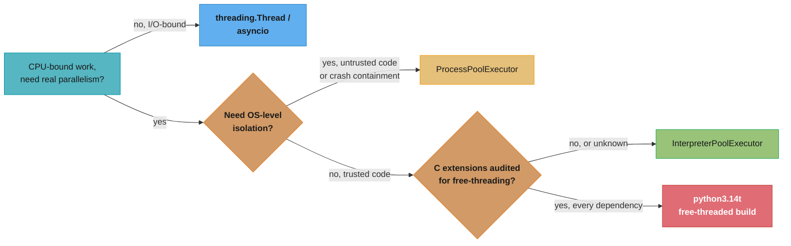
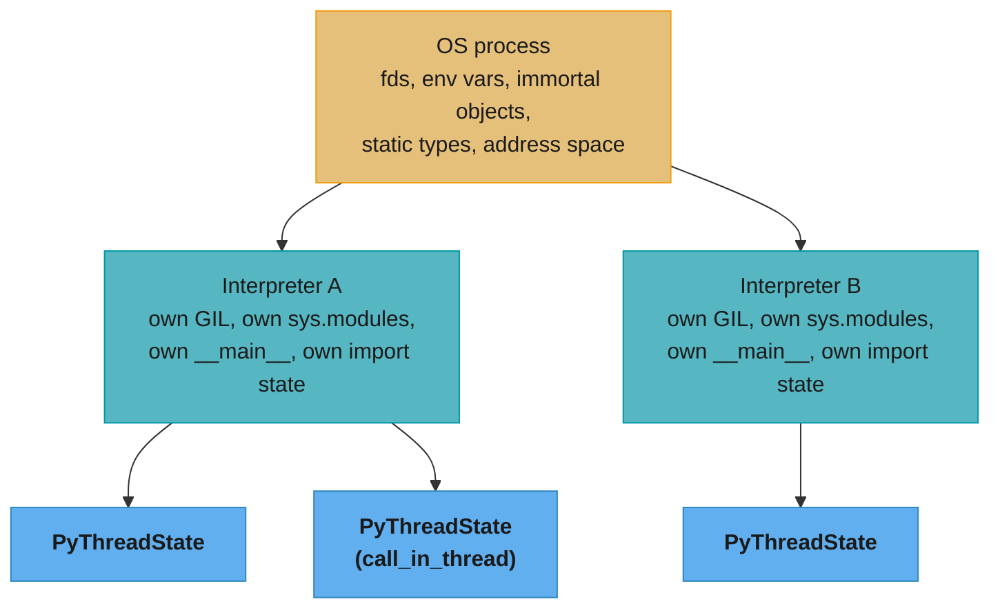
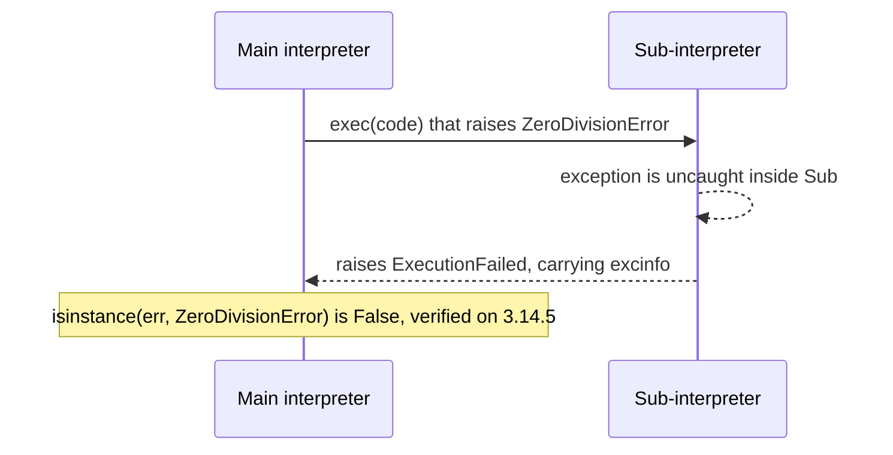
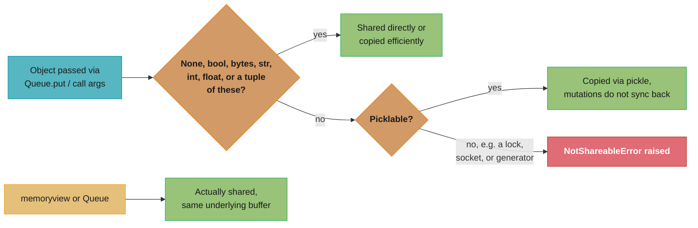
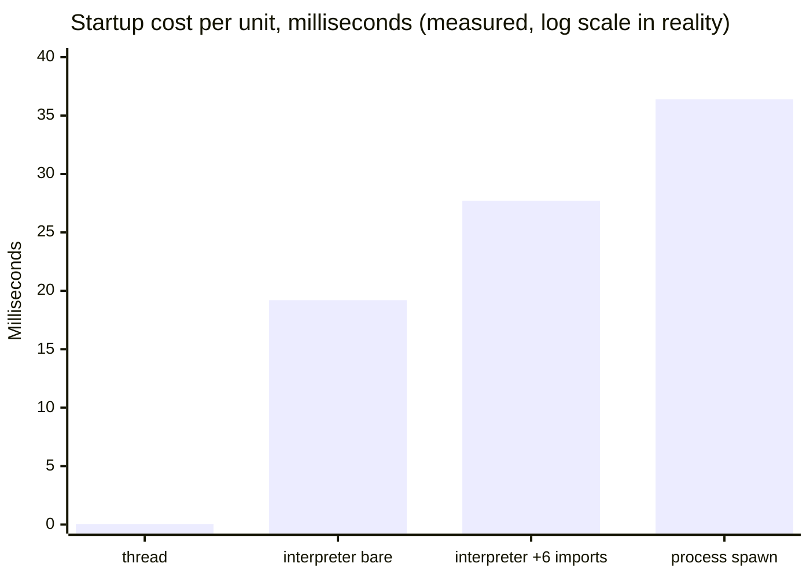

# Sub-Interpreters and Interpreter Pools

> A sub-interpreter is a second, independent copy of the Python runtime living inside the
> *same* OS process — its own GIL, its own module table, its own `__main__`, but the same
> address space and the same file descriptors as every other interpreter next door. This
> file is the mechanics and API layer: `PyInterpreterState`, the `concurrent.interpreters`
> stdlib module (PEP 734), what can and cannot cross an interpreter boundary, and why a
> C extension that has never heard of subinterpreters can quietly break one.

---

## 1. Concept Overview

CPython has supported multiple interpreters in one process since the C-API existed —
`Py_NewInterpreter()` is over 20 years old — but until Python 3.14 that capability was
reachable only from C, mostly by embedders like `mod_wsgi`. Three things changed that:
[PEP 684](https://peps.python.org/pep-0684/) (3.12) gave each sub-interpreter its own
GIL instead of sharing the process's one lock, which is what makes a pool of
sub-interpreters actually parallel rather than merely isolated; PEP 734 exposed the
capability from pure Python as the `concurrent.interpreters` stdlib module (3.14); and
`concurrent.futures.InterpreterPoolExecutor` (3.14) wrapped that module in the same
executor interface as `ThreadPoolExecutor` and `ProcessPoolExecutor`. See
[The GIL and Free Threading](the_gil_and_free_threading.md) for the PEP 703/779
free-threading track, which is a separate, orthogonal axis from everything in this file.

A sub-interpreter is not a thread and not a process. A thread inside CPython shares
everything — the heap, `sys.modules`, the GIL — with every other thread in the process.
A process shares nothing — separate heap, separate address space, separate GIL,
communication only through OS-level IPC (pipes, sockets, pickled bytes over a pipe).
A sub-interpreter sits between them: it shares the *process* (address space, file
descriptors, environment) but not the *Python heap* (no shared mutable objects, its own
`sys.modules`, and, since PEP 684, its own GIL). That middle position is the entire
reason to reach for it — cheaper than a process because there is no `fork`/`spawn` and
no OS-level re-exec, stricter than a thread because nothing mutable is implicitly
shared, so a whole category of GIL-protected-but-still-racy bugs cannot happen at all.

The C-level structures behind this: `PyInterpreterState` holds everything a running
Python program needs that is not tied to one specific thread of execution — the module
table, the GIL, the per-interpreter allocator state, the import machinery's bookkeeping.
`PyThreadState` holds the much smaller per-thread slice — the current frame, the
recursion depth, the exception being handled — and always points back to exactly one
owning `PyInterpreterState`. A process can have many `PyInterpreterState` objects; each
of those can have many `PyThreadState` objects executing on its behalf (Section 4 below
covers `call_in_thread`, which spins up exactly this). What is genuinely process-global —
not owned by any `PyInterpreterState` — is covered in Section 3.

---

## 2. Intuition

> A process is a separate apartment building — its own plumbing, its own address, no
> shared walls. A thread is a roommate in the same apartment, using the same kitchen,
> the same fridge, the same everything, with all the mess that implies when two people
> reach for the same pan at once. A sub-interpreter is a separate apartment in the *same*
> building — its own kitchen, its own fridge, nothing shared inside the unit — but the
> building's plumbing risers, electrical grid, and street address (the OS process) are
> still one shared thing underneath both apartments.

**Mental model:** you cannot leave a mutable object on the sub-interpreter's counter and
expect the interpreter next door to see it change — there is a wall. What you *can* do is
pass things through the building's shared systems: a `Queue` is the dumbwaiter between
apartments, `call()`/`exec()` arguments travel by pickling a copy (photographing the
object and handing over the photo, not the object), and a few types — `memoryview`,
`Queue` itself — genuinely share the same underlying buffer because the C level chose to
wire that one pipe through the wall on purpose.

**Key insight:** the isolation is not a limitation bolted on top of a shared-heap design —
it is what makes the per-interpreter GIL safe in the first place. If two interpreters
could freely share a mutable `dict`, each with its own GIL running on its own core, you
would be back to exactly the race conditions the single GIL existed to prevent, just with
two locks instead of zero. Isolation is the price of the parallelism, not a separate cost.

---

## 3. Core Principles

- **No shared mutable Python heap.** Two interpreters can run truly in parallel (own GIL
  each, since PEP 684) precisely because neither can mutate an object the other is
  reading. Communication is explicit: `Queue`, or the pickled-copy semantics of
  `exec()`/`call()`/`prepare_main()` arguments.
- **The import system re-runs per interpreter.** Every interpreter has its own
  `sys.modules`; `import numpy` inside a fresh interpreter genuinely re-executes
  `numpy`'s module-level code, it does not attach to the calling interpreter's already-
  imported copy. This is the dominant cost in interpreter startup — see the measurements
  in Section 6.
- **What is per-interpreter after PEP 684** (verified at
  [PEP 684](https://peps.python.org/pep-0684/)): the GIL itself; all non-shareable
  global objects (interned strings aside, most builtin caches); mutable runtime state
  that used to be guarded by the single process-wide GIL; every module's state,
  including `builtins`, `__main__`, and `sys`; the small-block memory allocator's
  internal bookkeeping (the allocator mechanism itself stays process-global, its
  per-interpreter *state* does not); and the import machinery's per-interpreter
  extension-compatibility tracking (`check_multi_interp_extensions`, Section 6).
- **What stays process-global** (same source): OS-level resources — memory, file
  descriptors, environment variables — with, in the PEP's own words, "no plans to
  change this"; immortal objects (PEP 683, e.g. small cached ints, `None`, `True`,
  `False`); builtin static types, with special-cased handling for `__subclasses__`;
  immutable or effectively-immutable data such as precomputed string hashes; and state
  protected by locks other than the GIL, such as certain allocator-internal locks.
- **A thrown exception does not cross the boundary as itself.** `exec()`/`call()` raise
  `ExecutionFailed` in the caller, never the original exception type — see Section 6.
- **Creation is not free.** Every interpreter pays import cost independently; see the
  measured numbers in Section 6 before assuming a pool of interpreters is a lightweight
  drop-in for a thread pool.
- **PEP 554 is dead as a live proposal, not as a document.** Its status is
  [`Superseded`](https://peps.python.org/pep-0554/), `Superseded-By: PEP 734`; PEP 734's
  own text calls itself "a reduction back to the essential information" after PEP 554
  accumulated seven years of discussion. Do not cite PEP 554 as the current API — cite
  [PEP 734](https://peps.python.org/pep-0734/), status **Final**, target 3.14. PEP 734
  itself notes it "was accepted with the provision" that its proposed top-level module
  name `interpreters` be renamed — it shipped as `concurrent.interpreters`.

---

## 4. Types / Architectures / Strategies

**Direct API — `concurrent.interpreters`.** Create and drive interpreters by hand:
`interpreters.create()`, `Interpreter.exec()`/`call()`, `Queue` for cross-interpreter
messaging. Full control, no pooling, no futures — you manage lifecycle and load
balancing yourself. This is what Section 6 walks through in detail.

**Pooled API — `concurrent.futures.InterpreterPoolExecutor`.** Verified at runtime
(`InterpreterPoolExecutor.__mro__` on CPython 3.14.5): it is a subclass of
`ThreadPoolExecutor`, not a new executor family — each pool worker is an OS thread that
happens to run its submitted callables inside its own dedicated sub-interpreter rather
than the main one. `submit()`/`map()` keep the exact `concurrent.futures` surface you
already use for `ThreadPoolExecutor` and `ProcessPoolExecutor`; only the isolation and
pickling profile changes underneath. See
[Design a CPU-Bound Batch Pipeline §4.3](../case_studies/design_a_cpu_bound_batch_pipeline.md)
for a working thumbnail-pipeline example built on this executor.

**GIL-sharing modes (C-level, rarely touched from Python).** `PyInterpreterConfig`
exposes `PyInterpreterConfig_OWN_GIL`, `PyInterpreterConfig_SHARED_GIL`, and
`PyInterpreterConfig_DEFAULT_GIL` for an embedder creating interpreters through the
C-API. The stdlib `concurrent.interpreters.create()` gives every new interpreter its
own GIL — the docs describe interpreters as "sufficiently isolated that they do not
share the GIL," true since 3.12 — so pure-Python callers get the parallel configuration
without ever seeing this knob. It matters only if you are embedding CPython yourself.

**Four competing runtime models, not two.** The question this file exists to answer is
usually phrased as "processes vs. threads," but Python 3.14 makes it a four-way choice:


*Sub-interpreters are the middle ground: they buy parallelism without a process's OS
overhead and without free-threading's C-extension audit burden, at the cost of
explicit-only communication. Section 8 quantifies the tradeoff against the other three.*

---

## 5. Architecture Diagrams

**Isolation boundary — what one process actually contains.** A tall hierarchy is the
right shape here (Section 4's flowchart was horizontal because it was a decision path;
this is a containment tree, so `TD`):


*One `PyInterpreterState` per box in the middle row; every `PyThreadState` in the
bottom row points back to exactly one of them. The top box is not a `PyInterpreterState`
at all — it is the one process everything lives inside.*

**Error propagation across the boundary.** An uncaught exception inside a sub-interpreter
never crosses as itself:


*`excinfo` is a read-only snapshot — type name, message, formatted traceback text — not
the live exception object, because the live object belongs to a heap that no longer
runs. Section 6 shows the exact `excinfo` fields measured against CPython 3.14.5.*

**Shareable vs. copied vs. rejected.** The single most interview-relevant fact in this
topic, as a decision path:



**Measured startup cost, four models side by side** (CPython 3.14.5, Apple M-series
macOS 26.6.2 — see Section 6 for the raw script and numbers):


*A bare `threading.Thread` start+join is roughly three orders of magnitude cheaper than
a bare interpreter; a bare interpreter is already within the same order of magnitude as
spawning a whole new OS process. Interpreter creation is not the "cheap thread-like"
option it is sometimes assumed to be — it is closer to a process than a thread.*

**Per-interpreter vs. process-global state — layout map.** An alignment-critical grid,
kept as ASCII per the repo's convention for this archetype:

```
                              PROCESS-GLOBAL   INTERPRETER A     INTERPRETER B
File descriptors, env vars   [ shared        ] [ same fds      ] [ same fds      ]
Immortal objects (PEP 683)   [ shared        ] [ same objects  ] [ same objects  ]
Builtin static types         [ shared        ] [ same types*   ] [ same types*   ]
GIL                          [    --         ] [ own GIL       ] [ own GIL       ]
sys.modules / import state   [    --         ] [ own table     ] [ own table     ]
__main__ namespace           [    --         ] [ own           ] [ own           ]
Small-block allocator state  [    --         ] [ own arenas    ] [ own arenas    ]
Mutable Python heap objects  [    --         ] [ own heap      ] [ own heap      ]

* except __subclasses__ bookkeeping, which PEP 684 special-cases per interpreter
```
*Rows with `--` in the PROCESS-GLOBAL column moved to per-interpreter storage under
PEP 684; rows marked `shared` never moved and, per the PEP's own text, are not planned
to.*

---

## 6. How It Works — Detailed Mechanics

### 6.1 Creating and driving an interpreter

```python
import concurrent.interpreters as interpreters

interp = interpreters.create()          # idle interpreter, own GIL, own sys.modules
interp.exec("import json")              # runs in interp's __main__ namespace
interp.exec("""
    def double(n):
        return n * 2
""")                                    # dedent=True (the default) lets you pass
                                         # indented triple-quoted source directly

result = interp.call(lambda: 21 * 2)    # runs a callable in interp, returns the result
print(interp.is_running())              # False once call()/exec() returns
interp.close()                          # finalizes and destroys the interpreter
```

Both `exec()` and `call()` run in the *interpreter's* `__main__` module as the globals
namespace — verified against the stdlib docs, which state this is "the same as how
scripts invoked from the command-line run in the `__main__` module." That single fact
explains the biggest gotcha in Section 10: a `call()` target is pickled by reference
(module name + qualified name), not shipped as bytecode, so it must be resolvable by
that reference inside the target interpreter's own import of that module.

### 6.2 `prepare_main` and the `Queue`

`prepare_main()` binds names into an interpreter's `__main__` before you run anything —
useful for handing a worker its one-time setup (a `Queue` handle, a config value) the
same way `ProcessPoolExecutor`'s `initializer`/`initargs` hands a worker process its
one-time setup:

```python
import concurrent.interpreters as interpreters

q = interpreters.create_queue()         # a cross-interpreter Queue, itself shareable
interp = interpreters.create()
interp.prepare_main(q=q)                # binds `q` into interp's __main__
interp.exec("q.put('hello from the sub-interpreter')")
print(q.get())                          # -> "hello from the sub-interpreter"
```

`Queue` implements the `queue.Queue` interface (`put`/`put_nowait`, `get`/`get_nowait`,
`empty()`, `full()`, `qsize()`) and is one of exactly two Python types that genuinely
share mutable data across the boundary rather than copying — the other is `memoryview`,
whose underlying `Py_buffer` is the same buffer on both sides, verified against the
stdlib docs' own "Sharing" section.

### 6.3 `call_in_thread`

`call_in_thread(callable, /, *args, **kwargs)` runs the callable inside the
interpreter but on a *new* OS thread, and returns the `threading.Thread` object
immediately rather than blocking — verified live:

```python
>>> interp2 = interpreters.create()
>>> t = interp2.call_in_thread(worker, 7)
>>> type(t)
<class 'threading.Thread'>
>>> t.join()
```

This is the primitive `InterpreterPoolExecutor` builds on: each pool worker thread
calls into its own dedicated sub-interpreter, so `submit()` reads as "run this on a
thread" while actually meaning "run this on a thread, inside its own isolated
interpreter with its own GIL."

### 6.4 The exception layer

Verified against `docs.python.org/3/library/concurrent.interpreters.html`, the exact
hierarchy:

```
Exception
 +-- InterpreterError
      +-- InterpreterNotFoundError   # the target interpreter no longer exists
      +-- ExecutionFailed            # uncaught exception inside the target interpreter
TypeError
 +-- NotShareableError               # object cannot cross the boundary
queue.Empty
 +-- QueueEmptyError                 # Queue.get()/get_nowait() on an empty queue
queue.Full
 +-- QueueFullError                  # Queue.put()/put_nowait() on a full queue
```

`ExecutionFailed` carries an `excinfo` attribute — measured directly against CPython
3.14.5 by running `interp.exec("1/0")` and catching the result:

```python
>>> try:
...     interp.exec("1/0")
... except Exception as e:
...     type(e).__name__, isinstance(e, ZeroDivisionError)
...
('ExecutionFailed', False)
>>> e.excinfo
namespace(type=namespace(__name__='ZeroDivisionError', __qualname__='ZeroDivisionError',
                          __module__='builtins'),
          msg='division by zero',
          formatted='ZeroDivisionError: division by zero',
          errdisplay='Traceback (most recent call last):\n  ...\nZeroDivisionError: ...')
```

`excinfo` is a plain `types.SimpleNamespace`-style snapshot, not the live exception —
the original `ZeroDivisionError` object belonged to a heap (the sub-interpreter's) that
still exists but is a different Python-object-graph than the caller's, so there is
nothing for `isinstance` to match against on the calling side.

### 6.5 What "shareable" means in practice

Verified against the stdlib docs' "Sharing" section, quoted directly: "By default, most
objects are copied with pickle when they are passed to another interpreter. Nearly all
of the immutable builtin objects are either directly shared or copied efficiently" —
`None`, `bool`, `bytes`, `str`, `int`, `float`, and `tuple` of the same. Everything else
picklable still crosses, just through the slower general pickle path — measured
directly: a plain `list` of ints passed as a `call()` argument works fine, because
`list` is picklable even though it is not in the fast-path list. What does *not* cross
is anything unpicklable — measured directly with `threading.Lock()`:

```python
>>> interp.call(lambda x: x, threading.Lock())
concurrent.interpreters.NotShareableError: <unlocked _thread.lock object ...>
does not support cross-interpreter data
```

### 6.6 Startup cost — measured, not guessed

**Measured on CPython 3.14.5 (Homebrew, Apple Silicon macOS 26.6.2), 30 iterations with
5-iteration warmup, `time.perf_counter()`:**

| Operation | Cost |
|---|---|
| `interpreters.create()` + `close()`, no imports | **~19.2 ms** each |
| `interpreters.create()` + `exec()` of 6 stdlib imports + `close()` | **~27.7 ms** each |
| `threading.Thread` start + join, no-op target | **~0.03 ms** each |
| `subprocess.run([sys.executable, "-c", "pass"])` | **~36.4 ms** each |

The dominant term is imports, not the interpreter object itself: adding six ordinary
stdlib imports (`json`, `re`, `decimal`, `datetime`, `collections`,
`xml.etree.ElementTree`) to an otherwise-bare `create()` added roughly 8.5 ms, because
each interpreter has its own `sys.modules` and genuinely re-executes every imported
module's top-level code — it cannot attach to the calling interpreter's already-loaded
copy the way a thread implicitly does. A pool of interpreters that imports a real
dependency stack (NumPy, Pillow — see the case study) pays proportionally more per
worker at creation time, front-loaded once per worker under `InterpreterPoolExecutor`,
not once per task. That is a real number for this one machine and workload, not a
universal constant — re-measure before sizing a production pool.

---

## 7. Real-World Examples

- **Web servers under `mod_wsgi`.** The original production use of sub-interpreters,
  predating the stdlib module by two decades — `mod_wsgi` can run each WSGI application
  in its own sub-interpreter for isolation between unrelated apps sharing one Apache
  process. This is also the source of the well-known "NumPy was imported from a Python
  sub-interpreter" runtime warning many web developers have hit without knowing why.
- **`InterpreterPoolExecutor` as a `ProcessPoolExecutor` alternative for CPU-bound
  pipelines.** See
  [Design a CPU-Bound Batch Pipeline §4.3](../case_studies/design_a_cpu_bound_batch_pipeline.md)
  for a full worked example (thumbnail generation + perceptual hashing) with measured
  throughput (205 images/sec) and RSS (~620 MB at 8 workers) against the
  `ProcessPoolExecutor` and free-threaded alternatives.
- **Test isolation.** Running an untrusted or stateful plugin's code in a disposable
  sub-interpreter bounds the blast radius of a global-variable leak or a monkeypatch
  without paying full process-spawn cost per test — Section 14 works through a version
  of this scenario end to end.
- **Multi-tenant script execution inside one long-lived server process** — e.g. a
  notebook or automation platform that runs many users' short scripts, where OS-process-
  per-script is too slow to spin up per request but a shared-heap thread pool is an
  unacceptable data-leak risk between tenants.

---

## 8. Tradeoffs

| Cost axis | `threading.Thread` | `concurrent.interpreters` / `InterpreterPoolExecutor` | `ProcessPoolExecutor` | `python3.14t` free-threaded |
|---|---|---|---|---|
| Parallelism for CPU-bound code | None under the standard GIL | Yes — own GIL per interpreter (PEP 684) | Yes — separate processes | Yes — no GIL at all |
| Creation cost | ~0.03 ms (measured) | ~19-28 ms bare (measured) | ~35+ ms (measured, comparable to a bare interpreter) | Thread cost only, no extra interpreter |
| Data sharing | Direct, same heap, races possible | None implicit — `Queue` / pickled copies only | None implicit — pickled IPC only | Direct, same heap, races possible |
| Memory per worker | Shared heap, thread stack only | Own Python-level state, shared process/C libs | Full interpreter + module tree, duplicated | Shared heap, thread stack only |
| Crash blast radius | Whole process | Whole process (interpreters share the process) | One process | Whole process |
| C-extension risk | Low (thread-safety only) | Medium — most extensions default to working, but `Py_MOD_PER_INTERPRETER_GIL_SUPPORTED` is opt-in (Section 10) | Low — each process has its own GIL regardless | High — an unaudited extension silently re-enables the GIL process-wide |
| Isolation strength | None | Strong — no shared Python heap | Strongest — OS-level | None |

**The isolation-vs-cost curve, read left to right:** threads share everything and cost
almost nothing to start; processes share nothing and cost the most; sub-interpreters sit
deliberately between them — real isolation, real parallelism, at a creation cost closer
to a process than to a thread. Free-threading is not on this curve at all — it keeps a
thread's cheap creation and its shared heap, and pays for parallelism with a mandatory
audit of every C extension in the dependency tree instead of a startup-time cost.

---

## 9. When to Use / When NOT to Use

**Use sub-interpreters when:**
- You need real CPU parallelism and want isolation stronger than a shared heap but do
  not want a full OS process per worker (memory, not just speed, is the constraint —
  Section 6 of the [case study](../case_studies/design_a_cpu_bound_batch_pipeline.md)
  measured roughly a third of a process's RSS at the same worker count).
- The workload is trusted code where explicit `Queue`-based communication is an
  acceptable programming model, not a burden.
- You want to bound the blast radius of one worker's misbehaving global state (a
  monkeypatch, a leaked singleton) without paying a process's full memory
  multiplication.
- The `concurrent.futures` API surface matters — swapping `ThreadPoolExecutor` for
  `InterpreterPoolExecutor` should require the smallest possible code diff.

**Do NOT use sub-interpreters when:**
- Any hard security boundary is required — sub-interpreters share the OS process, its
  file descriptors, and its memory space; they are not a sandbox against a malicious
  actor, only isolation against accidental state leakage between trusted code.
- Your dependency stack is not verified compatible — an unaudited C extension can fail
  to import at all under `check_multi_interp_extensions`, or silently misbehave if it
  keeps C-level global state (Section 10).
- The workload is I/O-bound — `asyncio` or plain threads are cheaper and simpler; you
  gain nothing from a separate GIL when nothing was contending for the one GIL you had.
- Per-task creation cost matters and the pool cannot be kept warm — the measured ~19-28
  ms is a one-time-per-worker cost under a pool, but a fatal one if you create-and-close
  an interpreter per request.

---

## 10. Common Pitfalls

**Pitfall 1 — assuming `call()` ships the function's code, not just a reference.**
`call()`'s target is pickled the same way `ProcessPoolExecutor.submit()`'s target is:
by module name and qualified name, then looked up by that reference inside the target
interpreter. A function defined in `__main__` — an interactive session, a bare script —
is not resolvable that way, because the target interpreter's own `__main__` never saw
that definition.

```python
# BROKEN — defined and run from a script's own __main__
def read_x():
    return x

interp.exec("x = 1")
interp.call(read_x)
# concurrent.interpreters.NotShareableError: func not shareable
# (raised when the target interpreter's pickle load can't resolve __main__.read_x)
```
```python
# FIXED — move the callable into a real, importable module
# workers_mod.py
def square(n):
    return n * n

# calling code
import workers_mod
interp.call(workers_mod.square, 7)   # -> 49, verified on CPython 3.14.5
```
This is the exact same class of bug as a `multiprocessing`/`ProcessPoolExecutor` lambda-
or-closure pickling failure — see
[Threading and Multiprocessing](../threading_and_multiprocessing/threading_and_multiprocessing.md)
for that side of the same underlying constraint.

**Pitfall 2 — assuming a module-level global written in one interpreter is visible in
another.** Every interpreter has its own `sys.modules` and its own copy of every
module's state, including things that feel like process-wide singletons — a logging
handler registered at import time, a cache dict at module scope, a client object built
once "for the whole process." Each interpreter runs that top-level code independently
and gets its own copy; writes in one are invisible in the other, silently, with no
error. The fix is the same as `initializer`/`initargs` for a `ProcessPoolExecutor`
worker: treat each interpreter's global state as its own, seeded explicitly via
`prepare_main()` or a first `exec()` call, never assumed to be already there.

**Pitfall 3 — importing a C extension without checking `Py_mod_multiple_interpreters`.**
An extension built with multi-phase initialization (PEP 489) declares its subinterpreter
compatibility through the `Py_mod_multiple_interpreters` slot — verified against the
CPython C-API docs:

| Slot value | Meaning |
|---|---|
| `Py_MOD_MULTIPLE_INTERPRETERS_NOT_SUPPORTED` | Import fails outright in a sub-interpreter |
| `Py_MOD_MULTIPLE_INTERPRETERS_SUPPORTED` | Works under sub-interpreters, but only ones sharing the main interpreter's GIL — the **default when the slot is unspecified**, chosen to preserve pre-3.12 behavior (corrected in the docs after [gh-129405](https://github.com/python/cpython/issues/129405) flagged the shipped documentation as backwards) |
| `Py_MOD_PER_INTERPRETER_GIL_SUPPORTED` | Fully supports running under its own, independent per-interpreter GIL |

Legacy single-phase-init extensions (`PyModule_Create()`) are the riskier case: the
first import initializes normally and CPython squirrels away a shallow copy of the
module's dict; every later import in another interpreter gets a fresh module object
pre-filled from that copy *without re-running the extension's init function* — so any
extension relying on C-level static or global variables can end up with objects shared
across interpreters that the extension author never intended to share. **Do not assume
a specific library's status** — check that library's own tracker for a current answer.
As one verified, dated example: NumPy's own issue tracker states it "does not properly
support sub-interpreters" as of
[numpy/numpy#27192](https://github.com/numpy/numpy/issues/27192), with work underway to
adopt multi-phase initialization and explicitly declare
`Py_MOD_MULTIPLE_INTERPRETERS_NOT_SUPPORTED` per
[numpy/numpy#29021](https://github.com/numpy/numpy/issues/29021) — verify the current
state before depending on it, since this is exactly the kind of fact that changes
between releases.

**Pitfall 4 — treating interpreter creation as thread-cheap inside a hot path.** Section
6.6's measured ~19-28 ms per `create()` is three orders of magnitude more expensive than
starting a thread. Creating and closing an interpreter per incoming request (rather than
keeping a pool warm) turns a request handler's overhead into something closer to
spawning a subprocess per request than spawning a thread per request.

**Pitfall 5 — forgetting to `close()` interpreters you created directly.** Unlike
`InterpreterPoolExecutor`, which manages worker lifecycle for you, `interpreters.create()`
leaves cleanup to the caller. Leaving interpreters open shows up as a
`RuntimeWarning: remaining subinterpreters` at process exit — annoying at best, and a
real per-worker memory leak in a long-running server that creates interpreters
dynamically without a corresponding `close()`.

---

## 11. Technologies & Tools

| Tool / API | Purpose | Python version | Notes |
|---|---|---|---|
| `concurrent.interpreters` | Direct sub-interpreter creation, `exec`/`call`, `Queue` | 3.14+ | PEP 734; wraps a private `_interpreters` C extension module |
| `concurrent.futures.InterpreterPoolExecutor` | Pool of sub-interpreters behind the standard executor API | 3.14+ | Subclass of `ThreadPoolExecutor` (verified via `__mro__`) |
| `Py_NewInterpreter()` / `Py_EndInterpreter()` | C-API interpreter creation, the 20-year-old primitive underneath the stdlib module | All (C-API) | See `docs.python.org/3/c-api/subinterpreters.html` |
| `PyInterpreterConfig` | C-API struct controlling `OWN_GIL`/`SHARED_GIL`/`DEFAULT_GIL` for an embedder | 3.12+ | Not reachable from pure Python; `concurrent.interpreters.create()` always requests its own GIL |
| `Py_mod_multiple_interpreters` module slot | C-extension declares its own-GIL / shared-GIL / unsupported status | 3.12+ | Stable ABI since 3.12; unspecified defaults to `..._SUPPORTED` (shared-GIL only) |
| `mod_wsgi` | Production embedder using per-application sub-interpreters for isolation | N/A | Predates the stdlib module by ~20 years |
| `sys._is_gil_enabled()` | Confirms whether the *process's* GIL is disabled — a free-threading check, not a sub-interpreter one | 3.13+ | Do not confuse with per-interpreter GIL status |

---

## 12. Interview Questions with Answers

**Q: What does `InterpreterPoolExecutor` actually save compared to `ProcessPoolExecutor`, and what does it NOT save?**
**Short:** It skips process/OS startup cost, not pickling — submit() still pickles the callable, args, and result.
`InterpreterPoolExecutor` is a `ThreadPoolExecutor` subclass, so its workers are OS threads, each running its submitted callables inside its own sub-interpreter rather than a shared one — verified via `InterpreterPoolExecutor.__mro__` showing `ThreadPoolExecutor` as its base. What it saves is the process creation and re-exec that `ProcessPoolExecutor` pays: no `spawn`/`forkserver` startup, no re-imported module tree per new OS process. What it does NOT save is pickling — arguments and return values still cross the interpreter boundary the same way they cross the process boundary, because there is still no shared mutable heap to pass a live reference through. The mistake to avoid is assuming subinterpreters remove pickling; they only remove the OS process.

**Q: A function works fine when called directly but raises `NotShareableError: func not shareable` when passed to `Interpreter.call()`. What's wrong?**
**Short:** The function was defined in a script's own __main__, which the target interpreter cannot resolve by reference.
`call()` pickles its target by module name and qualified name, then looks that name up inside the *target* interpreter's own import of that module — it does not ship bytecode. A function defined in an interactively-run script's `__main__` has no module the target interpreter can import to find it, so the pickle-by-reference fails. The fix is to move the callable into a real, importable module (`import workers_mod; interp.call(workers_mod.square, 7)`), the identical fix `ProcessPoolExecutor`'s lambda/closure pickling failures require.

**Q: I caught an exception from `interp.exec()`. Why does `isinstance(e, ZeroDivisionError)` return False even though the sub-interpreter clearly raised a `ZeroDivisionError`?**
**Short:** exec() raises ExecutionFailed on the caller's side, a wrapper carrying a snapshot, never the original exception object.
The caught exception is `ExecutionFailed` — a subclass of `InterpreterError`, not of `ZeroDivisionError` — because the actual `ZeroDivisionError` object lives on the sub-interpreter's own heap, which is a different object graph than the caller's. `ExecutionFailed.excinfo` carries a read-only snapshot (type name, message, a pre-formatted traceback string) rather than the live object, since there is nothing for the caller's `isinstance` to match against across the boundary. Always branch on `excinfo.type.__name__` or the formatted text, never assume the caught type matches the original.

**Q: Does `concurrent.interpreters` remove the need to worry about pickling, the way people sometimes assume it removes process overhead?**
**Short:** No, most objects crossing the boundary are still pickled by default; only a few types are actually shared.
The stdlib docs are explicit: "by default, most objects are copied with pickle when they are passed to another interpreter." A small set of immutable builtins (`None`, `bool`, `bytes`, `str`, `int`, `float`, `tuple` of the same) are shared directly or copied efficiently without the general pickle path, and exactly two mutable types — `memoryview` and `Queue` — genuinely share the same underlying buffer rather than copying. Everything else picklable still goes through pickle; anything unpicklable (a lock, a socket, a generator, a function defined in `__main__`) raises `NotShareableError`.

**Q: Is `interpreters.create()` cheap enough to call once per incoming request in a server?**
**Short:** No, measured startup is tens of milliseconds, comparable to spawning a process, not to starting a thread.
Measured on CPython 3.14.5: a bare `create()`+`close()` costs roughly 19 ms, and one with six ordinary stdlib imports costs roughly 28 ms — against roughly 0.03 ms for a `threading.Thread` start+join and roughly 36 ms for spawning a whole subprocess. Interpreter creation is closer in cost to a process than to a thread, because the dominant cost is re-running imports in a fresh `sys.modules`. The right pattern is a warm pool (`InterpreterPoolExecutor`) whose workers are created once and reused, exactly like a `ProcessPoolExecutor`, never created fresh per request.

**Q: What happens if a C extension does not declare `Py_mod_multiple_interpreters` at all?**
**Short:** It defaults to shared-GIL-only support, not to full failure and not to full per-interpreter-GIL support.
Verified against the CPython C-API docs, an unspecified `Py_mod_multiple_interpreters` slot defaults to `Py_MOD_MULTIPLE_INTERPRETERS_SUPPORTED` — the extension is assumed to work under sub-interpreters, but only ones sharing the main interpreter's GIL, preserving pre-3.12 behavior. It is not assumed to support `Py_MOD_PER_INTERPRETER_GIL_SUPPORTED`, the mode `concurrent.interpreters.create()` actually uses by default. The documentation itself stated the opposite default until a 2026-era fix (gh-129405) corrected it, which is a useful reminder to check current docs rather than trust memory on this exact point.

**Q: What is the real difference between PEP 684 and PEP 703 — are they the same feature under different names?**
**Short:** PEP 684 gives each sub-interpreter its own GIL; PEP 703 removes the GIL from the process entirely.
PEP 684 (3.12) keeps the GIL concept but makes it per-interpreter, so multiple isolated sub-interpreters can each hold their own lock and run in parallel — the GIL still exists, there are just more than one of them in the process. PEP 703 (3.13 experimental, 3.14 officially supported via PEP 779) removes the GIL from a single shared-heap interpreter entirely, replacing plain reference counting with biased reference counting so ordinary threads sharing one heap can run bytecode in parallel. They solve the same underlying problem — CPU-bound parallelism — through opposite means: strict isolation with multiple locks, versus one heap with zero locks and mandatory extension-level thread safety.

**Q: PEP 554 proposed sub-interpreters from Python years before this shipped. What happened to it?**
**Short:** PEP 554 is Superseded by PEP 734, which is the actual accepted, implemented proposal shipped in 3.14.
PEP 554's own status field reads `Superseded`, `Superseded-By: PEP 734` — it accumulated seven years of discussion and background material, and PEP 734 was written as, in its own words, "a reduction back to the essential information." Citing PEP 554 as the current design is a version-currency trap: its proposed API differs in naming and shape from what actually shipped. The document authoritative for the shipped 3.14 API is PEP 734 (status Final) plus the live stdlib docs for `concurrent.interpreters`.

**Q: PEP 734 originally proposed a top-level `interpreters` module. Why does the stdlib import path read `concurrent.interpreters`?**
**Short:** PEP 734 was accepted on the explicit condition that the module be renamed under the concurrent namespace.
PEP 734's own text notes it "was accepted with the provision" that the proposed name change to `concurrent.interpreters` be made, placing it alongside `concurrent.futures` rather than as a new top-level stdlib name. Anyone reading the original PEP text literally (`import interpreters`) is reading the pre-rename proposal, not the shipped API — the correct import in 3.14 is `import concurrent.interpreters`.

**Q: What is `PyInterpreterState` and how does it relate to `PyThreadState`?**
**Short:** PyInterpreterState holds per-interpreter state; every PyThreadState belongs to exactly one PyInterpreterState.
`PyInterpreterState` is the C structure holding everything one running Python program needs that is not tied to a specific thread — the module table, the (now per-interpreter, since PEP 684) GIL, allocator bookkeeping, import state. `PyThreadState` is the smaller per-thread structure — the current frame, recursion depth, active exception — and always points back to exactly one owning `PyInterpreterState`. One process can hold many `PyInterpreterState` objects; each can have multiple `PyThreadState` objects running against it, which is exactly what `Interpreter.call_in_thread()` creates.

**Q: What stays shared across sub-interpreters even after PEP 684's isolation, and why weren't those moved too?**
**Short:** OS resources, immortal objects, and static types stay process-global because moving them would break or slow everything.
Per PEP 684 itself: OS-level resources (memory, file descriptors, environment variables) are explicitly stated to have "no plans to change"; immortal objects (PEP 683 — small cached ints, singletons like `None`) are safe to share because they are never mutated; builtin static types are shared, with special handling only for the `__subclasses__` bookkeeping; and some allocator-internal state is protected by locks other than the GIL rather than duplicated per interpreter. Moving OS-level resources per interpreter would mean re-opening every file descriptor per interpreter, which the design deliberately avoids.

**Q: Why does a plain `list` of integers pass across the interpreter boundary fine, even though it's not in the "efficiently shared" fast-path list?**
**Short:** Anything picklable still crosses via the general pickle fallback, just without the fast-path optimization.
The fast-path list (`None`, `bool`, `bytes`, `str`, `int`, `float`, `tuple`) is the set of types CPython shares or copies without the general pickle machinery; everything else that is picklable — a `list`, a `dict`, a custom class with `__reduce__` — still crosses, just through the ordinary pickle-and-unpickle path, which is slower and produces an independent copy rather than a shared or lightly-copied value. Only genuinely unpicklable objects (locks, sockets, open file handles, generators, functions not resolvable by module reference) raise `NotShareableError`.

**Q: How would you choose between `InterpreterPoolExecutor` and a free-threaded (`python3.14t`) thread pool for a CPU-bound workload?**
**Short:** Choose free-threading for raw throughput when every dependency is audited, subinterpreters when isolation matters more.
On a measured CPU-bound thumbnail pipeline, the free-threaded pool beat `InterpreterPoolExecutor` on both throughput (230 vs. 205 images/sec) and memory (~310 MB vs. ~620 MB at 8 workers) — see [Design a CPU-Bound Batch Pipeline §5](../case_studies/design_a_cpu_bound_batch_pipeline.md). Subinterpreters win only when their stronger isolation is worth that cost: no shared Python heap between workers bounds the blast radius of a misbehaving worker tighter than free-threading's single shared heap does, without the free-threaded build's requirement that every C extension in the dependency tree be audited and declare `Py_mod_gil = Py_MOD_GIL_NOT_USED`.

**Q: If you need genuine security isolation between two pieces of code in the same server, is a sub-interpreter enough?**
**Short:** No, sub-interpreters share the OS process, file descriptors, and memory space, so they are not a security sandbox.
Sub-interpreters isolate the *Python heap* — no shared mutable objects, separate `sys.modules` — but they run inside the same OS process, sharing its address space, its file descriptors, and its environment. A determined attacker with native-code execution, or a C extension with a memory-safety bug, is not contained by interpreter isolation the way an OS process boundary contains it. Use `ProcessPoolExecutor` or a real sandbox (container, VM) when the requirement is security isolation against untrusted code, not merely avoiding accidental state leakage between trusted workers.

**Q: What does `Interpreter.prepare_main()` do, and what's the closest analogy in `ProcessPoolExecutor`?**
**Short:** prepare_main binds objects into an interpreter's __main__ namespace once, the same role as a pool's initializer.
`prepare_main(ns=None, **kwargs)` binds names directly into the target interpreter's `__main__` module before any `exec()`/`call()` runs, without shipping them as source code to be executed — the natural place to hand a freshly created interpreter a shared `Queue` handle or a one-time configuration value. It plays the same role `initializer`/`initargs` play for a `ProcessPoolExecutor` worker: setup that should happen once per worker, not once per task.

**Q: What is `check_multi_interp_extensions`, and how does it interact with `Py_mod_multiple_interpreters`?**
**Short:** It's the embedder-level switch controlling whether legacy single-phase-init C extensions may import into a subinterpreter at all.
It is a field on `PyInterpreterConfig`: if `0`, all extension modules — including legacy single-phase-init ones — may be imported in a subinterpreter's thread; otherwise only multi-phase-init extensions (PEP 489) are allowed, and the `Py_mod_multiple_interpreters` slot then governs the finer-grained shared-GIL-vs-own-GIL question for those. The stdlib `concurrent.interpreters.create()` path effectively requires the stricter mode, which is why an extension that never adopted multi-phase initialization can fail to import at all rather than merely misbehave.

**Q: Why is a legacy single-phase-init C extension riskier under sub-interpreters than a multi-phase one, even when both technically import?**
**Short:** Legacy extensions share a shallow-copied module dict across interpreters instead of re-running their init function.
For a legacy single-phase-init extension, only the *first* import runs the extension's real init function; every later import from another interpreter gets a new module object pre-filled from a shallow copy of that first module's dict, with the init function skipped entirely. Any C-level static or global state the extension relies on ends up implicitly shared across interpreters that never asked for that sharing — exactly the class of bug PEP 684's Python-level isolation exists to prevent, reintroduced at the C layer. Multi-phase init avoids this by re-running proper per-interpreter initialization for each import.

**Q: What is the underlying C module behind `concurrent.interpreters`, and does that matter to a Python-level user?**
**Short:** It wraps a private _interpreters extension module, visible mainly in tracebacks, not part of the supported API.
Tracebacks from `concurrent.interpreters` calls show frames inside `_interpreters.call(...)`, confirming the public Python module is a thin wrapper around a lower-level private C extension. This is implementation detail, not API surface — a Python-level user should import and use `concurrent.interpreters`, never `_interpreters` directly, the same convention as other stdlib modules with a private C-accelerated backend (`_asyncio` behind `asyncio`, `_json` behind `json`).

---

## 13. Best Practices

- **Keep a pool warm; never create-and-close per task.** Measured creation cost (Section
  6.6) is tens of milliseconds — pay it once per worker via `InterpreterPoolExecutor`,
  not once per request.
- **Put every `call()` target in a real, importable module.** Never a lambda, never a
  closure, never a function defined in an interactively-run `__main__` — the same rule
  `ProcessPoolExecutor` already trained you to follow, for the same underlying reason.
- **Treat every module-level global as per-interpreter, not per-process.** Seed shared
  configuration explicitly through `prepare_main()` or a first `exec()` call; never
  assume a value set in one interpreter is visible in another.
- **Branch on `excinfo`, not on the caught exception's type.** `ExecutionFailed` is
  always what you catch from `exec()`/`call()`; check `excinfo.type.__name__` or the
  formatted traceback text, never `isinstance(e, SomeOriginalExceptionType)`.
- **Audit the dependency tree's `Py_mod_multiple_interpreters` status before committing
  to `InterpreterPoolExecutor` in production**, the same way the free-threading track
  requires an audit before adopting `python3.14t` — check each critical extension's own
  tracker, since the stdlib default (shared-GIL-only) is not the mode
  `concurrent.interpreters.create()` actually needs.
- **Always `close()` interpreters you created directly**, or use `InterpreterPoolExecutor`
  / a context-manager pattern that closes them for you — a `RuntimeWarning: remaining
  subinterpreters` at exit is a real leak, not decoration.
- **Do not reach for sub-interpreters as a security boundary.** They isolate the Python
  heap, not the OS process — use `ProcessPoolExecutor` or a real sandbox when the
  requirement is containing untrusted code, not just avoiding accidental state sharing
  between trusted workers.

---

## 14. Case Study

**Scenario: isolating a third-party scoring plugin inside a long-running analytics
service.** A service loads user-supplied Python "scoring functions" — small snippets
that take a row of data and return a float — and runs thousands of them per minute. Two
requirements collide: plugin authors write ordinary module-level globals and imports
without knowing they will run alongside hundreds of other plugins in the same process
(so a shared heap is a correctness risk — one plugin's `import numpy as np; np.seterr(...)`
call should not change another plugin's floating-point error behavior), and spinning up
a full OS process per plugin call is too slow for the service's per-request latency
budget (Section 6's measured process-spawn cost of ~36 ms would dominate a sub-
millisecond scoring function).

**Design:** one warm `InterpreterPoolExecutor`, sized to the service's worker count, with
each plugin's module loaded once per worker via `initializer`/`prepare_main` rather than
per call:

```python
from concurrent.futures import InterpreterPoolExecutor
import importlib

_loaded_plugins: dict[str, object] = {}

def _load_plugin(plugin_name: str) -> None:
    # Runs once per pool worker's sub-interpreter, not once per scoring call.
    _loaded_plugins[plugin_name] = importlib.import_module(plugin_name)

def score_row(plugin_name: str, row: dict) -> float:
    plugin = _loaded_plugins[plugin_name]
    return plugin.score(row)   # row must itself be shareable — a dict of picklable values

with InterpreterPoolExecutor(
    max_workers=8,
    initializer=_load_plugin,
    initargs=("trusted_scoring_plugin",),
) as pool:
    futures = [pool.submit(score_row, "trusted_scoring_plugin", row) for row in rows]
    scores = [f.result() for f in futures]
```

**Why this shape and not the alternatives:** a `ThreadPoolExecutor` was rejected first —
every plugin sharing one heap means one plugin's `numpy.seterr()` or a monkeypatched
stdlib function silently affects every other plugin running concurrently, exactly the
bug class Section 3's "no shared mutable heap" principle exists to prevent.
`ProcessPoolExecutor` was rejected second — the measured ~36 ms process-spawn cost
(Section 6.6) does not amortize well against thousands of sub-millisecond scoring calls
per minute if workers are recycled frequently for freshness, whereas `create()`'s
~19-28 ms is roughly half that and, more importantly, is paid once per long-lived pool
worker under `InterpreterPoolExecutor`, not once per call either way. Free-threading
(`python3.14t`) was rejected third and explicitly, on the same reasoning as Pitfall 3 —
the service cannot audit every third-party plugin author's C-extension dependencies for
`Py_mod_gil` support, and a single unaudited import would silently re-enable the GIL for
every plugin in the process, erasing the entire point of the change.

**The lesson generalizes:** sub-interpreters are the right tool exactly when the
workload's isolation need is "different pieces of trusted-but-not-coordinated code must
not step on each other's global state," and its performance need is "faster than a
process, more parallel than a single GIL" — a scoring-plugin host, a multi-tenant
notebook kernel, and the thumbnail pipeline in the companion case study are three
instances of the identical shape.

---

**Cross-cutting references:**

- [The GIL and Free Threading](the_gil_and_free_threading.md) — GIL acquisition/release
  mechanics, PEP 703/779 free-threading internals, the parent module's summary of PEP
  684/734 (Section 1's timeline, Section 11's tools row, Section 12 Q8's one-paragraph
  overview) that this file expands into full mechanics
- [Design a CPU-Bound Batch Pipeline](../case_studies/design_a_cpu_bound_batch_pipeline.md) —
  a full `InterpreterPoolExecutor` pipeline example (§4.3), the process-vs-interpreter-
  vs-free-threaded cost table (§5), and the scaled memory figures (§10) this file's
  Section 8 draws its comparison rows from
- [CPython Memory Model](../cpython_memory_model/cpython_memory_model.md) — per-process
  heap layout, reference counting, and allocator arenas behind Section 3's
  per-interpreter-vs-process-global split
- [Threading and Multiprocessing](../threading_and_multiprocessing/threading_and_multiprocessing.md) —
  `ThreadPoolExecutor`/`ProcessPoolExecutor` fundamentals and the pickling-lambda pitfall
  Section 10's Pitfall 1 mirrors exactly
