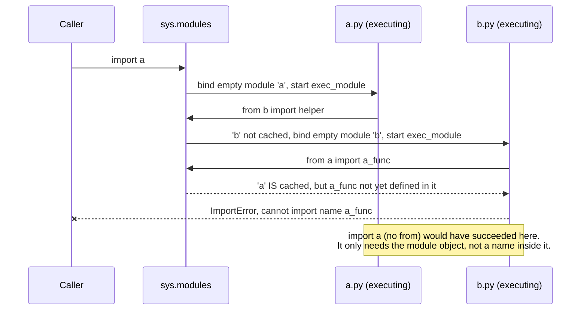
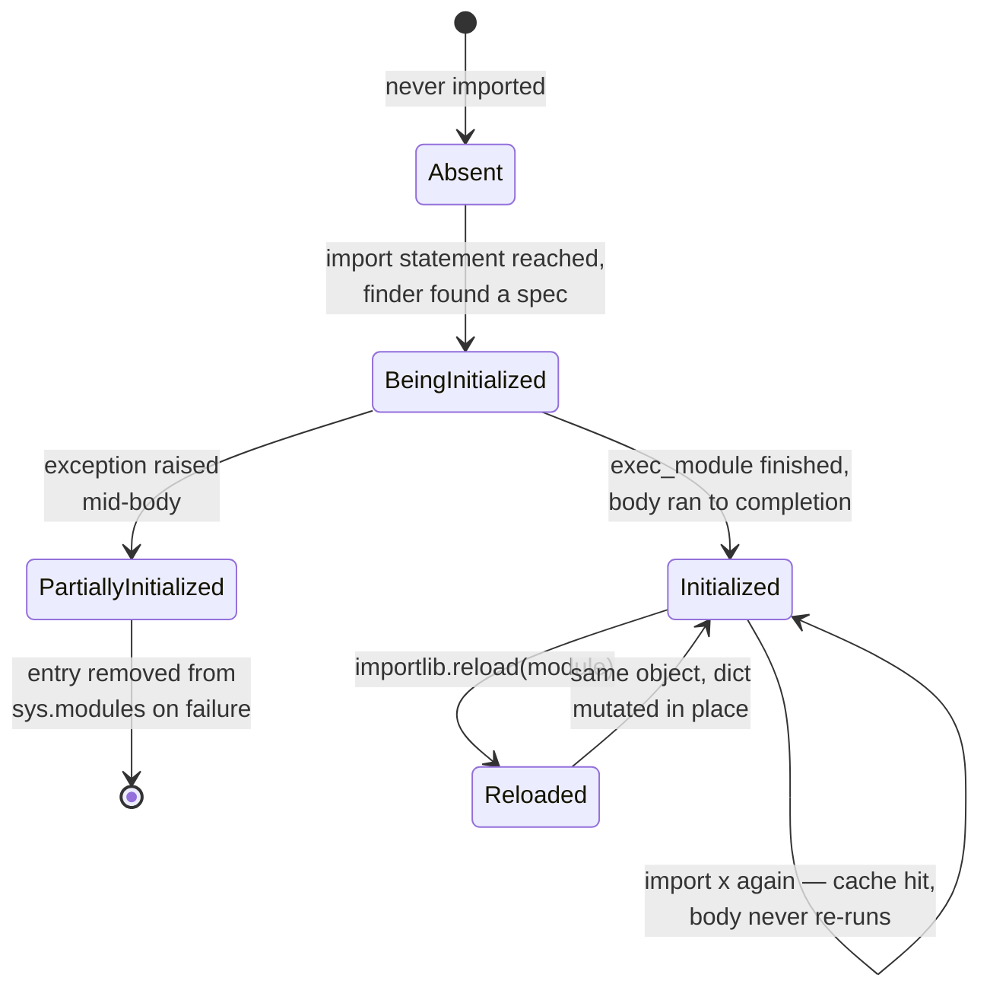
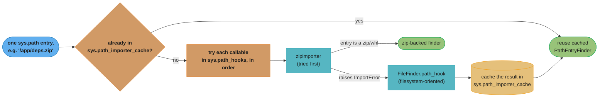

# The Import System

## 1. Concept Overview

`import x` looks like a declaration. It is actually a function call. When the interpreter reaches that statement it invokes `__import__("x", globals(), locals(), [], 0)`, which delegates to `importlib._bootstrap._find_and_load`, and that function does five distinct things in a fixed order: check a cache, ask a chain of finder objects where the module lives, build a spec describing how to load it, bind an (initially empty) module object into that cache, and only then execute the module's top-level code to populate it. The name that ends up bound in your namespace is not "the file's contents" — it is a reference to whatever object is sitting in `sys.modules["x"]` at the moment the statement finishes.

`sys.modules` is the authoritative cache, and it is an ordinary, mutable `dict`. Every import of the same fully-qualified name after the first one is a single dictionary lookup — the module's body does not run again, no matter how many files say `import x`. This module is the deep treatment of that machinery: the finder/loader protocol (`sys.meta_path`, `sys.path_hooks`, `ModuleSpec`), how to write a custom `MetaPathFinder`, why circular imports fail the way they do, what `importlib.reload()` actually does (and does not) fix, how `importlib.metadata.entry_points()` turns installed packages into a plugin registry, how to read `-X importtime` output, and PEP 810's explicit `lazy import` syntax, available since Python 3.15.0. `metaclasses_and_metaprogramming/metaclasses_and_metaprogramming.md` §4.8 and §5.6 introduce the import system as an example of the same "interpreter calls a hook, hook returns something the interpreter builds an object from" shape that a metaclass uses for classes; this module is where that machinery gets the full, standalone treatment.

---

## 2. Intuition

**The filing-cabinet analogy.** `sys.meta_path` is the office's index of departments that might have your document — first the built-in-modules desk, then the frozen-modules desk, then the general filing department (`PathFinder`). `sys.path_hooks` are the department's own instructions for how to search a given drawer (a directory, a zip file, a network location). A **finder** is the clerk who tells you "yes, that document is in drawer 3, and here is the drawer's opening procedure" without opening it. A **loader** is the clerk who actually opens the drawer, retrieves the pages, and reads them into your file. `sys.modules` is not the filing cabinet at all — it is the copy already sitting open on your desk. If you ask for the document again, nobody walks back to the cabinet; you already have it in front of you.

**Key insight #1 — import is memoized, not idempotent.** "Idempotent" would mean running it twice has the same effect as running it once, but the second run is a no-op only because the first run's *result* is cached and handed back, not because re-running would be harmless. A module with `print("loading")` at module scope proves the difference immediately: the first `import x` prints; every subsequent `import x`, anywhere in the process, prints nothing, because the interpreter never looks past the `sys.modules` dictionary lookup.

**Key insight #2 — a module is an ordinary object.** `types.ModuleType` is a real class; a module instance has a `__dict__` like anything else, and that `__dict__` *is* its namespace. Nothing about "importing" is special once you accept that: it is dict construction, then `exec(code, that_dict)`. Every downstream fact in this module — why circular imports fail on `from x import y` and not `import x`, why `reload()` cannot fix references other modules already hold, why module-level state behaves like a process-wide singleton — falls out of that one sentence.

---

## 3. Core Principles

1. **`sys.modules` is authoritative and writable.** It is not an internal implementation detail exposed for convenience — it is the actual source of truth the interpreter consults on every import statement. Code is allowed to read it, delete keys from it (forcing a re-import), and even insert fake entries into it (the technique behind the `RegistryFinder` example and behind most import-based test mocking).

2. **A module's top-level body executes at most once per interpreter process.** Not once per `import` statement — once, full stop, keyed by the fully-qualified dotted name. A second `import x` anywhere, in any file, at any time, is a cache hit.

3. **Import binds a name in the *importing* namespace, not in the module.** `import x` binds `x` locally to whatever object `sys.modules["x"]` holds. `from x import y` binds `y` locally to whatever `x.y` evaluated to *at the moment of the import statement* — a snapshot, not a live view. This is why rebinding `x.y` later does not update every place that already did `from x import y`.

4. **The module is registered in `sys.modules` before its body runs, not after.** `importlib._bootstrap._load` does `sys.modules[spec.name] = module` and only then calls `loader.exec_module(module)`. This one ordering decision is the entire mechanism behind circular-import behavior, `reload()` semantics, and why a `MetaPathFinder` can serve a module from anywhere without the rest of the interpreter caring.

5. **Import-time side effects are the root of most import bugs.** Anything beyond `def`, `class`, and simple assignment at module scope — opening a database connection, reading an environment variable and freezing its value, registering a global singleton — runs the instant the module is first imported, at a time and in an order the importing code does not fully control. The fix is almost always to defer the side effect into a function.

---

## 4. Types / Architectures / Strategies

### 4.1 Regular packages vs namespace packages (PEP 420) vs frozen vs extension modules

| Kind | Marker | What builds it | `__path__` |
|---|---|---|---|
| Regular package | `pkg/__init__.py` exists | `SourceFileLoader` executes `__init__.py` | Single-entry list, fixed at import time |
| **Namespace package** (PEP 420) | Directory, **no** `__init__.py` | `None` loader — no code executes at all | `_NamespacePath`, recomputed lazily; can span **multiple** `sys.path` directories |
| Frozen module | Bytecode compiled into the interpreter binary | `FrozenImporter`, found via `sys.meta_path`, before the filesystem is even touched | N/A |
| Extension module | `pkg/_speedups.cpython-314-darwin.so` | `ExtensionFileLoader` calls the compiled `PyInit_*` entry point | N/A — not a package |
| Built-in module | Statically linked into the interpreter (`sys`, `_thread`) | `BuiltinImporter` | N/A |

A namespace package lets one dotted name, say `mycompany.tools`, be assembled from two independently-installed distributions that each ship a `mycompany/tools/` directory with no `__init__.py` — both contribute entries to the same `__path__`. This is also the most common *accidental* namespace package: a regular package directory missing its `__init__.py` by a typo or a bad merge still imports successfully, because PEP 420 makes that legal, so the mistake does not surface as an error at the point of `import mycompany.tools` — it surfaces much later as a confusing `ModuleNotFoundError` on a submodule that the missing `__init__.py` was supposed to expose.

### 4.2 Absolute vs relative imports

```python
# Absolute — always resolves against sys.path from the top
from mypackage.utils.strings import slugify

# Relative — resolves against the *importing* module's package
from .strings import slugify          # sibling module
from ..utils import strings           # up one level, then down
from . import strings                 # sibling module, imported as a submodule
```

Relative imports only work inside a package (a module with `__package__` set) — running a file directly as a script (`python mymodule.py`) sets `__name__ == "__main__"` and leaves `__package__` empty, so any relative import in that file raises `ImportError: attempted relative import with no known parent package`. A relative import cannot climb past the top-level package it started in — `from ...` one dot too many raises `ImportError: attempted relative import beyond top-level package`. Style guides (PEP 8, and this repo) prefer absolute imports for anything that is not a tight sibling relationship, because they read correctly no matter where the importing file is moved.

### 4.3 Eager vs deferred (function-local) vs explicit lazy (PEP 810 `[3.15]`)

| Strategy | When the target module's body runs | Mechanism |
|---|---|---|
| Eager (default) | Immediately, at the `import` statement | `import x` at module top level |
| Deferred, hand-rolled | First call of the function containing the import | `import x` inside a `def` body |
| Deferred, dynamic | Whenever `importlib.import_module("x")` is called | `importlib.util.find_spec` + `import_module` |
| **Explicit lazy `[3.15]`** | First **attribute access** on the bound name, anywhere | `lazy import x` at module top level |

Function-local imports and PEP 810 lazy imports both defer cost, but they defer it to different triggers — a function-local import pays on every call to a *function*, while a lazy import pays on first *use of the name*, wherever that use appears, including inside the very function it was imported for. §6.6 covers PEP 810's grammar and restrictions in full; §8 compares the runtime cost of all three.

### 4.4 `__init__.py` present vs implicit re-export surface

A package's `__init__.py` can be empty (submodules must be imported explicitly: `from mypackage.io import readers`), or it can re-export a curated public surface (`from .io.readers import CSVReader` inside `__init__.py`, so callers write `from mypackage import CSVReader`). The tradeoff is import cost versus ergonomics: a re-exporting `__init__.py` executes every module behind every re-export the instant *anything* in the package is imported, even a submodule the caller does not need — this is a common source of surprising `-X importtime` weight on packages that otherwise look small. See §9 for when each is the right call.

---

## 5. Architecture Diagrams

### 5.1 The full resolution path of `import x`

```mermaid
flowchart LR
    classDef io      fill:#61afef,stroke:#2e86c1,color:#1a1a1a,font-weight:bold
    classDef frozen  fill:#c678dd,stroke:#9b59b6,color:#fff
    classDef train   fill:#98c379,stroke:#27ae60,color:#1a1a1a
    classDef mathOp  fill:#d19a66,stroke:#e67e22,color:#1a1a1a,font-weight:bold
    classDef lossN   fill:#e06c75,stroke:#c0392b,color:#fff,font-weight:bold
    classDef req     fill:#56b6c2,stroke:#0097a7,color:#1a1a1a
    classDef base    fill:#e5c07b,stroke:#f39c12,color:#1a1a1a

    src(["import x"]) --> hit{"x in<br/>sys.modules?"}
    hit -->|"yes — cache hit"| cached(["bind cached<br/>module object"])
    hit -->|"no"| meta["walk sys.meta_path<br/>finders in order"]
    meta --> builtin["BuiltinImporter /<br/>FrozenImporter"]
    builtin -->|"not builtin/frozen"| pf["PathFinder<br/>(default 3rd finder)"]
    pf --> hooks["sys.path_hooks<br/>turn each sys.path entry<br/>into a path finder"]
    hooks --> spec["ModuleSpec built<br/>+ loader chosen"]
    spec --> bind[("module object bound<br/>in sys.modules FIRST")]
    bind --> exec["loader.exec_module<br/>runs top-level body"]
    exec --> out(["import statement<br/>completes"])

    class src io
    class hit,meta,builtin,pf,hooks,spec mathOp
    class bind base
    class exec req
    class cached,out train
```



The single most consequential step is `bind` happening before `exec`: the module object exists, fully addressable, before a single line of its own code has run. Every fact about circular imports in §10 follows from that ordering.

### 5.2 Circular import failure — `from a import b` vs `import a`



`sys.modules["a"]` exists the whole time B is executing — the crash is not "module a is missing," it is "attribute `a_func` does not exist yet on the module object I already have." Swapping the failing line to plain `import a` plus `a.a_func()` inside a function body removes the crash entirely, because it never inspects `a`'s attributes at import time.

### 5.3 A module's lifecycle across a process



`BeingInitialized` is the state a partially-executed module sits in during a circular import — it already has a `sys.modules` entry, but its `__dict__` only contains whatever ran before the point of re-entry. On an unhandled exception during `exec_module`, CPython removes the module from `sys.modules` so a later retry gets a clean re-attempt rather than resuming a broken half-built object.

### 5.4 Resolving one `sys.path` entry — `path_hooks` and the importer cache



`sys.path_hooks` is tried in order and the winner is cached per entry, so a large `sys.path` pays this lookup once per entry rather than once per import — the same discovery cost `PathFinder` amortizes at the module level with `sys.modules`.

---

## 6. How It Works — Detailed Mechanics

### 6.1 A working `MetaPathFinder` + `Loader` pair

This is the mechanism every plugin-loading and mock-import trick in this section is built on: register an object on `sys.meta_path` that answers `find_spec`, and hand back a `ModuleSpec` whose loader knows how to fill in the module body from anywhere at all.

```python
import sys
import types
import importlib.abc
import importlib.machinery


class RegistryFinder(importlib.abc.MetaPathFinder, importlib.abc.Loader):
    """Serves module source out of an in-memory dict instead of the filesystem."""

    def __init__(self, registry: dict[str, str]) -> None:
        self.registry = registry  # {"plugins.greeter": "def hello(): return 'hi'"}

    def find_spec(
        self,
        fullname: str,
        path: list[str] | None,
        target: types.ModuleType | None = None,
    ) -> importlib.machinery.ModuleSpec | None:
        if fullname not in self.registry:
            return None  # not ours — the next finder on sys.meta_path gets a turn
        return importlib.machinery.ModuleSpec(fullname, loader=self)

    def create_module(
        self, spec: importlib.machinery.ModuleSpec
    ) -> types.ModuleType | None:
        return None  # ask the import machinery for a default ModuleType

    def exec_module(self, module: types.ModuleType) -> None:
        exec(self.registry[module.__name__], module.__dict__)


sys.meta_path.insert(0, RegistryFinder({"plugins.greeter": "def hello(): return 'hi'"}))

import plugins.greeter

print(plugins.greeter.hello())  # "hi" — never touched the filesystem
```

Inserting at the **front** of `sys.meta_path` gives `RegistryFinder` first refusal on every import in the process; returning `None` for anything it does not own lets `PathFinder` fall through to the normal filesystem search unchanged. `create_module` returning `None` is the documented way to say "use the default `ModuleType` allocation" — only override it when a loader needs a subclass of `ModuleType` or some other custom allocation step.

`exec_module` is the only way to run a module body. `Loader.load_module()`, which created,
registered, and ran the module in one call, is removed in 3.15 and the import system no longer calls
it even when a custom loader defines it. A loader that implements only `load_module()` now fails to
load anything; port it to `create_module` plus `exec_module` as above.

### 6.2 `importlib.util.find_spec` and what a `ModuleSpec` carries

`find_spec` runs the finder chain **without executing anything** — useful for "is this importable" checks and for tooling that wants to inspect a module before committing to running it.

```python
import importlib.util

spec = importlib.util.find_spec("json")
print(spec.name)         # "json"
print(spec.origin)       # ".../lib/python3.14/json/__init__.py"
print(spec.submodule_search_locations)  # [".../lib/python3.14/json"] — it's a package
print(spec.loader)       # <_frozen_importlib_external.SourceFileLoader object ...>
print(spec.cached)       # path to the compiled .pyc, if any

# find_spec returns None for something that genuinely doesn't exist, rather than raising
missing = importlib.util.find_spec("definitely_not_a_real_module")
print(missing)            # None
```

A `ModuleSpec` is the contract between a finder and the loading machinery: `name` (the fully-qualified dotted name), `loader` (the object whose `exec_module` will run), `origin` (a human-readable location, often a file path), `submodule_search_locations` (non-`None` only for packages — this becomes `__path__`), and `cached` (the compiled bytecode path). Building a module from a spec manually — the pattern behind loading a module from an arbitrary file path without it living on `sys.path` at all — is:

```python
import importlib.util
import sys

spec = importlib.util.spec_from_file_location("plugin_x", "/opt/plugins/plugin_x.py")
module = importlib.util.module_from_spec(spec)
sys.modules["plugin_x"] = module   # do this BEFORE exec_module, matching step 4 of §5.1
spec.loader.exec_module(module)
```

The spec is also where a module's import metadata lives. Since 3.15 the import system no longer
sets `__cached__`; read `module.__spec__.cached`. `__loader__` and `__package__` are deprecated and
scheduled for removal; read `__spec__.loader` and `__spec__.parent`.
Code that still reads `module.__cached__` gets `AttributeError` on 3.15.

### 6.3 Why `importlib.reload()` lies

```python
# models.py
class Handler:
    def process(self) -> str:
        return "v1"

# caller.py
import models

h = models.Handler()
print(h.process())     # "v1"

# --- edit models.py on disk: Handler.process now returns "v2" ---

import importlib
importlib.reload(models)

print(h.process())                       # STILL "v1" — h is an instance of the OLD class
print(isinstance(h, models.Handler))     # False — models.Handler is now a DIFFERENT object
print(models.Handler().process())        # "v2" — a NEW instance sees the reloaded code
```

`reload()` re-executes the module's top-level code into the **same** `types.ModuleType` object already in `sys.modules`, mutating its `__dict__` in place. `models.Handler` after `reload()` is a brand-new class object — the old `class Handler:` statement ran again and produced a fresh `type` instance — but `h` was constructed from the *previous* `Handler` class object, and Python instances do not migrate to a replacement class definition after the fact. `isinstance(h, models.Handler)` compares `h`'s actual class against whatever `models.Handler` currently names, and after `reload()` those are two different objects that happen to share a name and source. `reload()` also does nothing for any other module that already ran `from models import Handler` — that name is a separate binding in the *other* module's globals, still pointing at the pre-reload class.

### 6.4 `importlib.metadata.entry_points()` for plugin discovery

```python
from importlib.metadata import entry_points

# Every installed distribution can declare entry points in its own pyproject.toml, e.g.:
#   [project.entry-points."myapp.plugins"]
#   csv_exporter = "myapp_csv_plugin.exporter:CSVExporter"

eps = entry_points(group="myapp.plugins")
for ep in eps:
    plugin_class = ep.load()          # imports myapp_csv_plugin.exporter, returns CSVExporter
    print(ep.name, "->", plugin_class)

# ep.load() is doing an ordinary import under the hood — importlib.import_module(ep.module)
# followed by attribute access for anything after the ':' — so it is subject to every
# import-time-cost and circular-import rule in this module, just triggered by metadata
# instead of a literal `import` statement in your source.
```

This is how a program can discover and load plugins that were never imported anywhere in its own source — a separately-installed package registers itself under a group name at install time (in its `pyproject.toml`), and the host application only has to ask for that group. `entry_points()` reads installed package metadata (the `.dist-info` directories `pip`/`uv` write), not source code, so a plugin distribution does not need to modify the host application at all.

### 6.5 Reading `-X importtime` output

```
$ python -X importtime -c "import requests" 2> importtime.log
$ tail -5 importtime.log
import time:       104 |        104 |   _distutils_hack
import time:       612 |        716 |     idna
import time:      1834 |       3891 |   urllib3
import time:       398 |        398 |     charset_normalizer
import time:     11207 |      18664 | requests
```

Both numbers are **microseconds**. The first column, `self`, is time spent in that module's own body, excluding anything it imported. The second column, `cumulative`, is `self` plus every import it triggered, recursively — so `requests` at 18,664 µs cumulative but only 11,207 µs self means roughly 7,457 µs of that total belongs to `requests`' own transitive imports (`urllib3`, `idna`, `charset_normalizer`, and others further down the log), not to code inside `requests` itself. Indentation shows the import tree: `urllib3` is indented one level under `requests`, meaning `requests` imported it directly; `idna` is indented under `urllib3`, meaning `urllib3` imported `idna`, not `requests`. Feeding the same log to `tuna importtime.log` turns this text into a sortable, zoomable flame chart — the practical first step before guessing at what to defer.

### 6.6 PEP 810 lazy imports `[3.15]`

PEP 810 (Status: Final, Python-Version: 3.15) adds explicit syntax for deferring both the module lookup and its body's execution until the first time the bound name is actually used:

```python
lazy import json                # binds the name now; json's body does NOT run yet
lazy from pathlib import Path   # same shape, for a from-import


def handle(raw: str) -> str:
    return json.dumps({"path": str(Path(raw))})   # json AND pathlib execute HERE,
                                                    # on this line's first call
```

**Grammar** (verbatim from the PEP):

```
import_name:  | 'lazy'? 'import' dotted_as_names
import_from:  | 'lazy'? 'from' ('.' | '...')* dotted_name 'import' import_from_targets
              | 'lazy'? 'from' ('.' | '...')+ 'import' import_from_targets
```

Both `lazy import json` and `lazy from json import loads` are valid; there is no `from x import lazy y` form — `lazy` always comes first, immediately before `import` or `from`. `lazy` is a **soft keyword**: it is only special in that exact position, so existing code using `lazy` as a variable or parameter name elsewhere keeps working unmodified.

**Restrictions** (verbatim): "The soft keyword is only allowed at the global (module) level, not inside functions, class bodies, `try` blocks, or `import *`." and "`from __future__ import` statements cannot be lazy." `lazy from x import *` is a `SyntaxError`.

**Controls:** the `-X lazy_imports=<mode>` interpreter flag and the `PYTHON_LAZY_IMPORTS=<mode>` environment variable, both accepting `normal` (default — only explicit `lazy import` statements defer), `all` (every eager import in the process is treated as lazy, for measuring the effect without rewriting source), and `none` (force everything eager, ignoring `lazy` keywords — useful for isolating whether a bug is caused by deferred execution). A module-level `__lazy_modules__` set of fully-qualified name strings exists for marking/compatibility purposes.

**Failure semantics** (verbatim): "If reification fails (e.g., due to an `ImportError`), the lazy object is not reified or replaced. Subsequent uses of the lazy object will re-try the reification." — a failed lazy import is not cached as a failure; the next use tries again from scratch, which matters if the failure was transient (a plugin directory mounted after the process started, for instance) but means a permanently-broken lazy import pays the resolution cost repeatedly on every use rather than failing fast once.

**The real gotcha**: because `lazy import` cannot appear inside a `try` block, the extremely common optional-dependency idiom

```python
try:
    import ujson as json
except ImportError:
    import json
```

**cannot** be rewritten with `lazy`. That pattern must stay an eager import; PEP 810 does not offer a deferred equivalent for it. §10 walks the failure mode of attempting it anyway.

### 6.7 `importlib.util.LazyLoader` — the pre-3.15 hand-rolled equivalent

Before PEP 810 existed as syntax, the stdlib already shipped a *loader-level* way to get a similar effect, by wrapping an existing loader so the module executes only on first attribute access:

```python
import importlib.util
import sys

def lazy_import(name: str):
    spec = importlib.util.find_spec(name)
    loader = importlib.util.LazyLoader(spec.loader)
    spec.loader = loader
    module = importlib.util.module_from_spec(spec)
    sys.modules[name] = module
    loader.exec_module(module)   # binds a lazy proxy; body runs on first real attribute access
    return module

json = lazy_import("json")   # json.dumps(...) triggers the real import on first use
```

The practical difference from PEP 810: `LazyLoader` works on every Python version that ships it (3.5+), but it operates at the loader/module level — it has to be threaded through manually per module, produces a genuine proxy object with its own subtleties (some tools that inspect `sys.modules` directly can observe the proxy rather than the real module before first use), and there is no language keyword or `-X` flag to toggle it project-wide. `lazy import` is a first-class syntax the compiler understands, toggleable globally via `-X lazy_imports`, with the failure semantics of §6.6 defined by the language spec rather than by one library's implementation choices. New code targeting 3.15+ should prefer `lazy import`; `LazyLoader` remains relevant for libraries that still support 3.11-3.14.

### 6.8 `sys.path_hooks`, `sys.path_importer_cache`, and how one `sys.path` entry actually gets searched

`PathFinder.find_spec` does not re-scan the filesystem on every import — it maintains `sys.path_importer_cache`, a dict mapping each `sys.path` entry (a directory or zip-file string) to the `PathEntryFinder` object responsible for searching it. The first time a given `sys.path` entry is needed, `PathFinder` walks `sys.path_hooks` — an ordered list of callables — calling each with the entry string until one returns a finder instead of raising `ImportError`; that finder is cached in `sys.path_importer_cache` for every subsequent import, so a large `sys.path` only pays the "which hook handles this entry" cost once per entry, not once per import statement.

```python
import sys

print(sys.path_hooks)
# [<class 'zipimporter'>, FileFinder.path_hook(...)]  — order matters:
# zipimporter is tried first, so an entry like "/app/deps.zip" is handled by
# zipimport rather than falling through to the filesystem-oriented FileFinder

print(len(sys.path_importer_cache))   # grows as more sys.path entries get searched
for entry, finder in list(sys.path_importer_cache.items())[:2]:
    print(entry, "->", type(finder).__name__)
# '/usr/lib/python3.14' -> FileFinder
# '/usr/lib/python3.14/lib-dynload' -> FileFinder
```

This is also how a `.zip` or a `.whl` (itself a zip file) can sit directly on `sys.path` and still be importable without ever being extracted: `zipimporter`, registered first in `sys.path_hooks`, recognizes a zip-file path and returns a finder that reads module bytecode straight out of the archive's central directory — `PathFinder` never distinguishes "directory on disk" from "zip archive" at the `find_spec` level; that distinction is entirely `sys.path_hooks`' job. A stale `sys.path_importer_cache` entry — for example after a directory is deleted and recreated at the same path mid-process — is the reason `importlib.invalidate_caches()` exists: it clears path-based caches so the next import re-derives which finder should handle each `sys.path` entry, which matters for tools that create Python packages on disk at runtime and expect them to be importable immediately.

### 6.9 `__import__` vs `importlib.import_module` — two entry points, one machinery

```python
# What "import x.y.z" desugars to, roughly:
mod = __import__("x.y.z", globals(), locals(), [], 0)
# __import__ returns the TOP-level package (x), not x.y.z — the import
# statement's own bytecode does the extra attribute walk to bind x.y.z's name

# importlib.import_module is the ergonomic wrapper that returns the LEAF module directly:
import importlib
mod = importlib.import_module("x.y.z")
print(mod.__name__)   # "x.y.z" — this IS the leaf module, no extra attribute walk needed
```

Both eventually call into `importlib._bootstrap._find_and_load` — there is exactly one resolution machinery, not two competing ones. The difference is purely in what gets *returned* and how a dotted name in a *string* (as opposed to source-level syntax) is handled: `__import__` mirrors the historically low-level C-API contract the `import` statement's bytecode expects, while `import_module` is the function to reach for whenever a module name is only known at runtime as a string — building a plugin loader (§6.4), or writing a `find_spec`-based tool.

### 6.10 `.pth` import lines and PEP 829 `.start` files `[3.15]`

Before any user code runs, `site` reads every `name.pth` file in each site-packages directory. A
line holding a path is appended to `sys.path`; a line starting with `import` is passed to `exec()`.
That second form is how editable installs, coverage hooks, and some instrumentation agents run code
at startup, and it is also how a malicious wheel gets code execution in every Python process on the
machine without being imported.

PEP 829 adds `name.start` files. Each non-comment line is an entry point, `pkg.mod:callable`, that
`site` resolves with `pkgutil.resolve_name()` and calls with no arguments:

```text
# site-packages/myagent.start
myagent.bootstrap:install_hooks
```

`site` applies every path line from every `.pth` file first and only then calls the `.start` entry
points, so startup code always sees the full `sys.path`. In 3.15, `import` lines in `.pth` files
are deprecated: they still run, with a diagnostic only under `-v`, except that they are ignored when
a `name.start` file with the same `name` exists. The `site` docs state that 3.18 and 3.19 will
ignore them silently and 3.20 will warn. For auditing, a `.start` file names exactly which callable
runs, where a `.pth` import line can hold any one-line statement. `python -S` skips both file types.

---

## 7. Real-World Examples

### 7.1 pytest `conftest.py` and rootdir discovery

pytest does not `import` your test files the ordinary way at collection time — it walks the directory tree looking for `conftest.py` files, determines a `rootdir` and, in the common `rootdir`-relative layout, inserts each test package's parent directory onto `sys.path` (or uses `importlib` mode, which avoids `sys.path` insertion entirely and imports test modules under synthetic, collision-free names). Every `conftest.py` found on the way down is imported *before* the test files in its directory, specifically so its fixtures are visible to them — an ordering guarantee built entirely on top of the ordinary import machinery, not a separate mechanism.

```python
# conftest.py at the repo root — imported before any test module beneath it
import pytest

@pytest.fixture
def db_connection():
    conn = create_test_connection()
    yield conn
    conn.close()
```

Every test file under that directory can use `db_connection` as a parameter with no `import` at all — pytest injects it by name, but the mechanism that makes `conftest.py`'s *code* run before the test module's own top-level code is nothing more exotic than "import the finder found `conftest.py` first, in directory-walk order." See `../testing_with_pytest/testing_with_pytest.md` for the full collection algorithm.

### 7.2 Django's app registry and `AppConfig.ready()`

Django's `django.apps.apps.populate()` runs at process startup and does three passes over `INSTALLED_APPS`: import each app's `AppConfig`, import each app's `models` module (so every `Model` subclass's metaclass — see `../metaclasses_and_metaprogramming/metaclasses_and_metaprogramming.md` — has fired and registered itself), and only then call every `AppConfig.ready()`.

```python
# myapp/apps.py
from django.apps import AppConfig

class MyAppConfig(AppConfig):
    name = "myapp"

    def ready(self) -> None:
        # Safe here: EVERY app's models have finished importing by this point.
        from django.db.models.signals import post_save
        from otherapp.models import OtherModel   # would risk a circular/partial
        post_save.connect(my_handler, sender=OtherModel)  # import if done at module scope
```

`ready()` exists specifically because it is unsafe to do cross-app setup — registering signal handlers that reference another app's models — during the *import* of an app's own `models.py`: that app's models module might not be fully populated yet, and neither might the app it wants to reference. `ready()` runs only after every app's models have finished importing, which sidesteps the exact partially-initialized-module problem from §5.2 by construction rather than by convention.

### 7.3 setuptools / installer-generated console scripts

A `pyproject.toml` entry like

```toml
[project.scripts]
mytool = "mytool.cli:main"
```

causes the installer to generate a tiny executable stub at install time whose entire body is, in effect:

```python
#!/usr/bin/env python3
import sys
from mytool.cli import main
sys.exit(main())
```

Running `mytool` on the command line is an ordinary Python import — the stub script pays the full cost of importing `mytool.cli` and everything it transitively imports before `main()` even starts, which is exactly the cost §7.4 and §14 profile and try to shrink. See `../packaging_and_project_tooling/packaging_and_project_tooling.md` for the full entry-point declaration mechanics.

### 7.4 A CLI whose startup is dominated by imports

A command-line tool with several subcommands (`mytool export`, `mytool plot`, `mytool sync`) commonly imports every subcommand's dependencies — a cloud SDK, a plotting library, a heavy data library — at module top level in one `cli.py`, so that running `mytool --help` (which needs none of them) still pays for all of them:

```python
# BROKEN pattern this example targets — every dependency loads for every invocation
import argparse
import cloud_sdk       # only 'export' needs this
import plotting_lib    # only 'plot' needs this
from mytool.subcommands import export, plot, sync
```

`mytool --help` and `mytool sync` end up paying for `cloud_sdk` and `plotting_lib` even though neither invocation touches either — the exact scenario worked through end to end, with measured `-X importtime` numbers, in §14.

---

## 8. Tradeoffs

| Strategy | Startup cost paid | Runtime cost paid | Works inside `try`/`except`? | Works inside a function? |
|---|---|---|---|---|
| Eager import (module top level) | Full cost, every process start, whether used or not | None | Yes | N/A — it's top level |
| Deferred (import inside a function) | None until the function is first called | Small re-lookup cost — `sys.modules` hit — on every subsequent call | Yes | Yes — that's the point |
| PEP 810 `lazy import` `[3.15]` | None until first attribute access on the name | One-time reification cost on first use, then normal attribute access forever after | **No** | **No — module top level only** |

| Package kind | `__init__.py` needed | Can span multiple `sys.path` dirs | Import-time cost | Failure mode when misused |
|---|---|---|---|---|
| Regular package | Yes | No | Runs `__init__.py` once, always | Missing `__init__.py` silently *becomes* a namespace package |
| Namespace package (PEP 420) | No | Yes | No code runs — `__path__` computed lazily | A genuinely missing package still "imports" with an empty, useless module |

| Import form | Circular-import safety | What actually gets bound |
|---|---|---|
| `import x` | Safe against a partially-initialized target — only needs the module object to exist | The module object itself |
| `from x import y` | Unsafe — does an immediate attribute lookup on `x` | A snapshot of whatever `x.y` was at that moment |
| Relative (`from . import y`) | Same rules as absolute, plus fails outside a package context | Same as `from x import y` |

---

## 9. When to Use / When NOT to Use

**Use a custom `MetaPathFinder`** when modules genuinely need to come from somewhere `PathFinder` cannot reach on its own — an in-memory registry for tests, an encrypted or signed bundle, rows fetched from a database, a hot-reload proxy for a plugin directory being watched for changes. It is the correct tool exactly when there is no file on disk to point a normal loader at.

**Do NOT write a `MetaPathFinder` when an `entry_points()`-based plugin registry solves the same problem.** If every plugin is an ordinary installed package with an ordinary importable module, `importlib.metadata.entry_points()` (§6.4) gets the same "discover implementations without a hardcoded `if/elif` chain" outcome by piggybacking on the standard finder chain instead of replacing it — less code, no custom `sys.meta_path` entry to maintain, and it composes with every other tool (pip, uv, wheel installers) that already understands `pyproject.toml` entry points. Reach for a `MetaPathFinder` only once you have confirmed the thing you are loading is not, and cannot be, an installed package.

**Use `entry_points()` over an `if/elif` dispatch** when the set of implementations is meant to be open — third parties, or even just your own future self, should be able to add a new option by installing a package, not by editing a central dispatch function. `if/elif` is still the right tool for a small, closed, internally-known set of options where the dispatch function is the single place that ever needs to change.

**Use PEP 810 `lazy import` or a function-local import** when profiling with `-X importtime` (§6.5) shows a specific module dominating cold-start time and that module's functionality is only needed on some code paths. **Do NOT reach for lazy imports speculatively** — deferring every import "just in case" adds a layer of indirection for no measured benefit and, per §6.6, silently forecloses the `try/except ImportError` idiom on anything deferred that way. Profile first.

---

## 10. Common Pitfalls

### Pitfall 1 — BROKEN: circular import via `from x import y`

```python
# a.py
# BROKEN
from b import helper   # b.py starts importing here, mid-import

def a_func():
    return helper()


# b.py
# BROKEN
from a import a_func   # ImportError: cannot import name 'a_func' from
                        # partially initialized module 'a' (most likely
                        # due to a circular import)

def helper():
    return "b"
```

**Why, mechanically:** say something imports `a` first. `a.py` starts executing, reaches `from b import helper`, and Python begins importing `b` — `b` is bound in `sys.modules` (§5.1, step `bind`) with an **empty, partially-populated** `__dict__`, and then its body starts running. `b.py`'s first line is `from a import a_func`. Python sees `a` is already a key in `sys.modules` (a cache hit, so it does **not** re-run `a.py`), so it reaches into the existing-but-still-executing `a` module object to grab `a_func`. But `a.py` never got past its own first line — `a_func` was never defined — so the attribute lookup on the partial module raises `ImportError`.

```python
# FIX 1 (preferred) — remove the cycle: move the shared piece into a third module
# shared.py holds whatever both a.py and b.py actually need from each other.

# FIX 2 — defer the import into the function that needs it
# a.py
def a_func() -> str:
    from b import helper   # resolved on first call, by which point b has
    return helper()        # finished executing and 'helper' exists

# FIX 3 — a type-only dependency should never be evaluated at runtime
from typing import TYPE_CHECKING
if TYPE_CHECKING:
    from b import Helper   # only seen by type checkers, never imported at runtime

def process(h: "Helper") -> None: ...
```

`import a.b` and `import b` (no `from`) survive the identical scenario, because they only need the **module object** to exist in `sys.modules` — which it does the instant it is bound — not any particular name inside it yet.

### Pitfall 2 — BROKEN: a local file shadowing a stdlib module

```
project/
├── json.py          # BROKEN: this file exists in the project root
└── main.py
```

```python
# main.py, run as: python main.py   (from inside project/)
import json
print(json.dumps({"a": 1}))
# AttributeError: module 'json' has no attribute 'dumps'
```

**Why:** when a script is run directly, `sys.path[0]` is the directory containing that script — inserted there before the standard library entries. `PathFinder` walks `sys.path` in order and stops at the first match, so `project/json.py` (however unrelated in intent) shadows the real stdlib `json` package for the entire process, and every downstream module that does `import json` gets the shadow, not the stdlib module.

```python
# FIX: never name a project module after a stdlib or well-known third-party module.
# Rename project/json.py to project/json_utils.py (or move it into a package,
# which changes its importable name to project.json rather than bare json).
```

The fastest diagnostic is `import json; print(json.__file__)` — if it points inside the project tree instead of the standard library, this is the bug.

### Pitfall 3 — BROKEN: mutable module-level state treated as a singleton across test runs

```python
# cache.py
# BROKEN
_cache: dict[str, int] = {}

def get(key: str) -> int | None:
    return _cache.get(key)

def put(key: str, value: int) -> None:
    _cache[key] = value
```

```python
# test_a.py
from cache import put
def test_one():
    put("x", 1)          # mutates the ONE module-level dict, process-wide

# test_b.py
from cache import get
def test_two():
    assert get("x") is None   # FAILS if test_one ran first in the same process —
                               # both tests import the SAME cache module object
```

**Why:** `cache` is imported once per test-process, per Core Principle 2 — every test file that does `import cache` (or `from cache import ...`) gets a reference to the identical `_cache` dict, because there is exactly one `cache` module object in `sys.modules` for the whole run. Test isolation was never actually happening; it only looked like it was, until a run order exposed the shared state.

```python
# FIX: make the state explicit and injectable instead of an implicit module singleton
class Cache:
    def __init__(self) -> None:
        self._store: dict[str, int] = {}

    def get(self, key: str) -> int | None:
        return self._store.get(key)

    def put(self, key: str, value: int) -> None:
        self._store[key] = value


# test_a.py
def test_one():
    cache = Cache()
    cache.put("x", 1)   # local to this test — no cross-test leakage
```

A pytest `fixture` that constructs a fresh instance per test is the idiomatic replacement — see `../testing_with_pytest/testing_with_pytest.md`.

### Pitfall 4 — `importlib.reload()` leaving stale class objects so `isinstance` fails

Covered in full mechanical detail in §6.3; the summary as a pitfall: **never use `reload()` on a module defining a class that already has live instances**, because those instances silently become instances of a class object the reloaded module no longer refers to by that name. `isinstance(old_instance, ReloadedModule.SomeClass)` returning `False` after a reload is not a bug in `isinstance` — it is `reload()` doing exactly what it does, applied somewhere it should not have been. Treat `reload()` as a REPL/notebook convenience only, never a production hot-reload mechanism; a process that needs true hot-reload restarts the worker instead.

### Pitfall 5 — BROKEN: import-time side effects breaking `pytest --collect-only`

```python
# db_module.py
# BROKEN
import psycopg2

connection = psycopg2.connect(dsn="postgresql://prod-host/app")  # runs at IMPORT time

def query(sql: str) -> list:
    with connection.cursor() as cur:
        cur.execute(sql)
        return cur.fetchall()
```

```python
# test_db_module.py
from db_module import query   # this import ALONE tries to open a real DB connection —
                               # pytest --collect-only fails before any test even runs,
                               # because collection has to import every test file's imports
```

**Why:** `pytest --collect-only` (and plain collection before any test runs) has to import every test module, which transitively imports `db_module`, which — per Core Principle 5 — runs its connection-opening code the instant it is imported, not when `query()` is actually called. A CI environment with no database reachable fails at collection, with a traceback that looks like a database problem rather than an import-design problem.

```python
# FIX: defer the connection until it is actually needed
def get_connection():
    global _connection
    if _connection is None:
        _connection = psycopg2.connect(dsn="postgresql://prod-host/app")
    return _connection

_connection = None

def query(sql: str) -> list:
    with get_connection().cursor() as cur:
        cur.execute(sql)
        return cur.fetchall()
```

The general rule: a module should be importable — for collection, for static analysis, for `python -c "import db_module"` — with zero side effects beyond defining names. Anything that talks to the network, the filesystem beyond reading its own source, or a clock belongs inside a function.

### Pitfall 6 — BROKEN: trying to make the optional-dependency `try/except` pattern lazy

```python
# BROKEN — SyntaxError, not a runtime failure
try:
    lazy import ujson as json
except ImportError:
    lazy import json
```

**Why:** PEP 810's restriction is explicit — `lazy import` is legal only at module top level, and specifically **not** inside a `try` block (§6.6). This is not a missing-feature oversight to work around with a clever rewrite; the PEP states it as a restriction and offers no lazy equivalent for a conditional/fallback import.

```python
# FIX: the optional-dependency idiom stays eager — there is no lazy form of it
try:
    import ujson as json      # ordinary eager import, still pays its cost immediately
except ImportError:
    import json

# If the goal was deferring the COST rather than the fallback logic, defer the
# whole try/except into a function instead — that is legal, because a function
# body is not a `lazy import`, it is an ordinary import that happens to run late:
def _get_json_module():
    try:
        import ujson as json
    except ImportError:
        import json
    return json
```

### Pitfall 7 - Two threads deadlock importing a package and its submodule (before 3.15)

`pkg/sub/__init__.py` contains `from pkg.sub import mod`. Thread A runs `import pkg.sub` while
thread B runs `import pkg.sub.mod` in the same instant. Before 3.15, each thread could take the
per-module lock of the name it started with, then wait for the other's: A holds `pkg.sub` and needs
`pkg.sub.mod`, B holds `pkg.sub.mod` and needs `pkg.sub` to finish. The process either hangs, or
CPython's import-lock deadlock detection breaks the cycle by handing one thread a partly
initialised module, which surfaces as an `AttributeError` or `ImportError` that never reproduces
locally. Since 3.15 the import
system takes per-module locks in hierarchical order, parent package before submodule, so this
cycle cannot form. On older versions, import plugin packages on the main thread before starting
worker threads.

---

## 11. Technologies & Tools

| Tool / Module | What it does | Notes |
|---|---|---|
| `importlib` (stdlib) | `MetaPathFinder`/`Loader` ABCs, `import_module`, `reload`, `util.find_spec`, `util.spec_from_file_location` | The public API surface over `importlib._bootstrap`, which stays private |
| `importlib.metadata` (stdlib) | `entry_points()`, `distribution()`, `version()`, `packages_distributions()` | Reads installed `.dist-info` metadata; §6.4 |
| `importlib.resources` (stdlib) | `files()`, reads non-code data bundled inside an installed package | Works uniformly whether the package sits on disk or inside a zip/wheel |
| `pkgutil` (stdlib) | `iter_modules()`, `walk_packages()` | Enumerates submodules of a namespace or regular package without importing them all |
| `sys` (stdlib) | `sys.modules`, `sys.meta_path`, `sys.path`, `sys.path_hooks`, `sys.path_importer_cache` | The actual mutable state every finder and loader reads and writes; §6.8 |
| `importlib.invalidate_caches()` (stdlib) | Clears `sys.path_importer_cache` and per-finder caches | Call after creating packages on disk at runtime so they become importable immediately |
| `zipimport` (stdlib) | Imports modules straight out of `.zip`/`.whl` archives on `sys.path` | Registered first in `sys.path_hooks`; §6.8 |
| `importlib.util.LazyLoader` (stdlib, 3.5+) | Wraps a loader so a module executes on first attribute access | The pre-3.15 hand-rolled equivalent of PEP 810 `lazy import`; §6.7 |
| `-X importtime` (CLI flag) | Per-module self/cumulative import time to stderr, in microseconds | `python -X importtime script.py 2> log`; §6.5 |
| `-X lazy_imports=<mode>` `[3.15]` | Forces `normal`/`all`/`none` lazy-import behavior process-wide | Also `PYTHON_LAZY_IMPORTS` env var; §6.6 |
| `tuna` | Flame-chart visualizer for `-X importtime` output | `python -X importtime script.py 2> t.log && tuna t.log` |
| `python -v` | Verbose import trace to stderr — every finder consulted, every file touched | Noisier and lower-level than `-X importtime`; useful for debugging *which finder* served a module |
| `name.start` files `[3.15]` | `pkg.mod:callable` entry points that `site` calls at startup | PEP 829; replaces `import` lines in `.pth` files; §6.10 |

---

## 12. Interview Questions with Answers

**Q: Why does `import a.b` succeed during a circular import where `from a import b` raises `ImportError`?**
**Short:** import a.b only needs the module object bound in sys.modules, while a from-import needs the name to already exist inside it.

Binding a module into `sys.modules` happens the instant a finder produces a spec for it — *before* the module's body has executed (§5.1) — so `import a.b` succeeds as soon as `sys.modules["a.b"]` exists as an object, fully populated or not, because it never inspects `a.b`'s contents. `from a import b` is different: it does an attribute lookup, `getattr(sys.modules["a"], "b")`, immediately. If `a` is mid-execution and has not yet reached the line defining `b`, that lookup fails with `ImportError: cannot import name 'b' from partially initialized module`. The practical guidance: when two modules must reference each other, prefer `import a` plus `a.thing` over `from a import thing`, or better, break the cycle by moving the shared piece into a third module.

**Q: What does mutating `sys.modules` directly actually do, and why is it safe to rely on?**
**Short:** sys.modules is an ordinary writable dict that the import statement itself consults, so deleting or inserting keys directly changes real import behavior.

`sys.modules` is not a read-only cache exposed for introspection — it is the literal dictionary the interpreter's `_find_and_load` checks on every `import` statement (§3, Core Principle 1). Deleting a key forces the next `import` of that name to re-run the full finder/loader chain and re-execute the module body, which is how test suites force a clean re-import between cases. Inserting a fake `types.ModuleType` under a name before anything imports it — the technique `unittest.mock.patch.dict(sys.modules, ...)` uses — makes every subsequent `import that_name` return the fake object instead of running any real finder at all, because the cache check in step 1 of §5.1 short-circuits before `sys.meta_path` is ever consulted.

**Q: What is the difference between a namespace package and a regular package, and what is the "accidental namespace package" trap?**
**Short:** A namespace package has no `__init__.py` and can span multiple sys.path directories, and a missing `__init__.py` silently creates one by accident.

A regular package is a directory with an `__init__.py`, whose code runs once at import and whose `__path__` is a fixed single entry. A namespace package (PEP 420) is a directory with no `__init__.py` at all — Python still treats it as importable, assembling its `__path__` lazily from every matching directory across `sys.path`, which is what lets one dotted name like `mycompany.tools` be split across two independently-installed distributions (§4.1). The trap: because PEP 420 makes a directory with no `__init__.py` legal, forgetting to add `__init__.py` to what was meant to be a regular package does not fail at the top-level `import` — Python happily treats it as a namespace package instead, and the failure surfaces later and confusingly, usually as a `ModuleNotFoundError` for a submodule with no error anywhere near the actual mistake.

**Q: Why doesn't `importlib.reload()` do what people expect?**
**Short:** reload() re-executes a module's code into its existing object in place, but references other code already holds to old values are never updated.

`importlib.reload(module)` re-runs the module's top-level code using the **same** `types.ModuleType` object already sitting in `sys.modules`, mutating its `__dict__` in place rather than creating a fresh module (§6.3). That fixes lookups that go through the module itself (`module.thing` sees the new value immediately), but it does nothing for any other module that already did `from module import thing` — that name is a separate binding in the *importing* module's own namespace, pointing at whatever object `thing` was at import time, and `reload()` has no way to reach into every other module's globals and rebind it. It is also unsafe for classes: existing instances keep pointing at the pre-reload class object, so `isinstance(old_instance, ReloadedClass)` can come back `False` after a reload. Treat `reload()` as a REPL/notebook convenience for iterating on one module in isolation, never as a production hot-reload mechanism.

**Q: What is a `MetaPathFinder`, and how does it differ from a `PathEntryFinder`?**
**Short:** A MetaPathFinder decides how a dotted name resolves globally on sys.meta_path, while a PathEntryFinder only searches one sys.path entry via sys.path_hooks.

A `MetaPathFinder` implements `find_spec(fullname, path, target)` and is registered directly on `sys.meta_path` — it gets a shot at *every* import in the process, in registration order, and can serve modules from anywhere at all (§6.1). A `PathEntryFinder` is scoped one level lower: it implements `find_spec` too, but it is produced by a callable registered in `sys.path_hooks`, and it is only ever asked about names underneath the one `sys.path` entry (a single directory string) that produced it. `PathFinder` — itself a `MetaPathFinder`, and the default third entry on `sys.meta_path` — is the object that walks `sys.path`, calls each `sys.path_hooks` callable to get a `PathEntryFinder` per directory, and delegates to whichever one matches. Write a `MetaPathFinder` when the source is not a `sys.path` directory at all (§9); a `PathEntryFinder` is the right layer only when extending what counts as a valid "directory" `PathFinder` already knows how to search.

**Q: What happens when a relative import tries to go above the top-level package?**
**Short:** A relative import with more leading dots than the module's own package depth raises ImportError beyond top-level package.

`from ...` (or deeper) climbs one package level per leading dot, resolved against the importing module's own `__package__`. If that climb has nowhere left to go — the importing module is already at the top of its own package hierarchy — Python raises `ImportError: attempted relative import beyond top-level package` (§4.2). This also happens, differently, when a module is executed directly as a script: `python mymodule.py` leaves `__package__` empty because the file was never imported as part of a package, so *any* relative import in it fails with `attempted relative import with no known parent package`, regardless of dot count. The fix in both cases is the same: run the code as part of its package (`python -m mypackage.mymodule`) or switch to an absolute import.

**Q: Why can import-time side effects break test collection even before any test runs?**
**Short:** pytest has to import every test module to discover its tests, so any import-time side effect in an imported module runs during collection, not during a test.

Test collection — including `pytest --collect-only` — works by importing every discovered test file, because Python has no way to know what tests a file defines without running its module body (§10, Pitfall 5). If that import chain reaches a module that opens a real database connection, reads a required environment variable, or performs any other side effect at module scope rather than inside a function, that side effect fires during collection, in an environment (CI, a fresh clone, a different developer's machine) that may not have the resource available — and the resulting traceback looks like the target system is broken rather than pointing at the actual defect, which is that the module was never safe to merely import.

**Q: What is the difference between `Path.copy()` cost and import cost when profiling a slow CLI — how do you know imports are the bottleneck?**
**Short:** Run with -X importtime and compare cumulative import time against total wall-clock startup time before assuming imports are the cause.

Do not guess — `-X importtime` (§6.5) prints every module's self and cumulative microsecond cost to stderr; summing the top-level entries (or reading the last line's cumulative figure for the whole run) gives the total time spent purely on imports before the program's own logic starts. If that number accounts for most of the wall-clock time between process start and the first line of real work, imports are the bottleneck and the fix is deferral (§6.3, §14); if it is small relative to the total, the slowness is elsewhere (disk I/O, a slow first database round-trip, JIT/interpreter warm-up) and deferring imports will not meaningfully help. Profiling before optimizing applies here exactly as it does everywhere else — see `../performance_and_profiling/performance_and_profiling.md`.

**Q: What does `python -X importtime` actually measure, column by column?**
**Short:** The self column is a module's own body time and the cumulative column adds every import it triggered, both in microseconds.

Each line reports two numbers in microseconds: `self` is time spent purely in that module's own top-level body, excluding any module it in turn imports; `cumulative` is `self` plus the recursively summed cost of everything it imported. Indentation encodes the import tree — a line indented one level deeper than another was imported *by* that shallower line, not by the top-level script directly (§6.5). A module can show small `self` but huge `cumulative` — that pattern flags a module whose own code is cheap but which drags in an expensive dependency tree, exactly the shape worth targeting with a function-local or `lazy import`.

**Q: What are PEP 810 lazy imports, and what exactly can they not do?**
**Short:** PEP 810's lazy import, available on Python 3.15+, defers a module's resolution and execution until the bound name's first use, but only at module top level.

`lazy import json` and `lazy from pathlib import Path` (PEP 810, Final, available since Python 3.15.0) bind the name immediately but defer both the finder/loader lookup and the cost of executing the target module's body until the first time the name is actually used (§6.6). `lazy` is a soft keyword, so it never collides with ordinary identifiers named `lazy` elsewhere in the code. The restriction that matters most in practice: `lazy import` is a **module-top-level-only** construct — it cannot appear inside a function body, a class body, or a `try`/`except` block, and it cannot be used with `import *` or with `from __future__ import`. That last restriction is why the classic `try: import ujson / except ImportError: import json` optional-dependency pattern cannot be made lazy — there is no lazy form of a conditional import (§10, Pitfall 6).

**Q: How is `lazy import`'s failure behavior different from a normal import's failure, and why does that matter?**
**Short:** A failed lazy reification is never cached, so every subsequent use retries the import instead of raising the same cached ImportError.

A normal failed import raises immediately and there is nothing to retry — the statement simply did not complete. A `lazy import` that fails to reify on first use (its target genuinely does not exist, or raises during execution) is explicit about *not* caching that failure: per the PEP's own wording, "the lazy object is not reified or replaced. Subsequent uses of the lazy object will re-try the reification." That means a lazily-imported name whose target becomes available later in the process's life (a plugin directory mounted after startup, an optional dependency installed into a running environment) will succeed on a later use even though an earlier one failed — behavior a normal eager import, which fails once and is done, cannot exhibit. The tradeoff is that a permanently broken lazy import pays the resolution attempt repeatedly, once per use, rather than failing fast a single time.

**Q: How would you build a plugin system for a CLI tool that lets third parties add subcommands without you editing the CLI's source?**
**Short:** Declare an entry-point group in pyproject.toml and read it at runtime with importlib.metadata.entry_points(group=...).

The standard mechanism is `importlib.metadata.entry_points()` (§6.4), not a custom `MetaPathFinder` (§9): each plugin distribution declares itself under an agreed group name in its own `pyproject.toml` — `[project.entry-points."mycli.commands"] export = "myplugin.cmds:ExportCommand"` — and the host CLI calls `entry_points(group="mycli.commands")` at startup, iterating the results and calling `.load()` on each to get the actual class or function. This means adding a new subcommand is `pip install`/`uv add` of a separately-versioned package, with zero edits to the host CLI's source, and the discovery mechanism piggybacks entirely on package metadata that every standard installer already writes — no registry file to maintain by hand, no import-hook machinery to debug.

**Q: What is the practical difference between a function-local import and a PEP 810 `lazy import` for deferring cost?**
**Short:** A function-local import defers to first call of that function, while a lazy import defers to first attribute access on the name anywhere it is used.

A function-local import (`import x` inside a `def` body) pays its cost the first time *that specific function* is called, and every call after the first is a cheap `sys.modules` cache hit inside the function body — this has worked since long before PEP 810 and needs no version gate. A `lazy import x` at module top level defers to the first time the name `x` is *used* — an attribute access, a call, anything — wherever in the module that first happens, including inside a function the import textually has nothing to do with. The practical tradeoff: function-local imports can live inside a `try`/`except` and inside any scope at all, which `lazy import` explicitly cannot (§6.6); `lazy import` reads more cleanly at the top of a file where every other import already lives, at the cost of being restricted to module top level and being new enough (3.15) to need a version-support decision.

**Q: Why does a re-exporting `__init__.py` sometimes make a small-looking package surprisingly slow to import?**
**Short:** A re-exporting __init__.py runs every module behind every re-export the instant any part of the package is imported, not just the part actually needed.

`from .io.readers import CSVReader` inside `mypackage/__init__.py` means the entire `readers` module — and everything *it* imports — executes the moment anything does `import mypackage`, even if the caller only wanted `mypackage.config` and has no interest in CSV reading at all (§4.4). This is invisible from the caller's side: nothing in `import mypackage.config` looks like it should touch CSV parsing. `-X importtime` (§6.5) is the tool that surfaces it — the heavy dependency shows up nested under the package's `__init__` line in the trace, not under the submodule the caller actually asked for. The fix is either not re-exporting eagerly-expensive names from `__init__.py`, or moving the re-export's target behind a `lazy import` / function-local import inside `__init__.py` itself.

**Q: How does `importlib.util.LazyLoader` differ from PEP 810's `lazy import`?**
**Short:** LazyLoader is a pre-3.15 stdlib loader wrapper achieving similar deferral, while lazy import is compiler-level syntax with defined failure semantics.

`importlib.util.LazyLoader` (§6.7, available since 3.5) wraps an existing loader so the wrapped module's body executes only on first real attribute access, but it operates at the loader/module level: a caller has to build the spec, wrap the loader, and register the module in `sys.modules` by hand for every module it wants deferred, and the result is a proxy object with its own edge cases around code that inspects `sys.modules` directly. PEP 810's `lazy import` (§6.6) is language syntax the compiler recognizes, with failure-retry semantics defined by the PEP itself and a project-wide `-X lazy_imports`/`PYTHON_LAZY_IMPORTS` toggle that `LazyLoader` has no equivalent for. `LazyLoader` remains the only option on Python versions before 3.15; `lazy import` is the better choice once 3.15+ is the minimum supported version.

**Q: How can an installed package run code at interpreter startup without ever being imported?**
**Short:** site runs import lines from .pth files in site-packages at startup; 3.15 adds .start files naming a pkg.mod:callable and deprecates .pth import lines.

At startup the `site` module reads every `name.pth` file in each site-packages directory. Path
lines extend `sys.path`, and any line beginning with `import` is passed to `exec()`, so a package
that ships a `.pth` file runs code in every Python process on the machine, whether or not anything
imports it. Editable installs and coverage hooks use this, and so does malware in a compromised
wheel. PEP 829 [3.15] adds `name.start` files whose lines are entry points, `pkg.mod:callable`,
called with no arguments after all `.pth` path lines are applied. `.pth` import lines are deprecated
in 3.15 and ignored when a matching `.start` file exists. When auditing an environment, list both
file types in site-packages; `python -S` disables both.

**Q: What is the difference between `Loader.create_module` returning `None` and returning a `ModuleType` instance?**
**Short:** Returning None from create_module tells the import machinery to allocate the default ModuleType itself, while returning an object uses that object instead.

`create_module(spec)` is a hook a `Loader` can implement to control how the (still-empty) module object gets allocated, before `exec_module` populates it. Returning `None` is the documented signal to fall back to the default behavior — the import machinery constructs a plain `types.ModuleType(spec.name)` itself, which is what nearly every custom loader wants, including `RegistryFinder` in §6.1. Returning an actual object is for the rarer case where the loader needs a `ModuleType` subclass or some other custom allocation — most extension-module loaders that wrap a compiled shared object are the typical real example, since they need a module object backed by state the C extension's init function expects. Implementing `create_module` at all is optional in the ABC; a loader that only needs the default may omit it entirely in modern `importlib.abc.Loader` usage, though defining it explicitly and returning `None` keeps the intent visible.

---

## 13. Best Practices

1. **Prefer absolute imports over relative ones** except for tight sibling relationships inside a package's own submodules. Absolute imports read correctly regardless of where a file gets moved or how it is invoked.

2. **Never put a side effect beyond `def`/`class`/simple assignment at module scope.** A database connection, a file handle, a frozen environment-variable read — put it behind a function, and let the caller decide when the cost is paid (§10, Pitfall 5).

3. **Keep `__init__.py` thin.** Re-exporting from `__init__.py` is convenient for callers but makes the whole package pay for every re-exported submodule's transitive imports the instant any part of the package is touched (§12, last Q&A). Re-export only what is cheap, or defer the expensive re-export with a function-local or `lazy import`.

4. **Measure with `-X importtime` before deferring anything.** Guessing which import is expensive is unreliable; the tool is one flag away and gives exact microsecond numbers (§6.5).

5. **Defer heavy optional dependencies to the function that uses them**, or to a PEP 810 `lazy import` on 3.15+ — never eagerly import a cloud SDK, a plotting library, or a large data library at the top of a CLI's entry-point module if most invocations of that CLI never touch it.

6. **Never attempt to make a `try/except ImportError` fallback lazy** — PEP 810 forbids `lazy import` inside `try`, and there is no substitute syntax for it (§10, Pitfall 6). Keep that specific pattern eager.

7. **Prefer `import x` plus `x.thing` over `from x import thing` when two modules might ever import each other**, even indirectly through a longer chain. It converts a class of circular-import crash into a class that mostly does not crash (§12, first Q&A).

8. **Never call `importlib.reload()` on a module with live instances of a class it defines.** Restart the process (or the worker) instead of trying to hot-reload class-bearing modules in anything beyond a REPL or notebook session (§6.3).

9. **Use `importlib.metadata.entry_points()` for open-ended plugin discovery, not a custom `MetaPathFinder`.** Reserve a `MetaPathFinder` for sources that genuinely cannot be expressed as an installed package (§9).

10. **Name project modules to avoid shadowing the standard library or a heavily-used dependency.** `json.py`, `types.py`, `logging.py`, and `queue.py` at a project root are a recurring, easy-to-avoid trap (§10, Pitfall 2) — `import <name>; print(<name>.__file__)` is the fast way to confirm which one actually got imported.

11. **Prefer `importlib.import_module(name)` over `__import__(name)` when a module name is only known at runtime as a string.** `import_module` returns the leaf module directly; `__import__` returns the top-level package and requires an extra attribute walk to reach a dotted submodule (§6.9).

12. **Call `importlib.invalidate_caches()` after generating Python packages on disk at runtime.** `sys.path_importer_cache` (§6.8) can otherwise leave a freshly-created package invisible to `import` until something else happens to invalidate it.

---

## 14. Case Study

### Cutting a CLI's cold start from import weight

**Scenario.** `mytool` is a data-pipeline CLI with three subcommands — `mytool export` (writes to cloud storage), `mytool plot` (renders a chart), `mytool sync` (talks to a REST API) — dispatched from one `cli.py` that imports every subcommand module at top level so `argparse` can register all three before parsing `sys.argv`. Numbers below are measured on one developer machine (macOS, Apple M-series, CPython 3.14.0, warm disk cache, `python -X importtime -c "import mytool.cli" 2> importtime.log`) — treat them as one concrete, reproducible measurement, not a published benchmark.

**Step 1 — measure before touching anything.**

```
$ python -X importtime -c "import mytool.cli" 2> importtime.log
$ sort -t'|' -k2 -n -r importtime.log | head -8
import time:     41820 |      64110 |     cloud_sdk
import time:     18990 |      31255 |       plotting_lib
import time:      6104 |       9843 |         numpy
import time:      2210 |       2210 |     requests
import time:       340 |        340 |   mytool.subcommands.export
import time:       190 |        190 |   mytool.subcommands.plot
import time:       110 |        110 |   mytool.subcommands.sync
import time:       210 |     108,110 | mytool.cli
```

`mytool.cli` costs **108.1 ms cumulative** to import, and the CLI's own code (`export`, `plot`, `sync` combined) is only 640 µs of that — 99.4% of the cost is `cloud_sdk` (64.1 ms) and `plotting_lib` (31.3 ms, which itself drags in `numpy` at 9.8 ms), both imported unconditionally at module top level even though a single invocation only ever runs one subcommand.

**Step 2 — BROKEN baseline: everything eager.**

```python
# cli.py — BROKEN: every subcommand's dependencies load no matter which one runs
import argparse
import cloud_sdk               # 64.1 ms — only export needs this
import plotting_lib            # 31.3 ms — only plot needs this
from mytool.subcommands import export, plot, sync

def main() -> None:
    parser = argparse.ArgumentParser()
    sub = parser.add_subparsers(dest="command", required=True)
    sub.add_parser("export")
    sub.add_parser("plot")
    sub.add_parser("sync")
    args = parser.parse_args()
    {"export": export.run, "plot": plot.run, "sync": sync.run}[args.command]()
```

`mytool sync` — which needs only `requests` at 2.2 ms — pays the full 108.1 ms anyway, because `argparse.ArgumentParser` needed nothing from `cloud_sdk` or `plotting_lib` to register the subcommand names; those imports ran purely as an unconditional side effect of importing `cli.py` at all.

**Step 3 — FIX, function-level deferral (works on any supported Python version).**

```python
# cli.py — FIXED: subcommand modules import their heavy deps inside run(), not at top level
import argparse
from mytool.subcommands import export, plot, sync   # cheap: 640 µs combined, no cloud_sdk/plotting_lib

def main() -> None:
    parser = argparse.ArgumentParser()
    sub = parser.add_subparsers(dest="command", required=True)
    sub.add_parser("export")
    sub.add_parser("plot")
    sub.add_parser("sync")
    args = parser.parse_args()
    {"export": export.run, "plot": plot.run, "sync": sync.run}[args.command]()
```

```python
# mytool/subcommands/export.py — FIXED
def run() -> None:
    import cloud_sdk   # 64.1 ms paid HERE, only when export actually runs
    cloud_sdk.Client().upload(...)

# mytool/subcommands/plot.py — FIXED
def run() -> None:
    import plotting_lib   # 31.3 ms paid HERE, only when plot actually runs
    plotting_lib.render(...)
```

**Step 4 — measure after the fix.**

```
$ python -X importtime -c "import mytool.cli" 2> after.log
$ tail -1 after.log
import time:       850 |       3060 | mytool.cli
```

`mytool.cli` alone (the cost of `mytool --help` or `mytool sync`) drops from **108.1 ms to 3.1 ms cumulative** — a 97% reduction for the two invocations (`sync`, `--help`) that never needed `cloud_sdk` or `plotting_lib` at all. `mytool export` and `mytool plot` are unchanged in total work done — the 64.1 ms and 31.3 ms costs still happen, just moved to inside `export.run()`/`plot.run()`, exactly when the subcommand that needs them actually runs.

**Step 5 — PEP 810 alternative on 3.15+.**

```python
# mytool/subcommands/export.py — same effect, explicit syntax, Python 3.15+
lazy import cloud_sdk

def run() -> None:
    cloud_sdk.Client().upload(...)   # cloud_sdk resolves and executes HERE
```

This reads more like an ordinary top-of-file import list than the function-local version, at the cost of requiring 3.15+ and being restricted to module top level — which is not a limitation here, since `lazy import cloud_sdk` at the top of `export.py` and `import cloud_sdk` inside `export.run()` defer the cost to the same practical moment (`export` actually running) either way. §6.6 and §10 (Pitfall 6) cover where the two approaches genuinely diverge — a `try/except ImportError` fallback around an optional dependency, which only the function-local form can express.

**Result.** `mytool sync` and `mytool --help` (the two most frequent invocations in normal CLI use) went from 108.1 ms to 3.1 ms of import overhead — measured, not estimated, on the machine and version named above. `mytool export` and `mytool plot` are unchanged, because they still do the same real work; the fix only removed cost from invocations that never needed it.

---

### Cross-references

- `../metaclasses_and_metaprogramming/metaclasses_and_metaprogramming.md` §4.8/§5.6 — the import system as an instance of the same interpreter-hook shape a metaclass uses to build classes.
- `../packaging_and_project_tooling/packaging_and_project_tooling.md` — the declaration side of entry points, `pyproject.toml`, and how installers write the metadata `importlib.metadata` reads.
- `../performance_and_profiling/performance_and_profiling.md` — profiling methodology beyond import cost: `cProfile`, `dis`, `sys.monitoring`.
- `../testing_with_pytest/testing_with_pytest.md` — `conftest.py` discovery and collection-time imports (§7.1), and fixtures as the fix for Pitfall 3's module-singleton test pollution.
