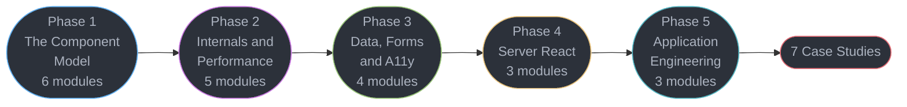

# React — Senior Engineer & Interview Prep Guide

The library half of the front-end track. The language lives in
[../typescript/](../typescript/README.md); the browser, build pipeline and toolchain live in
[../frontend_platform/](../frontend_platform/README.md).

A comprehensive reference for **React as it exists in 2026** — the component and render
model, the fiber architecture and concurrent rendering, the compiler that has replaced hand
memoization, Server Components and the client/server boundary, and the application-level
concerns (data, forms, accessibility, styling, testing, architecture) that a senior React
engineer owns. Includes seven front-end **system design** case studies.

> **No runnable application** — all content is Markdown with runnable-shaped TypeScript and TSX blocks.

---

## 1. Section Overview

This section covers:

- **The component model** — elements vs components, why a re-render happens, the hook
  dispatcher, typing React, effects as synchronization, refs and focus, context and tearing
- **Internals, concurrency and performance** — fiber and reconciliation, interruptible
  rendering and transitions, Suspense and error boundaries, profiling, and the React
  Compiler
- **Data, forms and accessible components** — server state vs client state, the data-fetching
  layer (TanStack Query, GraphQL clients, tRPC), forms and validation, and the accessibility
  contracts a component library owes its users
- **Server React and frameworks** — Server Components and Server Functions, rendering
  strategies and client hydration, SEO, and the meta-framework landscape
- **Application engineering** — styling and design systems, testing and front-end CI, and
  architecture including micro-frontends

**Primary target: React 19.2.** Meta-frameworks (Next.js 16, React Router v8, TanStack
Start, Astro 7) are covered **inside this section** rather than split out, because in 2026
you cannot teach Server Components honestly without the framework that implements them.

---

## 2. Module Table

| # | Module Directory | Phase | Difficulty | Key Topics |
|---|-----------------|-------|-----------|-----------|
| 1 | [react_fundamentals_and_the_render_model](react_fundamentals_and_the_render_model/react_fundamentals_and_the_render_model.md) | 1 — The Component Model | Beginner | Elements vs components, the JSX transform, why re-renders happen, state as a snapshot, `useReducer`, keys and the index-as-key bug |
| 2 | [hooks_rules_and_the_hook_model](hooks_rules_and_the_hook_model/hooks_rules_and_the_hook_model.md) | 1 — The Component Model | Intermediate | The hook dispatcher and its linked list, why order matters, closure capture, dependency arrays, custom hooks |
| 3 | [typing_react_components](typing_react_components/typing_react_components.md) | 1 — The Component Model | Advanced | `ReactNode` vs `ReactElement`, generic components, discriminated prop unions, polymorphic `as`, typing context, refs and Server Function args |
| 4 | [effects_and_synchronization](effects_and_synchronization/effects_and_synchronization.md) | 1 — The Component Model | Advanced | Effects as synchronization not lifecycle, cleanup, StrictMode double-invoke, `useEffectEvent` `[19.2]`, you-might-not-need-an-effect |
| 5 | [refs_and_focus_management](refs_and_focus_management/refs_and_focus_management.md) | 1 — The Component Model | Intermediate | `useRef` vs state, ref as a prop `[19]`, `useImperativeHandle`, portals, focus across routes and Suspense boundaries |
| 6 | [context_and_component_communication](context_and_component_communication/context_and_component_communication.md) | 1 — The Component Model | Intermediate | `<Context>` as provider `[19]`, context re-render cost, tearing, `useSyncExternalStore`, composition over prop drilling |
| 7 | [fiber_and_reconciliation](fiber_and_reconciliation/fiber_and_reconciliation.md) | 2 — Internals & Performance | Advanced | The fiber node, current/workInProgress double buffering, the work loop, render vs commit, diffing heuristics, lanes |
| 8 | [concurrent_rendering_and_transitions](concurrent_rendering_and_transitions/concurrent_rendering_and_transitions.md) | 2 — Internals & Performance | Advanced | Interruptible rendering, `startTransition`, `useDeferredValue`, priority lanes, how concurrency changed effect timing |
| 9 | [suspense_and_error_boundaries](suspense_and_error_boundaries/suspense_and_error_boundaries.md) | 2 — Internals & Performance | Advanced | Boundary placement, the `use()` hook `[19]`, streaming SSR, request waterfalls, what error boundaries do not catch |
| 10 | [react_performance_and_profiling](react_performance_and_profiling/react_performance_and_profiling.md) | 2 — Internals & Performance | Advanced | Profiler API, React Performance Tracks `[19.2]`, `<Activity>` `[19.2]`, virtualization, `React.lazy`, measuring first |
| 11 | [the_react_compiler](the_react_compiler/the_react_compiler.md) | 2 — Internals & Performance | Advanced | Compiler 1.0, Babel AST to HIR, mutability analysis, conditional memoization, the directives, when to keep manual memo |
| 12 | [server_state_and_data_fetching](server_state_and_data_fetching/server_state_and_data_fetching.md) | 3 — Data, Forms & A11y | Advanced | Server vs client state, TanStack Query v5, GraphQL normalized caches, tRPC, codegen, prefetch, contract drift |
| 13 | [client_state_management](client_state_management/client_state_management.md) | 3 — Data, Forms & A11y | Intermediate | Zustand v5, Jotai, Valtio, Redux Toolkit and when it is still right, XState, URL as state |
| 14 | [forms_and_validation](forms_and_validation/forms_and_validation.md) | 3 — Data, Forms & A11y | Intermediate | Controlled vs uncontrolled, validation timing, field arrays, error summaries and focus, React Hook Form vs TanStack Form vs Conform |
| 15 | [accessible_component_patterns](accessible_component_patterns/accessible_component_patterns.md) | 3 — Data, Forms & A11y | Advanced | Headless primitive a11y contracts, live regions under concurrent rendering, focus trap, roving tabindex, combobox and dialog patterns |
| 16 | [server_components_and_server_functions](server_components_and_server_functions/server_components_and_server_functions.md) | 4 — Server React | Advanced | RSC payload, `"use client"` and `"use server"`, serialization rules, Server Functions, `useActionState`, CSRF |
| 17 | [rendering_strategies_hydration_and_seo](rendering_strategies_hydration_and_seo/rendering_strategies_hydration_and_seo.md) | 4 — Server React | Advanced | CSR/SSR/SSG/ISR/PPR on numbers, client hydration and mismatches, selective hydration, Cache Components, SEO and metadata |
| 18 | [meta_frameworks_and_routing](meta_frameworks_and_routing/meta_frameworks_and_routing.md) | 4 — Server React | Advanced | Next.js 16 App Router, React Router v8, TanStack Start, Astro 7, file-based routing, nested layouts, i18n routing |
| 19 | [styling_and_design_systems](styling_and_design_systems/styling_and_design_systems.md) | 5 — Application Engineering | Intermediate | Tailwind v4, CSS Modules, vanilla-extract, Panda, why runtime CSS-in-JS struggles with RSC, shadcn and Base UI, tokens |
| 20 | [testing_and_frontend_ci](testing_and_frontend_ci/testing_and_frontend_ci.md) | 5 — Application Engineering | Intermediate | React Testing Library, role queries, `act()`, Vitest browser mode, Playwright, MSW v2, Storybook 10, visual regression |
| 21 | [react_architecture_and_antipatterns](react_architecture_and_antipatterns/react_architecture_and_antipatterns.md) | 5 — Application Engineering | Advanced | Feature-sliced structure, the client/server seam, micro-frontends and Module Federation, migration, the antipattern catalogue |

---

## 3. 5-Phase Learning Path



### Phase 1 — The Component Model (6 modules)

| # | Module | Why it is here |
|---|--------|----------------|
| 1 | [React Fundamentals & the Render Model](react_fundamentals_and_the_render_model/react_fundamentals_and_the_render_model.md) | Everything downstream is an answer to "why did this re-render" |
| 2 | [Hooks Rules & the Hook Model](hooks_rules_and_the_hook_model/hooks_rules_and_the_hook_model.md) | The rules stop being arbitrary once you have seen the linked list |
| 3 | [Typing React Components](typing_react_components/typing_react_components.md) | The highest-frequency TypeScript-and-React interview ground |
| 4 | [Effects & Synchronization](effects_and_synchronization/effects_and_synchronization.md) | The most misused hook in React, and the catalogue of when not to use it |
| 5 | [Refs & Focus Management](refs_and_focus_management/refs_and_focus_management.md) | The escape hatch, and the accessibility obligation that comes with it |
| 6 | [Context & Component Communication](context_and_component_communication/context_and_component_communication.md) | What context costs, and the external-store answer to tearing |

### Phase 2 — Internals, Concurrency & Performance (5 modules)

| # | Module | Why it is here |
|---|--------|----------------|
| 7 | [Fiber & Reconciliation](fiber_and_reconciliation/fiber_and_reconciliation.md) | The data structure that makes interruptible rendering possible |
| 8 | [Concurrent Rendering & Transitions](concurrent_rendering_and_transitions/concurrent_rendering_and_transitions.md) | Priority, interruption, and why effects fire when they do |
| 9 | [Suspense & Error Boundaries](suspense_and_error_boundaries/suspense_and_error_boundaries.md) | Boundary placement is an architecture decision, not a detail |
| 10 | [React Performance & Profiling](react_performance_and_profiling/react_performance_and_profiling.md) | Measure first — and this is the module that teaches the measuring |
| 11 | [The React Compiler](the_react_compiler/the_react_compiler.md) | Placed **after** profiling on purpose: the profiler is how you verify the compiler helped and decide `"use no memo"` |

### Phase 3 — Data, Forms & Accessible Components (4 modules)

| # | Module | Why it is here |
|---|--------|----------------|
| 12 | [Server State & Data Fetching](server_state_and_data_fetching/server_state_and_data_fetching.md) | Most "state management" problems are cache problems in disguise |
| 13 | [Client State Management](client_state_management/client_state_management.md) | What is left once the server state has been taken away |
| 14 | [Forms & Validation](forms_and_validation/forms_and_validation.md) | The most common real screen, and the one with the most accessibility obligations |
| 15 | [Accessible Component Patterns](accessible_component_patterns/accessible_component_patterns.md) | The contracts a component library owes, and the ones it silently breaks |

### Phase 4 — Server React & Frameworks (3 modules)

| # | Module | Why it is here |
|---|--------|----------------|
| 16 | [Server Components & Server Functions](server_components_and_server_functions/server_components_and_server_functions.md) | The largest change to the React model since hooks |
| 17 | [Rendering Strategies, Hydration & SEO](rendering_strategies_hydration_and_seo/rendering_strategies_hydration_and_seo.md) | Choosing a strategy on latency *and* on the business reason SSR exists |
| 18 | [Meta-Frameworks & Routing](meta_frameworks_and_routing/meta_frameworks_and_routing.md) | Where RSC actually ships, and how to choose between them |

### Phase 5 — Application Engineering (3 modules)

| # | Module | Why it is here |
|---|--------|----------------|
| 19 | [Styling & Design Systems](styling_and_design_systems/styling_and_design_systems.md) | Including why the CSS-in-JS you know is in maintenance mode |
| 20 | [Testing & Frontend CI](testing_and_frontend_ci/testing_and_frontend_ci.md) | The test pyramid for UI, and keeping it out of the flake pit |
| 21 | [React Architecture & Antipatterns](react_architecture_and_antipatterns/react_architecture_and_antipatterns.md) | The capstone: structure, seams, and what to tell a team not to do |

**Dependencies to note:**

- **[`../frontend_platform/`](../frontend_platform/README.md) Phase 1 is a prerequisite for
  this whole section**, and [`../typescript/`](../typescript/README.md) Phase 1 for module 3
  onward. Every example here is TSX, and modules 10, 17 and 19 assume the rendering
  pipeline and the cascade.
- Module 11 (compiler) deliberately follows module 10 (profiling), not the reverse.
- Module 9 *names* request waterfalls; module 12 *solves* them. Read them in order.
- Modules 16-18 assume Phase 2 — streaming SSR is a concurrent-rendering feature before it
  is a framework feature.

---

## Learning Paths

This section is exhaustive by design. That is right for a reference and wrong for someone
two weeks from an interview, so there are **three ways through it**; the game's Study view
surfaces them as a Full / Senior / Principal toggle.

### Full Path (21 modules)

The complete curriculum in the order above — see
[5-Phase Learning Path](#3-5-phase-learning-path). Nothing is dropped.

The two curated tiers below are **different cuts, not nested depths**. Senior is the craft:
can you build it, debug it at 3am, and say why it broke. Principal is the judgment: which
approach at what cost, what the failure modes are, and what you tell a team *not* to do.
Principal is the smaller list, and roughly half of it is material Senior never sees.

<!-- study-path-table senior -->
### Senior Path (20 modules)

| # | Module | Files |
|---|--------|-------|
| 1 | [react_fundamentals_and_the_render_model](react_fundamentals_and_the_render_model/react_fundamentals_and_the_render_model.md) | module page only |
| 2 | [hooks_rules_and_the_hook_model](hooks_rules_and_the_hook_model/hooks_rules_and_the_hook_model.md) | module page only |
| 3 | [typing_react_components](typing_react_components/typing_react_components.md) | module page only |
| 4 | [effects_and_synchronization](effects_and_synchronization/effects_and_synchronization.md) | module page only |
| 5 | [refs_and_focus_management](refs_and_focus_management/refs_and_focus_management.md) | module page only |
| 6 | [context_and_component_communication](context_and_component_communication/context_and_component_communication.md) | module page only |
| 7 | [fiber_and_reconciliation](fiber_and_reconciliation/fiber_and_reconciliation.md) | module page only |
| 8 | [concurrent_rendering_and_transitions](concurrent_rendering_and_transitions/concurrent_rendering_and_transitions.md) | module page only |
| 9 | [suspense_and_error_boundaries](suspense_and_error_boundaries/suspense_and_error_boundaries.md) | module page only |
| 10 | [react_performance_and_profiling](react_performance_and_profiling/react_performance_and_profiling.md) | module page only |
| 11 | [the_react_compiler](the_react_compiler/the_react_compiler.md) | module page only |
| 12 | [server_state_and_data_fetching](server_state_and_data_fetching/server_state_and_data_fetching.md) | module page only |
| 13 | [client_state_management](client_state_management/client_state_management.md) | module page only |
| 14 | [forms_and_validation](forms_and_validation/forms_and_validation.md) | module page only |
| 15 | [accessible_component_patterns](accessible_component_patterns/accessible_component_patterns.md) | module page only |
| 16 | [server_components_and_server_functions](server_components_and_server_functions/server_components_and_server_functions.md) | module page only |
| 17 | [rendering_strategies_hydration_and_seo](rendering_strategies_hydration_and_seo/rendering_strategies_hydration_and_seo.md) | module page only |
| 18 | [meta_frameworks_and_routing](meta_frameworks_and_routing/meta_frameworks_and_routing.md) | module page only |
| 19 | [styling_and_design_systems](styling_and_design_systems/styling_and_design_systems.md) | module page only |
| 20 | [testing_and_frontend_ci](testing_and_frontend_ci/testing_and_frontend_ci.md) | module page only |

**Not in this path** (1 of 21, Full Path only): `react_architecture_and_antipatterns`
<!-- /study-path-table -->

<!-- study-path-table principal -->
### Principal Path (15 modules)

| # | Module | Files |
|---|--------|-------|
| 2 | [hooks_rules_and_the_hook_model](hooks_rules_and_the_hook_model/hooks_rules_and_the_hook_model.md) | module page only |
| 3 | [typing_react_components](typing_react_components/typing_react_components.md) | module page only |
| 4 | [effects_and_synchronization](effects_and_synchronization/effects_and_synchronization.md) | module page only |
| 6 | [context_and_component_communication](context_and_component_communication/context_and_component_communication.md) | module page only |
| 7 | [fiber_and_reconciliation](fiber_and_reconciliation/fiber_and_reconciliation.md) | module page only |
| 9 | [suspense_and_error_boundaries](suspense_and_error_boundaries/suspense_and_error_boundaries.md) | module page only |
| 10 | [react_performance_and_profiling](react_performance_and_profiling/react_performance_and_profiling.md) | module page only |
| 11 | [the_react_compiler](the_react_compiler/the_react_compiler.md) | module page only |
| 12 | [server_state_and_data_fetching](server_state_and_data_fetching/server_state_and_data_fetching.md) | module page only |
| 14 | [forms_and_validation](forms_and_validation/forms_and_validation.md) | module page only |
| 15 | [accessible_component_patterns](accessible_component_patterns/accessible_component_patterns.md) | module page only |
| 16 | [server_components_and_server_functions](server_components_and_server_functions/server_components_and_server_functions.md) | module page only |
| 17 | [rendering_strategies_hydration_and_seo](rendering_strategies_hydration_and_seo/rendering_strategies_hydration_and_seo.md) | module page only |
| 18 | [meta_frameworks_and_routing](meta_frameworks_and_routing/meta_frameworks_and_routing.md) | module page only |
| 21 | [react_architecture_and_antipatterns](react_architecture_and_antipatterns/react_architecture_and_antipatterns.md) | module page only |

**Not in this path** (6 of 21, Full Path only): `react_fundamentals_and_the_render_model`, `refs_and_focus_management`, `concurrent_rendering_and_transitions`, `client_state_management`, `styling_and_design_systems`, `testing_and_frontend_ci`
<!-- /study-path-table -->

---

## 4. Version Notes

**Primary target: React 19.2** (released 2025-10-01). **There is no React 20.** Latest
patches are **19.2.8 / 19.1.9 / 19.0.8** (2026-07-21). Verified 2026-09-02 — re-check
`react.dev/versions` before writing a version number into prose.

| Tag | What it gates |
|-----|---------------|
| `[19.2]` | `<Activity>`, `useEffectEvent`, `cacheSignal`, React Performance Tracks, `useId` prefix changed to `_r_` for View Transitions compatibility |
| `[19]` | Actions and `useActionState`, `useFormStatus`, `useOptimistic`, `use()`, ref as an ordinary prop, `<Context>` as provider, document metadata hoisting, `preload`/`preinit`, stable Server Components |

**Removed in 19.0** — do not teach these as available: `propTypes` and `defaultProps` on
function components, string refs, legacy context, `ReactDOM.render`, `ReactDOM.hydrate`,
`react-test-renderer/shallow`, `findDOMNode`.

**React Compiler 1.0** is stable (2025-10-07), `babel-plugin-react-compiler`, with its
ESLint rules shipping inside `eslint-plugin-react-hooks`. It works back to React 17. This
changes the pedagogy: `useMemo`, `useCallback` and `React.memo` are **escape hatches**, not
the primary optimization story.

**Governance:** since **2026-02-24**, React, React Native and JSX are stewarded by the
**React Foundation** under the Linux Foundation (platinum founders include Amazon,
Callstack, Expo, Huawei, Meta, Microsoft, Software Mansion and Vercel).

**Security:** `react-server-dom-*` denial-of-service and source-exposure advisories were
patched in **19.0.4 / 19.1.5 / 19.2.4** (2026-01-26). This belongs in a §10 pitfall, not a
footnote.

### Ecosystem pins — verified 2026-09-02

| Area | Pin | Note |
|------|-----|------|
| Next.js | **16** (2025-10-21), current **16.3.x** | Turbopack is default; Cache Components and `"use cache"` replace `experimental.ppr`/`dynamicIO`; `middleware.ts` is now **`proxy.ts`** on the Node runtime |
| React Router | **v8** (2026-06-17) | v7 was the Remix merge — "framework mode" is the former Remix |
| Remix v3 | **not React** | a separate framework on a Preact fork, previewed July 2026. Never present it as a React upgrade path |
| TanStack Start | **Release Candidate** | not 1.0 — say so |
| Astro | **7** (2026-06-22) | Rust compiler, on Vite 8 |
| RSC outside Next | `@vitejs/plugin-rsc`, Waku, Parcel | a framework-agnostic Vite RSC story now exists |
| TanStack Query / Zustand | **v5** / **v5** | Zustand v5 uses native `useSyncExternalStore` |
| Tailwind CSS | **v4** | Oxide engine, CSS-first `@theme`; no `tailwind.config.js` required |
| shadcn/ui | defaults to **Base UI** since 2026-07 | Radix is not deprecated; `radix-ui` is now a single package. React Aria is also a first-class option |
| styled-components | **maintenance mode** (since Jan 2024) | its runtime injection model is fundamentally incompatible with RSC |
| MUI | **v7 still defaults to Emotion** | Pigment CSS is opt-in since v6 and its repo is alpha/on-hold. Do **not** write that MUI "moved to" Pigment |
| Testing | RTL **16.3.2**, Vitest **4.1.11**, Jest **30.4.2**, MSW **v2**, Storybook **10** (ESM-only) | |

**REPLACE, DO NOT ANNOTATE.** An answer names the current API, never "`foo()` is
deprecated, use `bar()`". The three exceptions are in root `CLAUDE.md`.

---

## 5. Case Studies

Seven front-end **system design** studies using the repository's 11-section principal
template, 900-1100 lines each. The index, learning path and dependency map live in
[case_studies/case_studies.md](case_studies/case_studies.md).

| Case Study | Primary engineering concern |
|-----------|----------------------------|
| [Design a News Feed with Infinite Scroll](case_studies/design_a_news_feed_with_infinite_scroll.md) | Cursor pagination, virtualization plus scroll restoration on back-navigation, optimistic likes, media prefetch, memory growth over a long session |
| [Design a Checkout & Payment Flow](case_studies/design_a_checkout_and_payment_flow.md) | Multi-step form state, client-supplied idempotency keys, 3DS redirect, the cross-origin card iframe and PCI scope, double-submit prevention |
| [Design a Search & Typeahead Experience](case_studies/design_a_search_and_typeahead_experience.md) | Debounce vs throttle, out-of-order response races, `AbortController`, ARIA combobox and keyboard interaction, empty and error states |
| [Design a Realtime Collaborative Editor](case_studies/design_a_realtime_collaborative_editor.md) | CRDT vs OT, optimistic local state, presence, reconnect and backoff, conflict UI |
| [Design a Dashboard with Server Components](case_studies/design_a_dashboard_with_server_components.md) | The client/server boundary in a real app, streaming a slow widget, per-widget Suspense, `"use cache"` lifetimes |
| [Design a Micro-Frontend Platform](case_studies/design_a_micro_frontend_platform.md) | Module Federation vs Multi-Zones vs iframes, shared-dependency versioning, independent deploys, runtime failure isolation |
| [Design an AI Chat Streaming UI](case_studies/design_an_ai_chat_streaming_ui.md) | Token streaming over SSE, backpressure into the DOM, optimistic user turn, cancel and regenerate, markdown-safe rendering |

**Case-study Q&As never enter the quiz bank** — `extract.py` skips every `case_studies/`
path outright. That is the rule working, not a bug.

---

## 6. Cross-Section Links

| Topic | Owner | This section's boundary |
|-------|-------|------------------------|
| The DOM, CSS, rendering pipeline, event loop | [`../frontend_platform/`](../frontend_platform/README.md) Phase 1 | prerequisite. Modules 10, 17 and 19 assume it and do not re-teach it |
| Core Web Vitals, accessibility standards, bundling | [`../frontend_platform/`](../frontend_platform/README.md) Phases 3-4 | those own the metric definitions and WCAG. Modules 10, 15 and 20 own the React-level technique |
| TypeScript the language | [`../typescript/`](../typescript/README.md) | that owns generics and conditional types; module 3 owns applying them to components |
| Micro-frontends, BFF, UI decomposition | [`../book/building_microservices/14_user_interfaces/`](../book/building_microservices/14_user_interfaces/14_user_interfaces.md) | that owns the architectural argument; module 21 owns the React-level mechanics |
| WebSocket and SSE protocol, server scaling | [`../backend/websockets_and_sse/`](../backend/websockets_and_sse/websockets_and_sse.md), [`../hld/realtime_updates/`](../hld/realtime_updates/realtime_updates.md) | those own the server; the collaborative-editor and AI-chat case studies own the client |
| REST, GraphQL and gRPC contracts | [`../backend/rest_api_design/`](../backend/rest_api_design/rest_api_design.md), [`../backend/graphql/`](../backend/graphql/graphql.md), [`../backend/grpc_and_protobuf/connect_and_browser_rpc.md`](../backend/grpc_and_protobuf/connect_and_browser_rpc.md) | those own the server contract; module 12 owns consuming it |
| CDN and asset caching | [`../hld/cdn/`](../hld/cdn/cdn.md), [`../devops/cloud_networking_and_cdn/`](../devops/cloud_networking_and_cdn/cloud_networking_and_cdn.md) | those own CDN mechanics; `frontend_platform` owns invalidation |
| LLM streaming and token economics | [`../llm/`](../llm/README.md) | that owns the model side; the AI-chat case study owns the UI |

---

## 7. Build Manifest

Per-file status tracker. **This is the resume point** — the first `pending` row is the next
unit of work. Flip `pending` to `done` in the same commit as the file, filling in the
measured counts; a `done` row with no counts is not trustworthy.

Target per module page: **700-900 lines, 6-8 Mermaid fences, 15-18 Q&As** (every one
carrying an authored `**Short:**` line), all 14 template sections. Case studies: **900-1100
lines**, 11-section principal template, 10-16 Q&As.

| # | File | Phase | Status | Q&As | Lines |
|---|------|-------|--------|-----:|------:|
| 1 | `react_fundamentals_and_the_render_model/react_fundamentals_and_the_render_model.md` | 1 | **done** | 18 | 744 |
| 2 | `hooks_rules_and_the_hook_model/hooks_rules_and_the_hook_model.md` | 1 | **done** | 18 | 807 |
| 3 | `typing_react_components/typing_react_components.md` | 1 | **done** | 18 | 749 |
| 4 | `effects_and_synchronization/effects_and_synchronization.md` | 1 | **done** | 18 | 753 |
| 5 | `refs_and_focus_management/refs_and_focus_management.md` | 1 | **done** | 16 | 823 |
| 6 | `context_and_component_communication/context_and_component_communication.md` | 1 | **done** | 16 | 785 |
| 7 | `fiber_and_reconciliation/fiber_and_reconciliation.md` | 2 | **done** | 18 | 850 |
| 8 | `concurrent_rendering_and_transitions/concurrent_rendering_and_transitions.md` | 2 | **done** | 18 | 751 |
| 9 | `suspense_and_error_boundaries/suspense_and_error_boundaries.md` | 2 | **done** | 18 | 774 |
| 10 | `react_performance_and_profiling/react_performance_and_profiling.md` | 2 | **done** | 18 | 796 |
| 11 | `the_react_compiler/the_react_compiler.md` | 2 | **done** | 18 | 756 |
| 12 | `server_state_and_data_fetching/server_state_and_data_fetching.md` | 3 | **done** | 18 | 788 |
| 13 | `client_state_management/client_state_management.md` | 3 | **done** | 16 | 755 |
| 14 | `forms_and_validation/forms_and_validation.md` | 3 | **done** | 18 | 880 |
| 15 | `accessible_component_patterns/accessible_component_patterns.md` | 3 | **done** | 16 | 880 |
| 16 | `server_components_and_server_functions/server_components_and_server_functions.md` | 4 | **done** | 18 | 804 |
| 17 | `rendering_strategies_hydration_and_seo/rendering_strategies_hydration_and_seo.md` | 4 | **done** | 18 | 782 |
| 18 | `meta_frameworks_and_routing/meta_frameworks_and_routing.md` | 4 | **done** | 18 | 816 |
| 19 | `styling_and_design_systems/styling_and_design_systems.md` | 5 | **done** | 16 | 788 |
| 20 | `testing_and_frontend_ci/testing_and_frontend_ci.md` | 5 | **done** | 16 | 814 |
| 21 | `react_architecture_and_antipatterns/react_architecture_and_antipatterns.md` | 5 | **done** | 16 | 750 |
| C0 | `case_studies/case_studies.md` (index) | CS | **done** | n/a | 123 |
| C1 | `case_studies/design_a_news_feed_with_infinite_scroll.md` | CS | **done** | 14 | 929 |
| C2 | `case_studies/design_a_checkout_and_payment_flow.md` | CS | **done** | 14 | 937 |
| C3 | `case_studies/design_a_search_and_typeahead_experience.md` | CS | **done** | 14 | 919 |
| C4 | `case_studies/design_a_realtime_collaborative_editor.md` | CS | **done** | 14 | 923 |
| C5 | `case_studies/design_a_dashboard_with_server_components.md` | CS | **done** | 16 | 1010 |
| C6 | `case_studies/design_a_micro_frontend_platform.md` | CS | **done** | 15 | 901 |
| C7 | `case_studies/design_an_ai_chat_streaming_ui.md` | CS | **done** | 14 | 974 |

### Conventions reminder (for future batch agents)

- The page is named for its folder: `<module>/<module>.md`.
- **Never** name a file `*_deep_dive.md` or `*_internals.md` — FATAL under `--strict`.
  `fiber_and_reconciliation.md` and `the_react_compiler.md` are named around this rule.
- Q&As go under `## 12. Interview Questions with Answers`, each with a `**Short:**` line of
  15-220 characters as the first non-blank line of the answer.
- Tag code fences ` ```tsx ` / ` ```ts `, not ` ```typescript `.
- Say **"client hydration"**, never bare "hydration" — the word already means feed-object
  hydration in 14 files across `backend/` and `hld/`, and the MCQ distractor pool will mix
  them.
- In a `## 11. Technologies & Tools` table, the first cell is one bare product name. Never
  an unspaced `Next.js/Remix` — that becomes a single garbled record. Use two rows.
- Adding a file means adding its line to the `<!-- study-paths -->` block below **in the
  same commit**, then running `python3 game/extract.py --write-paths`. Case studies go
  under a `case_studies` pseudo-module in that block.

<!-- study-paths
     THE source of truth for this section's file inventory and study-tier membership.
     Every module, every file it owns, and every case study is listed here with the tiers
     it belongs to; `-` means Full path only. Content files carry NO structural metadata.
     Order is never declared here: it comes from STUDY_ORDER in game/app.js. The tier
     TABLES in this file are generated from this block by
     `python3 game/extract.py --write-paths`. A file on disk missing from this block, or
     listed here and absent from disk, FAILS `extract.py --strict`.

     Entries are added AS EACH FILE LANDS -- listing a not-yet-written file is fatal.

react_fundamentals_and_the_render_model
  react_fundamentals_and_the_render_model.md  senior
hooks_rules_and_the_hook_model
  hooks_rules_and_the_hook_model.md  senior, principal
typing_react_components
  typing_react_components.md  senior, principal
refs_and_focus_management
  refs_and_focus_management.md  senior
context_and_component_communication
  context_and_component_communication.md  senior, principal
effects_and_synchronization
  effects_and_synchronization.md  senior, principal
fiber_and_reconciliation
  fiber_and_reconciliation.md  senior, principal
concurrent_rendering_and_transitions
  concurrent_rendering_and_transitions.md  senior
suspense_and_error_boundaries
  suspense_and_error_boundaries.md  senior, principal
react_performance_and_profiling
  react_performance_and_profiling.md  senior, principal
server_state_and_data_fetching
  server_state_and_data_fetching.md  senior, principal
the_react_compiler
  the_react_compiler.md  senior, principal
client_state_management
  client_state_management.md  senior
server_components_and_server_functions
  server_components_and_server_functions.md  senior, principal
accessible_component_patterns
  accessible_component_patterns.md  senior, principal
forms_and_validation
  forms_and_validation.md  senior, principal
rendering_strategies_hydration_and_seo
  rendering_strategies_hydration_and_seo.md  senior, principal
meta_frameworks_and_routing
  meta_frameworks_and_routing.md  senior, principal
styling_and_design_systems
  styling_and_design_systems.md  senior
testing_and_frontend_ci
  testing_and_frontend_ci.md  senior
react_architecture_and_antipatterns
  react_architecture_and_antipatterns.md  principal
case_studies
  design_a_micro_frontend_platform.md  principal
  design_a_dashboard_with_server_components.md  senior, principal
  design_a_realtime_collaborative_editor.md  senior, principal
  design_a_checkout_and_payment_flow.md  senior, principal
  design_an_ai_chat_streaming_ui.md  senior, principal
  design_a_news_feed_with_infinite_scroll.md  senior, principal
  design_a_search_and_typeahead_experience.md  senior, principal
-->
