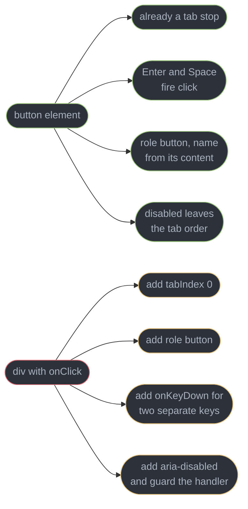
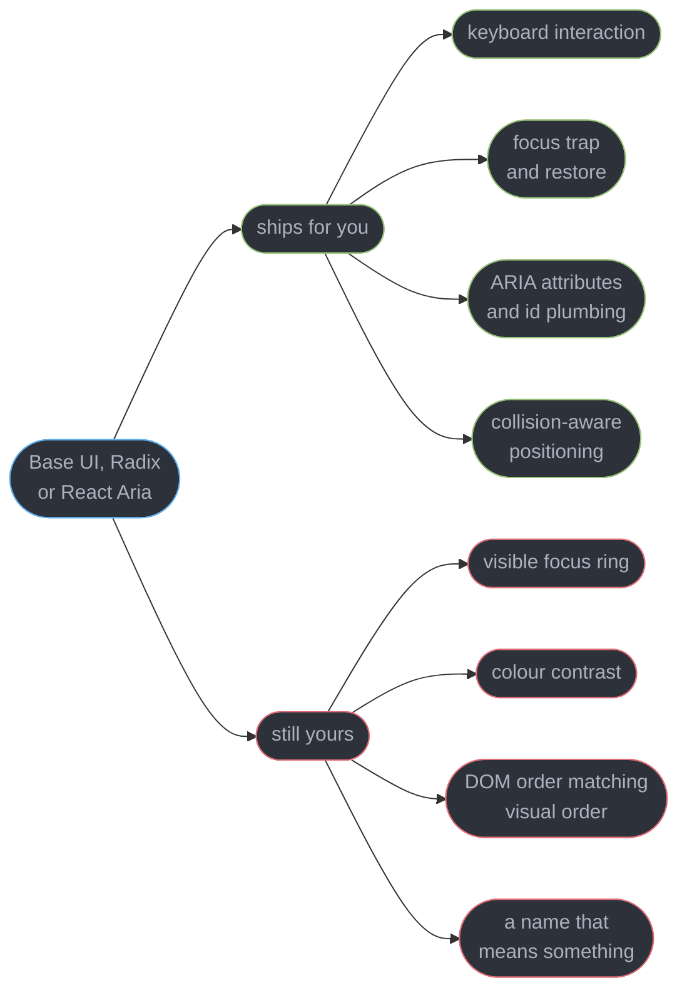
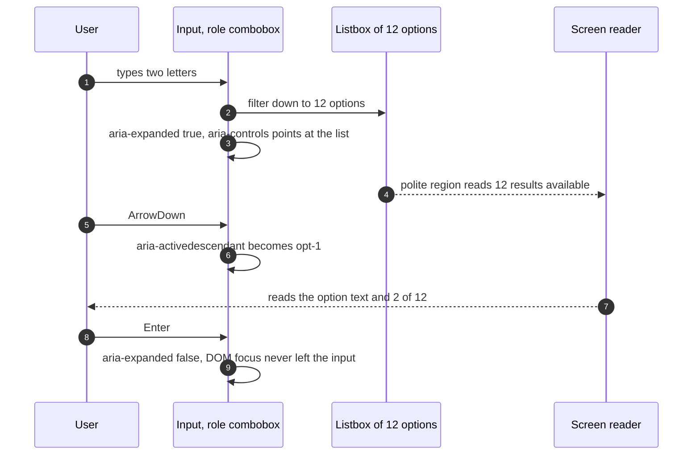
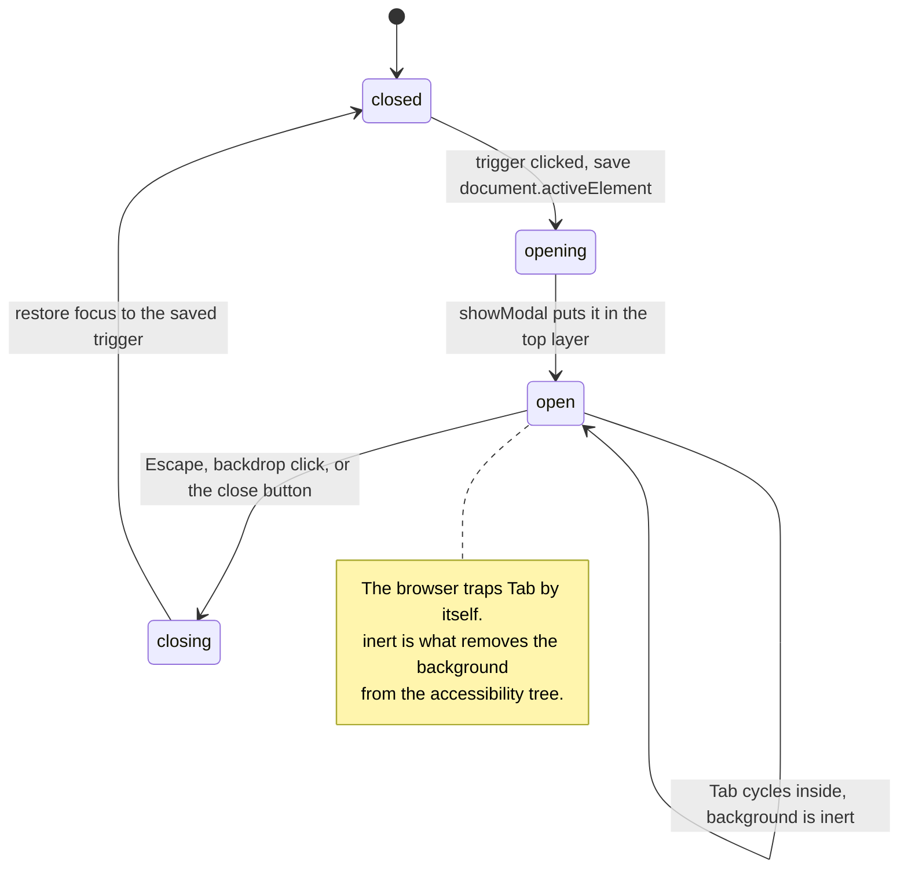
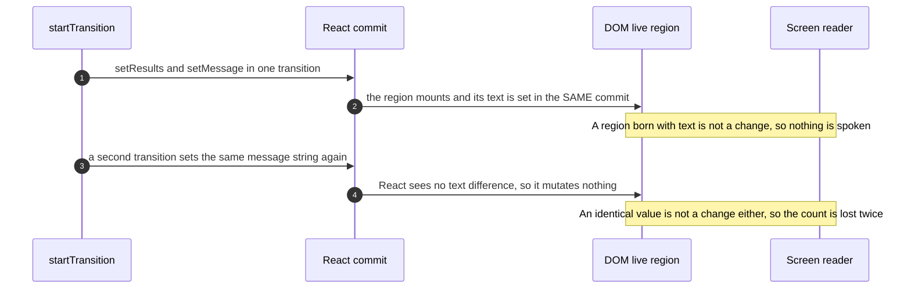
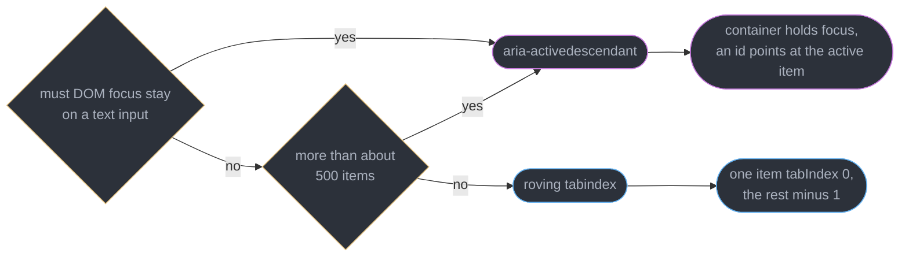

# Accessible Component Patterns

---

## 1. Concept Overview

A component library makes a promise it rarely writes down: that every widget it ships can be operated without a mouse, announced without sight, and understood without the surrounding visual layout. That promise is a contract with a machine — the browser's accessibility tree — and the machine reads only what the DOM tells it. Styling a `div` to look like a button tells it nothing.

This module owns the React-level half of that contract. The standard itself — WCAG 2.2 AA, the accessibility tree, how axe rules map to success criteria — belongs to [Accessibility and WCAG](../../frontend_platform/accessibility_and_wcag/accessibility_and_wcag.md), and is not re-derived here. What is re-derived here is what a React component author actually types: which element to render, which primitive to reach for, how a combobox wires `aria-activedescendant` across renders, why a live region announces nothing when its content arrives inside a transition, and how `useId` survives SSR hydration.

The starting position is deliberately unfashionable. **The first rule of ARIA is not to use ARIA.** A native `button` arrives with focusability, Enter and Space activation, `role="button"`, an accessible name computed from its content, and `disabled` semantics that remove it from the tab order — five behaviours, zero lines. A `div` with an `onClick` arrives with none of them, and each one you add back is a line that can rot. Section 6.1 counts the repair.

The second position is where 2026 differs from 2021. Headless primitives — Base UI, React Aria Components, Radix — now ship the keyboard interaction, focus management, ARIA wiring and collision-aware positioning that used to be hand-written per team. **shadcn/ui has defaulted to Base UI since July 2026.** Radix is not deprecated; it consolidated into a single `radix-ui` package. React Aria is a first-class shadcn option too. But the honest claim about all three is narrow: a primitive removes a *class* of bug. It does not make your component accessible, because the four things it cannot supply — a visible focus style, sufficient colour contrast, a sensible DOM content order, and a meaningful accessible name — are exactly the four that fail most audits.

Target is React 19.2, WCAG 2.2 AA, verified 2026-09-02. WCAG 3.0 is a Working Draft with a Candidate Recommendation target of Q4 2027; it is direction, not a compliance target, and nothing in this module is written against it.

---

## 2. Intuition

> **One-line analogy**: a screen reader is a client consuming an API you did not know you were publishing. The DOM is the response body, and `div` is `200 OK` with an empty payload.

**Mental model**: every interactive component publishes four facts to the accessibility tree — its **role** (what kind of thing it is), its **name** (which one it is), its **state** (expanded, checked, disabled, selected), and its **relationships** (this input controls that listbox, this error describes that field). Everything in this module is a technique for keeping those four facts correct while React re-renders underneath them. Semantic HTML supplies all four for free. ARIA is the repair kit for when you rendered the wrong element.

**Why it matters**: the cost is not abstract and it is not only ethical. A checkout whose "Continue" control is a `div` cannot be completed by a keyboard-only user, which is a lost order, not a lint warning. Failing WCAG 2.2 AA is a procurement blocker in public-sector and enterprise RFPs, and accessibility litigation in the US has run above 4,000 web-related filings a year since 2023. And the fixes get exponentially more expensive with time: retrofitting roles and focus order onto a shipped design system is a quarter of work, while rendering `button` instead of `div` costs zero.

**Key insight**: **accessibility is a property of the rendered DOM, not of the component you wrote.** React's job is to produce the right elements with the right attributes at the right moment; every failure in this module is a case where the component looked correct in JSX and produced the wrong DOM — a role missing, an id pointing at a node that unmounted, or an announcement written into a region that was born in the same commit as its text.

---

## 3. Core Principles

- **Semantic element first, ARIA as repair.** Every ARIA attribute you write is a promise you now maintain by hand. The element that already keeps that promise is cheaper.
- **ARIA changes what is announced, never what happens.** `role="button"` on a `div` does not make Enter fire the handler and does not put it in the tab order. It only makes the lie consistent.
- **A primitive removes a class of bug, not the responsibility.** Keyboard and ARIA come from the library; focus visibility, contrast, content order and naming stay yours.
- **Every interactive thing must have a visible focus indicator.** Removing the default outline without replacing it is the single most common regression in a design-system refresh.
- **A composite widget is one tab stop.** Toolbars, tabs, menus, listboxes and grids take Tab once and arrow keys within, whether by roving `tabindex` or `aria-activedescendant`.
- **A live region must exist before the content it announces.** Mounting the region and setting its text in one commit produces silence, not an announcement.
- **Ids must be generated by React, not by the component.** `useId` is the only generator that produces the same value on the server and on the client.
- **If you cannot query it by role and name, a screen reader cannot find it.** That makes `getByRole` a design constraint, not a test-writing preference.
- **Automation is a floor, never a ceiling.** Roughly 30-40% of WCAG failures are machine-detectable; focus order, meaningful names and content sequence are not among them.

---

## 4. Types / Architectures / Strategies

### 4.1 What a native element gives you, and the repair bill for skipping it

| Native element | Free behaviour | Hand-built cost if you use a div |
|----------------|----------------|----------------------------------|
| `button` | tab stop, Enter and Space activate, `role=button`, name from content, `disabled` removes from tab order | `tabIndex`, `role`, a keydown handler for two keys, `aria-disabled` plus a guard in the handler |
| `a` with `href` | tab stop, Enter activates, context menu, middle-click, `role=link` | all of the above, plus you lose open-in-new-tab entirely |
| `input type=checkbox` | tab stop, Space toggles, `checked` state exposed, label association | `role=checkbox`, `aria-checked`, keydown, and the state now has two sources of truth |
| `label` with `htmlFor` | click target, name computed automatically | `aria-labelledby` and an id you must generate |
| `dialog` with `showModal()` | top layer, backdrop, Escape, Tab trap, focus restore | a portal, a trap, a scroll lock, an Escape listener, and a saved `activeElement` |

### 4.2 The headless-primitive landscape

| Library | Package | Shape | Notable |
|---------|---------|-------|---------|
| Base UI | `@base-ui-components/react` | unstyled parts, `render` prop for the element | shadcn/ui's default since July 2026; from the MUI and Floating UI authors |
| Radix Primitives | `radix-ui` | unstyled parts, `asChild` composition | consolidated into one package; still maintained, still a correct choice |
| React Aria Components | `react-aria-components` | components plus the `react-aria` hooks underneath | Adobe; the widest internationalisation and touch-behaviour coverage |
| Headless UI | `@headlessui/react` | a small fixed set of widgets | Tailwind Labs; narrower scope, tightly paired with Tailwind |
| Ark UI | `@ark-ui/react` | Zag.js state machines under the parts | the same machines drive Vue and Svelte builds |

All five ship the same four things — keyboard interaction per the ARIA Authoring Practices, focus trapping and restore, ARIA attributes with the id plumbing between parts, and collision-aware positioning — and all five withhold the same four, which §5's second diagram names.

### 4.3 Two ways to move focus inside a composite widget

| | Roving `tabindex` | `aria-activedescendant` |
|---|---|---|
| Where DOM focus lives | on the active item, and it moves | on the container, and it never moves |
| Tab stops for the group | one | one |
| Right for | toolbars, tabs, menus, tree views, small grids | combobox, and any list of more than about 500 items |
| Why | `:focus-visible` styling and `scrollIntoView` come free | a text input must keep the caret, and moving focus 500 times is expensive |
| Cost | every item is a real focusable element in the DOM | you style the active item yourself, and support is weaker in older AT |

### 4.4 Announcement channels, from cheapest to loudest

| Channel | Announces | Interrupts | Use for |
|---------|-----------|------------|---------|
| Focus move | the newly focused element's role, name and state | yes | navigating to a new view, opening a dialog |
| `aria-live="polite"` / `role="status"` | the region's changed text after the current utterance | no | result counts, save confirmations, filter updates |
| `aria-live="assertive"` / `role="alert"` | the region's changed text immediately | yes | validation blocking submission, session expiry, payment failure |

---

## 5. Architecture Diagrams

### The repair bill for a div that should have been a button



Four free behaviours on the left, four hand-maintained lines on the right, and the right column is where the bugs live because nothing fails loudly when one is missing.

### What a headless primitive ships, and what it never will



The right column is where audits fail. A primitive moves you from "twelve categories of defect" to "four", which is worth a great deal and is not the same as done.

### The combobox contract, one keystroke at a time



DOM focus stays on the input for all eight steps. That is the whole reason a combobox uses `aria-activedescendant` and a toolbar does not.

### A modal dialog's focus lifecycle



Two separate guarantees. `showModal()` traps the Tab key, `inert` removes the background from the accessibility tree so a virtual cursor cannot read it either.

### Why an announcement disappears inside a transition



Both failures are silent in the DOM and in every snapshot test. The region is present, the text is right, and nothing was ever announced.

### Choosing between roving tabindex and virtual focus



Two questions, two answers. Everything else — tabs, toolbars, menus, tree views — is roving `tabindex`, and reaching for virtual focus there costs you `:focus-visible` for nothing.

---

## 6. How It Works — Detailed Mechanics

### 6.1 Semantic HTML first, ARIA as a repair

Rendering a `div` where a `button` belongs does not produce a slightly worse button. It produces a decoration that a mouse happens to be able to click. The accessibility tree sees a generic node with no role, no name derived from content, no state, and no place in the tab order — so keyboard users never reach it and screen-reader users are never told it exists.

The repair is four attributes and a handler, and every one of them is now yours to maintain:

```tsx
// The full hand-built equivalent of a native button. Every line here is free
// with the real element, and every line here is a line that can rot.
function FakeButton({ onPress, disabled, children }: FakeButtonProps) {
  return (
    <div
      role="button"                                   // announces the role
      tabIndex={disabled ? -1 : 0}                    // joins the tab order
      aria-disabled={disabled || undefined}           // announces the state
      onClick={disabled ? undefined : onPress}
      onKeyDown={(e) => {
        if (disabled) return;
        // Enter fires on keydown, Space fires on keyup for a real button, and
        // Space must be prevented or the page scrolls. Both are easy to forget.
        if (e.key === "Enter" || e.key === " ") { e.preventDefault(); onPress(); }
      }}
    >
      {children}
    </div>
  );
}

// The entire replacement:
// <button onClick={onPress} disabled={disabled}>{children}</button>
```

Three details in that block are the ones teams actually get wrong. **Space scrolls the page** unless prevented, so a "fake button" halfway down a long list jumps the viewport on activation. **`aria-disabled` is not `disabled`** — it changes only the announcement, so the click handler still fires unless you guard it separately, which is the source of the classic "the disabled button submitted the form twice" bug. And **a `div` inside a `form` does not submit it**, so a fake submit button silently breaks Enter-to-submit in every text field on the page.

The same argument runs through the whole element vocabulary. Use `nav`, `main`, `header` and `footer` so screen-reader landmark navigation works — roughly 68% of screen-reader users in WebAIM's survey navigate by headings first, and landmarks second. Use one `h1` per page and never skip a level for visual size; that is what `class` is for. Use `ul` and `li` so the reader announces "list, 12 items" before the first one.

ARIA earns its place in exactly two situations: a widget HTML has no element for (a tab list, a combobox, a tree), and a *state or relationship* HTML cannot express (`aria-expanded`, `aria-describedby`, `aria-current`). Those are repairs and additions, not substitutes.

### 6.2 What a headless primitive actually buys

A `Select` built from Base UI, Radix or React Aria Components is not "a styled dropdown". It is roughly 900 lines of interaction logic you did not write: typeahead that jumps to the option starting with the typed characters and resets after 500 ms, Home and End, PageUp and PageDown, arrow wrapping, an open-on-Space that does not scroll, a popup that flips above the trigger when it would overflow the viewport, `aria-selected` on the right option, and an id relationship between trigger and listbox that survives re-renders.

```tsx
// Base UI, the shadcn/ui default since July 2026. Every part is unstyled and
// every ARIA attribute below is generated, not typed by you.
import { Select } from "@base-ui-components/react/select";

export function CurrencySelect({ value, onValueChange }: CurrencySelectProps) {
  return (
    <Select.Root value={value} onValueChange={onValueChange}>
      <Select.Trigger className="btn">          {/* aria-haspopup, aria-expanded */}
        <Select.Value placeholder="Currency" />
      </Select.Trigger>
      <Select.Portal>
        <Select.Positioner sideOffset={4}>      {/* collision-aware placement */}
          <Select.Popup className="menu">       {/* role=listbox, wired to the trigger */}
            <Select.Item value="usd" className="item">USD</Select.Item>
            <Select.Item value="eur" className="item">EUR</Select.Item>
          </Select.Popup>
        </Select.Positioner>
      </Select.Portal>
    </Select.Root>
  );
}
```

Radix reads almost identically with `asChild` where Base UI uses `render`, and React Aria Components exposes the same widget through `Select`, `Button`, `Popover` and `ListBox` with `react-aria` hooks underneath if you want to keep the DOM entirely. Radix is not deprecated, and the single `radix-ui` package is the current install shape. The differences that matter in practice are ecosystem, not correctness: Base UI is where shadcn's generated code lands today, React Aria carries the deepest internationalisation and touch handling, Radix has the largest body of existing code.

**Now the honest part.** Everything in `className` above is yours, and that is where the failures are. `.btn` with `outline: none` and no `:focus-visible` replacement removes the only signal a keyboard user has. `.item` at `#8a8a8a` on `#2c313a` is 3.1:1 and fails WCAG 2.2 AA's 4.5:1 for body text. A `Select.Value` with `placeholder="Currency"` and no associated `label` gives the trigger an accessible name only while it is empty — once a value is chosen, the trigger announces "USD, button" and the user is never told what USD is *for*. And a popup rendered into a portal sits at the end of `document.body`, so DOM order and visual order diverge unless the primitive restores the relationship, which is exactly what its `aria-controls` and focus-return logic do — and why hand-rolled portals so often break it. Portals and focus across boundaries belong to [Refs and Focus Management](../refs_and_focus_management/refs_and_focus_management.md).

### 6.3 The combobox, the hardest common widget

The combobox is where every mechanism in this module appears at once: a role that is not the element, four state attributes that must stay in step across renders, virtual focus, a keyboard contract with eight keys, and a live region for the result count.

Under ARIA 1.2, `role="combobox"` goes **on the text input itself**, not on a wrapper. The input owns `aria-expanded`, `aria-controls` pointing at the listbox's id, `aria-autocomplete`, and `aria-activedescendant` pointing at the active option's id. The listbox is a sibling, the options carry `role="option"` and `aria-selected`.

```tsx
export function CitySearch() {
  const id = useId();
  const listId = `${id}-list`;
  const [open, setOpen] = useState(false);
  const [active, setActive] = useState(0);
  const [query, setQuery] = useState("");
  const options = useMemo(() => filterCities(query), [query]);

  return (
    <div>
      <label htmlFor={`${id}-input`}>City</label>
      <input
        id={`${id}-input`}
        role="combobox"
        aria-expanded={open}                       // must track `open` exactly
        aria-controls={listId}
        aria-autocomplete="list"
        aria-activedescendant={open && options.length ? `${id}-opt-${active}` : undefined}
        value={query}
        onChange={(e) => { setQuery(e.target.value); setOpen(true); setActive(0); }}
        onKeyDown={onKeyDown}
      />
      {/* The listbox is always rendered when open, never conditionally id'd. */}
      <ul id={listId} role="listbox" hidden={!open}>
        {options.map((c, i) => (
          <li
            key={c.id}
            id={`${id}-opt-${i}`}
            role="option"
            aria-selected={i === active}          // exactly one true, always
            onMouseDown={(e) => e.preventDefault()}   // keep focus on the input
            onClick={() => choose(i)}
          >
            {c.name}
          </li>
        ))}
      </ul>
    </div>
  );
}
```

The keyboard contract is where most implementations are 70% correct, and the missing 30% is what a screen-reader user hits first:

```ts
function onKeyDown(e: React.KeyboardEvent) {
  const last = options.length - 1;
  switch (e.key) {
    case "ArrowDown":
      e.preventDefault();
      if (!open) { setOpen(true); setActive(0); }
      else setActive((i) => (i === last ? 0 : i + 1));    // wraps
      break;
    case "ArrowUp":
      e.preventDefault();
      if (e.altKey) { setOpen(false); break; }            // Alt+Up closes, keeps the text
      setActive((i) => (i === 0 ? last : i - 1));
      break;
    case "Enter":
      if (open) { e.preventDefault(); choose(active); }   // preventDefault or the form submits
      break;
    case "Escape":
      // First Escape closes the list. A second clears the field. Never both at once.
      if (open) setOpen(false); else setQuery("");
      break;
    case "Tab":
      setOpen(false);                                     // Tab commits and leaves, no preventDefault
      break;
    // Home and End are deliberately absent: in an editable combobox they move
    // the text caret, which is what the APG specifies and what users expect.
  }
}
```

Three of those are the ones that get flagged in an audit. **Enter without `preventDefault`** submits the enclosing form while selecting an option, so the user picks "Cardiff" and lands on a submitted search for "car". **Escape doing two things at once** makes the field impossible to dismiss without losing the typed text. And **`Home` and `End` hijacked to jump to the first and last option** is wrong for an editable combobox — the APG reserves them for caret movement there, and only a select-only combobox moves the selection with them.

Announcing the count is a separate obligation and the one most often skipped. A sighted user sees the list shrink from 400 to 12; a screen-reader user hears nothing unless a polite region says so. Announce the count, not the results, and debounce it to about 500 ms so that typing "cardiff" does not queue seven utterances.

### 6.4 Dialogs: the native element, `inert`, and when a hand-rolled trap still earns its place

The native `dialog` element with `showModal()` is Baseline across all engines and gives you five things at once: the top layer (so no `z-index` fight and no `overflow: hidden` clipping), a `::backdrop` pseudo-element, Escape via the `cancel` event, a Tab trap the browser enforces, and focus restored to the previously focused element on close.

React cannot drive it declaratively, and this is the trap. Rendering `<dialog open>` produces a *non-modal* dialog with none of those five behaviours — no top layer, no trap, no backdrop. You must call the method:

```tsx
export function ConfirmDialog({ open, onClose, children }: ConfirmDialogProps) {
  const ref = useRef<HTMLDialogElement>(null);

  useEffect(() => {
    const el = ref.current;
    if (!el) return;
    // showModal, not the `open` attribute. The attribute gives a non-modal dialog.
    if (open && !el.open) el.showModal();
    if (!open && el.open) el.close();
  }, [open]);

  return (
    <dialog
      ref={ref}
      aria-labelledby="confirm-title"
      onCancel={onClose}                        // Escape reaches you here, not via keydown
      onClick={(e) => { if (e.target === ref.current) onClose(); }}   // backdrop click
    >
      <h2 id="confirm-title">Delete this project</h2>
      {children}
    </dialog>
  );
}
```

The backdrop-click handler works because a click on the backdrop targets the `dialog` element itself, while a click on any child targets the child — one comparison instead of a `contains` walk.

**`inert` is the second half, and it is not optional.** `showModal()` traps the Tab key, but a screen reader's virtual cursor is not the Tab key: VoiceOver and NVDA can still read the page behind the dialog by swiping or arrowing through the buffer. `inert` on a subtree removes it from the tab order *and* from the accessibility tree, and it is Baseline since March 2023. Applying it to the app root while a dialog is open closes the gap:

```tsx
// Everything outside the dialog is removed from the accessibility tree, not just
// from the tab order. Base UI, Radix and React Aria all do this for you.
function useInertBackground(active: boolean) {
  useEffect(() => {
    if (!active) return;
    const root = document.getElementById("app-root")!;
    root.inert = true;                          // a real DOM property since React 19
    return () => { root.inert = false; };
  }, [active]);
}
```

**When is a hand-rolled trap still needed?** Three cases. A non-modal surface that must still contain focus: a full-screen editor mode, a command palette that is not a `dialog`. A drawer whose content is portaled outside the `dialog` element, where the browser's trap covers the wrong subtree. And nested surfaces, where a dialog opens a popover that opens a second dialog and the restore chain must unwind in order. In all three, use a primitive's `FocusTrap` or React Aria's `FocusScope` rather than writing the Tab-cycling loop yourself; the loop is thirty lines and every one of the edge cases (`contenteditable`, `iframe`, a `tabindex` above zero, a focusable element that becomes hidden while focused) is a separate bug. When you must write the wrap, a Fragment ref `[19.3]` around the trapped content supplies both targets with no wrapper element: Tab past the last element calls `fragment.focus()` to land on the first focusable child, and Shift+Tab before the first calls `fragment.focusLast()`. The mechanics of moving focus, `useRef` on DOM nodes, and portal boundaries belong to [Refs and Focus Management](../refs_and_focus_management/refs_and_focus_management.md).

Finally, `popover` is a different tool for a different job. `popover="auto"` gives light dismiss, the top layer, and Escape without any JavaScript, and it is right for a tooltip, a menu, or a non-blocking notification. It does **not** trap focus and does **not** make the background inert, so it is wrong for anything the user must answer before continuing.

### 6.5 Live regions under concurrent rendering

An `aria-live` region announces its *changed* text. Two consequences follow, and both are invisible in the DOM.

**The region must be in the accessibility tree before the change.** Screen readers register live regions when they appear and then watch them for mutations. A region that mounts already containing "12 results" has not changed — it has appeared, and appearing is not a mutation. This is why the "render the message conditionally" pattern silently announces nothing:

```tsx
// Mounted once at the app root, empty. Every announcement writes into it.
// role=status implies aria-live=polite and aria-atomic=true.
export function Announcer({ message }: { message: string }) {
  return (
    <div role="status" aria-live="polite" className="sr-only">
      {message}
    </div>
  );
}
```

**Concurrent rendering adds a second failure that is specific to React.** Updates inside `startTransition` are low priority and interruptible, so React may collapse two successive messages into one commit — "Searching" followed 40 ms later by "12 results available" produces a single DOM mutation and only the second string is ever spoken, or the first is spoken and then immediately replaced mid-utterance. Worse, if the message happens to equal its previous value ("12 results available" twice in a row after two different queries), React writes nothing at all and the user hears silence where a sighted user saw the list change.

Three fixes, in order of preference. Set the announcement **outside** the transition so it commits at urgent priority while the expensive list render stays deferred. Give each announcement a **monotonic key** so that an identical string still produces a mutation. And keep the region **outside any Suspense boundary or `<Activity>` subtree**, because a boundary that falls back unmounts the region and the next announcement re-registers a fresh one — which, per the first rule, announces nothing.

```tsx
function Search() {
  const [msg, setMsg] = useState("");
  const [q, setQ] = useState("");
  const [results, setResults] = useState<City[]>([]);

  function onChange(next: string) {
    setQ(next);                                   // urgent: the input must stay responsive
    startTransition(() => setResults(filter(next)));   // deferred: the expensive list
    // The announcement is urgent too, and carries a counter so a repeated
    // string still mutates the DOM. Debounced so typing does not queue seven.
    debouncedAnnounce(`${filter(next).length} results available`);
  }
  return <Announcer message={msg} />;
}
```

React Aria takes the strongest position here and it is instructive: its `announce()` helper writes into a live region appended directly to `document.body` **outside React entirely**, precisely so that no transition, no batching and no Suspense boundary can reorder or swallow the write. If you announce from more than two places in an application, adopt that shape. Transition priorities and what "deferred" means are owned by [Concurrent Rendering and Transitions](../concurrent_rendering_and_transitions/concurrent_rendering_and_transitions.md).

Finally, choose the politeness level by consequence, not by urgency of feeling. `polite` waits for the current utterance and is right for result counts, autosave confirmations and filter changes. `assertive` interrupts mid-word and is right only when the user cannot proceed: a validation error blocking submission, an expiring session, a declined payment. An `assertive` toast on every successful save makes an application unusable with a screen reader.

### 6.6 Roving tabindex as a component API

The ARIA Authoring Practices rule is that a composite widget is **one tab stop**. A toolbar with 14 buttons that are each a tab stop forces a keyboard user through 14 presses to reach the content after it; the same toolbar with a roving `tabindex` costs one. The mechanism is small: exactly one item carries `tabIndex={0}`, every other carries `tabIndex={-1}`, and arrow keys move both the index and DOM focus.

```tsx
export function useRovingFocus(count: number, orientation: "horizontal" | "vertical" = "horizontal") {
  const [active, setActive] = useState(0);
  const refs = useRef<(HTMLElement | null)[]>([]);

  const next = orientation === "horizontal" ? "ArrowRight" : "ArrowDown";
  const prev = orientation === "horizontal" ? "ArrowLeft" : "ArrowUp";

  function onKeyDown(e: React.KeyboardEvent) {
    let i = active;
    if (e.key === next) i = (active + 1) % count;
    else if (e.key === prev) i = (active - 1 + count) % count;
    else if (e.key === "Home") i = 0;
    else if (e.key === "End") i = count - 1;
    else return;
    e.preventDefault();
    setActive(i);
    refs.current[i]?.focus();          // DOM focus moves with the index
  }

  const itemProps = (i: number) => ({
    tabIndex: i === active ? 0 : -1,   // exactly one zero in the whole group
    ref: (el: HTMLElement | null) => { refs.current[i] = el; },
    onFocus: () => setActive(i),       // a mouse click must update the index too
  });

  return { active, onKeyDown, itemProps };
}
```

Two lines in there are the ones that get omitted. `onFocus` syncing the index means a mouse click on item 9 leaves the tab stop on item 9, so tabbing away and back returns where the user was rather than to item 0. And `Home`/`End` are part of the pattern for a toolbar, tabs and a menu — this is the opposite of the combobox, where they belong to the caret.

`aria-activedescendant` is the alternative, and the decision is the one in §5's last diagram. Focus stays on the container; the container's `aria-activedescendant` holds the id of the active item; the item is styled from a data attribute rather than `:focus-visible`. It is required when the focused element must remain a text input, and it is worth it when the list is long enough that moving real DOM focus hundreds of times is measurable — around 500 items in practice, and `scrollIntoView` on every arrow press is usually what shows up in a profile first. Everywhere else, roving `tabindex` is simpler and better supported, because `:focus-visible`, `scrollIntoView`, and the browser's own focus-restore all work on it for free.

### 6.7 `useId` for label association

Every relationship attribute in this module — `htmlFor`, `aria-labelledby`, `aria-describedby`, `aria-controls`, `aria-activedescendant` — is an id pointing at another node. The ids therefore have to be unique per instance, stable across re-renders, and **identical on the server and the client**.

That last requirement is what kills every hand-rolled generator. A module-level counter starts at zero in a fresh Node process for each request and at zero again in the browser, but the two never traverse the tree in the same order once streaming SSR or Suspense is involved. `Math.random()` and `crypto.randomUUID()` differ by construction. Either way React reports an SSR hydration mismatch and throws away the server HTML for that subtree:

> `A tree hydrated but some attributes of the server rendered HTML didn't match the client properties.`

`useId` exists for exactly this. It derives the id from the component's position in the tree, so both renders produce the same string, and it is unique across multiple React roots on one page.

```tsx
// One useId call per component, suffixed for each node that needs an id.
// Calling useId three times works but is three hooks for no benefit.
function Field({ label, hint, error }: FieldProps) {
  const id = useId();
  const inputId = `${id}-input`;
  const hintId = `${id}-hint`;
  const errorId = `${id}-error`;

  return (
    <div>
      <label htmlFor={inputId}>{label}</label>
      <input
        id={inputId}
        aria-invalid={error ? true : undefined}
        // Both ids, space-separated. Omit the ones whose nodes are not rendered,
        // because a dangling reference is announced as nothing at all.
        aria-describedby={[hint && hintId, error && errorId].filter(Boolean).join(" ") || undefined}
      />
      {hint && <p id={hintId}>{hint}</p>}
      {error && <p id={errorId} role="alert">{error}</p>}
    </div>
  );
}
```

**React 19.2 changed the generated prefix to `_r_`**, so an id now looks like `_r_5_`. The earlier delimiters were not valid identifiers, which meant a generated id could not be used as a `view-transition-name` value and was not a legal XML name — a real problem for anyone rendering XHTML or feeding React output into an XML pipeline. Never hard-code the shape of a `useId` value; treat it as opaque, and never use it as a CSS class or a test selector, since the position-derived string changes when the tree does. Form-specific naming — error summaries, `aria-describedby` on grouped fields, focus-to-first-error — belongs to [Forms and Validation](../forms_and_validation/forms_and_validation.md).

### 6.8 Testing the contract

React Testing Library's query priority is not a style guide, it is the accessibility contract expressed as an API. `getByRole(role, { name })` computes the accessible name using the same algorithm the browser uses to build the accessibility tree. **If the query cannot find your element, neither can a screen reader.** That makes the test a specification rather than a check.

```tsx
test("the combobox exposes its state and its active option", async () => {
  const user = userEvent.setup();
  render(<CitySearch />);

  // Role plus name. If this line needs a test id, the component has no name.
  const input = screen.getByRole("combobox", { name: "City" });
  expect(input).toHaveAttribute("aria-expanded", "false");

  await user.type(input, "ca");
  const list = screen.getByRole("listbox");
  expect(within(list).getAllByRole("option")).toHaveLength(12);
  expect(input).toHaveAttribute("aria-expanded", "true");

  await user.keyboard("{ArrowDown}");
  const [first] = within(list).getAllByRole("option");
  expect(input).toHaveAttribute("aria-activedescendant", first.id);
  expect(first).toHaveAttribute("aria-selected", "true");

  await user.keyboard("{Escape}");
  expect(screen.queryByRole("listbox")).not.toBeInTheDocument();
  expect(input).toHaveFocus();                   // focus never left the input
});
```

Layer axe on top for the rule-based half. `jest-axe` and `vitest-axe` run `axe-core` against a rendered container; `@axe-core/playwright` runs it against a real page in CI, which is the only place `:focus-visible` styles and computed contrast are real.

```ts
import { axe, toHaveNoViolations } from "jest-axe";
expect.extend(toHaveNoViolations);

test("no axe violations with the listbox open", async () => {
  const { container } = render(<CitySearch defaultOpen />);
  // Assert the OPEN state. A collapsed combobox passes trivially and proves nothing.
  expect(await axe(container)).toHaveNoViolations();
});
```

**What automation structurally cannot catch is the majority of it.** Roughly 30-40% of WCAG failures are machine-detectable — a missing `alt`, a colour pair below 4.5:1, a form control with no label, a duplicated id. The rest requires a human because it requires meaning. Is the focus order sensible, or does Tab jump from the header to the footer and back? Is `aria-label="button"` a *meaningful* name, or a name that passes the rule and tells the user nothing? Does the content sequence make sense read linearly, when CSS Grid has reordered it visually? Is the announcement correct, or does the region say "12 results" when 400 were found? Every one of those passes axe cleanly.

So the pyramid is: role-based unit tests as the specification, axe in CI as the regression net, a keyboard-only pass of each new component by the author, and a screen-reader pass — NVDA on Windows and VoiceOver on macOS cover the majority of real usage — before a design system ships a new widget. Runners, CI wiring and the broader testing strategy belong to [Testing and Frontend CI](../testing_and_frontend_ci/testing_and_frontend_ci.md).

---

## 7. Real-World Examples

**The primitive that passed the audit and failed the user.** A fintech dashboard migrated 41 components to Radix in one quarter and its automated axe score went from 87 violations to 3. The manual audit that followed found 34 issues, of which 29 were CSS: a global `*:focus { outline: none }` from a 2019 reset, never replaced with a `:focus-visible` rule. Every keyboard interaction worked perfectly and was invisible. The fix was 6 lines of CSS, and the lesson was that the 87-to-3 number had measured the primitive, not the product.

**The combobox that submitted the form.** A travel site's destination field selected an option with Enter and, because the handler did not call `preventDefault`, also submitted the enclosing search form. Keyboard users searching "Cardiff" arrived at results for "car" — the query as typed at the moment of selection. It affected 100% of keyboard selections and 0% of mouse selections, which is why it survived 14 months of QA. One line fixed it.

**The announcement nobody heard.** A support tool moved its search to `startTransition` for input responsiveness and moved the "N results" announcement into the same transition. Median input latency improved from 180 ms to 24 ms, and the result count stopped being announced entirely — two consecutive searches returning the same count produced no DOM mutation at all. It was caught eleven weeks later by a screen-reader user, not by CI. Splitting the announcement out of the transition and appending a monotonic counter restored it without giving back the latency win.

**The 900-row grid that took 90 seconds to leave.** An analytics table rendered every cell as a focusable element with no roving `tabindex`, so a keyboard user tabbing past the grid to the pagination control needed roughly 900 presses. One user reported it as "the export button doesn't work". Converting to a single tab stop with two-dimensional arrow navigation took the traversal to one press and cut the initial commit by 41 ms, because 899 fewer nodes carried `tabindex`.

---

## 8. Tradeoffs

| Design choice | Bought | Paid |
|---------------|--------|------|
| Native element over a styled `div` | five behaviours per element, zero maintenance | some UA styling to override, and `select` remains hard to restyle |
| Headless primitive over hand-rolled | keyboard, focus, ARIA and positioning correct by default | 8-30 kB per widget family, and a library you must track |
| `aria-activedescendant` over roving `tabindex` | a text input keeps its caret, and 500 focus moves become zero | you style the active item yourself, and weaker AT support |
| Native `dialog` over a portal plus a trap | top layer, backdrop, Escape, trap and restore for free | imperative `showModal()` from an effect, not an `open` prop |
| `inert` on the background | the virtual cursor cannot read behind the dialog | a second mechanism to remember alongside the Tab trap |
| Announcing counts in a live region | the change is perceivable without sight | an utterance queue you must debounce or it becomes noise |
| `assertive` over `polite` | the user cannot miss it | it interrupts mid-word, which makes routine use hostile |
| `useId` over a hand-rolled counter | server and client agree, so no SSR hydration mismatch | ids are opaque and unusable as selectors |
| axe in CI | a regression net on the 30-40% that is mechanical | a green build that proves nothing about the other 60% |

---

## 9. When to Use / When NOT to Use

**Reach for a headless primitive when:**

- The widget is in the ARIA Authoring Practices catalogue — combobox, dialog, menu, tabs, tree, disclosure, slider. Those patterns have 20-40 documented keyboard behaviours each and you will not remember all of them.
- The popup needs collision-aware positioning, because flipping and shifting against a viewport edge is genuinely hard and has nothing to do with accessibility until the popup renders off-screen.
- More than one team consumes the component, so a defect multiplies.

**Write it by hand when:**

- It is a button, a link, a checkbox, a radio group or a text input. The native element is already the correct answer and a primitive adds bundle for nothing.
- The interaction is a single click with no popup, no focus movement and no state to announce.

**Do NOT reach for ARIA when:**

- A native element exists. `role="button"` on a `div` is strictly worse than `button` in every measurable way.
- You are adding a role to make an axe rule pass. A rule satisfied by a lie produces a component that announces confidently wrong information, which is worse than announcing nothing.
- The attribute duplicates what the element already says. `role="navigation"` on `nav` and `aria-label` identical to the visible text are noise, and a redundant `aria-label` can override a better name.

**Do NOT use `aria-hidden` when:** the element is focusable. `aria-hidden="true"` on a focusable node produces the worst state available — the user can Tab to it and the screen reader announces nothing. Use `inert`, or remove it from the tab order as well.

---

## 10. Common Pitfalls

**A `div` with an `onClick` and no keyboard handling.** The canonical failure, and it never throws.

```tsx
// BROKEN: reachable by mouse only. Not in the tab order, no role, no name from
// content, Enter and Space do nothing. axe flags it, but only sometimes, because
// a div with an onClick is not always distinguishable from a decorative div.
<div className="card-action" onClick={() => openProject(id)}>
  Open project
</div>

// FIX: the element that already does all four things. If the visual design
// demands no button chrome, that is a CSS problem, not an element problem.
<button type="button" className="card-action" onClick={() => openProject(id)}>
  Open project
</button>
```

**`outline: none` with no replacement.** A global reset removes the only indicator a keyboard user has. Replace it with `:focus-visible { outline: 2px solid; outline-offset: 2px }` so mouse clicks stay clean and keyboard focus stays visible. This single rule accounted for 29 of 34 findings in the §7 audit.

**Announcing from inside a transition.** The second silent failure in this module.

```tsx
// BROKEN: the message is deferred with the list, so React may collapse both
// updates into one commit, and an identical string produces no mutation at all.
function onSearch(q: string) {
  startTransition(() => {
    const hits = filter(q);
    setResults(hits);
    setMessage(`${hits.length} results available`);   // never spoken
  });
}

// FIX: the announcement commits at urgent priority, carries a counter so a
// repeated string still mutates the DOM, and is debounced to one per 500 ms.
const seq = useRef(0);
function onSearch(q: string) {
  const hits = filter(q);
  startTransition(() => setResults(hits));
  // The trailing space alternates, so a repeated count is still a text mutation.
  setMessage(`${hits.length} results available` + (++seq.current % 2 ? " " : ""));
}
```

**`aria-disabled` treated as `disabled`.** It changes the announcement and nothing else, so the click handler still fires and the element is still a tab stop. If you use it — and you should, when the control must stay focusable so the user can discover *why* it is unavailable — guard the handler separately.

**A dangling `aria-describedby`.** The hint element unmounts on a state change but the attribute still names its id. Screen readers announce nothing for a missing reference, so the field silently loses its description. Build the attribute from the ids that are actually rendered, as in §6.7.

**Conditionally rendering the live region.** `{message && <div role="status">{message}</div>}` mounts the region and its text together, which is an appearance rather than a mutation, and announces nothing. Mount the region empty at the app root and write into it.

**`role="alert"` for routine confirmations.** It is `aria-live="assertive"`, so every autosave interrupts whatever the user was reading mid-word. Reserve it for things that block progress.

**A tab stop per item in a composite widget.** 900 cells means 900 presses to get past the grid. One tab stop, arrow keys within.

**Focus not restored on close.** Closing a dialog without returning focus to its trigger drops the user at `document.body`, and the next Tab starts from the top of the page. `showModal()` does this for you; a hand-rolled overlay does not.

---

## 11. Technologies & Tools

| Tool | Purpose |
|------|---------|
| Base UI | Unstyled accessible primitives, the shadcn/ui default since July 2026 |
| Radix Primitives | Unstyled primitives with `asChild` composition, now one `radix-ui` package |
| React Aria Components | Adobe's primitives and hooks, deepest i18n and touch coverage |
| shadcn/ui | Copy-in components generated on top of Base UI, Radix or React Aria |
| Floating UI | Collision-aware popup positioning underneath most of the above |
| axe-core | The rule engine behind almost every automated accessibility check |
| jest-axe | axe assertions inside Jest, `vitest-axe` for Vitest |
| Testing Library | `getByRole` queries that enforce the role-and-name contract |
| eslint-plugin-jsx-a11y | Static detection of the div-with-onClick class of defect |
| NVDA | The most-used Windows screen reader, free, essential for manual passes |
| VoiceOver | The macOS and iOS screen reader, built in |

---

## 12. Interview Questions with Answers

**Q: If we adopt Radix or Base UI, is our component library accessible?**
**Short:** Keyboard behaviour and ARIA wiring arrive from the primitive, but focus visibility, colour contrast, DOM order and meaningful names stay yours and are where most audits fail.

A primitive ships the four things that are hard to write and easy to verify: the full ARIA Authoring Practices keyboard contract, focus trapping and restore, the attribute plumbing between parts, and collision-aware positioning. It cannot ship the four things that live in your CSS and your copy. One fintech team went from 87 axe violations to 3 by migrating to Radix, then found 34 manual issues of which 29 were a global `*:focus { outline: none }` reset. The honest claim is that a primitive removes a class of bug, which is worth a great deal and is not the same as done.

**Q: What actually breaks when you use a div with an onClick instead of a button?**
**Short:** Native buttons carry four behaviours a div has none of — tab order, Enter and Space activation, an announced role with a name from content, and disabled semantics.

Rebuilding them by hand means `tabIndex={0}`, `role="button"`, a keydown handler covering both Enter and Space, and `aria-disabled` with a separate guard in the click handler, because `aria-disabled` changes only the announcement. Two details are almost always missed: Space scrolls the page unless prevented, and a div inside a form does not submit it, so Enter-to-submit silently dies in every text field on the page. If the visual design has no button chrome, that is a CSS problem, not an element problem.

**Q: Walk me through the keyboard contract for a combobox.**
**Short:** Arrow keys move a virtual cursor while DOM focus stays on the input, Escape closes before it clears, and Enter must call preventDefault or the form submits.

ArrowDown opens the list and then wraps through options, ArrowUp goes back, Alt+ArrowUp closes while keeping the typed text, Enter commits the active option, Tab commits and leaves without preventDefault, and the first Escape closes the list while a second clears the field. Home and End are deliberately not hijacked — in an editable combobox the APG reserves them for caret movement, and only a select-only combobox moves the selection with them. The state attributes must track this exactly: `aria-expanded` on the input, `aria-controls` pointing at the listbox, and `aria-activedescendant` naming the active option's id.

**Q: Why is getByRole the right Testing Library query?**
**Short:** Querying by role and accessible name uses the same computation the browser uses to build the accessibility tree, so a query that fails proves a screen reader cannot find the element either.

That turns the test from a check into a specification. `getByRole("combobox", { name: "City" })` fails if the input has no label, no role, or a name that comes only from a placeholder — all three being real defects, not test-harness friction. Reaching for `getByTestId` instead hides exactly the problem the query was detecting. Assert state through the same surface: `aria-expanded`, `aria-selected` and `aria-activedescendant` are what the user's software reads, so they are what the test should read.

**Q: When do you use aria-activedescendant instead of a roving tabindex?**
**Short:** Virtual focus keeps DOM focus on a container while an id points at the active item, which is required whenever the focused element must remain a text input.

That is the combobox case: move real focus into the listbox and the caret leaves the input, so typing stops working. The second case is scale — moving DOM focus and calling `scrollIntoView` hundreds of times becomes measurable at roughly 500 items. Everywhere else, roving `tabindex` is better: exactly one item carries `tabIndex={0}` and the rest carry `-1`, and you get `:focus-visible`, `scrollIntoView` and the browser's own focus restore for free. The cost of virtual focus is styling the active item yourself and weaker support in older assistive technology.

**Q: Why does my aria-live region announce nothing?**
**Short:** A live region has to exist in the accessibility tree before its content changes, because screen readers register regions on appearance and then watch them for mutations.

Rendering `{message && <div role="status">{message}</div>}` mounts the region and its text in the same commit, which the reader sees as an appearance rather than a change, so nothing is spoken. Mount the region empty at the app root and write into it. The second cause is an identical string: React writes nothing when the text has not changed, so two searches returning the same count produce silence. Keep the region outside any Suspense boundary too, since a fallback unmounts it and the next announcement re-registers a fresh region that then announces nothing.

**Q: How does concurrent rendering break announcements specifically?**
**Short:** Transitions can batch two successive messages into one commit, so the first is never spoken or is cut off mid-utterance by the second.

Setting the results and the announcement inside the same `startTransition` is the common shape, and it is silent in every snapshot test because the DOM ends up correct. One support tool cut input latency from 180 ms to 24 ms this way and lost result-count announcements entirely for eleven weeks. Fix it by setting the message outside the transition so it commits at urgent priority, appending a monotonic counter so a repeated string still mutates the DOM, and debouncing to about one utterance per 500 ms. React Aria sidesteps all of it by writing into a body-level region outside React.

**Q: Should we use the native dialog element or a portal with a focus trap?**
**Short:** showModal puts the element in the top layer and gives you a backdrop, Escape, a Tab trap and focus restore, none of which the open attribute provides.

The React trap is that you cannot drive it declaratively — rendering `<dialog open>` produces a *non-modal* dialog with none of those behaviours, so you call `showModal()` from an effect against a ref. Handle Escape through the `cancel` event rather than a keydown listener, and detect a backdrop click by comparing `e.target` to the dialog element itself. A hand-rolled trap still earns its place for a non-modal surface that must contain focus, for content portaled outside the dialog element, and for nested surfaces whose restore chain must unwind in order.

**Q: If showModal traps Tab, why do we still need inert?**
**Short:** Marking the background inert removes it from the accessibility tree, while the Tab trap only stops one key — a screen reader's virtual cursor is not the Tab key.

VoiceOver and NVDA users navigate by swiping or arrowing through a buffer of the whole page, so without `inert` they can read the content behind an open dialog even though they cannot Tab to it. `inert` on a subtree removes it from the tab order and from the accessibility tree at once, and it has been Baseline since March 2023. React 19 exposes it as a real DOM property, so `root.inert = true` in an effect is the whole implementation. Base UI, Radix and React Aria all apply it for you, which is one more thing a primitive genuinely buys.

**Q: Why can't we generate ids ourselves for label association?**
**Short:** Server and client render in different processes with different traversal orders, so any hand-rolled generator produces different ids on each side and React discards the server HTML.

A module-level counter restarts at zero per request and again in the browser, and streaming SSR plus Suspense means the two never visit components in the same order. `Math.random()` and `crypto.randomUUID()` differ by construction. The result is the SSR hydration mismatch warning about server-rendered attributes not matching client properties, and a subtree re-rendered from scratch. `useId` derives the id from tree position so both sides agree, and it stays unique across multiple React roots on one page. Call it once per component and suffix it rather than calling it three times.

**Q: What changed about useId in React 19.2?**
**Short:** The colon in the older generated prefix was not a valid identifier character, so 19.2 switched to `_r_` and ids now look like `_r_5_`.

The practical consequence is that a generated id can now be used as a `view-transition-name` value and is a legal XML name, which mattered to anyone rendering XHTML or piping React output into an XML toolchain. Nothing about the API changed. The rule that follows is to treat the value as opaque: never hard-code its shape, never use it as a CSS class, and never use it as a test selector, because it is derived from tree position and changes whenever the tree does.

**Q: What can automated accessibility testing not catch?**
**Short:** Automated rules catch roughly 30-40% of WCAG failures, and everything that depends on meaning rather than markup is outside that set.

axe finds a missing `alt`, a contrast pair below 4.5:1, an unlabelled control, a duplicated id. It cannot tell you whether the focus order is sensible or jumps from header to footer, whether `aria-label="button"` is a meaningful name, whether CSS Grid has reordered content so the linear reading makes no sense, or whether a region announcing "12 results" is telling the truth. All four pass a green build. So the pyramid is role-based unit tests as the specification, axe in CI as a regression net, a keyboard-only pass per new component, and a screen-reader pass before a design system ships a widget.

**Q: Why does closing a dialog need to restore focus, and where does it go wrong?**
**Short:** Restoring focus to the trigger is what keeps a keyboard user's position, because otherwise focus falls to document.body and the next Tab starts from the top of the page.

Save `document.activeElement` before opening and focus it again on close; the native `dialog` does this for you, a hand-rolled overlay does not. The React-specific failure is that the trigger may have unmounted while the dialog was open — a row action whose row was deleted by the dialog itself — and focusing a detached node silently does nothing. Fall back to the nearest stable container with `tabIndex={-1}` rather than to the body, and announce where the user landed if the destination is not obvious.

**Q: Where should an accessible name come from, and when is aria-label wrong?**
**Short:** An accessible name computed from visible content beats an invented one, because the visible label is what a voice-control user speaks and what a sighted screen-reader user sees.

Prefer a real `label` with `htmlFor`, or the button's own text content. `aria-label` overrides the visible text entirely, so a button reading "Delete" with `aria-label="Remove item from cart"` cannot be activated by a voice-control user saying "click delete" — the spoken name and the visible name no longer match. Reserve `aria-label` for controls with no visible text at all, chiefly icon buttons, and make it specific: eleven buttons all named "Delete" are indistinguishable in a screen reader's element list. A `placeholder` is never a name; it disappears on the first keystroke.

**Q: What is the difference between disabled and aria-disabled, and which should a component API expose?**
**Short:** A disabled button is removed from the tab order entirely and its click handler never fires, while aria-disabled changes only the announcement and leaves both intact.

That makes `disabled` correct for a control that is genuinely inert, and `aria-disabled` correct when the user should be able to reach the control to discover why it is unavailable — a submit button waiting on validation is the classic case, since a keyboard user who cannot focus it has no way to learn what is missing. If you expose `aria-disabled`, guard the click handler separately, because nothing else will. The bug this creates when confused is a "disabled" submit button that still fires and produces a duplicate order.

**Q: How do you decide between Base UI, Radix and React Aria?**
**Short:** Three libraries solve the same class of bug with different ecosystems, so the deciding factors are what your generator emits and how much internationalisation you need.

shadcn/ui has defaulted to Base UI since July 2026, so new shadcn code lands there; Radix is not deprecated and is now a single `radix-ui` package, which makes it the right answer for any existing codebase already using it; React Aria Components carries the deepest internationalisation, touch and pointer handling and exposes `react-aria` hooks if you want to own every DOM node. Correctness is not the differentiator — all three follow the ARIA Authoring Practices. Do not migrate an accessible Radix codebase to Base UI for its own sake, and do budget 8-30 kB per widget family whichever you pick.

---

## 13. Best Practices

- Render the semantic element first and treat every ARIA attribute as a repair you now own.
- Replace any `outline: none` with a `:focus-visible` rule in the same commit, and check it against a real page rather than a unit test.
- Reach for a primitive for anything in the ARIA Authoring Practices catalogue, and write buttons, links and inputs by hand.
- Give a composite widget exactly one tab stop, with roving `tabindex` unless a text input must keep the caret.
- Mount one empty live region at the app root, write into it, and keep it outside every Suspense boundary.
- Set announcements outside `startTransition`, debounce them to about 500 ms, and reserve `assertive` for what blocks progress.
- Drive a native `dialog` with `showModal()` from an effect, and set `inert` on the background as well as trusting the Tab trap.
- Generate every relationship id with one `useId` call per component and build `aria-describedby` only from ids that are actually rendered.
- Write component tests with `getByRole` and a name, and treat a query that needs a test id as a defect in the component.
- Run axe in CI on the *open* state of each widget, and pair it with a keyboard pass and an NVDA or VoiceOver pass before shipping.

---

## 14. Case Study

**Problem.** A B2B procurement platform failed an enterprise customer's WCAG 2.2 AA audit two weeks before a contract renewal worth a seven-figure annual sum. The audit listed 61 findings across 9 components. Automated scanning in CI had been green for fourteen months.

**Investigation.** Grouping the 61 findings collapsed them into four causes. **31 findings** were one CSS rule: a reset carrying `*:focus { outline: none }` with no `:focus-visible` replacement, so every keyboard interaction in the product was invisible. **14 findings** were the supplier picker, a hand-rolled combobox whose Enter selection submitted the enclosing form and whose result count was never announced. **11 findings** were the approvals grid, where all 900 cells were tab stops. **5 findings** were icon buttons in the row-action menu, each announcing "button" with no name.

Two facts explained the green CI. axe was run only against components in their default collapsed state, so the combobox's open listbox — where every ARIA relationship lives — was never scanned. And contrast and focus visibility were computed in jsdom, where no styles are applied at all.

**Root cause.** The supplier picker was the deepest of the four, and it contained the module's two silent failures in one component.

```tsx
// BROKEN: three defects and none of them throws.
// 1. Enter selects AND submits the form, so the user searches for the partial text.
// 2. The live region mounts together with its text, so nothing is ever announced.
// 3. The count is set inside the transition, so identical counts produce no mutation.
function SupplierPicker() {
  const [msg, setMsg] = useState("");
  function onKeyDown(e: React.KeyboardEvent) {
    if (e.key === "Enter") choose(active);            // no preventDefault
  }
  function onChange(q: string) {
    startTransition(() => {
      const hits = search(q);
      setResults(hits);
      setMsg(`${hits.length} suppliers found`);       // deferred and possibly identical
    });
  }
  return <>{msg && <div role="status">{msg}</div>}</>;  // mounts with its text
}
```

**Fix.** Four changes over eleven days, in descending order of finding count.

```tsx
// FIX: the region is mounted once and empty at the app root, the announcement is
// urgent and debounced, and Enter is prevented from reaching the form.
function SupplierPicker({ announce }: { announce: (s: string) => void }) {
  function onKeyDown(e: React.KeyboardEvent) {
    if (e.key === "Enter" && open) { e.preventDefault(); choose(active); }
  }
  const say = useMemo(() => debounce(announce, 500), [announce]);
  function onChange(q: string) {
    const hits = search(q);
    startTransition(() => setResults(hits));          // only the list is deferred
    say(`${hits.length} suppliers found`);            // urgent, debounced, counted
  }
  // ... role=combobox input, aria-expanded, aria-controls, aria-activedescendant
}
```

The other three: a six-line `:focus-visible` rule replacing the reset; the approvals grid converted to a single tab stop with two-dimensional arrow navigation and `aria-activedescendant`, since 900 rows sat past the roving-`tabindex` threshold; and `aria-label` added to nine icon buttons with names naming the row, not the action alone.

CI was changed in the same release to run `@axe-core/playwright` against a real browser with each widget in its **open** state, and a role-based test was added per component asserting `aria-expanded`, `aria-activedescendant` and focus restore.

**Results.**

- Audit findings: 61 to 0 on the re-audit, with 2 advisory notes that were not AA failures.
- Keyboard presses to move past the approvals grid: about 900 to 1.
- Approvals grid initial commit: 41 ms faster, from 899 fewer nodes carrying `tabindex`.
- Combobox selections that also submitted the form: 100% of keyboard selections to 0.
- CI catch rate on a deliberately reintroduced defect set of 12: 4 caught before the change, 9 after — the remaining 3 needed a human.
- Contract renewed.

**Lesson.** Fifty-one of the 61 findings came from two lines of CSS and one missing `preventDefault`, and both had been in the codebase for over a year behind a green build. The automation was not wrong, it was measuring the wrong state: a collapsed combobox and a jsdom tree with no styles. Scanning components in the state where their ARIA relationships actually exist, in a browser where contrast and focus rings are real, moved the catch rate from 4 of 12 to 9 of 12 — and the honest reading of that number is that a quarter of the defects were never going to be caught by a machine at all.
