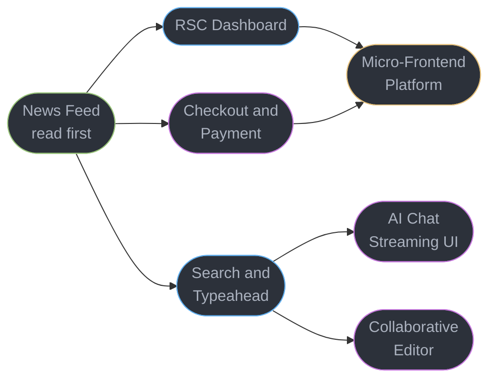

# React — Case Studies Learning Path

Seven front-end **system design** studies. Each follows the repository's 11-section
principal template — `## Intuition`, `## 1. Requirements Clarification`,
`## 2. Scale Estimation`, `## 3. High-Level Architecture`, `## 4. Component Deep Dives`,
`## 5. Design Decisions & Tradeoffs`, `## 6. Real-World Implementations`,
`## 7. Technologies & Tools`, `## 8. Operational Playbook`,
`## 9. Common Pitfalls & War Stories`, `## 10. Capacity Planning`,
`## 11. Interview Discussion Points` — at 900-1100 lines each.

These are **client system design**, not component exercises. A front-end system design
round asks how the whole client behaves: how it boots, how data flows, how it degrades,
how you measure it, and how it ships. Every study here is scoped to that.

> **Case-study Q&As never enter the quiz bank.** `extract.py` skips every `case_studies/`
> path outright, because a case study's questions are discussion prompts tied to one
> scenario and would draw distractors from unrelated scenarios. That is the rule working,
> not a bug — do not "rescue" them by moving them under a module's interview heading.

---

## Quick Start

If you only have time for three, read these in order:

1. **[Design a News Feed with Infinite Scroll](design_a_news_feed_with_infinite_scroll.md)** — the canonical front-end system design prompt, and the one that forces every core skill at once: pagination, virtualization, scroll restoration, optimistic updates and memory over a long session.
2. **[Design a Search & Typeahead Experience](design_a_search_and_typeahead_experience.md)** — the request-lifecycle study. Out-of-order responses and cancellation are where most candidates fail, and the ARIA combobox is where most shipped products fail.
3. **[Design a Dashboard with Server Components](design_a_dashboard_with_server_components.md)** — the modern architecture question: where the client/server boundary goes and what it costs.

---

## Full Learning Path

### Concern 1 — Rendering Large, Live Data

| Case Study | Primary Engineering Concern | What It Teaches |
|------------|----------------------------|----------------|
| [Design a News Feed with Infinite Scroll](design_a_news_feed_with_infinite_scroll.md) | List virtualization under real-world constraints | Cursor pagination over offset and why offset breaks on inserts; windowing plus **scroll restoration on back-navigation**, which a plain virtualized grid never has to solve; optimistic likes with rollback; media prefetch budgets; and the memory growth that makes a feed slow only after twenty minutes. |
| [Design a Dashboard with Server Components](design_a_dashboard_with_server_components.md) | The client/server boundary in a real application | Which widgets are Server Components and which must be client; streaming a slow widget behind its own Suspense boundary so the shell paints first; `"use cache"` lifetimes per widget; auth evaluated on the server; and the serialization rules that decide what can cross. |

### Concern 2 — The Request Lifecycle

| Case Study | Primary Engineering Concern | What It Teaches |
|------------|----------------------------|----------------|
| [Design a Search & Typeahead Experience](design_a_search_and_typeahead_experience.md) | Racing requests and accessible interaction | Debounce versus throttle and why the answer differs for search-as-you-type; **out-of-order response races** and the `AbortController` fix; result caching and prefetch on hover; the full ARIA combobox contract with keyboard interaction; and the empty, error, and minimum-length states that get skipped. |
| [Design an AI Chat Streaming UI](design_an_ai_chat_streaming_ui.md) | Streaming tokens into a live DOM | SSE over WebSocket for a one-way token stream; backpressure when tokens arrive faster than the browser can paint; the optimistic user turn; cancel and regenerate mid-stream; markdown rendered safely while incomplete; and surfacing cost and latency. Ties this section to [`../../llm/`](../../llm/README.md). |

### Concern 3 — Transactional and Collaborative State

| Case Study | Primary Engineering Concern | What It Teaches |
|------------|----------------------------|----------------|
| [Design a Checkout & Payment Flow](design_a_checkout_and_payment_flow.md) | Correctness where mistakes cost money | Multi-step form state that survives a refresh; **client-supplied idempotency keys** so a double-submit cannot double-charge; the 3DS redirect and returning to the right step; why the card field is a cross-origin iframe and what that does to PCI scope; currency and locale formatting; and error recovery that does not lose the cart. |
| [Design a Realtime Collaborative Editor](design_a_realtime_collaborative_editor.md) | Convergence under concurrent edits | CRDT versus OT and the honest tradeoff; optimistic local application with server reconciliation; presence and cursors; reconnect with exponential backoff and jitter; and the conflict UI for the cases the algorithm cannot resolve alone. |

### Concern 4 — Delivering at Organizational Scale

| Case Study | Primary Engineering Concern | What It Teaches |
|------------|----------------------------|----------------|
| [Design a Micro-Frontend Platform](design_a_micro_frontend_platform.md) | Independent deploys without a broken page | Module Federation versus Next.js Multi-Zones versus iframes, decided on team and failure-isolation grounds; shared-dependency version skew and the duplicate-React problem; runtime failure isolation so one team's bad deploy degrades rather than blanks the page; and the design-system contract that holds it together. |

---

## Cross-Cutting / Shared Primitives

There is no `cross_cutting/` directory here, following the `fastapi/` precedent — the
shared primitives are modules in this section and in `frontend_platform/`. This table maps
each to the study where it first becomes load-bearing.

| Primitive | First needed by | Owning module | Phase |
|---|---|---|---|
| Server state, caching, prefetch | News Feed | [`../server_state_and_data_fetching/`](../server_state_and_data_fetching/server_state_and_data_fetching.md) | 3 |
| List virtualization and profiling | News Feed | [`../react_performance_and_profiling/`](../react_performance_and_profiling/react_performance_and_profiling.md) | 2 |
| Suspense boundary placement | Dashboard | [`../suspense_and_error_boundaries/`](../suspense_and_error_boundaries/suspense_and_error_boundaries.md) | 2 |
| The client/server boundary | Dashboard | [`../server_components_and_server_functions/`](../server_components_and_server_functions/server_components_and_server_functions.md) | 4 |
| Form state and validation | Checkout | [`../forms_and_validation/`](../forms_and_validation/forms_and_validation.md) | 3 |
| ARIA patterns and focus | Typeahead | [`../accessible_component_patterns/`](../accessible_component_patterns/accessible_component_patterns.md) | 3 |
| Transitions and interruption | Typeahead | [`../concurrent_rendering_and_transitions/`](../concurrent_rendering_and_transitions/concurrent_rendering_and_transitions.md) | 2 |
| Realtime transports and reconnect | Collaborative Editor | [`../../frontend_platform/realtime_in_the_browser/`](../../frontend_platform/realtime_in_the_browser/realtime_in_the_browser.md) | Platform 2 |
| Module Federation and architecture | Micro-Frontend Platform | [`../react_architecture_and_antipatterns/`](../react_architecture_and_antipatterns/react_architecture_and_antipatterns.md) | 5 |
| Core Web Vitals as the acceptance bar | all seven | [`../../frontend_platform/web_performance_and_core_web_vitals/`](../../frontend_platform/web_performance_and_core_web_vitals/web_performance_and_core_web_vitals.md) | Platform 4 |

---

## Dependency Map

**Always read [News Feed](design_a_news_feed_with_infinite_scroll.md) first.** It
establishes the vocabulary — pagination, virtualization, optimistic update, scroll
restoration, measured budgets — that the other six assume rather than re-derive.

---

## Interview Prep Shortcuts

| "Design X" question | Best case study |
|---|---|
| "Design the Facebook / Twitter feed" | [News Feed with Infinite Scroll](design_a_news_feed_with_infinite_scroll.md) |
| "Design an autocomplete / search box" | [Search & Typeahead](design_a_search_and_typeahead_experience.md) |
| "Design Google Docs / a collaborative editor" | [Realtime Collaborative Editor](design_a_realtime_collaborative_editor.md) |
| "Design a checkout / payment page" | [Checkout & Payment Flow](design_a_checkout_and_payment_flow.md) |
| "Design an analytics dashboard" | [Dashboard with Server Components](design_a_dashboard_with_server_components.md) |
| "Design a chat / ChatGPT-style interface" | [AI Chat Streaming UI](design_an_ai_chat_streaming_ui.md) |
| "How would many teams ship one frontend?" | [Micro-Frontend Platform](design_a_micro_frontend_platform.md) |
| "How do you make this page fast?" | [`../../frontend_platform/web_performance_and_core_web_vitals/`](../../frontend_platform/web_performance_and_core_web_vitals/web_performance_and_core_web_vitals.md) §14 |
| "How do you make this accessible?" | [`../accessible_component_patterns/`](../accessible_component_patterns/accessible_component_patterns.md) + [`../../frontend_platform/accessibility_and_wcag/`](../../frontend_platform/accessibility_and_wcag/accessibility_and_wcag.md) |
