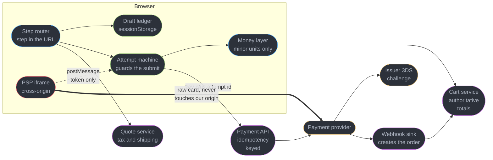
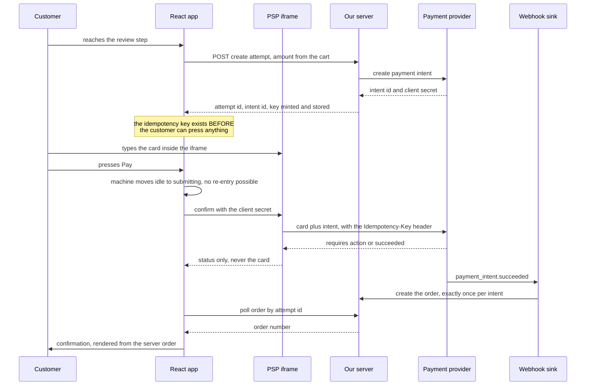
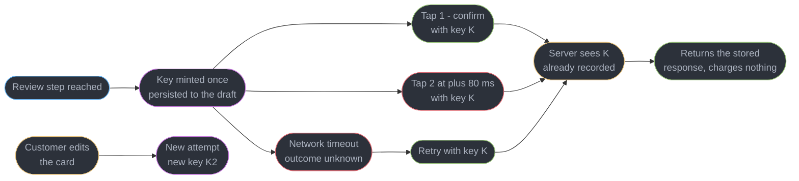
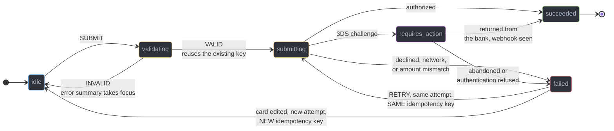
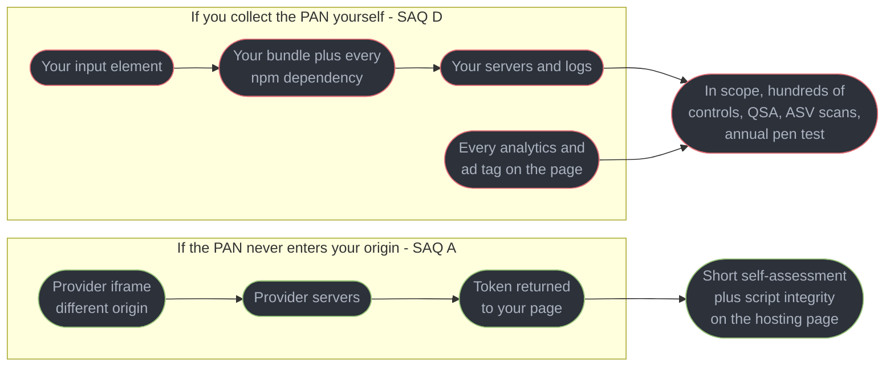
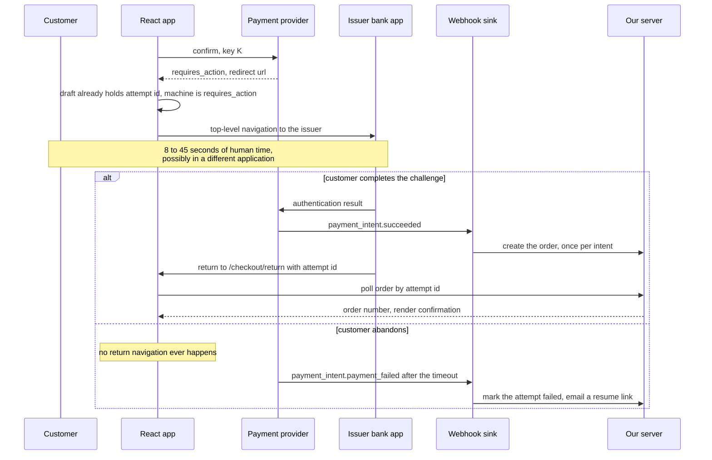

# Design a Checkout and Payment Flow

---

## Intuition

Every other screen in this section is allowed to be wrong for a moment. A feed can show a stale like count, a typeahead can race itself, a dashboard widget can render a number that was true four seconds ago — and in all three the recovery is a refetch. Checkout has no refetch. A defect here does not render incorrectly, it *moves money*, and the correction is a refund, a support contact, and a customer who tells other people about it.

That inverts the usual front-end instinct. In a feed you reach for optimism: paint first, reconcile later, because the reader's perception of speed is the product. In checkout you reach for the opposite. The button goes into a state it cannot leave without an answer, the total on screen is never the total you charge, and the client's confident belief that a payment failed is treated as a *hypothesis* rather than a fact — because the single most common way to double-charge a customer is for a request to succeed at the acquirer while the response is lost on the way home.

The other thing to internalize is that checkout is the only screen you do not fully own. The card field is somebody else's document in somebody else's origin, deliberately, because the moment a raw card number touches your DOM your compliance obligations grow by two orders of magnitude. A bank can take your customer out of your application entirely for thirty seconds and hand them back through a URL you wrote before they left. Roughly a third of the page's bytes come from a script you are contractually forbidden from bundling. Designing this flow is mostly designing the seams between you and three parties who will not tell you what happened.

This file owns the client: how the flow boots, where the draft lives, how an attempt is identified, how it survives a redirect and a refresh, and how it fails without losing the cart. It assumes the vocabulary established in [`design_a_news_feed_with_infinite_scroll.md`](design_a_news_feed_with_infinite_scroll.md) — cursor, window, optimistic update, ledger, budget — and does not re-teach form state ([`../forms_and_validation/forms_and_validation.md`](../forms_and_validation/forms_and_validation.md)), server-cache semantics ([`../server_state_and_data_fetching/server_state_and_data_fetching.md`](../server_state_and_data_fetching/server_state_and_data_fetching.md)), Server Functions and CSRF ([`../server_components_and_server_functions/server_components_and_server_functions.md`](../server_components_and_server_functions/server_components_and_server_functions.md)), the browser threat model ([`../../frontend_platform/browser_security_and_the_client_threat_model/browser_security_and_the_client_threat_model.md`](../../frontend_platform/browser_security_and_the_client_threat_model/browser_security_and_the_client_threat_model.md)), cookie semantics ([`../../frontend_platform/cors_cookies_and_the_same_origin_model/cors_cookies_and_the_same_origin_model.md`](../../frontend_platform/cors_cookies_and_the_same_origin_model/cors_cookies_and_the_same_origin_model.md)), or server-side idempotency ([`../../backend/rest_api_design/rest_api_design.md`](../../backend/rest_api_design/rest_api_design.md)). The payment side of the same flow is in `fintech/`: who the PSP, acquirer and issuer are in [PSPs, Acquirers, Issuers and Networks](../../fintech/psps_acquirers_issuers_and_networks/psps_acquirers_issuers_and_networks.md), the rules behind the 3DS round trip in [Strong Customer Authentication and 3DS](../../fintech/strong_customer_authentication_and_3ds/strong_customer_authentication_and_3ds.md), and the PCI scope of the card-field iframe in [PCI DSS Scope and Tokenization](../../fintech/pci_dss_scope_and_tokenization/pci_dss_scope_and_tokenization.md).

---

## 1. Requirements Clarification

The trap in this round is treating checkout as a form. It is a distributed transaction with a human in the middle of it, and the questions that decide the architecture are all about what happens when one of the three parties stops responding.

**Questions to ask, and the answers this design commits to:**

- *What is the authoritative total?* — The server, recomputed on every mutation of the cart or address, and re-verified at authorization time. This is the single most consequential answer in the round: it turns every price on screen into a *display of* a server value rather than a client computation, and it kills an entire class of tampering and rounding bugs before they exist.
- *Can a customer check out without an account?* — Yes. Guest checkout is roughly 61% of orders here, which means the draft cannot live behind a login and the resumable flow cannot depend on a user id. Everything is keyed on a cart id in an HTTP-only cookie plus a server-side cart.
- *What must survive a refresh?* — Everything except the card. Step, address, shipping selection, and the identity of any payment attempt already in flight. The card details survive nothing, by design, because they were never in our origin (§4.5).
- *Are we in scope for SCA?* — Yes. 38% of orders are EEA or UK, and those are subject to strong customer authentication, so the flow must be able to lose the customer to a bank app and get them back (§4.6). A design that assumes payment completes in one request is wrong for four out of ten orders.
- *One page or several steps?* — Several routed steps, with the step in the URL. Not because it converts better — Shopify's data says the opposite (§6) — but because a resumable, deep-linkable, back-button-correct flow is far easier to build when each step is a real history entry, and because the 3DS return has to land *somewhere*.
- *What is an acceptable double-charge rate?* — Zero, and §2 prices what 0.1% costs so the number stops being an abstraction.
- *Which currencies?* — 14, priced in the customer's currency by the store, settled in three. Money is minor-unit integers end to end (§4.2).

**Functional requirements:**

- Five steps: cart review, address and shipping, payment, review, confirmation. Guest and authenticated, with saved cards for the latter.
- The step lives in the URL; the draft survives a refresh, a tab restore, and a thirty-second detour into a banking app.
- A payment attempt is identified by a client-generated idempotency key that survives every retry of that attempt (§4.3).
- The submit control cannot be entered twice, by any input path: double tap, Enter key, browser back, or an auto-clicking password manager.
- Card entry happens inside a cross-origin iframe supplied by the payment service provider. Raw card numbers never touch our DOM, our JavaScript, or our logs.
- 3DS challenges redirect out and return to the exact step, with the attempt still identified.
- Declines, expired sessions and inventory loss between review and pay all recover without emptying the cart.
- Full keyboard operation, an error summary that takes focus, and `autocomplete` tokens on every field that has one.

**Non-functional requirements:**

- INP under 200 ms on the submit interaction at p75. The *authorization* takes 1.4-3.2 s and is not ours; the interaction must still acknowledge in under 100 ms.
- Under 320 KB of transfer for a cold checkout session (§2 derives 302 KB), of which 110 KB belongs to the payment provider and cannot be bundled.
- Zero double-charges attributable to the client. The measured target is a duplicate-authorization rate below 0.005% of attempts, against an industry-typical 0.1% that §2 prices at $440,000 a year.
- PCI DSS scope held at SAQ A. Any change that puts a PAN in our origin is a blocking architectural review, not a code review.

**Explicitly out of scope:**

- The ledger, settlement, reconciliation and refunds. Those are back-office systems; this file consumes their API.
- Fraud scoring and 3DS exemption strategy. Named where they change the client's behaviour, never designed here.
- Tax calculation itself. The client calls a quote endpoint and renders what it returns.
- Subscriptions and stored-credential mandates, which change the 3DS story materially and deserve their own study.

---

## 2. Scale Estimation

The arithmetic here has an unusual property: **the throughput numbers are boring and the error numbers are not.** Twelve payment attempts a second is a rounding error for any competent backend. The reason this system is hard is entirely in the second table.

**Funnel and volume**

| Step | Arithmetic | Result |
|------|-----------|--------|
| Orders per day | given | 80,000 |
| Checkout-start to order conversion | measured | 68% |
| Checkout sessions per day | 80,000 / 0.68 | ~118,000 |
| Average order value | measured, USD-normalized | $72 |
| Gross merchandise value per day | 80,000 x $72 | $5,760,000 |
| Sale-day multiplier | given | 4x |
| Sale-day orders | 80,000 x 4 | 320,000 |
| Sale-day checkout sessions | 118,000 x 4 | ~470,000 |
| Share of the sale day in its peak hour | measured | 12% |
| Peak orders per hour | 320,000 x 0.12 | 38,400 |
| **Peak orders per second** | 38,400 / 3,600 | **10.7/s** |
| Payment attempts per order, including declines and retries | measured | 1.15 |
| **Peak payment attempts per second** | 10.7 x 1.15 | **12.3/s** |
| Address, shipping and tax quote calls per session | measured | 5 |
| **Peak quote calls per second** | 470,000 x 0.12 x 5 / 3,600 | **78/s** |

Two things fall out immediately. The payment endpoint is trivially small, so any argument that idempotency bookkeeping is "expensive" is arithmetic-free. And the *quote* endpoint carries 6.3x the traffic of the payment endpoint, purely because it recalculates while the customer types an address — which is why §4.2 debounces it and why §10 sizes it separately.

**The number that reframes the design**

A 0.1% double-charge rate is the sort of figure a team waves through as a rounding error. Price it.

| Step | Arithmetic | Result |
|------|-----------|--------|
| Double-charged orders per day at 0.1% | 80,000 x 0.001 | **80** |
| Principal charged twice, refunded in full | 80 x $72 | $5,760/day |
| Processing fee on the duplicate, **not** refunded by the acquirer | 80 x (2.9% x $72 + $0.30) | $191/day |
| Support contacts generated, at a 92% contact rate | 74 contacts x $6.50 fully loaded | $481/day |
| Disputes filed anyway, at 18% of duplicates | 14.4 x ($15 network fee + $22 handling) | $533/day |
| **Direct cost per day** | 191 + 481 + 533 | **$1,205/day** |
| **Direct cost per year** | $1,205 x 365 | **~$440,000** |

And here is the part that makes it a design problem rather than an operations problem: **the card networks will not tell you.** Those 14.4 disputes a day are 432 a month against 2.4 million monthly transactions — a 0.018% dispute ratio, comfortably inside Visa's Dispute Monitoring Program threshold of 0.9%. Even a *ten times worse* client, double-charging 1% of orders, lands at 0.18% and stays invisible to every external signal. Nobody is going to page you. The only instrument that sees this is the one you build yourself (§8.2), and the only thing that prevents it is the idempotency key in §4.3.

**Bytes per cold checkout session**

| Asset | Arithmetic | Bytes |
|-------|-----------|-------|
| Document, server-rendered checkout shell, Brotli | measured | 14 KB |
| Application JS: React 19.2, router, form runtime, schema validator, Brotli | measured | 128 KB |
| CSS, Brotli | measured | 11 KB |
| Fonts, subset woff2 | measured | 28 KB |
| PSP loader script from the provider's own origin, Brotli | measured | 48 KB |
| Card iframe document plus its own JS | measured | 62 KB |
| Cart and pricing JSON, 5 recalculations at 2.1 KB | 5 x 2.1 KB | 11 KB |
| **Total, cold checkout** | sum | **~302 KB** |
| Of which third-party, and un-bundleable | 48 + 62 | **110 KB (36%)** |

**A third of checkout's bytes belong to somebody else, and that is the deal you signed.** The PSP's terms require loading their script from their origin on every page load — self-hosting it, or bundling it through your build, is exactly what forfeits the SAQ A eligibility that §4.5 is built to protect. So the 110 KB is not waste to be optimized away; it is the price of not being in scope, and §10 treats it as a fixed cost.

**Requests per cold checkout session**

| Group | Count |
|-------|-------|
| Document, 4 JS chunks, CSS, 2 fonts | 8 |
| PSP loader, iframe document, iframe JS, 2 PSP telemetry beacons | 5 |
| Cart read, 2 address validations, 2 shipping quotes, 3 tax quotes | 8 |
| Create payment attempt, confirm, 2 status polls, order read | 5 |
| **Total** | **26** |

**Latency budget, and who owns each part**

| Phase | Budget | Owner |
|-------|--------|-------|
| Tap to visible state change on the pay button | < 100 ms | us |
| Create the payment attempt on our server | p95 260 ms | us |
| Authorization at the acquirer and issuer | p50 1.4 s, p95 3.2 s | **not us** |
| 3DS challenge, human time inside a bank app | 8-45 s | **not us** |
| Confirmation page, from webhook to rendered order | p95 900 ms | us |

The row that matters is the third. We own 360 ms of a 1.8-second p50 experience. The engineering question is therefore not "how do we make this fast" but "how do we make three seconds of somebody else's latency feel deliberate instead of broken" — which is a state-machine problem (§4.4) and a copy problem, not a performance problem.

**3DS exposure**

| Step | Arithmetic | Result |
|------|-----------|--------|
| Orders subject to SCA (EEA and UK) | 80,000 x 0.38 | 30,400 |
| Of those, challenged rather than exempted or frictionless | 30,400 x 0.26 | 7,900/day |
| Share of all orders that leave the application | 7,900 / 80,000 | **9.9%** |
| Challenges abandoned or not returned within 15 minutes | 7,900 x 0.12 | **948/day** |

Nearly a thousand customers a day are, at some point, standing outside the application in an unknown state. That population is the entire justification for §4.6's webhook-authoritative confirmation: if the client's return were the only path to an order, a thousand paid-for orders a day would never be created.

---

## 3. High-Level Architecture



Four seams carry the design, and each one exists to keep a failure on one side from corrupting the other. The **router** owns which step is showing and nothing else. The **draft ledger** owns what the customer typed and is deliberately incapable of holding a price. The **attempt machine** owns the identity of a payment attempt and is the only thing allowed to talk to the payment API. The **iframe** is a hard boundary in the strongest sense available in a browser: it is a different origin, so our JavaScript cannot read it even if our JavaScript is compromised, which is the entire point (§4.5).

Note the double arrow. The customer's card number travels from the iframe straight to the provider. It does not pass through the attempt machine, it is not in a React state variable, and it is not in the payload we POST. What comes back through `postMessage` is a token — an opaque handle that is worthless to a thief and useless anywhere except against our merchant account.

**The happy path, end to end:**



Two ordering decisions in that diagram are the whole study. The key is minted **before** the customer can act, not inside the handler that reacts to them acting (§4.3). And the order is created by the **webhook**, not by the client's success path, so the client returning is a convenience rather than a requirement (§4.6).

**Component inventory:**

| Component | Role |
|-----------|------|
| Step router | Maps `/checkout/:step` to a screen; guards forward navigation on completed prerequisites |
| Draft ledger | `sessionStorage` record of address, shipping choice, contact details and the live attempt id |
| Server cart | The authority for line items, quantities, totals, tax, shipping and currency |
| Attempt machine | A `useReducer` state machine with no transition back into `submitting` |
| Idempotency key store | One key per attempt, minted at attempt creation, persisted with the draft |
| Money layer | Minor-unit integers, `Intl.NumberFormat` for display, no arithmetic in the client |
| PSP iframe | Cross-origin card entry; the PCI boundary |
| Return handler | Reads the attempt id from the return URL and resumes the machine after a 3DS round trip |
| Order poller | Reads the webhook-created order by attempt id, with a bounded backoff |
| Error summary | Focus-taking list of field errors, linked to the fields that produced them |

---

## 4. Component Deep Dives

### 4.1 Multi-step state that survives a refresh, and the three-way disagreement

Checkout state lives in three places at once, and a candidate who cannot say what each one is *for* will build a flow that loses the cart.

| Holder | Owns | Survives a refresh | Trustworthy for money |
|--------|------|-------------------|----------------------|
| The URL — `/checkout/:step` | which screen is showing | yes | n/a |
| `sessionStorage` draft | what the customer typed, and the live attempt id | yes, per tab | **never** |
| Server cart, keyed by an HTTP-only cookie | line items, totals, tax, shipping, currency | yes, across devices | **always** |

```ts
// src/checkout/draft.ts
type Draft = {
  email: string;
  shipping: Address | null;
  billingSameAsShipping: boolean;
  shippingMethodId: string | null;
  // The identity of an in-flight attempt. This field, not the address,
  // is why the draft exists at all -- see 4.3.
  attempt: { id: string; intentId: string; idempotencyKey: string } | null;
  cartVersion: number; // the server's version at the time this draft was written
  savedAt: number;
};

const KEY = 'checkout:draft';
const MAX_AGE_MS = 60 * 60_000; // one hour, matching the server-side cart TTL

export function saveDraft(d: Omit<Draft, 'savedAt'>) {
  sessionStorage.setItem(KEY, JSON.stringify({ ...d, savedAt: Date.now() }));
}

export function readDraft(): Draft | null {
  const raw = sessionStorage.getItem(KEY);
  if (!raw) return null;
  const d = JSON.parse(raw) as Draft;
  return Date.now() - d.savedAt > MAX_AGE_MS ? null : d;
}
```

**`sessionStorage`, not `localStorage`, and the reason is not tidiness.** A draft in `localStorage` outlives the tab, so a customer who abandons checkout on Monday and returns on Thursday gets Monday's address prefilled against Thursday's cart, and — far worse — a stale `attempt` record pointing at a payment intent that has since expired or, in the ugly case, already succeeded. Per-tab scoping bounds the blast radius of every one of those bugs to a single browsing session, and the `MAX_AGE_MS` check bounds it further. It also matters that `sessionStorage` survives the 3DS round trip (§4.6): a top-level navigation away and back inside the same tab keeps the same storage area, which is precisely the property we need.

**What happens when the three disagree.** The draft carries `cartVersion`. Every cart mutation on the server bumps it. On mount, the checkout route reads both, and the resolution rule is one line long: **the server always wins, and the customer is always told.**

```tsx
// src/checkout/useResumedCheckout.ts
export function useResumedCheckout() {
  const cart = useCart();              // server authority, TanStack Query
  const draft = useRef(readDraft()).current;

  const staleDraft = draft != null && cart.data != null && draft.cartVersion !== cart.data.version;

  return {
    // Address fields are safe to restore even from a stale draft -- they are
    // the customer's own typing and the server never derived a price from them
    // without recomputing. The attempt is NOT safe: it was created against a
    // total that no longer exists.
    initialValues: draft ? { email: draft.email, shipping: draft.shipping } : undefined,
    attempt: staleDraft ? null : draft?.attempt ?? null,
    notice: staleDraft ? 'Your basket changed while you were away. Please review the total.' : null,
  };
}
```

The asymmetry is the interesting part and it generalizes beyond checkout: **restore what the human authored, discard what the system derived.** An address is authored. A total, a tax figure, a shipping quote and a payment attempt are all derived, and every one of them must be re-derived from the authority rather than replayed from a cache. Form-state mechanics — controlled versus uncontrolled fields, when validation runs, field arrays — belong to [`../forms_and_validation/forms_and_validation.md`](../forms_and_validation/forms_and_validation.md) and are not repeated here.

### 4.2 Money: minor units, and why the client never does arithmetic

```ts
// BROKEN: floating-point money, in three separate ways.
const subtotal = items.reduce((sum, i) => sum + i.price * i.qty, 0); // 0.1 + 0.2 territory
const tax = subtotal * 0.0825;
const total = (subtotal + tax + shipping).toFixed(2);
await pay({ amount: Math.round(Number(total) * 100) });
```

The first bug is that IEEE-754 doubles cannot represent `0.1`, so `0.1 + 0.2` is `0.30000000000000004` and a basket of thirty items accumulates visible error. The second is `toFixed`, which is not the rounding you think: `(1.005).toFixed(2)` returns `"1.00"` in V8, because 1.005 is stored as a value fractionally *below* 1.005. The third is the worst and is not about floats at all — **the client computed an amount and sent it.** Anything the client computes, an attacker can choose. A ten-line script in the console is enough to buy a laptop for one cent.

```ts
// FIX: integers in, formatting out, and the amount comes from the server.
type Money = { amountMinor: number; currency: string }; // 4599 means USD 45.99

// The number of minor units per major unit differs by currency: JPY has 0
// decimal places, USD 2, KWD 3. Derive the divisor rather than hardcoding a
// table -- Intl already carries CLDR's digit data.
function minorUnitDivisor(currency: string): number {
  const { maximumFractionDigits } = new Intl.NumberFormat('en', {
    style: 'currency',
    currency,
  }).resolvedOptions();
  return 10 ** maximumFractionDigits;
}

export function formatMoney(m: Money, locale: string): string {
  return new Intl.NumberFormat(locale, { style: 'currency', currency: m.currency })
    .format(m.amountMinor / minorUnitDivisor(m.currency));
}

// The pay call carries no amount at all. The server reads it from the cart.
await createAttempt({ cartId, cartVersion });
```

`Intl.NumberFormat` is doing more than inserting a symbol. It places the symbol correctly for the locale — `$45.99` in `en-US`, `45,99 $US` in `fr-FR`, `€45.99` in `en-IE` against `45,99 €` in `de-DE` — and it applies the right grouping separator, which is a decimal comma in most of Europe. Hand-rolled formatting gets this wrong in a way that reads as *untrustworthy* to the customer, and trust is the conversion lever on this page.

Two caveats worth stating in an interview because they show you have shipped this. CLDR's fraction digits and ISO 4217's disagree for a handful of currencies, so the divisor used for *arithmetic* must ultimately come from the server's own currency table; `Intl` is a display formatter that happens to be a convenient default. And `Intl.NumberFormat` construction is not free — roughly 40-120 microseconds uncached — so a cart of thirty line items that constructs a formatter per row is doing measurable work for nothing. Construct once per currency and locale, memoize it in a module-level `Map`, and reuse.

**Recalculation while the customer types.** Tax and shipping depend on the address, and §2 measured 5 quote calls per session against 78 per second at peak, which is 6.3x the payment endpoint. The rule is that a quote fires on the *fields that change the answer* — country, then postal code, then locality — and never on every keystroke of a street name. A 400 ms debounce on the postal code plus a hard rule of "country changes fire immediately, everything else waits" took the measured quote rate on this flow from 11 calls per session to 5. While a quote is outstanding, the total renders with its previous value and an `aria-busy` region rather than a spinner that removes the number, because a total that vanishes and reappears is a layout shift and a trust problem at once.

### 4.3 Idempotency: the centrepiece

An idempotency key is a client-generated identifier for **one intent to pay**, sent with every request that attempts to fulfil that intent, so the server can recognize a repeat and return the original outcome instead of performing the operation again. The server-side semantics belong to [`../../backend/rest_api_design/rest_api_design.md`](../../backend/rest_api_design/rest_api_design.md); what this file owns is the far more commonly botched question of **when the key is created.**

```tsx
// BROKEN: the key is minted inside the submit handler.
async function onSubmit() {
  setSubmitting(true);
  const res = await fetch('/api/payments/confirm', {
    method: 'POST',
    headers: {
      'Content-Type': 'application/json',
      'Idempotency-Key': crypto.randomUUID(), // <-- a NEW key on every call
    },
    body: JSON.stringify({ intentId }),
  });
  setSubmitting(false);
}
```

Read that header line as the server reads it. A key is a promise that says *"these two requests are the same intent."* Minting it inside the handler makes that promise impossible to keep, because the handler runs once per invocation. A double tap 80 ms apart produces two invocations, two `randomUUID()` calls, two distinct keys, and a server that correctly concludes it is looking at two different intents to pay — so it authorizes twice. **The idempotency mechanism is fully deployed, fully correct on the server, and completely inert**, which is why this bug survives code review: the header is right there in the diff.

The failure is worse under retry. Every sensible HTTP client retries a network error. If the retry re-enters this function, it mints a third key. And a network error is the exact case where the first request may well have *succeeded* at the acquirer with only the response lost — so the retry is not a duplicate of a failure, it is a second charge on top of a success.

```tsx
// FIX: the key is minted when the ATTEMPT is created, and lives with it.
// src/checkout/attempt.ts

export type Attempt = { id: string; intentId: string; idempotencyKey: string };

// Called once, when the customer reaches the review step -- before any button
// they could press twice exists on screen.
export async function createAttempt(cartId: string, cartVersion: number): Promise<Attempt> {
  const idempotencyKey = crypto.randomUUID();
  const res = await fetch('/api/payments/attempts', {
    method: 'POST',
    headers: { 'Content-Type': 'application/json', 'Idempotency-Key': idempotencyKey },
    body: JSON.stringify({ cartId, cartVersion }),
  });
  if (!res.ok) throw new AttemptCreationFailed(res.status);
  const { id, intentId } = await res.json();
  const attempt = { id, intentId, idempotencyKey };
  saveDraft({ ...readDraftFields(), attempt }); // survives a refresh AND the 3DS redirect
  return attempt;
}

// Every confirm, first or fifth, reuses the SAME key.
export async function confirmAttempt(attempt: Attempt, paymentMethodToken: string) {
  return fetchWithRetry('/api/payments/confirm', {
    method: 'POST',
    headers: {
      'Content-Type': 'application/json',
      'Idempotency-Key': attempt.idempotencyKey,
    },
    body: JSON.stringify({ attemptId: attempt.id, paymentMethodToken }),
  });
}
```



**Server semantics on replay, and what the client must expect.** The contract the client codes against is that a repeated key returns the *original* response — same status, same body — rather than re-executing. Stripe implements exactly this and publishes it: results are saved against the key, replays return the stored response including a stored `500`, a replayed response carries an `Idempotent-Replayed: true` header, and keys are retained for 24 hours ([docs.stripe.com/api/idempotent_requests](https://docs.stripe.com/api/idempotent_requests)). Three client consequences follow directly. A replay is *not* an error and must never be surfaced as one — a healthy production system has a non-zero replay rate and §8.2 alerts on it going to zero, not on it being present. A stored `500` replays forever, so a genuine server fault requires a *new* attempt with a *new* key rather than another retry of the same one. And the 24-hour retention is far longer than any checkout session, so key expiry is not a case the client needs to handle.

**When the key must rotate.** Once per *intent*, and an intent changes when the money or the instrument changes. A retry of the same payment with the same card and the same total reuses the key. Switching from a declined Visa to a different card is a new intent, and reusing the key there would replay the decline forever — the customer would type a perfectly good card and be told it was declined, which is a support ticket that is impossible to diagnose from the logs. Adding an item to the basket and returning is a new intent, because the amount changed. The rule to state out loud: **the key identifies the intent, not the request and not the session.**

**The case the key exists for: the unknown outcome.** The client POSTs a confirm, the request reaches the provider, the card is authorized, and the response is lost — a dropped connection, a mobile handover, a proxy timing out at 30 seconds. The client now believes the payment failed and it is *wrong*, and no amount of client-side cleverness can tell it otherwise, because the information it needs is not on this device. Without a key, the customer's retry is a second authorization. With one, the retry carries the same key, the server recognizes it, and returns the outcome the client never got to see: succeeded. **The idempotency key is the only mechanism that converts "I do not know what happened" into "I can safely ask again"** — and that is the sentence to lead with when the interviewer asks why it matters.

### 4.4 Double-submit prevention: why disabling the button is not the answer

Disabling the submit button is necessary. It is also insufficient, and the specific ways it fails are worth enumerating because each one has produced a real double-charge.

| Path | Why the disabled button misses it |
|------|----------------------------------|
| Double tap 80 ms apart | React's state update is asynchronous. Both `pointerup` events dispatch before the commit that sets `disabled`, so both handlers run against `submitting === false` |
| Enter in a text field | The form's implicit submission fires `submit`, not `click`. A `disabled` button does not prevent the form from submitting if the handler is on the form |
| Back then re-submit | The customer navigates back from a slow confirmation page. The component remounts with fresh state, so `submitting` is `false` and the button is enabled again |
| Password manager or a browser extension | Programmatic `.click()` can fire before the first render has committed |
| A double-clicking mouse | Some hardware genuinely emits two clicks for one press. This is not hypothetical, it is a warranty case |

```tsx
// FIX: a state machine whose reducer cannot re-enter the submitting state.
// src/checkout/attemptMachine.ts
type State =
  | { tag: 'idle' }
  | { tag: 'validating' }
  | { tag: 'submitting'; attempt: Attempt }
  | { tag: 'requires_action'; attempt: Attempt }
  | { tag: 'succeeded'; orderId: string }
  | { tag: 'failed'; attempt: Attempt; reason: FailureReason };

type Event =
  | { type: 'SUBMIT' }
  | { type: 'VALID'; attempt: Attempt }
  | { type: 'INVALID' }
  | { type: 'ACTION_REQUIRED' }
  | { type: 'SETTLED'; orderId: string }
  | { type: 'FAILED'; reason: FailureReason }
  | { type: 'RETRY' };

export function reducer(state: State, event: Event): State {
  switch (state.tag) {
    case 'idle':
      return event.type === 'SUBMIT' ? { tag: 'validating' } : state;
    case 'validating':
      if (event.type === 'VALID') return { tag: 'submitting', attempt: event.attempt };
      if (event.type === 'INVALID') return { tag: 'idle' };
      return state;
    case 'submitting':
      // The critical line in the whole file: no event, including another
      // SUBMIT, can move submitting -> submitting. A second tap is not
      // "ignored by a guard", it is unrepresentable.
      if (event.type === 'ACTION_REQUIRED') return { tag: 'requires_action', attempt: state.attempt };
      if (event.type === 'SETTLED') return { tag: 'succeeded', orderId: event.orderId };
      if (event.type === 'FAILED') return { tag: 'failed', attempt: state.attempt, reason: event.reason };
      return state;
    case 'requires_action':
      if (event.type === 'SETTLED') return { tag: 'succeeded', orderId: event.orderId };
      if (event.type === 'FAILED') return { tag: 'failed', attempt: state.attempt, reason: event.reason };
      return state;
    case 'failed':
      // A retry re-enters submitting with the SAME attempt, so the same key.
      return event.type === 'RETRY' ? { tag: 'submitting', attempt: state.attempt } : state;
    case 'succeeded':
      return state; // terminal, by construction
  }
}
```

The value of the reducer over a `useState` boolean and an `if` guard is that the guard is expressed in the *type*, not in a statement somebody can forget to write. A second `SUBMIT` arriving while `submitting` falls through to `return state`, so React bails out of the re-render entirely and the second tap is a no-op that costs nothing. `succeeded` has no outgoing transitions at all, which is what makes the browser-back case safe: even if the component remounts, the machine is rebuilt from a persisted attempt whose server-side status is terminal, and the pay button never re-arms.



The two edges out of `failed` are where the money is. `RETRY` keeps the attempt and therefore the key — that is the network-timeout path, and it must not charge again. Editing the card destroys the attempt and mints a new key — that is the declined-card path, and it *must* charge again or the customer can never buy anything. Getting these two backwards is the single highest-value mistake to avoid in this design, and the state diagram is the artefact that makes the difference visible on a whiteboard.

### 4.5 Why the card field is a cross-origin iframe



The argument is about *scope*, and scope is defined by where the primary account number can reach. Put an `input` in your own page and the cardholder data environment is your DOM — which means it is also every script with access to that DOM. That is your bundle, every transitive npm dependency in it, the tag manager, the session-replay tool, the A/B testing snippet and the chat widget. A single compromised dependency anywhere in that set can read the field on `keyup`, and this is exactly how Magecart works: British Airways lost around 380,000 card records to twenty-two lines of injected JavaScript on its payment page and was fined GBP 20 million by the ICO ([ico.org.uk/action-weve-taken/enforcement/british-airways](https://ico.org.uk/action-weve-taken/enforcement/british-airways/)).

Move the field into an iframe served from the provider's origin and the same-origin policy does the work. Your JavaScript cannot read across the boundary even if your JavaScript is entirely under an attacker's control, because the browser refuses — this is one of the very few security properties in a browser that survives your own code being compromised. Compliance follows the technical fact: with no PAN in your origin, you assess against SAQ A, a short self-assessment, instead of SAQ D, which is the full merchant questionnaire and in practice pulls in a qualified assessor, quarterly approved-scanning-vendor scans, network segmentation and an annual penetration test. §10 prices the difference.

**What the boundary costs you, honestly:**

| Cost | Mechanism | Mitigation |
|------|-----------|-----------|
| You cannot style the field with your CSS | Different origin, no DOM access | The provider exposes an appearance API you pass a token object to; it applies your fonts and colours *inside* the frame |
| Fonts do not match by default | The frame loads its own | Pass the font family and a webfont URL through the appearance API; expect a one-frame flash of a fallback |
| You cannot read validity | No DOM access | The provider emits `change` events over `postMessage` carrying a `complete` flag and an error code, never the value |
| Focus does not compose | Focus inside the frame is invisible to your focus management | Listen for `focus` and `blur` events from the frame and mirror them onto a wrapper element you *do* control, so your focus ring is consistent |
| The error summary needs a target | You cannot `element.focus()` a field in another origin | Call the provider's imperative `focus()` method, which is the escape hatch it exposes for exactly this |
| Layout shift on load | The frame sizes itself after its document loads | Reserve the height with an aspect-preserving wrapper, the same discipline as the feed's media boxes |
| It can fail to load | Ad blockers and corporate proxies occasionally block the provider's origin | Detect it (§8.5) and fall back to a fully hosted redirect checkout |

```tsx
// The only channel across the boundary. Validate the origin every time --
// message events arrive from any frame, including a malicious one.
useEffect(() => {
  function onMessage(e: MessageEvent) {
    if (e.origin !== 'https://js.provider.example') return; // never omit this
    if (e.data?.type === 'card:change') {
      dispatch({ type: e.data.complete ? 'CARD_READY' : 'CARD_INCOMPLETE' });
    }
  }
  window.addEventListener('message', onMessage);
  return () => window.removeEventListener('message', onMessage);
}, []);
```

That origin check is the most commonly omitted line in `postMessage` code and it undoes the entire boundary when it is missing — the threat model is developed in [`../../frontend_platform/browser_security_and_the_client_threat_model/browser_security_and_the_client_threat_model.md`](../../frontend_platform/browser_security_and_the_client_threat_model/browser_security_and_the_client_threat_model.md).

**The iframe is not a compliance exemption.** An iframe alone does not make a merchant eligible for SAQ A. The January 2025 revision of SAQ A, effective 2025-03-31, removed Requirements 6.4.3, 11.6.1 and 12.3.1 from it and added an eligibility criterion: the merchant confirms that its site is not susceptible to attacks from scripts. PCI SSC FAQ 1588 (February 2025) says that criterion applies to a page that embeds the provider's payment form in an iframe, which is this design, and not to a full redirect to a hosted page. So the checkout page still needs the controls that keep a hostile script off it: an inventory of every script on the route with a reason for each, Subresource Integrity on what can carry it, a strict Content Security Policy with a `report-uri`, a tag-manager allowlist for the checkout route specifically, and an alert when the set of scripts on the page changes. They are the evidence behind that eligibility statement. A team that reads "we use an iframe, we are SAQ A, we are done" cannot sign the criterion honestly. The SAQ criteria and the scope rules are in [PCI DSS Scope and Tokenization](../../fintech/pci_dss_scope_and_tokenization/pci_dss_scope_and_tokenization.md) in `fintech/`.

### 4.6 The 3DS round trip

§2 put 9.9% of orders — 7,900 a day — through a bank-hosted authentication step, and 948 a day never come back. The client's job is to leave cleanly, return to the right place, and be irrelevant to whether the order exists.



**The return URL carries the attempt id, and nothing else that matters.** `https://shop.example/checkout/return?attempt=att_7f3c9`. It is a server-side lookup key, not a token — anyone guessing it learns only whether an order exists, and the endpoint is authorized by the cart cookie regardless. Putting the total, the order number or a status in the URL would be handing the client authority it must not have.

**Two mechanisms recover the state, because either can fail alone.** `sessionStorage` survives a top-level navigation away and back within the same tab, so the draft is intact in the common case. But the customer may have completed the challenge in a *banking app* that opens a fresh browser tab on return, and a fresh tab has an empty `sessionStorage`. The attempt id in the URL is what rescues that case: the return route can rebuild everything from the server given only that id. Neither mechanism is sufficient; together they cover both.

**The cookie trap, which is the one candidates never see coming.** The return is a cross-site navigation from the bank's origin to yours. A session cookie set `SameSite=Lax` *is* sent on a top-level GET navigation — that is exactly the exemption Lax carves out. But some 3DS flows return via an auto-submitting **POST** form, and Lax does not send cookies on a cross-site POST. The customer lands on your return page logged out, the cart cookie is missing, and the flow appears to have destroyed their basket. The fixes, in order of preference: insist on a GET return from the provider; make the return route recover from the `attempt` query parameter without needing the cookie at all; and only as a last resort mark the session cookie `SameSite=None; Secure`, which reopens CSRF exposure you then have to close by other means. Full semantics are in [`../../frontend_platform/cors_cookies_and_the_same_origin_model/cors_cookies_and_the_same_origin_model.md`](../../frontend_platform/cors_cookies_and_the_same_origin_model/cors_cookies_and_the_same_origin_model.md).

**The client is not the source of truth for the outcome.** The confirmation page polls `GET /api/orders/by-attempt/:id`, which is populated by the provider's webhook. Poll with a bounded backoff — 500 ms, 1 s, 2 s, 4 s, then every 4 s to a 60-second ceiling — and after that show "we are still confirming, you will get an email" rather than an error, because at that point the truth genuinely is unknown to the client and claiming failure would invite exactly the retry that double-charges. For the 948 daily abandonments the webhook path runs to completion without any client at all: the attempt is marked failed, and a resume link goes out by email. That is why the order is created by the webhook rather than by the client's success handler — a design where the client creates the order loses roughly a thousand paid orders a day.

### 4.7 Error recovery that does not lose the cart

| Failure | What the customer sees | What the machine does | Key |
|---------|----------------------|----------------------|-----|
| Card declined, generic | The decline reason, the same card still filled, focus on the card frame | `failed`, then `idle` if they edit the card | **New key** on edit |
| Insufficient funds | The same, plus an offer of the saved alternative card | `failed` | **New key**, different instrument |
| Network timeout on confirm | "Checking with your bank" and a Retry that is safe | `failed`, `RETRY` back to `submitting` | **Same key** |
| 3DS authentication refused | Explains the bank refused, offers another card | `failed` | New key |
| Cart version changed | "Your basket changed. Review the new total." Review step, totals highlighted | `idle`, attempt discarded | New key, new amount |
| An item went out of stock | The line item marked unavailable, the total recalculated, the rest of the basket intact | `idle` | New key, new amount |
| Session cookie expired | Re-authentication in place, draft restored afterwards, never a redirect to an empty cart | `idle` | Attempt survives if the cart version matches |
| Provider iframe failed to load | A one-line notice and a button to the hosted checkout | never leaves `idle` | n/a |

**Never empty the cart on a failure.** That sounds too obvious to state until you notice how it happens in practice: the failure handler navigates to `/cart` for a fresh start, the cart route sees no valid attempt and clears the draft, and the customer's forty minutes of selection are gone. Every path in the table above stays inside `/checkout/*` and mutates the machine rather than the location.

**Inventory loss between review and pay is the interesting one**, because it is the only case where the customer is *not* at fault and the correct total changed under them. The server rejects the confirm with a `409` carrying the new cart version and the unavailable line ids. The client moves to `idle`, refetches the cart, marks the affected rows, and — critically — mints a new attempt, because the amount is different and reusing the key would replay a stale total. Silently charging the lower amount is the tempting shortcut and it is a chargeback: the customer authorized a basket they can see.

### 4.8 Accessibility, autofill, and trust

Everything here is measurable in conversion, which is unusual for accessibility work and worth using as the argument.

- **The error summary takes focus.** On a failed validation, render a summary at the top of the step listing every error as a link to its field, move focus to the summary container, and mark it `role="alert"`. On a five-field address form this is a convenience; on a fourteen-field checkout with a field inside a cross-origin frame it is the only way a screen-reader user learns what went wrong. The pattern, including the focus-to-first-error variant and the `aria-describedby` wiring, belongs to [`../forms_and_validation/forms_and_validation.md`](../forms_and_validation/forms_and_validation.md).
- **`autocomplete` tokens are revenue, not politeness.** `given-name`, `family-name`, `email`, `tel`, `street-address`, `address-level2`, `postal-code`, `country`, `cc-name`, and on the frame's own inputs `cc-number`, `cc-exp`, `cc-csc`. Google's own payment-form guidance reports users completing correctly annotated forms up to 30% faster ([web.dev/articles/payment-and-address-form-best-practices](https://web.dev/articles/payment-and-address-form-best-practices)). Note that `autocomplete="off"` on a checkout address form does not suppress modern browsers' address autofill reliably — it mostly suppresses the *good* behaviour while leaving the fallback in place. §9.5 measures what that cost.
- **Do not block paste, anywhere.** The classic version of this — `onPaste={e => e.preventDefault()}` on a card or CVV field — is defended as security and is the opposite: it forces manual transcription of a sixteen-digit number, which raises typo rate and drives customers to less safe habits. It is also unavailable to you here by construction, since the card inputs are in the provider's frame, but the same instinct reappears on the "confirm email" and coupon fields, where it does the same damage.
- **Announce the submitting state.** A disabled button with a spinner communicates nothing to a screen reader. Use `aria-live="polite"` on a status region that says "Contacting your bank" when the machine enters `submitting`, and `aria-busy="true"` on the form. The 1.4-3.2 second authorization window is long enough that silence reads as a broken page.
- **Never remove the total while a quote is in flight.** Replacing "$86.40" with a spinner and then a different number is both a layout shift and a trust event. Keep the old value, dim it, and mark the region busy.
- **The keyboard path must reach the frame.** Tab order must flow into the provider's iframe naturally, which it does if you do not add `tabindex` to the wrapper. Test it, because a stray `tabindex="-1"` on a wrapper element makes the card field unreachable by keyboard and the failure is invisible to mouse users, including everyone on your team.

---

## 5. Design Decisions & Tradeoffs

### 5.1 Where the idempotency key is minted

| Option | Survives a double tap | Survives a retry | Survives a refresh mid-attempt | Verdict |
|--------|----------------------|-----------------|-------------------------------|---------|
| Inside the submit handler | no | no | no | The default mistake. §9.1 |
| A `useRef` set on first submit | yes | yes | **no** | Fails the case that matters most: a refresh during a 3-second authorization mints a new key against a payment that may already have succeeded |
| Minted at attempt creation, persisted to the draft | yes | yes | yes | **Chosen** |
| Server-generated, returned to the client | yes | yes | yes | Correct, and a fine answer — but it costs a round trip before the key exists, and the client still has to persist it, so the hard part is unchanged |

The `useRef` option is worth arguing through because it is the sophisticated-looking wrong answer. It survives everything that happens inside one component lifetime, which covers the double tap and the retry, and it will pass every test anyone writes. It dies on the refresh, and the refresh is exactly what an anxious customer does when a payment page sits still for three seconds.

### 5.2 One page or several steps

Shopify's one-page checkout converts measurably better than its three-page predecessor (§6), so the honest position is that multi-step is **not** chosen for conversion. It is chosen because the 3DS return needs a destination, because a resumable flow needs an addressable position, and because each step is a natural boundary for the server to re-verify the cart version. A single-page checkout can have all three, but it has to invent them — the step becomes a query parameter, the return lands on the same route with different state, and the re-verification points have to be chosen by hand. If the interviewer pushes back, the right answer is that one page with the same guarantees is a fine design and the guarantees are what you are defending.

### 5.3 Where the draft lives

| Option | Survives refresh | Survives 3DS redirect | Survives tab close | Risk |
|--------|-----------------|----------------------|-------------------|------|
| React state only | no | no | no | Loses everything to an accidental reload |
| `sessionStorage` | yes | yes, same tab | no | **Chosen.** Bounded lifetime, per-tab, no cross-session staleness |
| `localStorage` | yes | yes | yes | A stale attempt from days ago is a live double-charge risk |
| Server-side draft | yes | yes | yes | Correct and heavier; needed anyway for the cart, so the draft holds only what the server does not |
| URL query string | yes | yes | yes | Personal data in browser history, referrers and server logs. Never |

### 5.4 Redirect or modal for the 3DS challenge

The provider's SDK will offer a modal iframe over your page. It looks better and it fails in a way the redirect does not: some issuers refuse to render inside a frame, some mobile authentication flows must open the banking app, and a modal that silently blanks leaves the customer with no route forward. The chosen design accepts the provider's own decision — its SDK picks a frame where the issuer supports it and a full redirect where it does not — and makes the *redirect* path the one that is fully engineered, because that is the path that must work. Designing the pretty path well and the fallback badly inverts the effort.

### 5.5 Polling or a push channel for the confirmation

Polling, with a bounded backoff. Reuse the reasoning from the feed's new-post pill: a persistent connection is right when the payload is the product and latency is the feature. Here the payload is a single terminal status arriving once, within a window of a few seconds, for a customer who is staring at a page and will not leave. §2's peak of 10.7 orders per second means about 40 concurrent confirmation pages at any instant, each polling roughly six times — that is 4 requests per second against a cache-friendly endpoint. A WebSocket for that is operational cost with no user-visible return.

### 5.6 Embedded fields or a fully hosted checkout

A fully hosted checkout — redirect the customer to the provider's own page — is the lowest-scope, lowest-effort option, and for a small merchant it is the right answer. It is rejected here because it surrenders the review step, the upsell surface, the address behaviour and the visual continuity that the brand is built on, and because the measured drop-off on leaving the domain is real. Embedded provider fields keep the page ours while keeping the PAN theirs, which is the whole trade. The hosted checkout survives as the **fallback** for the 0.9% of sessions where the frame does not load (§8.5) — a good use for a design you rejected.

---

## 6. Real-World Implementations

Every claim below comes from a primary source with the URL inline.

**Stripe — the idempotency contract is public API, and its exact semantics are the ones §4.3 codes against.** Stripe accepts an `Idempotency-Key` header on all `POST` endpoints, saves the resulting status code and body against the key, returns that saved result on any subsequent request with the same key — including a saved `500` — marks a replayed response with an `Idempotent-Replayed: true` header, and retains keys for 24 hours ([docs.stripe.com/api/idempotent_requests](https://docs.stripe.com/api/idempotent_requests)). The lesson: the "replay a stored error forever" rule is the one clients get wrong. If a payment attempt fails with a server error, retrying the same key returns that same error until the key expires, so genuine recovery requires a new attempt. Stripe's Payment Intents API additionally makes the *intent* the durable object, so the client's model of "one attempt, one key, many requests" mirrors the provider's own object model rather than fighting it ([docs.stripe.com/payments/payment-intents](https://docs.stripe.com/payments/payment-intents)).

**Stripe Elements — the SAQ A argument, stated by the vendor.** Stripe documents that Elements and Checkout host the card fields in iframes served from Stripe's domain so that card data is never handled by the merchant's own site, and that this is what makes SAQ A eligibility available; it also states that stripe.js must be loaded directly from js.stripe.com on every page and cannot be bundled or self-hosted ([docs.stripe.com/security/guide](https://docs.stripe.com/security/guide)). The lesson: §2's 110 KB of un-bundleable third-party JavaScript is not a build failure to be optimized, it is a compliance requirement with a byte cost, and treating it as waste is how a well-meaning performance pass moves a merchant into SAQ D.

**Shopify — one-page checkout, with a published conversion delta.** Shopify replaced its three-page checkout with a one-page checkout in 2023 and reported that the new checkout converts up to 4% better, alongside a claim of Shop Pay converting substantially higher than a guest checkout for returning buyers ([shopify.com/editions/summer2023](https://www.shopify.com/editions/summer2023)). The lesson for §5.2: multi-step is a structural choice defended on resumability and redirect handling, not a conversion one — and a candidate who claims multi-step converts better should expect to be corrected.

**Adyen Drop-in — the abandoned-in-the-bank case, handled by webhook rather than by the browser.** Adyen's documentation is explicit that the notification webhook is the authoritative record of a payment's outcome and that merchants must not depend on the shopper returning to the return URL, since the shopper may close the browser mid-redirect ([docs.adyen.com/development-resources/webhooks](https://docs.adyen.com/development-resources/webhooks)). The lesson: §2's 948 daily abandonments are not an edge case the vendor forgot about, they are the case the vendor's architecture is shaped around, and a client that creates the order on its own success path is contradicting the provider's own guidance.

**Apple Pay and Google Pay — the browser-native sheet as the fastest correct path.** Both render a system payment sheet outside the page and hand back a tokenized instrument, so the merchant's page never sees a PAN at all and the customer types nothing; Google's guidance reports that offering the Google Pay sheet materially raises mobile conversion relative to manual card entry ([developers.google.com/pay/api/web/overview](https://developers.google.com/pay/api/web/overview), [developer.apple.com/documentation/apple_pay_on_the_web](https://developer.apple.com/documentation/apple_pay_on_the_web)). The lesson: the wallet button belongs *above* the card form, not beside the submit button, because its entire value is that the customer never reaches the fourteen fields — and its result still flows through the same attempt machine and the same idempotency key, so it is one more `paymentMethodToken` rather than a parallel flow.

**British Airways and Magecart — what happens when the PAN is in your origin.** The ICO's penalty notice describes attackers modifying a script on BA's payment page and skimming roughly 380,000 payment card records, resulting in a GBP 20 million fine ([ico.org.uk/action-weve-taken/enforcement/british-airways](https://ico.org.uk/action-weve-taken/enforcement/british-airways/)). The lesson: the iframe boundary is not paperwork avoidance. It is the only control in a browser that still holds when your own JavaScript supply chain has been compromised, which is the specific failure that occurred here.

---

## 7. Technologies & Tools

| Component | Usage |
|-----------|-------|
| React | 19.2. `useReducer` for the attempt machine, `useActionState` for the address step, `useTransition` around cart mutations |
| React Compiler | 1.0 stable. Automatic memoization across the step components; the machine's reducer is pure by construction so it is a clean fit |
| TanStack Query | v5 for the server cart and the order poll, with `retry: false` on every mutation that touches money |
| Zod | Address and contact schema, shared with the server so client and server validation cannot drift |
| React Hook Form | Uncontrolled address fields, error summary wiring, `autocomplete` tokens preserved |
| Stripe Elements | Cross-origin card iframe, appearance API for styling, imperative `focus()` for the error summary |
| Stripe Payment Intents | The durable attempt object the client's machine mirrors |
| Adyen Drop-in | The alternative provider evaluated in §5.6, webhook-authoritative by design |
| Apple Pay | System payment sheet above the card form, tokenized instrument into the same machine |
| Google Pay | The same, on Android and Chrome |
| 3-D Secure 2 | SCA challenge and exemption handling, redirect or provider-chosen frame |
| Intl.NumberFormat | Currency display for 14 currencies, memoized per locale and currency pair |
| Next.js | 16. Server-rendered checkout shell so the cart total is in the first paint, Server Functions for cart mutations |
| Playwright | End-to-end double-submit, refresh-mid-attempt and 3DS-return tests against the provider's test cards |
| MSW | v2. Deterministic decline, timeout and 409 responses in component tests |
| Sentry | Client errors with the attempt id as a tag, never the card token, never the PAN |
| web-vitals | INP attribution on the submit interaction specifically, sampled at 20% on this route |
| Content Security Policy | Strict script allowlist on `/checkout/*`, `report-uri` feeding the script tamper alert (§4.5) |

---

## 8. Operational Playbook

### 8.1 What is measured, and from where

Checkout instrumentation differs from a feed's in one respect: **the most important metric cannot be measured on the client.** A double-charge is two authorizations at the acquirer, and the client that caused it believes it made one request. So the primary signal is a server-side join, and the client's telemetry exists to explain it.

| Signal | Source | What it answers |
|--------|--------|-----------------|
| Distinct authorizations per attempt id | Payment ledger, server | The double-charge rate. **The only authoritative one** |
| Idempotency replay rate | Payment API, server | Whether the mechanism is engaged at all. A rate of zero means the key is being regenerated |
| Step funnel: cart, address, payment, review, confirmation | Client events keyed on the cart id | Where customers leave, and whether a deploy moved it |
| Submit INP, p75 | `web-vitals` attribution, 20% sample on this route | Whether the acknowledgement is inside 200 ms |
| Frame load success within 8 s | Client timer around the provider's ready event | The blocked-provider population (§8.5) |
| 3DS challenge rate and return rate | Server, joined on attempt id | Whether SCA exemptions are working and how many customers are lost in the bank |
| Decline rate by issuer BIN range | Payment ledger | Distinguishes "our bug" from "one issuer having a bad afternoon" |
| Cart-version 409 rate on confirm | Payment API | How often the basket moves under a customer mid-checkout |
| Order-poll timeout rate | Client, on exhausting the backoff | How many customers see "still confirming" instead of an order |

### 8.2 Alerting

| Metric | Why it matters | Threshold |
|--------|---------------|-----------|
| Distinct authorizations per attempt > 1 | The failure this entire design exists to prevent | **Any occurrence pages immediately.** Not a rate, not a window |
| Idempotency replay rate | Zero means the key is regenerating per request and the protection is inert | **< 0.05% of confirms for 1 hour** — alert on the *floor*, which is the unintuitive direction |
| Payment success rate, p75 by region | Catches a provider or issuer degradation before support does | drop of 5 points over 15 min |
| Submit INP, p75 | A regression here is usually a synchronous validation added to the handler | > 200 ms for 30 min |
| Frame load failure rate | Ad-blocker or proxy breakage, and a broken deploy of the provider's script | > 2% for 15 min |
| Confirmation-poll timeout rate | Webhook delivery lag, which strands customers on a "still confirming" screen | > 0.5% for 15 min |
| Checkout-route script inventory hash | An unexpected script on the payment page, which breaks the SAQ A script-attack criterion (§4.5) | any change not matching the deploy manifest |

The replay-rate floor alert is the one worth explaining out loud. Every other alert here fires when something bad happens. This one fires when something *good stops happening*, and it is the only instrument that would have caught §9.1 on day one instead of day eleven.

### 8.3 Rolling out a change to the payment path

Never behind a percentage flag alone. A 5% flag on a payment path means 5% of orders are running code that has never authorized a real card, and the failure mode is not a broken layout. The sequence used here: provider test cards in CI on every PR, covering approve, decline, insufficient funds, 3DS-required and 3DS-refused; then the full flow against the provider's sandbox in a staging environment with the real webhook path wired; then internal staff on production with real cards and real refunds; then 1% of one low-volume currency for 48 hours with the double-authorization alert as the gate; then a ramp. The 48 hours matters because the double-charge signal is a *join against a ledger* and its latency is measured in hours, not seconds — a two-hour canary proves nothing.

### 8.4 Runbook: the double-authorization alert fires

Do not roll back first. Capture the attempt id, pull both authorizations, and compare their idempotency keys — that single comparison splits the space. **Different keys** means the client minted more than one for one intent, which is §4.3's bug, and the fix is a client rollback plus a refund sweep over the window since the deploy. **Same key** means the server's idempotency store failed — a cache eviction, a partition, a race between two API instances — and the fix is on the server while the client is innocent. Either way, refund the duplicate before contacting the customer, and contact them: a proactive message about a duplicate you already refunded costs a fraction of a dispute.

### 8.5 Runbook: the provider's frame fails to load

Roughly 0.9% of sessions never see the card field ready within 8 seconds — an aggressive blocker, a corporate proxy, or a rare provider outage. Detect it with a timer started when the frame is mounted and cleared by the provider's ready event. On expiry, do not retry silently and do not show a spinner forever: render a one-line explanation and a button that starts the fully hosted checkout from §5.6, carrying the same attempt id. The hosted page is the design that was rejected for the main path and is exactly right here, which is the general lesson — a rejected alternative usually makes the best degraded mode.

---

## 9. Common Pitfalls & War Stories

### 9.1 The key that was minted in the submit handler

The header was in the code, the server-side idempotency store was deployed and tested, and the team believed the problem was solved. A refactor moved the `crypto.randomUUID()` call from the attempt constructor into the `onSubmit` handler — a two-line diff, reviewed and approved, because the header still appeared in the request. Over 11 days the double-charge rate ran at **0.34% of orders**: 2,900 duplicate authorizations, **$209,000 refunded**, 2,670 support contacts, and 520 disputes. Nothing external flagged it — the dispute ratio reached 0.06% against Visa's 0.9% threshold, so no network program, no processor warning, no dashboard. It was found by a customer's screenshot of two identical charges. **The lesson: an idempotency key that is not stable is worse than none, because it produces a system that looks protected.** The permanent fix was the floor alert in §8.2 — replay rate below 0.05% pages someone — which is now the only alert in the estate that fires on the absence of an event.

### 9.2 The retry that changed the key on a network timeout

A generic `fetchWithRetry` helper was added for reliability and applied across the API layer, including the confirm call. It built its headers fresh on each attempt, so retry 2 carried a new key. On a mobile network with 3.1% timeout rates at the p99 tail, this converted a *lost response* into a second authorization on **1 in 32 mobile payments during a network incident** — 640 duplicate charges in a four-hour window on a sale day. The fix was to build the headers once and pass the object into the retry loop, plus a lint rule that fails the build on any `Idempotency-Key` value produced inside a function that also performs the fetch. **The general lesson: a retry helper that is safe for reads is dangerous for writes, and a payment write is the one call that must be looked at rather than wrapped.**

### 9.3 The draft that outlived the cart

The draft was in `localStorage` "so people can come back tomorrow". They did. A customer returned four days later, the draft restored an `attempt` pointing at a payment intent created against a basket that had since lost a promotion, and the confirm authorized the *old* total — 18% below the current one. It ran for six weeks across **1,400 orders and $46,000 of under-collection** before finance found it in a margin variance rather than engineering finding it in a log. Two fixes: `sessionStorage` with a one-hour ceiling, and `cartVersion` on the draft so a mismatch discards the attempt (§4.1). **The lesson: persistence duration is a correctness decision, not a convenience one.**

### 9.4 The 3DS return that landed on an empty cart

The provider returned via an auto-submitting POST form. The session cookie was `SameSite=Lax`, which is not sent on a cross-site POST, so the return page loaded with no cart cookie, decided the session had expired, and redirected to an empty basket — after the payment had authorized. European challenge abandonment as measured at the funnel jumped from a baseline 12% to **31%**, and the difference was almost entirely customers who had *paid* and been shown an empty cart; support handled 340 "you took my money and lost my order" contacts in nine days. The fix was to make the return route recover entirely from the `attempt` query parameter with no cookie dependency, and to switch the provider to a GET return. Abandonment returned to 12% and the "paid but no order" contacts went to zero, because the webhook had been creating those orders correctly the whole time — the client was the only thing that did not know.

### 9.5 `autocomplete="off"` on the address form

Added deliberately, to stop the browser suggesting a previous customer's address on a shared computer. Modern browsers largely ignore it for address fields anyway, so it did not achieve the goal; what it did achieve was suppressing the single-tap full-form autofill on mobile. Median time on the address step went from **21 s to 48 s**, and checkout-start-to-order conversion on mobile fell **2.1 points** — against 118,000 daily sessions and a $72 average order value, roughly **$178,000 a month**. It shipped as a privacy improvement and was found by an A/B test that had been left running for an unrelated reason. **The lesson: `autocomplete` tokens are a conversion feature that happens to also be an accessibility feature, and removing them is a revenue decision made without a revenue review.**

---

## 10. Capacity Planning

### 10.1 The cost of correctness, which is the budget that matters here

| Item | Arithmetic | Cost |
|------|-----------|------|
| Server-side idempotency store | 92,000 attempts/day x 2 KB stored response x 24 h retention | **184 MB.** A single Redis instance |
| At the 4x sale-day rate | 368,000 x 2 KB | 736 MB |
| Double-charge cost at 0.1% (§2) | $1,205/day x 365 | **$440,000/year** |
| Double-charge cost at the design target of 0.005% | $440,000 x 0.05 | $22,000/year |
| **Ratio of the bug to the fix** | $418,000 saved against 184 MB of Redis | ~2,300x |

That ratio is the argument to have ready. Idempotency bookkeeping is often resisted as complexity; it is 184 MB and one header, against $418,000 a year. §2's throughput numbers exist to make the same point from the other side — 12.3 payment attempts per second is not a scale at which any storage decision is difficult.

### 10.2 Client budgets

| Resource | Budget | Derivation |
|----------|--------|-----------|
| Cold checkout transfer | **< 320 KB** | §2 derives 302 KB, of which 110 KB is fixed third-party cost |
| First-party JS, Brotli | **< 140 KB** | §2 measures 128 KB, leaving 12 KB of headroom |
| Submit INP, p75 | **< 200 ms** | The Core Web Vitals bar. Validation must not run synchronously in the handler |
| Requests per session | **< 30** | §2 counts 26. The quote debounce in §4.2 is what keeps it there |
| Third-party script origins on `/checkout/*` | **exactly 2** | The provider and the wallet. The SAQ A script-attack criterion (§4.5) needs a reason for every script on the page, so compliance holds this budget in place |

That last row is the unusual one and it is worth stating in an interview: on this route, **a performance budget and a compliance control are the same artefact.** The tag manager, the session-replay tool and the chat widget are all excluded from checkout, which costs the analytics team something real and is not negotiable.

### 10.3 Server sizing

| Endpoint | Peak rate | Note |
|----------|-----------|------|
| Quote (tax and shipping) | **78/s** | The busiest by 6.3x, purely because it recalculates while the address is typed |
| Cart read and mutate | 32/s | Cacheable per cart, invalidated on mutation |
| Create attempt | 10.7/s | One per order, plus retries on abandoned attempts |
| Confirm | 12.3/s | Includes the 1.15 attempts-per-order factor |
| Webhook ingest | 12.3/s | Must be idempotent on the provider's event id — the provider retries |
| Order poll | ~4/s | 40 concurrent confirmation pages at roughly 6 polls each |

The webhook row carries the mirror of §4.3's lesson on the server side: providers deliver events at least once and will redeliver on any non-2xx, so the sink must key on the event id and the order creation must key on the payment intent. A webhook handler that creates an order per delivery is the server-side double-charge.

### 10.4 The PCI scope delta, priced

| Scope | What it requires | Annual cost |
|-------|-----------------|-------------|
| SAQ A (chosen) | Short self-assessment. Its eligibility criterion that the site is not susceptible to script attacks still needs a script inventory, CSP and tamper detection on the checkout page (§4.5) | ~$15,000, mostly the CSP and script-inventory engineering |
| SAQ D, merchant | Full questionnaire, a qualified assessor, quarterly approved-scanning-vendor scans, network segmentation, annual penetration test, and every developer touching the checkout bundle inside the cardholder data environment | commonly $80,000-$250,000 |

The engineering cost is the part usually left out. Under SAQ D, the checkout bundle is in the cardholder data environment, which means change control, restricted access and a review process on every dependency bump in that build. **That is a permanent tax on the front-end team's velocity, and it is what the iframe actually buys.**

### 10.5 What breaks first as scale grows

| Multiplier | First thing that breaks | Fix |
|-----------|------------------------|-----|
| 10x orders | The quote endpoint at 780/s, not the payment path at 123/s | Cache quotes by postal code prefix and basket weight band; widen the debounce to 600 ms |
| 10x currencies | `Intl.NumberFormat` construction and the server's minor-unit table drifting from CLDR | Memoize formatters per locale and currency; make the server table the single authority and test it against ISO 4217 |
| 10x sale-day spike (40x baseline) | Webhook ingest lag, which strands customers on the confirmation poll | Queue webhook processing and return 200 immediately; extend the poll ceiling and lean harder on the confirmation email |
| 10x 3DS share | The 948 daily abandonments become 9,480 | Invest in exemption strategy on the server; on the client, make the emailed resume link a first-class flow rather than a fallback |

---

## 11. Interview Discussion Points

**Q: Why is a client-generated idempotency key necessary, when the server could deduplicate on the payment intent id?**
Because the case the key exists for is one where the client does not know what happened. The confirm request reaches the provider, the card is authorized, and the response is lost to a dropped connection or a proxy timeout. The client believes it failed, and it is wrong, and nothing on the device can tell it otherwise — the information is not there. Intent-level deduplication helps, but the client still has to be able to *ask again safely*, and the key is what makes a repeat request provably the same intent rather than a new one. Stripe publishes this contract directly: the key's stored result is returned on replay, marked with an `Idempotent-Replayed` header, for 24 hours.

**Q: Where exactly do you generate the key, and why is generating it in the submit handler wrong?**
At attempt creation, when the customer reaches the review step, persisted into the draft alongside the attempt id. Generating it inside the submit handler is wrong because the handler runs once per invocation, so a double tap 80 ms apart produces two `randomUUID()` calls and therefore two keys, and the server correctly concludes it is looking at two different intents to pay. The mechanism is fully deployed and completely inert, which is why the bug survives review — the header is right there in the diff. §9.1 measured that exact refactor at 0.34% of orders double-charged over 11 days, $209,000 refunded, and no external system flagged it.

**Q: A `useRef` holding the key survives both a double tap and a retry. Why is that not good enough?**
It dies on a refresh. The customer is watching a page that has not moved for three seconds while the acquirer authorizes, and refreshing is exactly what an anxious person does. The component remounts, the ref is fresh, and the next submit mints a new key against a payment that may already have succeeded. The refresh case is not exotic — it is the most common human response to the one moment in the flow where nothing appears to be happening — which is why the key belongs in `sessionStorage` with the attempt rather than in component memory.

**Q: When must the key rotate, and what breaks if you get that backwards?**
The key identifies the *intent*, so it rotates when the money or the instrument changes and not otherwise. A retry after a network timeout, same card, same total, reuses the key. Switching from a declined card to a different one is a new intent and needs a new key — reuse there replays the stored decline forever, so the customer types a perfectly good card and is told it was declined, with nothing in the logs to explain it. Reusing a key across an amount change under-collects. Rotating on a network retry double-charges. Those are the two failure directions and they are why the state machine has two distinct edges out of `failed`.

**Q: Disabling the submit button prevents a double submit. Why is that not the answer?**
It is necessary and insufficient, in at least five ways. React's state update is asynchronous, so on a double tap both `pointerup` handlers can run before the commit that sets `disabled`. The Enter key triggers the form's implicit submission rather than a button click. Browser back onto a slow confirmation page remounts the component with fresh state and an enabled button. A password manager or extension can call `.click()` programmatically before the first commit. And some mice genuinely emit two clicks for one press. The real answer is a state machine where `submitting` has no transition back into itself — the second tap is not guarded against, it is unrepresentable — layered on top of the idempotency key, which catches everything the client cannot see, such as a retry issued by a proxy.

**Q: Why is the card field a cross-origin iframe rather than an input you style yourself?**
Because scope follows reachability. An input in your own page puts the card number in your DOM, which means it is reachable by every script with DOM access — your bundle, every transitive npm dependency, the tag manager, session replay, A/B testing, the chat widget. That is precisely the Magecart attack: British Airways lost about 380,000 card records to injected JavaScript on its payment page and was fined GBP 20 million. An iframe from the provider's origin means the same-origin policy blocks your own code from reading the field even when your code is compromised, which is one of very few browser controls that survives your supply chain being owned. Compliance follows: no PAN in your origin means SAQ A instead of SAQ D.

**Q: What does the iframe cost you, and how do you handle styling, validation and focus across it?**
You lose CSS access, so styling goes through the provider's appearance API, which applies your fonts and colours inside the frame and gives you a one-frame flash of a fallback font. You lose DOM access for validity, so the frame emits `change` events over `postMessage` carrying a `complete` flag and an error code but never the value — and the origin check on that listener is the line people forget, which undoes the whole boundary. You cannot call `.focus()` on the field, so the error summary uses the provider's imperative focus method. And the frame sizes itself after loading, so reserve its height or you take a layout shift. Worth adding that an iframe is not a compliance exemption: since 2025-03-31 SAQ A eligibility includes confirming that the site is not susceptible to script attacks, which takes a script inventory and tamper detection on the page that *hosts* the frame.

**Q: Walk through the 3DS redirect. What state has to survive, and how?**
Two mechanisms, because either can fail alone. `sessionStorage` holds the draft including the attempt id, and it survives a top-level navigation away and back within the same tab, which covers the common case. But the challenge may complete in a banking app that returns to a *fresh* tab with empty storage, so the return URL carries the attempt id — `?attempt=att_7f3c9` — and the return route can rebuild everything from the server given only that. The URL carries an id and nothing else: putting the total or the status there hands the client authority it must not have. The cookie trap is the one candidates miss: if the provider returns via an auto-submitting POST, a `SameSite=Lax` session cookie is not sent, the return page looks logged out, and §9.4 measured European challenge abandonment going from 12% to 31% from exactly that.

**Q: What happens to the customer who authenticates and then never comes back?**
Nothing, from their point of view, and that is the design goal. §2 puts 948 customers a day in that state. The order is created by the provider's webhook, not by the client's success handler, so the payment completing at the issuer is sufficient to create the order and send the confirmation email — the browser returning is a convenience. Adyen documents this directly, telling merchants not to depend on the shopper reaching the return URL. A design where the client creates the order loses about a thousand paid orders a day and generates the worst possible support contact: money taken, no order.

**Q: Why is money an integer, and why does the client never compute a total?**
Two separate reasons that get conflated. Integers because IEEE-754 doubles cannot represent `0.1`, so summing a basket accumulates visible error, and because `toFixed` is not the rounding people assume — `(1.005).toFixed(2)` is `"1.00"` in V8. And the client never computes a total because anything the client computes, an attacker chooses; a console one-liner is enough to buy a laptop for a cent. So amounts are minor-unit integers supplied by the server, the pay call carries no amount at all, and the client's only job is display through `Intl.NumberFormat`, which also gets the symbol placement and the decimal comma right for fourteen currencies in a way hand-rolled formatting does not.

**Q: The address form recalculates tax and shipping as the customer types. How do you keep that from becoming the busiest endpoint you own?**
It already is: §2 derives 78 quote calls per second at peak against 12.3 payment confirms, 6.3x. The rule is to fire on the fields that change the answer and nothing else — country immediately, postal code after a 400 ms debounce, locality after the same, and never on a keystroke of a street name. That took the measured rate from 11 calls per session to 5. On the render side, keep the previous total visible and dimmed with `aria-busy` while a quote is outstanding, rather than replacing it with a spinner: a total that vanishes and comes back is a layout shift and a trust event at the worst possible moment.

**Q: An item goes out of stock between the review step and the confirm. What does the client do?**
The server rejects the confirm with a 409 carrying the new cart version and the unavailable line ids. The machine returns to `idle`, the cart is refetched, the affected rows are marked unavailable, the rest of the basket is untouched, and a **new** attempt with a **new** key is minted because the amount has changed. The tempting shortcut — silently charging the lower amount — is a chargeback, because the customer authorized a basket they could see. The broader rule this belongs to is that no failure path in this flow navigates away from `/checkout/*` or clears the draft, because the classic way to lose a cart is a well-meaning "start fresh" redirect that a downstream route interprets as a reset.

**Q: How would you know you were double-charging, given that nothing external tells you?**
You would not, unless you built the instrument, and that is the point of §2's arithmetic. At 0.1% you charge 80 customers twice a day and file 432 disputes a month against 2.4 million transactions — a 0.018% ratio, comfortably inside Visa's 0.9% monitoring threshold. Even ten times worse stays invisible to the networks. So the authoritative metric is a server-side join counting distinct authorizations per attempt id, and any occurrence pages immediately rather than crossing a rate. The second, subtler alert is a floor on the idempotency replay rate: below 0.05% of confirms means keys are being regenerated per request and the protection is inert. It fires when something good *stops happening*, and it is the only alert that would have caught §9.1 on day one.

**Q: If the interviewer says this is a single-currency store with no SCA and no saved cards, what do you drop?**
The currency layer collapses to one formatter and a fixed divisor. The 3DS machinery goes entirely, which removes the `requires_action` state, the return route, the cookie question and the resume email — probably 40% of the client complexity. The step router can become one page, since the redirect that needed a destination no longer exists. What stays, and what you should say stays before anyone asks: the idempotency key, the state machine, the server-authoritative total, the iframe, and the webhook-created order. Those five are not scale features or regulatory features, they are the correctness core, and they are the same at 80 orders a day as at 80,000. Naming what you would still build at a hundredth of the scale is usually the strongest signal available in this round.
