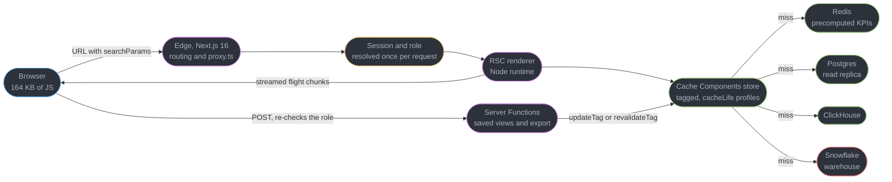
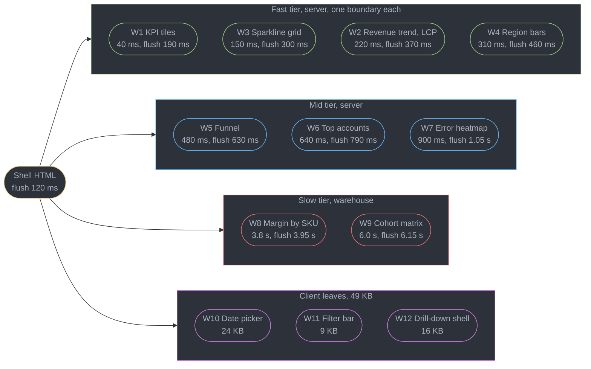
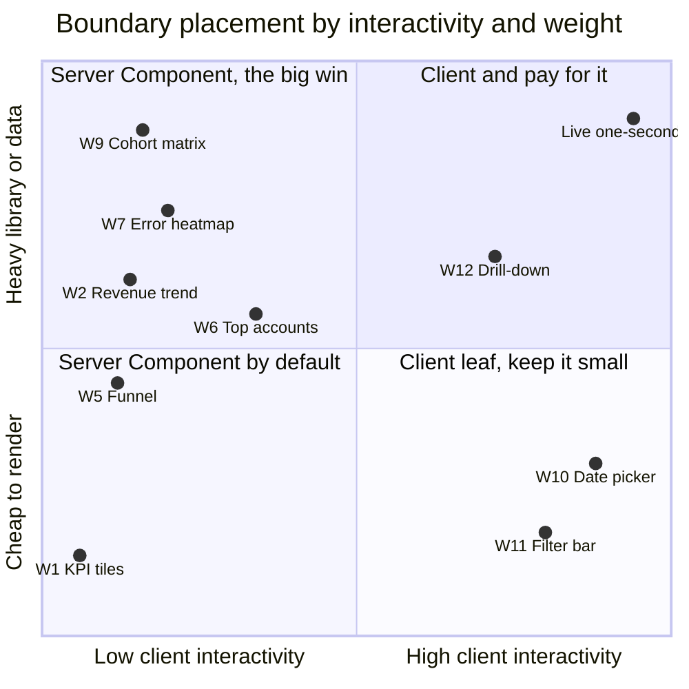
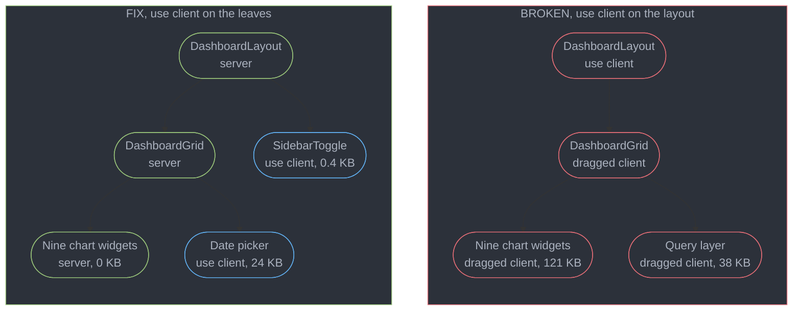
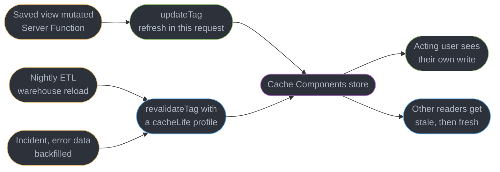
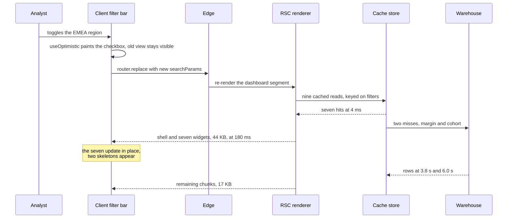

# Design a Dashboard with Server Components

---

## Intuition

Most front-end system design questions are about the client. This one is about the *seam*. A dashboard is twelve boxes on a grid, and the entire architecture is decided by a single question asked twelve times: does this box run on the server, or does it ship to the browser? Every consequence follows mechanically from those twelve answers — the bundle size, the time to first pixel, whether a filter change is a local state update or a network round trip, and whether the salary aggregate an analyst is not cleared to see is nonetheless sitting in the page source.

The reason interviewers reach for this prompt is that it has no default answer. A feed is obviously client-driven. A checkout is obviously server-authoritative about money. A dashboard is genuinely ambiguous, and both extremes are defensible: Datadog and Grafana are almost entirely client-rendered and are *correct* to be (§6), while a read-mostly internal analytics view is the single strongest case React Server Components have. Saying "RSC, obviously" without being able to name what it costs is the same failure as saying "client, obviously" — the answer the round is looking for is the boundary and the arithmetic behind it.

Two numbers drive everything here. The charting library weighs **121 KB Brotli** in the client bundle and **0 KB** in a Server Component, because a Server Component's output is markup and its imports never leave the server. And the slowest widget on the page takes **6.0 seconds** to answer, against 40 ms for the fastest. Those two facts pull in opposite directions: the first says put everything on the server, the second says a server that renders everything before it responds produces a six-second blank page. Streaming is what reconciles them, and *where you put the Suspense boundaries* is the second architectural decision this file is about.

This study owns the boundary. It does not re-teach what a Server Component is, the serialization rules, or Server Function security ([`../server_components_and_server_functions/server_components_and_server_functions.md`](../server_components_and_server_functions/server_components_and_server_functions.md)); Suspense mechanics and streaming SSR ([`../suspense_and_error_boundaries/suspense_and_error_boundaries.md`](../suspense_and_error_boundaries/suspense_and_error_boundaries.md)); rendering strategies and the Cache Components model ([`../rendering_strategies_hydration_and_seo/rendering_strategies_hydration_and_seo.md`](../rendering_strategies_hydration_and_seo/rendering_strategies_hydration_and_seo.md)); framework routing specifics ([`../meta_frameworks_and_routing/meta_frameworks_and_routing.md`](../meta_frameworks_and_routing/meta_frameworks_and_routing.md)); or the Core Web Vitals definitions used as the acceptance bar ([`../../frontend_platform/web_performance_and_core_web_vitals/web_performance_and_core_web_vitals.md`](../../frontend_platform/web_performance_and_core_web_vitals/web_performance_and_core_web_vitals.md)). Target is React 19.2 on Next.js 16.

---

## 1. Requirements Clarification

The trap in this round is designing a chart library integration. The interviewer does not care which charting package you pick; they care whether you can say where the boundary goes and defend it against the case where it is wrong.

**Questions to ask, and the answers this design commits to:**

- *Who uses this, and from where?* — 30,000 internal staff across three offices, roughly 60% of sessions over a corporate VPN measured at 6.5 Mbps effective at p75. That kills the usual "it is internal, bundle size does not matter" reflex: the VPN is slower than most home broadband, and §2 prices what 185 KB of extra JavaScript costs on it.
- *Is the data read-mostly?* — Yes. There are no writes from this surface except saved views and exports. That is the single strongest signal for RSC: the whole argument for a client cache is coordinating writes with reads, and there are no writes.
- *How stale may each number be?* — **Per widget, not per page.** A headline session count may be 60 seconds old; the recognised-revenue figure that goes into a regulatory filing may not be stale at all. This answer is what makes `cacheLife` profiles a design decision rather than a config value (§4.5).
- *Does every user see all twelve widgets?* — No. Three widgets are gated on a finance role, held by 4% of users. The follow-up matters more than the question: *where* is that check evaluated? On the server, at the fetch (§4.6), because a client-side conditional render still ships the data.
- *Must a filtered view be shareable?* — Yes, by pasting a URL into Slack, which is how 71% of drill-downs start here. That forces filters into `searchParams` and makes a filter change a server round trip (§4.4).
- *Is anything real-time?* — No. The fastest refresh anyone asked for is 30 seconds. If the answer had been "a live tail at one-second resolution", the correct architecture would be a client-fetched dashboard and this file would be shorter (§5.6).
- *Can a widget fail alone?* — Yes, and it must. The warehouse is the least reliable dependency on the page, and a cohort matrix timing out cannot blank the eleven widgets that answered.

**Functional requirements:**

- Twelve widgets on one route: nine data widgets, a date-range picker, a filter bar, and a drill-down panel.
- A date range and up to four filter dimensions (segment, region, product line, channel), all reflected in the URL.
- Per-widget drill-down: clicking a row or a bar opens a panel with the underlying records.
- Role-based visibility on three widgets, enforced where the data is fetched.
- Shareable URLs that restore the exact view, with working back and forward navigation.
- CSV and XLSX export of any widget's underlying rows, up to 250,000 rows.
- Every widget fails independently, with a retry that does not reload the page.

**Non-functional requirements:**

- LCP under 1.2 s at p75 on the VPN population. §2 shows a blocking render lands at 6.5 s, so this is a streaming requirement, not a tuning one.
- CLS under 0.1 at p75. With twelve skeletons resolving at twelve different times this is the metric most at risk, and §4.3 derives why.
- First-party client JavaScript under 180 KB Brotli. §2 derives 164 KB and shows the all-client variant at 349 KB.
- INP under 200 ms on the date picker and the filter bar. Both are client components precisely so that this is achievable.
- No widget's data reaches the browser for a user not authorised to see it — a payload-level assertion, tested in CI (§8.1).

**Explicitly out of scope:**

- The warehouse modelling. Whether the cohort matrix should be a materialized view is a data-platform decision; §5.5 states when it changes the client design and stops there.
- Dashboard authoring. These twelve widgets are fixed by product. A user-authored dashboard is a fundamentally different problem and is the reason Grafana is built the way it is (§6).
- Alerting and anomaly detection on the metrics themselves.
- Mobile. This is a 1440-wide desktop surface used on laptops.

---

## 2. Scale Estimation

Two independent chains matter here. The first is throughput, and it is small. The second is *bytes and milliseconds per view*, and it is where the architecture is actually decided.

**Users, sessions and request rate**

| Step | Arithmetic | Result |
|------|-----------|--------|
| Staff with a licence | given | 30,000 |
| Weekly active share | measured | 38% |
| Weekly actives | 30,000 x 0.38 | 11,400 |
| Daily actives | 11,400 x 0.55 | 6,270 |
| Sessions per active per day | measured | 2.9 |
| **Sessions per day** | 6,270 x 2.9 | **~18,200** |
| Peak-hour share, 09:00-10:00 across three offices | measured | 19% |
| Peak sessions per hour | 18,200 x 0.19 | 3,460 |
| **Peak sessions per second** | 3,460 / 3,600 | **0.96/s** |
| Filter or date changes per session | measured | 7.2 |
| Drill-downs per session | measured | 1.4 |
| **Peak server renders per second** | 0.96 x (1 + 7.2 + 1.4) | **9.2/s** |
| Data-widget queries if nothing is cached | 9.2 x 9 | **83/s** |

Nine requests a second is nothing. **83 warehouse and database queries a second for nine widgets is not nothing**, and it is the number that makes §4.5's per-widget caching a requirement rather than an optimization — two of those nine widgets take seconds and cost money per execution (§10.2).

**The twelve widgets, their sources and their latencies**

| # | Widget | Source | p50 query | Placement |
|---|--------|--------|----------|-----------|
| W1 | KPI tile row, four counts | Redis, precomputed | 40 ms | Server |
| W3 | Active-user sparkline grid | ClickHouse | 150 ms | Server |
| W2 | Revenue trend, 90-day line | Postgres read replica | 220 ms | Server |
| W4 | Region breakdown bars | Postgres read replica | 310 ms | Server |
| W5 | Funnel conversion | Postgres read replica | 480 ms | Server |
| W6 | Top 50 accounts table | Postgres read replica | 640 ms | Server |
| W7 | Error-rate heatmap | ClickHouse | 900 ms | Server |
| W8 | Margin by SKU | Snowflake | 3.8 s | Server |
| W9 | Cohort retention matrix | Snowflake | 6.0 s | Server |
| W10 | Date-range picker | none | — | **Client** |
| W11 | Filter bar | none | — | **Client** |
| W12 | Drill-down panel | server route, on demand | 340 ms | **Client shell** |

**Why a single blocking render is unusable**

| Approach | Arithmetic | Time to first content |
|----------|-----------|----------------------|
| Render everything, then respond | 6.0 s slowest query + 180 ms render + 100 ms network | **6.28 s** |
| One Suspense boundary around all twelve | shell at 120 ms, but the boundary resolves at max(all) | shell 120 ms, **content 6.15 s** |
| One boundary per widget | shell at 120 ms, each widget at its own query time | **W1 at 190 ms** |

The middle row is the naive mistake and it is worth dwelling on, because it *looks* like streaming. The shell paints, a spinner appears, and the engineer ships it believing the problem is solved. But a Suspense boundary resolves when everything inside it has resolved, so twelve widgets in one boundary is eleven fast widgets waiting on the cohort matrix. The measured LCP difference between the second and third rows on this page was **6.4 s against 0.9 s** (§9.2).

**Per-widget flush schedule with one boundary each** — shell TTFB 120 ms, plus the query, plus roughly 30 ms of server render and serialization:

| Widget | Flush | Widget | Flush |
|--------|-------|--------|-------|
| Shell | 120 ms | W6 | 790 ms |
| W1 | 190 ms | W7 | 1.05 s |
| W3 | 300 ms | W8 | 3.95 s |
| W2 | 370 ms | W9 | 6.15 s |
| W4 | 460 ms | Client JS ready | 480 ms |
| W5 | 630 ms | | |

The LCP element is W2, the 90-day revenue line, at 900 x 320 CSS pixels. It flushes at 370 ms in the lab and measures **0.9 s at p75 in the field** on the VPN population. The two warehouse widgets arrive after everything a user actually looks at first, which is the whole point: **streaming does not make the cohort matrix faster, it makes the cohort matrix stop being on the critical path.**

**The bundle arithmetic — the number that justifies RSC**

| Item | This design (Brotli) | All-client variant (Brotli) |
|------|---------------------|----------------------------|
| React 19.2 and react-dom client runtime | 58 KB | 58 KB |
| RSC client runtime | 12 KB | — |
| App Router client runtime | 34 KB | 34 KB |
| Date-range picker, `react-day-picker` plus a `date-fns` subset | 24 KB | 24 KB |
| Filter bar comboboxes | 9 KB | 9 KB |
| Drill-down dialog and table | 16 KB | 16 KB |
| Charting library, tree-shaken to line, bar, heatmap, scatter | **0 KB** | **121 KB** |
| Client data layer, TanStack Query plus fetch wrappers | **0 KB** | 38 KB |
| Chart configuration and adapters for nine widgets | **0 KB** | 26 KB |
| Application client code | 11 KB | 43 KB |
| **Total** | **164 KB** | **349 KB** |

The delta is **185 KB**, and it is not an abstraction. Over the measured 6.5 Mbps VPN link that is `185 x 8 / 6500` = **228 ms of transfer**, and the reference laptop (a 2021 four-core x86 at 2.4 GHz, the standard-issue machine here) spends a measured **214 ms** parsing, compiling and evaluating it. That is **442 ms** added ahead of first paint, before a single query has been issued — and in the all-client variant the queries cannot start until that JavaScript has run, which is the request waterfall the RSC model exists to collapse.

**RSC payload against a JSON API — the honest cost**

| Payload | Arithmetic | Brotli |
|---------|-----------|--------|
| Initial HTML shell | measured | 9 KB |
| Inline RSC flight chunks for nine data widgets, raw | measured | 96 KB |
| Same, after downsampling every series to 480 points (§4.7) | measured | **61 KB** |
| Equivalent JSON for a client-rendered dashboard | measured | **41 KB** |
| Ratio, RSC payload to JSON | 61 / 41 | **1.49x** |

An RSC payload is bigger than the JSON it replaces, because it carries rendered markup — SVG paths, table cells, formatted numbers — rather than raw series. That is a real cost and it is paid on **every** filter change, since a `searchParams` change re-runs the server render and streams a fresh payload.

| Step | Arithmetic | Result |
|------|-----------|--------|
| Bytes per session, RSC | 61 KB x (1 + 7.2 filter changes) | **500 KB** |
| Bytes per session, client dashboard | 41 KB x 8.2, plus 185 KB of JS once | **521 KB** |
| Break-even filter changes per session | 185 / (61 - 41) | **9.25** |

**This is the number to have ready.** At the measured 7.2 filter changes per session RSC is ahead on bytes and far ahead on time-to-first-content. Past roughly nine interactions per session the extra JavaScript pays for itself and the client dashboard wins on bytes — which is exactly why a Datadog-style surface, where a user interacts hundreds of times in one sitting, is correctly built the other way (§6). The boundary is not a matter of taste; it is a function of interactions per session.

**Cold-load transfer budget**

| Asset | Bytes |
|-------|-------|
| HTML document including inline flight chunks | 70 KB |
| Client JavaScript | 164 KB |
| CSS | 8 KB |
| Fonts, subset woff2 | 22 KB |
| **Total cold load** | **264 KB** |

---

## 3. High-Level Architecture



Four properties of that picture carry the design. The **role is resolved once per request, before rendering**, and every widget's fetch receives it — there is no path by which a widget renders without the check having happened. The **cache sits between the renderer and every source**, keyed per widget with its own lifetime, which is what turns §2's 83 queries per second into §10.2's handful. The **flight chunks stream**, so the arrow back to the browser is not one response but a sequence of them. And **Server Functions are a separate arrow**, because they are ordinary public POST endpoints that happen to be generated for you, and they re-run the authorisation check independently (§4.6).

**The twelve widgets, their boundary placement, and the order they stream**



Read that diagram as three independent claims. **Nine of twelve widgets are Server Components**, so the charting library and every query client are absent from the browser entirely — that is the 121 KB and 38 KB rows in §2's bundle table going to zero. **Each server widget has its own Suspense boundary**, so the flush column is a schedule rather than a single number. And **the three client widgets are leaves**, deliberately: W10, W11 and W12 sit inside a server-rendered grid, not around it, which is the distinction §4.2 is entirely about.

**Component inventory:**

| Component | Kind | Role |
|-----------|------|------|
| `app/dashboard/page.tsx` | Server | Reads `searchParams`, resolves the session, lays out the grid |
| `DashboardGrid` | Server | CSS grid, one `Suspense` per slot with a sized skeleton |
| Nine widget components | Server | Own their query, their `"use cache"` scope and their role check |
| `DateRangePicker` | Client | Owns calendar interaction, writes to `searchParams` |
| `FilterBar` | Client | Multi-select comboboxes, writes to `searchParams` |
| `DrillDownPanel` | Client | Dialog, focus trap, keyboard. Its *content* is a server route |
| `WidgetErrorBoundary` | Client | Per-widget fallback with a retry that refreshes one segment |
| `exportWidget` | Server Function | Re-checks the role, streams CSV or XLSX |
| `saveView` | Server Function | Persists a named filter set, then `updateTag` |

---

## 4. Component Deep Dives

### 4.1 The boundary rule, applied twelve times

There is one question and it is mechanical: **does this component need a browser capability?** Event handlers, `useState`, `useEffect`, refs to DOM nodes, `window`, `IntersectionObserver`, anything that reacts to a pointer. If yes, it is a Client Component. If no, it is a Server Component, and it should be, because the alternative costs bytes for nothing.



The top-left quadrant is where RSC earns its keep and where nine of the twelve widgets sit: heavy to render, nothing to click. The top-right is the quadrant nobody escapes — if a widget genuinely needs pointer-driven interaction *and* a heavy rendering library, you pay for the library, full stop. The point of the quadrant chart is that most dashboards put widgets in the top-right *by default*, when almost all of them belong in the top-left.

A widget that looks interactive often is not. Sorting the top-accounts table (W6) feels like client state and is not: the sort key goes into `searchParams`, the server re-queries with a different `ORDER BY`, and the widget stays a Server Component. Only the column header is a client leaf — a nine-line button that calls `router.replace`. **The instinct to check is "does the interaction change what data is needed, or only how existing data is arranged?"** If it changes the data, the server was always going to be involved and a round trip is honest. If it only rearranges data already in the browser, keep it client-side; a round trip to reverse a 50-row table would be absurd.

Serialization decides the rest. A Server Component may pass strings, numbers, plain objects, arrays, `Date`, `Map`, `Set`, and Promises to a Client Component, but not functions, class instances, or anything with a prototype. The rules and their failure messages belong to [Server Components and Server Functions](../server_components_and_server_functions/server_components_and_server_functions.md); the design consequence here is that **a Server Component cannot hand a chart an `onClick`**, which is why W12's drill-down is a client wrapper receiving a serialisable row id rather than a callback.

### 4.2 Where `"use client"` goes, and the trap that eats the whole subtree

`"use client"` is not a per-component annotation. It marks a **module boundary**: that file and everything it imports become part of the client graph. Put it on a leaf and you pay for the leaf. Put it on a layout and you pay for the layout's entire subtree.

```tsx
// BROKEN: app/dashboard/layout.tsx
"use client";                     // <-- one line, at the top of the tree

import { useState } from "react";
import { DashboardGrid } from "./DashboardGrid";

export default function DashboardLayout({ children }: { children: React.ReactNode }) {
  const [sidebarOpen, setSidebarOpen] = useState(true);   // the only reason it is here
  return (
    <div data-open={sidebarOpen}>
      <button onClick={() => setSidebarOpen((o) => !o)}>Toggle</button>
      <DashboardGrid>{children}</DashboardGrid>
    </div>
  );
}
```

That directive exists to support one boolean. What it actually does is make `DashboardGrid` a Client Component, and therefore every widget `DashboardGrid` imports, and therefore the charting library those widgets import. The nine server widgets stop being server widgets. They can no longer `await` a database query, so their data has to arrive as props from a server parent or be fetched over HTTP after client hydration — and either way the 121 KB chart library and the 38 KB query layer are now in the browser. **Measured on this application: 164 KB became 391 KB, and LCP at p75 went from 0.9 s to 2.3 s** (§9.1).

The reason this survives review is that the diff is one line and the page still works. Nothing errors. The build succeeds. The only signal is the bundle report, which is why §8.1 makes it a CI gate rather than a habit.

```tsx
// FIX: app/dashboard/layout.tsx stays a Server Component.
import { SidebarToggle } from "./SidebarToggle";   // the ONLY client module
import { DashboardGrid } from "./DashboardGrid";

export default function DashboardLayout({ children }: { children: React.ReactNode }) {
  return (
    <div>
      <SidebarToggle />
      <DashboardGrid>{children}</DashboardGrid>
    </div>
  );
}
```

```tsx
// FIX: app/dashboard/SidebarToggle.tsx -- 0.4 KB of client graph, not 227 KB.
"use client";
import { useState } from "react";

export function SidebarToggle() {
  const [open, setOpen] = useState(true);
  return (
    <button aria-expanded={open} onClick={() => setOpen((o) => !o)}>
      Toggle sidebar
    </button>
  );
}
```



**The composition escape hatch is the part candidates miss.** A Client Component may *render* Server Components, as long as they arrive as `children` or as props rather than being imported. `SidebarToggle` could wrap the whole grid and the grid would still be server-rendered, because `children` is an already-rendered payload passed through, not a module import the bundler has to follow. That single fact is what lets a client-side layout shell coexist with server-rendered content, and it is the standard answer to "but my app has a client-side theme provider at the root".

### 4.3 One Suspense boundary per widget, and skeletons that do not move

```tsx
// BROKEN: one boundary, twelve widgets. Looks like streaming, is not.
export default async function Page({ searchParams }: PageProps) {
  const filters = parseFilters(await searchParams);
  return (
    <Suspense fallback={<DashboardSkeleton />}>
      <DashboardGrid filters={filters} />   {/* every widget awaits inside */}
    </Suspense>
  );
}
```

The shell flushes at 120 ms, a skeleton appears, and then nothing happens for six seconds, because the boundary cannot resolve until W9 has. Eleven widgets that had their answer inside a second sit rendered in server memory, waiting.

```tsx
// FIX: the grid owns the boundaries, one per slot, each with a sized skeleton.
// app/dashboard/DashboardGrid.tsx  (Server Component)
import { Suspense } from "react";

const SLOTS = [
  { id: "w1", h: 96,  Widget: KpiTiles },
  { id: "w2", h: 320, Widget: RevenueTrend },
  { id: "w3", h: 200, Widget: SparklineGrid },
  { id: "w4", h: 280, Widget: RegionBars },
  { id: "w5", h: 280, Widget: Funnel },
  { id: "w6", h: 420, Widget: TopAccounts },
  { id: "w7", h: 320, Widget: ErrorHeatmap },
  { id: "w8", h: 360, Widget: MarginBySku },
  { id: "w9", h: 440, Widget: CohortMatrix },
] as const;

export function DashboardGrid({ filters }: { filters: Filters }) {
  return (
    <div className="grid">
      {SLOTS.map(({ id, h, Widget }) => (
        <WidgetErrorBoundary key={id} slot={id} height={h}>
          <Suspense fallback={<WidgetSkeleton height={h} />}>
            <Widget filters={filters} />
          </Suspense>
        </WidgetErrorBoundary>
      ))}
    </div>
  );
}
```

Boundaries resolve **out of order**. React streams each one as it completes and the browser inserts it in place, so W1 at 190 ms and W9 at 6.15 s land in the same DOM positions the skeletons occupied regardless of arrival order — the mechanism is a template plus a small inline script that relocates the content, and it is why the flush schedule in §2 is a schedule of independent events rather than a queue. The mechanics belong to [Suspense and Error Boundaries](../suspense_and_error_boundaries/suspense_and_error_boundaries.md).

**The height in `SLOTS` is a correctness field, not a styling one.** A skeleton shorter than its widget shifts every widget below it when the real content lands, and with twelve boundaries resolving across six seconds that happens repeatedly. Price one instance: the error heatmap's skeleton is 276 px, its real height is 320 px, so it grows 44 px and pushes 620 px of content below it down the page.

| Term | Arithmetic | Value |
|------|-----------|-------|
| Viewport | 1440 x 900 | 1,296,000 px squared |
| Affected region, union of before and after | 1400 wide x 664 tall | 929,600 px squared |
| Impact fraction | 929,600 / 1,296,000 | 0.717 |
| Distance fraction | 44 / 900 | 0.049 |
| **Layout shift score, one widget** | 0.717 x 0.049 | **0.035** |
| Three widgets with mismatched skeletons | 3 x 0.035 | **0.105** |

Three sloppy skeletons put the page over the 0.1 CLS threshold on their own. The fix is that `WidgetSkeleton` takes the same `height` the widget renders at, the grid rows are `grid-template-rows` with explicit sizes, and a Playwright test asserts that every skeleton's bounding box matches its resolved widget's within 2 px (§8.1). Metric definitions are in [Web Performance and Core Web Vitals](../../frontend_platform/web_performance_and_core_web_vitals/web_performance_and_core_web_vitals.md).

**Boundary granularity has a floor.** Each boundary costs a flush, an inline template and a relocation script — roughly 0.4 KB and a handful of DOM operations. Twelve is right. A boundary per KPI tile, giving 15 for the tile row alone, buys nothing because all four counts come from one 40 ms Redis read, and it turns one paint into four. **Group by data source and latency, not by visual element.**

### 4.4 Filters in the URL, and what that makes a filter change

Every filter lives in `searchParams`: `?from=2026-08-01&to=2026-08-31&segment=enterprise&region=emea,apac&sort=-arr`. Three properties fall out for free — the URL is shareable into Slack, the back button restores the previous view because each change is a history entry, and the server render is a pure function of the URL, which makes it cacheable (§4.5) and reproducible in a bug report.

The cost is equally direct: **a filter change is a network round trip, not a `setState`.** In a client dashboard, toggling a region re-filters an array in memory in under 16 ms. Here it re-runs the server render and streams a fresh payload. Hiding that would be dishonest; the design instead makes the wait *interruptible and non-blocking*.

```tsx
// app/dashboard/FilterBar.tsx
"use client";
import { useOptimistic, useTransition } from "react";
import { usePathname, useRouter, useSearchParams } from "next/navigation";

export function FilterBar({ regions }: { regions: Region[] }) {
  const router = useRouter();
  const pathname = usePathname();
  const params = useSearchParams();
  const [isPending, startTransition] = useTransition();

  const committed = params.get("region")?.split(",") ?? [];
  // Without this, the checkbox visually reverts to the server value until the
  // round trip lands -- the single most reported bug on URL-driven filters.
  const [selected, setSelected] = useOptimistic(committed);

  function toggle(code: string) {
    const next = selected.includes(code)
      ? selected.filter((r) => r !== code)
      : [...selected, code];

    startTransition(() => {
      setSelected(next);
      const q = new URLSearchParams(params);
      next.length ? q.set("region", next.join(",")) : q.delete("region");
      router.replace(`${pathname}?${q}`, { scroll: false });
    });
  }

  return (
    <fieldset aria-busy={isPending}>
      {regions.map((r) => (
        <label key={r.code}>
          <input type="checkbox" checked={selected.includes(r.code)}
                 onChange={() => toggle(r.code)} />
          {r.name}
        </label>
      ))}
    </fieldset>
  );
}
```

Three details are load-bearing. `startTransition` keeps the *previous* dashboard on screen and interactive while the new one streams, instead of tearing it down to skeletons — the old numbers stay readable, dimmed by `aria-busy`, which is what makes a 600 ms round trip acceptable. `useOptimistic` keeps the checkbox in the state the user just put it in; without it the input snaps back for the duration of the request and the control feels broken. And `router.replace` rather than `push` for *rapid* changes: dragging a date range across twelve days should not put twelve entries in the history stack. The date picker uses `replace` while dragging and one `push` on commit, so back returns to the previous *chosen* range rather than the previous frame of a drag (§9.5 is what happens when it does not).

Server-side, the page reads them and hands them down. In Next.js 16 `searchParams` is a Promise:

```tsx
// app/dashboard/page.tsx  (Server Component)
export default async function Page({ searchParams }: PageProps) {
  const sp = await searchParams;
  const filters = parseFilters(sp);   // zod-validated, clamped, defaulted
  return <DashboardGrid filters={filters} />;
}
```

`parseFilters` validates rather than trusts. A range of 3 years against a daily-grain warehouse table is a query that will not finish, so the range is clamped to 400 days and the user is told; an unknown region code is dropped rather than passed to SQL. **A URL is user input from an untrusted party** — the fact that your own picker generated it last time says nothing about the one that was pasted.

### 4.5 Cache Components: a lifetime per widget, not per page

Next.js 16 replaced `experimental.ppr` and `dynamicIO` with **Cache Components**: everything is dynamic until a `"use cache"` directive says otherwise, and `cacheLife` names the staleness contract. The model belongs to [Rendering Strategies, Hydration and SEO](../rendering_strategies_hydration_and_seo/rendering_strategies_hydration_and_seo.md); what this study owns is the observation that **staleness tolerance is a per-widget product decision and the twelve widgets do not agree.**

```tsx
// app/dashboard/widgets/RevenueTrend.tsx  (Server Component)
import { cacheLife, cacheTag } from "next/cache";

async function revenueSeries(from: string, to: string, segment: string) {
  "use cache";
  cacheLife("minutes");
  cacheTag(`revenue:${segment}`);
  return db.query(REVENUE_SQL, [from, to, segment]);
}

export async function RevenueTrend({ filters }: { filters: Filters }) {
  const series = await revenueSeries(filters.from, filters.to, filters.segment);
  return <LineChart data={downsample(series, 480)} />;   // renders to SVG on the server
}
```

| Widget | Profile | Why |
|--------|---------|-----|
| W1 KPI tiles | custom `kpi`: stale 30 s, revalidate 60 s, expire 300 s | A headline count may be a minute old. Nobody makes a decision on it |
| W3 Sparklines | `minutes` | Trend shape, not a value anyone quotes |
| W2 Revenue trend | `minutes` | Same, and it is the LCP element so a hit matters most here |
| W4 Region bars | `minutes` | |
| W5 Funnel | `hours` | Recomputed by a scheduled job anyway |
| W6 Top accounts | `minutes` | |
| W7 Error heatmap | custom `live`: stale 10 s, revalidate 30 s | The one widget people watch during an incident |
| W8 Margin by SKU | `hours` | Warehouse data lands hourly. A shorter profile caches nothing new |
| W9 Cohort matrix | custom `nightly`: revalidate 8 h | The upstream model rebuilds overnight |
| Recognised revenue | **no `"use cache"`** | Goes into a filing. A stale figure here is a reportable error |

That last row is the one that makes the table a design artefact instead of a config file. It is a variant of W2 shown to the finance role, it is dynamic on every request, it sits in its own Suspense boundary so its 340 ms does not delay anything, and it carries a rendered "as of 14:22:07" timestamp. **The general rule: a number a human will paste into a document that other people rely on cannot be served from a cache with a staleness profile, no matter how short.**

**The cache key is the function's arguments.** This is the gotcha that produces a wrong-data incident rather than a slow page:

```tsx
// BROKEN: the filter is read inside the cached scope, so it is not in the key.
async function regionBars() {
  "use cache";
  const sp = await searchParams();          // uncached read inside a cached function
  return db.query(REGION_SQL, [sp.region]);
}
```

Under Cache Components that is a build error rather than a silent bug — an uncached read inside a cached scope fails the build, which is exactly the safety property the model was rebuilt to provide. Pass every input as an argument and the key is correct by construction. The same applies to `cookies()` and to anything derived from the session: if the widget's output varies by user, either the user id is an argument or the widget is not cached at all.

**Invalidation, and the read-your-writes case.**



`revalidateTag(tag, profile)` expires an entry against a named profile and readers may still be served the stale value while a refresh happens behind them — correct for the nightly ETL, which nobody is watching. `updateTag(tag)` refreshes immediately in the same request, so the analyst who just renamed a saved view sees the new name rather than the old one. The rule is the same everywhere in this repo: **`updateTag` for the acting user's own write, `revalidateTag` for everything else**, and the cost of `updateTag` is that the mutation request pays the regeneration inline.

One React 19.2 addition earns its place here. `cacheSignal()` gives a Server Component an `AbortSignal` that fires when React abandons the render — a navigation away, a client disconnect. Wire it into the warehouse driver and an abandoned load stops a 6-second Snowflake query instead of letting it run to completion and bill for it, which §10.2 prices.

### 4.6 Authorisation on the server, at the fetch

```tsx
// BROKEN: the check is a client-side conditional render.
"use client";
export function DashboardGrid({ role, marginData, cohortData }: Props) {
  return (
    <div className="grid">
      <KpiTiles />
      {role === "finance" && <MarginBySku data={marginData} />}
      {role === "finance" && <CohortMatrix data={cohortData} />}
    </div>
  );
}
```

The widget does not render. The data is in the page. `marginData` and `cohortData` were fetched by a server parent and passed as props to a Client Component, and **props crossing that boundary are serialised into the RSC payload whether the component renders them or not** — they are in the inline flight chunks in the HTML, readable with view-source by any of the 28,800 users without the finance role. The React DevTools props panel shows them too. This is the failure mode that makes RSC's serialisation rules a security topic rather than an ergonomics one, and the payload is the artefact to inspect ([Server Components and Server Functions](../server_components_and_server_functions/server_components_and_server_functions.md)).

```tsx
// FIX: the check is where the fetch is, and there is no fetch without it.
// app/dashboard/widgets/MarginBySku.tsx  (Server Component)
import { forbidden } from "next/navigation";
import { getSession } from "@/lib/session";

export async function MarginBySku({ filters }: { filters: Filters }) {
  const session = await getSession();          // cached per request, not per call site
  if (!session.can("finance:read")) forbidden();

  const rows = await marginBySku(filters, session.orgId);   // never runs otherwise
  return <BarChart data={rows} />;
}
```

```tsx
// FIX: the grid never even mounts a widget the session cannot see.
export async function DashboardGrid({ filters }: { filters: Filters }) {
  const session = await getSession();
  const slots = SLOTS.filter((s) => !s.permission || session.can(s.permission));
  return <div className="grid">{slots.map(renderSlot)}</div>;
}
```

Two properties now hold that did not before. **The query is not issued** for an unauthorised user, so there is nothing to leak and the warehouse is not billed for data nobody may see. And the grid's slot list is computed on the server, so the payload contains no evidence the widget exists — no placeholder, no empty div, no key.

**A Server Function is a public endpoint.** `exportWidget` compiles to an HTTP POST route with a generated id, and that id is discoverable in the client bundle. It is reachable with `curl`. Nothing about being invoked from a component that only renders for the finance role constrains who can call it:

```tsx
// app/dashboard/actions.ts
"use server";
import { getSession } from "@/lib/session";
import { z } from "zod";

const ExportInput = z.object({
  widget: z.enum(["margin_by_sku", "cohort_retention", "top_accounts"]),
  filters: FiltersSchema,
});

export async function exportWidget(raw: unknown) {
  const session = await getSession();                    // 1. authenticate
  const input = ExportInput.parse(raw);                  // 2. validate, never trust the arg
  if (!session.can(`export:${input.widget}`)) forbidden(); // 3. authorise, again
  return streamCsv(input.widget, input.filters, session.orgId); // 4. scope to the tenant
}
```

Those four steps run on **every** Server Function in this application, in that order, with no exceptions and a lint rule that fails the build on a `"use server"` module whose exported function does not call `getSession()`. The argument is attacker-controlled: `orgId` comes from the session, never from the input, which is what stops one tenant exporting another's margins.

### 4.7 Rendering charts on the server, and the payload consequence

A Server Component chart imports `d3-scale` and `d3-shape`, computes the path strings, and returns SVG elements. None of that reaches the browser — the browser receives `<path d="M0,180L12,174...">`. That is where §2's 121 KB goes to zero.

The tradeoff is payload weight. A 90-day daily series is 90 points and its path is small; a 5-minute-grain series over 30 days is 8,640 points and its `d` attribute alone is 74 KB before compression. So the server downsamples to the pixel width of the chart before rendering:

```ts
// lib/downsample.ts -- largest-triangle-three-buckets, the standard choice for
// preserving visual peaks that naive nth-point sampling flattens away.
export function downsample(series: Point[], target: number): Point[] {
  if (series.length <= target) return series;
  // ...LTTB: keep the first and last points, pick the point in each bucket that
  // forms the largest triangle with the previous kept point and the next bucket's
  // average. Roughly 30 lines.
}
```

At `target = 480` — a 900 px chart at 2x device pixel ratio has no more resolution than that — the nine widgets' payload drops from 96 KB to **61 KB Brotli**, which is the figure §2's break-even calculation uses. This is the RSC-specific version of an old lesson: on the client you downsample to save render time, on the server you downsample to save *bytes over the wire*, and the second matters more because it is on the critical path.

Interactivity that survives without JavaScript is worth naming. A tooltip on hover is a CSS `:hover` on the SVG group plus a `<title>` element, which is also the accessible name. Crosshairs synced across all nine charts are not, and would require a client component wrapping them all — at which point the quadrant chart in §4.1 says pay the 121 KB, because that is a Datadog-shaped requirement (§6).

### 4.8 Drill-down: a client shell around server content

Clicking a bar opens a panel with the underlying rows. The panel needs a dialog, a focus trap, escape-to-close and keyboard navigation — all browser capabilities, all client. The *content* is a table of 200 rows from a 340 ms query, which is server work.

```tsx
// app/dashboard/@drill/[widget]/[key]/page.tsx  (Server Component, parallel route)
export default async function DrillDown({ params }: { params: Promise<Params> }) {
  const { widget, key } = await params;
  const session = await getSession();
  if (!session.can(`${widget}:read`)) forbidden();
  const rows = await drillRows(widget, key, session.orgId);
  return <DrillDownPanel title={LABELS[widget]}><RowTable rows={rows} /></DrillDownPanel>;
}
```

`DrillDownPanel` is the Client Component and `RowTable` is a Server Component passed to it as `children` — the composition escape hatch from §4.2, doing the job it exists for. The dialog's 16 KB of interaction code ships; the table's formatting, currency handling and 200 rows do not.

Routing it as a parallel route rather than client state buys three things for free: the panel is deep-linkable, so an analyst pastes the drill-down itself into Slack; the browser back button closes it, which is what users expect from something that looks like a page; and the rows are fetched on the server with the role check attached, rather than by a client fetch that would need its own authorisation path. Intercepting and parallel routes belong to [Meta Frameworks and Routing](../meta_frameworks_and_routing/meta_frameworks_and_routing.md).

---

## 5. Design Decisions & Tradeoffs

### 5.1 Server Components against a client-fetched dashboard

| Dimension | RSC (chosen) | Client-fetched SPA |
|-----------|-------------|-------------------|
| Client JS | 164 KB | 349 KB |
| Time to first content | 190 ms, streamed per widget | 1.1 s, after JS parses and the first fetch returns |
| Filter change | 61 KB round trip, 380-640 ms | in-memory where data is loaded, 16 ms |
| Bytes at 7.2 changes per session | 500 KB | 521 KB |
| Bytes at 30 changes per session | 1.9 MB | 1.4 MB |
| Data-source credentials | server only | a BFF or a gateway is mandatory |
| Authorisation | at the fetch, unbypassable | a second implementation on the server anyway |
| Offline or flaky network | every interaction fails | filtering keeps working on loaded data |
| Debugging | spans two runtimes, two logs, one stack trace that stops at the boundary | one runtime, one devtools |

The decision rests on the fourth and fifth rows together. **This dashboard is a read surface with 7.2 interactions per session, below the 9.25 break-even §2 derived**, and its slowest data is 6 s away, so the streaming win is large and the round-trip cost is small. Change either fact and the answer flips.

### 5.2 What a filter change actually costs



The measured p50 for a filter change here is **380 ms** to a fully repainted fast tier, with the two warehouse widgets trailing. Compare an in-memory filter at 16 ms and the gap is real — 24x. What makes it acceptable is the second line of the diagram: the previous view stays on screen and interactive throughout, so the analyst is reading numbers during those 380 ms rather than watching skeletons. **A round trip that never blanks the screen is a different product from a round trip that does**, and `startTransition` is the whole difference.

### 5.3 Filters in `searchParams` against client state

| | `searchParams` (chosen) | Client state |
|---|---|---|
| Shareable URL | yes, and 71% of drill-downs start with a pasted link | no, without hand-rolled serialisation |
| Back and forward | correct by construction | needs a history integration nobody maintains |
| Server render is a pure function of the URL | yes, so it is cacheable | no |
| Cost per change | a round trip | a re-render |
| Rapid changes | need `replace` while dragging, `push` on commit | free |

The shareability requirement decided this before performance entered the conversation. It is also what makes §4.5's caching possible at all: a cache key needs a complete, stable description of the request, and the URL *is* one.

### 5.4 Cache Components against a materialized-view layer

Caching the render and materializing the query solve overlapping problems and the honest answer is that a mature analytics platform does both. The warehouse team's hourly rollup makes W8's query 3.8 s instead of 40 s; `"use cache"` makes it 4 ms for the second user to ask for the same filter combination. **The rule used here: materialize what is expensive for *everyone*, cache what is expensive *repeatedly*.** A per-user, per-filter combination that three people request in an hour is a caching problem, not a modelling one. §10.2 shows the cache doing 53x more for the bill than another rollup would.

### 5.5 Nine boundaries against three tiers

Grouping widgets into three Suspense boundaries by latency tier — fast, mid, slow — is tempting because it means three flushes instead of nine. It costs W1 its 190 ms: the fast tier would resolve at 460 ms, when W4 finishes. Measured LCP moved from 0.9 s to 1.3 s, so the tiering was reverted. **Boundaries are cheap and waiting is expensive**; the only reason to group is when several widgets genuinely share one query.

### 5.6 When a client-fetched dashboard is simply better

State this without hedging, because an interviewer is listening for whether you know the limits of the thing you just advocated.

- **Live data at sub-30-second refresh.** A round trip per tick is absurd. Stream over SSE into client state and render on the client.
- **Pointer-driven exploration** — drag-to-zoom, brush selection, crosshairs synced across panels. Each of those is a state change at 60 Hz and cannot be a network request.
- **User-authored dashboards.** If the widget set is data rather than code, the rendering has to be interpretable at runtime, which is what a client plugin architecture gives you (§6, Grafana).
- **Offline or hostile networks.** Field tooling on a tablet needs the data resident.
- **A high-interaction session.** Past §2's 9.25 changes per session the extra bundle has paid for itself, and everything after that is pure win for the client.
- **A team with no server to run.** RSC needs a Node or edge runtime you operate. A static export plus a client fetch is a legitimate architecture with a lower operational floor.

---

## 6. Real-World Implementations

Every claim below comes from a primary source with the URL inline.

**Vercel — their own dashboard is the reference deployment of this pattern.** Vercel has published that its dashboard runs on the Next.js App Router with Partial Prerendering, streaming a prerendered shell while dynamic, per-user regions fill in, and it documents the Cache Components model that replaced the earlier `experimental.ppr` and `dynamicIO` flags with the explicit `"use cache"` directive ([vercel.com/blog/partial-prerendering-with-next-js-creating-a-new-default-rendering-model](https://vercel.com/blog/partial-prerendering-with-next-js-creating-a-new-default-rendering-model), [nextjs.org/docs/app/api-reference/directives/use-cache](https://nextjs.org/docs/app/api-reference/directives/use-cache)). The lesson: a dashboard is the workload PPR was designed against, because a dashboard is precisely a static frame around per-user dynamic holes, and the framework team dogfoods it on exactly this shape.

**Next.js 16: the reference implementation of the boundary, including its build-time guardrails.** Next.js 16 (2025-10-21, current 16.4.x) makes Turbopack the default bundler, replaces route-level static-versus-dynamic inference with Cache Components, renames `middleware.ts` to `proxy.ts` on the Node runtime, and requires `revalidateTag()` to name a `cacheLife` profile as its second argument ([nextjs.org/blog/next-16](https://nextjs.org/blog/next-16)). The lesson for §4.5: the model's real contribution is that an uncached read outside a Suspense boundary is a **build error**, so the class of bug where one unnoticed `cookies()` call silently made a whole dashboard dynamic is now caught before deploy rather than found in a latency graph.

**Apache ECharts — server-side rendering to an SVG string is a supported, documented mode.** ECharts ships an SSR path where the chart is rendered in Node to an SVG string with animation disabled, intended for exactly the case where the client should not download the library ([echarts.apache.org/handbook/en/how-to/cross-platform/server](https://echarts.apache.org/handbook/en/how-to/cross-platform/server)). The lesson: §4.7's "charts on the server" is not a bespoke trick, it is a first-class mode in the largest open-source charting library, and it is what makes the 121 KB row in §2's table an avoidable cost rather than a fixed one.

**Metabase — chart rendering moved to the server for the same reason, before RSC existed.** Metabase renders charts server-side for dashboard subscriptions and alerts so the images can be emailed without a browser, running the same visualisation code in a server context ([metabase.com/docs/latest/permissions/notifications](https://www.metabase.com/docs/latest/permissions/notifications)). The lesson: the boundary question predates the framework. Any product that has ever needed a chart without a browser has already solved server-side chart rendering, and RSC is a way to reuse that output for the interactive page too.

**Datadog — client-heavy, and correct to be.** Datadog dashboards support live tail and refresh intervals down to the tens of seconds, drag-to-zoom on any graph, and a crosshair that synchronises across every widget on the board ([docs.datadoghq.com/dashboards/widgets](https://docs.datadoghq.com/dashboards/widgets/)). The lesson: every one of those is a pointer-driven state change at interaction rate, and a server round trip per mouse move is not a slow design, it is an impossible one. Datadog pays the bundle and gets the interaction, which is the top-right quadrant of §4.1 chosen deliberately.

**Grafana — client-side because the dashboard itself is data.** A Grafana dashboard is a JSON document, panels are plugins loaded at runtime, and data sources are queried through a proxy, so which visualisation code runs is decided by the user's saved dashboard rather than by the build ([grafana.com/docs/grafana/latest/developers/plugins](https://grafana.com/docs/grafana/latest/developers/plugins/)). The lesson: RSC binds the component graph at build time, and a product whose component graph is user-authored at runtime cannot use it for the panels. Grafana is not behind on rendering architecture; it has a requirement that rules the architecture out.

---

## 7. Technologies & Tools

| Component | Usage |
|-----------|-------|
| React | 19.2. Server Components, `Suspense` per widget, `useOptimistic` and `useTransition` in the filter bar, `cacheSignal` to abort abandoned warehouse queries |
| Next.js | 16, current 16.4.x. App Router, Cache Components, parallel routes for the drill-down, `proxy.ts` for session resolution at the edge |
| Turbopack | Default bundler in 16. Produces the client-graph report §8.1 gates on |
| React Compiler | 1.0 stable. Automatic memoization inside the three client widgets |
| Apache ECharts | Server-side SVG mode for the heatmap and the cohort matrix |
| d3-scale | Scales for the hand-rolled line and bar charts, server only |
| d3-shape | Path generation for the same, server only |
| Zod | `searchParams` validation and Server Function argument schemas |
| Postgres | Read replica behind six of the nine data widgets |
| ClickHouse | Sparkline grid and error heatmap |
| Snowflake | Margin by SKU and the cohort retention matrix |
| Redis | Precomputed KPI counts, and the Cache Components store |
| react-day-picker | The date-range picker, the largest client widget at 24 KB |
| TanStack Table | Row model for the drill-down grid |
| Playwright | Skeleton-versus-widget bounding-box assertions, streaming-order tests |
| OpenTelemetry | Per-boundary flush spans joined to the query spans behind them |
| web-vitals | Field LCP, CLS and INP, attributed to the widget slot |
| Sentry | Client errors tagged with the widget slot id and the filter hash |

---

## 8. Operational Playbook

### 8.1 What is measured, and where it is enforced

The unusual property of an RSC dashboard is that **the two most important signals are not in the browser.** LCP is a consequence of when a boundary flushed, and a boundary flushes when a query returned, so the instrumentation has to join a client metric to a server span.

| Signal | Source | What it answers |
|--------|--------|-----------------|
| Per-boundary flush time, p50 and p95 | OpenTelemetry span per widget, joined to its query span | Which widget is the schedule, and whether it is the query or the render |
| Cache hit rate per widget tag | Cache Components store | Whether a `cacheLife` profile is doing anything. W8 and W9 are the ones that pay |
| RSC payload bytes per render | Response instrumentation, bucketed by filter shape | Catches a downsampling regression, which is silent otherwise |
| Client JS graph size | Turbopack build report, per route | The `"use client"` drag in §4.2. **Gated in CI** |
| LCP, CLS, INP at p75 | `web-vitals`, attributed to the widget slot | The acceptance bar |
| Skeleton-to-widget height delta | Playwright, per slot, per PR | The CLS cause rather than the CLS symptom |
| Payload authorisation assertion | Playwright, per role | Fetches the page as each role and greps the flight chunks for forbidden field names |
| Server Function invocation by role | Server logs | Direct calls from users who never see the button |

Three of those are CI gates rather than dashboards, and they are the three that catch the failures §9 describes: the bundle-size gate fails a PR that adds more than 8 KB to the client graph, the bounding-box test fails a skeleton more than 2 px off its widget, and the payload assertion fails if the string `margin_per_unit` appears in a payload rendered for a non-finance role. **A gate is the right shape for all three because each one is invisible in review and harmless in staging.**

### 8.2 Alerting

| Metric | Why it matters | Threshold |
|--------|---------------|-----------|
| Warehouse widget flush p95 | The cohort matrix degrading past its budget strands the slow tier | > 9 s for 15 min |
| Fast-tier flush p95 | This is the LCP path | > 700 ms for 10 min |
| Cache hit rate, W8 and W9 | A drop means every session is paying warehouse credits (§10.2) | < 85% for 30 min |
| Boundary error rate per widget | One widget failing alone is by design, all twelve failing is not | any slot > 2% for 10 min |
| RSC payload p95 | A downsampling regression shows up here first | > 110 KB for 15 min |
| Server Function 403 rate | Direct calls to a generated endpoint by unauthorised users | any sustained rate |
| CLS p75 | A new widget shipped without a matched skeleton | > 0.08 for 1 hour |

The cache-hit alert is the one with money attached. Everything else costs latency; that one costs **$101 a day** if it goes to zero (§10.2).

### 8.3 Rolling out a boundary change

Moving a `"use client"` directive or re-cutting a Suspense boundary is not a visual change and cannot be reviewed as one. The sequence: run the Turbopack client-graph diff in the PR and require an explicit approval on any increase; deploy behind a route-level flag so the old and new grid can be compared on the same traffic; hold for one full business day, because the peak hour is 19% of traffic and a two-hour canary samples the wrong population; gate promotion on fast-tier flush p95 and client graph size, not on error rate, because both failures in §9 shipped with a zero error rate.

### 8.4 Runbook: the warehouse widget is timing out

Do not remove the widget. Its boundary already isolates it, so the page is fine and the alert is about one slot. Check the cache hit rate first — a hit rate collapse means a cache key changed, usually because a new filter dimension was added to `searchParams` without being added to the cached function's arguments, and the fix is a one-line argument change rather than a warehouse ticket. If the hit rate is healthy, the underlying query has degraded, and the interim mitigation is to widen that widget's `cacheLife` from `hours` to a custom 12-hour profile with a rendered "as of" timestamp, which trades freshness nobody was using for a page that answers.

### 8.5 Runbook: the client bundle jumped

Read the Turbopack client-graph diff before reading the code. It names the module that entered the graph and the import chain that pulled it in, and the chain almost always terminates in a `"use client"` file that was previously a leaf and is now imported by something higher, or in a directive added to a shared module. The failure in §9.1 was a single line at the top of a layout, and the graph diff identified it in under a minute after two days of profiling had not.

---

## 9. Common Pitfalls & War Stories

### 9.1 The `"use client"` that ate the dashboard

A sidebar toggle needed one boolean of state, and `"use client"` went on `app/dashboard/layout.tsx` because that is where the sidebar lived. The page rendered identically, all tests passed, and the PR was approved in eleven minutes. The nine chart widgets stopped being Server Components, so the charting library, the query layer and nine chart adapters entered the client graph: **164 KB became 391 KB**, LCP at p75 went from **0.9 s to 2.3 s**, and because the widgets now fetched after client hydration the fast tier's first paint moved from 190 ms to 1.4 s. Nobody noticed for nine days — there was no error, and the internal audience does not file performance bugs, they just use the tool less. Weekly actives fell **6.2%** over that window and recovered when the directive moved to a 0.4 KB leaf. The permanent fix is §8.1's CI gate on client-graph size, which now fails any PR adding more than 8 KB.

### 9.2 One Suspense boundary around all twelve widgets

The first implementation wrapped `DashboardGrid` in a single boundary with a full-page skeleton. It streamed — the shell arrived at 120 ms — and the team recorded it as done. But the boundary could not resolve until the cohort matrix did, so measured **LCP was 6.4 s** and 31% of sessions closed the tab before any content appeared. Splitting to one boundary per widget took LCP to **0.9 s** and abandonment to 4%. **The lesson: a streaming architecture with the boundaries in the wrong place performs exactly like no streaming at all, and looks like streaming while doing it.**

### 9.3 The finance data in everyone's page source

The margin and cohort widgets were hidden with `{role === "finance" && ...}` in a Client Component whose props were fetched by a server parent. The components did not render. The data was in the inline flight chunks of every response, for **28,800 users without the role**, for seven weeks, including per-SKU unit margins. It was found by an engineer using view-source to debug something unrelated. There was no breach — the audience was internal — but it was a reportable access-control failure, and the remediation was a full review of every Client Component prop in the application. Fixes: the role check moved to the fetch (§4.6), the grid computes its slot list on the server, and §8.1's payload assertion now greps every role's rendered payload for a list of forbidden field names on every PR.

### 9.4 `cacheLife("hours")` on the recognised-revenue figure

The finance variant of the revenue widget was given `cacheLife("hours")` during a pass to reduce database load, alongside eight other widgets where it was correct. A controller pasted a figure into a board pack that was **4 hours and 12 minutes stale** and **$1.4M** below the closing number, and it was caught in review rather than shipped. The widget is now uncached, dynamic on every request, in its own boundary, with a rendered timestamp. **The lesson: staleness tolerance is a property of what the number is used for, not of how expensive it is to compute, and the two have no correlation.**

### 9.5 The date picker that pushed 43 history entries

Dragging across a date range fired `router.push` on every `pointermove` that crossed a day boundary. A one-month drag produced 31 history entries and 31 server renders; the worst observed session logged **43 entries and 2.6 MB of RSC payload for one range selection**, and the back button became unusable — an analyst pressing it 43 times to leave the page. The fix was `replace` while the pointer is down and a single `push` on `pointerup`, plus a 120 ms debounce, taking one range selection to **one history entry and one render**.

---

## 10. Capacity Planning

### 10.1 Bandwidth and render budgets

| Resource | Budget | Derivation |
|----------|--------|-----------|
| Cold-load transfer | **< 300 KB** | §2 measures 264 KB, leaving 36 KB of headroom |
| First-party client JS, Brotli | **< 180 KB** | §2 measures 164 KB. The CI gate holds it here |
| RSC payload per render | **< 70 KB** | §2 measures 61 KB after downsampling to 480 points |
| Bytes per session | **< 600 KB** | 264 KB cold plus 7.2 x 61 KB minus the JS already cached |
| Suspense boundaries per route | **12** | One per widget. §5.5 rejected tiering, §4.3 rejects finer |
| LCP p75 | **< 1.2 s** | Measured 0.9 s, driven by W2's 370 ms flush |
| CLS p75 | **< 0.1** | §4.3 shows three mismatched skeletons alone reach 0.105 |

Peak egress is small: 0.96 cold sessions per second at 264 KB plus 6.9 filter renders per second at 61 KB is **674 KB/s**, or 5.4 Mbps. Bandwidth is not the constraint here. **Render concurrency is** — 9.2 renders per second each holding open server-side React state for up to 6.15 s means roughly 57 concurrent in-flight renders, which is the number that sizes the Node fleet.

### 10.2 Warehouse cost, which is what caching actually buys

| Step | Arithmetic | Result |
|------|-----------|--------|
| Warehouse widget renders per day, uncached | 18,200 sessions x 8.6 renders x 2 widgets | 313,000 |
| Mean execution | (3.8 s + 6.0 s) / 2 | 4.9 s |
| Compute-seconds per day | 313,000 x 4.9 | 1,534,000 s |
| Warehouse-hours on an XS instance | 1,534,000 / 3,600 | 426 h |
| Credits at 1 per hour, $2.00 per credit | 426 x 2 | **$852/day** |
| Distinct filter-and-range combinations per day, measured | | 340 |
| Executions per day with `cacheLife("hours")` and `nightly` | 340 x 2 widgets x 3 refreshes | 2,040 |
| Compute-seconds cached | 2,040 x 4.9 | 10,000 s |
| **Credits per day, cached** | 10,000 / 3,600 x 2 | **$5.60/day** |
| **Reduction** | 852 / 5.6 | **152x** |

Note what the 340 means: 18,200 sessions produce only 340 distinct filter combinations, because everybody looks at the same eight or nine views. **That concentration is the property that makes a shared server-side cache work and a per-user client cache useless** — a client cache is cold for every user, while this one is warm for the second person to ask. It is also the number to watch, since adding a fifth filter dimension multiplies it; §8.2's hit-rate alert is really an alert on that ratio.

### 10.3 What breaks first as scale grows

| Multiplier | First thing that breaks | Fix |
|-----------|------------------------|-----|
| 10x users (300,000) | Render concurrency — 570 in-flight renders holding React state, not CPU | Horizontal Node fleet, and shorten the slow tier by materializing W9 upstream |
| 10x widgets (120) | The RSC payload at 610 KB per render, and 120 boundaries of flush overhead | Route-split into three dashboards, since nobody reads 120 widgets at once |
| 10x filter combinations (3,400) | Cache hit rate collapses and the warehouse bill returns toward $852/day | Precompute the top 200 combinations on a schedule, leave the tail dynamic |
| 10x interactions per session (72) | Past §2's 9.25 break-even, RSC is now losing on bytes by 4.4 MB per session | This is the signal to move the interactive widgets client-side, not to tune |

The last row is the honest one. **An architecture is right for a usage pattern, not forever**, and the trigger to revisit this one is not a latency number or a bundle number — it is interactions per session crossing 9.25.

---

## 11. Interview Discussion Points

**Q: How do you decide whether a given widget is a Server Component or a Client Component?**
One question, asked mechanically: does it need a browser capability — an event handler, `useState`, `useEffect`, a DOM ref, `window`? If not, it is a Server Component, because the alternative ships bytes for nothing. On this dashboard nine of twelve widgets answer no, and the consequence is that the 121 KB charting library and the 38 KB client data layer are absent from the browser entirely. The refinement worth stating is that an interaction which *changes what data is needed* (sorting a server-paged table) keeps the widget on the server with a tiny client leaf for the control, while an interaction that only rearranges data already in the browser should stay client-side.

**Q: What exactly does `"use client"` do, and why is putting it on a layout so dangerous?**
It marks a module boundary, not a component. That file and its entire import graph join the client bundle, so a directive on a layout drags every widget the layout imports and every library those widgets import. Measured on this application, one line added to `app/dashboard/layout.tsx` to support a sidebar boolean took the client graph from 164 KB to 391 KB and LCP at p75 from 0.9 s to 2.3 s, with no error, no failing test and no visual change. The fix is a 0.4 KB leaf component, and the durable defence is a CI gate on client-graph size, because this failure is invisible in review.

**Q: A Client Component needs to wrap the whole page. Does that force everything into the bundle?**
No, if the server content arrives as `children` or as a prop rather than as an import. The bundler follows imports, so a Client Component that renders `{children}` never sees what those children are and never pulls them in — the server renders them and passes the payload through. That composition escape hatch is what lets a client-side theme provider or layout shell coexist with server-rendered content, and it is the standard answer to the objection that any client-side root ruins RSC.

**Q: Why one Suspense boundary per widget rather than one for the page?**
Because a boundary resolves only when everything inside it has resolved. With twelve widgets in one boundary, the eleven that answer within a second wait for the cohort matrix at 6.0 s, so the measured LCP was 6.4 s — identical to no streaming, while looking like streaming. One boundary each turns a single number into a schedule: the shell at 120 ms, the KPI row at 190 ms, the LCP chart at 370 ms, and the warehouse widgets at 3.95 s and 6.15 s, off the critical path. Measured LCP went to 0.9 s and tab abandonment from 31% to 4%.

**Q: Is there a point where you have too many Suspense boundaries?**
Yes. Each costs a flush, an inline template and a relocation script — roughly 0.4 KB plus DOM work — so a boundary per KPI tile turns one 40 ms Redis read into four paints for no benefit. Group by data source and latency rather than by visual element. Grouping the other way is also wrong: tiering these nine widgets into three boundaries by latency delayed the KPI row from 190 ms to 460 ms and moved LCP from 0.9 s to 1.3 s, so it was reverted.

**Q: How do skeletons affect CLS, and what makes a skeleton correct?**
A skeleton is correct when its rendered box matches its widget's within a couple of pixels, because any difference shifts everything below it when the content lands. On a 1440x900 viewport a 44 px growth affecting 664 px of page scores `0.717 x 0.049 = 0.035`, so three sloppy skeletons alone reach 0.105 and fail the 0.1 threshold — and with twelve boundaries resolving across six seconds those shifts accumulate rather than cancel. The enforcement is a Playwright assertion comparing each skeleton's bounding box to its resolved widget's on every PR, because eyeballing it in a fast dev environment never reproduces the six-second spread.

**Q: Why put filters in `searchParams` instead of client state, and what does it cost?**
Because the view must be shareable — 71% of drill-downs here start with a URL pasted into Slack — and because back and forward then work by construction, and because a server render that is a pure function of the URL is cacheable. The cost is that a filter change is a round trip rather than a `setState`: 380 ms at p50 against 16 ms in memory, a 24x gap. What makes it acceptable is `startTransition`, which keeps the previous dashboard on screen and interactive while the new one streams, plus `useOptimistic` so the control itself does not visibly revert while the request is in flight.

**Q: How do you set cache lifetimes on a dashboard where the widgets disagree?**
Per widget, with named `cacheLife` profiles, because staleness tolerance is a property of what each number is used for. A headline session count may be 60 seconds old, an error heatmap watched during an incident gets a 10-second stale window, a warehouse cohort matrix refreshes every 8 hours because the upstream model only rebuilds nightly, and a recognised-revenue figure destined for a filing carries no `"use cache"` at all and is dynamic on every request with a rendered timestamp. The failure to avoid is applying one profile across a pass for load reduction: that is how a controller pasted a figure 4 hours stale and $1.4M wrong into a board pack.

**Q: What is the difference between `revalidateTag` and `updateTag`?**
`revalidateTag(tag, profile)` expires an entry against a named `cacheLife` profile, and readers may still be served the stale value while the refresh happens behind them — correct for a nightly ETL nobody is watching. `updateTag(tag)` refreshes immediately within the same request, so the user who just saved a named view sees their own write rather than the version they replaced. Use `updateTag` for the acting user's own mutation and `revalidateTag` for everything else, and accept that `updateTag` makes the mutation request pay the regeneration inline.

**Q: Why can't a `"use cache"` function read `searchParams` or `cookies()` inside itself?**
Because the cache key is the function's arguments, so an input read inside the cached scope is invisible to the key and every caller would collide on one entry. Under Next.js 16's Cache Components that is a build error rather than a silent wrong-data bug, which is the safety property the model was rebuilt to provide — pass every varying input as an argument and the key is correct by construction. The operational corollary is in §8.4: a cache hit-rate collapse on one widget is usually a new filter dimension added to the URL and not to the cached function's signature.

**Q: Where does the role check go, and why is a client-side conditional render wrong?**
At the fetch, in the Server Component that owns the query, so the query is never issued for a user without the permission. A client-side `{role === "finance" && <Widget data={data} />}` does not render the widget but the data still reaches the browser: props crossing into a Client Component are serialised into the RSC payload whether they are rendered or not, so they sit in the page source and in the DevTools props panel. That exact bug exposed per-SKU margins to 28,800 users for seven weeks here, and the defence is both the server-side check and a CI assertion that greps each role's rendered payload for forbidden field names.

**Q: A Server Function is only called from a component that renders for admins. Is it protected?**
No. A Server Function compiles to a public HTTP POST endpoint with a generated id that is discoverable in the client bundle and reachable with `curl`, and nothing about where it is invoked constrains who can invoke it. Every Server Function here runs the same four steps in order: resolve the session, validate the argument with a schema because the argument is attacker-controlled, re-check the permission, and scope the query with the tenant id taken from the session rather than from the input. A lint rule fails the build on any `"use server"` export that does not call `getSession()`.

**Q: An RSC payload is larger than the JSON it replaces. How do you justify it?**
By pricing both sides. The payload carries rendered markup, so at 61 KB against 41 KB of equivalent JSON it is 1.49x heavier per render — but it removes 185 KB of JavaScript, which is 228 ms of transfer on the measured 6.5 Mbps VPN plus 214 ms of parse and evaluation on the reference laptop, and it removes the request waterfall where queries cannot start until that JavaScript runs. The break-even is `185 / (61 - 41)` = 9.25 interactions per session. This dashboard measures 7.2, so RSC wins on bytes as well as on time-to-content, and the number to monitor is interactions per session rather than any latency metric.

**Q: How do you keep the payload from growing as the data does?**
Downsample on the server before rendering. A 90-point daily series is small, but a 5-minute-grain series over 30 days is 8,640 points whose SVG path attribute alone is 74 KB before compression, and a 900 px chart at 2x device pixel ratio cannot show more than about 480 of them. Largest-triangle-three-buckets to 480 points preserves the visual peaks that nth-point sampling flattens and takes the nine widgets' payload from 96 KB to 61 KB. On the client you downsample to save render time; on the server you downsample to save wire bytes, and the second is on the critical path.

**Q: When would you not use Server Components for a dashboard?**
When refresh is sub-30-second, because a round trip per tick is absurd and the data should stream over SSE into client state. When exploration is pointer-driven — drag-to-zoom, brush selection, crosshairs synced across panels — because those are state changes at 60 Hz. When the dashboard itself is user-authored data rather than code, which is why Grafana loads panel plugins at runtime and cannot bind its component graph at build time. When the client must work offline. When interactions per session exceed the break-even and the extra bundle has paid for itself, which is Datadog's situation. And when the team has no server runtime to operate, since a static export plus a client fetch has a genuinely lower operational floor.

**Q: What is the hardest thing about operating this that a client-only dashboard does not have?**
Debugging across the boundary. A stack trace stops at the seam, the server logs and the browser console are two different systems, and a bug reproduces only for one role or one filter combination that neither log alone identifies. The countermeasures are structural rather than clever: an OpenTelemetry span per Suspense boundary joined to the query span behind it, so a slow widget is attributable to render or to query without guessing; Sentry events tagged with the widget slot id and a hash of the filters, so a report carries the exact server state that produced it; and the three CI gates in §8.1, because every failure in §9 shipped green, rendered correctly, and had a zero error rate.
