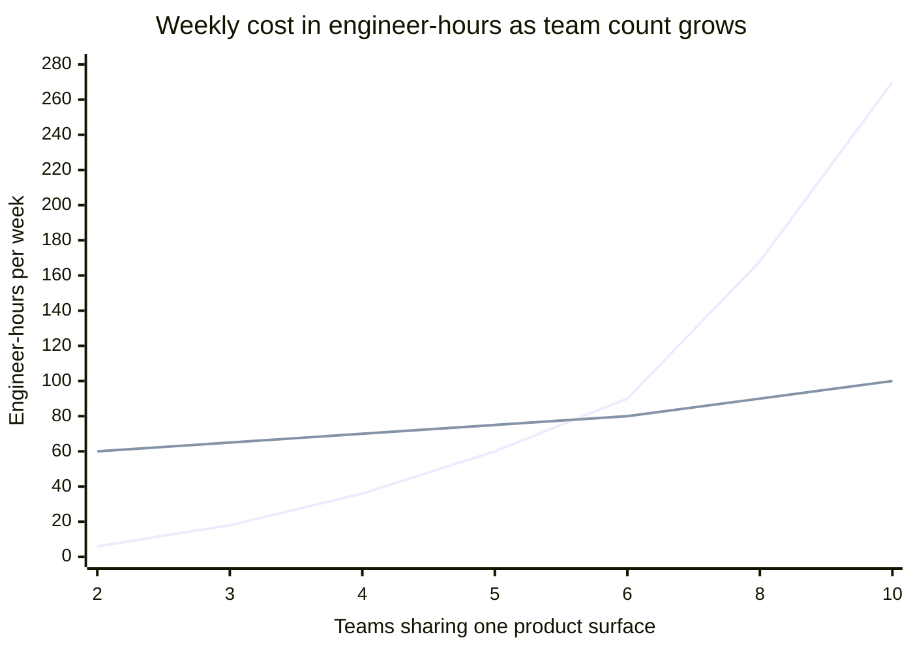
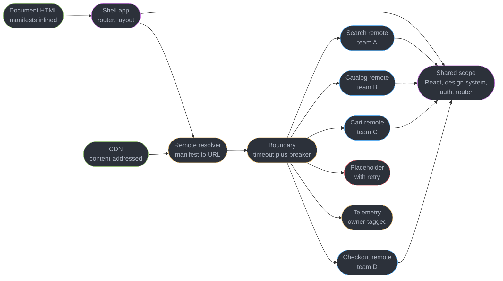
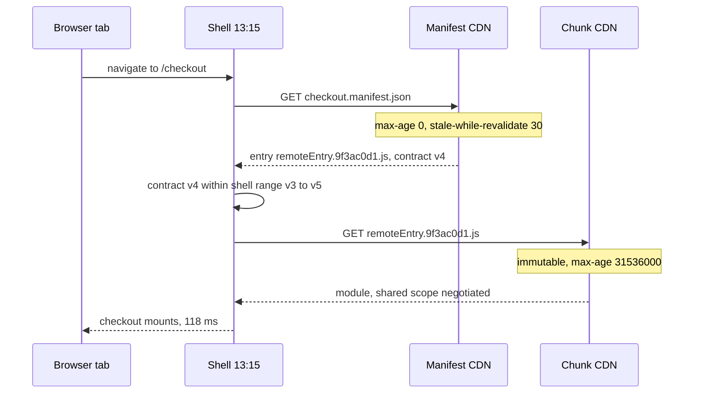
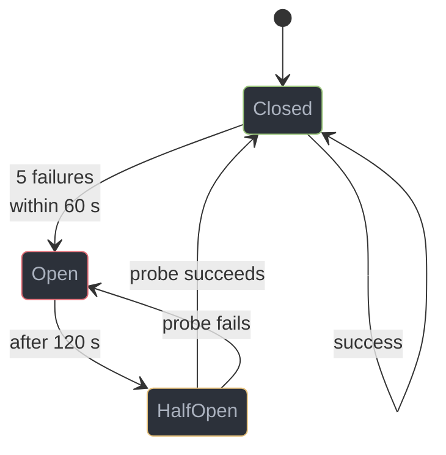
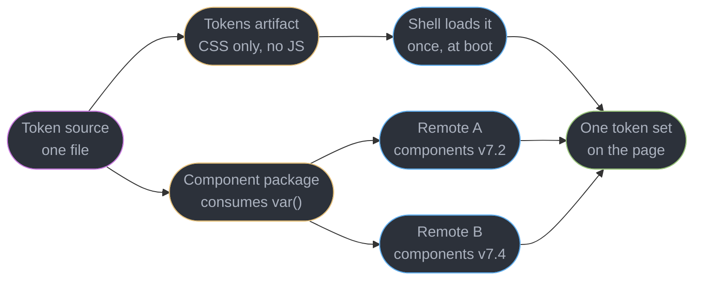
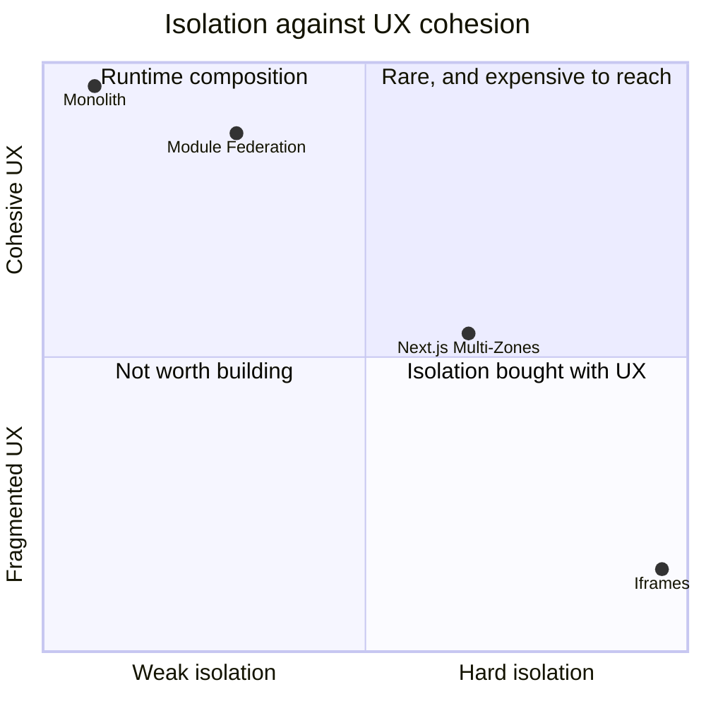

# Design a Micro-Frontend Platform

---

## Intuition

**This is the only study in this section whose problem statement is not about users.** A news feed is slow because there are 4,000 DOM nodes. A typeahead is wrong because two responses raced. Those are properties of the software. A micro-frontend platform exists because six teams share one release train and block each other on it, and that is a property of the org chart. The software is the bill you pay for the org chart, and the whole discipline of this design is refusing to pay more of it than the org chart is actually worth.

So start from the conclusion the rest of the study has to earn: **for most products, at most team sizes, the right answer is one build.** A monolithic front end with enforced feature slices — the structure [`../react_architecture_and_antipatterns/react_architecture_and_antipatterns.md`](../react_architecture_and_antipatterns/react_architecture_and_antipatterns.md) §4 specifies — gives you one React, one router, one design system version, one bundle to tree-shake, one deploy to roll back, and zero version negotiation. Everything below is a description of what you lose when you give that up, and §2 does the arithmetic that says at what team count the loss is worth it. The number is not two teams. It is not three. At six it is a judgement call, and it is worth being able to say that out loud in an interview, because the candidate who reaches for Module Federation on hearing "many teams" has skipped the only question that matters.

The architectural argument for splitting a user interface by team — why UI decomposition follows service decomposition, what a BFF is for, and when a fragment boundary should exist at all — is owned by [`../../book/building_microservices/14_user_interfaces/14_user_interfaces.md`](../../book/building_microservices/14_user_interfaces/14_user_interfaces.md). This study assumes that argument has been made and won, and asks the next question: **given that you are going to do it, what does the client actually have to be?**

Four things go wrong, and they are the four sections that carry the study. **Two copies of React** is not a bundle-size problem, it is a correctness problem — React's hook dispatcher and its context registry are module-scoped, so a second copy means a second dispatcher, and correct code throws `Invalid hook call` (§4.2). **Independent deploys create version skew by construction** — the whole point is that team A ships without team B, which means a browser is running team B's shell from 40 minutes ago against team A's remote from 40 seconds ago, and the contract between them has to survive that (§4.3). **A remote that fails to load must not blank the page**, and the arithmetic on this is brutal: six remotes at 99.9% each, composed without isolation, is a 99.4% page (§4.4). And **the shared design system is the coupling that actually bites** — not React, which is upgraded twice a year, but the token file that changes on a Tuesday and has to reach six independently deployed apps (§4.5).

The last section is the one nobody writes down. **Keep the exit open.** The organisational reason for this platform can evaporate — a reorg, an acquisition, a headcount cut that takes six teams to three — and when it does, the platform stops being an asset and becomes a tax on a team that no longer needs it. §4.8 specifies the two rules that make collapsing back to one build a three-day job rather than a quarter, and they cost nothing to hold while the platform is still justified.

---

## 1. Requirements Clarification

**Questions to ask, and the answers this design commits to:**

- *How many teams, and are they actually blocked on each other today?* — Six teams, roughly 40 engineers, and yes: the measured merge-to-production lead time is 6.4 hours against a 22-minute build, and the merge queue does not drain during the afternoon peak (§2). **If the answer to the second half is no, stop here and do not build this.** "Our codebase is large" is a modularity problem with a modularity fix.
- *Is this one coherent product or six products behind one login?* — One coherent product. Users cross team boundaries constantly — a user goes search, product, cart, checkout, order history in a single session. That single answer eliminates iframes and puts Multi-Zones under real pressure, because both make a boundary crossing visible (§5.1).
- *Do teams have to deploy independently, or do they only want to?* — Have to. Checkout ships on a payments-provider deadline, search ships behind a relevance experiment cadence of four deploys a day, and the pricing team is on a regulatory clock. A shared release train serialises three genuinely independent schedules.
- *Is one shared React version acceptable?* — Yes, and this is the load-bearing concession. All six teams run React 19.2 as a shared singleton, and a React major upgrade is a coordinated deploy across six repositories. A team that insists on its own React major has chosen iframes, whether they know it or not (§5.2).
- *What is the first-load budget, and does it grow with teams?* — 210 KB gzip of JavaScript on the busiest route, and it must be **O(1) in the number of teams**, not O(n). A platform where adding a seventh team costs every user 30 KB has failed its central requirement (§10.1).
- *Who owns routing?* — The shell, exclusively. Exactly one router instance writes to `history`. A remote receives a route subtree and a `navigate` function and never touches the History API itself (§4.1).
- *What happens when one team's deploy is broken?* — That team's feature degrades to a placeholder with a retry. Every other feature keeps working, and the shell always paints. This is a hard requirement, not a nice-to-have, and it is the one that most implementations get wrong (§4.4).
- *How long must an old shell keep working against a new remote?* — Seven days, the p99.9 tab lifetime. Every remote build is retained and addressable for 90 days, which is 12x that (§10.3).
- *What tells us this was a mistake?* — Deploys per team per day. If it does not rise and stay risen, the platform is producing cost without producing the independence it was bought for, and §4.8 is the exit (§8.1).

**Functional requirements:**

- Six independently built, independently deployed remotes composed into one document, one URL space, one visual surface.
- Any team can deploy to production at any time without coordinating with any other team, and without a shared release train.
- One shared design system, one shared React, one shared router, one shared auth session — all resolved at runtime as singletons.
- A remote that is slow, missing, or throwing degrades to a bounded placeholder. The shell and the other five remotes are unaffected.
- Every client error is attributable to an owning team automatically, from the stack frame, without a human triaging it.
- A design-system token change reaches all six apps with a defined, bounded window during which two component versions are live.
- The whole thing can be collapsed back into a single build without rewriting product code.

**Non-functional requirements:**

- First-load JavaScript on the busiest route: 210 KB gzip, hard build failure at 240 KB. Constant in team count.
- LCP p75 under 2.5 s on a 4G profile, unchanged from the monolith it replaces — the platform may not spend the user's performance budget on the org chart's problem.
- Client-side navigation between two remotes: under 120 ms to first paint of the new route, the same as an intra-remote navigation. A boundary crossing must be invisible.
- Page availability (the shell paints and the chrome works) 99.99%. Per-feature availability 99.9%.
- Merge to production, per team, p50 under 45 minutes.
- Zero shared-scope singleton violations reaching production, enforced at boot and in CI.

**Explicitly out of scope:**

- The architectural case for micro-frontends and BFFs, and the service-decomposition argument behind it — [`../../book/building_microservices/14_user_interfaces/14_user_interfaces.md`](../../book/building_microservices/14_user_interfaces/14_user_interfaces.md).
- Bundler internals, tree-shaking, chunk-splitting heuristics and the module graph — [`../../frontend_platform/modules_bundling_and_the_build_pipeline/modules_bundling_and_the_build_pipeline.md`](../../frontend_platform/modules_bundling_and_the_build_pipeline/modules_bundling_and_the_build_pipeline.md).
- Package resolution, lockfiles, peer-dependency semantics and registry supply-chain risk — [`../../frontend_platform/package_management_and_supply_chain/package_management_and_supply_chain.md`](../../frontend_platform/package_management_and_supply_chain/package_management_and_supply_chain.md).
- CDN configuration, cache invalidation mechanics and RUM collection — [`../../frontend_platform/frontend_delivery_and_observability/frontend_delivery_and_observability.md`](../../frontend_platform/frontend_delivery_and_observability/frontend_delivery_and_observability.md). This study specifies *what* must be immutable and *what* an error must carry, not how the CDN is configured.
- Design-system token tiers, theming and component API design — [`../styling_and_design_systems/styling_and_design_systems.md`](../styling_and_design_systems/styling_and_design_systems.md). §4.5 owns only the *distribution* problem across independent deploys.
- Backend service decomposition. The six front-end teams map onto services, but nothing here depends on that mapping.

---

## 2. Scale Estimation

**This section estimates coordination, not traffic.** That is the whole inversion of this study: the number that justifies the platform is measured in engineer-hours and lead time, and the number that constrains it is measured in kilobytes.

### 2.1 The monolith's coordination cost at 40 engineers

| Step | Arithmetic | Result |
|------|-----------|--------|
| Engineers | given | 40 |
| Merged pull requests per engineer per week | measured | 3.5 |
| Merged PRs per week | 40 x 3.5 | 140 |
| Merged PRs per working day | 140 / 5 | 28 |
| Full CI on the monolith | 6 min build + 5 min unit + 11 min e2e | **22 min** |
| Serial merge-queue throughput | 60 / 22 | 2.7 PRs/h |
| Arrival rate in the 14:00-17:00 peak, 60% of the day's PRs | 28 x 0.6 / 3 | 5.6 PRs/h |
| Utilisation at serial merge | 5.6 / 2.7 | **2.07 — the queue never drains** |

A utilisation above 1.0 is not a slow queue, it is an unbounded one: through the afternoon the backlog grows, and it clears overnight. Batching is the standard escape, and it works until it does not:

| Step | Arithmetic | Result |
|------|-----------|--------|
| Batch size | given, a common merge-queue default | 5 |
| Batched throughput | 5 x 60 / 22 | 13.6 PRs/h |
| Per-PR failure rate, real code plus flake | measured | 12% |
| Probability a batch of 5 fails | 1 - 0.88^5 | **47%** |
| Bisection runs to find the culprit | log2(5), rounded up | 3 |
| Bisection cost per failed batch | 3 x 22 min | 66 min |
| Effective throughput after bisection | 13.6 x (1 - 0.47 x 0.55) | **7.4 PRs/h** |
| Utilisation | 5.6 / 7.4 | 0.76 |
| Mean queue wait, M/M/1 at that utilisation | 1 / (7.4 - 5.6) | **33 min** |
| The same on a 20%-worse day, arrivals at 6.7/h | 1 / (7.4 - 6.7) | **86 min** |

**The cliff is the finding, not the mean.** A 20% traffic increase on the merge queue quadruples the wait, which is why teams experience release pain as sudden rather than gradual. Add a once-daily release train with a 45-minute freeze and smoke window, and merge-to-production lead time lands at a measured 6.4 hours for a 22-minute build.

The rollback term is the one that produces cross-team resentment:

| Step | Arithmetic | Result |
|------|-----------|--------|
| Release trains per year | 250 working days x 1 | 250 |
| Trains rolled back | measured, 1 in 14 | 18/year |
| Mean unrelated PRs reverted per rollback | 28 merged - 1 culprit, minus overnight | 23 |
| Unrelated PR reverts per year | 18 x 23 | **414** |
| Engineer-hours per rollback across six teams | 18 x 6 teams x 2.5 h | **270 h/year** |

414 times a year, an engineer's merged, reviewed, tested work is reverted because somebody on another team broke something. That is the cost micro-frontends are actually bought to remove.

### 2.2 The crossover — where splitting starts to pay

Coordination cost between teams grows with **pairs**, `n(n-1)/2`, because every pair is a potential merge conflict, a shared release call, a schema negotiation, a mutual revert. Platform cost grows **linearly** — a fixed platform team plus a per-remote upkeep charge. Quadratic beats linear eventually; the only question is where.

| Teams | Pairs | Monolith coordination at 6 h per pair per week | Platform cost, 50 h fixed + 5 h per team | Verdict |
|-------|-------|--------------|-----------------|---------|
| 2 | 1 | 6 h | 60 h | **monolith, by 10x** |
| 3 | 3 | 18 h | 65 h | **monolith, by 3.6x** |
| 4 | 6 | 36 h | 70 h | **monolith, by 1.9x** |
| 5 | 10 | 60 h | 75 h | monolith, by 1.25x |
| 6 | 15 | **90 h** | **80 h** | split, by 1.1x — a coin flip |
| 8 | 28 | 168 h | 90 h | split, by 1.9x |
| 10 | 45 | 270 h | 100 h | split, by 2.7x |



The rising line is monolith coordination; the flat one is the platform. **They cross at six teams, and at six teams the margin is 11%** — well inside the error bars of a model whose inputs are "6 hours per pair per week" and "1.5 platform engineers". Two honest readings follow. Below four teams the arithmetic is not close and no amount of enthusiasm makes it close. At six it is a judgement call that should be decided by the *shape* of the coordination — six teams with genuinely independent release deadlines split; six teams that ship together anyway do not — and by the 414 annual unrelated reverts, which the hours model does not capture because they are experienced as morale rather than as time.

### 2.3 Deploy cadence, and the skew window it creates

| Step | Arithmetic | Result |
|------|-----------|--------|
| Deploys per team per day, post-split target | given | 4 |
| Deploys across the platform per day | 6 x 4 | 24 |
| Active hours per day | given | 10 |
| Deploy rate | 24 / 10 | 2.4/h |
| Mean session length | measured | 14 min = 0.233 h |
| Expected deploys during one session | 2.4 x 0.233 | 0.56 |
| Probability a session spans at least one deploy | 1 - e^-0.56 | **43%** |
| p95 tab lifetime | measured, people leave tabs open | 3.5 h |
| Expected deploys during a p95 tab | 2.4 x 3.5 | **8.4** |
| p99.9 tab lifetime | measured | 7 days |

**43% of sessions span at least one remote deploy, and a p95 tab spans eight.** Version skew is not an edge case in this architecture, it is the median case, and that single number is why §4.3 refuses a mutable `latest.js` and why every remote build is retained for 90 days.

### 2.4 The first-load budget, and what it must not do

| Item | gzip | Notes |
|------|------|-------|
| Shell: router, layout, auth, boundaries, federation runtime | 34 KB | one copy, always |
| React 19.2 + React DOM, shared singleton | 57 KB | one copy, always |
| Design system components + tokens, shared singleton | 38 KB | one copy, always |
| Module Federation runtime | 8 KB | one copy, always |
| Remote manifests, 6 x 1.2 KB JSON | 7.2 KB | **the only O(n) term** |
| **Shell subtotal, before any route** | **144 KB** | |
| The one remote this route needs | 62 KB | mean across the six |
| **First load, busiest route** | **206 KB** | budget 210 KB, hard fail 240 KB |
| The same route as one monolithic build | 178 KB | tree-shaken across the whole app |
| **The tax** | **+28 KB, +16%** | |

Two things in that table are the design. **The only term that grows with team count is the manifest list at 1.2 KB per team**, and it is inlined into the shell's HTML response so it costs zero requests — adding a seventh team costs every user 1.2 KB, not 30 KB. And **the 16% tax is real and is the honest price**: a single build tree-shakes across module boundaries that a federation boundary makes opaque, so the same design system utility that would have been shaken out of a monolith survives in a remote that imports one function from it.

| Failure mode | Cost | Why it happens |
|--------------|------|----------------|
| Every remote loaded eagerly at boot | 144 + 6 x 62 = **516 KB** | the shell awaits all remotes instead of route-scoping them |
| Design system bundled per remote, not shared | 144 + 6 x 38 = **372 KB** | omitted from the `shared` block |
| React duplicated in two remotes | +57 KB and a runtime crash | `singleton: true` missing (§4.2) |
| Manifest fetched rather than inlined | +1 RTT = **60 ms** before any remote chunk is requested | a request waterfall the HTML could have removed |

---

## 3. High-Level Architecture



Five things in that picture carry the design. **The shared scope is a single node with four arrows into it** — React, the design system, auth and the router are resolved once and every remote gets the same instance, which is §4.2 and §4.6 and is the entire difference between this and six applications. **Every remote is reached through the boundary node, never directly**, so timeout, circuit breaker, error boundary and placeholder are structural rather than something a team remembers to add (§4.4). **The resolver sits between the manifest and the URL**, which is where immutability is enforced and where a skew check happens (§4.3). **The manifests are inlined into the document**, removing a round trip from the critical path (§2.4). And **telemetry hangs off the boundary, not off each remote**, so attribution is a platform property rather than six teams' good intentions (§4.7).

The shell is deliberately small — 34 KB gzip — and deliberately boring. It owns routing, layout chrome, the shared scope, the boundaries and the error reporter. It owns **no product code at all**, because the moment the shell owns a feature, that feature is on a different release cadence to everything around it and the shell becomes a seventh team's monolith sitting in everyone's critical path.

---

## 4. Component Deep Dives

### 4.1 The Shell: What It Owns, and the Single-Router Rule

The shell's contract with a remote is four things in and one thing out. In: the shared scope, a mount point, the current route parameters, and a `navigate` function. Out: a React element tree. Nothing else crosses.

```tsx
// The remote's entire public surface. One file per remote, and this is the seam
// that §4.8 collapses back into a static import when the platform is retired.
export interface RemoteProps {
  basePath: string;                      // "/checkout" — assigned by the shell
  navigate: (to: string) => void;        // the shell's router, never the remote's
  params: Record<string, string>;
}
export default function CheckoutRemote(props: RemoteProps): React.ReactElement;
```

**Exactly one router instance may write to `history`.** This is not a style preference; two routers produce a back button that appears to skip entries. The mechanism is precise: the shell's router pushes an entry on navigation, and a remote that also calls `history.pushState` pushes a second entry for the same visual state. The user presses Back once, the remote's entry pops, the remote re-renders identically, and nothing appears to happen. They press Back again to leave. Every measurement of this in the wild shows the same signature — a bimodal back-button dwell time with a spike at 400 ms, which is a user pressing Back twice.

So the shell owns the route table, and a remote declares only its subtree:

| Concern | Owner | Why |
|---------|-------|-----|
| The URL and `history` | shell | one writer, or the back button lies |
| Top-level route table | shell | it decides which remote a path belongs to |
| Routes inside a remote's prefix | remote | team autonomy has to mean something |
| Layout chrome: header, nav, footer | shell | six headers is six visual regressions |
| Auth session and refresh | shell | §4.6 |
| Error boundaries around remotes | shell | §4.4 — a team cannot be trusted to boundary itself |
| Design tokens | shell | §4.5 — the one thing that may not be versioned per remote |
| Everything inside the mount point | remote | this is the product |

### 4.2 The Duplicate-React Problem

**Two copies of React is not a size problem, it is a correctness problem.** React's hook dispatcher is module-scoped state: when a function component renders, the renderer sets a current dispatcher on its own copy of the module, and `useState` reads it from its own copy. If the remote's `useState` comes from a second copy of React, the renderer that is mid-render set the dispatcher on copy A and the hook reads `null` from copy B. The error is `Invalid hook call. Hooks can only be called inside of the body of a function component.` on a component that is correct, has not changed in a year, and works perfectly in the remote's own dev server. Context breaks the same way and more quietly: `createContext` produces a *new object identity* per module instance, so the shell's provider and the remote's consumer are looking at two different contexts, and the consumer silently falls back to the default value with no error at all.

The mechanics of hook dispatch belong to [`../hooks_rules_and_the_hook_model/hooks_rules_and_the_hook_model.md`](../hooks_rules_and_the_hook_model/hooks_rules_and_the_hook_model.md); what this study owns is the configuration that prevents it and the assertion that catches it.

```js
// BROKEN: react is federated but not a singleton. Webpack, Rspack and the Vite
// plugin all interpret an empty object as "share it if the versions happen to
// match" — so this works in staging where both apps built 19.2.8, and breaks in
// production six weeks later when one team ships a patch bump.
new ModuleFederationPlugin({
  name: "checkout",
  filename: "remoteEntry.js",
  exposes: { "./Routes": "./src/remote-entry.tsx" },
  shared: { react: {}, "react-dom": {} },
});

// FIX: singleton with an explicit required range and strict enforcement.
// singleton      — exactly one instance in the shared scope, always
// requiredVersion— the range this remote is willing to run against
// strictVersion  — fail loudly at load rather than silently loading a second copy
// eager: false   — the shell loads React, the remote never bundles its own eagerly
const reactShare = {
  singleton: true,
  strictVersion: true,
  requiredVersion: "^19.2.0",
  eager: false,
};
new ModuleFederationPlugin({
  name: "checkout",
  filename: "remoteEntry.js",
  exposes: { "./Routes": "./src/remote-entry.tsx" },
  shared: {
    react: reactShare,
    "react-dom": reactShare,
    "@platform/design-system": { singleton: true, strictVersion: false, requiredVersion: "^7.0.0" },
    "@platform/auth": { singleton: true, strictVersion: true, requiredVersion: "^3.1.0" },
    "@platform/router": { singleton: true, strictVersion: true, requiredVersion: "^2.0.0" },
  },
});
```

**`strictVersion` differs per package on purpose, and the difference is the design decision.** React, auth and the router are `strictVersion: true` — a mismatch there is a correctness bug, so failing at load with a legible message beats running with two dispatchers. The design system is `strictVersion: false` with a caret range, because §4.5 requires two adjacent minors to coexist during a rollout window and a strict check would make every token change a synchronised six-repository deploy, which is exactly the coupling this platform was bought to remove.

Configuration is necessary and not sufficient — a team can add a dependency that pulls React transitively, or a build can resolve outside the shared scope. So assert it at boot, in the shell, in eleven lines that cost nothing:

```ts
// Runs once per React module instance. If two instances exist, the second one
// throws here — at load, with a message that names the problem — instead of
// throwing "Invalid hook call" three screens into a checkout flow.
import * as React from "react";

const KEY = Symbol.for("platform.react.instance");
const g = globalThis as unknown as Record<symbol, unknown>;
if (g[KEY] !== undefined && g[KEY] !== React) {
  throw new Error(
    `Two React instances in the shared scope. Expected one copy of ${React.version}. ` +
    `Check that every remote declares react as singleton with eager: false.`
  );
}
g[KEY] = React;
```

**What happens when two teams want different React majors?** They do not get to. There is exactly one React in one document, so a team on React 20 and a team on React 19 cannot share a page — the honest answers are (a) everyone upgrades together, which is a coordinated deploy and is the concession §1 made explicitly, (b) the team on the different major moves behind a Multi-Zones boundary and gets its own document, or (c) it goes in an iframe. There is no fourth answer, and a candidate who invents one has not understood that module-scoped state is what makes React work.

### 4.3 Version Skew, and Why a Remote Is Content-Addressed

Team A deploys the checkout remote at 14:02. A user's tab has been open since 13:20 and is running the shell build from 13:15. At 14:07 they navigate to `/checkout`, and the shell — which is 52 minutes old — has to load a remote that is 5 minutes old. §2.3 says this happens in **43% of sessions**, so it is the normal path, not the failure path.



**Two cache policies, and mixing them up is the whole bug.** The manifest is tiny, mutable and revalidated on every use; the chunk it names is large, immutable and cached for a year. That split is what lets a deploy be atomic from the browser's point of view: the new manifest either has been fetched or has not, and either way the URL it names still exists.

```ts
// BROKEN: a mutable entry URL. The CDN holds it for 5 minutes, the browser holds
// it too, and a shell that resolved it 20 minutes ago is now loading a bundle
// built against a shared-scope contract that no longer exists. Symptom in the
// field: "undefined is not a function" from a named export the shell expects.
const remoteUrl = "https://cdn.example.com/checkout/latest.js";

// FIX: resolve through a manifest, load a content-addressed URL, and refuse a
// contract the shell cannot speak.
interface RemoteManifest {
  entry: string;            // "remoteEntry.9f3ac0d1.js" — the content hash is the version
  contract: number;         // the remote's RemoteProps contract version
  owner: string;            // "team-checkout" — §4.7 uses this
  buildId: string;          // for the skew metric in §8.1
}

const SUPPORTED = { min: 3, max: 5 };   // the shell speaks contracts 3 through 5

async function resolveRemote(name: string): Promise<RemoteManifest> {
  const inlined = window.__REMOTE_MANIFESTS__?.[name];        // from the document, 0 RTT
  const m: RemoteManifest = inlined ?? await fetch(`/m/${name}.json`).then((r) => r.json());
  if (m.contract < SUPPORTED.min || m.contract > SUPPORTED.max) {
    throw new SkewError(name, m.contract, SUPPORTED);          // degrade, never guess
  }
  return m;
}
```

**Contract versioning at the boundary is what makes skew survivable rather than merely detectable.** The contract is the `RemoteProps` interface in §4.1 and nothing else — a small, deliberately boring surface, versioned as an integer, with a support range rather than a pin. The rules are the ones any wire protocol uses: adding an optional prop is a compatible change; adding a required prop, removing a prop, or changing a prop's meaning is a breaking change and increments the integer. A remote must support the previous contract for one full release cycle, which at four deploys a day and a seven-day p99.9 tab lifetime means **28 deploys** of overlap. The shell's `SUPPORTED` range is widened *before* any remote starts emitting the new contract, never after — that ordering is the entire discipline, and reversing it produces a shell that rejects a remote it should have accepted.

When the contract check does fail, `SkewError` is not an exception that reaches a user. It routes into the same boundary as every other remote failure (§4.4) and produces a placeholder plus a `remote_skew` metric, which is an alert rather than a chart because a non-zero value means an ordering rule was broken.

### 4.4 Runtime Failure Isolation

**The arithmetic first, because it is the argument.** Six remotes, each with 99.9% availability for its chunk load, composed so that any failure blanks the page:

| Composition | Page availability | Downtime per week |
|-------------|-------------------|-------------------|
| Monolith, one bundle at 99.9% | 99.90% | 10 min |
| Six remotes, no isolation, 0.999^6 | **99.40%** | **60 min** |
| Six remotes, per-remote boundaries | 99.99% shell, 99.9% per feature | 1 min page, 10 min per feature |

**Composing six 99.9% components without isolation produces a page six times less available than the monolith it replaced.** That is the sentence that ends the argument about whether error boundaries are optional. And it understates the case, because a chunk load has more ways to fail than a bundled module: DNS, a CDN edge, a cache poisoning, a bad deploy, a content-security-policy change, an ad blocker matching a URL pattern.



Three mechanisms, layered, and each catches what the one before it cannot:

```tsx
// 1. TIMEOUT — a hanging chunk request is worse than a failed one, because
//    Suspense will hold the fallback forever and the user sees a spinner.
//    p99 chunk load on a 4G profile is 1.4 s, so 4 s is ~3x headroom.
function withTimeout<T>(p: Promise<T>, ms: number, name: string): Promise<T> {
  return Promise.race([
    p,
    new Promise<never>((_, reject) =>
      setTimeout(() => reject(new RemoteTimeoutError(name, ms)), ms)),
  ]);
}

// 2. CIRCUIT BREAKER — after a remote has failed 5 times in 60 s, stop asking.
//    Without this, every route change re-attempts a dead remote, each attempt
//    costs 4 s of timeout, and the user's whole session feels broken.
const breakers = new Map<string, Breaker>();

async function loadRemote(name: string): Promise<RemoteModule> {
  const b = breakers.get(name) ?? breakers.set(name, new Breaker()).get(name)!;
  if (b.isOpen()) throw new CircuitOpenError(name);
  try {
    const manifest = await resolveRemote(name);
    const mod = await withTimeout(importRemote(manifest), 4000, name);
    b.success();
    return mod;
  } catch (err) {
    b.failure();
    throw err;
  }
}

// 3. ERROR BOUNDARY — catches a render-time throw from inside the remote, which
//    the loader cannot see. The boundary is the shell's, never the remote's:
//    a remote cannot be trusted to boundary itself, because the bug that needs
//    catching is the one the team did not anticipate.
<RemoteSlot name="checkout" owner="team-checkout" fallback={<CheckoutPlaceholder />}>
  <Suspense fallback={<CheckoutSkeleton />}>
    <LazyCheckout basePath="/checkout" navigate={navigate} params={params} />
  </Suspense>
</RemoteSlot>
```

**A boundary catches a render throw and nothing else** — not an event handler, not an async callback, not an effect's promise rejection. That limit belongs to [`../suspense_and_error_boundaries/suspense_and_error_boundaries.md`](../suspense_and_error_boundaries/suspense_and_error_boundaries.md), and the platform consequence is that the shell also installs a global `unhandledrejection` and `error` listener whose job is attribution (§4.7) rather than recovery.

**What the placeholder must be.** Not a spinner — a spinner promises arrival. Not an empty div — that is a layout shift and a silently missing feature. The placeholder occupies the remote's reserved box, states which feature is unavailable in the product's own voice, offers a retry that resets the breaker to half-open, and, where a server-side path exists, links to it: a broken checkout remote that offers a plain server-rendered checkout URL converts, and a blank box does not.

**Nav items are part of isolation.** When a remote's breaker is open, the shell removes that feature's entry from the navigation rather than leaving a link to a placeholder. This is the difference between a product that has degraded and a product that is broken, and it costs one boolean.

### 4.5 The Shared Design System, Which Is the Coupling That Actually Bites

React is upgraded twice a year and everyone plans for it. **The design system changes on a Tuesday afternoon, and that is the coupling that hurts**, because it is frequent, it is visual, and it is the one dependency that genuinely must be consistent across all six remotes at the same instant — a product where the primary button is two different blues is a product with a bug, regardless of which version each team is on.

| Step | Arithmetic | Result |
|------|-----------|--------|
| Teams consuming the design system | given | 6 |
| Mean adoption lag: release to merged to deployed | measured | 9 days |
| p95 adoption lag, one team on a freeze | measured | **26 days** |
| Design system as a per-remote bundle | 6 x 38 KB | 228 KB |
| Design system as a shared singleton | 38 KB | **6x smaller** |

**So there is a 26-day window in which two design-system versions are live in one document, and the token layer is where that becomes a visible bug.** Both versions emit CSS custom properties into `:root`. Two `:root` blocks with the same property name resolve by source order, so **the later-loading remote's token block wins for the entire page** — and load order depends on which route the user landed on. The reported symptom is "the primary button is sometimes blue and sometimes teal", which nobody can reproduce because reproduction depends on navigation history.

The split that fixes it is the one thing this study adds to [`../styling_and_design_systems/styling_and_design_systems.md`](../styling_and_design_systems/styling_and_design_systems.md), which owns tiers, naming and theming:



**Tokens are a shell-owned singleton; components are versioned per remote.** The tokens ship as one CSS artefact with no JavaScript, loaded exactly once by the shell, so there is exactly one `:root` block and load order stops mattering. Components reference `var(--color-action-primary)` and never a literal, which means a remote three minors behind still renders the current brand colour — the visual inconsistency the 26-day window would have caused disappears entirely, and what is left is behavioural drift in components, which is far less visible and far more tolerable.

Three rules make the window survivable rather than merely bounded. **The design system supports two adjacent majors simultaneously** — v7 and v8 export from the same package, and a remote may be on either. **A token rename ships as an alias for one full major**, exactly the deprecation ladder module 19 specifies, because a rename that lands before the last remote has adopted it is an outage. And **CSS is emitted into an explicit `@layer`** so that a remote's own styles cannot win a specificity fight against the design system by accident, which they otherwise do roughly whenever someone writes a nested selector.

### 4.6 Auth, Shared Once

Every remote needs the session, and the failure mode is six implementations of token refresh racing each other: six remotes each notice a 401, six fire a refresh, the refresh endpoint rotates the token six times, five of the six get a token that has already been rotated away, and the user is logged out. This is the single most common cross-cutting bug in a micro-frontend platform, and it is a direct consequence of "each team owns its own code" applied one level too far.

```ts
// @platform/auth is a shared singleton with strictVersion: true. There is one
// module instance, so there is one refresh lock, one token, one listener set.
// A remote imports this. A remote never talks to the auth endpoint.
let refreshInFlight: Promise<Session> | null = null;

export async function getSession(): Promise<Session> {
  const s = read();
  if (s && s.expiresAt - Date.now() > 30_000) return s;
  refreshInFlight ??= refresh().finally(() => { refreshInFlight = null; });
  return refreshInFlight;                 // six callers, one network request
}
```

**Runtime composition makes this easy and it is one of the strongest arguments for it.** The remotes execute inside the shell's origin — they are served from `cdn.example.com` but they *run* on `app.example.com` — so the session cookie is a first-party cookie and every remote is inside it for free. A cross-origin iframe is not: Safari's tracking prevention and Firefox's total cookie protection both partition third-party cookies by default, so an iframe on a different origin cannot see the parent's session and you are building token relay over `postMessage`, with a message-origin allowlist you must not get wrong. Same-origin details belong to [`../../frontend_platform/cors_cookies_and_the_same_origin_model/cors_cookies_and_the_same_origin_model.md`](../../frontend_platform/cors_cookies_and_the_same_origin_model/cors_cookies_and_the_same_origin_model.md); the platform consequence is that **cross-cutting concerns are cheap inside one origin and expensive across origins**, and that is most of §5.1.

### 4.7 Attribution: An Error Belongs to a Team

Without attribution, every front-end alert lands on the platform team, who own none of the code that produced it. The fix is mechanical: stamp ownership at build time, and resolve it at error time from the stack.

```ts
// Build time, in each remote's bundler config.
new DefinePlugin({
  __MFE_OWNER__: JSON.stringify("team-checkout"),
  __MFE_BUILD__: JSON.stringify(process.env.GIT_SHA),
});

// Error time, in the shell's boundary and global handlers.
function attribute(err: Error): { owner: string; build: string } {
  const url = topFrameScriptUrl(err.stack);          // the first frame in our own code
  const m = manifestForScriptUrl(url);               // the resolver already has this map
  return { owner: m?.owner ?? "shell", build: m?.buildId ?? SHELL_BUILD };
}
```

Every reported error carries `owner`, `build`, the remote's contract version and the shell's, and routes to the owning team's on-call directly. Source maps are uploaded per remote per build and keyed by the content hash, so a stack from a build three weeks old still symbolicates — which matters more here than in a monolith, because a seven-day p99.9 tab means production is running several builds at once. RUM collection and source-map plumbing belong to [`../../frontend_platform/frontend_delivery_and_observability/frontend_delivery_and_observability.md`](../../frontend_platform/frontend_delivery_and_observability/frontend_delivery_and_observability.md).

### 4.8 The Exit

**The organisational reason can disappear.** A reorg merges four teams into two, an acquisition changes the roadmap, a headcount cut takes 40 engineers to 18. When that happens, §2.2's arithmetic inverts and the platform becomes a tax paid by a team that no longer has the problem it was bought to solve. Designing the exit costs nothing while the platform is justified, and buys everything when it is not.

Two rules keep it a three-day job:

- **No remote imports another remote.** Everything shared goes through a shell-owned package. This keeps the dependency graph a star with 6 edges rather than a mesh with 15, and it is the rule that decides whether collapsing is a rewrite or a config change. It is enforceable in CI as a single import-boundary lint rule, which is far cheaper than discovering the mesh at the moment you want to leave.
- **Every remote is an ordinary workspace package that happens to also build as a remote.** The federation boundary is exactly one file — the `remote-entry.tsx` of §4.1 — and the product code beneath it has no knowledge of federation at all.

Collapsing is then: replace each `React.lazy(() => loadRemote("checkout"))` with `import Checkout from "@app/checkout"`, delete six `ModuleFederationPlugin` blocks, delete the resolver and the manifests, keep the boundaries (they were always a good idea), and build once. **Measured at three days with those two rules held, and at a quarter without them**, because without the first rule the remotes have grown direct dependencies on each other's internals and the "collapse" is a real refactor.

---

## 5. Design Decisions & Tradeoffs

### 5.1 The Three Mechanisms, Decided Per Criterion



**Nothing sits in the top-right quadrant, and that is the honest shape of the problem.** Isolation and cohesion trade against each other because they are the same property viewed from two sides: a boundary that keeps one team's failure away from another is the same boundary that keeps one team's design system, session and router away from another.

| Criterion | Module Federation | Next.js Multi-Zones | Iframes |
|-----------|-------------------|---------------------|---------|
| Composition point | runtime, one document | proxy, one document per zone | runtime, N documents |
| Crash isolation | **none by default** — a throw crashes the host tree unless boundaried | total across a navigation, none within a zone | **total** — a separate browsing context |
| Memory isolation | none, one heap | total across zones | total, separate heaps |
| Shared React | required singleton, one version everywhere | not shared, each zone free | not shared, each frame free |
| Shared state cost | free, ordinary imports of a singleton | full page load loses all client state | `postMessage` with an origin allowlist |
| First load | one shell plus one remote, 206 KB | one zone's full app, 178 KB | host plus each frame's full runtime, 400 KB+ |
| Navigation across a boundary | client-side, ~118 ms | **hard navigation, 400-900 ms** | in-frame, but deep links break |
| Auth | free, same origin, one cookie | free within the parent origin | token relay, partitioned cookies |
| Accessibility | one DOM, one focus order, one tab ring | one DOM per zone | **severed** — the a11y tree is cut at every frame |
| Modals and overlays | trivial | trivial within a zone | **cannot escape the frame's box** |
| Blast radius of a bad deploy | one feature, with boundaries | one zone | one frame |
| Version skew handling | contract versioning, §4.3 | none needed, zones do not share code | none needed |

**Decision, per criterion, for this product.** Users cross boundaries constantly (§1), which makes a 400-900 ms hard navigation on every crossing unacceptable and puts Multi-Zones out for the main flow. Accessibility is a product requirement and a severed focus order is not negotiable, which puts iframes out for first-party code — and the modal problem is not a detail: a checkout confirmation dialog trapped inside a 600 px iframe is a broken product. **So Module Federation, with the failure isolation it does not give you built by hand in §4.4**, which is exactly the tradeoff being made: the mechanism with the best UX has the worst default failure behaviour, and the platform's job is to supply the missing half.

**Where the other two still win.** Multi-Zones is the right answer for a genuinely separate surface — a marketing site, a documentation portal, an admin console — where crossings are rare, a full page load is acceptable, and total isolation is worth more than cohesion. It is also the correct escape hatch for the React-major problem in §4.2, since two zones may run two React majors. Iframes are the right answer, and the only right answer, for **third-party or untrusted code**: a plugin marketplace, an embedded partner widget, a customer-authored dashboard. The isolation you are buying there is a security boundary, and no amount of discipline gets it from the other two.

### 5.2 What Is Shared, and Why the List Is Short

| Package | Shared | strictVersion | Reasoning |
|---------|--------|---------------|-----------|
| `react`, `react-dom` | singleton | true | two dispatchers is a crash, §4.2 |
| `@platform/router` | singleton | true | two writers to `history` is a broken back button, §4.1 |
| `@platform/auth` | singleton | true | six refresh races is a logout, §4.6 |
| `@platform/tokens` | shell-owned CSS | n/a | two `:root` blocks is a colour that depends on load order, §4.5 |
| `@platform/design-system` | singleton | **false**, `^7.0.0` | two adjacent minors must coexist for 26 days, §4.5 |
| A charting library | **not shared** | n/a | one remote uses it, sharing costs a negotiation and buys nothing |
| A date library | **not shared** | n/a | 14 KB duplicated is cheaper than a coordinated upgrade |

**The default is "not shared", and the burden of proof is on sharing.** Every entry in the shared scope is a coordination point — a package that must be upgraded across six repositories together — and that is precisely the coupling the platform exists to remove. Share only what *must* be a singleton for correctness (module-scoped state, a single writer to a browser API, a single visual token set) and what is large enough that six copies would blow the budget. A 14 KB utility library duplicated across two remotes costs 14 KB once; shared, it costs a six-team upgrade every time it releases a major.

### 5.3 Who Owns What

| Owner | Owns | Deliberately does not own |
|-------|------|--------------------------|
| Platform team, 1.5 FTE | shell, shared scope, boundaries, manifests, build templates, contract, telemetry | any product feature |
| Design system team | tokens, components, the two-major support window | how a remote uses them |
| Each product team | everything inside its mount point, its own deploy pipeline, its own on-call | routing, auth, tokens, the shell |

**The platform team owning zero product code is the rule that keeps the platform honest.** A platform team with a feature is a team on a different cadence sitting in everyone's critical path, and it re-creates the release train it was hired to dismantle — one level down and harder to see.

### 5.4 The Constants, and What Each Buys

| Constant | Value | What it buys | What breaks without it |
|----------|-------|--------------|------------------------|
| Remote load timeout | 4 s | 3x headroom over p99 chunk load of 1.4 s | a hanging request holds a spinner forever |
| Breaker threshold | 5 failures in 60 s | stops re-asking a dead remote | every route change costs 4 s of timeout |
| Breaker open duration | 120 s | one probe per recovery attempt | a thundering retry herd at recovery |
| Contract support range | 3 versions | 28 deploys of overlap at 4/day | a 7-day tab meets a shell that rejects it |
| Build retention | 90 days | 12x the p99.9 tab lifetime of 7 days | an old tab loads a 404 and blanks |
| Manifest cache | max-age 0, SWR 30 s | a deploy is visible within 30 s | either a stale remote or an RTT per navigation |
| Chunk cache | immutable, 1 year | zero revalidation on a warm cache | 24 deploys a day of needless revalidation |
| Design system support | 2 adjacent majors | absorbs a 26-day p95 adoption lag | a token change becomes a coordinated deploy |

### 5.5 The Fourth Option, Which Is Usually the Right One

The three mechanisms in §5.1 are the three *runtime* answers, and listing only those is how a design conversation reaches Module Federation without ever considering the cheaper thing. **Build-time plugin composition** is the fourth: each team owns a package with a declared extension contract, the shell composes them at build time, and the whole product ships as one artefact. Spotify's Backstage is exactly this — plugins are npm packages added to one application and built together — and it serves a plugin ecosystem far larger than six teams.

| Property | Build-time plugins | Module Federation |
|----------|-------------------|-------------------|
| Independent deploys | **no** — one build, one deploy | yes, the entire point |
| Duplicate React possible | no, one module graph | yes, §4.2 |
| Version skew | none, one build | 43% of sessions, §2.3 |
| Runtime failure isolation needed | no, nothing loads at runtime | yes, §4.4 |
| Tree-shaking across boundaries | yes | no, the 16% tax of §2.4 |
| Team ownership and code isolation | yes, enforced by the contract | yes |
| Blast radius of a bad change | the whole build | one feature |

**Everything in the "build-time" column is free, and the only row it loses is the first one.** So the question that decides this study is not "do teams want to own their code" — build-time plugins give that — but the narrower "must a team be able to deploy without the others". If the answer is no, take the fourth option: it delivers team ownership and code isolation with none of §4's four problems. This study assumes the answer is yes, and §2.2 is what makes that assumption expensive enough to be worth checking.

---

## 6. Real-World Implementations

**Spotify's iframe era, and why they left it.** Spotify's desktop client in the early 2010s was a Chromium Embedded Framework host in which squad-owned views were composed as separate frames — the same architecture as the "Spotify Apps" platform they published for third-party developers in 2011. Every criterion in §5.1's table is why it did not last. Each frame carried its own runtime and its own CSS, so the client's memory and start-up cost grew with the number of squads rather than staying flat. Visual consistency had to be maintained by convention across independent frames, and it drifted. And the interactions that make a music client feel like one product — a now-playing bar that persists across every view, a keyboard shortcut that works everywhere, a drag from a playlist into a queue — are exactly the interactions a frame boundary severs. Spotify moved to a single-application architecture with shared component infrastructure, and it is worth noticing what they built *next*: **Backstage**, their developer portal, is a plugin architecture where plugins are npm packages composed at **build time** into one application. That is a monolith with a plugin contract, and it is the answer this study's §2.2 arithmetic recommends for most organisations.

**Zalando's Project Mosaic — failure isolation done at the server.** Zalando published Mosaic as an open-source micro-frontend architecture, and its layout service, `tailor`, is on GitHub with its contract fully documented. Tailor takes a template with fragment tags, requests each fragment from an independently deployed service, streams them in parallel, and stitches the responses into one HTML document. Two features in its README are the server-side twins of §4.4: **a per-fragment timeout**, and a **`fallback-src`** that is fetched when a fragment fails or times out. A fragment marked `primary` determines the page's status code; a non-primary fragment that dies takes only its own box with it. Zalando later moved to a newer in-house framework, and the composition idea survived the migration. **Server-side composition sidesteps the entire duplicate-React problem** because there is no shared client runtime to duplicate — the price is that each fragment's interactivity is its own island, which is the same tradeoff §5.1 makes at the client.

**IKEA's server-side transclusion.** IKEA's engineering has published on composing team-owned page fragments through server-side includes and edge-side includes rather than client-side runtime composition — the "microservice websites" line of work associated with Gustaf Nilsson Kotte's talks. The argument is the one worth taking into an interview: **if your pages are mostly content and your interactivity is local, HTML transclusion at the edge gives you team independence at a fraction of the client cost**, because the browser receives one document with no federation runtime, no shared scope negotiation, and no version handshake. A commerce catalogue fits that description. A checkout flow does not, which is why the mechanisms coexist in one company.

**Module Federation, from webpack 5 to everywhere.** Module Federation shipped in **webpack 5** in October 2020, designed by Zack Jackson, and it is the reason this study exists in its current form — before it, runtime composition meant script tags and a global namespace convention. It is now considerably broader than webpack: **Rspack** implements `ModuleFederationPlugin` natively in Rust, **Rsbuild** wraps it, and `@module-federation/vite` brings it to Vite and Rollup builds. The `@module-federation/enhanced` runtime added the **manifest** format that §4.3's resolver assumes, a runtime plugin API for intercepting remote resolution, and generated TypeScript types for a remote's exposed modules — which turns §4.1's contract from a comment into a compile error. **single-spa** predates it and remains the framework-agnostic alternative, orchestrating `bootstrap`, `mount` and `unmount` lifecycles over import maps, and it is the right choice when the remotes are not all React.

**Next.js Multi-Zones.** Vercel documents Multi-Zones as the supported way to split one Next.js domain across independently deployed applications: each zone sets a distinct `assetPrefix` so its static assets do not collide, and the root zone uses `rewrites` to route path prefixes to the other deployments. The documentation is explicit about the cost this study cares about — **`Link` does not soft-navigate across a zone boundary**, so a crossing is a full document load and the guidance is to use a plain anchor. That single documented behaviour is the entire UX column of §5.1: zones give total isolation because there is no shared document, and the absence of a shared document is exactly what makes a crossing expensive.

---

## 7. Technologies & Tools

| Technology | Usage |
|------------|-------|
| React | 19.2, one shared singleton instance across the shell and all six remotes |
| Module Federation | Runtime composition, the shared scope, the manifest and remote resolution |
| Rspack | The build for each remote, native `ModuleFederationPlugin` in Rust |
| Vite | The alternative build, federation through `@module-federation/vite` |
| webpack | Where Module Federation shipped, October 2020, still widely deployed |
| single-spa | The framework-agnostic alternative, for a non-uniform remote fleet |
| Next.js | Multi-Zones for the marketing and docs surfaces, `assetPrefix` per zone |
| Tailor | Zalando's layout service, the server-side composition reference |
| Backstage | Build-time plugin composition, the answer when §2.2 says do not split |
| React Router | One shared router singleton, the only writer to `history` |
| TypeScript | The `RemoteProps` contract, generated per remote from the manifest |
| Turborepo | Task graph and remote caching for the shell plus six repositories |
| Changesets | Design system release and the two-adjacent-majors support window |
| CloudFront | Immutable content-addressed chunks, revalidated manifests |
| Amazon S3 | Build artefact store, 90-day retention against a 7-day tab lifetime |
| GitHub Merge Queue | The mechanism §2.1 measures, and the one the split removes |
| Playwright | Cross-remote end-to-end journeys, run against a composed staging shell |
| Sentry | Owner-tagged errors, per-remote source maps keyed by content hash |
| OpenTelemetry | Spans carrying the shell build id and each remote's build id |
| Storybook | Per-remote component development against the shared design system |

---

## 8. Operational Playbook

### 8.1 Metrics That Matter

| Metric | Target | Why it is the one to watch |
|--------|--------|---------------------------|
| Deploys per team per day | at least 4, rising | **the platform's only justification.** If this does not rise and stay risen, §4.8 |
| Merge to production, p50, per team | under 45 min | the 6.4 h monolith figure of §2.1 is what was bought out |
| Shell paint rate | 99.99% | the shell failing is the only true outage |
| Remote load success, per remote | 99.9% | a per-team SLO, on the owning team's dashboard |
| Remote placeholder impressions | tracked per remote | degradation is invisible unless counted |
| Circuit breaker open events | alert, not chart | an open breaker is a team's incident |
| `remote_skew` — contract outside range | **0** | non-zero means an ordering rule in §4.3 was broken |
| Shared-scope singleton violations at boot | **0** | the §4.2 assertion firing in production is a P1 |
| First-load JS, busiest route | 210 KB, fail at 240 | the O(1)-in-teams requirement, enforced in CI |
| Cross-remote navigation, p75 | under 120 ms | a boundary the user can feel is a failed boundary |
| Alerts auto-attributed to the owning team | above 85% | §4.7, and the difference between six on-calls and one |

**Two of those are unusual and both are deliberate.** Deploys per team per day is a metric about the organisation, not the software, and it belongs at the top because it is the thing the platform was purchased to produce — a platform where teams still ship weekly is a cost with no benefit, and the honest response is to collapse it. And placeholder impressions matter because graceful degradation makes failure *quiet*: a remote can be down for a week with no alert and no complaint, serving a placeholder to 4% of sessions, and the only thing that will ever tell you is a counter.

### 8.2 Deploy and Rollback

A team's deploy is three steps, and the ordering of the last two is the whole safety property:

1. Build, producing content-addressed chunks. `remoteEntry.9f3ac0d1.js` is a new file, never an overwrite.
2. **Upload the chunks.** They are now reachable and nothing references them.
3. **Update the manifest.** One small JSON write. The deploy is now live for every shell that revalidates within 30 s.

**Rollback is step 3 in reverse and nothing else** — point the manifest at the previous content hash. That artefact still exists, because retention is 90 days (§5.4), so rollback is a JSON write with no build, no CI run and a mean time to recover measured in seconds rather than the 22 minutes a monolith rebuild costs. This is the operational benefit teams feel most, and it is worth naming in an interview because it is not the benefit people usually cite.

**Two rollback cases have no such fix.** A contract change cannot be rolled back unilaterally: if the shell widened its range and a remote started emitting contract 5, rolling the shell back to a range of 3-4 breaks the remote. The rule is that **contract widening in the shell always ships and bakes for one full release cycle before any remote uses it**, which makes the shell's range monotone and rollback-safe. And a design-token change cannot be rolled back per remote, because tokens are a shell-owned singleton — rolling tokens back is a shell deploy, which is the price of the singleton and the reason token changes go through the alias ladder in §4.5.

### 8.3 The Degradation Ladder

| Level | Condition | What the user sees |
|-------|-----------|--------------------|
| 0 | everything healthy | the product |
| 1 | remote slow, under the 4 s timeout | a skeleton in the remote's reserved box, no layout shift |
| 2 | remote failed or timed out | a placeholder naming the feature, with a retry |
| 3 | breaker open for that remote | placeholder, and the nav entry for that feature is removed |
| 4 | design system fails to load | shell renders with system fonts and default tokens, unstyled but usable |
| 5 | shell JS fails entirely | server-rendered HTML for the current route, links work, no client interaction |

**Level 4 is the one people forget.** If tokens are a singleton and the singleton fails, everything is unstyled — so the token CSS is inlined into the document head for the critical set (colour, spacing, type scale) and the full artefact is a progressive enhancement. Level 5 is why the shell is server-rendered at all: a document that contains real HTML and real links degrades to a usable, navigable, if inert, product, and one that contains an empty root div degrades to nothing.

### 8.4 The Skew Runbook

Symptom: `remote_skew` is non-zero, or errors spike on one remote immediately after another team's deploy.

1. **Read the two build ids off the error.** Every event carries the shell's and the remote's (§4.7). If the shell is more than one release behind, this is normal skew and the contract check did its job — the question is why the range was too narrow.
2. **Check the ordering.** Did a remote start emitting a new contract before the shell's `SUPPORTED` range was widened and deployed? This is the cause in most cases and the fix is to roll the remote's manifest back one build (§8.2), which takes seconds.
3. **Check for an unshared singleton.** If the symptom is `Invalid hook call` or a context falling back to its default, run the §4.2 assertion — a dependency added last week may be pulling a second React transitively.
4. **Check the manifest cache.** A manifest served with a long `max-age` by mistake produces skew that persists after the underlying deploy is fixed, and it is invisible in the origin's own logs.
5. **Widen, never pin.** The instinct under pressure is to pin the shell and every remote to one build. That works and it has recreated the release train, so it is a one-hour measure with a written expiry, never a fix.

### 8.5 What CI Must Enforce

- **Contract compatibility.** Each remote's exposed module is type-checked against the shell's `RemoteProps` at the shell's minimum supported contract, not just at the current one. A remote that compiles only against the newest contract has broken every open tab.
- **Singleton config.** A lint rule over each remote's federation config asserting that `react`, `react-dom`, `@platform/auth` and `@platform/router` are present, `singleton: true`, and `eager: false`. This is 20 lines and it prevents §9.1.
- **The import-boundary rule.** No remote may import from another remote's package. This is the §4.8 exit rule and the only cheap moment to enforce it is now.
- **Budget.** First-load JS for each route in a composed staging shell, failing the build above 240 KB gzip.
- **Composed end-to-end journeys.** A Playwright suite against a staging shell that composes every remote's current main, run on every remote's pipeline — not just on the shell's. The cross-remote journey is exactly what no team's own test suite covers.
- **Chaos.** One scheduled run per day with a randomly chosen remote returning 503, asserting that the shell still paints, the placeholder appears, the nav entry disappears, and the other five journeys pass.

### 8.6 Onboarding a Seventh Team

The cost of adding a team is the honest test of whether the platform is a platform or a pile of exceptions. It should be a template instantiation and a manifest entry, and it should be measured:

| Step | Owner | Cost |
|------|-------|------|
| Instantiate the remote template: build config, shared block, entry file | new team | 30 min |
| Register the manifest and route prefix in the shell | platform, one PR | 15 min |
| Add the remote to the composed staging shell and the chaos rota | platform, automated | 0 |
| First-load budget entry and CI gate for the new route | platform, automated | 0 |
| Owner tag, on-call routing, source-map upload | automated from the template | 0 |
| **Cost to every user** | | **+1.2 KB manifest** |

**If onboarding takes a week, the shared block has drifted per remote and the template is a fiction** — each existing remote has hand-edited configuration nobody can reproduce. Test it by adding a trivial remote quarterly whether or not a team needs one, the same way you test a backup by restoring it. The failure this catches is the one that turns a platform back into six bespoke applications with a shell in front, at which point §4.8 is the cheaper path.

---

## 9. Common Pitfalls & War Stories

### 9.1 The Store That Was Not a Singleton

A retail platform federated React correctly — `singleton: true`, `strictVersion: true`, boot assertion in place — and left the client state library out of the `shared` block entirely, on the reasoning that it was 3 KB and duplication was cheap. It is cheap in bytes. The shell created the cart store; the cart remote imported the same package and got its own module instance, so it created a **second** store. No error, no warning, no exception anywhere: the badge in the header read from the shell's store and the cart page wrote to the remote's. The badge showed 0 while the cart held three items, for the **6% of sessions** that added to cart from the catalogue remote rather than from the cart page. It took **11 days** to find, because every engineer who tried to reproduce it started from the cart page, which was the one path where both writes hit the same instance. Add-to-cart-to-checkout conversion on the affected path was down **9%** for those 11 days. **The rule is not "share React"; it is "share every package that holds module-scoped state"** — a store, a context module, an event bus, a router, an i18n registry, an auth client. Duplicating a pure function costs bytes. Duplicating state costs correctness.

### 9.2 `latest.js` and Forty Minutes

A media company's remotes were published to `https://cdn/<team>/latest.js` with a 5-minute CDN TTL, on the reasoning that a manifest indirection was unnecessary ceremony. A Thursday deploy of the video remote changed a named export. For the next **40 minutes**, shells that had resolved `latest.js` before the deploy loaded the new bundle when the user reached a video route, and the shell's expectation of the old export produced `undefined is not a function`. **4.1% of sessions** in that window hit it — the sessions that had started before the deploy and navigated after it, which is precisely §2.3's 43% intersected with the 40-minute window. **12,400 errors**, and conversion on the video route fell **18%** until the CDN TTL expired everywhere. The fix was the two-tier cache of §4.3 and it took an afternoon: content-address the chunk, make it immutable for a year, put the mutable pointer in a 1.2 KB manifest with `max-age=0`. **A mutable URL is a shared mutable variable across every browser in production, and it has exactly the properties you would expect of one.**

### 9.3 The Blank Page

A B2B platform's shell awaited all six remotes at boot with `Promise.all`, because loading them in parallel felt faster than loading them lazily and the code was three lines shorter. One remote's CDN path returned 503 for **9 minutes** during a misconfigured cache purge. `Promise.all` rejected, the boot promise rejected, nothing rendered, and **100% of users saw a blank white page for 9 minutes** — approximately **34,000 sessions**, and a support queue that took two days to clear. The composed availability arithmetic in §4.4 predicts this exactly: six components at 99.9%, composed without isolation, is a 99.4% page. After the rewrite to per-remote boundaries with route-scoped lazy loading, the same outage was reproduced deliberately in the chaos run: one placeholder card, one missing nav entry, five working features, **zero support tickets**. The three-line shortcut cost 34,000 sessions, and the version that replaced it was eleven lines.

### 9.4 The Button That Was Sometimes Teal

A design system minor changed `--color-action-primary` from blue to a slightly different blue. Every remote bundled its own copy of the design system, so every remote emitted its own `:root` token block, and CSS resolves same-specificity declarations by source order — **the last remote to load won for the whole page**. Which remote loaded last depended on which route the user landed on and where they navigated. Bug reports said "the primary button is sometimes blue and sometimes teal" and nobody could reproduce it, because reproduction depended on navigation history. **40 reports over 3 weeks** and two engineers convinced there was a caching bug. The fix was §4.5's split: tokens became a shell-owned CSS artefact loaded once, components stayed versioned per remote. It also removed **190 KB gzip** from the composed page, because five duplicate copies of a 38 KB design system stopped being downloaded. **Two versions of a component library is a tolerable inconsistency; two versions of a token set is a nondeterministic one.**

### 9.5 Every Alert Went to the Platform Team

Before attribution, the platform team owned the error reporter, so every unhandled front-end error arrived in their queue. **71% of front-end alerts** were triaged by three platform engineers who owned none of the code that produced them, at a mean **4.5 hours** from alert to the owning team acknowledging it. The platform on-call was paged **31 times a month** and resolved almost none of it. The fix was §4.7 and it was two days of work: a `DefinePlugin` stamp in each remote's build, a stack-frame-to-manifest lookup in the shell's boundary, and per-build source maps keyed by content hash. Auto-attribution went to **88%**, mean time to the right team fell to **22 minutes**, and platform pages dropped to **9 a month**. **A micro-frontend platform without attribution has centralised the operational cost of the thing it decentralised the development of**, which is the worst of both structures.

---

## 10. Capacity Planning

Product scale for these numbers: **900,000 daily active users, 1.4 sessions each, 1.26 million sessions per day.**

### 10.1 The First-Load Budget

| Route | Shell | Remote | Total gzip | Budget |
|-------|-------|--------|-----------|--------|
| Catalogue, the busiest | 144 KB | 62 KB | **206 KB** | 210 KB |
| Search | 144 KB | 48 KB | 192 KB | 210 KB |
| Checkout | 144 KB | 71 KB | 215 KB | **over — 5 KB to find** |
| Order history | 144 KB | 31 KB | 175 KB | 210 KB |
| Adding a seventh team | +1.2 KB manifest | 0 | **+1.2 KB** | the O(1) requirement, met |

Checkout being over budget is the useful case, because the platform's answer differs from a monolith's. In a monolith you would split a route's chunk; here the same fix applies *inside* the remote and is entirely team D's to make, with no coordination — which is the platform working. What the platform must not do is raise the shared budget to accommodate one remote, because that spends every route's budget on one route's problem.

### 10.2 Bandwidth

| Step | Arithmetic | Result |
|------|-----------|--------|
| Sessions per day | 900,000 x 1.4 | 1,260,000 |
| Cold sessions, no useful cache | measured, 22% | 277,000 |
| Cold bytes | 277,000 x 206 KB | **57 GB/day** |
| Warm sessions | 78% | 983,000 |
| Mean changed bytes per warm session at 24 deploys/day | measured | 41 KB |
| Warm bytes | 983,000 x 41 KB | **40 GB/day** |
| Total | 57 + 40 | **97 GB/day = 2.9 TB/month** |
| CDN cost at $0.06/GB | 2,900 x 0.06 | **$174/month** |

**Immutability is what keeps the warm number at 41 KB.** With content-addressed chunks, a deploy of one remote invalidates that remote's chunk and nothing else — React, the design system, the shell and the other five remotes are still served from cache with no revalidation request. With a mutable `latest.js` and a 5-minute TTL, every warm session at 24 deploys a day revalidates every remote, and the warm number becomes a 206 KB conditional-request storm.

### 10.3 Storage and Retention

| Step | Arithmetic | Result |
|------|-----------|--------|
| Builds per year | 6 teams x 4/day x 250 days | 6,000 |
| Chunks per build | mean across the six remotes | 620 KB |
| Annual artefact volume | 6,000 x 620 KB | 3.7 GB/year |
| Retained at 90 days | 3.7 x 90/365 | **0.92 GB** |
| S3 at $0.023/GB/month | negligible | **under $0.03/month** |
| Retention against p99.9 tab lifetime | 90 days / 7 days | **12x headroom** |

**Never prune a build younger than the longest tab lifetime.** This is the cheapest rule in the document to hold and the most expensive to break: a session that has had a tab open for four days navigates to a route, the shell requests a chunk that was pruned yesterday, and the user gets a 404 into an error boundary. At $0.03 a month, 90-day retention is free; a pruning job tuned for cost is the only way to get this wrong.

### 10.4 Where the Money Actually Goes

| Cost | Monthly | Multiple of the CDN bill |
|------|---------|-------------------------|
| CDN egress | $174 | 1x |
| Artefact storage | $0.03 | 0.0002x |
| CI for six pipelines instead of one | ~$900 | 5x |
| **Platform team, 1.5 FTE fully loaded** | **~$25,000** | **144x** |

**The platform costs 144 times more in salary than in infrastructure, and that is the number the whole design should be argued from.** Nobody ever regretted a micro-frontend platform because of a CDN bill. They regret it because 1.5 engineers are permanently employed maintaining a shell, a shared scope and a contract for an organisation that turned out to have five teams instead of nine. §2.2's crossover is a salary calculation wearing an architecture diagram's clothes, and §4.8 exists because salaries can be redeployed and architectures cannot, unless you planned for it.

### 10.5 Client Budgets

| Budget | Target | Failure mode if exceeded |
|--------|--------|-------------------------|
| First-load JS, any route | 210 KB gzip | LCP regression, the platform spending the user's budget |
| JS execution on the main thread at boot | 340 ms on a 4x-throttled CPU | INP regression on the first interaction |
| Remote load, p99 | 1.4 s | approaches the 4 s timeout and starts producing placeholders |
| Cross-remote navigation, p75 | 120 ms | the boundary becomes perceptible and the illusion of one product breaks |
| Memory after a 20-minute six-remote session | 180 MB | remotes are never unloaded, so leaks accumulate across all six |
| Shell size | 34 KB gzip | the shell is on every route, so every kilobyte is charged six times over |

Metric definitions and the measurement methodology belong to [`../../frontend_platform/web_performance_and_core_web_vitals/web_performance_and_core_web_vitals.md`](../../frontend_platform/web_performance_and_core_web_vitals/web_performance_and_core_web_vitals.md). The platform-specific point is the last row: **the shell is the only code that runs on every route, so its budget is the strictest in the system and it is the first place a well-meaning addition goes to die.** Every request to "just put this in the shell, it is only 4 KB" is a request to charge 4 KB to every route forever.

---

## 11. Interview Discussion Points

**Q: What problem do micro-frontends actually solve?**
A coordination problem between teams, and nothing else. The measurable symptom is a shared release train: at 40 engineers merging 140 pull requests a week into one 22-minute pipeline, the merge queue does not drain during the afternoon peak, merge-to-production lead time is 6.4 hours for a 22-minute build, and one team's bad merge reverts 23 other people's work roughly 18 times a year. Splitting the deployment lets six independent release schedules stop serialising. Notice what is *not* on that list: bundle size, code organisation, technology diversity, and "the codebase is too big". Those are modularity problems, and enforced feature slices inside one build solve every one of them without a shared scope, a contract, a version handshake or a runtime failure mode.

**Q: When should you not build this?**
Whenever the teams are not actually blocked on each other. Below four teams the arithmetic is not close — coordination cost grows with team pairs, so three teams have three pairs and six have fifteen, while the platform's cost is a roughly fixed 1.5 engineers plus a small per-team charge. At three teams the monolith is cheaper by a factor of 3.6; at six the margin is 11%, which is inside the error bars of any model whose inputs are estimates. Three more disqualifiers, each sufficient on its own: users cross team boundaries constantly, which makes every crossing a shared-state or full-navigation problem; the teams ship together anyway for product reasons, so independent deploys buy nothing; or nobody will own the platform, in which case you have distributed a coupling problem across six repositories and added a shared scope on top.

**Q: A director says "the codebase is too large for one team, let us split it into micro-frontends". What do you say?**
That codebase size is a modularity problem and micro-frontends are a deployment solution, so the proposal treats a symptom with the wrong instrument. The diagnostic question is whether people are blocked, and it has a number: measure merge-to-production lead time, merge-queue wait at peak, and how often one team's revert takes another team's work with it. If those are healthy, splitting will make them worse, because you will keep the same import graph and distribute it across six deployments with runtime version negotiation added. The cheap intervention is an enforced import-boundary lint rule between feature slices, which is about fourteen lines of configuration and does more for blast radius than a folder reorganisation ever does. Come back to micro-frontends when the lead-time numbers are bad and the team count is above four.

**Q: Why does a second copy of React break code that is correct?**
Because React's hook dispatcher and its context registry are module-scoped state. When a component renders, the renderer sets a current dispatcher on its own copy of the React module, and `useState` reads the dispatcher from whichever copy it was imported from. Two copies means the renderer sets it on one and the hook reads `null` from the other, producing `Invalid hook call` on a component that has not changed in a year and that works in the remote's own dev server. Context fails the same way and more quietly: `createContext` returns a new object identity per module instance, so the shell's provider and the remote's consumer hold two different contexts and the consumer silently falls back to its default value with no error at all. The configuration fix is `singleton: true, strictVersion: true, requiredVersion: "^19.2.0", eager: false` on both `react` and `react-dom`, and the belt-and-braces fix is a boot-time assertion that stamps a `Symbol.for` key on `globalThis` and throws if a second instance appears.

**Q: Two teams want different React majors. What happens?**
They do not get to have them, in one document. There is one hook dispatcher per document, so one React. The three honest options are: everyone upgrades together, which makes a React major a coordinated deploy across six repositories and is a concession you should state out loud when you choose runtime composition; the divergent team moves behind a Multi-Zones boundary and gets its own document, at the price of a 400-900 ms hard navigation when a user crosses; or it goes in an iframe, at the price of a severed accessibility tree and modals trapped in a box. A candidate who invents a fourth answer has not understood that module-scoped state is what makes React work, and the interviewer is usually asking this question to find that out.

**Q: How do you choose between Module Federation, Multi-Zones and iframes?**
Per criterion, and the criteria are how often users cross boundaries, whether the code is trusted, and what failure isolation you need. Module Federation composes at runtime in one document with a shared React singleton — the best UX, free cross-cutting concerns because everything is same-origin, and the worst default failure behaviour, since a remote's throw crashes the host tree unless you supply the boundary yourself. Multi-Zones composes at the proxy, one Next.js app per path prefix with distinct asset prefixes; isolation is total because there is no shared document, and Next.js documents that `Link` will not soft-navigate across a zone, so every crossing is a full page load. Iframes are the only mechanism with real crash, memory and security isolation, and they pay for it with a severed accessibility tree, sizing over `postMessage`, modals that cannot escape their box, and partitioned cookies that break the parent's session in Safari and Firefox. Federation when the apps share a page, zones when the seams are rare, iframes when the code is third-party or hostile.

**Q: Six remotes at 99.9% availability each. What is the page's availability?**
99.4%, if a remote failure blanks the page — 0.999 to the sixth power. That is 60 minutes of downtime a week against the monolith's 10, so composing six highly available components without isolation produced a page six times *less* available than the thing it replaced. This is the entire argument for per-remote boundaries and it is worth leading with, because it turns "we should add error boundaries" from a hygiene suggestion into an availability calculation. With boundaries the numbers separate: the shell is 99.99% and each feature is independently 99.9%, so a bad deploy costs one feature its ten minutes and costs the page nothing.

**Q: A remote fails to load. Walk me through what the user sees.**
Three layered mechanisms and then a placeholder. A 4-second timeout races the chunk request, because a hanging request is worse than a failed one — Suspense will hold a spinner forever and the user cannot tell a slow product from a broken one. A circuit breaker opens after five failures in sixty seconds and stays open for two minutes with a single half-open probe, so a dead remote stops costing four seconds of timeout on every route change. An error boundary owned by the shell, never by the remote, catches a render-time throw that the loader cannot see. What the user then sees is not a spinner and not an empty div: it is a placeholder occupying the remote's reserved box, naming the unavailable feature in the product's voice, offering a retry that resets the breaker, and linking to a server-rendered fallback path where one exists. When the breaker is open the shell also removes that feature's navigation entry, which is the one-boolean difference between a product that has degraded and one that is broken.

**Q: Team A deploys while team B's shell is cached in a browser. How does that not break?**
By accepting that it is the normal case rather than an edge case and designing for it. At four deploys per team per day across six teams and a fourteen-minute mean session, 43% of sessions span at least one remote deploy and a p95 tab spans eight, so skew is the median experience. Two things make it survivable. Remotes are content-addressed and immutable — `remoteEntry.9f3ac0d1.js` cached for a year — with a small mutable manifest revalidated on every use, so a deploy is atomic from the browser's point of view and every previously named URL still exists. And the boundary carries an integer contract version with a supported range in the shell rather than a pin, where adding an optional prop is compatible and anything else increments the integer. The ordering rule is the whole discipline: the shell widens its range and bakes for a full release cycle *before* any remote emits the new contract, never after, which keeps the shell's range monotone and therefore rollback-safe.

**Q: Why is a mutable `latest.js` so bad, specifically?**
Because it is a shared mutable variable read by every browser in production, with a CDN and a browser cache in front of it, and it has exactly the properties you would expect of one. A shell that resolved it twenty minutes ago and lazily loads a route now gets a bundle built against a different contract — the symptom in the field is `undefined is not a function` from a named export the shell expects to exist. One deployment that changed an export produced 12,400 errors across 4.1% of sessions in a forty-minute window and an 18% conversion drop on the affected route, and the window was forty minutes because that is how long the five-minute TTL took to clear every edge. The content-addressed alternative costs one 1.2 KB manifest fetch, which is itself inlined into the document so it costs zero round trips, and it makes rollback a JSON write against an artefact that still exists.

**Q: What actually couples six teams together in practice?**
The design system, not React. React is upgraded twice a year and everyone plans for it; the token file changes on a Tuesday afternoon and has to be consistent across all six apps at that instant, because a product with two different primary blues is a product with a bug. Measured adoption lag from design-system release to a remote deploying it is 9 days at the mean and 26 days at p95, so there is a 26-day window with two versions live in one page. If each remote bundles its own copy, both emit `:root` custom property blocks, CSS resolves them by source order, and the later-loading remote wins for the whole page — producing a button colour that depends on navigation history and is therefore unreproducible. The fix is to split the versioning axis: tokens become a shell-owned CSS artefact loaded exactly once, components stay versioned per remote against `var()` references. Then a remote three minors behind still renders the current brand, the library supports two adjacent majors, and a token rename ships as an alias for one full major.

**Q: How do six teams share auth without each one re-implementing it?**
One shared singleton package with `strictVersion: true`, holding the session, the refresh promise and the listener set. The failure you are preventing is concrete: six remotes each notice a 401, six fire a refresh, the endpoint rotates the token six times, five callers receive a token that has already been rotated away, and the user is logged out. One module instance means one refresh lock and one in-flight promise that six callers await. The reason this is cheap is the same reason runtime composition wins on cross-cutting concerns generally: the remotes are served from a CDN but they *execute* in the shell's origin, so the session cookie is first-party and every remote is inside it for free. A cross-origin iframe is not — Safari's tracking prevention and Firefox's total cookie protection partition third-party cookies by default — so the iframe version is token relay over `postMessage` with an origin allowlist you cannot afford to get wrong.

**Q: An error appears in production. How do you know whose it is?**
From the stack frame, mechanically, with no human triage. Each remote's build stamps an owner and a build id through a define plugin, the shell's boundary and global handlers resolve the top frame's script URL against the manifest map the resolver already holds, and every reported event carries the owner, the remote's build id, the shell's build id and both contract versions. Routing then goes to the owning team's on-call directly. Source maps are uploaded per remote per build and keyed by content hash, which matters more here than in a monolith because a seven-day p99.9 tab means several builds are live simultaneously. Without this, the platform team owns the error reporter and therefore owns every alert: one platform measured 71% of front-end alerts landing on three engineers who owned none of the code, at 4.5 hours mean time to the right team. Two days of work took that to 88% auto-attributed and 22 minutes, and dropped platform pages from 31 a month to 9.

**Q: What is the platform team allowed to own?**
The shell, the shared scope, the boundaries, the manifests, the build templates, the contract and the telemetry — and no product feature whatsoever. The moment the platform team owns a feature, they are a seventh team on a different cadence sitting in everyone's critical path, and the release train reappears one level down where it is harder to see. The same discipline applies to the shell as an artefact: it is 34 KB and it is the only code that runs on every route, so every "it is only 4 KB, just put it in the shell" request is a request to charge 4 KB to every route forever. The default answer to sharing anything is no, and the burden of proof is on the person who wants to share, because every entry in the shared scope is a package that six repositories must upgrade together — which is the exact coupling the platform was bought to remove.

**Q: How would you unwind this if the organisation changed?**
Two rules make it a three-day job, and both cost nothing to hold while the platform is still justified. No remote may import another remote — everything shared goes through a shell-owned package, which keeps the dependency graph a star with six edges instead of a mesh with fifteen, and which is enforceable as one import-boundary lint rule. And every remote is an ordinary workspace package that happens to also build as a remote, with the federation boundary confined to a single `remote-entry.tsx` file that the product code beneath knows nothing about. Then collapsing is: swap each lazy remote load for a static import of the workspace package, delete the federation config, delete the resolver and manifests, keep the boundaries because they were always a good idea, and build once. Without the first rule it is a quarter, because the remotes have grown direct dependencies on each other's internals and the collapse is a real refactor. The reason to plan this at all is in the cost table: the platform costs 144 times more in salary than in infrastructure, and salaries are the thing an organisation redeploys when the reason for them disappears.

**Q: What single metric tells you the platform was worth building?**
Deploys per team per day, tracked over months. It is the only number that measures the thing the platform was bought to produce, and everything else — availability, budgets, skew rates — measures whether you are paying the bill competently rather than whether the bill was worth paying. If teams were shipping daily before the split and are still shipping daily after, you have added a shell, a shared scope, a contract, a version handshake, a runtime failure mode and 1.5 permanent engineers in exchange for nothing measurable, and the correct response is not to optimise the platform but to collapse it. That is an uncomfortable metric to put at the top of a dashboard, which is precisely why it belongs there: an architecture whose justification is organisational should be held to an organisational measurement, and should be willing to fail it.
