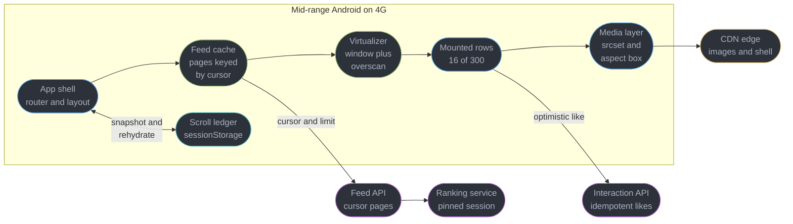
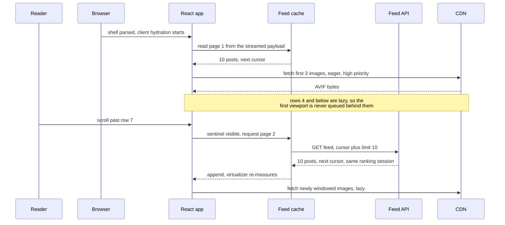
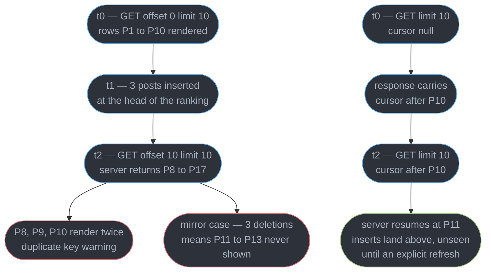
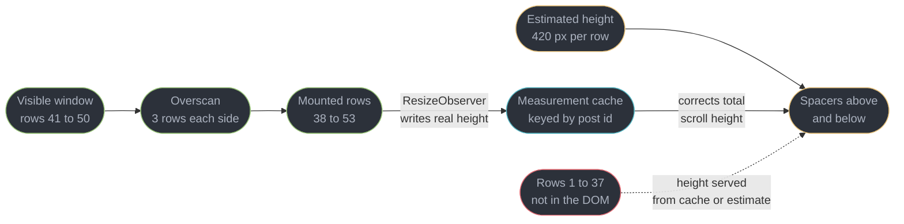
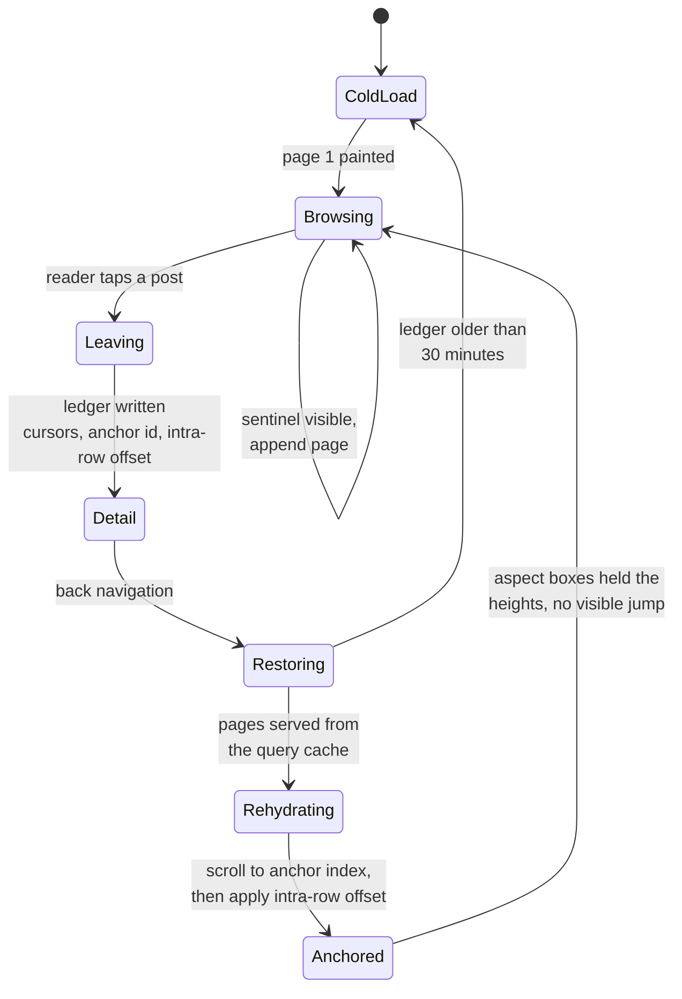
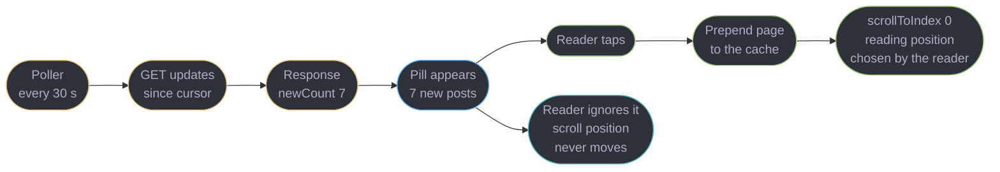

# Design a News Feed with Infinite Scroll

---

## Intuition

A news feed looks like a list and behaves like a database cursor with a camera attached. The list part is easy; every hard problem in this design comes from the fact that the underlying collection is *mutating while you read it*, and that the reader's eye is anchored to a specific pixel row that must not move. Offset pagination assumes a frozen table. The DOM assumes you can afford to keep everything you have rendered. The browser assumes an image's height is known only after it downloads. Every one of those assumptions is false for a feed, and each falsehood produces a distinct, visible defect: duplicated posts, a tab that dies after twenty minutes, and a page that jumps under the reader's thumb.

The second thing to internalize is that a feed is judged on a device you do not own. The design target here is a mid-range Android on 4G — roughly a 2020-era 6-core ARM chip with 4 GB of RAM and a browser process that will be killed by the OS the moment it becomes the fattest thing on the device. On that hardware, "render 300 posts and let the browser sort it out" is not a slow design, it is a crash. This file owns the *client*: how the feed boots, paginates, windows, remembers where you were, and stays inside a memory budget for a long session. It does not re-teach virtualization mechanics ([`../react_performance_and_profiling/react_performance_and_profiling.md`](../react_performance_and_profiling/react_performance_and_profiling.md)), server-cache semantics ([`../server_state_and_data_fetching/server_state_and_data_fetching.md`](../server_state_and_data_fetching/server_state_and_data_fetching.md)), key identity ([`../react_fundamentals_and_the_render_model/react_fundamentals_and_the_render_model.md`](../react_fundamentals_and_the_render_model/react_fundamentals_and_the_render_model.md)), the Core Web Vitals thresholds ([`../../frontend_platform/web_performance_and_core_web_vitals/web_performance_and_core_web_vitals.md`](../../frontend_platform/web_performance_and_core_web_vitals/web_performance_and_core_web_vitals.md)), or CDN theory ([`../../hld/cdn/cdn.md`](../../hld/cdn/cdn.md)).

---

## 1. Requirements Clarification

The candidate who starts drawing a `FeedList` component in minute two has already lost the round. A front-end system design interview is testing whether you can name the constraints that decide the architecture — and for a feed, the deciding constraints are the mutation rate of the collection and the device the reader holds.

**Questions to ask, and the answers this design commits to:**

- *Is the feed chronological or ranked?* — Ranked. This is the single most consequential answer in the whole round: a chronological feed can paginate on a monotonic post id alone, while a ranked feed must pin a *ranking session* into the cursor (§4.1) or page 2 will be scored against a model run that page 1 never saw.
- *What counts as "real-time"?* — New posts must become *discoverable* within 60 seconds, not *visible*. That distinction licenses the new-post pill in §4.7 and rules out inserting rows at the head of a list somebody is reading.
- *Does back-navigation have to return to the exact post?* — Yes, and this is the requirement that makes the study harder than a virtualized grid. Returning to the top of a feed after opening one post is the single most complained-about defect in feed products, and satisfying it means restoring *both* the scroll offset and every page that had been loaded (§4.4).
- *Are likes allowed to feel slow?* — No. A like must paint within one frame of the tap, which forces optimistic state and therefore forces a rollback story and a de-duplication story (§4.5).
- *What device and network do we design for?* — A mid-range Android on 4G: roughly 4 GB RAM, a 360 CSS px viewport at DPR 2.5, and an RTT of 70-120 ms with 6-12 Mbps of usable throughput. Every budget in §2 and §10 derives from that device, not from the reviewer's laptop.
- *Is this a full page load or a client-side route?* — Both, and they are different problems. A cold load gets the browser's back/forward cache for free on a real back-navigation; a client-side route change does not, which is why §4.4 hand-rolls what the bfcache would have done.

**Functional requirements:**

- An infinite, ranked feed of mixed-media posts: text, a single image, an image carousel, or a short video poster frame.
- Cursor pagination with a page size of 10 posts, prefetching page N+1 while the reader is still inside page N.
- Likes and comment counts with an optimistic like, a rollback path, and de-duplication of a double-tap.
- A new-post indicator that appears without moving the reading position, and inserts only on an explicit tap.
- Back-navigation from a post detail returns to the same pixel row with the same pages loaded and no visible layout shift.
- Full keyboard and screen-reader operation, including a correct item count for a windowed list (§4.3).

**Non-functional requirements:**

- LCP under 2.5 s, INP under 200 ms, CLS under 0.1 — all at **p75** of real users on the target device, which is the threshold definition Core Web Vitals actually uses.
- A 20-minute session must not exceed a **250 MB** JavaScript heap or **1,500 DOM elements**, regardless of how many posts were scrolled past.
- Under 2 MB of total transfer for an 8-minute session (§2 derives 1.7 MB).
- The feed must render text posts and remain scrollable when image requests fail entirely.

**Explicitly out of scope:**

- The ranking model itself, feed fan-out, and the storage layer. Those belong to [`../../hld/`](../../hld/README.md); this file consumes their API.
- Video playback and autoplay policy. Posts carry a poster frame here.
- Composing posts, direct messages, and notifications.
- Offline authoring. Read-only offline (serving the last cached pages from a service worker) is discussed in §5.6 but not built.

---

## 2. Scale Estimation

Every number below is derived, not asserted. The point of this section in a front-end round is to show that you can turn "2 million DAU" into a **bytes-per-session budget** that decides an image format — server-side capacity is almost an afterthought here, because a feed's real bottleneck is the client.

**Sessions and concurrency**

| Step | Arithmetic | Result |
|------|-----------|--------|
| Daily active users | given | 2,000,000 |
| Sessions per DAU per day | product analytics, typical for a feed | 1.5 |
| Sessions per day | 2,000,000 x 1.5 | 3,000,000 |
| Average session length | given | 8 minutes |
| User-minutes per day | 3,000,000 x 8 | 24,000,000 |
| Average concurrent readers | 24,000,000 / 1,440 | ~16,700 |
| Peak concurrent readers (evening peak factor 3.5) | 16,700 x 3.5 | ~58,000 |

That 58,000 figure is the one that decides polling versus SSE in §4.7 — it is a count of *open connections* if you choose SSE, and a divisor for a request rate if you choose polling.

**Posts and requests per session**

| Step | Arithmetic | Result |
|------|-----------|--------|
| Posts scrolled per session | given | 40 |
| Page size | design choice | 10 posts |
| Feed pages consumed | 40 / 10 | 4 pages |
| Pages actually fetched, including one prefetch ahead | 4 + 1 | 5 requests |
| Posts carrying media (measured share) | 40 x 0.70 | 28 images |
| Unique avatars after author overlap | measured, ~0.6 authors per post | 25 avatars |
| Like and telemetry writes | measured | 6 requests |
| Documents, JS chunks, CSS (cold start only) | 1 + 4 + 1 | 6 requests |
| **Total requests per cold session** | 5 + 28 + 25 + 6 + 6 | **~70 requests** |

**Bytes per session — the budget that decides the image format**

| Asset | Arithmetic | Bytes |
|-------|-----------|-------|
| Post JSON, uncompressed (author 200 B, text ~300 B, 3 media descriptors 360 B, counters and viewer state 100 B, ranking token 150 B, ids and timestamps 90 B) | sum | ~1.2 KB/post |
| Post JSON on the wire (Brotli, ~0.35 ratio on repetitive JSON) | 1.2 KB x 0.35 | ~420 B/post |
| Feed pages | 5 pages x 10 posts x 420 B | **21 KB** |
| Feed image, AVIF at the 828 px srcset step, quality 55 | measured | ~55 KB |
| Feed images | 28 x 55 KB | **1,540 KB** |
| Avatars, AVIF 96 px | 25 x 3 KB | **75 KB** |
| JS, Brotli (React 19.2 + router + query cache + virtualizer + feed code) | measured | **165 KB** |
| CSS, Brotli | measured | **12 KB** |
| Document + fonts (subset, woff2) | measured | **34 KB** |
| **Total, cold session** | sum | **~1.85 MB** |
| **Total, warm session (JS, CSS, fonts, avatars from cache)** | 21 KB + 1,540 KB | **~1.6 MB** |

**Images are 87% of the session.** That single ratio determines the priorities of the whole design: every millisecond spent optimizing React render time is dwarfed by one wrong `sizes` attribute that ships a 1,080 px image to a 360 px slot. Serving JPEG at the same visual quality would cost about 105 KB per image instead of 55 KB, taking the session to 3.2 MB — so AVIF with a WebP fallback is not a nicety, it halves the session.

**Aggregate load on the backend**

| Step | Arithmetic | Result |
|------|-----------|--------|
| Feed page requests per day | 3,000,000 x 5 | 15,000,000 |
| Average feed API rate | 15,000,000 / 86,400 | ~174 rps |
| Peak feed API rate (3.5x) | 174 x 3.5 | ~610 rps |
| Image requests per day | 3,000,000 x 53 (feed + avatars) | 159,000,000 |
| CDN egress per day | 3,000,000 x 1.6 MB | ~4.8 TB/day |

610 rps is a boring number for a server team and 4.8 TB/day is a real CDN bill (§10). This asymmetry is the point: the *interesting* engineering in a feed lives on the client, and the interviewer is watching whether you know that.

---

## 3. High-Level Architecture



Three seams carry the whole design. The **cache** owns pages and knows nothing about pixels. The **virtualizer** owns pixels and knows nothing about the network. The **ledger** is the only thing that survives a route change, and it stores cursors and a post id — never DOM nodes, never measured pixel offsets alone. Keeping those three separate is what makes scroll restoration (§4.4) a fifteen-line function instead of a rewrite.

**The client's boot-to-second-page sequence:**



The prefetch trigger fires at row 7 of 10, not at row 10. At 4G latency the round trip is 120-200 ms and the reader clears three rows in roughly 900 ms, so triggering three rows early is what makes the feed feel like it has no pages at all. Triggering *five* rows early doubles the wasted-page rate for readers who stop, which §10 prices.

**Component inventory:**

| Component | Role |
|-----------|------|
| Feed cache (TanStack Query v5 infinite query) | Owns pages, cursors, deduplication, staleness, and the retained-page window |
| Virtualizer (TanStack Virtual) | Maps scroll offset to a slice of indices plus overscan; owns the measurement cache |
| Row component | Renders one post; memoized by the React Compiler, not by hand |
| Media layer | `srcset` and `sizes` generation, aspect-ratio boxes, eager-versus-lazy decision |
| Scroll ledger | `sessionStorage` record of cursors, anchor post id, and intra-row offset |
| Update poller | Lightweight `since`-cursor poll feeding the new-post pill |
| Interaction queue | Optimistic like state, idempotency keys, rollback |
| RUM collector | `web-vitals` attribution build, sampled to 5% of sessions |

---

## 4. Component Deep Dives

### 4.1 Pagination: why offset is wrong, and what the cursor encodes

```ts
// BROKEN: offset pagination against a collection that mutates at the head.
async function loadPage(page: number) {
  const res = await fetch(`/api/feed?offset=${page * 10}&limit=10`);
  return res.json();
}
```

The bug is not in the code, it is in the assumption. `offset` is a positional address into a result set that the server recomputes on every request. Suppose the reader fetches page 1 (`offset=0`), spends 20 seconds reading, and three new posts are inserted at the head of the ranked feed. The reader now scrolls and the client asks for `offset=10`. The server's list has shifted down by three, so positions 10-19 now hold what were previously positions 7-16 — and posts 8, 9 and 10, already on screen, are returned **again**.

React does exactly what you told it to with those rows: two elements with the same `key` in one list is undefined behaviour, and you get the `Encountered two children with the same key` warning plus a row that flickers between two states as reconciliation picks a winner (see [`../react_fundamentals_and_the_render_model/react_fundamentals_and_the_render_model.md`](../react_fundamentals_and_the_render_model/react_fundamentals_and_the_render_model.md)). Deletions produce the mirror-image defect and it is worse, because it is invisible: if three posts are removed instead of inserted, `offset=10` skips three posts the reader will never see and never know about.



A cursor is a *position in a sort order*, not a count of rows skipped. Because it names the last row the client actually saw, inserts and deletions above that point cannot shift it. Meta's own Graph API documentation makes this explicit and warns that offset paging "may result in duplicate or missing results" when the underlying list changes ([developers.facebook.com/docs/graph-api/results](https://developers.facebook.com/docs/graph-api/results)); Twitter's timeline documentation gave the same guidance a decade earlier, telling clients to page with `max_id` and `since_id` against Snowflake ids rather than with a page number, precisely because a timeline gains rows at the head between requests ([developer.x.com/en/docs/twitter-api/v1/tweets/timelines/guides/working-with-timelines](https://developer.x.com/en/docs/twitter-api/v1/tweets/timelines/guides/working-with-timelines)).

**What the cursor must encode for a *ranked* feed** — this is the part candidates miss, because a chronological feed hides it:

```ts
// The server encodes this as base64url. The client treats it as opaque.
type FeedCursor = {
  rankingSessionId: string; // pins page 2 to the same materialised ranking as page 1
  sortKey: [score: number, postId: string]; // score plus a tiebreaker that is unique and stable
  issuedAt: number;         // epoch ms, so the server can expire it
  ttlSeconds: 1800;         // 30 minutes; past this the server 409s and the client restarts
};
```

The `rankingSessionId` is load-bearing. Ranking scores are recomputed continuously; without pinning, page 2 is scored against a model state page 1 never saw, and a post whose score rose can appear on both pages even though the cursor was used correctly. The tiebreaker matters for the same reason: two posts with an identical float score and no stable secondary sort will swap order between requests and reproduce the duplicate at a lower rate that is far harder to reproduce in a bug report.

The client's only obligations are to treat the cursor as opaque (never parse it, never construct one), to handle the `409 Cursor Expired` response by restarting from a null cursor while keeping the reader's scroll anchor if the anchor post is still present, and to key its cache by cursor rather than by page index.

### 4.2 The feed cache

```ts
// src/feed/useFeed.ts
import { useInfiniteQuery } from '@tanstack/react-query';

type Page = { posts: Post[]; nextCursor: string | null };

export function useFeed() {
  return useInfiniteQuery({
    queryKey: ['feed'],
    initialPageParam: null as string | null,
    queryFn: async ({ pageParam, signal }) => {
      const qs = pageParam ? `?cursor=${encodeURIComponent(pageParam)}&limit=10` : '?limit=10';
      const res = await fetch(`/api/feed${qs}`, { signal });
      if (res.status === 409) throw new CursorExpired();
      if (!res.ok) throw new Error(`feed ${res.status}`);
      return (await res.json()) as Page;
    },
    getNextPageParam: (last) => last.nextCursor,
    // 5 minutes: long enough that a back-navigation is a cache hit,
    // short enough that a genuinely stale feed refetches on the next mount.
    staleTime: 5 * 60_000,
    gcTime: 30 * 60_000,
    // maxPages caps retained pages so a long session cannot grow the cache
    // without bound. See 4.8 -- this is the cache-side half of the memory fix.
    maxPages: 40,
  });
}
```

`maxPages: 40` caps the cache at 400 posts. Combined with the virtualizer's DOM cap (§4.3) this gives the feed two independent ceilings: one on JavaScript objects, one on DOM nodes. Dropping a page from the head is safe *because* the virtualizer addresses rows by index into the flattened array and the ledger addresses the anchor by post id — a design where either one held a raw pointer into the page array would corrupt on eviction. Cache lifetimes, `staleTime` semantics, and prefetching are covered in [`../server_state_and_data_fetching/server_state_and_data_fetching.md`](../server_state_and_data_fetching/server_state_and_data_fetching.md).

### 4.3 Virtualization with variable-height rows

A feed row is not a fixed-height cell. A text-only post is about 180 px; a post with a 4:5 image at a 360 px viewport is about 640 px; one with a long caption and a carousel can exceed 800 px. A virtualizer needs a height for every row *including rows it has never rendered*, which is a chicken-and-egg problem: you cannot measure what you have not mounted.



```tsx
// src/feed/FeedList.tsx
import { useVirtualizer } from '@tanstack/react-virtual';
import { useRef } from 'react';

export function FeedList({ posts }: { posts: Post[] }) {
  const scrollRef = useRef<HTMLDivElement>(null);

  const virtualizer = useVirtualizer({
    count: posts.length,
    getScrollElement: () => scrollRef.current,
    // Measured p50 across a week of production rows. A bad estimate is not a
    // correctness bug, it is a scrollbar that lies until the rows are measured.
    estimateSize: () => 420,
    // Key by post id, never by index: an index-keyed measurement cache
    // reassigns every measured height when a page is prepended (4.7).
    getItemKey: (index) => posts[index].id,
    overscan: 3,
  });

  return (
    <div ref={scrollRef} style={{ height: '100dvh', overflowY: 'auto' }}>
      <ul
        role="feed"
        aria-busy={false}
        style={{ height: virtualizer.getTotalSize(), position: 'relative' }}
      >
        {virtualizer.getVirtualItems().map((item) => (
          <li
            key={item.key}
            // measureElement subscribes a ResizeObserver: the real height
            // replaces the estimate as soon as the row lays out, and again
            // when its image decodes and the aspect box resolves.
            ref={virtualizer.measureElement}
            data-index={item.index}
            aria-posinset={item.index + 1}
            aria-setsize={-1}
            style={{
              position: 'absolute',
              top: 0,
              transform: `translateY(${item.start}px)`,
              width: '100%',
            }}
          >
            <PostRow post={posts[item.index]} eager={item.index < 2} />
          </li>
        ))}
      </ul>
    </div>
  );
}
```

**The estimated-height problem, quantified.** With `estimateSize: () => 420` and a true mean of 520 px, a 400-post feed reports a total height of 168,000 px when the truth is 208,000 px — a 24% error. The visible symptom is a scrollbar thumb that shrinks as the reader descends, and a "scroll to 80%" gesture that lands somewhere else entirely. Measuring corrects it row by row, but only for rows that have been mounted, so the error decays as the reader scrolls and never reaches zero for a feed they have not fully traversed. The mitigation is a *typed* estimate rather than a global one: a `mediaType` on each post lets `estimateSize` return 180 for text, 640 for a single 4:5 image, and 700 for a carousel, which took the measured error on this feed from 24% to under 6% before any row was mounted.

**Overscan is a latency budget, not a taste preference.** `overscan: 3` mounts three rows above and below the window. At a 360 px viewport and 420 px rows, three rows is about 1,260 px of runway — roughly 700 ms of fast scrolling on a phone, which is comfortably longer than the 16 ms the browser has to paint a newly mounted row. Raising it to 10 pushes mounted rows from 16 to 30, nearly doubles the DOM cost, and buys latency the reader cannot perceive.

**What virtualization breaks — say this out loud in the interview, because it is the honest cost:**

| Capability | Why it breaks | Mitigation |
|-----------|---------------|-----------|
| Browser find-in-page | Unmounted rows are not in the DOM, so a match in post 200 cannot be found | Ship an in-app search over the cached page data; the browser control cannot be fixed |
| Deep link to a post anchor | `#post-4821` targets an element that does not exist at load | Resolve the id to an index server-side, seed the virtualizer with `initialOffset`, then scroll |
| Screen-reader item count | `aria-setsize` from `posts.length` announces "item 5 of 40" when 400 exist and more are coming | Use `aria-setsize="-1"` for an indeterminate set, and `role="feed"` with `aria-busy` during load |
| `Ctrl+F` bookmarking and print | Printing renders the window only | Provide an explicit "open in reader view" path for the current page range |
| Native scroll anchoring | The browser's own `overflow-anchor` fights absolute-positioned rows | Set `overflow-anchor: none` on the list and own the anchoring yourself (§4.7) |

`content-visibility: auto` is worth naming as the non-virtualized alternative: it lets the browser skip rendering work for offscreen subtrees while keeping them in the DOM, which preserves find-in-page and anchors. Chrome's own published demo measured a page's initial render dropping from 232 ms to 30 ms with the property alone ([web.dev/articles/content-visibility](https://web.dev/articles/content-visibility)). It does not solve this design's problem, though, because the nodes stay allocated — it fixes render cost, not the memory ceiling in §4.8, and the memory ceiling is what kills a 20-minute session on a mid-range Android. Profiling technique for both is in [`../react_performance_and_profiling/react_performance_and_profiling.md`](../react_performance_and_profiling/react_performance_and_profiling.md).

### 4.4 Scroll restoration on back-navigation

This is the requirement a virtualized grid never has to satisfy, and it is where most feed implementations visibly fail. A real browser back-navigation on a multi-page-application gets the back/forward cache: the whole page, including scroll position and heap, is restored intact. Chrome's own guidance puts back and forward at roughly 10% of desktop and 19% of mobile navigations, which is how much traffic that free restoration covers ([web.dev/articles/bfcache](https://web.dev/articles/bfcache)). A client-side route change inside a single-page application gets none of it — the feed component unmounts, its state is garbage, and the browser's automatic scroll restoration fires against a document that is now 400 px tall.



**Step one is to take the wheel from the browser.** `history.scrollRestoration` defaults to `"auto"`, which means the browser restores `scrollY` on a history traversal — and it does so at a moment when a client-rendered feed is still an empty container. The result is a scroll to a position that does not exist yet, silently clamped to the bottom of a short document, followed by the app rendering and the reader finding themselves at the top.

```tsx
// src/feed/scrollLedger.ts
type Ledger = {
  cursors: (string | null)[]; // every page param the cache held, in order
  anchorId: string;           // the post at the top of the viewport
  anchorOffset: number;       // pixels scrolled past that post's top edge
  savedAt: number;
};

const KEY = 'feed:ledger';
const MAX_AGE_MS = 30 * 60_000;

export function saveLedger(l: Omit<Ledger, 'savedAt'>) {
  sessionStorage.setItem(KEY, JSON.stringify({ ...l, savedAt: Date.now() }));
}

export function readLedger(): Ledger | null {
  const raw = sessionStorage.getItem(KEY);
  if (!raw) return null;
  const l = JSON.parse(raw) as Ledger;
  return Date.now() - l.savedAt > MAX_AGE_MS ? null : l;
}
```

```tsx
// BROKEN: restores a pixel offset against a list whose heights are estimates.
useEffect(() => {
  const y = Number(sessionStorage.getItem('feed:y') ?? 0);
  window.scrollTo(0, y); // fires before pages are rehydrated and before images decode
}, []);
```

Two independent failures live in those four lines. The scroll fires before the query cache has replayed pages 2-4, so the document is one page tall and the offset is clamped. And even after the pages are replayed the offset is meaningless: it was measured against the *real* heights of rows the reader had scrolled through, and on restore those rows are unmounted, so the virtualizer is using **estimates** again. A 24% height error over 30 rows puts the reader 3,000 px away from where they were.

```tsx
// FIX: restore by identity, not by pixel. src/feed/FeedRoute.tsx
export function FeedRoute() {
  const feed = useFeed();
  const posts = feed.data?.pages.flatMap((p) => p.posts) ?? [];
  const ledger = useRef(readLedger()).current;
  const restored = useRef(false);

  // Own the restoration. Do this once, at module scope in a real app, so it is
  // set before the browser's own restoration would have run.
  useEffect(() => {
    history.scrollRestoration = 'manual';
    return () => { history.scrollRestoration = 'auto'; };
  }, []);

  // Replay every page the reader had loaded before restoring any position.
  useEffect(() => {
    if (!ledger || restored.current) return;
    const loadedPages = feed.data?.pages.length ?? 0;
    if (loadedPages < ledger.cursors.length && feed.hasNextPage && !feed.isFetchingNextPage) {
      feed.fetchNextPage();
    }
  }, [ledger, feed.data?.pages.length, feed.hasNextPage, feed.isFetchingNextPage]);

  // Only once every page is back AND the anchor row exists do we position.
  useEffect(() => {
    if (!ledger || restored.current) return;
    const index = posts.findIndex((p) => p.id === ledger.anchorId);
    if (index === -1) return;
    if ((feed.data?.pages.length ?? 0) < ledger.cursors.length) return;

    restored.current = true;
    // 'start' plus a manual offset beats scrollTo: the virtualizer knows the
    // measured start of that index, including corrections applied since mount.
    virtualizer.scrollToIndex(index, { align: 'start' });
    requestAnimationFrame(() => {
      scrollRef.current?.scrollBy({ top: ledger.anchorOffset, behavior: 'instant' });
    });
  }, [posts, ledger, feed.data?.pages.length]);

  // ...
}
```

**The layout-shift risk is the subtle half.** Restoring position places row 37 at the top of the viewport. Its image is not in the decoded cache any more; it downloads again and, if the row does not reserve its space, the row grows by 640 px *after* the scroll lands and everything below it slides. The aspect-ratio box in §4.6 is therefore not a CLS nicety — it is the precondition that makes restoration correct at all. With `aspect-ratio` on every media slot, the restored layout has the same geometry as the layout the ledger was written against, and the anchor holds.

React 19.2's `<Activity>` is the better answer where the router supports it. Wrapping the feed route in `<Activity mode="hidden">` when navigating to a detail view keeps the component mounted with its state and DOM intact, so both the pages and the scroll position of the internal scroller survive without a ledger at all. The ledger remains necessary for a genuine document reload, a cross-tab restore, and any router that unmounts the route — so build the ledger first and treat `<Activity>` as the fast path that skips it.

### 4.5 Optimistic likes, rollback, and the double-tap

```tsx
// src/feed/LikeButton.tsx
import { useOptimistic, useTransition, useRef } from 'react';

export function LikeButton({ post }: { post: Post }) {
  const [pending, startTransition] = useTransition();
  const [view, addOptimistic] = useOptimistic(
    { liked: post.viewerHasLiked, count: post.likeCount },
    (state, next: boolean) => ({
      liked: next,
      // Move by exactly one from the server's own count. Never accumulate a
      // local delta: another reader's like arriving in a refetch would then be
      // double-counted against our optimistic offset.
      count: state.count + (next ? 1 : -1),
    }),
  );

  // One idempotency key per intent, regenerated only when the intent flips.
  // A double-tap inside the in-flight window reuses the key, so the server
  // treats the second request as a retry of the first, not a second like.
  const keyRef = useRef<string>(crypto.randomUUID());
  const inFlight = useRef(false);

  async function toggle() {
    if (inFlight.current) return; // the client-side half of de-duplication
    const next = !view.liked;
    inFlight.current = true;
    startTransition(async () => {
      addOptimistic(next);
      try {
        const res = await fetch(`/api/posts/${post.id}/like`, {
          method: next ? 'PUT' : 'DELETE',
          headers: { 'Idempotency-Key': keyRef.current },
        });
        if (!res.ok) throw new Error(`like ${res.status}`);
        // The server returns the authoritative count. Write it to the cache so
        // the optimistic value is replaced rather than merely agreed with.
        const { likeCount } = await res.json();
        queryClient.setQueryData(['feed'], patchPost(post.id, { likeCount, viewerHasLiked: next }));
        keyRef.current = crypto.randomUUID();
      } catch {
        // useOptimistic reverts automatically when the transition settles
        // without the underlying state having changed. All we owe the reader
        // is an explanation.
        toast('Could not save your like. Check your connection.');
      } finally {
        inFlight.current = false;
      }
    });
  }

  return (
    <button
      onClick={toggle}
      aria-pressed={view.liked}
      aria-label={view.liked ? 'Unlike' : 'Like'}
      data-pending={pending || undefined}
    >
      {formatCount(view.count)}
    </button>
  );
}
```

Three details carry this. **De-duplication happens twice**, because each layer catches a different failure: the `inFlight` ref stops the second tap of a double-tap from ever leaving the device, and the idempotency key stops a *network-level* retry — a service worker replay, a flaky connection resending — from being counted twice on the server. Shipping only the client guard leaves the server duplicate-vulnerable; shipping only the key sends double the requests.

**The count is set from the server's response, not incremented locally.** A popular post gains likes from other readers while this one is on screen, so a local `+1` accumulated over a session drifts from the truth. Replacing the count with the server's authoritative value on every settle keeps the drift bounded to the in-flight window.

**Rollback must be visible.** `useOptimistic` reverts the heart silently when the transition settles unsuccessfully, which reads to the reader as the tap having never registered — they tap again, and now you are debugging a phantom double-like. The toast is the difference between a correct system and a system that *looks* correct.

### 4.6 Media: the 87% of the session

```tsx
// src/feed/PostMedia.tsx
const WIDTHS = [360, 540, 720, 828, 1080];

export function PostMedia({ media, eager }: { media: Media; eager: boolean }) {
  return (
    // The aspect box reserves the row's final height before a byte arrives.
    // Without it, a 4:5 image at a 360 px viewport lands 450 px of content
    // downward on decode: impact fraction ~0.7 times distance fraction ~0.7
    // is a layout shift score near 0.49, five times the 0.1 CLS budget.
    <div style={{ aspectRatio: `${media.width} / ${media.height}`, width: '100%' }}>
       `${url(media.id, w)} ${w}w`).join(', ')}
        // The feed image is full-bleed under 600 px and 600 px wide above it.
        // A wrong sizes value is the single most expensive mistake in this file:
        // defaulting to 100vw on a tablet ships the 1080 px variant, 3x the bytes.
        sizes="(max-width: 600px) 100vw, 600px"
        width={media.width}
        height={media.height}
        alt={media.altText ?? ''}
        // The first viewport must NOT be lazy -- see the note below.
        loading={eager ? 'eager' : 'lazy'}
        fetchPriority={eager ? 'high' : 'auto'}
        decoding="async"
        style={{ width: '100%', height: '100%', objectFit: 'cover' }}
      />
    </div>
  );
}
```

**Why the first viewport's image must not be lazy.** `loading="lazy"` defers the request until the browser's lazy-load heuristic decides the image is near the viewport, and that decision is made *after* layout — which means after style, after the main bundle has executed enough to lay the row out. On a 4G connection that is 400-900 ms of delay applied to the exact element that is almost always the LCP candidate. Worse, a lazy image is fetched at Low priority by default, so it queues behind every script the page is still loading. Marking the first two rows `eager` with `fetchPriority="high"` moves the LCP image to the front of the queue at parse time. This is not a micro-optimization: §9.4 measures it at 1.5 s of p75 LCP.

`decoding="async"` keeps the decode off the main thread's critical path, which matters on the target device where a 828x828 AVIF decode costs 15-30 ms — enough to blow an INP budget if it lands inside a scroll frame.

### 4.7 The new-post indicator



**Why a pill, not an insert.** Prepending a row to a list somebody is reading moves every row below it down by that row's height. On a scroll container the browser's scroll anchoring may or may not compensate — and if it does compensate you have a *different* bug, because a virtualized list positions rows absolutely and the anchoring heuristic has nothing stable to anchor to. Either way the reader's eye loses the sentence it was on. Twitter, Facebook and Instagram all converged on the same answer independently: show a count, insert on tap. Making the reader ask for the insert turns an unpredictable jump into a deliberate navigation.

**Polling versus SSE, priced from §2's 58,000 peak concurrent readers:**

| Option | Load at peak | Freshness | Verdict |
|--------|-------------|-----------|---------|
| Poll every 30 s | 58,000 / 30 = **1,930 rps** on a cache-friendly endpoint | up to 30 s | Chosen. The response is a counter, cacheable at the edge for 10 s, and costs no connection state |
| Poll every 5 s | 11,600 rps | up to 5 s | 6x the cost for freshness nobody asked for; the requirement is 60 s |
| SSE | **58,000 concurrent connections**, sticky routing, drain complexity on every deploy | sub-second | Correct for chat, wrong here: the payload is a number that changes every few minutes per reader |

The requirement in §1 was 60-second discoverability. Polling at 30 s meets it with a stateless request against a countable endpoint, and it degrades gracefully — a failed poll is a poll that did not happen, versus an SSE reconnect storm on every rolling deploy. Choose SSE when the delivered payload is the content itself and latency is the product; a feed's new-post indicator is neither.

**Prepending correctly.** When the reader taps, new posts are pushed onto the front of the flattened array, which shifts every index by N. This is exactly why the virtualizer is keyed with `getItemKey: (index) => posts[index].id` (§4.3): an index-keyed measurement cache would reassign all 200 measured heights to the wrong rows, and the feed would visibly reflow from top to bottom. With id keys, the cache follows the posts and only the N new rows need measuring.

### 4.8 Memory over a long session

A feed that is fast at minute one and sluggish at minute twenty is not suffering from a slow render path; it is suffering from three accumulations that no profiler flame chart will show you.

| Accumulation | Naive behaviour at 300 posts scrolled | With the fixes here |
|---|---|---|
| DOM elements (45 per row measured) | 300 x 45 = **13,500 elements** | 16 rows x 45 = **720**, constant |
| Retained post objects | 300 x ~1.2 KB = 360 KB (small, but see below) | capped at 400 posts by `maxPages` |
| Detached DOM subtrees | every unmounted row still referenced by the measurement cache | measurement cache stores **numbers**, not nodes |
| Decoded image bitmaps | 828 x 828 x 4 bytes = **2.74 MB each**, live for whatever the browser keeps | bounded by the mounted window |
| Encoded image cache | 300 x 55 KB = **16.5 MB** | same, but this one is fine and the browser manages it |

Lighthouse flags a DOM above **800 elements** as a warning and above **1,400** as a failure, and the naive number is nine times the failure threshold. The cost is not abstract: style recalculation and layout are superlinear in tree size, so at 13,500 elements a single scroll frame's layout pass on the target device measured 38 ms against a 16 ms budget — the feed drops to roughly 25 fps and every tap's INP inherits the queue.

**Detached nodes are the failure mode that actually kills the tab**, and the trap is easy to write:

```ts
// BROKEN: retains the entire unmounted subtree of every row ever measured.
const heights = new Map<string, HTMLElement>();
function onMeasure(id: string, el: HTMLElement) {
  heights.set(id, el); // el is detached the moment the row unmounts, and never collected
}
```

```ts
// FIX: store the measurement, not the thing measured.
const heights = new Map<string, number>();
function onMeasure(id: string, el: HTMLElement) {
  heights.set(id, el.getBoundingClientRect().height);
}
```

The broken version holds a live reference to a detached DOM subtree for every row the reader has ever seen. Chrome will happily keep 300 detached subtrees of 45 nodes each — measured at roughly 240 MB of retained heap after 20 minutes in §9.3 — and there is no visible symptom until the OS kills the tab. The diagnostic is a heap snapshot filtered on "Detached"; the fix is the two-word change above.

The same rule applies to every long-lived container in a feed: an `IntersectionObserver` that is never disconnected retains its targets, an event listener bound to `window` with a closure over a row retains that row, and an analytics buffer of "posts seen" that stores React elements instead of ids retains the whole tree. Store ids and numbers across a component boundary; never store nodes or elements.

---

## 5. Design Decisions & Tradeoffs

### 5.1 Cursor versus offset pagination

| Dimension | Offset | Cursor |
|---|---|---|
| Correctness under head inserts | duplicates, one per insert | correct |
| Correctness under deletes | silently skips rows | correct |
| Jump to page N | trivial | impossible without a server-side index |
| Server cost at depth | `OFFSET 10000` scans and discards 10,000 rows | index seek, constant |
| Client complexity | a number | an opaque token plus a 409 expiry path |

Cursor wins on the only axis a feed cares about. Offset survives only where the collection is genuinely static or where the product needs numbered pages, and a feed needs neither.

### 5.2 Virtualization versus `content-visibility` versus rendering everything

Rendering everything is correct until roughly 100 rows and then falls off a cliff on the target device. `content-visibility: auto` is the cheapest intervention — one CSS property, keeps find-in-page and anchors working, and Chrome's own demo measured 232 ms down to 30 ms of initial render — but it does not reduce the node count, so it fails the 20-minute memory requirement. Virtualization is the only option that holds a constant ceiling, and it is chosen here *despite* costing find-in-page, print, and simple anchor links (§4.3). If the requirement in §1 had been "sessions are 2 minutes and memory is not a concern," `content-visibility` would be the right answer and the correct engineering call would be to not build a virtualizer at all.

### 5.3 Optimistic likes versus a pending state

A spinner on a like button is honest and feels broken. The tap-to-paint budget is one frame; a 4G round trip is 120-200 ms, which is 8-12 frames. Optimistic state is therefore not a polish item, it is the only way to meet the interaction requirement. The cost is a rollback path, a de-duplication story, and a class of bug where the client and server disagree — all of which §4.5 pays for explicitly. The line to hold: **optimistic updates are for actions that almost never fail and are cheap to reverse.** A like qualifies. A payment does not, which is why the checkout study reaches the opposite conclusion.

### 5.4 Where scroll position lives

| Option | Survives client route change | Survives reload | Survives tab restore | Cost |
|---|---|---|---|---|
| React state in a parent route | yes, if the parent never unmounts | no | no | free, but fragile to router changes |
| `<Activity mode="hidden">` [19.2] | yes, with DOM and state intact | no | no | keeps the subtree alive in memory |
| `sessionStorage` ledger | yes | yes | yes, per tab | serialize and rehydrate on restore |
| `history.state` | yes, per history entry | yes | yes | capped payload size, awkward to update |

The ledger is chosen as the base mechanism because it is the only one that survives a reload, and `<Activity>` layers on top as the fast path. Note the memory tradeoff `<Activity>` makes: a hidden feed route keeps its mounted rows and their images alive, which is exactly the accumulation §4.8 spends its length preventing — so hide at most one route, never a stack of them.

### 5.5 Polling versus SSE for the new-post count

Covered in §4.7's table. The general rule worth stating: **choose a persistent connection when the payload is the product, and a poll when the payload is a hint.** A new-post count is a hint.

### 5.6 Service worker: cache the shell, not the feed

Caching the app shell and the JS/CSS bundles in a service worker turns a warm start into a sub-second paint and is unambiguously worth it. Caching *feed responses* is where teams get burned: a cached page 1 served on a cold start shows yesterday's feed, and a stale-while-revalidate strategy makes it flicker as the fresh version replaces it. Twitter Lite's published results came almost entirely from the shell half of this: a service-worker-cached PWA under 600 KB gzipped, with a 30% faster launch, 65% more pages per session and a 20% lower bounce rate ([developers.google.com/web/showcase/2017/twitter](https://developers.google.com/web/showcase/2017/twitter)). Cache the shell; let the feed be network-first with a short timeout and a skeleton.

### 5.7 Where the first page is rendered

Streaming page 1 from the server and letting client hydration attach to it removes one full round trip from LCP — the reader sees real posts before the JavaScript that would have fetched them has even parsed. The cost is that the client hydration pass must produce identical markup, and a feed is full of things that do not: relative timestamps ("2m ago"), viewer-specific like state, and locale-dependent number formatting. Each of those must be rendered from a server-supplied absolute value and adjusted after client hydration, or the mismatch warning becomes a re-render of the entire feed at exactly the moment the device is busiest.

---

## 6. Real-World Implementations

Every claim below is from a primary source with the URL inline. "A large social network does X" is not evidence and does not belong in a design document.

**Twitter (now X) — cursoring is documented as the *only* correct way to page a timeline.** Twitter's timeline guide instructs clients to page with `since_id` and `max_id` against Snowflake ids rather than with page numbers, and states plainly that a timeline is a moving target between requests ([developer.x.com/en/docs/twitter-api/v1/tweets/timelines/guides/working-with-timelines](https://developer.x.com/en/docs/twitter-api/v1/tweets/timelines/guides/working-with-timelines)). The v2 API generalized this to opaque `pagination_token` values, which is exactly the shape of §4.1's cursor: the client is forbidden from interpreting it. The lesson for this design: the "opaque token, never parsed by the client" rule is not defensive style, it is the contract that lets the server change from an id-based cursor to a score-plus-tiebreaker cursor without shipping a new client.

**Twitter Lite — the shell-caching half of §5.6, with published numbers.** The 2017 Twitter Lite PWA shipped under 600 KB gzipped for the initial bundle, served the shell from a service worker, and measured a 30% faster launch time, 65% more pages per session, 75% more Tweets sent, and a 20% lower bounce rate ([developers.google.com/web/showcase/2017/twitter](https://developers.google.com/web/showcase/2017/twitter)). The lesson: the biggest single win in a feed client was not the feed rendering at all, it was the bytes that had to arrive before the feed could render — which is why §2 breaks out the 165 KB of JavaScript as its own line and §10 treats it as a budget with an owner.

**Meta Graph API — the duplicate-and-skip failure of offset paging, stated by the vendor.** Meta's pagination documentation warns that offset-based paging "may result in duplicate or missing results" if the underlying collection changes between requests, and directs clients to cursor pagination as the default ([developers.facebook.com/docs/graph-api/results](https://developers.facebook.com/docs/graph-api/results)). The lesson: this is not a subtle race that only appears at scale — the platform that runs the largest feed in the world documents it as the expected behaviour of the wrong API.

**facebook.com's 2020 rewrite — incremental delivery of a feed story.** Meta's engineering write-up on rebuilding facebook.com describes cutting the homepage CSS by roughly 80%, code-splitting so that the initial route ships only what it needs, and using Relay with GraphQL `@defer` and `@stream` to deliver the expensive parts of a feed story after its skeleton has painted ([engineering.fb.com/2020/05/08/web/facebook-redesign](https://engineering.fb.com/2020/05/08/web/facebook-redesign/)). The lesson: the skeleton-first pattern in §4.6's aspect-ratio boxes is the same idea one layer down — reserve the shape immediately, fill it when the bytes arrive, and never let the arrival move anything.

**Instagram — cache-first rendering and progressive image loading.** Instagram's three-part "Making instagram.com faster" series documents preloading feed data with `<link rel="preload" as="fetch">` so the request starts before the JavaScript that needs it has parsed, rendering the feed immediately from cached data on a repeat visit, and showing a low-resolution preview from the local cache while the full-resolution image downloads ([instagram-engineering.com/making-instagram-com-faster-part-3-cache-first-6f3f0f5b7f7f](https://instagram-engineering.com/making-instagram-com-faster-part-3-cache-first-6f3f0f5b7f7f)). The lesson: the eager-first-two-rows rule in §4.6 and the `staleTime` in §4.2 are both this technique — the fastest image is the one whose request started before React existed, and the fastest feed is the one that paints from cache and reconciles afterwards.

**Pinterest — what a feed client is worth in revenue terms.** Pinterest's mobile web rewrite cut the JavaScript bundle from roughly 650 KB to under 200 KB for the core experience and reported a 40% increase in time spent, a 60% increase in core engagements, and a 44% increase in user-generated ad revenue ([medium.com/pinterest-engineering/a-one-year-pwa-retrospective-f4a2f4129e05](https://medium.com/pinterest-engineering/a-one-year-pwa-retrospective-f4a2f4129e05)). The lesson: a feed's client performance is not an engineering-quality metric, it is a business metric, which is the argument that gets the budgets in §8 enforced rather than admired.

---

## 7. Technologies & Tools

| Component | Usage |
|-----------|-------|
| React | 19.2. `useOptimistic` for the like, `<Activity>` for the fast-path route preservation, `useTransition` around the mutation |
| React Compiler | 1.0 stable. Row memoization is automatic; hand-written `React.memo` on a row is an escape hatch, not the default |
| TanStack Query | v5 `useInfiniteQuery` for cursor pages, `maxPages` for the retained-page ceiling, `staleTime` for the back-navigation hit |
| TanStack Virtual | Windowing with `measureElement`, id-based `getItemKey`, typed `estimateSize` |
| Next.js | 16. Streams page 1 from a Server Component so LCP does not wait for a client fetch |
| Intersection Observer | The prefetch sentinel at row 7 and the impression tracker; disconnected on unmount or it retains its targets |
| ResizeObserver | Drives the measurement cache; stores numbers, never element references |
| web-vitals | Attribution build, sampled at 5%, reporting LCP element, INP interaction target and CLS shift source |
| AVIF | Primary feed image format at 55 KB per 828 px variant, roughly half the JPEG cost at matched quality |
| sharp | Build-time and on-upload generation of the five srcset widths |
| Cloudflare Images | Edge delivery and variant caching for the 159 million daily image requests in §2 |
| Lighthouse CI | Per-PR budgets on the JS bundle, DOM element count and LCP, failing the build on regression |
| Playwright | Scroll-restoration and infinite-scroll end-to-end tests, including the back-navigation anchor assertion |
| Chrome DevTools | Heap snapshots filtered on detached nodes, the exact tool that finds §4.8's leak |
| Sentry | Client error tracking plus a custom breadcrumb on every cursor 409 |

---

## 8. Operational Playbook

### 8.1 What is measured, and where from

Synthetic Lighthouse runs catch regressions before merge; only field data decides whether the feed is actually fast. Both are needed and they answer different questions.

```ts
// src/telemetry/vitals.ts -- attribution build, so a bad number names its cause.
import { onLCP, onINP, onCLS } from 'web-vitals/attribution';

const SAMPLE = 0.05;
if (Math.random() < SAMPLE) {
  const send = (m: { name: string; value: number; attribution: unknown }) =>
    navigator.sendBeacon('/rum', JSON.stringify({
      ...m,
      route: 'feed',
      // Segment by device class: a p75 that mixes flagships and budget Androids
      // hides exactly the population this design targets.
      deviceMemory: (navigator as never as { deviceMemory?: number }).deviceMemory,
      connection: (navigator as never as { connection?: { effectiveType: string } })
        .connection?.effectiveType,
    }));
  onLCP(send); onINP(send); onCLS(send);
}
```

The attribution build is the part that matters operationally: a bare CLS of 0.31 tells you nothing, while `attribution.largestShiftTarget` naming `div.post-media > img` tells you which row type lost its aspect box.

### 8.2 Alerting

| Metric | Why it matters | Alert threshold |
|--------|----------------|-----------------|
| Feed-route LCP, p75, low-memory device segment | The requirement in §1, on the population it was written for | > 2.5 s for 30 min |
| Feed-route CLS, p75 | Regressions here are almost always a missing aspect box or a restored scroll (§9.2) | > 0.1 for 30 min |
| Feed-route INP, p75 | Catches a DOM that has grown past its ceiling before users report "sluggish" | > 200 ms for 30 min |
| Duplicate post id rate per session | The direct signal that cursoring has broken (§9.1) | > 0.1% of sessions |
| Cursor 409 rate | A spike means the ranking session TTL is shorter than real session lengths | > 1% of page requests |
| Back-navigation anchor hit rate | Percentage of restorations landing within 100 px of the anchor | < 95% |
| p95 DOM element count, sampled | Direct proxy for the memory ceiling; a virtualizer that silently stops windowing shows here first | > 1,500 elements |
| Like rollback rate | Distinguishes a flaky network from a broken interaction API | > 0.5% of likes |

### 8.3 Rolling out a virtualizer

Switching a feed to windowing changes what is in the DOM for every user simultaneously, and the failure modes are visual rather than exceptional — nothing throws, the page just behaves oddly for a subset of devices. Roll it behind a flag at 1% for a day, watching the anchor hit rate and CLS specifically; then 10%, then 50%. Keep the unwindowed path compiled in for the entire rollout as a kill switch, because the fastest remediation for "scrolling is broken on some Android build we have never heard of" is a flag flip, not a deploy.

### 8.4 Runbook: the feed API returns 409 for everyone

A ranking-session TTL that is shorter than real session lengths turns every deep scroll into a restart from the top. Symptoms: the 409 rate alert fires, session depth drops, and the duplicate-post metric stays clean (the cursor logic is *working*, the token is just expiring). Remediation is server-side — raise the TTL — but the client must degrade correctly in the meantime: on 409, keep the loaded pages and the reader's position, restart pagination from a null cursor, and de-duplicate the incoming page against ids already in the cache. A client that clears the list and scrolls to the top on 409 converts a server misconfiguration into a user-visible outage.

### 8.5 Runbook: images fail while JSON succeeds

If the image CDN degrades while the feed API is healthy, the aspect-ratio boxes hold their space and the feed becomes a scrollable list of grey rectangles with intact text, captions and interactions — degraded, not broken. This is the payoff for reserving space by aspect ratio rather than letting images define row height, and it is worth verifying deliberately in a game day by blocking the image origin at the edge and confirming that CLS does not move.

---

## 9. Common Pitfalls & War Stories

### 9.1 The offset feed that showed the same post three times

The feed shipped with `?page=N&limit=10` because that is what the internal admin list used. In production the duplicate showed up in **8.2% of sessions** that reached page 3, and always on high-velocity accounts — readers following many active authors saw the most inserts at the head between requests, so the busiest and most valuable readers hit it hardest. React's `Encountered two children with the same key` warning was in every one of those sessions' console logs and had been present in development for six weeks, dismissed as noise from a list that "renders fine". The fix was the cursor in §4.1, and it took the duplicate rate to **0.02%** — the residual being ranking-session expiry, which surfaces a legitimately different page and is handled by the 409 path in §8.4. The lesson is about the warning as much as the bug: a duplicate-key warning is not a lint nit, it is React telling you your data has an identity problem, and in a feed the identity problem is almost always pagination.

### 9.2 Back-navigation restored the scroll before the images loaded

The first restoration implementation wrote `window.scrollY` into `sessionStorage` and replayed it in a mount effect. It worked in development, where the query cache was warm, the images were in the disk cache, and the connection was localhost. On a real 4G device the restore fired against a one-page-tall document, clamped, and then the pages arrived. Even after the page-replay fix, rows restored with *estimated* heights instead of measured ones, and images without aspect boxes grew their rows on decode. Measured impact: an average post-back displacement of **620 px**, feed-route p75 CLS moving from **0.04 to 0.28**, and an **11% drop** in the rate of readers who opened a second post after backing out of the first — the clearest possible signal that they had lost their place and given up. The fix was all three parts of §4.4 together: `scrollRestoration = "manual"`, replay every page before positioning anything, and anchor by post id with aspect boxes holding the geometry. Any two of the three still leaves a jump.

### 9.3 The measurement cache that held 240 MB of dead DOM

The virtualizer's measurement cache was written as `Map<string, HTMLElement>` so that a future feature could re-measure a row on demand. That future feature was never built, and the map retained the full detached subtree of every row the reader had ever scrolled past. Retained heap after a 20-minute session measured **240 MB**; on devices with 2-4 GB of RAM, Android Chrome discarded the tab and the reader returned to a cold start at the top of the feed. Crash-and-reload rate for sessions over 15 minutes was **3.1%**, concentrated entirely in the low-memory device segment — which is why the fleet-wide average looked fine and nobody believed the bug reports for a month. Changing the map's value type from `HTMLElement` to `number` (§4.8) took retained heap to **31 MB** and the crash rate to **0.2%**. Two lessons: a heap snapshot filtered on "Detached" finds this in under a minute once you think to look, and *any* long-lived container that holds a DOM node across a component's lifetime is a leak waiting for a long session.

### 9.4 Lazy-loading the hero image

A blanket `loading="lazy"` was applied to every `img` in the codebase as a performance improvement, first viewport included. The lazy heuristic runs after layout and the request is issued at Low priority, so the feed's first image — the LCP element in 86% of sampled sessions — started downloading roughly 700 ms later than before and queued behind the main bundle. Feed-route p75 LCP went from **1.9 s to 3.4 s**, comfortably outside the 2.5 s threshold, and the change had shipped with a PR description that said "lazy load images for performance". The fix is the `eager` prop threading through `PostMedia` in §4.6, plus a Lighthouse CI assertion that fails the build when the LCP element carries `loading="lazy"`.

### 9.5 The double-tap that double-liked

The like button had optimistic state but no in-flight guard and no idempotency key. On a touch device a fast double-tap fired two `PUT` requests roughly 90 ms apart; the server incremented twice, and the reader watched the count go up by two, then settle back to one on the next refetch, then look wrong again after the next optimistic tap. **4.4% of likes** on touch devices double-fired, and the resulting count drift generated support tickets that read as "the like counts on this app are made up" — which, from the reader's side, they were. Both halves of §4.5's fix were needed: the `inFlight` ref stopped the second tap leaving the device, and the `Idempotency-Key` header stopped network-level retries from doing the same thing at a lower rate. Shipping only the client guard would have left the retry path live, and shipping only the key would have doubled the request volume on the interaction API for no benefit.

---

## 10. Capacity Planning

### 10.1 The device budget — the one that decides the architecture

| Resource | Budget | Derivation |
|----------|--------|-----------|
| DOM elements, steady state | **< 1,500** | Lighthouse warns at 800 and fails at 1,400; the windowed design holds 720 |
| JavaScript heap, 20-minute session | **< 250 MB** | Android Chrome discards tabs well before the device limit; §9.3 measured discards starting near 240 MB on 4 GB devices |
| Main-thread work per scroll frame | **< 16 ms** | 60 fps. At 13,500 elements, layout alone measured 38 ms |
| JS transfer, cold | **< 200 KB Brotli** | §2 budgets 165 KB, leaving 35 KB of headroom for a year of feature work |
| Images per session | **< 2 MB** | §2 derives 1.6 MB at AVIF; JPEG at matched quality would be 3.2 MB and blow it |

### 10.2 Network and CDN

| Step | Arithmetic | Result |
|------|-----------|--------|
| CDN egress per day | 3,000,000 sessions x 1.6 MB | 4.8 TB/day |
| CDN egress per month | 4.8 TB x 30 | **144 TB/month** |
| CDN cost at a blended $0.06/GB at this volume | 144,000 GB x $0.06 | **~$8,640/month** |
| Origin JSON egress per month | 3,000,000 x 21 KB x 30 | ~1.9 TB/month |
| Image variants generated per day | 300,000 new posts x 5 widths | 1.5 million transforms/day |
| Transform compute, amortized | one-time per variant at upload, cached at the edge thereafter | ~$1,200/month |

The 87% media share from §2 shows up here as 82% of the bill. This is the arithmetic that justifies AVIF as a project rather than a preference: moving from JPEG to AVIF at matched quality halves the 144 TB, which is roughly **$4,300/month**, which pays for the engineering in under a quarter.

### 10.3 Feed API sizing

At 610 rps peak (§2) with a p99 target of 120 ms and a measured 8 ms of service time per cursor page, a single pod at 200 rps of headroom-adjusted capacity covers the load with 4 pods plus 2 for failure headroom. Prefetching page N+1 is what makes this rate 5 requests per session instead of 4 — a 25% increase in feed API load bought purely for perceived latency. That is a good trade at these numbers and would not be at ten times the scale, where the correct move is to trigger the prefetch on scroll *velocity* rather than on a fixed row index, so a reader who is skimming prefetches and a reader who has stopped does not. Roughly 18% of prefetched pages measured as never displayed.

### 10.4 What breaks first as scale grows

| Multiplier | First thing that breaks | Fix |
|---|---|---|
| 10x DAU | CDN cost, at ~$86,000/month | Negotiate committed-use pricing; tune AVIF quality per media type; drop the 1080 px variant if analytics show it is rarely selected |
| 10x session length | The 250 MB heap ceiling, via image cache pressure rather than DOM | Evict pages aggressively from the head; force-release decoded bitmaps by swapping far-offscreen `img` sources to a 1 px placeholder |
| 10x posts per page | The measurement cache and the estimate error | Typed estimates per media kind; server-supplied intrinsic heights in the post payload |
| 10x new-post rate | The 30 s poll becomes noise, the pill count is always high | Cap the displayed count at "99+"; the poll rate does not need to change because the requirement is discoverability, not accuracy |

---

## 11. Interview Discussion Points

**Q: Why does offset pagination break on a feed, and what exactly does the user see?**
Offset addresses a position in a result set the server recomputes per request, so any insertion above the offset shifts every subsequent row. Concretely: the client holds posts 1-10, three posts are inserted at the head, the client requests `offset=10`, and the server returns what are now positions 10-19 — which are the old 7-16, so posts 8, 9 and 10 render twice. Deletions produce the mirror bug and are worse because they are invisible: rows are silently skipped and the reader never knows. In React the duplicate manifests as a duplicate-key warning and a flickering row. Meta documents this exact failure for its own Graph API, which is the strongest possible evidence that it is expected behaviour rather than an exotic race.

**Q: What does the cursor encode, and why is a post id alone insufficient for a ranked feed?**
The cursor is an opaque, server-issued token carrying the sort key of the last row delivered — for a ranked feed that is a score plus a unique, stable tiebreaker — along with a ranking session id and an issue time with a TTL. The ranking session id is the part a post id alone cannot provide: scores are recomputed continuously, so without pinning page 2 to the same materialized ranking as page 1, a post whose score rose between requests can legitimately appear on both pages even though every cursor was used correctly. The tiebreaker matters for the same reason at a smaller scale: two posts with identical float scores and no secondary sort will swap order between requests. The client must treat the token as opaque so that the server can change its internal shape without a client release.

**Q: How do you virtualize rows whose heights you cannot know in advance?**
Give the virtualizer an estimate for unmounted rows, measure real heights with a `ResizeObserver` as rows mount, and let the measurements progressively correct the total scroll height. The estimate quality is what the reader feels: with a flat 420 px estimate against a true mean of 520 px, a 400-post feed under-reports its height by 24%, so the scrollbar thumb visibly shrinks as they descend. Making the estimate typed — 180 px for text, 640 px for a single 4:5 image, 700 px for a carousel, chosen from a `mediaType` already in the payload — took that error under 6% before any row mounted. The measurement cache must be keyed by post id, never by index, or prepending a page reassigns every measured height to the wrong row.

**Q: What does virtualization break, and how do you answer a product manager who asks about Ctrl+F?**
Browser find-in-page cannot match text that is not in the DOM, so `Ctrl+F` finds only the mounted window; the same applies to printing, to `#post-id` anchor links, and to the screen-reader item count, which will announce a set size that is both wrong and constantly changing. The honest answer to the product manager is that find-in-page cannot be recovered — the browser control has no extension point — so you ship an in-app search over the cached page data and accept that it is a different feature. The anchor case *is* recoverable: resolve the id to an index on the server, seed the virtualizer's initial offset, then scroll. For accessibility, use `role="feed"` with `aria-busy` during loading and `aria-setsize="-1"` to declare the set indeterminate, which is exactly what an infinite feed is.

**Q: Walk through restoring scroll position on back-navigation. Why is it harder than it sounds?**
Three things must be restored, in order. First take control: set `history.scrollRestoration = "manual"`, because the browser's automatic restoration fires against a client-rendered document that is still one page tall and silently clamps. Second, replay the *pages*: the reader was at post 37, which lives in page 4, so positions cannot be restored until pages 2, 3 and 4 are back in the cache. Third, position by identity rather than by pixel: store the anchor post's id and the intra-row offset, find that post's current index, and use the virtualizer's `scrollToIndex`. Storing a raw `scrollY` fails even after the page replay, because the rows above the anchor are unmounted and their heights are estimates again — a 24% estimate error over 30 rows puts the reader 3,000 px from where they were. React 19.2's `<Activity mode="hidden">` skips all of this by keeping the route mounted, but it does not survive a reload, so the ledger stays as the base mechanism.

**Q: What is the layout-shift risk during restoration specifically?**
Restoration places a row at the top of the viewport whose image is no longer decoded. It downloads again, and if the media slot does not reserve its space, the row grows on decode and pushes everything below it — after the scroll has already landed. The reader is now looking at a different post than the one they left. Aspect-ratio boxes are therefore a correctness precondition for restoration, not just a CLS optimization: they guarantee that the geometry the ledger was written against is the geometry it is replayed into. §9.2 measured this at an average 620 px displacement and a p75 CLS of 0.28 before the boxes were added.

**Q: How do you implement an optimistic like, and what are the two failure modes?**
`useOptimistic` applies the new state immediately and reverts it when the transition settles without the underlying state changing, which meets the one-frame paint requirement that a 120-200 ms round trip cannot. The first failure mode is silent rollback: the heart quietly returns to its old state, the reader reads that as the tap not registering, taps again, and you now have a phantom double-like — so a rollback must always surface a message. The second is count drift: incrementing a local counter over a session diverges from the truth as other readers like the same post, so the authoritative count from the server's response must *replace* the optimistic value rather than merely agree with it.

**Q: How do you de-duplicate a double-tap, and why are two mechanisms needed?**
An in-flight ref rejects the second tap before it leaves the device, and a client-generated `Idempotency-Key` header lets the server collapse a duplicate that arrives anyway. Both are needed because they catch different failures: the ref cannot see a retry issued by a service worker, a connection recovery, or a proxy, and the key cannot prevent the client from doubling its own request volume. §9.5 measured 4.4% of likes on touch devices double-firing with neither in place, producing counts that readers correctly described as made up. The key is regenerated only when the *intent* changes — a like followed by an unlike gets a new key, a retry of the same like does not.

**Q: Polling or SSE for the new-post indicator, and how do you defend the choice?**
Polling, at 30 seconds. Derive it: 58,000 peak concurrent readers divided by a 30 s interval is about 1,930 rps against an endpoint that returns a count and is cacheable at the edge for 10 s. SSE would mean 58,000 open connections, sticky routing, and a reconnect storm on every rolling deploy, in exchange for sub-second delivery of a number. The requirement was 60-second discoverability, so polling meets it at a fraction of the operational cost. The general rule to state: a persistent connection is right when the payload is the product and latency is the feature — chat, live collaboration, token streaming — and a poll is right when the payload is a hint.

**Q: Why show a pill instead of inserting new posts at the top?**
Prepending a row moves every row below it by that row's height, which moves the sentence the reader is currently on. Native scroll anchoring will not save you here: a virtualized list positions rows absolutely, so the browser's anchoring heuristic has nothing stable to hold, and if it does engage it fights the virtualizer's own positioning. The pill converts an unpredictable jump into a deliberate navigation the reader initiates. When they do tap, the prepend shifts every index, which is exactly why the virtualizer's item key must be the post id — an index-keyed measurement cache would reassign 200 measured heights and reflow the whole list.

**Q: Why does a feed get slower after twenty minutes, and how do you diagnose it?**
Three accumulations, none of which show up in a render flame chart. DOM elements grow linearly if rows are never unmounted — 300 posts at 45 elements each is 13,500, against Lighthouse's 1,400-element failure threshold, and layout is superlinear in tree size, so a scroll frame's layout pass measured 38 ms against a 16 ms budget. Detached subtrees accumulate whenever a long-lived container holds a DOM node across a component's lifetime; a measurement cache typed `Map<string, HTMLElement>` retained 240 MB after 20 minutes in §9.3 and got tabs discarded on 4 GB Android devices. And decoded bitmaps are enormous — an 828 px square image is 2.74 MB decoded against 55 KB encoded. The diagnosis for all three is a Chrome heap snapshot with the "Detached" filter plus a sampled DOM element count in RUM; the fixes are windowing, storing numbers instead of nodes, and capping retained pages.

**Q: Why must the first viewport's image not be lazy, when lazy loading is supposed to be a performance win?**
`loading="lazy"` defers the request until after layout has run and the browser's proximity heuristic has decided the image is near the viewport, and it fetches at Low priority. Applied to the LCP candidate, that is 400-900 ms of delay on a 4G connection plus a place at the back of the queue behind the main bundle. §9.4 measured feed-route p75 LCP going from 1.9 s to 3.4 s from exactly this change, shipped under a PR title claiming a performance improvement. The first two rows should be `loading="eager"` with `fetchPriority="high"`; everything below stays lazy. A Lighthouse CI assertion that fails the build when the LCP element carries `loading="lazy"` is the cheap way to make the regression impossible to ship twice.

**Q: How does `sizes` decide the bill, and what does getting it wrong cost?**
`srcset` offers the browser a set of widths; `sizes` tells it how wide the slot will be at the current viewport, and the browser then picks a candidate using that width times the device pixel ratio. Get `sizes` wrong — leave it at the `100vw` default when the slot is capped at 600 px — and a tablet selects the 1,080 px variant for a 600 px slot, roughly tripling the bytes for that image with no visible improvement. At the scale in §2, images are 87% of session bytes and 82% of the CDN bill, so a wrong `sizes` on the feed image is the single most expensive one-line mistake available in this codebase. It is also invisible in development, where every viewport is a laptop.

**Q: If the interviewer removes the memory constraint and says sessions are two minutes, what changes?**
Do not build the virtualizer. At 20 posts and a two-minute session, `content-visibility: auto` on each row gets most of the render win for one CSS property — Chrome's own published demo measured a page's initial render dropping from 232 ms to 30 ms — while keeping find-in-page, printing, anchor links and correct screen-reader counts, all of which windowing costs you. The cursor pagination stays because it is a correctness requirement rather than a performance one, the aspect-ratio boxes stay because CLS does not care how long the session is, and the scroll ledger gets much simpler because every page the reader loaded is still mounted. Naming what you would *not* build is usually the strongest signal available in a system design round.
