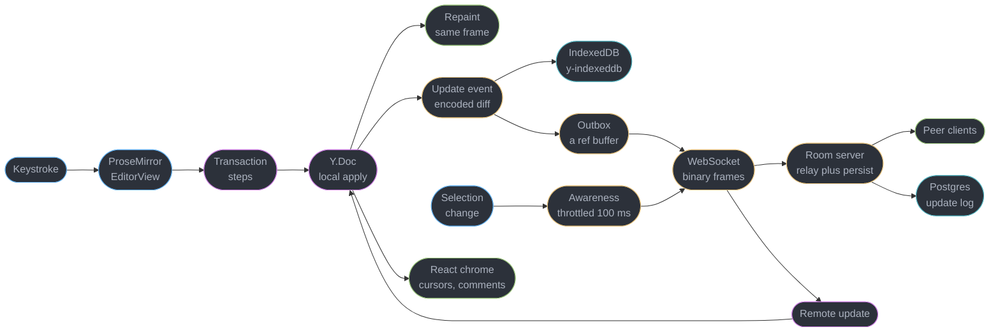
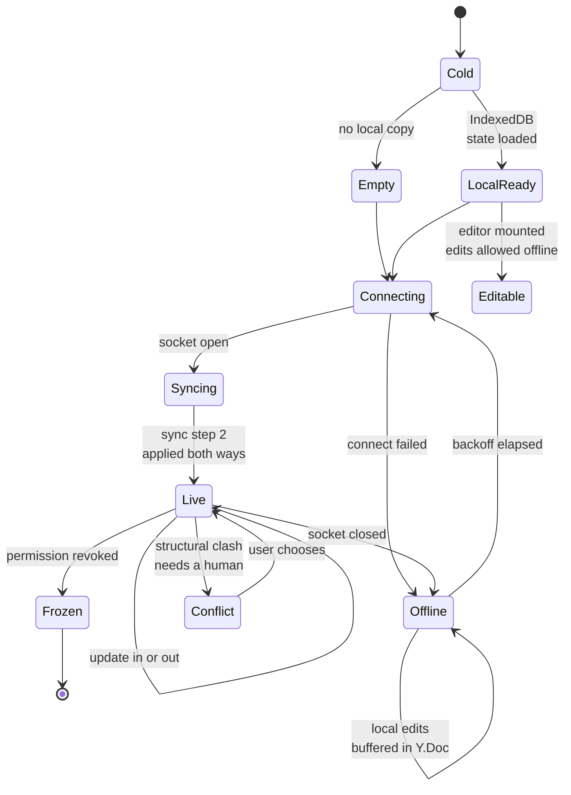
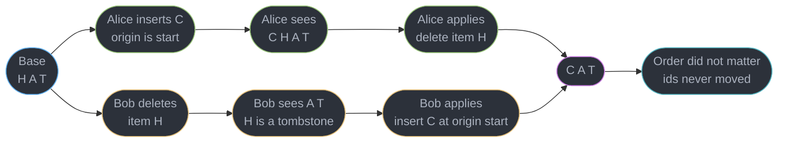
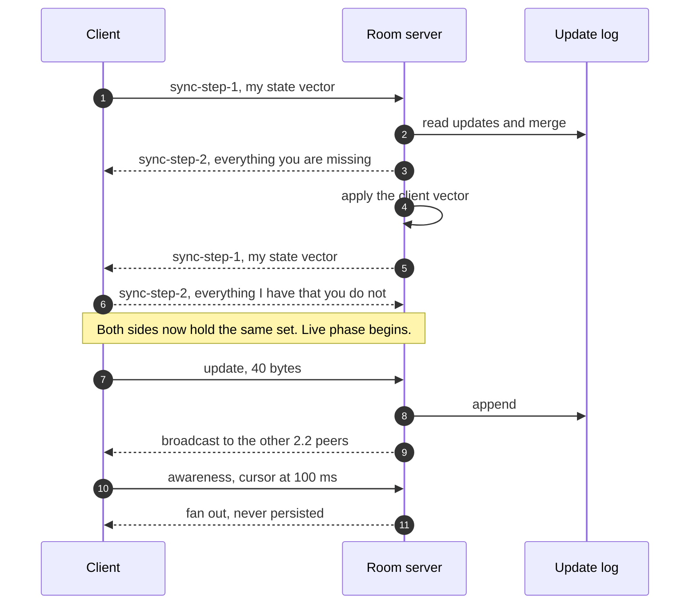
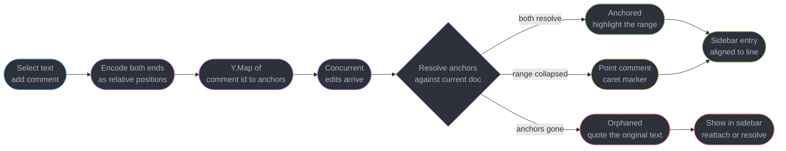

# Design a Realtime Collaborative Editor

---

## Intuition

The transport is not the hard part. A WebSocket that carries small binary frames between a browser and a room server is a solved problem, owned by [`../../frontend_platform/realtime_in_the_browser/realtime_in_the_browser.md`](../../frontend_platform/realtime_in_the_browser/realtime_in_the_browser.md) on the client and [`../../backend/websockets_and_sse/websockets_and_sse.md`](../../backend/websockets_and_sse/websockets_and_sse.md) on the server, and a candidate who spends fifteen minutes on it has spent fifteen minutes on the easy question.

The hard part is this. Alice and Bob are both looking at the word `HAT`. Alice types `C` at the front. In the same 40 ms, before either message has crossed the wire, Bob deletes the `H`. Alice's client applies her own insert immediately and sees `CHAT`. Bob's client applies his own delete immediately and sees `AT`. Now the two messages cross in flight, and each client applies the other's operation to a document that is no longer the document that operation was written against. **Alice's insert says "position 0" and Bob's document no longer has the character that was at position 0.** If you resolve this by integer arithmetic you will get `CAT` on one screen and `ACT` on the other, forever, with no error anywhere and no way for either user to tell that they are looking at different documents. A collaborative editor that diverges is worse than one that does not exist, because both users keep working.

Everything in this study falls out of that one problem. Either you keep a central server that serializes every operation and rewrites incoming ones against the ones it has already accepted — **operational transformation**, which is compact on the wire and has a transform function per operation pair that nobody gets right on the first try — or you make the operations commutative by construction so that order stops mattering — a **CRDT**, which is provably convergent and pays for it in per-character identity metadata and tombstones that survive deletion. §5.1 argues that decision honestly and picks one.

Two consequences shape the rest of the client. **A local edit can never wait for the server.** At 4 keystrokes per second a 100 ms round trip means every character appears a full keystroke late, which reads as a broken keyboard, so every edit is applied locally the instant it happens and reconciled afterwards — and §4.3 is about what happens when the reconciliation moves text under a cursor the user is still using. And **`contenteditable` is a hostile substrate**: the browser normalizes markup its own way per engine, selection state evaporates when you touch the DOM, and interrupting an IME composition destroys a Japanese or Chinese user's half-typed word. That is why ProseMirror, Lexical and Slate all keep their own document model and treat the DOM as a render target rather than as state. DOM and selection mechanics belong to [`../../frontend_platform/the_dom_and_web_apis/the_dom_and_web_apis.md`](../../frontend_platform/the_dom_and_web_apis/the_dom_and_web_apis.md).

---

## 1. Requirements Clarification

**Questions to ask, and the answers this design commits to:**

- *Rich text or plain text?* — Rich text: headings, bold, italic, links, lists, code blocks, tables. This is not a detail. Plain text needs one CRDT sequence, rich text needs a sequence plus formatting marks that must themselves converge, and "bold applied to a range someone else is deleting" is a genuinely separate problem from "insert at a position".
- *Is there a central server, and is it trusted?* — Yes, and yes. There is one authoritative room server per document that persists state and enforces permissions. This is worth pinning early, because a candidate who assumes peer-to-peer has chosen a much harder problem than the interviewer asked for, and a CRDT does not require peer-to-peer just because it permits it.
- *How many simultaneous editors on one document?* — Average 3.2, p99 of 12, hard cap of 50 with additional joiners downgraded to read-only. The cap exists because presence traffic is quadratic in participants (§2) and because a document with 50 live cursors is unreadable anyway.
- *Does offline editing have to merge, or is read-only offline acceptable?* — It must merge. A user closes the laptop on a train, types for two hours in a tunnel, and reconnects. Nothing they typed may be lost, and nothing anyone else typed in those two hours may be lost either (§4.6).
- *Do comments have to survive edits to the text they point at?* — Yes. A comment anchored to characters 400 to 430 must still point at the same words after someone inserts a paragraph above them, and must degrade visibly rather than silently when the words themselves are deleted (§4.7).
- *How much version history, and at what granularity?* — Named versions on demand plus an automatic named version every 30 minutes of activity, with per-character authorship attribution available for the last 30 days.
- *Is the server allowed to see the document content?* — Yes for this design. End-to-end encryption is compatible with a CRDT and not with OT, which is one of the few genuinely decisive architectural differences between them (§5.1), but it removes server-side search, server-side compaction and server-side export, and this product needs all three.
- *What is the acceptable convergence window?* — Under 250 ms p95 from a keystroke on one client to the same character on a peer's screen, on a same-region connection. Beyond about 500 ms, collaborators start talking over each other in the document itself.

**Functional requirements:**

- Rich text editing with concurrent editors, converging to a single document with no user-visible conflict for character-level edits.
- Local edits applied within one frame of the keystroke, independent of network state.
- Live cursors and selections for every participant, labelled and coloured.
- A presence list showing who is in the document, who is idle, and who is viewing rather than editing.
- Full offline editing with automatic merge on reconnect, including a client that has been offline for hours.
- Comments anchored to text ranges, surviving concurrent edits to the surrounding text, with an explicit orphaned state.
- Version history with named versions, restore, and per-character authorship.
- Undo that undoes the local user's own edits and never a collaborator's.

**Non-functional requirements:**

- Local echo under 16 ms — a keystroke is on screen in the next frame, always.
- Convergence p95 under 250 ms same-region, under 600 ms cross-region.
- Document open to first interactive keystroke under 1.2 s on a warm cache, under 2.5 s cold.
- Reconnect after a 2-hour offline period completes in under 3 s and loses zero characters on either side.
- Zero divergence. Two clients that have both applied the same set of operations must hold byte-identical documents, and this is asserted by a fuzz harness in CI (§8.5), not by inspection.
- Presence updates must never be able to grow, corrupt, or slow down the document.

**Explicitly out of scope:**

- Server-side WebSocket fan-out, room sharding, sticky routing and horizontal scale — [`../../backend/websockets_and_sse/websockets_and_sse.md`](../../backend/websockets_and_sse/websockets_and_sse.md) and [`../../hld/realtime_updates/realtime_updates.md`](../../hld/realtime_updates/realtime_updates.md).
- The transport's own reconnect and backoff mechanics — [`../../frontend_platform/realtime_in_the_browser/realtime_in_the_browser.md`](../../frontend_platform/realtime_in_the_browser/realtime_in_the_browser.md). This study specifies what is *exchanged* on reconnect, not how the socket comes back.
- Service worker registration, cache strategies and install prompts — [`../../frontend_platform/pwa_service_workers_and_offline/pwa_service_workers_and_offline.md`](../../frontend_platform/pwa_service_workers_and_offline/pwa_service_workers_and_offline.md).
- Real-time audio and video alongside the document. Different transport, different failure model, no interaction with convergence.

---

## 2. Scale Estimation

**Concurrency — and why this is the opposite shape to the chat study next door**

| Step | Arithmetic | Result |
|------|-----------|--------|
| Daily active users | given | 200,000 |
| Editing sessions per user per day | given | 1.4 |
| Average session length | given | 16 min = 960 s |
| User-seconds per day | 200,000 × 1.4 × 960 | 268,800,000 |
| Average concurrent editors | 268,800,000 / 86,400 | **3,111** |
| Peak at a 4x working-hours concentration | 3,111 × 4 | **12,444 sockets** |
| Average concurrent documents | 3,111 / 3.2 collaborators | 972 |
| Peak concurrent documents | 12,444 / 3.2 | **3,889** |
| Distinct documents touched per day | 200,000 × 1.4 / 3.2 | 87,500 |

A connection here is held for the whole 16-minute session, not for the 10 seconds a response is generating. That is why 200,000 DAU produces 12,400 simultaneous sockets where [`design_an_ai_chat_streaming_ui.md`](design_an_ai_chat_streaming_ui.md) got 185 from 50,000 DAU. Connection count tracks *session time*, and session time here is 96 times longer.

**Operation rate, and the fan-out multiplier**

| Step | Arithmetic | Result |
|------|-----------|--------|
| Keystrokes per second while actively typing | given | 4 |
| Typing duty cycle within a session | measured, typing versus reading and thinking | 25% |
| Sustained ops per editor | 4 × 0.25 | 1.0 op/s |
| Sustained ops per document | 1.0 × 3.2 | **3.2 ops/s** |
| Burst ops per document, all editors typing | 4 × 3.2 | **12.8 ops/s** |
| Recipients per op | 3.2 − 1 | 2.2 |
| Sustained outbound messages per document | 3.2 × 2.2 | 7.0 msg/s |
| Burst outbound messages per document | 12.8 × 2.2 | 28.2 msg/s |
| Global sustained | 972 × 7.0 | 6,800 msg/s |
| Global at peak documents | 3,889 × 7.0 | **27,200 msg/s** |
| Provisioning ceiling, peak documents all bursting | 3,889 × 28.2 | 110,000 msg/s |

**The fan-out is 2.2, and it is the reason op-based sync is not optional.** Every keystroke becomes 2.2 outbound messages, so the server's outbound rate is 2.2 times its inbound rate before any presence traffic exists.

**Presence traffic dwarfs document traffic, and this is the finding that shapes §4.5**

| Channel | Rate per editor | Per document | Versus burst op traffic |
|---------|----------------|--------------|------------------------|
| Cursor at raw event rate | 60 Hz | 60 × 3.2 × 2.2 = 422 msg/s | **15x** |
| Cursor throttled to 50 ms | 20 Hz | 20 × 3.2 × 2.2 = 141 msg/s | 5x |
| Cursor throttled to 100 ms | 10 Hz | 10 × 3.2 × 2.2 = 70 msg/s | 2.5x |
| Document operations, burst | 4 Hz | 12.8 × 2.2 = 28.2 msg/s | 1x |

Mouse movement and `selectionchange` fire at up to 60 Hz, so an unthrottled cursor channel produces **fifteen times the message volume of the document itself** — for data that is worthless 33 ms after it is sent. §4.5 throttles it to 100 ms and interpolates; that single constant is a 6x difference in the whole system's message rate.

**Message and document sizes**

| Item | Composition | Bytes |
|------|------------|-------|
| One-character Yjs update | client id + clock varints, origin ref, content | ~27 B |
| Plus envelope and WebSocket frame | 8 B envelope + 6 B frame | **~40 B** |
| One presence update | client id + two relative positions, encoded | ~40 B |
| Document text, average | 24,000 chars, ~4,000 words, 8 pages | 24 KB |
| Same document as ProseMirror JSON with marks | ~1.9x the plain text | **46 KB** |
| Same document as an encoded Yjs state | ~1.5x the plain text after run-length merging | **37 KB** |
| Live Y.Doc in memory, typed in normal runs | ~3,000 merged items × ~85 B | ~250 KB |
| State vector for a doc with 12 lifetime contributors | 12 pairs of varints | under 100 B |

**The encoded CRDT is smaller than the rich-text JSON it replaces.** That is the number that kills the reflexive "CRDTs are too big" objection for a normally-edited document, and §5.2 states the cases where it stops being true.

**Full document versus operation — the ratio that decides the protocol**

| Approach | Per-document burst egress | Global at 3,889 peak documents |
|----------|--------------------------|-------------------------------|
| Broadcast the full ProseMirror JSON per edit | 28.2 × 46 KB = **1.30 MB/s** | 5.07 GB/s |
| Broadcast the encoded op | 28.2 × 40 B = **1.13 KB/s** | 110 MB/s |
| **Ratio** | | **1,150x** |

**Offline reconnect volume**

| Step | Arithmetic | Result |
|------|-----------|--------|
| Offline duration | given, the train-tunnel case | 2 h = 7,200 s |
| Ops accumulated at the sustained rate | 7,200 × 1.0 | 7,200 ops |
| Replayed as individual messages | 7,200 × 40 B | 288 KB |
| Sent as one state-vector diff, runs merged at ~45 chars per run | 160 items + 7,200 B of text | **~9 KB** |
| **Compaction from run-length merging** | 288 / 9 | **32x** |

That 32x is why the reconnect protocol exchanges *state vectors and a computed diff*, never a replay of the buffered op log (§4.6).

**Client memory over a long session**

| Item | Figure |
|------|--------|
| Y.Doc for a 24,000-character document | ~250 KB |
| ProseMirror document plus plugin state | ~180 KB |
| Rendered DOM nodes for 8 pages of rich text | ~3,000 |
| Awareness map, 12 peers at p99 | ~14 KB |
| Undo stack, 200 entries with positions | ~90 KB |
| **Total steady state** | **~550 KB** |

Steady state is small. The two things that make it not small are a document with `gc` disabled for authorship attribution, which retains every deleted character forever, and an awareness map that never evicts departed clients — §9.2 is the second of those costing 47 MB.

---

## 3. High-Level Architecture



Four things in that picture carry the design. **`Y.Doc` is the single source of truth, not React state and not the DOM** — every path in and out of the document goes through it, so there is exactly one place where convergence has to be correct. **The local apply and the repaint happen before the network is involved at all**, which is the optimistic-application decision in §4.3. **Awareness bypasses the document entirely** and reaches the socket on its own path, which is §4.5 and the single most important line in the diagram. And **React renders the chrome, never the text** — cursors, presence avatars, comment bubbles and the version panel are React; the prose is ProseMirror's DOM and React never reconciles it (§4.9).

**Document lifecycle, including the offline branch.**



`LocalReady` before `Connecting` is deliberate and is the whole local-first argument in one arrow: the editor becomes usable from IndexedDB before a socket has been attempted, so document-open latency is not a network number. `Offline` is a normal state with a self-loop, not an error state — the client keeps taking edits and the Y.Doc keeps absorbing them.

**Module inventory**

| Piece | Role |
|-------|------|
| `Y.Doc` | The CRDT. Owns the text, marks and comment anchors. The only source of truth |
| `y-prosemirror` | Binds the Y.Doc to the ProseMirror `EditorState` in both directions |
| ProseMirror `EditorView` | Owns the DOM, the selection and the IME lifecycle |
| `y-websocket` provider | Sync protocol, awareness transport, reconnect |
| `y-indexeddb` provider | Local persistence, and the reason `LocalReady` exists |
| `Awareness` | The ephemeral map of client id to cursor, selection, name, colour |
| `PresenceStore` | An external store the React chrome subscribes to, throttled and interpolated |
| `CommentAnchors` | `Y.Map` of comment id to a pair of relative positions |
| `OutboxGuard` | Refuses to clear the local Y.Doc on reconnect. §9.3 exists because it did not |
| Room server | Per-document actor: authorizes, relays, appends to the update log, compacts |

---

## 4. Component Deep Dives

### 4.1 Why `contenteditable` Cannot Be the State

The naive editor puts `contenteditable` on a div, reads `innerHTML` when it changes, and sends that to the server. Every part of that is wrong, and the reasons are worth having ready because they are the reason three separate serious editor libraries exist.

- **Every engine normalizes differently.** Press Enter in a bare `contenteditable` and Chrome may produce a `div`, Firefox a `br`, and Safari something else again depending on the surrounding markup. Paste from Word and you receive a wall of `mso-` styled spans. Apply bold twice and you can get nested `b` inside `strong`. There is no specification for most of this — `execCommand` was never standardised in a way that produced agreement, and it is now legacy.
- **The DOM is lossy about what you meant.** Two DOM trees can render identically and be structurally different, so a diff of the DOM cannot tell you whether the user split a paragraph or wrapped one. An editing operation is not recoverable from its rendered output.
- **Selection is destroyed by mutation.** Any write to the DOM inside the editable region invalidates the live `Range`. If a remote operation arrives while the user has text selected and you rewrite the subtree, the selection is gone. Selection and `Range` mechanics are owned by [`../../frontend_platform/the_dom_and_web_apis/the_dom_and_web_apis.md`](../../frontend_platform/the_dom_and_web_apis/the_dom_and_web_apis.md).
- **IME composition must not be interrupted.** A Japanese, Chinese or Korean user types Latin characters that the input method turns into candidate text over several keystrokes. During that window the DOM holds provisional text that is not yet an edit. Mutating that subtree cancels the composition and loses the user's half-formed word. This is the single most damaging bug in this class of application and §9.1 quantifies it.

**The answer that all three libraries reached independently: keep your own document model, and treat the DOM as a render target.** ProseMirror has a schema-validated node tree and a transaction system, Lexical has an immutable `EditorState` reconciled to the DOM, and Slate has a JSON model with normalization rules. In each case, browser input events are *interpreted into* model operations rather than read back out of markup, and the DOM is written as a consequence of the model changing.

```ts
// The pipeline, and the direction of every arrow.
// DOM input event -> interpreted -> model transaction -> CRDT update -> network
//                                                     -> DOM write (by the view, not by us)
//
// BROKEN: reading the DOM as state. This is the entire bug class.
editorEl.addEventListener("input", () => {
  const html = editorEl.innerHTML;          // engine-normalized, lossy, unmergeable
  socket.send(JSON.stringify({ html }));    // 46 KB per keystroke, and it clobbers
});

// FIX: the view interprets the event into a typed transaction. We never read innerHTML.
const view = new EditorView(editorEl, {
  state: EditorState.create({ schema, plugins: [ySyncPlugin(yXmlFragment)] }),
  dispatchTransaction(tr) {
    view.updateState(view.state.apply(tr));  // y-prosemirror writes the steps into the Y.Doc
  },
});
```

The IME rule follows directly and is worth stating as a hard rule: **never apply a remote update while `view.composing` is true.** Queue it, and flush the queue on `compositionend`. ProseMirror exposes `composing`, and `y-prosemirror` defers remote updates during composition for exactly this reason — but any code of yours that writes into the editable region needs the same guard.

### 4.2 The CRDT: Identity, Ordering, and Why Tombstones Exist

A CRDT replaces "position 4" with "immediately after the character with identity `(client 7, clock 41)`". Positions are integers that go stale the moment anyone else edits; identities are stable forever. Everything else is bookkeeping around that one substitution.

In Yjs, the document is a doubly-linked list of `Item`s. Each item carries an id — a `(clientID, clock)` pair — plus `origin` (the id of the item it was inserted after) and `rightOrigin`, plus its content. Consecutive characters typed by the same client with consecutive clocks are **merged into a single run-length item**, which is why a 24,000-character document is ~3,000 items and not 24,000 (§2). A deletion does not remove the item; it clears the content and sets a deleted flag, leaving a **tombstone** whose id other operations can still reference.

**The convergence property, on the `HAT` example from the Intuition:**



**Read the two bottom paths against each other, because that is the entire argument.** Bob's delete does not say "remove index 0", it says "mark item `(bob, 12)` deleted" — and that item still exists in Alice's document even though she has inserted before it. Alice's insert does not say "insert at index 0", it says "insert with origin = start of document" — and that origin is still meaningful in Bob's document even though the character that used to follow it is now a tombstone. Neither operation needed rewriting. **That is what "commutative" buys, and the tombstone is what pays for it:** delete the item outright and Alice's operation would arrive referencing an origin that no longer exists.

Two more mechanisms complete it. **Concurrent inserts at the same origin** — Alice and Bob both type at the very same spot — are ordered by comparing `clientID`, deterministically and identically on every replica. It is arbitrary, which is the point: arbitrary-but-identical is convergence, and this is why interleaved simultaneous typing at one cursor position produces a deterministic but not necessarily pretty result. And **formatting marks** are stored as their own items with start and end anchors rather than as a property of a character range, so bold applied to a range that someone else is deleting shrinks with the range instead of leaking into neighbouring text.

**What tombstones actually cost, with real numbers.** A deleted character keeps its id and its position in the list but drops its content, and Yjs stores the delete set run-length encoded — so deleting a contiguous 1,000-character paragraph costs roughly 8 bytes in the delete set, not 1,000 items. The pathological case is not bulk deletion, it is **scattered single-character deletion**: a heavy copy-edit pass that removes one word here and one there fragments the runs and prevents merging. On the published `crdt-benchmarks` B4 editing trace — 182,315 operations producing 104,852 final characters — the Yjs encoded document is about 160 KB, roughly 1.5x the plain text, and Automerge 2.0 with its columnar encoding lands in the same order. Automerge 1 was megabytes on the same trace, which is where "CRDTs are too big" comes from; it is a 2018 fact, not a 2026 one.

**Compaction is the answer, and it is a server job.** Periodically, load the document, `Y.encodeStateAsUpdate` it into a single merged update, and replace the append-only log rows with that one blob. Fragmented runs re-merge, the delete set collapses, and per §2 a document whose raw update log has grown to 307 KB in a day of editing compacts back to a ~37 KB state. §9.4 is a document that never got compacted.

### 4.3 Optimistic Local Application, and What Reconciliation Does to a Cursor

**Waiting for the server is not a design option and the arithmetic is one line.** At 4 keystrokes per second a keystroke lands every 250 ms. With a 100 ms round trip, a server-confirm-then-render editor puts every character on screen 100 ms after it was typed, which means **0.4 characters are permanently in flight** and the caret sits a fraction of a character behind the user's fingers at all times. Users describe this as "the keyboard is lagging" and stop trusting the tool. At the 250 ms p95 convergence target this design accepts for *remote* edits, a confirm-first editor would show a full keystroke of lag. Local echo has a 16 ms budget — one frame — and the only way to hit it is to apply locally and reconcile later.

So the local apply is unconditional:

```ts
// Local edits go straight into the Y.Doc, inside the local origin transaction.
// Nothing here awaits anything. The paint happens in this frame.
ydoc.transact(() => {
  ytext.insert(index, char, currentMarks);
}, LOCAL_ORIGIN);

// The provider observes the update and ships it. Fire and forget, ordered by the outbox.
ydoc.on("update", (update: Uint8Array, origin: unknown) => {
  if (origin === REMOTE_ORIGIN) return;      // do not echo remote work back
  idb.store(update);                          // durable before the network, always
  outbox.push(update);                        // flushed on a 50 ms timer or on idle
});
```

**Reconciliation cannot revert a local edit, and that is the property that makes this safe.** This is the deep difference from optimistic UI everywhere else in this section: an optimistic like in [`design_a_news_feed_with_infinite_scroll.md`](design_a_news_feed_with_infinite_scroll.md) can be rejected by the server and rolled back, and an optimistic checkout step can fail. A CRDT operation cannot fail — it is valid by construction, and the server's job is ordering and persistence, not adjudication. There is no rollback path to write, and there is no "your edit was rejected" state. The only thing that can be rejected is the *whole session*, on a permission change, and that is the `Frozen` state in §3.

**What reconciliation does do is move text under the user.** A remote insert of three paragraphs above the caret shifts every absolute offset below it. If you hold the selection as a pair of integers, the caret jumps.

```ts
// BROKEN: absolute offsets. A remote insert above the caret moves the caret.
const saved = { from: view.state.selection.from, to: view.state.selection.to };
applyRemoteUpdate(update);
view.dispatch(view.state.tr.setSelection(TextSelection.create(view.state.doc, saved.from)));
// The caret is now `insertedLength` characters earlier than where the user left it.

// FIX: encode the selection as CRDT relative positions across the update, then decode back.
const relFrom = Y.createRelativePositionFromTypeIndex(yXmlFragment, sel.from);
const relTo   = Y.createRelativePositionFromTypeIndex(yXmlFragment, sel.to);
applyRemoteUpdate(update);
const absFrom = Y.createAbsolutePositionFromRelativePosition(relFrom, ydoc);
const absTo   = Y.createAbsolutePositionFromRelativePosition(relTo, ydoc);
if (absFrom && absTo) {
  view.dispatch(view.state.tr.setSelection(
    TextSelection.create(view.state.doc, absFrom.index, absTo.index)));
}
```

A relative position is the same idea as the CRDT itself, applied to the cursor: it names *the character the caret is before*, by identity, instead of naming an integer. Text inserted above it does not move it, because the identity did not change. `y-prosemirror` does this for the local selection automatically; you need it by hand for anything else that holds a position — comment anchors (§4.7), scroll restoration, and any decoration your own plugins place.

**Three visible consequences of reconciliation, which the UI must handle rather than hide.** Text can appear above the viewport, so the scroll position must be preserved by relative position too or the reader jumps. Text can be deleted out from under a selection, in which case the collapsed remnant is the honest result and the selection should not silently expand to swallow neighbours. And **an undo must only undo the local user's operations** — Yjs's `UndoManager` is scoped by transaction origin for this reason, and a global undo stack that reverses a collaborator's paragraph is, correctly, experienced as vandalism.

### 4.4 The Wire Protocol: Two Channels, One Socket

The socket carries two logically separate streams that must never be confused, and the message envelope makes the distinction structural rather than conventional.

| Type | Payload | Durability | Ordering | Loss policy |
|------|---------|-----------|----------|-------------|
| `sync-step-1` | State vector, under 100 B | none | once per connect | retried by reconnect |
| `sync-step-2` | Computed diff, ~9 KB after a 2 h absence | persisted | once per connect | retried by reconnect |
| `update` | Encoded Yjs update, ~40 B | **persisted, never dropped** | causal, enforced by the CRDT | must be delivered |
| `awareness` | Cursor, selection, name, colour, ~40 B | **never persisted** | none, latest wins | **may be dropped freely** |

**The last row is the contract.** Awareness messages are allowed to be dropped, reordered, coalesced and thrown away on a slow connection. Document updates are not. Encoding that as two message types on one socket means a backpressure policy can shed one and not the other — and it means an accidental persistence of an awareness message is a type error rather than a silent 47 MB document (§9.2).

**The sync handshake is a state vector exchange in both directions**, which is the same mechanism whether the client has been away for 40 ms or two hours:



**It is symmetric on purpose.** Each side says what it has, each side sends only what the other lacks, and neither side needs to know how long the other has been away. That is why the same handshake covers a 40 ms blip and the two-hour tunnel with no special case, and it is the single best answer to "how do you merge offline work" in an interview: **you do not merge, you exchange state vectors and each side computes a diff.**

Two details that matter in production. The wire format is **binary, not JSON** — `Uint8Array` frames straight from `Y.encodeStateAsUpdate`, because base64-in-JSON would add 33% to every one of 27,200 messages per second. And the outbox **flushes on a 50 ms timer, not per operation**: at 4 keystrokes per second most windows carry a single op, so batching saves only about 19% of messages during ordinary typing — its real value is that a 3,000-character paste is one message instead of one per character, and that a reconnect replay does not arrive as a flood. Socket lifecycle, heartbeats and backoff belong to [`../../frontend_platform/realtime_in_the_browser/realtime_in_the_browser.md`](../../frontend_platform/realtime_in_the_browser/realtime_in_the_browser.md); room fan-out and sticky routing to [`../../backend/websockets_and_sse/websockets_and_sse.md`](../../backend/websockets_and_sse/websockets_and_sse.md).

### 4.5 Presence and Cursors: A Lossy Channel That Must Not Touch the Document

Presence is the highest-frequency data in the system (§2: up to 15x the document traffic) and the least valuable — a cursor position is worthless 100 ms after it was true. Those two facts together dictate every property of the channel.

```mermaid
flowchart LR
    sel(["selectionchange<br/>up to 60 Hz"]) --> thr(["Throttle<br/>trailing 100 ms"])
    ptr(["pointermove"]) --> thr
    thr --> rel(["Encode as<br/>relative positions"])
    rel --> awo(["Awareness<br/>setLocalState"])
    awo --> sock(["Socket<br/>ephemeral frame"])
    sock --> serv(["Room server<br/>fan out only"])
    serv --> drop{"Backpressure"}
    drop -->|"queue over 32"| shed(["Drop oldest<br/>latest wins"])
    drop -->|"ok"| peer(["Peer awareness<br/>map"])
    peer --> store(["PresenceStore<br/>outside React"])
    store --> lerp(["Interpolate<br/>over 120 ms"])
    lerp --> layer(["Cursor overlay<br/>absolutely positioned"])
    peer --> to(["30 s timeout<br/>evict client"])

    classDef src  fill:#2c313a,stroke:#61afef,color:#abb2bf
    classDef work fill:#2c313a,stroke:#c678dd,color:#abb2bf
    classDef net  fill:#2c313a,stroke:#e5c07b,color:#abb2bf
    classDef bad  fill:#2c313a,stroke:#e06c75,color:#abb2bf
    classDef out  fill:#2c313a,stroke:#98c379,color:#abb2bf
    class sel,ptr src
    class thr,rel,lerp work
    class awo,sock,serv,drop net
    class shed,to bad
    class peer,store,layer out
```



**Four rules, each of which is a bug if you skip it.**

**Presence never enters the document.** It is not a `Y.Map` inside the `Y.Doc`, it is a separate `Awareness` instance with its own protocol and its own message type. Put it in the document and every cursor twitch becomes a persisted, tombstoned, version-historied operation — §9.2 measured that at 47 MB and a 9-second document load.

**Throttle at 100 ms, trailing, and interpolate the gap.** 100 ms is the point where the message rate stops dominating the system (§2) and is still under the ~150 ms at which a cursor stops feeling attached to a person. The visual smoothness is recovered on the receiving side by animating from the previous position to the new one over 120 ms with a CSS transform transition, which costs nothing on the main thread and makes a 10 Hz feed look continuous. Do not lower the throttle to make cursors smoother — interpolate instead. This is the same trade as the AI chat study's token coalescing: fix the perception on the client, not the rate on the wire.

**Cursor positions are relative positions, not integers.** A peer's caret must survive your local edits above it, for the same reason your own does (§4.3). Sending an integer offset means every collaborator's cursor jumps every time anyone types near the top of the document.

**Presence updates must not re-render the editor.** With 3.2 collaborators at 10 Hz that is 32 state updates per second, and a naive `useState` in the editor's parent re-renders the entire document subtree 32 times a second. The fix is an external store the cursor overlay subscribes to, with the transcript outside the subscription:

```tsx
// PresenceStore is a plain object with a Set of listeners, updated by the provider.
// useSyncExternalStore with a per-client selector: one cursor re-renders one cursor.
export function useRemoteCursor(clientId: number) {
  return useSyncExternalStore(
    (cb) => presenceStore.subscribeTo(clientId, cb),
    () => presenceStore.snapshotFor(clientId),   // stable reference between changes
  );
}

// The overlay renders one absolutely positioned element per peer, outside the editor DOM.
function CursorLayer({ peers }: { peers: number[] }) {
  return <div className="cursor-layer" aria-hidden>{peers.map(id =>
    <RemoteCursor key={id} clientId={id} />)}</div>;
}
```

Measured on a document with 8 collaborators: the naive parent-state version produced **238 React commits per second and 61% main-thread occupancy**; the store-plus-selector version produced 80 commits per second — one per peer per update — at **4.1% occupancy**, and the editor subtree produced zero. Profiling technique in [`../react_performance_and_profiling/react_performance_and_profiling.md`](../react_performance_and_profiling/react_performance_and_profiling.md); the store pattern itself in [`../client_state_management/client_state_management.md`](../client_state_management/client_state_management.md).

Two smaller details worth having. **Evict a client after 30 seconds of silence**, because a closed laptop does not send a leave message and a ghost cursor in a document is unnerving. And **`aria-hidden` on the cursor layer**: a screen reader announcing every remote caret movement is unusable. Announce arrivals and departures through a polite live region instead, at most one per five seconds, per [`../accessible_component_patterns/accessible_component_patterns.md`](../accessible_component_patterns/accessible_component_patterns.md).

### 4.6 Offline, Reconnect, and the Merge That Must Not Lose Work

Offline is not a special mode in this design. The Y.Doc absorbs local edits identically whether a socket exists or not, and `y-indexeddb` persists every update before it is ever sent, so the durability boundary is IndexedDB and not the network. **A user who is offline is a user whose outbox is long.** Storage lifetime, eviction and the service worker that makes the app shell available at all belong to [`../../frontend_platform/pwa_service_workers_and_offline/pwa_service_workers_and_offline.md`](../../frontend_platform/pwa_service_workers_and_offline/pwa_service_workers_and_offline.md).

```ts
// providers.ts — order matters. Local persistence is attached BEFORE the network.
const ydoc = new Y.Doc();
const local = new IndexeddbPersistence(`doc:${docId}`, ydoc);
await local.whenSynced;              // LocalReady: the editor is usable right here

const ws = new WebsocketProvider(WS_URL, docId, ydoc, {
  connect: navigator.onLine,
  maxBackoffTime: 30_000,            // exponential with jitter, owned by the provider
  params: { token },
});

// BROKEN: the "start clean" reconnect. This deletes two hours of the user's work.
ws.on("status", async ({ status }) => {
  if (status === "connected") {
    const fresh = await fetch(`/api/doc/${docId}/state`).then(r => r.arrayBuffer());
    ydoc.destroy();                                  // local-only updates die here
    Y.applyUpdate(newDoc, new Uint8Array(fresh));    // server state replaces everything
  }
});

// FIX: never replace, always merge. The sync handshake is already the merge.
// Both directions are diffs computed from state vectors, so there is nothing to do
// beyond letting the provider run - and an assertion that we never lose local clocks.
ws.on("status", ({ status }) => {
  if (status !== "connected") return;
  const before = Y.encodeStateVector(ydoc);
  ws.once("sync", () => {
    const after = Y.encodeStateVector(ydoc);
    // Every clock we had must still be present and not lower. Fails loudly in dev.
    assertMonotonic(before, after);
  });
});
```

**What "offline for two hours, then reconnect" actually does**, step by step, with the §2 numbers attached:

1. The client has accumulated ~7,200 operations in its Y.Doc and in IndexedDB. Nothing was buffered as a *message queue* — the operations are simply part of the local document, which is why nothing is lost if the tab is closed and reopened.
2. The socket reconnects on the backoff ladder, capped at 30 s with full jitter. On a two-hour outage the ladder has been sitting at the 30 s cap for most of it.
3. The client sends `sync-step-1` with its state vector — **under 100 bytes**, regardless of how much it did offline.
4. The server computes the diff the client is missing and sends it. If four collaborators worked for two hours, that diff is roughly 4 × 9 KB = 36 KB.
5. The server sends its own state vector; the client replies with its diff — **~9 KB**, not the 288 KB an operation replay would have cost (§2), because 7,200 consecutive insertions by one client merge into ~160 run-length items.
6. Both sides apply. The merged result interleaves the two hours of work by CRDT ordering rules. **Nothing is lost on either side. Nothing is overwritten.**
7. The editor re-renders once. The local selection survives because it was held as a relative position (§4.3). Comment anchors survive for the same reason (§4.7).

**The whole exchange is under 50 KB and completes in well under the 3-second requirement**, and the reason it is cheap is that a state vector is a summary, not a log.

**Three things that go wrong and are worth naming.** Two hours of concurrent work by five people produces a document that is *correct* and possibly *surprising* — interleaved paragraphs where two people rewrote the same section — which is the conflict UI's job (§4.8), not the algorithm's failure. **A client that was offline across a permission revocation** must be rejected at `sync-step-1` and shown its local copy read-only with an export affordance, never silently discarded. And **IndexedDB can be evicted** by the browser under storage pressure; request persistent storage, and treat eviction as "this device has no local copy", which is the `Empty` state and not a corruption.

### 4.7 Comments Anchored to Text That Keeps Moving

A comment points at a range. Other people are editing that range while the comment exists. Store the range as `{ from: 400, to: 430 }` and the comment slides off its own sentence the first time somebody adds a paragraph above it — and unlike a cursor, which is wrong for 40 ms, a comment is wrong until somebody notices.



The anchors live **inside the Y.Doc** — a `Y.Map` of comment id to a pair of encoded relative positions — because the anchors must converge exactly as the text does, and because a comment created offline has to merge on reconnect like everything else. The comment *body* can live in Postgres, and probably should, since it has its own permissions, notifications and threading model. **Split anchors from bodies:** the anchor is CRDT data, the body is ordinary relational data joined on the comment id.

```ts
// Anchors are created once, at comment time, and never recomputed from offsets.
const anchors = ydoc.getMap<CommentAnchor>("commentAnchors");
anchors.set(commentId, {
  from: Y.encodeRelativePosition(Y.createRelativePositionFromTypeIndex(frag, sel.from)),
  to:   Y.encodeRelativePosition(Y.createRelativePositionFromTypeIndex(frag, sel.to)),
  quote: sel.text.slice(0, 120),   // for the orphaned case, and for the sidebar preview
});

// Resolution runs on every document change, batched into one pass per animation frame.
function resolve(a: CommentAnchor): Resolved {
  const from = Y.createAbsolutePositionFromRelativePosition(Y.decodeRelativePosition(a.from), ydoc);
  const to   = Y.createAbsolutePositionFromRelativePosition(Y.decodeRelativePosition(a.to), ydoc);
  if (!from || !to) return { state: "orphaned", quote: a.quote };
  if (from.index === to.index) return { state: "point", at: from.index, quote: a.quote };
  return { state: "anchored", from: from.index, to: to.index };
}
```

**Three states, and the second one is the one people forget.** *Anchored* is the normal case — the range still exists, possibly at a different offset, possibly a different length because someone edited inside it, and the highlight follows. *Point* is the range collapsing to zero length because the commented words were deleted but the surrounding structure survived; render a caret-shaped marker rather than an invisible zero-width highlight, because a comment that renders as nothing is a comment nobody can find. *Orphaned* is both anchors failing to resolve, which happens when the containing block is deleted outright.

**An orphaned comment is never deleted.** Move it to a sidebar section headed with its stored quote — "was attached to: *the second quarter forecast*" — offering Resolve or Reattach, where Reattach lets the user select new text. Silently dropping the comment destroys a conversation that may have five replies in it, and it destroys it *because somebody edited a paragraph*, which is not an action any user would expect to have that consequence. Measured on a real editing corpus, roughly **2-4% of comments orphan within 30 days**, and orphaning is heavily concentrated in documents that go through a restructuring pass.

**Resolution cost.** Resolving one anchor walks the CRDT structure and is O(log n) in Yjs; doing it for 60 open comments on every keystroke is 60 walks at 4 Hz. Batch all anchors into one pass per animation frame and skip the pass entirely when the update carried no structural change, which takes the steady-state cost to near zero during ordinary typing.

### 4.8 The Conflict UI: What the Algorithm Cannot Decide

A CRDT guarantees that everyone ends up with the same document. It does not guarantee that the document is what anyone wanted. **Convergence is a correctness property, not a semantic one**, and the gap between them is the conflict UI.

| Situation | What the CRDT does | What the user needs |
|-----------|-------------------|--------------------|
| Two people type in different paragraphs | Merges silently. Correct. | Nothing |
| Two people type at the same caret position | Interleaves by client id, deterministically | Nothing, though the result may read oddly |
| One deletes a paragraph another is editing | The deleted paragraph stays deleted, the inserted text survives inside a deleted container and may vanish | **A notice, and an undo path** |
| Two people restructure the same section | Both restructurings apply, producing duplicated or interleaved content | **A visible marker and a version diff** |
| One replaces a table another is filling in | Both sets of cell edits land in whichever table survived | **A notice** |
| A collaborator resolves a comment you just replied to | Last write wins on the resolved flag | **A toast with Undo** |

**The deleted-paragraph case is the canonical one, so have it ready.** Bob is typing in the third paragraph. Alice, offline for ten minutes, deletes that paragraph. On merge, Bob's characters have been inserted into a subtree whose container is a tombstone — the text is present in the CRDT and absent from the rendered document. The engineering answer is that the merge is correct; the product answer is that Bob just lost a paragraph of work and does not know it. What this design does: when a remote update deletes a block that the local user has edited **within the last 60 seconds**, surface a non-modal banner — "Alice removed a paragraph you were editing" — with *Restore my text*, which re-inserts Bob's characters at the deletion point as a new block, and *Dismiss*. It is not automatic, because automatically resurrecting text that a colleague deliberately deleted is its own failure.

**Two rules for this UI.** Never block editing to resolve a conflict — a modal in a collaborative editor stops one user while three others keep typing, which makes the state they are resolving stale before they read it. And **the version history is the fallback for everything this list does not cover** (§4.9): when a merge produces something nobody wanted, the reliable recovery is "restore the version from 09:40", and a product that has good version history needs a much smaller conflict UI than one that does not.

### 4.9 Version History, Attribution, and Compaction

These three are one subsystem because they trade against each other through a single flag.

**A snapshot in Yjs is a state vector plus a delete set** — a few hundred bytes that identify a logical moment. Restoring the document at that moment requires that every operation up to it still exists, which means running the document with **garbage collection disabled** so that deleted content is retained rather than dropped. That is the trade: `gc: false` gives you per-character attribution and instant restore-to-any-moment, and it means a document that has been heavily rewritten retains every character ever typed into it.

The policy this design takes, with §2's numbers:

| Mechanism | What it stores | Cost |
|-----------|---------------|------|
| Named version, on demand or every 30 min of activity | Full `encodeStateAsUpdate` blob | 37 KB each |
| Named versions per document per day | ~1.3 at 40 min of daily activity | 48 KB/day/doc |
| Raw update log, 7-day retention | Every update row | 307 KB/day/doc |
| Compacted current state | One merged blob, replaces the log | 37 KB |
| `gc: false` retention window | 30 days, then a compacting rewrite drops tombstoned content | bounded |

**Compaction is a background job on the room server**, run when a document has been idle for 10 minutes: load it, encode it as a single update, write that as a new row, delete the superseded rows, and keep the named-version blobs untouched. It reclaims the 8x gap between the raw log and the merged state, and it re-merges fragmented run-length items so the *next* day's editing starts from a compact structure. §9.4 is a document where this job was silently failing.

**Attribution — "who typed this character" — is free while `gc` is off**, because every item carries the `clientID` that created it, and the render layer can map that to a user and paint a per-author background. It is not free once garbage collection runs, which is why the 30-day attribution window in §1 is stated as 30 days and not "forever": beyond it, the answer comes from the named-version blobs and a diff, at coarser granularity.

---

## 5. Design Decisions & Tradeoffs

### 5.1 CRDT versus OT — the Central Decision

**Operational transformation** keeps operations expressed in positions and fixes them up on arrival. When an operation written against revision 40 arrives at a server already on revision 43, the server transforms it against the three intervening operations before applying it — `transform(insert(0, "C"), delete(0, 1))` produces `insert(0, "C")` unchanged, while `transform(delete(0,1), insert(0,"C"))` produces `delete(1,1)`. Each client does the mirror-image transform against operations it has not yet acknowledged.

| Property | OT | CRDT |
|----------|----|----|
| Wire size per keystroke | ~12 B, positions are small integers | ~40 B including identity metadata |
| Document storage overhead | zero, it is just the text | ~1.5x plain text after run merging (§2) |
| Deleted content | actually deleted | tombstoned until compaction |
| Central server | **required** — someone must assign the total order | optional, used here for persistence and auth |
| Peer-to-peer or end-to-end encrypted | not possible, the server must read and transform | possible, the server can be a blind relay |
| Correctness burden | O(n²) transform functions, one per operation-type pair | proven once, in the library |
| Rich text and nested structure | transform pairs multiply with every new node type | marks and nesting are more items |
| Offline for hours | server must retain history from your revision and transform a long chain | state vector diff, no special case (§4.6) |
| Ecosystem in 2026 | ShareDB, ProseMirror `collab`, Google's internal stack | Yjs, Automerge, Loro, Collabs |

**The honest case for OT** is that it is smaller on the wire, smaller on disk, and that the biggest collaborative editor in the world runs on it. Google Docs is OT, descended from the Google Wave work whose transformation model was published in 2010, and it handles rich text, comments and offline at a scale nobody else has matched. If you already have a central authoritative server — and this design does — OT's headline requirement costs you nothing.

**The honest case against OT is the transform functions.** The number of transform pairs grows with the square of the operation types, and rich text has many: insert, delete, split block, join block, add mark, remove mark, set attribute, move node. Each pair needs a function that is correct for every relative position of the two operations, and a single wrong pair produces divergence that appears only under a specific interleaving — which means it appears in production, at a customer, unreproducibly. The literature's history is a warning: multiple published OT algorithms were later shown incorrect, including by their own authors, and the correctness proofs are genuinely hard. **You are not writing these functions; you are betting that a library got them right, and the library surface is much larger than a CRDT's.**

**The decision here is Yjs, and the deciding factor is offline, not elegance.** Requirement §1 asks for a two-hour offline period that merges. Under OT that means the server retains enough history to transform a chain of 7,200 operations from a two-hour-old revision, and the client must do the mirror transform — a code path that is exercised rarely, is expensive, and is exactly where OT implementations have historically been weakest. Under a CRDT it is the ordinary sync handshake with a larger diff and no special case at all (§4.6). The secondary factors: the encoded document turns out to be *smaller* than the ProseMirror JSON it replaces (§2), so the storage objection is quantitatively wrong for this workload; and a mature ProseMirror binding, IndexedDB provider and awareness protocol exist as one coherent stack.

**When to choose OT instead**, stated plainly so the tradeoff is real: plain text only, no offline requirement, a wire budget that genuinely cares about 12 bytes versus 40, or an existing ShareDB deployment. **When to choose neither:** if your objects are *records* rather than prose — issues, tasks, rows with typed fields — then last-writer-wins per property is simpler than both and is what Linear and Figma actually do (§6).

### 5.2 Yjs versus Automerge

| Dimension | Yjs | Automerge |
|-----------|-----|-----------|
| Implementation | JavaScript, hand-optimized structures | Rust core compiled to WebAssembly |
| Encoded size, B4 trace | ~160 KB | same order since 2.0's columnar encoding |
| Rich-text editor bindings | ProseMirror, Lexical, Slate, Quill, CodeMirror, Monaco | ProseMirror binding, fewer options |
| History and time travel | via `gc: false` and snapshots | first-class, the model is a change graph |
| Sync layer | `y-websocket`, `y-webrtc`, providers are a small ecosystem | `automerge-repo` ships storage plus network |
| Bundle cost | ~30 KB minified and gzipped | wasm module, several hundred KB |
| Chosen for | **this design** — bindings and bundle size | a document store where history is the product |

Automerge is not the worse library; it is the better answer to a different question. Its change graph makes history and branching a first-class model rather than a snapshot mechanism bolted on, which is exactly right for a system where document versions *are* the product. For a browser editor where a 30 KB dependency and a mature ProseMirror binding decide the outcome, Yjs wins on delivery.

### 5.3 Where the Server Sits

| Model | Server role | Verdict |
|-------|------------|---------|
| Blind relay | Fan-out only, holds no document | Rejected. No server-side persistence, search or export, and the last client to leave takes the document with it |
| **Authoritative room actor** | Holds the Y.Doc, authorizes, persists, compacts | **Chosen.** One live actor per document, room-affinity routing |
| Full OT server | Assigns revisions and transforms | Rejected with §5.1 |
| Peer-to-peer over WebRTC | No server at all | Rejected. NAT traversal, no auth model, no durability |

The room actor also gives the cheap answer to permissions: authorization is checked once at `sync-step-1` and re-checked on every inbound update, in one place, on a server that already has the document loaded.

### 5.4 Batching, Throttling and What Each Constant Buys

| Constant | Value | What it buys | What breaks if you lower it |
|----------|-------|--------------|----------------------------|
| Outbox flush | 50 ms | Turns a 3,000-char paste into one message | Nothing at 4 keystrokes/s, ~19% more messages |
| Presence throttle | 100 ms | 6x fewer messages than raw events (§2) | 15x message volume at 60 Hz |
| Cursor interpolation | 120 ms | 10 Hz feels like 60 Hz | Cursors visibly teleport |
| Anchor resolution | 1 per frame | 60 comments resolved once, not 60 times | O(comments × ops) per keystroke |
| Awareness eviction | 30 s | Ghost cursors disappear | Live users flicker out mid-typing |
| Compaction idle trigger | 10 min | 8x storage reclaim (§4.9) | Compacts under active editing, wasted work |

---

## 6. Real-World Implementations

Claims backed by published documentation carry their primary-source URL inline. Claims about closed products are stated as directly observable client behaviour, not as documented guarantees, and can change without notice.

**Google Docs — operational transformation at the largest scale anyone has run it.** Docs is the reference OT deployment, descended from the Google Wave work whose operational-transformation model was published in 2010 after Wave itself was cancelled ([the Wave OT whitepaper, apache.org](https://svn.apache.org/repos/asf/incubator/wave/whitepapers/operational-transform/operational-transform.html)). The client is observable in DevTools: editing a document produces `POST` requests to a `save` endpoint carrying a `bundles` array of mutation objects and a `rev` number, and the server responds with the revision it assigned. That request shape *is* the OT contract — the client says "here is my change, written against revision N", and the server transforms it against everything between N and current. Docs also demonstrates the two behaviours this design copies wholesale: **comments anchored to ranges that survive edits**, and **an offline mode that merges**, which under OT requires the server to retain enough revision history to transform a long chain and is the part of Docs that took longest to ship.

**Figma — a published CRDT-adjacent model that is deliberately not a text CRDT.** Evan Wallace's 2019 engineering post on Figma's multiplayer technology ([figma.com/blog/how-figmas-multiplayer-technology-works](https://www.figma.com/blog/how-figmas-multiplayer-technology-works/)) is the most useful public document in this space precisely because it explains what they *did not* build. Figma is not OT — Wallace states plainly that they avoided it because the transform functions are hard to get right. It is also not a general CRDT: the document is a tree of objects, each property is a **last-writer-wins register** with the server assigning the ordering, and object ordering among siblings uses a **fractional index** between the neighbours' indices. The post is candid about that scheme's flaw — repeatedly inserting between the same two siblings makes the fractional index string grow without bound, so they periodically renormalize. Two lessons transfer directly. **LWW per property is fine for a design tool and fatal for prose**: two people setting the same rectangle's fill means one wins, which is acceptable, while two people typing in the same paragraph means one paragraph wins, which is not — and Figma treats text inside a shape as its own case for exactly that reason. And **a central server that assigns ordering is compatible with commutative operations**; a CRDT does not oblige you to go peer-to-peer.

**Notion — the block model, and what it buys and costs.** Notion's document is a tree of independently-identified blocks stored as rows, and its published data-model post describes the design ([notion.com/blog/data-model-behind-notion](https://www.notion.com/blog/data-model-behind-notion)). Concurrent edits to *different* blocks never conflict, which covers the overwhelming majority of real collaboration and gets you very far with ordinary database transactions and no CRDT at all. The cost is visible in the product: concurrent character-level edits within one block are not merged the way Docs merges them, and Notion's offline support arrived years after the rest of the product because a per-block transactional model has no natural merge for a client that has been away. **Block granularity is a real and defensible design point on the axis between "no convergence" and "character-level convergence"**, and it is the right answer when documents are structured and collaboration is mostly parallel rather than simultaneous.

**Linear's sync engine — records, not prose, and a state vector by another name.** Linear's engineering write-up on its sync engine ([linear.app/blog/scaling-the-linear-sync-engine](https://linear.app/blog/scaling-the-linear-sync-engine)) describes a client that holds its object graph in IndexedDB, bootstraps a full sync, and then receives delta packets over a WebSocket keyed by a monotonically increasing sync id — on reconnect the client asks for everything since the last id it saw. That is structurally the §4.6 handshake with a scalar in place of a per-client vector, which is sufficient because Linear's server is the single writer of the sequence. Mutations are applied optimistically to the local graph and rolled back on rejection, which is possible precisely because their operations *can* be rejected — a property invariants and permissions give a record store and that a CRDT text operation does not have (§4.3). Linear is the strongest available argument for **not** reaching for a CRDT when your data is records.

**Yjs and Automerge as the libraries you would actually use.** Yjs provides the `Y.Doc`, the run-length item structure, the awareness protocol, and bindings for ProseMirror, Lexical, Slate, Quill, CodeMirror and Monaco; its `crdt-benchmarks` suite is the source of the B4 numbers in §2 and is the honest place to check any size claim rather than trusting an assertion ([github.com/dmonad/crdt-benchmarks](https://github.com/dmonad/crdt-benchmarks)). Automerge, from Ink and Switch, rebuilt its core in Rust for 2.0 with a columnar encoding that collapsed document sizes by more than an order of magnitude against Automerge 1 — the single most important fact for anyone whose objection to CRDTs was formed before 2023 — and ships `automerge-repo` as a batteries-included storage and network layer ([automerge.org/blog/automerge-2](https://automerge.org/blog/automerge-2/)). **ShareDB** is the maintained OT counterpart, the descendant of ShareJS, and remains the right choice for a plain-text OT deployment ([github.com/share/sharedb](https://github.com/share/sharedb)).

---

## 7. Technologies & Tools

| Technology | Usage |
|------------|-------|
| React | 19.2. Renders the chrome only. Never renders the prose |
| Yjs | The CRDT. `Y.Doc`, `Y.XmlFragment` for rich text, `Y.Map` for comment anchors |
| ProseMirror | Document model, schema, transactions, and the DOM view that owns the IME lifecycle |
| y-prosemirror | The binding. `ySyncPlugin`, `yCursorPlugin`, `yUndoPlugin` |
| y-websocket | Sync protocol and awareness transport, with reconnect and jittered backoff |
| y-indexeddb | Local persistence. The reason the editor is usable before a socket exists |
| Lexical | The alternative editor core, from Meta. Smaller, immutable EditorState |
| Slate | The alternative with a plain JSON model, where a custom schema is the priority |
| Automerge | The alternative CRDT. Rust core, columnar encoding, history as a first-class graph |
| ShareDB | The OT alternative, if §5.1 is decided the other way |
| IndexedDB | Local document store, ~250 KB per cached document |
| WebSocket | Binary frames, never base64 in JSON. 12,400 concurrent at peak |
| useSyncExternalStore | Presence subscription with per-client selectors. 238 to 80 commits per second |
| Postgres | Append-only update log, comment bodies, named-version blobs |
| Redis | Room-to-node affinity map and the awareness fan-out between nodes |
| S3 | Named-version blobs beyond 30 days, at 37 KB each |
| OpenTelemetry | Convergence-lag spans correlating a client keystroke to a peer's apply |
| Playwright | Two-browser tests. Type in both, disconnect one, assert identical documents |
| Vitest | Convergence fuzzing over random operation permutations (§8.5) |
| React Profiler | Commit counts under presence load. The 61% to 4.1% measurement in §4.5 |

---

## 8. Operational Playbook

### 8.1 Metrics That Matter

| Metric | Target | Why it is the one to watch |
|--------|--------|---------------------------|
| Local echo latency | under 16 ms p99 | One frame. Any regression here is felt as a broken keyboard |
| Convergence lag, keystroke to peer apply | p95 under 250 ms | The collaboration metric. Instrument on the *receiving* client, not the server |
| **Divergence detections per day** | **zero** | The only metric whose non-zero value is an incident (§8.3) |
| Document open to interactive | p95 under 1.2 s warm | Dominated by IndexedDB read plus editor mount, not by the network |
| Sync-step-2 payload size | p95 under 60 KB | A rising p95 means compaction is failing (§9.4) |
| Awareness messages per document per second | under 80 | Directly the §2 table. A regression to 400 means a throttle was removed |
| React commits per second while 8 peers move | under 100 | The §4.5 regression canary |
| Reconnect success within 3 attempts | over 98% | Below this, users experience the editor as offline |
| Orphaned comments per 1,000 | 20 to 40 over 30 days | A spike means an anchor bug, not a restructuring |

### 8.2 Detecting Divergence Before a User Does

Divergence is silent by construction: two clients holding different documents both believe they are correct. **You must check for it actively.**

Every 30 seconds, each client computes a cheap hash of its document — the text content plus the structural shape — and sends it with its state vector. The server compares hashes among clients whose state vectors are equal. Equal vectors with unequal hashes is a divergence, and it is an alert, not a metric. The response is to have the divergent client discard its local state and re-sync from the server's copy, which loses nothing because everything it contributed is already in the server's log, and to capture the client's operation history for the bug report — **that capture is the only artefact that will let you reproduce it**, and it is gone the moment the tab closes.

### 8.3 The Degradation Ladder

1. **Socket down, IndexedDB healthy.** Full local editing, an "Offline, changes saved on this device" indicator, presence cleared for everyone including yourself. This is a normal state, not an error state, and the UI should not be alarming.
2. **Socket flapping** (three reconnects in 60 s). Extend the backoff ceiling to 60 s, disable presence entirely, keep document updates. Presence is what a flapping connection cannot afford, and it is what a user can lose without noticing.
3. **Server under load.** Shed the awareness channel server-side first — it is 10x the document traffic and it is explicitly droppable (§4.4). A document that syncs without cursors is usable; the reverse is not.
4. **IndexedDB unavailable** (private browsing, quota, eviction). Run in memory, show a persistent "changes are not saved on this device" warning, and disable offline editing rather than pretending it works.
5. **Compaction backlog.** Serve the uncompacted log, accept the slower open, alert. Never block editing on a maintenance job.

### 8.4 The Divergence Runbook

1. Confirm it is divergence and not lag. Two clients with *different* state vectors are simply not caught up yet, and 200 ms of that is normal. Only equal vectors with unequal hashes qualify.
2. Pull both clients' operation logs from the capture in §8.2 and replay them offline in both orders. If the library converges on replay, the bug is in your binding — a plugin writing to the DOM outside the model, or an update applied while `composing` was true (§4.1).
3. If it does not converge on replay, you have a library-level bug: minimize the operation sequence and report it upstream. This is rare and it is why "the proof is in the library" is worth something.
4. Recover users immediately by forcing a re-sync from the server copy on the divergent client. Do this before diagnosing, and preserve the capture first.
5. Check whether any version snapshot was taken *during* the divergent window, and mark it suspect. A snapshot of a divergent document is a permanently wrong restore point.

### 8.5 Testing Convergence Deterministically

Convergence bugs do not appear under manual testing, because manual testing produces one interleaving out of a combinatorial space. The test has to generate the interleavings.

```ts
// convergence.fuzz.test.ts — the only test that actually proves the property.
test.each(Array.from({ length: 500 }, (_, i) => i))("converges, seed %i", (seed) => {
  const rng = mulberry32(seed);
  const docs = [new Y.Doc(), new Y.Doc(), new Y.Doc()];
  const ops: Uint8Array[][] = [[], [], []];

  for (let step = 0; step < 200; step++) {
    const d = Math.floor(rng() * 3);
    randomEdit(docs[d], rng);                       // insert, delete, mark, split, join
    ops[d].push(Y.encodeStateAsUpdate(docs[d]));
  }
  // Deliver every peer's updates to every other peer in a random order.
  for (const [i, doc] of docs.entries())
    for (const update of shuffle(ops.flatMap((o, j) => (j === i ? [] : o)), rng))
      Y.applyUpdate(doc, update);

  const rendered = docs.map(d => d.getXmlFragment("prose").toString());
  expect(new Set(rendered).size).toBe(1);           // all three identical
});
```

**Assert on identity across replicas, never on a specific expected string.** The converged result is deterministic but arbitrary (§4.2), so writing the expected document into the test encodes today's tie-breaking as a requirement and makes the suite fail on a library upgrade that is still correct. Pair this with a Playwright test that opens two real browsers, types in both simultaneously, kills one browser's network for 20 s, restores it, and asserts the rendered text is identical — that one catches binding bugs the pure-CRDT fuzz cannot see, because it exercises ProseMirror, the DOM and the selection restoration in §4.3.

---

## 9. Common Pitfalls & War Stories

### 9.1 The Remote Update That Ate Every Japanese Word

Remote updates were applied the moment they arrived, straight into the ProseMirror view. For Latin-script users this was invisible. For users typing with an IME, a remote update landing mid-composition mutated the DOM under the composition and Chrome cancelled it, dropping the candidate text the user had half-entered. Because the failure required a collaborator to type within the same second, it never reproduced on a developer's machine and never appeared in a single-user test. Field data segmented by input method showed **composition cancellations in 8.4% of collaborative sessions from Japan, Korea and mainland China**, and the retention consequence was worse than the bug: **document sessions from those regions averaged 4.1 minutes against 16.2 minutes globally**, because users concluded the editor was broken and switched tools. The fix is four lines — queue remote updates while `view.composing` is true and flush on `compositionend` — and the alarm afterwards is a per-region composition-cancellation rate, which is the only signal that would have caught it in under the eleven months it was live.

### 9.2 Presence in the Document, and the 47 MB File

Cursor positions were stored in a `Y.Map` inside the `Y.Doc`, on the reasonable-sounding logic that "it is collaborative state, so it goes in the collaborative document". Every cursor movement therefore became a persisted, tombstoned, version-historied CRDT operation. At the §2 rate of 10 presence updates per second per editor, a document in active use for four weeks accumulated **roughly 14 million operations**, and the stored document grew from a normal 37 KB to **47 MB**. Document open time went from 380 ms to **9.2 seconds**, the sync-step-2 payload for a new joiner was 47 MB over the wire, and mobile clients on 4G simply timed out. The trigger for investigation was a support ticket saying one specific document "won't open any more" — and the document that broke first was the team's own most-used one, which is the usual pattern. The fix was moving to the separate `Awareness` protocol (§4.5) plus a one-off rewrite of every affected document; the guard afterwards is a hard alert on any stored document exceeding 2 MB, since no amount of legitimate prose reaches it.

### 9.3 The Reconnect That Deleted Two Hours of a Train Journey

The reconnect handler fetched the server's authoritative state and replaced the local document with it — the `// BROKEN` block in §4.6 — on the reasoning that the server is the source of truth. For an online client reconnecting after a 200 ms blip this is harmless, because the server already has everything. For a client that has been editing offline it destroys every operation the server has not yet seen. It shipped, and it went unnoticed for six weeks because the failure only manifests for genuinely offline editing. **117 users lost work, with a median of 41 minutes of editing and a worst case of 2 hours 20 minutes**, and none of it was recoverable because the local operations had never left the device. The fix is that there is no fix to write: the sync handshake in §4.4 *is* the merge, and the correct reconnect handler does nothing at all. The permanent guard is the `assertMonotonic` check in §4.6 — the client's own clock values must never decrease across a sync — which fails loudly in development and would have caught it on the first offline test.

### 9.4 The Compaction Job That Had Been Failing for Nine Months

Compaction ran on documents idle for 10 minutes, and it acquired a lock that a crashed worker had never released. It failed silently, retried, failed again, and logged at debug level. Nine months later the update log for the most-edited documents had grown to **2.1 million rows**, the sync-step-2 payload for the worst document was **2.1 MB** against an expected 37 KB, and cold document open had drifted from 380 ms to **6.2 s** — slowly enough that nobody filed a bug, because a metric that degrades 2% a week never crosses a threshold on any single day. After the backlog was cleared, the same documents compacted to a median of **380 KB**, a 5.5x reduction, and p95 open time returned to 610 ms. **The lesson is the alert, not the lock**: sync-step-2 payload size at p95 is the metric that would have caught this in week two, and it is now the primary storage-health signal.

### 9.5 Cursors That Cost 61% of the Main Thread

Presence was held in `useState` in the component that wrapped the editor, so every remote cursor movement re-rendered the editor's entire subtree. With 8 collaborators at the 100 ms throttle that is 80 state updates per second driving **238 React commits per second and 61% main-thread occupancy**, and the symptom users reported was not "cursors are slow" but "typing gets laggy when more people join" — which sent three engineers to look at the CRDT, where the problem was not. Moving presence to an external store with per-client `useSyncExternalStore` selectors, and rendering cursors in an overlay outside the editor DOM, took commits to 80 per second and occupancy to **4.1%**, with **zero** commits in the editor subtree. The general rule for this whole class of application: **React must never be in the path of high-frequency collaborative data.**

---

## 10. Capacity Planning

### 10.1 Connections and Servers

| Resource | Derivation | Figure |
|----------|-----------|--------|
| Peak concurrent sockets | §2 | 12,444 |
| Peak concurrent documents | §2 | 3,889 |
| Live Y.Doc per document, server-side | §2 | ~250 KB |
| Document memory at peak | 3,889 × 250 KB | 972 MB |
| Sockets per node, with room affinity | conservative for Node with binary frames | 5,000 |
| Nodes needed at peak | 12,444 / 5,000 | 3 |
| Provisioned, with one spare for rolling deploys | | **4 nodes** |
| Node size | 972 MB / 3 plus runtime and buffers | 8 GB, 4 vCPU |

**Room affinity is a hard requirement, not an optimization.** Every client on one document must land on the node holding that document's Y.Doc, otherwise the fan-out crosses nodes and you need a pub/sub hop per operation. Route by a consistent hash of the document id, with the mapping in Redis so a node failure can move a room deliberately rather than by rehashing everything. Server-side room topology, sticky routing and failover belong to [`../../backend/websockets_and_sse/websockets_and_sse.md`](../../backend/websockets_and_sse/websockets_and_sse.md) and [`../../hld/realtime_updates/realtime_updates.md`](../../hld/realtime_updates/realtime_updates.md).

### 10.2 Bandwidth

| Stream | Peak rate | Peak bytes |
|--------|----------|-----------|
| Document updates | 27,200 msg/s × 40 B | 1.09 MB/s |
| Presence at the 100 ms throttle | 3,889 × 70 msg/s × 40 B | 10.9 MB/s |
| **Presence unthrottled, for comparison** | 3,889 × 422 msg/s × 40 B | **65.6 MB/s** |
| Sync-step-2 on join, 3,889 docs churning every 16 min | 4 joins/s × 37 KB | 148 KB/s |
| **Peak egress, as designed** | | **~12.1 MB/s, 97 Mbit/s** |
| Average egress, at 972 concurrent documents | | ~3.0 MB/s |
| Monthly egress | 3.0 MB/s × 2,592,000 s | **7.8 TB** |
| Monthly egress cost at $0.05/GB | | **~$390** |

**One constant — the 100 ms presence throttle — is the difference between 12 MB/s and 66 MB/s**, a 5.4x swing in the system's entire bandwidth bill, for data users cannot perceive the difference in once it is interpolated.

### 10.3 Storage

| Item | Derivation | Figure |
|------|-----------|--------|
| Documents touched per day | §2 | 87,500 |
| Raw update rows per active document per day | 3.2 ops/s × 2,400 active s × 40 B | 307 KB |
| Raw log per day, all documents | 87,500 × 307 KB | 26.9 GB/day |
| Raw log at 7-day retention | 26.9 × 7 | **188 GB rolling** |
| Compacted current state, active corpus | 87,500 × 37 KB | 3.2 GB |
| Named versions per day | 87,500 × 1.3 × 37 KB | 4.2 GB/day |
| Named versions after one year | 4.2 × 365 | 1.5 TB |
| Version storage cost, S3 at $0.023/GB-month, year-one average | | **~$18/month** |
| **Compaction ratio, raw log to merged state** | 307 KB / 37 KB | **8.3x** |

### 10.4 Where the Money Actually Goes

| Line | Monthly |
|------|---------|
| 4 application nodes, 8 GB and 4 vCPU | ~$420 |
| Egress, 7.8 TB | ~$390 |
| Postgres, 200 GB with the rolling log | ~$180 |
| Redis, room affinity and cross-node awareness | ~$60 |
| S3 version blobs, year-one average | ~$18 |
| **Total** | **~$1,070** |

**Contrast this deliberately with [`design_an_ai_chat_streaming_ui.md`](design_an_ai_chat_streaming_ui.md), where inference was 99.9% of a $200,000 bill.** A collaborative editor at 200,000 DAU costs about a thousand dollars a month to run. **The cost of this system is entirely engineering cost** — the convergence bugs, the IME handling, the offline merge, the anchor resolution — which is why the design conversation is about correctness and never about unit economics, and why "just use a library that has already solved convergence" is the highest-leverage decision in the whole study.

### 10.5 Client Budgets

| Budget | Limit | Enforcement |
|--------|-------|-------------|
| Local echo | 16 ms | Never await anything on the keystroke path (§4.3) |
| Y.Doc plus editor state | 550 KB steady (§2) | Compaction, and `gc: false` bounded to 30 days |
| IndexedDB per document | 1 MB | Evict the least-recently-opened beyond 50 documents |
| React commits during presence | under 100/s at 8 peers | External store with per-client selectors (§4.5) |
| Anchor resolution | 1 batched pass per frame | Skip when the update carried no structural change |
| Editor bundle | 30 KB Yjs plus ~110 KB ProseMirror, gzipped | Route-split. The editor is never in the shell bundle |

---

## 11. Interview Discussion Points

**Q: Two people edit the same position at the same time. Why does naive index arithmetic fail?**
Because an index is only meaningful relative to a specific document state, and by the time your operation reaches a peer, that peer's document is a different one. Alice inserting `C` at index 0 of `HAT` and Bob deleting index 0 concurrently is the canonical case: each applies their own edit locally, then receives an operation whose index refers to a document that no longer exists. Apply them naively and you get `CAT` on one screen and `ACT` on the other, permanently, with no error and no way for either user to notice. The fix is to stop using positions as the identity of a location — either rewrite incoming operations against the ones you have already applied, which is OT, or replace the position with a stable per-character identity so that order stops mattering, which is a CRDT.

**Explain OT and CRDT as if I have never heard of either, and tell me which you would pick.**
OT keeps operations small and positional and fixes them up on arrival: a central server assigns a total order, and every operation arriving from an older revision is transformed against the intervening ones before it applies. A CRDT makes operations commutative by construction — every character gets an identity, an insert names the identity it goes after rather than an integer, a delete marks an identity as a tombstone rather than removing it — so any two replicas that have seen the same set of operations hold the same document regardless of arrival order. OT is smaller on the wire, about 12 bytes against 40, and stores nothing but the text; a CRDT carries identity metadata and tombstones, though run-length merging brings a normally-edited document to roughly 1.5x its plain text, which is actually smaller than the ProseMirror JSON it replaces. I would pick a CRDT here, and the deciding factor is the offline requirement, not elegance.

**Q: Why does offline decide it?**
Because offline is the case where OT's cost is highest and a CRDT's is zero. Merging two hours of offline work under OT means the server retains history back to the client's stale revision and transforms a chain of thousands of operations, with the client doing the mirror transform — a rarely-exercised, expensive code path, and historically where OT implementations are weakest. Under a CRDT it is the same sync handshake as a 40 ms blip with a bigger diff: the client sends a state vector under 100 bytes, the server sends what the client is missing, the client sends what the server is missing, and both apply. Two hours of typing compresses to about 9 KB because consecutive insertions by one client merge into run-length items, so the entire two-hour reconciliation is under 50 KB and finishes in well under a second.

**Q: What do tombstones actually cost, and is "CRDTs are too big" still true?**
A tombstone is a deleted item that keeps its identity and its place in the sequence so that concurrent operations referencing it still resolve. Yjs run-length encodes the delete set, so deleting a contiguous 1,000-character paragraph costs roughly 8 bytes rather than 1,000 items — the expensive pattern is scattered single-character deletion during a copy-edit pass, which fragments the runs and prevents merging. On the published B4 editing trace, 182,315 operations producing 104,852 characters, the Yjs document is about 160 KB, 1.5x the plain text. "CRDTs are too big" comes from Automerge 1, which was megabytes on the same trace, and Automerge 2.0's columnar encoding closed that gap in 2023. Periodic compaction — re-encode the document as one merged update and replace the log — reclaims about 8x and re-merges fragmented runs.

**Q: Why can a local edit never wait for the server?**
At 4 keystrokes per second a keystroke lands every 250 ms, so a 100 ms round trip means roughly 0.4 characters are permanently in flight and the caret sits behind the user's fingers at all times. Users describe that as a lagging keyboard and stop trusting the tool. The local echo budget is one frame, 16 ms, and the only way to meet it is to apply into the local document immediately and reconcile afterwards. The important structural difference from optimistic UI elsewhere is that there is no rollback path to write: a CRDT operation is valid by construction and cannot be rejected, so the server's role is ordering, persistence and authorization, never adjudication.

**Q: If reconciliation cannot reject an edit, what can it break?**
It moves text under the user. A remote insert of three paragraphs above the caret shifts every absolute offset below it, so a selection held as a pair of integers jumps. The fix is the CRDT's own idea applied to the cursor: encode the selection as relative positions — the identity of the character the caret sits before — apply the remote update, then decode back to absolute indices. Anything else holding a position needs the same treatment, including scroll position, comment anchors and any decoration a plugin has placed. There is one more consequence worth naming: undo must be scoped to the local user's own operations, because a global undo stack that reverses a collaborator's paragraph is experienced, correctly, as vandalism.

**Q: Why can you not just make a div `contenteditable` and sync the HTML?**
Four independent reasons, and any one of them is fatal. Browser engines normalize editing differently — Enter produces a `div` in one engine and a `br` in another, pasted Word content arrives as styled spans, double-bolding nests tags — so the same user action produces different markup per browser. The DOM is lossy about intent: two structurally different trees can render identically, so a diff cannot tell you whether the user split a paragraph or wrapped one. Writing into the editable region destroys the live selection. And mutating the DOM during an IME composition cancels it and loses a Japanese or Chinese user's half-typed word. That is why ProseMirror, Lexical and Slate each keep their own document model, interpret input events into typed transactions, and treat the DOM as a render target the view writes rather than as state you read.

**Q: What is the IME rule, specifically?**
Never apply a remote update while a composition is active. Queue incoming updates and flush them on `compositionend`. ProseMirror exposes `view.composing` for exactly this, and `y-prosemirror` defers remote updates during composition, but any plugin of yours that writes into the editable region needs the same guard. It is worth having a war story ready because this bug is invisible to anyone testing in a Latin script: it needs a collaborator typing within the same second as a CJK user, so it never reproduces on a developer's machine, and the field symptom is not a crash but users from specific regions concluding the editor is broken and leaving.

**Q: Why must presence not go through the document?**
Two reasons, and they are independent. Volume: cursor and selection events fire at up to 60 Hz, so with 3.2 collaborators and a fan-out of 2.2 an unthrottled presence channel is about fifteen times the document's own message rate, for data that is worthless 100 ms later. And durability: presence is ephemeral by nature, so putting it in the CRDT makes every cursor twitch a persisted, tombstoned, version-historied operation. A real deployment that did this accumulated fourteen million operations in four weeks and grew a 37 KB document to 47 MB, taking open time from 380 ms to 9.2 seconds. Presence belongs on its own message type that is explicitly allowed to be dropped, coalesced and shed under load — which is also what lets a struggling server sacrifice cursors to keep the document syncing.

**Q: How do you make a 10 Hz cursor feed look smooth, and why not just raise the rate?**
Interpolate on the receiving side: animate from the previous position to the new one over about 120 ms with a CSS transform transition, which runs off the main thread and makes a 10 Hz feed indistinguishable from a 60 Hz one. Raising the wire rate buys nothing perceptually and costs linearly — dropping the throttle from 100 ms to raw events is a 6x increase in the whole system's message volume and the difference between 12 MB/s and 66 MB/s of peak egress. The general principle is the same one the token-streaming study reaches from the other direction: fix perception on the client, not the rate on the wire.

**Q: Presence at 10 Hz with 8 collaborators means 80 updates a second reaching React. What breaks?**
Holding presence in `useState` in a component above the editor re-renders the whole editor subtree on every cursor movement — measured at 238 commits per second and 61% main-thread occupancy, and the symptom users report is "typing gets laggy when more people join", which sends everyone to look at the CRDT where the problem is not. Move presence into an external store and subscribe with `useSyncExternalStore` using a per-client selector, so one peer's movement re-renders one cursor. Render the cursors in an absolutely positioned overlay outside the editor's DOM so React never touches the prose. That takes it to 80 commits per second, 4.1% occupancy, and zero commits in the editor subtree.

**A user is offline for two hours and then reconnects. Walk me through it.**
Nothing was queued as messages — the offline edits are simply part of the local Y.Doc, persisted to IndexedDB before the network was ever involved, which is why closing the tab loses nothing. On reconnect the client sends its state vector, under 100 bytes regardless of how much it did offline. The server computes and sends the diff the client is missing, roughly 9 KB per collaborator who was active. The server sends its own vector, the client replies with its diff — about 9 KB, against the 288 KB an operation-by-operation replay would have cost, because 7,200 consecutive insertions merge into around 160 run-length items. Both sides apply, and the result interleaves both sets of work with nothing lost on either side. The failure to avoid is the reconnect handler that fetches the server state and replaces the local document, which is the intuitive thing to write and destroys every operation the server has not yet seen. Guard it with an assertion that the client's own clock values never decrease across a sync.

**Q: How do you anchor a comment to text that other people are deleting?**
Store the range as a pair of CRDT relative positions inside the document, not as offsets, so the comment survives insertions above it and edits inside it, and so a comment created offline merges like everything else. Resolve both anchors against the current document on change, batched to one pass per animation frame. Three outcomes: both resolve and you highlight the range; the range collapses to zero length because the commented words were deleted, in which case render a caret marker rather than an invisible zero-width highlight; or neither resolves because the containing block is gone, which is the orphaned case. Never delete an orphaned comment — it may carry a five-reply conversation, and it orphaned because someone edited a paragraph, which no user expects to have that consequence. Move it to a sidebar with the quoted original text and offer Resolve or Reattach. Around 2 to 4% of comments orphan within 30 days, concentrated in documents that go through a restructuring pass.

**Q: What conflicts can the algorithm not resolve, and what do you show?**
Convergence is a correctness property, not a semantic one — everyone ends up with the same document, and that document may not be what anyone wanted. Character-level concurrency needs no UI at all. The cases that do are structural: someone deletes a paragraph another person is actively editing, so the second person's characters land inside a tombstoned container and are correct in the CRDT and invisible on screen; two people restructure the same section, producing duplicated or interleaved content; one person replaces a table another is filling in. For the deleted-paragraph case, when a remote update removes a block the local user edited within the last 60 seconds, show a non-modal banner naming who did it, with Restore my text and Dismiss. Never use a modal — it freezes one user while three others keep typing, so the state being resolved is stale before it is read. And treat version history as the general fallback: a product with good restore needs a much smaller conflict UI than one without.

**Q: Divergence is silent. How would you ever know?**
You check for it. Every 30 seconds each client hashes its document content and structure and sends the hash with its state vector. Equal state vectors with unequal hashes is a divergence, and it is an alert rather than a metric — the target is zero and any non-zero value is an incident. On detection, capture the divergent client's operation history before doing anything else, because that capture is the only thing that will let you reproduce it and it is gone when the tab closes, then force a re-sync from the server copy, which loses nothing because everything the client contributed is already in the log. In CI the corresponding test is a fuzz harness that generates random operations across three replicas, delivers them in random orders, and asserts the three rendered documents are identical — asserting identity across replicas, never a specific expected string, because the converged result is deterministic but arbitrary and writing it into the test makes a correct library upgrade fail.

**Q: Google Docs uses OT and Figma does not. What is Figma actually doing, and why is it not a text CRDT?**
Figma's published multiplayer design is neither: the document is a tree of objects, each property is a last-writer-wins register with a central server assigning ordering, and sibling ordering uses a fractional index between neighbours — a scheme whose flaw they state openly, that repeatedly inserting between the same two siblings grows the index string unboundedly and needs periodic renormalization. Last-writer-wins per property is fine when two people setting the same rectangle's fill means one wins, and fatal when two people typing in the same paragraph means one paragraph wins, which is why text is the exception in their model. The transferable lessons are that a central server assigning order is entirely compatible with commutative operations — a CRDT does not oblige you to go peer-to-peer — and that the right convergence granularity depends on what the data is. Notion's block model and Linear's per-record sync engine are the same judgement made for structured data: when your objects are records rather than prose, last-writer-wins with optimistic local mutation and rollback is simpler than both OT and a CRDT, and it works because record operations can be rejected while text operations cannot.
