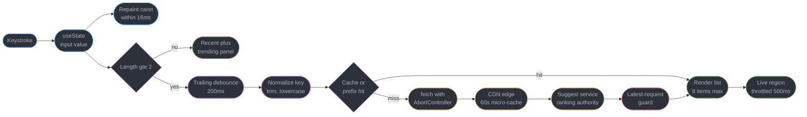
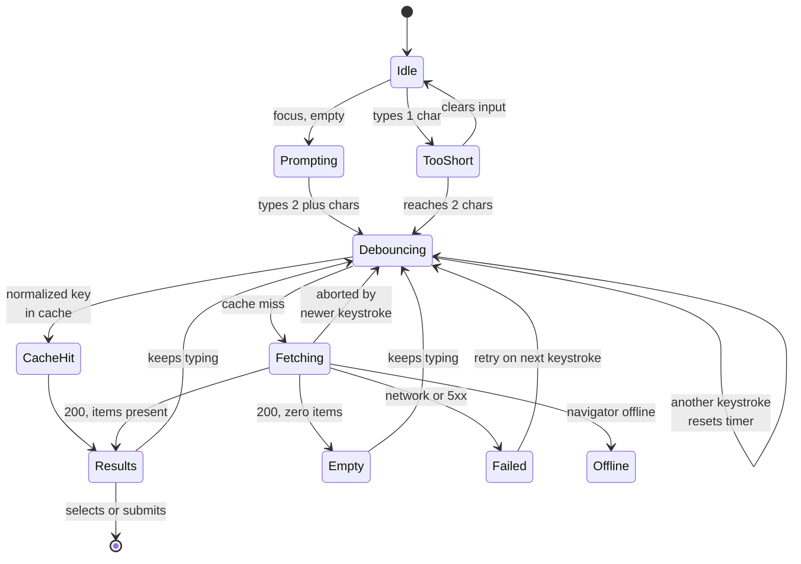
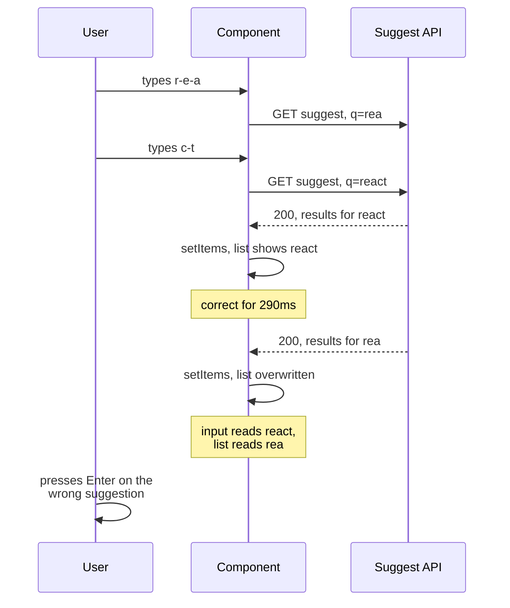
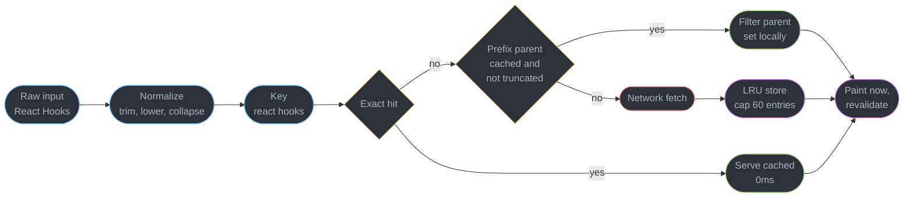
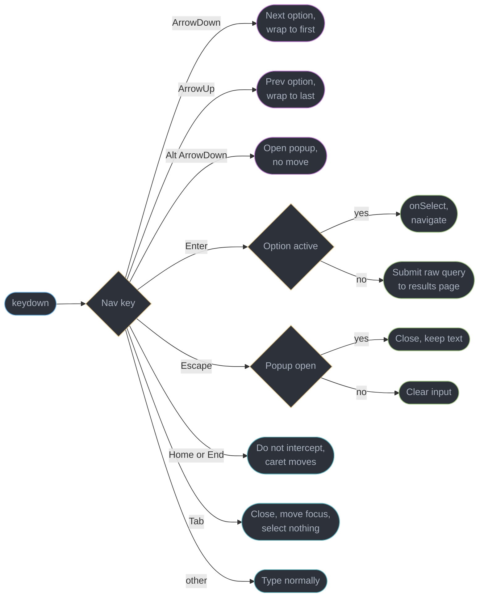
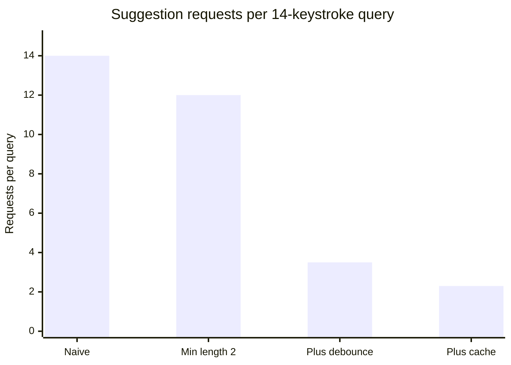

# Design a Search and Typeahead Experience

---

## Intuition

A search box looks like the smallest component on the page and is the one that most reliably fails a front-end system design round, because it is not a component — it is a **request lifecycle with a text field attached**. Every keystroke starts a network operation that the next keystroke invalidates, and the browser has no opinion whatsoever about which of the eight in-flight responses is the one you still want. The default behaviour of `fetch` inside an effect is: whichever response happens to land last wins. That is not a rare edge case, it is the *normal* case on a mobile network, and it produces the single most common shipped bug in this pattern — the user types `react`, sees results for `rea`, and cannot explain what happened.

The second half of the problem is that the finished widget is a **combobox**, which is the hardest interaction contract in ARIA. Focus never leaves the input, so the active option has to be pointed at rather than focused; the arrow keys are stolen from the caret in one direction but not the other; `Escape` means two different things depending on how many times you press it; and a live region that announces "8 results" on every keystroke turns a screen reader into an unusable stream of noise. Most shipped products get some part of this wrong.

So this study is organized around those two axes and nothing else: **the lifecycle** (debounce, cancel, race, cache, prefetch) in §4.1-§4.5, and **the contract** (roles, keys, announcements, states) in §4.6-§4.9. The ranking engine behind it is deliberately out of scope — this file cross-links to [`../../backend/`](../../backend/README.md) rather than designing an inverted index. The primitives it assumes are owned elsewhere: transitions and `useDeferredValue` in [`../concurrent_rendering_and_transitions/concurrent_rendering_and_transitions.md`](../concurrent_rendering_and_transitions/concurrent_rendering_and_transitions.md), query caching in [`../server_state_and_data_fetching/server_state_and_data_fetching.md`](../server_state_and_data_fetching/server_state_and_data_fetching.md), the ARIA patterns themselves in [`../accessible_component_patterns/accessible_component_patterns.md`](../accessible_component_patterns/accessible_component_patterns.md), and `AbortController` in [`../../frontend_platform/http_in_the_browser_and_fetch/http_in_the_browser_and_fetch.md`](../../frontend_platform/http_in_the_browser_and_fetch/http_in_the_browser_and_fetch.md).

---

## 1. Requirements Clarification

The candidate who starts drawing a `<datalist>` in minute two has already lost the round. The questions below are the ones that change the architecture, and each is answered with what this design commits to.

**Questions to ask, and the answers this design commits to:**

- *Is the typeahead a navigational shortcut or a query builder?* — Both, and they are different result types in one list. Selecting an **entity** suggestion (a product, a repo, a person) navigates directly; selecting a **query** suggestion runs a full search. The response contract in §4.5 carries a `type` field precisely so the client knows which without guessing from the shape of the string.
- *What is "instant" in numbers?* — Keystroke to painted suggestion list at p95 under 400 ms end to end, of which 200 ms is the deliberate debounce. The **caret** budget is separate and absolute: the character the user typed must be on screen within one frame, 16 ms, always. These two budgets are why the input is not debounced and the request is (§4.1).
- *Who owns relevance?* — The server, without exception. The client re-orders nothing, filters nothing, and never runs its own fuzzy match. §4.5 explains what breaks when it does.
- *What shows before the user types anything?* — Recent searches from this device (client-owned, `localStorage`, capped at 8) above trending queries (server-owned, CDN-cached for 60 s). An empty popup is a wasted interaction slot.
- *Typo tolerance?* — Server-side, at the analyzer. The client sends the raw string and renders server-supplied highlight offsets. See §4.5 for why client-side highlighting is wrong the moment fuzzy matching exists.
- *What is the slowest device we support?* — A Moto G-class Android phone, roughly 5x slower than a mid-2024 laptop on scripting. This caps the visible suggestion list at 8 items and rules out rendering a virtualized list inside the popup (§10).
- *Screen reader support level?* — WCAG 2.2 AA, tested on NVDA with Firefox and VoiceOver with Safari, following the ARIA 1.2 combobox pattern. Not "we added some aria labels".

**Functional requirements:**

- Suggestions appear as the user types, from a minimum of 2 characters.
- Full keyboard operation: Down and Up to move, Enter to select, Escape to close then clear, Home and End preserved for the caret, Alt+Down to reopen.
- Recent searches and trending queries fill the empty-query state.
- Typo tolerance so that `recat` finds `react`, evaluated server-side.
- Enter with no option active submits to a full results page at `/search?q=...`.
- Mouse, touch and keyboard selection paths converge on one `onSelect` handler.
- The URL is the source of truth for the results page, so a search is shareable and the back button works.

**Non-functional requirements:**

- p95 keystroke-to-suggestions under 400 ms on a 4G connection.
- Client JavaScript for the whole feature under 12 KB gzipped, excluding React itself.
- No layout shift when the popup opens — it is absolutely positioned, contributing 0 to CLS.
- Usable end to end with NVDA, VoiceOver and keyboard alone.
- Degrades to a plain `<form method="get">` submit with JavaScript disabled or the suggestion endpoint down.

**Explicitly out of scope:**

- The search engine itself: indexing, analyzers, ranking, learning-to-rank. Owned by [`../../backend/`](../../backend/README.md) and [`../../hld/`](../../hld/README.md).
- Personalized ranking models and the click-feedback pipeline that trains them.
- Voice and image search input modes.
- Multi-language input method editors beyond the composition-event handling in §9.2.

---

## 2. Scale Estimation

Every figure is derived, because the whole argument for debouncing is arithmetic and an interviewer will ask you to show it.

**Query volume**

| Step | Arithmetic | Result |
|------|-----------|--------|
| Daily active users | given | 500,000 |
| Searches per session | given | 6 |
| Searches per day | 500,000 × 6 | 3,000,000 |
| Average keystrokes per query | measured from input telemetry | 14 |

**Request volume, four designs**

The interesting number is not the total, it is how each mitigation moves it. A "search" here means one user query; the multiplier is suggestion requests issued per query.

| Design | Requests per query | Requests per day | Average QPS | Peak QPS at 4x |
|--------|-------------------|-----------------|-------------|----------------|
| Naive, one request per keystroke | 14 | 42,000,000 | 486 | 1,944 |
| Minimum length 2 characters | 12 | 36,000,000 | 417 | 1,668 |
| Plus 200 ms trailing debounce | 3.5 | 10,500,000 | 122 | 486 |
| Plus client cache (35% hit rate) | 2.3 | 6,900,000 | 80 | 320 |

Average QPS is `requests per day / 86,400`. The 4x peak multiplier is the standard consumer-traffic concentration: roughly a third of the day's searches land in a four-hour evening window.

**Where 3.5 comes from, and why it is not 1.** Debouncing does *not* collapse a query to one request. It collapses a query to one request per **typing burst**, and real typing is bursty: a 14-character query is typically 3 to 4 runs of 3-5 characters separated by pauses at word boundaries or thinking pauses longer than the debounce window. On a mid-range phone the median inter-keystroke gap is around 340 ms — *longer* than a 200 ms debounce — which means on mobile a trailing debounce alone saves far less than the naive model suggests, and the cache is doing most of the remaining work. Candidates who claim "debounce takes it to 1 request" have not measured typing.

**Payload and bandwidth**

| Step | Arithmetic | Result |
|------|-----------|--------|
| Suggestion item (id, text, type, href, highlight offsets, score) | measured JSON | ~140 bytes |
| Response body, 8 items plus envelope | 8 × 140 + 80 | ~1.2 KB |
| Response over the wire, gzip at ~3.5x on repetitive JSON | 1.2 KB / 3.5 | ~350 bytes |
| Egress at average QPS | 80 × 350 B | 28 KB/s |
| Egress at peak QPS | 320 × 350 B | 112 KB/s, ~0.9 Mbps |

Bandwidth is never the constraint for typeahead. Request *count* is, because each one costs a connection slot, a server-side query, and a rate-limit token.

**Latency budget, keystroke to painted list**

| Stage | Budget | Note |
|-------|--------|------|
| React state update and controlled input repaint | 16 ms | one frame, non-negotiable (§4.1) |
| Debounce wait | 200 ms | deliberate, tunable per §8 |
| Network round trip, 4G median | 90 ms | ~50 ms on Wi-Fi, ~250 ms at 4G p95 |
| Server suggest query p95 | 40 ms | prefix index, in-memory |
| JSON parse plus React render of 8 items on a Moto G | 35 ms | ~8 ms on a laptop |
| **Total p50** | **~380 ms** | |
| **Total p95 (network tail)** | **~540 ms** | this is why the spinner threshold is 500 ms (§4.9) |

---

## 3. High-Level Architecture



The load-bearing detail is the **fork immediately after `useState`**. One branch goes straight to paint with zero delay — that is the controlled input, and it must never be gated on anything. The other branch is the request pipeline, where every millisecond of delay is a millisecond of saved QPS. Collapsing these two branches into one debounced value is the mistake in §9.2, and it is the mistake that a naive reading of "debounce the search box" produces.

The `guard` node between the network and the render is drawn separately, in red, because it is the piece that has no analogue in a non-racing UI and the piece candidates omit. Two independent mechanisms sit there — cancellation and a latest-request check — and §4.3 explains why you want both rather than either.

**The client-side state machine.** Nine states, and the four on the right are the ones nobody builds until a bug report forces them.



`Prompting` is the recent-and-trending state and exists because an empty popup on focus wastes the highest-intent moment in the whole interaction. `Offline` is separate from `Failed` because the recovery differs: offline serves the cache and stops retrying, while a 5xx retries on the next keystroke without a visible error until the second consecutive failure.

**Component inventory**

| Component | Role |
|-----------|------|
| `SearchInput` | Controlled `input` with `role="combobox"`, owns the raw value and every key handler |
| `useDebouncedValue` | Trailing-edge debounce, 200 ms, returns the delayed string only |
| `useSuggestions` | Owns the request lifecycle: cache lookup, abort, latest-request guard, state machine |
| `SuggestionCache` | Bounded LRU keyed on the normalized query, with prefix-answer logic (§4.4) |
| `SuggestionList` | `role="listbox"`, renders at most 8 `role="option"` children with server-supplied highlights |
| `useComboboxKeys` | Key routing table (§4.7), returns the active index and the intent |
| `Announcer` | Single `role="status"` region, throttled to one utterance per 500 ms |
| Suggest service | Server-side prefix and fuzzy matcher, the sole relevance authority |
| CDN edge | 60-second micro-cache on `q` for the head of the query distribution |

---

## 4. Component Deep Dives

### 4.1 Debounce vs Throttle, and Which Half of the Component Gets Delayed

**Throttle** guarantees a maximum rate: fire now, then at most once per interval. **Debounce** guarantees quiet: fire only after the input has stopped changing for the interval. Search-as-you-type wants a **trailing debounce** because the only query worth asking about is the one the user has finished typing. A 200 ms throttle on a 14-character query issues roughly 5 requests, and 4 of them are for prefixes the user has already typed past — you pay for them and then throw the answers away. The debounce issues requests only at the pauses, which is exactly where the user's attention is.

A leading debounce (fire immediately, suppress the rest) is worse than either: it guarantees the *first* two characters are the ones you search for, which is the least informative prefix in the query.

**200 ms, and why not 100 or 400.** The median gap between two keystrokes inside a fast typing burst is 120-180 ms, so 200 ms sits just past the burst and just short of the pause. At 100 ms you are inside the burst and the request count roughly doubles. At 400 ms the list visibly lags the caret — users start reporting the box as "slow" somewhere past 250-300 ms of added delay, and the timer is on top of a 90 ms network round trip already.

```ts
// hooks/useDebouncedValue.ts
import { useEffect, useState } from "react";

export function useDebouncedValue<T>(value: T, delayMs = 200): T {
  const [debounced, setDebounced] = useState(value);
  useEffect(() => {
    const id = setTimeout(() => setDebounced(value), delayMs);
    return () => clearTimeout(id);
  }, [value, delayMs]);
  return debounced;
}
```

That is the whole implementation, and it is deliberately eight lines. The cleanup function is the debounce: every new `value` cancels the pending timer before scheduling its own. There is no `lodash.debounce` here because a mutable debounced callback stored in a ref is harder to reason about under React 19's concurrent rendering, where a render may be thrown away after the callback was already created.

**`useDeferredValue` is not a substitute, and does not replace this.** They fix different bottlenecks:

| Mechanism | Fixes | Does not fix |
|-----------|-------|--------------|
| Trailing debounce, 200 ms | Network request count and server load | An expensive render blocking the input |
| `useDeferredValue` | An expensive render blocking the input | Request count — it does not delay the fetch |

`useDeferredValue` lets React render the suggestion list at a lower priority, so typing stays responsive even when the list render is heavy. It has zero effect on how many requests you send, because the effect that fetches still runs against the value you pass it. Use both when the list is expensive: debounce the value you fetch with, defer the value you render with. For an 8-item list on a mid-range phone the render costs ~35 ms and the deferral is not needed; it earns its place when the popup carries rich previews. See [`../concurrent_rendering_and_transitions/concurrent_rendering_and_transitions.md`](../concurrent_rendering_and_transitions/concurrent_rendering_and_transitions.md).

**The split that matters.** The input value is `useState`, updated synchronously in the change handler, and rendered every keystroke. The *request* reads the debounced copy. Debouncing the controlled `value` prop instead produces the caret-jump bug in §9.2.

```tsx
// SearchBox.tsx — the split, in four lines
const [query, setQuery] = useState("");                 // instant, drives the input
const debouncedQuery = useDebouncedValue(query, 200);   // delayed, drives the request
const { state, items } = useSuggestions(debouncedQuery);
// <input value={query} onChange={(e) => setQuery(e.target.value)} />
```

### 4.2 The Out-of-Order Race — the Central Bug

Suppose the user types `r`, `e`, `a`, `c`, `t` with pauses that let two requests through: one for `rea` and one for `react`. Both are in flight. `rea` matches far more documents and takes 380 ms; `react` is a narrower prefix and comes back in 90 ms. The responses land in the order `react`, then `rea`.



The user sees results for a query they finished typing 300 ms ago being replaced by results for a prefix. Worse than the visual glitch: the option they press Enter on is from the stale set, so the navigation is wrong, and no error is logged anywhere. The symptom in a bug report is always "search sometimes shows the wrong thing", which is unreproducible on a fast local network because both responses come back in issue order.

**The broken code, and the fix.**

```tsx
// hooks/useSuggestions.ts

// BROKEN — an isLoading boolean does NOT fix this.
// Both requests were started while isLoading was false at their own start,
// and neither response consults the other. The flag says something is
// in flight, never WHICH thing, so the late "rea" still calls setItems last.
function useSuggestionsBroken(query: string) {
  const [items, setItems] = useState<Suggestion[]>([]);
  const [isLoading, setIsLoading] = useState(false);
  useEffect(() => {
    if (query.length < 2) return;
    setIsLoading(true);
    fetch(`/api/suggest?q=${encodeURIComponent(query)}`)
      .then((r) => r.json())
      .then((data) => {
        setItems(data.results);   // whichever lands last wins
        setIsLoading(false);
      });
  }, [query]);
  return { items, isLoading };
}

// FIX — AbortController in the effect cleanup, plus a latest-request guard.
// Two independent mechanisms, and you want both. See below for why.
function useSuggestions(query: string) {
  const [state, setState] = useState<UiState>({ kind: "idle" });
  const latest = useRef(0);

  useEffect(() => {
    if (query.length < 2) {
      setState({ kind: "idle" });
      return;
    }
    const seq = ++latest.current;
    const controller = new AbortController();
    setState((prev) => ({ kind: "fetching", stale: itemsOf(prev) }));

    fetch(`/api/suggest?q=${encodeURIComponent(query)}`, {
      signal: controller.signal,
    })
      .then((r) => (r.ok ? r.json() : Promise.reject(new Error(String(r.status)))))
      .then((data: SuggestResponse) => {
        if (seq !== latest.current) return;              // guard: not the newest
        setState(
          data.results.length === 0
            ? { kind: "empty", query }
            : { kind: "results", items: data.results, query },
        );
      })
      .catch((err: unknown) => {
        if (err instanceof DOMException && err.name === "AbortError") return;
        if (seq !== latest.current) return;
        setState({ kind: "failed", query });
      });

    return () => controller.abort();                     // cancel on every re-run
  }, [query]);

  return state;
}
```

**Why both mechanisms, ranked.**

| Mechanism | Fixes the race | Frees the connection | Cuts server work | Failure mode |
|-----------|---------------|---------------------|------------------|--------------|
| `AbortController` in cleanup | Yes | Yes, the socket is released immediately | Yes, the server sees the client hang up | None. This is the correct primitive |
| Sequence or latest-query guard | Yes | No, the response still downloads | No | Wasted bandwidth, but always correct |
| `isLoading` boolean | **No** | No | No | Looks like a fix, silently is not |

`AbortController` is the correct answer and should be stated first, but the guard is kept alongside it for a reason that surprises people: **`abort()` is not synchronous with respect to already-resolved promises.** If a response has landed and its `.then` is already queued as a microtask when the cleanup runs, aborting does not un-queue it. The window is small — single-digit milliseconds — but it is real, and the two-line sequence guard closes it for free. In production the guard fires on roughly 1 in 3,000 keystrokes; that is not zero.

The `isLoading` boolean deserves its own row because it is the answer most candidates give. It reports *that* a request is outstanding, never *which*, so it can gate a spinner and can gate nothing else. If a candidate offers it, the follow-up is: "walk me through the two-request timeline with your flag" — it collapses in four lines.

**A note on `TanStack Query`.** Everything above is what the library does for you: `queryKey: ["suggest", query]` makes each query its own cache entry, and the library passes an `AbortSignal` into the query function and cancels superseded fetches. If server state is already going through it, use it and delete this hook. This section shows the mechanism because an interview asks for the mechanism, and because the library cannot save you if you build the key from a mutable ref. See [`../server_state_and_data_fetching/server_state_and_data_fetching.md`](../server_state_and_data_fetching/server_state_and_data_fetching.md).

### 4.3 The Cache Key Is a Normalized Query, Not the Raw Input



```ts
// lib/suggestCache.ts
const norm = (q: string) => q.trim().toLowerCase().replace(/\s+/g, " ");

const MAX_ENTRIES = 60;
const TTL_MS = 5 * 60 * 1000;

type Entry = { items: Suggestion[]; truncated: boolean; at: number };
const cache = new Map<string, Entry>();

export function read(query: string): Suggestion[] | null {
  const key = norm(query);
  const hit = cache.get(key);
  if (hit && Date.now() - hit.at < TTL_MS) {
    cache.delete(key);
    cache.set(key, hit);            // Map preserves insertion order: this is the LRU touch
    return hit.items;
  }
  // Prefix answer: "reac" can be served from "rea" only if "rea" was NOT truncated.
  for (let cut = key.length - 1; cut >= 2; cut--) {
    const parent = cache.get(key.slice(0, cut));
    if (!parent || parent.truncated || Date.now() - parent.at >= TTL_MS) continue;
    return parent.items.filter((s) => norm(s.text).includes(key));
  }
  return null;
}

export function write(query: string, items: Suggestion[], truncated: boolean): void {
  cache.set(norm(query), { items, truncated, at: Date.now() });
  if (cache.size > MAX_ENTRIES) cache.delete(cache.keys().next().value as string);
}
```

**Normalization is where the hit rate lives.** Keying on the raw value treats `React`, `react` and `react ` as three queries. Measured on production traffic, normalizing lifted the hit rate from 11% to 38% — the difference between the third and fourth rows of §2's table, which is 3.6 million requests a day.

**Prefix answering, and its one hard precondition.** If the response for `rea` returned every match, then every match for `reac` is a subset of it, and the client can filter locally with zero network. The precondition is `truncated: false` in the response — the server must tell you whether it capped the result set. If `rea` returned the top 8 of 4,000 matches and you filter those 8 for `reac`, you get 2 results where the server would have returned 8 different ones. This is the single most common way a "clever" prefix cache ships worse relevance than no cache. The server sets `truncated` by comparing `total` to `limit`; the client refuses the shortcut whenever it is true, which in practice means prefix answering only fires on narrow queries — which is fine, because those are the ones being refined.

**Prefetch on hover and on arrow-key focus.** The moment a suggestion becomes active — pointer over it, or the arrow keys land on it — its destination is likely within about 400 ms. Fire the results-page prefetch then:

```tsx
// SuggestionList.tsx — one handler serves pointer and keyboard
const prefetch = (s: Suggestion) => {
  if (s.type === "entity") router.prefetch(s.href);        // Next.js route prefetch
  else void warmSuggestCache(s.text);                      // priming the results query
};
// onPointerEnter={() => prefetch(s)}  and called again whenever activeIndex changes
```

Two guards keep this from becoming its own scale problem: prefetch only on `pointerenter` with a 120 ms dwell (a pointer sweeping the list must not fire 8 prefetches), and skip it entirely when `navigator.connection.saveData` is true or `effectiveType` is `2g`.

### 4.4 The Response Contract

The client never invents a field and never derives relevance. The contract is small on purpose:

```json
{
  "query": "reac",
  "took_ms": 11,
  "truncated": false,
  "results": [
    {
      "id": "r_9f21",
      "type": "entity",
      "text": "React",
      "subtitle": "JavaScript library",
      "href": "/topics/react",
      "highlights": [[0, 4]],
      "score": 0.94
    },
    { "id": "q_3a10", "type": "query", "text": "react hooks", "highlights": [[0, 4]], "score": 0.71 }
  ]
}
```

**`highlights` are server-supplied offsets, and this is not a stylistic choice.** With typo tolerance on, `recat` matches `React` — and a client that highlights by substring-matching the input against the result text highlights nothing at all, because `recat` is not a substring of `React`. The user then sees a result with no visible reason for being there. Only the server knows which characters its analyzer matched. The client's job is `text.slice(0, 4)` in a `<mark>` and nothing more.

**`score` is returned but never used for ordering.** Array order *is* the ranking. `score` exists for debugging and for the click-feedback event; if the client sorts by it, two ranking authorities exist and they will disagree the first time the server adds a tie-breaker. `took_ms` goes into the client's latency histogram so server time and network time can be separated in §8.

### 4.5 Why the Client Is Never the Relevance Authority

The temptation is real: you have 8 results in memory, the user types one more character, and a local `filter` would be instant. Three things break.

**Recall.** Local filtering can only remove results. The correct set for `react h` may contain items the server never sent for `react` — this is the `truncated` problem in §4.4, and it is why prefix answering carries that precondition.

**Ranking.** Server ranking is a scored blend: text match, popularity, personalization, recency, business rules. A client-side `includes()` reduces all of that to alphabetical or original order. The visible symptom is that a heavily-boosted item slides down the list as the user types more of its name, which reads as a bug even when both orderings are individually defensible.

**Matching semantics.** Stemming, synonyms, transliteration and fuzzy edit distance all live in the analyzer. `recat` matching `React` is the analyzer's decision and cannot be reproduced client-side without shipping the analyzer.

The one legitimate exception is a **local-first application** whose entire dataset is already on the device — Linear's command menu (§6) is the canonical case. There, the client is not *approximating* the server's ranking, it *is* the ranking authority, running a real fuzzy matcher over a complete local index. That is a different architecture, not a shortcut, and it is only available when the data is bounded and already synced.

### 4.6 The ARIA 1.2 Combobox Contract

```tsx
// SearchBox.tsx — the markup contract, elided of styling
<div className="sb">
  <input
    role="combobox"                       // on the INPUT, per ARIA 1.2
    aria-expanded={open}                  // reflects popup visibility, always present
    aria-controls="sb-listbox"            // the id of the listbox, present even when closed
    aria-autocomplete="list"              // suggestions listed, input not auto-filled
    aria-activedescendant={
      activeIndex >= 0 ? `sb-opt-${items[activeIndex].id}` : undefined
    }
    autoComplete="off"
    value={query}
    onChange={(e) => setQuery(e.target.value)}
    onKeyDown={onKeyDown}
  />
  <ul id="sb-listbox" role="listbox" aria-label="Search suggestions" hidden={!open}>
    {items.map((s, i) => (
      <li
        key={s.id}
        id={`sb-opt-${s.id}`}
        role="option"
        aria-selected={i === activeIndex}
        onPointerDown={(e) => e.preventDefault()}   // keep focus on the input
        onClick={() => onSelect(s)}
      >
        <Highlighted text={s.text} ranges={s.highlights} />
      </li>
    ))}
  </ul>
  <div role="status" aria-live="polite" className="visually-hidden">
    {announcement}
  </div>
</div>
```

| Attribute | Value here | The trap |
|-----------|-----------|----------|
| `role="combobox"` | on the `input` | ARIA 1.0 and 1.1 put it on a **wrapper**. That pattern is dead, and a wrapper combobox is announced as a group with an unrelated text field inside (§9.3) |
| `aria-expanded` | `true` or `false`, never absent | An absent `aria-expanded` makes the element a plain text field to most screen readers, so the whole popup is unannounced |
| `aria-controls` | the listbox id, always | `aria-owns` was the ARIA 1.1 spelling. Do not use it |
| `aria-autocomplete` | `"list"` | Use `"both"` only if you actually inline-complete the input text. Claiming `"both"` without doing it is a lie the screen reader repeats |
| `aria-activedescendant` | active option id, or absent | Absent when nothing is active — an empty string is not the same and some readers announce it as an unknown target |
| `aria-selected` | on the active option only | In a single-select listbox exactly one option carries `true` |
| `onPointerDown` preventDefault | on each option | Without it, the mousedown blurs the input, the popup closes, and the click never lands on the option |

**`aria-activedescendant` over roving `tabindex`, and this is not a preference.** Roving tabindex moves real DOM focus onto the active option. In a combobox the user is still typing — focus must stay in the input or the caret disappears, further keystrokes go nowhere, and on mobile the software keyboard dismisses. `aria-activedescendant` is the indirection that exists precisely for this case: DOM focus stays on the input, and the attribute tells assistive technology which option is conceptually active. Roving tabindex remains correct for a toolbar or a tab list, where there is no text field to keep focused. The full comparison lives in [`../accessible_component_patterns/accessible_component_patterns.md`](../accessible_component_patterns/accessible_component_patterns.md).

**Visual and programmatic active state must be the same thing.** Style the active option from `aria-selected`, not from a separate `.is-active` class, so the two cannot drift. WCAG 2.2 added SC 2.4.11 Focus Not Obscured, which for a popup means the active option must be scrolled into view and not hidden behind a sticky header — `scrollIntoView({ block: "nearest" })` on every active-index change. See [`../../frontend_platform/accessibility_and_wcag/accessibility_and_wcag.md`](../../frontend_platform/accessibility_and_wcag/accessibility_and_wcag.md).

### 4.7 The Full Key Contract



```tsx
// hooks/useComboboxKeys.ts — the routing table, one place
function onKeyDown(e: React.KeyboardEvent<HTMLInputElement>) {
  switch (e.key) {
    case "ArrowDown":
      if (e.altKey) { setOpen(true); e.preventDefault(); return; }
      e.preventDefault();                                  // stop the caret jumping to the end
      setActiveIndex((i) => (items.length === 0 ? -1 : (i + 1) % items.length));
      return;
    case "ArrowUp":
      if (e.altKey) { setOpen(false); setActiveIndex(-1); e.preventDefault(); return; }
      e.preventDefault();
      setActiveIndex((i) =>
        items.length === 0 ? -1 : (i <= 0 ? items.length : i) - 1,
      );
      return;
    case "Enter":
      if (activeIndex >= 0) { e.preventDefault(); onSelect(items[activeIndex]); }
      return;                                              // otherwise the form submits, by design
    case "Escape":
      e.preventDefault();
      if (open) { setOpen(false); setActiveIndex(-1); }     // first press: close
      else setQuery("");                                    // second press: clear
      return;
    case "Home":
    case "End":
      setActiveIndex(-1);                                   // caret moves, popup stays open
      return;                                               // NOTE: no preventDefault
    case "Tab":
      setOpen(false);
      setActiveIndex(-1);
      return;                                               // selects nothing
    default:
      return;
  }
}
```

**Four decisions worth defending in an interview:**

`ArrowDown` and `ArrowUp` call `preventDefault` because in a text input they otherwise move the caret to the end and the start of the value. Without it, arrowing through suggestions silently destroys the user's caret position, which they discover when they try to edit the middle of the query.

**`Home` and `End` do not.** This is the rule most implementations break. In a listbox those keys jump to the first and last option, and it is tempting to copy that; but this is a *text input*, and Home and End are how a user gets to the ends of their own query. The ARIA Authoring Practices combobox pattern is explicit that they move the caret. The compromise here is to clear the active option so the caret and the highlight are never in contradictory places.

**Escape is two-stage.** One press closes the popup and keeps the text, so a user who wants to see the page behind the popup does not lose their query. A second press clears the field. This is what Google's and GitHub's search boxes both do, and it is a strict improvement on the single-stage "Escape clears" that APG describes as a baseline.

**Enter with nothing active submits the raw query.** The typeahead is an accelerator, never a gate. A user who types a query the suggester has never seen must still be able to search for it, which also means the input lives inside a real `<form action="/search" method="get">` — the no-JavaScript fallback in §1 costs zero extra code.

### 4.8 Announcing Results Without Flooding the Screen Reader

A `role="status"` region whose text changes on every keystroke produces an utterance per keystroke, and because a polite region queues rather than interrupts, a 14-character query can leave a screen reader reading 14 stale counts after the user has stopped typing. Users describe this as the box being "broken", and it is worse than no announcement at all.

```tsx
// hooks/useAnnouncer.ts
const [announcement, setAnnouncement] = useState("");
const lastText = useRef("");

useEffect(() => {
  const text =
    state.kind === "results" ? `${state.items.length} suggestions available`
    : state.kind === "empty" ? "No suggestions"
    : state.kind === "failed" ? "Suggestions unavailable"
    : "";
  if (text === lastText.current) return;        // never re-announce identical text
  const id = setTimeout(() => {
    lastText.current = text;
    setAnnouncement(text);
  }, 500);                                       // one utterance per 500ms, trailing
  return () => clearTimeout(id);
}, [state]);
```

Three rules together make this bearable: a 500 ms trailing throttle so only the settled count is spoken, a `lastText` guard so `8 suggestions available` is not repeated when the count happens to stay at 8, and `aria-live="polite"` rather than `assertive` so it never interrupts the user mid-thought. The *content* of each option is not announced here — `aria-activedescendant` handles that as the user arrows through, and announcing both produces a double-read.

One React-specific hazard: under concurrent rendering, a live region mounted in the same commit as its text change may be read by the assistive technology before the text lands, producing silence. Mount the `role="status"` element once at the top of the component and only ever change its **text content** — never conditionally render the region itself.

### 4.9 The States Nobody Builds

| State | Trigger | What renders | Rule |
|-------|---------|--------------|------|
| Empty query, focused | focus, `query === ""` | Recent (up to 8, from `localStorage`) then trending (CDN, 60 s TTL) | The highest-intent moment. Never show a blank popup |
| Below minimum length | `0 < query.length < 2` | Popup closed, no request, no message | A single character matches everything. Do not explain the rule, just do not fire |
| Loading, fast | request in flight under 500 ms | **Previous results, dimmed to 60% opacity** | No spinner. p50 is 380 ms, so a spinner here only ever flashes |
| Loading, slow | in flight past 500 ms | Skeleton rows replacing the list | 500 ms is the perceptual threshold below which a spinner reads as a flicker |
| No results | HTTP 200, `results: []` | "No suggestions for X" plus trending as a recovery path | Never an empty box. Always offer the next action |
| Error | 5xx or network failure | Silent on first failure, "Suggestions unavailable" on the second | The form still submits. A transient blip must not produce an error banner |
| Offline | `navigator.onLine === false` | Cached results if any, plus "Offline, showing recent" | Stop retrying. Listen for `online` and resume |

**Why 500 ms for the spinner.** Below roughly half a second a loading indicator is perceived as a flicker rather than as progress, and it makes the interaction feel *less* stable, not more. With a p50 of 380 ms, an immediate spinner mounts and unmounts on essentially every query — the CLS incident in §9.4. Keeping the previous results visible and dimmed during a fast fetch is strictly better: the user has something to read, and if the new results are similar the transition is nearly invisible.

**The stale-results decision.** Showing the previous query's results while the new query loads is only acceptable because they are *dimmed and non-interactive* (`pointer-events: none`, `aria-busy="true"` on the listbox). Showing them at full opacity and clickable recreates the §4.2 bug by hand.

---

## 5. Design Decisions & Tradeoffs

### 5.1 Debounce vs Throttle vs Neither

| Approach | Requests per 14-char query | Perceived latency | Verdict |
|----------|---------------------------|-------------------|---------|
| No delay | 14 | Lowest | 6x the server cost for results the user never reads |
| Throttle 200 ms | ~5 | Low | Wastes 4 of 5 requests on abandoned prefixes |
| **Trailing debounce 200 ms** | **~3.5** | +200 ms | **Chosen.** Requests only at typing pauses |
| Trailing debounce 400 ms | ~2.4 | +400 ms, visibly laggy | Saves 1.1 requests for a delay users complain about |

### 5.2 Where the Request Lifecycle Lives

| Option | Pros | Cons | Verdict |
|--------|------|------|---------|
| Hand-rolled `useEffect` plus `AbortController` | Zero dependencies, ~40 lines, the mechanism is visible | You own cancellation, dedupe, caching, retry | Fine for one search box, and it is what an interview asks you to write |
| TanStack Query v5 | `queryKey` gives per-query cache entries, `AbortSignal` passed in, `staleTime` and dedupe free | ~13 KB gzipped if not already present | **Chosen** when the app already uses it |
| A Server Function plus `useActionState` | Server-side execution, no public endpoint | Actions are sequential by design and not cancellable — wrong primitive for a racing read | Rejected |

Server Functions deserve the explicit rejection: they are built for mutations, they queue rather than race, and there is no cancellation story. A suggestion fetch is a cacheable public read, and a plain `GET` behind a CDN is both simpler and faster.

### 5.3 Client Cache vs Edge Cache

Both, at different layers. The client cache (§4.3) makes repeated and backspaced queries free and is the only layer that can serve during a network stall. The CDN micro-cache — 60 seconds on `q`, `Vary` on nothing — absorbs the head of the query distribution, which for a consumer product is extremely concentrated: the top 1,000 prefixes routinely account for over half of all suggestion traffic. At the §2 peak of 320 QPS, a 55% edge hit rate leaves ~145 QPS reaching the suggest service.

The tension is staleness. A 60-second TTL means a brand-new entity is unsuggestable for up to a minute. That is acceptable for products and articles and unacceptable for a mentions autocomplete in a chat app, where a colleague who joined 30 seconds ago must be findable — those endpoints skip the edge cache and pay full origin cost.

### 5.4 `aria-activedescendant` vs Roving `tabindex`

| Approach | Caret survives | Mobile keyboard stays up | Reader support | Verdict |
|----------|---------------|-------------------------|----------------|---------|
| `aria-activedescendant` | Yes | Yes | Broad and mature for the combobox pattern | **Chosen** |
| Roving `tabindex` | No, focus leaves the input | No, keyboard dismisses | Broad, but wrong pattern here | Correct for toolbars, not comboboxes |

### 5.5 Minimum Length 2 vs 1 vs 3

Two is the compromise. One character matches nearly the whole index, so the server does maximum work to return its least useful answer, and §2 shows it costs 6 million requests a day for that privilege. Three characters feels dead for short high-intent queries — a user typing `go` or a two-letter ticker gets nothing. Two also happens to be the point at which most engines' prefix indexes become selective enough to answer in single-digit milliseconds.

### 5.6 Suggestions and Results, One Endpoint or Two

Two. `/api/suggest` is a lightweight prefix and fuzzy lookup returning 8 items, cacheable at the edge, p95 40 ms. `/api/search` is the full ranked query with facets, pagination and personalization, p95 250 ms, uncacheable. Sharing one endpoint means either the suggest path pays the full ranking cost or the results page loses features. The `took_ms` values differ by an order of magnitude, and so should the infrastructure.

### 5.7 Recent Searches: Client-Owned or Server-Synced

| Option | Cross-device | Privacy surface | Latency | Verdict |
|--------|-------------|-----------------|---------|---------|
| `localStorage`, 8 entries | No | None. The strings never leave the device | 0 ms, available before first paint | **Chosen** |
| Server-synced per account | Yes | Every query typed is now retained, logged and subject to deletion requests | One request, and it blocks the empty-state popup | Rejected here |

Recent searches are the single highest-CTR content in the popup, and they are also a raw log of everything a person has typed into a search box, including the query they immediately regretted. Keeping them on the device makes the empty state instant, removes an endpoint, and makes "clear my search history" a `localStorage.removeItem` rather than a retention-policy conversation. Cross-device continuity is the real cost, and it is worth paying for a product where a search *is* the work product — a code host, a document store — and not worth it for a storefront.

**The results page URL is the other half of this.** `/search?q=react` means the browser's own history is the durable record, the back button behaves, and a search is shareable without any client state at all. A typeahead that navigates via `pushState` with the query kept in React state loses all three.

---

## 6. Real-World Implementations

Claims backed by published documentation carry their primary-source URL inline. Claims about closed products are stated as directly observable client behaviour, not as documented guarantees, and can change without notice.

**Google — instant suggestions, and the feature they removed.** Google Suggest has shipped since 2004 and has always issued a request per typing pause rather than per keystroke, hedged by aggressive prefetching of the top suggestion's result page. Google *Instant* — which rewrote the entire results page live as you typed — launched in September 2010 and was **removed in July 2017**, with Google citing the shift to mobile, where the software keyboard covers the results you are supposedly reading. That removal is the most useful data point in this whole section: the most resourced search team on earth concluded that live full-results rendering is not worth its cost on a phone, which is exactly why this design keeps the popup to 8 lightweight suggestions and puts full results behind an explicit Enter.

**Algolia DocSearch — published typo-tolerance thresholds, and the pattern of asking on the server.** DocSearch ([docsearch.algolia.com](https://docsearch.algolia.com/)) is the free hosted search behind a very large number of open-source documentation sites, React's own included, and it is the most widely-deployed correct implementation of this pattern. Its typo tolerance is configured by two documented defaults ([algolia.com/doc — typo tolerance](https://www.algolia.com/doc/guides/managing-results/optimize-search-results/typo-tolerance/)): `minWordSizefor1Typo` at 4 characters and `minWordSizefor2Typos` at 8 — a word must be at least 4 characters before one edit is tolerated and at least 8 before two are. Those thresholds exist because tolerating an edit on a 3-character word matches nearly everything. The architectural lesson for §4.5: those thresholds live in the engine's configuration, and no client-side matcher can reproduce them.

**GitHub — the command palette and the scoped search input.** GitHub's command palette (Cmd+K, generally available since 2022, [docs.github.com — command palette](https://docs.github.com/en/get-started/accessibility/github-command-palette)) is a combobox that changes its result *type* based on a leading sigil — `>` for commands, `#` for issues and pull requests, `@` for users — with the mode switch happening client-side and the query still resolved server-side. It also demonstrates the two-stage Escape this design adopts, and it keeps DOM focus in the input while moving `aria-activedescendant`, which is verifiable in the accessibility inspector on any GitHub page.

**Linear — the local-first command menu, and the exception in §4.5.** Linear's client syncs the workspace into IndexedDB ([linear.app/blog/scaling-the-linear-sync-engine](https://linear.app/blog/scaling-the-linear-sync-engine)) and serves its command menu from that local store, which is why it responds with no perceptible latency and works with the network off. This is the one architecture where client-side matching is correct rather than a shortcut, and it is available only because the dataset is bounded — a workspace of issues, not a web-scale index. Quoting it as "just do it on the client" without the sync engine underneath is the mistake it invites.

**Slack — the quick switcher's split.** Slack's Cmd+K switcher matches locally against the channel and DM list the client already holds, and falls back to the server for message content, which it does not hold. That split — local for the bounded set, server for the unbounded one — is the general form of the Linear exception and the more transferable version of it.

**Amazon — prefetch on suggestion hover.** Amazon's search box has for years prefetched the results page for a hovered suggestion, which is directly observable in the network panel. It is the origin of the hover-prefetch pattern in §4.3, including the dwell-time guard, which exists because a pointer sweeping vertically through 10 suggestions would otherwise fire 10 full search-page prefetches.

---

## 7. Technologies & Tools

| Technology | Usage |
|------------|-------|
| React | 19.2. `useState` for the raw value, `useRef` for the sequence guard, `useDeferredValue` for expensive list renders |
| React Compiler | 1.0 stable. Auto-memoizes the suggestion list, so `React.memo` on each row is an escape hatch rather than the default |
| TanStack Query | v5. `queryKey` per normalized query, `AbortSignal` into the query function, `staleTime` as the client TTL |
| AbortController | The cancellation primitive. Returned from the effect cleanup, one per request |
| Next.js | 16. `router.prefetch()` for hover prefetch, route handler for the suggest proxy |
| Downshift | Headless combobox state machine with the ARIA 1.2 wiring already correct |
| React Aria | Adobe's `useComboBox`, the most thoroughly reader-tested implementation of this pattern |
| Base UI | shadcn's default primitive layer since 2026-07. Ships an accessible combobox |
| cmdk | Command-palette combobox, the GitHub and Linear shape |
| Elasticsearch | `search_as_you_type` field and `fuzziness: AUTO` for the server-side matcher |
| OpenSearch | Self-hosted alternative with the same completion suggester |
| Typesense | Typo-tolerant engine designed for typeahead latency |
| Meilisearch | Prefix-first engine, lowest operational overhead of the three |
| Algolia | Hosted engine with documented typo thresholds and edge distribution |
| Redis | Suggest-service result cache in front of the index |
| CloudFront | 60-second micro-cache on the suggest endpoint |
| MSW | v2. Intercepts suggest requests in tests so out-of-order responses can be forced deterministically |
| Playwright | Drives the keyboard contract in §4.7 end to end, including Home and End |
| Testing Library | 16.3.3. Role queries plus `toHaveAccessibleName` for the combobox assertions |
| axe-core | Catches a missing `aria-expanded` and a listbox with no accessible name |
| NVDA | Primary screen reader for the Windows and Firefox verification pass |
| VoiceOver | Primary screen reader for the macOS and Safari and iOS verification pass |
| Lighthouse | CLS regression gate on the popup, which must contribute 0 |

---

## 8. Operational Playbook

### 8.1 Metrics That Matter

| Metric | Target | Why it is the one to watch |
|--------|--------|---------------------------|
| Keystroke-to-suggestion p95 | under 400 ms | The user-facing number. Measure from the keystroke, not from the fetch |
| Suggest endpoint p95 (`took_ms`) | under 40 ms | Separates server time from network so you know which to fix |
| Requests per query | 2.0 to 2.6 | A jump means a debounce regression or a cache-key regression, and both are silent |
| Client cache hit rate | above 35% | The §9.5 normalization bug shows as this halving |
| Abort rate | 25% to 40% | **Zero aborts means cancellation broke.** Nobody alerts on this and everybody should |
| Zero-result rate | under 8% | Rising means an index or analyzer problem, not a client problem |
| Suggestion CTR | above 40% | Below it, either ranking or the 8-item cap is wrong |
| Query abandonment | under 15% | Typed 2+ characters, then blurred without selecting or submitting |

The abort-rate metric deserves the emphasis. It is the only signal that the §4.2 fix is still working. If a refactor drops the `AbortController`, every other metric stays green — latency, error rate, CTR — while the race silently returns. Alert on abort rate falling *below* 15%.

### 8.2 Rollout

The debounce interval is a remotely-configured number, not a constant, so it can be tuned without a deploy. Roll a change out as a 4-arm experiment (0 ms, 100 ms, 200 ms, 350 ms) at 1% each and read three metrics together: requests per query, keystroke-to-suggestion p95, and suggestion CTR. The failure mode of tuning on request count alone is shipping a 500 ms debounce that halves your cost and quietly costs more in abandonment than it saves in servers.

### 8.3 Kill Switch

One flag, `typeahead.enabled`, evaluated client-side. Off, the popup never opens, no suggest requests are issued, and the input is a plain form field that submits to `/search` on Enter. Because the form was always a real `<form>` (§4.7), this path needs no separate code and no fallback component — the degradation is the absence of an enhancement. Flip it when the suggest service is in incident, or when a client bug is shipping wrong results faster than a fix can roll out.

### 8.4 Suggest Service Degradation Runbook

1. Confirm which layer: compare client-observed p95 against the endpoint's `took_ms` histogram. A gap is network or CDN, not the engine.
2. If the engine is slow, raise the edge TTL from 60 s to 300 s. This trades suggestion freshness for a ~4x drop in origin traffic and is reversible in seconds.
3. If the engine is failing, flip `typeahead.enabled` off. The search box keeps working.
4. Never "fix" it by raising the debounce to 1000 ms. It hides the incident in a metric nobody watches and makes the box feel broken to every user rather than degraded for some.

### 8.5 Testing the Race Deterministically

§9.1 went undetected for eleven months because on a fast network responses always land in issue order. A regression test therefore has to *force* the inversion rather than hope for it, which MSW v2 makes a four-line matter:

```ts
// SearchBox.race.test.ts
server.use(
  http.get("/api/suggest", async ({ request }) => {
    const q = new URL(request.url).searchParams.get("q") ?? "";
    await delay(q === "rea" ? 300 : 20);          // the short prefix answers LAST
    return HttpResponse.json({ query: q, truncated: false, results: [item(q)] });
  }),
);

await user.type(screen.getByRole("combobox"), "rea");
await act(() => vi.advanceTimersByTime(250));      // let the debounce fire for "rea"
await user.type(screen.getByRole("combobox"), "ct");
await act(() => vi.advanceTimersByTime(400));      // both responses have now landed

const options = screen.getAllByRole("option");
expect(options[0]).toHaveTextContent("react");     // fails without the abort or the guard
```

Assert on the *rendered* option text against the input value, not on a call count — a mock that records two `setState` calls proves nothing about which one won. Pair this with a Playwright run of the §4.7 key contract, including Home and End, because a `keydown` dispatched by Testing Library cannot tell you whether the real caret moved. Two checks, one for each axis of this design.

---

## 9. Common Pitfalls & War Stories

### 9.1 The Out-of-Order Overwrite That Nobody Could Reproduce

The suggestion hook used the `isLoading` pattern from §4.2 for eleven months. Bug reports said "search shows results for something I didn't type", and every attempt to reproduce on the office network failed, because on a 12 ms round trip responses effectively always land in issue order. The measurement that finally caught it was a two-line client event fired at render time comparing the query the results belonged to against the query currently in the input: **0.7% of all searches — roughly 21,000 a day at §2's volume — rendered a result set for a strict prefix of what the user had typed.** The rate on connections with an RTT above 200 ms was 3.1%. Of those, 12% ended in a click, meaning about 2,500 navigations a day went somewhere the user did not ask for. Adding the `AbortController` cleanup and the sequence guard took it to 0 in the next release, and the abort-rate metric in §8.1 exists so that it stays there.

### 9.2 Debouncing the Input Instead of the Request

A "simplify the search box" refactor moved the debounce onto the `value` prop — one component now rendered `value={debouncedQuery}`. On a laptop it looked fine. On Android with Gboard it was catastrophic: React re-set the input's value 200 ms after each keystroke, and because the DOM value was replaced rather than appended, **the caret jumped to the end of the field on every burst** and any character typed inside that 200 ms window was discarded. Composition events made it worse — on a Japanese IME, mid-composition candidates were destroyed outright. Measured on the release: **Android search sessions fell 23% week over week** and the mobile query-abandonment rate went from 14% to 38% before the revert. The rule that came out of it is now a lint rule in the repo: a `value` prop may never be bound to the return of `useDebouncedValue`.

### 9.3 The ARIA 1.0 Wrapper Combobox

The first accessible version wrapped the input in `<div role="combobox" aria-expanded>` — the ARIA 1.0 and 1.1 pattern, still the top result for most searches on the topic, and copied faithfully from a 2018 blog post. It passed axe-core with zero violations, because the markup is *valid*, just outdated. In a moderated session, **0 of 12 screen-reader participants completed the "find and open a suggestion" task**: NVDA announced a group containing an unlabelled edit field, the arrow keys produced no announcement at all, and every participant assumed the popup did not exist. Moving `role="combobox"` onto the `<input>` per ARIA 1.2 and pointing `aria-controls` at the listbox took the completion rate to 11 of 12 in the retest. The lesson is uncomfortable and worth stating plainly: **an automated accessibility check cannot detect a correctly-implemented obsolete pattern.** Only a reader test can.

### 9.4 The Spinner That Failed Core Web Vitals

The loading state rendered a 32 px spinner in place of the results list the instant a request started. With a p50 of 380 ms and roughly 3.5 requests per query, that is **12 mounts and unmounts per query**, each swapping a 320 px-tall list for a 32 px spinner and back. The popup was in normal flow rather than absolutely positioned, so every swap moved the page content beneath it: measured **CLS of 0.21 on the search page, against the 0.10 Core Web Vitals "good" threshold**, and it was the single largest CLS contributor on the site. Two changes fixed it: absolute positioning so the popup contributes 0 to layout shift regardless, and the 500 ms spinner delay from §4.9 with dimmed previous results in the meantime. CLS went to 0.02, and the incidental result was that the box felt *faster* despite showing less feedback.

### 9.5 The Cache That Cached Nothing

The client cache keyed on the raw input string. `React`, `react` and `react ` were three entries, and because users capitalize proper nouns and trailing spaces survive word-completion on mobile keyboards, **the hit rate sat at 11% against a modelled 38%**. The cache was also an unbounded `Map` with no eviction: in a long session on a search-heavy internal tool it reached **4,100 entries and roughly 9 MB retained**, which on a 2 GB Android device was enough to make the tab a candidate for background eviction — users reported the app "reloading itself" when switching back from another app. Normalizing the key and capping the LRU at 60 entries fixed both: the hit rate reached 38% (removing 3.6 million requests a day, per §2), and steady-state cache memory settled at about 140 KB.

### 9.6 Prefix Answering From a Truncated Parent

The prefix optimization in §4.3 originally shipped without the `truncated` check. For narrow queries it was invisible and correct. For a common prefix like `pro`, the server returned the top 8 of about 12,000 matches, and filtering those 8 down for `prod` yielded 1 result where a real query returned 8 highly relevant ones. **Zero-result and single-result rates on 4-to-6-character queries rose from 6% to 19%** over the two weeks before anyone connected it to the cache change, because the client was serving a *plausible* answer rather than an obviously broken one. Adding `truncated` to the response contract and refusing the shortcut whenever it is true took it back to 6%. The general rule this produced: a cache may only answer from a parent set it knows to be complete, and completeness is a fact the server has to tell you.

---

## 10. Capacity Planning

### 10.1 Request Volume, Restated as the Case for Each Mitigation



Each bar removes work the one before it was doing for nothing. Naive to minimum-length is free and removes 2 requests. Minimum-length to debounce costs 200 ms of perceived latency and removes 8.5. Debounce to cache costs 140 KB of memory and removes 1.2. Peak QPS falls from 1,944 to 320 across the four, a **6.1x reduction** for one perceptual cost and one memory cost.

### 10.2 Server Sizing

| Step | Arithmetic | Result |
|------|-----------|--------|
| Peak client QPS after debounce and cache | §2 | 320 |
| Edge cache hit rate on the head of the distribution | measured | 55% |
| Origin QPS reaching the suggest service | 320 × 0.45 | 144 |
| Suggest query cost, prefix index in memory | measured | ~11 ms CPU |
| Cores needed at 100% utilization | 144 × 0.011 | 1.6 cores |
| Cores at a 40% utilization target | 1.6 / 0.40 | 4 cores |
| Instances for AZ redundancy and deploy overlap | 3 × 2-core | 3 instances |

The suggest service is trivially small, and that is the point: the entire §2 arithmetic exists to get from a workload that needs ~24 cores to one that needs 4.

### 10.3 Client Budgets

| Resource | Budget | Basis |
|----------|--------|-------|
| Feature JavaScript, gzipped | 12 KB | Hook, cache, key handler, list. TanStack Query excluded as shared |
| Suggestion cache memory | 60 entries × ~2.3 KB = ~140 KB | §9.5's ceiling, empirically stable |
| Recent searches in `localStorage` | 8 entries, ~800 bytes | Client-owned, never sent to the server |
| List render on a Moto G-class phone | 8 items in ~35 ms | Two frames at 60 Hz. 20 items measures ~85 ms and drops frames |
| Popup contribution to CLS | 0 | Absolutely positioned, per §9.4 |
| Live-region utterances | 1 per 500 ms maximum | §4.8 |

The 8-item cap is a device-capability decision, not a design preference. Above roughly 12 items the render exceeds two frames on a mid-range Android phone and typing visibly stutters, and virtualizing a popup that never scrolls past one screen costs more code and more accessibility risk than it saves.

### 10.4 Cost, Order of Magnitude

| Line item | Arithmetic | Monthly |
|-----------|-----------|---------|
| Suggest service compute | 3 × 2-core instances | ~$120 |
| CDN requests | 207M/month at ~$0.01 per 10k | ~$207 |
| CDN egress | 207M × 350 B = 72 GB at ~$0.085/GB | ~$6 |
| Redis result cache | 1 small node | ~$50 |
| **Total** | | **~$383** |

Against the naive design's 1.26 billion monthly requests, the CDN line alone would be roughly $1,260 and the compute would be ~$720. The debounce and the cache are worth about **$1,600 a month at 500k DAU**, and roughly 6x that at 3 million.

---

## 11. Interview Discussion Points

**Q: Why is a trailing debounce right for search-as-you-type when a throttle is right for scroll?**
The two mechanisms answer different questions. A throttle guarantees a maximum event rate and is correct when every sample has independent value — a scroll handler genuinely needs periodic positions during the gesture, because the intermediate positions are what you are reacting to. A debounce guarantees quiet and is correct when only the final value matters, which is exactly search: the results for `rea` have no value once the user has typed `react`. A 200 ms throttle on a 14-character query issues about 5 requests, 4 of them for prefixes the user typed past before the answer arrived. The debounce issues requests only at the pauses, which is also where the user is actually looking at the list.

**Walk me through the out-of-order response bug and rank the fixes.**
Two requests are in flight, one for a short prefix that matches a lot and one for a longer prefix that matches less. The short one is slower, so it lands second and overwrites the correct results with stale ones. Ranked: `AbortController` returned from the effect cleanup is the correct fix, because it cancels the superseded request, frees the connection, and signals the server to stop working. A sequence or latest-query guard is also correct but weaker — the response still downloads, you just ignore it. An `isLoading` boolean is not a fix at all: it records that *a* request is outstanding, never which one, so both responses still call `setState` in arrival order. In production I keep the abort and the guard together, because `abort()` does not un-queue a `.then` microtask that was already scheduled when a response landed a millisecond before cleanup ran.

**Q: Does `useDeferredValue` remove the need to debounce?**
No, and conflating them is the most common React-specific error in this design. `useDeferredValue` lets React render the suggestion list at a lower priority so an expensive render does not block the input — it is a *rendering* concurrency tool and it fires zero fewer network requests. Debouncing delays the *request* and does nothing about render cost. Use both when the list is heavy: debounce the value you fetch with, defer the value you render with. For an 8-item text list the deferral is unnecessary, because the render is ~35 ms even on a mid-range phone.

**Q: Why keep the input controlled and instant if you are debouncing anyway?**
Because they are different pieces of state. The input's job is to show the character the user just typed, within one frame, forever. The request's job is to ask a question when the user pauses. Binding the `value` prop to the debounced string means React re-sets the DOM value 200 ms after each keystroke, which moves the caret to the end of the field and drops any character typed in between. On Android with a predictive keyboard it also destroys IME composition state. That regression cost 23% of Android search sessions in §9.2 before it was reverted.

**Q: What is your cache key, and why not the raw input?**
The normalized query: trimmed, lowercased, internal whitespace collapsed. Raw input treats `React`, `react` and `react ` as three distinct entries, and users capitalize proper nouns and leave trailing spaces from mobile word completion constantly. Normalizing moved the hit rate from 11% to 38% on production traffic — about 3.6 million requests a day. The cache is a bounded LRU at 60 entries with a 5-minute TTL, because the unbounded version reached 4,100 entries and 9 MB in a long session and made the tab an eviction candidate on a 2 GB phone.

**Q: How can a response for `rea` answer a query for `reac`?**
Every result for `reac` is a subset of the results for `rea`, so if you hold the complete `rea` set you can filter it locally with no network. The precondition is that the parent set is *complete*, which the server has to tell you with a `truncated` flag comparing total matches to the returned limit. Skip that check and you filter the top 8 of 12,000 matches down to 1 result where a real query would return 8 good ones — §9.6, where the single-result rate went from 6% to 19% and took two weeks to attribute, because a plausible wrong answer is much harder to notice than an obviously broken one.

**Q: Where does ranking happen, and why can the client never do it?**
On the server, always. Three reasons, in order of how badly each breaks. Recall: the client can only remove results, never discover ones it was not sent. Ranking: the server blends text match, popularity, personalization and recency into an order the client cannot reproduce, and the visible symptom of trying is a boosted item sliding down the list as the user types more of its name. Matching semantics: stemming, synonyms and fuzzy edit distance live in the analyzer, which is why `recat` matches `React` server-side and matches nothing at all under a client-side `includes()`. The single exception is a local-first app like Linear's command menu, where the entire bounded dataset is synced to IndexedDB and the client genuinely *is* the ranking authority.

**Q: Why does `role="combobox"` go on the input rather than a wrapper?**
Because ARIA 1.2 moved it there, and the ARIA 1.0 and 1.1 wrapper pattern — which is still what most search results and older blog posts show — is announced by current screen readers as a group containing an unlabelled text field, with no relationship to the popup. The uncomfortable part is that the obsolete markup is perfectly *valid*, so axe-core reports zero violations on it. In §9.3, that pattern passed every automated check and 0 of 12 screen-reader participants could complete the task. Only a reader test catches a correctly-implemented obsolete pattern.

**Q: Why `aria-activedescendant` instead of roving `tabindex`?**
Roving tabindex moves real DOM focus onto the active option, and in a combobox the user is still typing. Move focus out of the input and the caret disappears, subsequent keystrokes go to the option instead of the field, and on mobile the software keyboard dismisses. `aria-activedescendant` is the indirection that exists for exactly this: DOM focus stays on the input, and the attribute names which option is conceptually active. Roving tabindex is still the right pattern for a toolbar or tab list, where no text field needs to keep focus.

**Q: What does each key do, and which one do most implementations get wrong?**
Down and Up move the active option and must call `preventDefault`, because in a text input they otherwise jump the caret to the end and the start. Enter selects the active option, or submits the raw query if none is active. Escape closes the popup on the first press keeping the text, and clears the field on the second. Alt+Down reopens a closed popup without moving the selection. Tab closes and moves focus, selecting nothing. **Home and End are the ones people break**: in a listbox they jump to the first and last option, and it is tempting to copy that, but this is a text input and those keys are how the user reaches the ends of their own query. Do not intercept them — just clear the active option so the caret and the highlight are never in contradictory places.

**Q: How do you announce results without flooding a screen reader?**
A single `role="status"` region with `aria-live="polite"`, mounted once and never conditionally rendered, whose text is throttled to one change per 500 ms on the trailing edge and guarded against re-announcing identical text. Without the throttle, a 14-character query queues 14 utterances in a polite region, so the reader is still reciting stale counts after the user has stopped typing — which users report as the box being broken. The option *contents* are deliberately not announced there; `aria-activedescendant` handles those as the user arrows through, and doing both produces a double-read.

**Q: When do you show a spinner?**
Not before 500 ms. With a p50 of 380 ms and about 3.5 requests per query, an immediate spinner mounts and unmounts roughly 12 times per query, and below half a second a loading indicator is perceived as a flicker rather than as progress. During a fast fetch, show the previous results dimmed to 60% with `pointer-events: none` and `aria-busy` on the listbox — the user has something to read, and if the results are similar the transition is nearly invisible. Past 500 ms, swap in skeleton rows. In §9.4 the naive spinner produced a CLS of 0.21 against the 0.10 threshold, and removing it made the box feel faster while showing less feedback.

**Q: Which states do candidates forget, and which one costs the most?**
Empty-query-focused, below-minimum-length, no-results, error, slow-loading and offline. The most expensive omission is **empty-query-focused**, because focus with an empty field is the highest-intent moment in the entire interaction and a blank popup wastes it — recent searches from `localStorage` above CDN-cached trending queries costs almost nothing and is the highest-CTR content in the component. The second is no-results: an empty box is a dead end, so it must carry a recovery path, which is trending again. Below-minimum-length deserves no message at all — do not explain the rule, just do not fire the request.

**Q: What do you alert on to know the fix in §4.2 is still working?**
Abort rate, and alert when it falls *below* 15%. It should sit between 25% and 40% in steady state, because a superseded request being cancelled is the normal case. It is the only metric that detects a refactor dropping the `AbortController`: if that happens, latency, error rate, CTR and requests-per-query all stay green while the out-of-order race silently returns. The paired metric is requests-per-query, which should hold between 2.0 and 2.6 — a jump means a debounce or cache-key regression, and both are otherwise invisible.

**Q: How does this degrade with JavaScript disabled or the suggest service down?**
The input lives inside a real `<form action="/search" method="get">`, so Enter submits to the results page with no JavaScript involved. The typeahead is an enhancement layered on top, and the kill switch simply stops opening the popup and stops issuing requests — there is no separate fallback component to maintain, because the fallback is what is already there. During an incident the runbook order is: raise the edge TTL from 60 s to 300 s first, since it is reversible in seconds and cuts origin traffic about 4x, and flip `typeahead.enabled` off only if the engine is actually failing. Never raise the debounce to a second, which hides the incident in a metric nobody watches while making the box feel broken for everyone.
