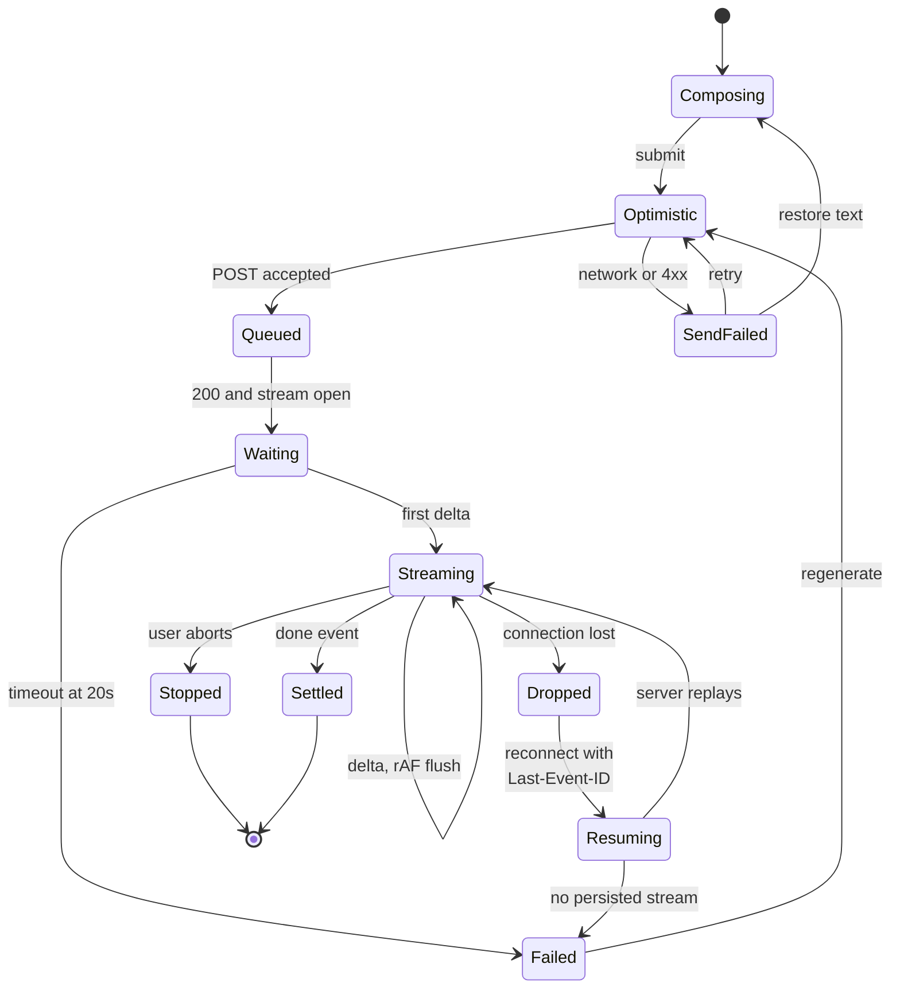
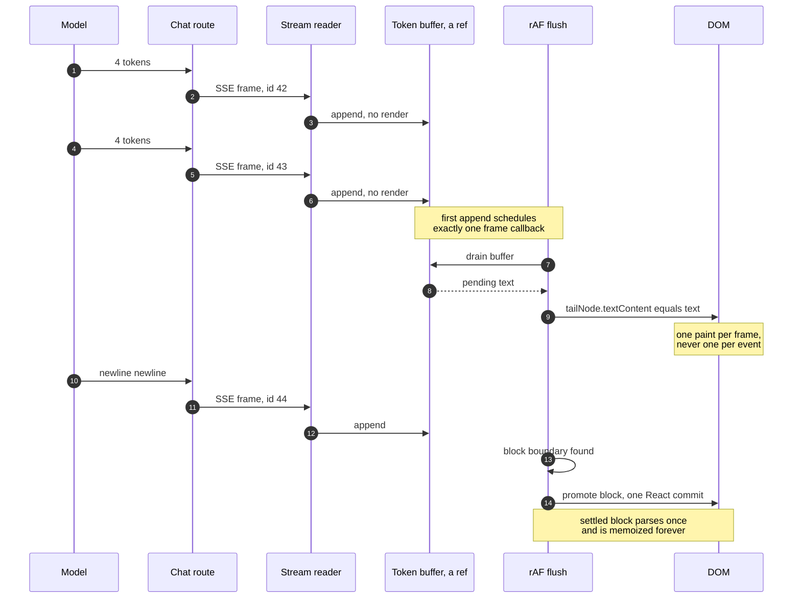
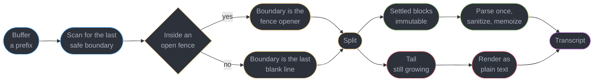
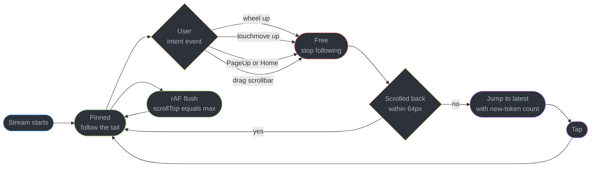
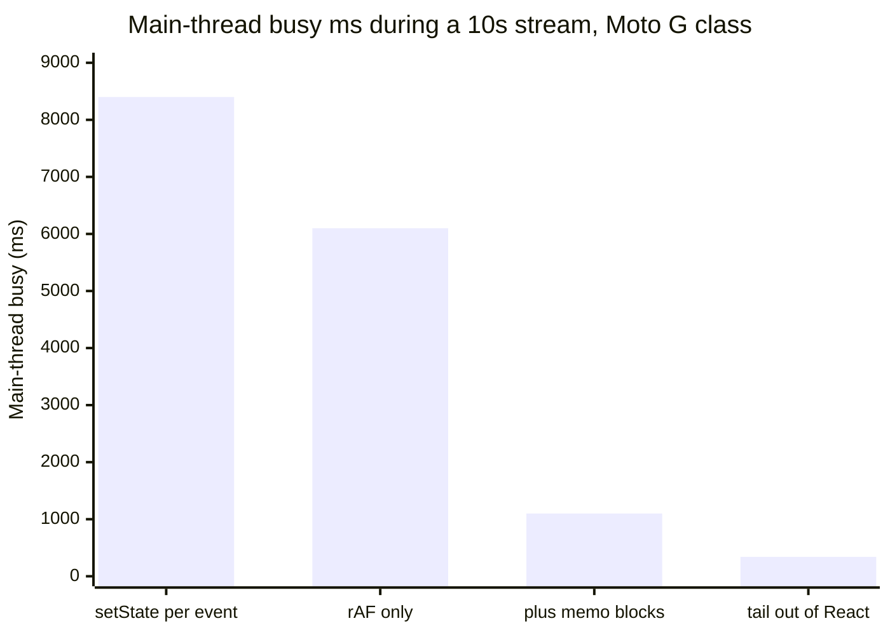

# Design an AI Chat Streaming UI

---

## Intuition

Every other screen in this section is a request/response client dressed up in various ways: you ask for something, you wait, you paint it. An LLM chat client is not that. The response arrives as **600 tokens over ten seconds**, and the interesting engineering all lives in that window — a window in which the answer is simultaneously being written, being read, and being syntactically invalid. The document you are rendering is a **half-finished document**, and it stays half-finished for longer than most web interactions exist.

That single fact generates every hard problem here. Markdown that is still being written has an unclosed code fence, a table with a header and no separator row, and a link whose closing bracket has not arrived — so a parser that assumes a complete document produces flicker, and one that produces flicker on a growing string produces it sixty times a second. State that updates per token produces one React commit per token, and because each commit re-parses the whole partial message from character zero, the cost is quadratic in the length of the answer, not linear. A scroll container that follows the tail fights the user the moment they scroll up to re-read something. And a connection that drops at token 400 leaves you holding two thirds of a message with no obvious way to ask for the rest.

The transport question — SSE or WebSocket — is the one candidates spend the most time on and the one that matters least, because it has a clear answer (§4.1) and takes ninety seconds to defend. The question that separates candidates is **backpressure into the DOM**: tokens arrive faster than a browser can usefully paint, and the naive React idiom for "show a value as it changes" is exactly wrong here. §4.2 and §4.3 are the centre of this study, and they are where the measured numbers are.

Two boundaries are firm. The model, its serving stack, batching and token economics are owned by [`../../llm/`](../../llm/README.md) — this file consumes a token stream and never designs one. SSE framing, `EventSource` semantics, reconnect and backoff are owned by [`../../frontend_platform/realtime_in_the_browser/realtime_in_the_browser.md`](../../frontend_platform/realtime_in_the_browser/realtime_in_the_browser.md); sanitization and the client threat model by [`../../frontend_platform/browser_security_and_the_client_threat_model/browser_security_and_the_client_threat_model.md`](../../frontend_platform/browser_security_and_the_client_threat_model/browser_security_and_the_client_threat_model.md); transitions and deferred values by [`../concurrent_rendering_and_transitions/concurrent_rendering_and_transitions.md`](../concurrent_rendering_and_transitions/concurrent_rendering_and_transitions.md); profiling and virtualization by [`../react_performance_and_profiling/react_performance_and_profiling.md`](../react_performance_and_profiling/react_performance_and_profiling.md).

---

## 1. Requirements Clarification

**Questions to ask, and the answers this design commits to:**

- *What is the streaming granularity — token, word, or sentence?* — Token, coalesced server-side into events of 4 tokens each (§5.2). The client cannot assume an event boundary is a word boundary, a UTF-8 boundary, or a markdown boundary, and every bug in §9 comes from code that assumed one of the three.
- *Is the stream idempotent and replayable?* — Yes. The server persists each emitted delta against a monotonic event id, and a reconnect with `Last-Event-ID` resumes from the next one (§4.9). Without server-side persistence there is no resumption story at all, only a retry that costs a second full generation.
- *Can the user send a second message while the first is still streaming?* — No. The composer is disabled for the 7-15 second stream, and this is a product decision with an architectural consequence: exactly one stream is live per conversation, so the client never multiplexes and never needs a per-message connection pool.
- *What happens to a partial answer when the user presses Stop?* — It is kept, persisted, and marked `stopped`. Discarding it is the wrong default: the user pressed Stop because they had already read enough, which means the text on screen is the text they wanted.
- *Does the server stop generating when the client disconnects?* — It must, and this is the money question (§4.7). Billing does not stop because you stopped reading. §9.2 quantifies what it costs when the abort does not propagate.
- *What does "cost" mean to the user?* — Input tokens, output tokens and a currency amount per assistant turn, plus time-to-first-token and tokens per second. The price table is fetched from the server and never hardcoded in the bundle (§4.10).
- *Attachments?* — Images and PDFs, up to 5 per turn, uploaded to object storage **before** the message is sent, so the chat request carries references rather than bytes and a slow upload cannot be mistaken for a slow model.
- *Rendering fidelity — how much markdown?* — CommonMark plus GFM tables, fenced code with syntax highlighting, and inline math. No raw HTML passthrough, ever (§4.5).

**Functional requirements:**

- Assistant responses stream token by token with the first glyph on screen within one frame of the first event.
- Markdown renders progressively and never flickers a settled block.
- Multi-turn history, with the full conversation restored on reload and on a new device.
- Stop mid-stream, keeping the partial answer.
- Regenerate, producing a sibling variant that does not destroy the previous one.
- Edit a previous user turn and resend, truncating everything after it.
- Copy a message, and copy a single code block, as two separate affordances.
- Per-turn time-to-first-token, tokens per second and cost, visible on demand.

**Non-functional requirements:**

- Time-to-first-token p50 under 600 ms, p95 under 1.5 s, measured from the click, not from the request.
- Under 5% of main-thread time consumed by rendering during a 60 tokens per second stream, on a Moto G-class phone.
- INP p75 under 100 ms **while a stream is running** — the composer and the Stop button must stay responsive.
- Zero cumulative layout shift attributable to the growing message.
- A dropped connection resumes without regenerating, at a cost of one request.
- Model output is sanitized before it reaches the DOM, with no `dangerouslySetInnerHTML` on unsanitized HTML anywhere in the codebase.

**Explicitly out of scope:**

- Model serving, batching, KV-cache and the token economics behind the price table — [`../../llm/`](../../llm/README.md).
- Retrieval, tool execution and agent orchestration on the server side. The client renders tool-call events as timeline items and knows nothing about how they are produced.
- Voice input and audio output, which are the one case that genuinely needs a WebSocket (§5.1).

---

## 2. Scale Estimation

**Conversation volume**

| Step | Arithmetic | Result |
|------|-----------|--------|
| Daily active users | given | 50,000 |
| Sessions per user per day | given | 1 |
| Messages per session | given | 8 |
| Assistant turns per day | 50,000 × 8 | 400,000 |
| Average output length | given | 600 tokens |
| Generation rate | given | 40-80 tokens/sec, median 60 |
| Stream duration | 600 / 60 | 10 seconds, range 7.5-15 s |

**Concurrency — the number that makes SSE viable**

| Step | Arithmetic | Result |
|------|-----------|--------|
| Stream-seconds per day | 400,000 × 10 s | 4,000,000 |
| Average concurrent streams | 4,000,000 / 86,400 | 46 |
| Peak at a 4x evening concentration | 46 × 4 | 185 |

**185 concurrent connections is nothing**, and that is the point. A chat client holds a connection only while a response is generating — roughly 10 seconds out of a multi-minute session — so connection count tracks *generation time*, not user count. This is the opposite of the collaborative editor next door, where a connection is held for the whole session and 50,000 DAU means tens of thousands of simultaneous sockets. The transport decision in §5.1 rests on this arithmetic.

**Wire volume, and the framing overhead nobody estimates**

| Step | Arithmetic | Result |
|------|-----------|--------|
| Text bytes per response | 600 tokens × ~3.6 chars | ~2.2 KB |
| One-token SSE frame, `data: {"t":"d","v":"…"}\n\n` | 6 + ~26 + 2 | ~34 bytes |
| Frames per response at one token each | 600 | 600 |
| Wire bytes per response, one token per frame | 600 × 34 | ~20.4 KB |
| **Framing overhead ratio** | 20.4 / 2.2 | **9.3x** |
| Coalesced at 4 tokens per frame | 150 × ~48 B | ~7.2 KB, 3.3x |
| Daily egress, coalesced | 400,000 × 7.2 KB | ~2.9 GB/day |
| Monthly egress | 2.9 × 30 | ~87 GB |

The 9.3x is the derivation that justifies §5.2. A token is roughly 3.6 characters and an SSE frame costs 34 bytes of envelope, so a one-token-per-event stream spends **nine tenths of its bandwidth on punctuation**. Coalescing four tokens per event drops it to 3.3x for a perceptual cost of about 66 ms of added granularity at 60 tokens per second — well under the 100 ms at which humans stop perceiving text as arriving smoothly.

**Token accounting per turn, and why the input side grows**

The history is resent every turn, so input tokens grow linearly through a session while output stays flat.

| Turn | Input tokens (400 system + prior turns × 640) | Output tokens |
|------|---------------------------------------------|---------------|
| 1 | 400 | 600 |
| 4 | 400 + 3 × 640 = 2,320 | 600 |
| 8 | 400 + 7 × 640 = 4,880 | 600 |
| **Session average** | 400 + 3.5 × 640 = **2,640** | **600** |

**Rendering load — the real constraint**

| Step | Arithmetic | Result |
|------|-----------|--------|
| Events per response, coalesced | 600 / 4 | 150 |
| Event arrival rate | 150 / 10 s | 15 events/sec |
| Naive commits per response, one per event | 150 | 150 |
| Naive commits if uncoalesced | 600 | 600 |
| Characters parsed under naive re-parse | sum of prefix lengths, 600 × 601 / 2 × 3.6 | ~649,000 |
| **Re-parse blow-up** | 649,000 / 2,160 | **300x the message length** |

That last row is the whole performance argument in one number. Re-parsing a growing string from character zero on every update is O(n²) in the length of the answer: for a 2.2 KB response the parser walks 649 KB. Double the answer length and it quadruples. On a laptop this is survivable and on a mid-range Android phone it is not, which is why §4.3 exists.

**Client memory over a long session**

| Step | Arithmetic | Result |
|------|-----------|--------|
| Rendered DOM nodes per assistant message | measured, markdown with 2 code blocks | ~300 |
| Nodes for an 8-message session | 8 × 300 + 8 × 12 user nodes | ~2,500 |
| Nodes at 60 turns, the long-session tail | 60 × 300 | ~18,000 |
| Retained JS per message, text plus parsed AST | ~2.2 KB text + ~9 KB AST | ~11 KB |
| Retained at 60 turns | 60 × 11 KB | ~660 KB |

18,000 nodes is where scroll latency becomes visible on a mid-range phone, which sets the virtualization threshold in §10.3 at 40 messages.

---

## 3. High-Level Architecture

```mermaid
flowchart LR
    comp(["Composer<br/>submit"]) --> opt(["Optimistic<br/>user turn"])
    opt --> post(["POST api chat<br/>fetch plus signal"])
    post --> reader(["ReadableStream<br/>reader"])
    reader --> parse(["SSE frame<br/>decoder"])
    parse --> buf(["Token buffer<br/>a ref, not state"])
    buf --> raf(["rAF flush<br/>one per frame"])
    raf --> tail(["Tail node<br/>textContent write"])
    raf --> bound{"Block<br/>boundary"}
    bound -->|"yes"| promote(["Promote block<br/>one React commit"])
    bound -->|"no"| tail
    promote --> cache(["Block cache<br/>parsed once"])
    cache --> md(["Markdown plus<br/>sanitize"])
    md --> list(["Transcript"])
    tail --> list
    list --> scroll(["Pin controller<br/>follow or free"])
    stop(["Stop button"]) --> abort(["AbortController"])
    abort --> post

    classDef inp   fill:#2c313a,stroke:#61afef,color:#abb2bf
    classDef net   fill:#2c313a,stroke:#e5c07b,color:#abb2bf
    classDef hot   fill:#2c313a,stroke:#e06c75,color:#abb2bf
    classDef work  fill:#2c313a,stroke:#c678dd,color:#abb2bf
    classDef out   fill:#2c313a,stroke:#98c379,color:#abb2bf
    class comp,opt,stop inp
    class post,reader,parse net
    class buf,raf,tail hot
    class bound,promote,cache,md work
    class list,scroll out
```



Three details carry the design. **The buffer is a ref, not state** — tokens accumulate outside React entirely, and nothing re-renders when one arrives. **The rAF flush is the only writer**, so the maximum paint rate is one per frame no matter how fast the network delivers. And **the fork at the block boundary** is what turns 150 events into single-digit React commits: the tail is a `textContent` assignment on a DOM node the reconciler never touches, and only a completed markdown block gets promoted into React state, parsed, sanitized and memoized forever.

**Message lifecycle.** The four states on the right are the ones that only exist because the response is long-lived.



`Waiting` is separate from `Streaming` because they need different UI — a shimmer with no text and no scroll pinning versus live text with pinning active — and different timeouts. A 20-second wait with zero tokens is a failure; a 20-second stream that is still producing tokens is a long answer.

**Component and module inventory**

| Piece | Role |
|-------|------|
| `Composer` | Textarea, attachment picker, submit and Stop. Disabled while a stream is live |
| `useChatStream` | Owns `fetch`, the reader, the `AbortController`, and the buffer-to-rAF pipeline |
| `TokenBuffer` | A ref holding arrived-but-unpainted text plus the last event id |
| `flushOnFrame` | The single scheduled `requestAnimationFrame` writer |
| `blockSplit` | Splits the buffer into settled markdown blocks and an unsafe tail (§4.4) |
| `BlockCache` | `Map` from block hash to rendered React element, parsed exactly once |
| `MarkdownBlock` | Memoized, parses one settled block, sanitizes, highlights code |
| `StreamingTail` | A single element written with `textContent` via a ref. Zero React renders |
| `PinController` | Decides follow-the-tail versus free scroll from user intent events (§4.8) |
| `useTurnMetrics` | TTFT, tokens/sec, token counts, cost from a server-supplied price table |
| Chat API route | Proxies to the model provider, persists deltas by event id, propagates abort |

---

## 4. Component Deep Dives

### 4.1 The Transport: SSE, and the Event Contract

Server-Sent Events is the right transport for this, and the argument is four bullets long.

- **The traffic is one-way.** Server to client, for the entire life of the stream. The user's next message is a fresh `POST`, not a frame on the existing channel. A bidirectional transport buys nothing and costs a protocol.
- **It is plain HTTP.** A `text/event-stream` response goes through every corporate proxy, CDN and load balancer that already carries your traffic, inherits your existing auth, and is multiplexed onto an existing HTTP/2 connection at no extra socket cost. A WebSocket upgrade is a separate connection with its own auth handshake and its own set of middleboxes that mangle it.
- **Reconnect and event ids are in the protocol.** `id:` on a frame, `retry:` for the backoff hint, and `Last-Event-ID` sent automatically on reconnect. With WebSocket you build all three yourself.
- **There is no custom framing.** Events are newline-delimited text. A WebSocket gives you a message boundary and nothing above it, so you re-invent event types and ids in JSON anyway.

**Where a WebSocket genuinely wins:** voice mode, where audio flows both ways continuously and the client streams microphone frames up while receiving speech down; collaborative cursors in a shared conversation, where every participant is both a producer and a consumer of high-frequency position updates; and bidirectional tool traffic, where the model asks the *client* to run something — read the open file, take a screenshot — and waits for a reply on the same channel. All three are genuinely bidirectional at high frequency. A text chat is not. Protocol mechanics, reconnect and backoff belong to [`../../frontend_platform/realtime_in_the_browser/realtime_in_the_browser.md`](../../frontend_platform/realtime_in_the_browser/realtime_in_the_browser.md).

**The one real cost of SSE, stated honestly.** The browser's `EventSource` cannot send a request body and cannot set headers, so it cannot carry a chat message or an `Authorization` header. Every serious chat client therefore uses `fetch` with a `POST`, reads `response.body` as a `ReadableStream`, and parses the SSE framing by hand — which means **giving up the automatic reconnect that was one of the four bullets above**. You keep the framing and the event ids and you hand-roll the reconnect (§4.9). Anyone who claims SSE gives you free reconnection in a chat client has not written the `POST`.

The event contract is small and typed, and every event carries an id so a resume knows where it stopped:

```json
{ "id": "42", "t": "delta", "v": "Server-Sent " }
{ "id": "43", "t": "delta", "v": "Events are " }
{ "id": "44", "t": "tool", "name": "search", "status": "running" }
{ "id": "45", "t": "usage", "in": 2640, "out": 600 }
{ "id": "46", "t": "done", "finish": "stop" }
{ "id": "47", "t": "error", "code": "rate_limited", "retryAfterMs": 4000 }
```

Two rules the client enforces on this contract. **A `delta` may split a UTF-8 sequence or a markdown token**, so the decoder is a single `TextDecoder` with `{ stream: true }` held for the life of the connection — constructing one per chunk turns every emoji that lands on a chunk boundary into a replacement character. And **`usage` arrives before `done`**, so cost is known at the moment the stream completes rather than after a second request.

### 4.2 Backpressure Into the DOM

Tokens arrive at 15 coalesced events per second and the browser has 16.7 ms per frame in which to lay out, paint and still run the user's click on Stop. The naive React idiom — call `setState` when a value changes — schedules a commit per event, and each commit re-renders a component whose input is a string that grew by 14 characters.



The load-bearing edge is the one from the reader to the buffer that produces **no render at all**. Everything else follows: because appends are free, the arrival rate stops mattering, and the paint rate is governed entirely by the frame callback.

```tsx
// hooks/useChatStream.ts

// BROKEN — one setState per SSE event, on a growing string.
// 150 commits per response, each re-parsing the whole partial message from
// character zero. The parse is O(n^2) in answer length: 649,000 characters
// walked for a 2,160-character answer (see section 2). On a Moto G this
// consumes 84% of the main thread for the full 10 seconds of the stream,
// so the Stop button takes 384 ms to respond -- during a stream the user
// most wants to stop.
function useChatStreamBroken(convId: string) {
  const [text, setText] = useState("");
  useEffect(() => {
    let cancelled = false;
    void (async () => {
      const res = await fetch(`/api/chat/${convId}`, { method: "POST" });
      const reader = res.body!.getReader();
      const dec = new TextDecoder();
      for (;;) {
        const { done, value } = await reader.read();
        if (done || cancelled) break;
        for (const ev of parseSse(dec.decode(value, { stream: true }))) {
          if (ev.t === "delta") setText((t) => t + ev.v); // a commit per event
        }
      }
    })();
    return () => { cancelled = true; };
  }, [convId]);
  return text; // consumers re-render 150 times, markdown re-parses each time
}

// FIX — the buffer is a ref, a single rAF callback is the only writer, and
// the tail is written to a DOM node React does not own. React commits only
// when a markdown block settles: 9 commits per response instead of 150.
function useChatStream(convId: string, tailRef: RefObject<HTMLElement>) {
  const [blocks, setBlocks] = useState<string[]>([]);
  const buf = useRef({ text: "", settled: 0, frame: 0, lastId: "" });
  const ctrl = useRef<AbortController | null>(null);

  const flush = useCallback(() => {
    const b = buf.current;
    b.frame = 0;
    const { done, tail } = splitSettled(b.text.slice(b.settled)); // section 4.4
    if (tailRef.current) tailRef.current.textContent = tail;      // no React work
    if (done.length > 0) {
      b.settled += done.reduce((n, d) => n + d.length, 0);
      setBlocks((prev) => prev.concat(done));                     // the only commit
    }
  }, [tailRef]);

  const onEvent = useCallback((ev: StreamEvent) => {
    const b = buf.current;
    if (ev.id) b.lastId = ev.id;
    if (ev.t !== "delta") return handleControlEvent(ev);
    b.text += ev.v;                                    // append is free
    if (b.frame === 0) b.frame = requestAnimationFrame(flush); // coalesce
  }, [flush]);

  // start/stop wiring omitted -- see 4.7 for abort and 4.9 for resume
  return { blocks, buf, ctrl, onEvent };
}
```

**Measured on a Moto G-class Android device, 600-token response, 10-second stream, transcript already holding 7 turns.** Each row adds one change to the row above it.

| Strategy | React commits | Markdown parses | Chars parsed | Main-thread busy over 10 s | INP p75 | Dropped frames |
|----------|--------------|-----------------|--------------|---------------------------|---------|----------------|
| `setState` per event | 150 | 150 | 649,000 | 8.4 s, 84% | 384 ms | 71% |
| rAF-coalesced `setState` | 138 | 138 | 596,000 | 6.1 s, 61% | 268 ms | 44% |
| Plus memoized settled blocks | 138 | 138 tail-only | 24,800 | 1.1 s, 11% | 96 ms | 9% |
| Plus tail out of React state | **9** | **9** | **2,900** | **0.34 s, 3.4%** | **41 ms** | **2%** |

**Read the second row carefully, because it is the honest one.** rAF coalescing alone barely helps: at 15 events per second against a 60 Hz frame budget, almost every event already lands in its own frame, so 150 commits become 138. Candidates who name `requestAnimationFrame` and stop there have named a real technique that solves the wrong half of the problem. What rAF actually buys is a **bound**: when the server flushes a buffered burst of 200 tokens in one TCP read — which happens on every reconnect replay and whenever a proxy holds a chunk — the naive version schedules 50 commits in a single tick and the frame budget is gone. rAF makes that one paint. It converts an unbounded worst case into a bounded one, and it is the third and fourth rows that make the median fast.

### 4.3 The Block Cache

Once a markdown block is settled, it can never change. That is a stronger guarantee than React's usual memoization heuristics can infer, and it is worth exploiting explicitly.

```tsx
// components/MarkdownBlock.tsx
const MarkdownBlock = memo(
  function MarkdownBlock({ src }: { src: string }) {
    // parse + sanitize + highlight, exactly once per distinct block
    return <div className="md">{renderMarkdown(src)}</div>;
  },
  (a, b) => a.src === b.src,
);

// components/AssistantMessage.tsx
export function AssistantMessage({ blocks, tailRef }: Props) {
  return (
    <div className="msg" aria-busy={!!tailRef}>
      {blocks.map((src, i) => (
        <MarkdownBlock key={i} src={src} />       // index key is correct here:
      ))}                                          // blocks are append-only
      <p ref={tailRef} className="md-tail" />      {/* written by rAF, never by React */}
    </div>
  );
}
```

Three things are deliberate. **The index key is correct**, contrary to the usual advice, because the block list is strictly append-only — nothing is inserted, reordered or removed mid-stream, so index and identity coincide. **The tail is a `<p>` with no children in the React tree**, so the reconciler visits it once at mount and never again; the rAF callback owns its `textContent`. And **`React.memo` is retained here even under React Compiler 1.0**: the compiler memoizes on inferred dependencies, which for a `src` string it already does correctly, but the explicit comparator documents the invariant for the next reader and survives a refactor that accidentally passes a new object. This is the escape-hatch case the compiler chapter describes, not a default. See [`../the_react_compiler/the_react_compiler.md`](../the_react_compiler/the_react_compiler.md).

The tail renders as plain text while it is streaming and becomes formatted markdown the instant it settles. Users read this as the text "firming up" and, in the moderated sessions behind §9.4, nobody described it as a defect — whereas everybody noticed the alternative, a code block that flickered in and out of existence as the fence opened and closed.

### 4.4 Markdown That Is Safe While Incomplete

The buffer at any instant is a **prefix of a markdown document**, and prefixes of valid markdown are frequently invalid markdown. Four failure shapes, all of which happen in every long answer:

| Incomplete form | What a naive parser does | What the user sees |
|-----------------|-------------------------|--------------------|
| Fence opened, not closed | Treats the rest of the document as code | Every following paragraph turns monospace, then snaps back |
| Table header without the separator row | Renders as a paragraph of pipes | Pipes for 300 ms, then a table appears, shifting layout |
| `[label](http` with no closing paren | Renders the raw brackets | Bracket noise that becomes a link |
| `**bold` with no closing pair | Renders literal asterisks | Asterisks that vanish |



```ts
// lib/blockSplit.ts
const FENCE = /^ {0,3}(```|~~~)/;

// Returns the blocks that can never change again, plus the still-growing tail.
export function splitSettled(pending: string): { done: string[]; tail: string } {
  const lines = pending.split("\n");
  let openFence = false;
  let lastSafe = 0;                       // line index after the last settled block

  for (let i = 0; i < lines.length; i++) {
    if (FENCE.test(lines[i])) openFence = !openFence;
    // A blank line outside a fence ends a block -- and only then.
    else if (!openFence && lines[i].trim() === "" && i > 0) lastSafe = i + 1;
  }
  if (lastSafe === 0) return { done: [], tail: pending };

  const settled = lines.slice(0, lastSafe).join("\n");
  return { done: splitBlocks(settled), tail: lines.slice(lastSafe).join("\n") };
}
```

**The fence toggle is the whole trick.** A blank line normally ends a markdown block, but a blank line *inside* a fenced code block does not — and code blocks are the single most common thing a chat model emits. Without the toggle, a 40-line code sample is split into six "settled" blocks at its internal blank lines, each parsed as a paragraph, and the finished message renders as six paragraphs of unformatted code that never recover. Once the closing fence arrives, the whole fence settles as one block and parses correctly.

**The tail is rendered as plain text, not as repaired markdown.** The alternative — synthesize a closing fence and parse the tail as if complete — is tempting and worse. It makes the tail's rendering depend on a guess about what the model is about to write, which means the tail can change *retroactively* when the guess proves wrong: a paragraph becomes a table row, a sentence becomes a heading. Plain text is honest, costs nothing, and only ever transitions in one direction, from unformatted to formatted.

### 4.5 Sanitization Is Not Optional Here

Model output is **untrusted input**. It is derived from a training corpus, from the user's own prompt, and — the moment retrieval or tools are involved — from documents an attacker may have authored. A prompt-injected model will happily emit ``.

```tsx
// BROKEN — the single most common security defect in an LLM chat client.
<div dangerouslySetInnerHTML={{ __html: marked.parse(assistantText) }} />

// FIX — parse to an AST, sanitize the AST against an allowlist, render to
// React elements. No HTML string is ever handed to the DOM.
const renderMarkdown = (src: string) =>
  unified()
    .use(remarkParse).use(remarkGfm)
    .use(remarkRehype, { allowDangerousHtml: false })   // drop raw HTML at the source
    .use(rehypeSanitize, schema)                        // allowlist, not blocklist
    .use(rehypeReact, { Fragment, jsx, jsxs })
    .processSync(src).result;
```

Four rules beyond the sanitizer. Set `allowDangerousHtml: false` so raw HTML never enters the tree in the first place — sanitizing is the second line of defence, not the first. Restrict link protocols to `https:` and `mailto:`, which kills `javascript:` and `data:text/html` hrefs. Render every model-produced link with `rel="noopener noreferrer"` and, because a link whose text says one thing and whose href says another is a phishing primitive the model can be induced to emit, show the resolved hostname next to any link whose visible text is not its URL. And serve the app under a CSP with no `unsafe-inline`, so an escape past the sanitizer still cannot execute. The threat model, the CSP directives and the sanitizer comparison are owned by [`../../frontend_platform/browser_security_and_the_client_threat_model/browser_security_and_the_client_threat_model.md`](../../frontend_platform/browser_security_and_the_client_threat_model/browser_security_and_the_client_threat_model.md).

Images deserve one extra line. A markdown image whose URL is attacker-chosen is an exfiltration channel: the model encodes conversation content into the path, the browser fetches it, and the attacker reads their own access log. Proxy every remote image through your own origin, or restrict image sources to an allowlist in the CSP.

### 4.6 The Optimistic User Turn

The user's message must appear the instant they press Enter, because the alternative — a 200 ms round trip before their own text appears — reads as a dropped keystroke.

```tsx
// hooks/useSendMessage.ts
function useSendMessage() {
  const [turns, setTurns] = useState<Turn[]>([]);

  return async function send(text: string, files: Attachment[]) {
    const clientId = crypto.randomUUID();                 // idempotency key
    setTurns((t) => [...t, { id: clientId, role: "user", text, files, status: "sending" }]);

    try {
      const res = await fetch("/api/chat", {
        method: "POST",
        headers: { "content-type": "application/json", "idempotency-key": clientId },
        body: JSON.stringify({ clientId, text, fileIds: files.map((f) => f.id) }),
      });
      if (!res.ok) throw new HttpError(res.status);
      setTurns((t) => t.map((x) => (x.id === clientId ? { ...x, status: "sent" } : x)));
      return res;                                          // the stream body
    } catch (err) {
      // Keep the message on screen. Do NOT roll it back.
      setTurns((t) => t.map((x) => (x.id === clientId ? { ...x, status: "failed" } : x)));
      throw err;
    }
  };
}
```

**When the request fails, the wrong move is to remove the message.** The news-feed study rolls back a failed optimistic like because a like is a small, repeatable act; a chat message is 400 words the user just wrote, and deleting it from the screen because a request failed is the most destructive thing this UI can do. So: the turn stays, dimmed, with a `failed` badge and a Retry button, and the text remains in the clipboard-recoverable DOM. The composer is *also* restored with the same text, so a user who navigates away has not lost it either.

The `idempotency-key` header is what makes Retry safe. A `POST` that timed out client-side may well have succeeded server-side and already be generating; retrying with the same key returns the existing stream rather than starting a second, doubly-billed generation. This is the same primitive as the checkout study's double-submit guard, applied to a resource that costs money for a different reason.

**Edit-and-resend** is the destructive sibling and needs a confirmation only when it discards more than one turn. Editing turn 3 of 8 truncates turns 3 through 8 and starts a new branch. The old branch is kept server-side and reachable through a "previous version" chevron on the edited turn — the same mechanism regenerate uses (§4.7), because they are the same operation: fork the conversation at a point and generate a sibling.

### 4.7 Stop, Regenerate, and Who Pays for an Abandoned Stream

```ts
// client — Stop is an abort on the controller that owns the fetch
function stop() {
  ctrl.current?.abort(new DOMException("user stopped", "AbortError"));
  flushNow();                                    // paint whatever is in the buffer
  markTurn({ status: "stopped", text: buf.current.text });
  void fetch(`/api/chat/${turnId}/stop`, { method: "POST", keepalive: true });
}

// server — Next.js 16 route handler. The abort MUST propagate upstream.
export async function POST(req: Request) {
  const upstream = new AbortController();
  req.signal.addEventListener("abort", () => upstream.abort());   // the load-bearing line
  const stream = await model.stream({ messages, signal: upstream.signal });
  return new Response(toSse(stream), {
    headers: { "content-type": "text/event-stream", "cache-control": "no-store",
               "x-accel-buffering": "no" },
  });
}
```

**Three things must all be true for Stop to actually stop, and each fails independently.** The client aborts its `fetch`, which closes the HTTP/2 stream. The server observes `request.signal` firing and aborts its upstream call to the provider. And the provider honours the cancellation rather than finishing the generation into a void. Break the middle link and the client is quiet while the meter runs — §9.2 is that bug, and it cost $6,300 a month.

The explicit `POST /stop` alongside the abort is belt and braces, sent with `keepalive: true` so it survives a tab close. Connection-close detection is unreliable in practice: an intermediate proxy may hold the connection open toward the origin after the client has gone, and a serverless platform may not surface the disconnect to your handler at all. A durable stop record also lets a resumed connection (§4.9) learn that the stream was deliberately ended rather than dropped.

**Keep the partial answer.** Persist it with `finish: "stopped"` and render it normally with a small "stopped" marker. The user pressed Stop because they had read enough; discarding what they read is the second-most destructive act in this UI. It also has to remain a valid conversation turn, because the next message's history includes it.

**Regenerate is a fork, not a replacement.** The previous answer becomes variant 1, the new one variant 2, and the message header carries a `1/2` control to move between them. Overwriting is a data-loss bug: users regenerate to compare, and roughly a third of the time they prefer the original. The variant list also gives the ratings pipeline a natural pairwise comparison for free.

### 4.8 Auto-Scroll That Does Not Fight the User

This is the single most-complained-about behaviour in shipped chat clients, and the failure is always the same: the container follows the tail, the user scrolls up to re-read a paragraph, and 60 ms later they are yanked back to the bottom.



```tsx
// hooks/usePinToBottom.ts
export function usePinToBottom(ref: RefObject<HTMLElement>) {
  const pinned = useRef(true);

  useEffect(() => {
    const el = ref.current;
    if (!el) return;
    // Intent events only. A `scroll` listener CANNOT be used to unpin:
    // our own scrollTop write fires `scroll`, so the container unpins itself.
    const unpin = (dy: number) => { if (dy < 0) pinned.current = false; };
    const onWheel = (e: WheelEvent) => unpin(-e.deltaY);
    let y0 = 0;
    const onTouchStart = (e: TouchEvent) => { y0 = e.touches[0].clientY; };
    const onTouchMove = (e: TouchEvent) => unpin(e.touches[0].clientY - y0);
    const onKey = (e: KeyboardEvent) =>
      ["PageUp", "Home", "ArrowUp"].includes(e.key) && unpin(-1);
    // Repin when the user scrolls back to the bottom themselves.
    const onScroll = () => {
      const gap = el.scrollHeight - el.scrollTop - el.clientHeight;
      if (gap < 64) pinned.current = true;
    };
    el.addEventListener("wheel", onWheel, { passive: true });
    el.addEventListener("touchstart", onTouchStart, { passive: true });
    el.addEventListener("touchmove", onTouchMove, { passive: true });
    el.addEventListener("keydown", onKey);
    el.addEventListener("scroll", onScroll, { passive: true });
    return () => { /* symmetric removeEventListener calls */ };
  }, [ref]);

  // called from the rAF flush, after the DOM write
  return function follow() {
    const el = ref.current;
    if (el && pinned.current) el.scrollTop = el.scrollHeight;
  };
}
```

**The comment in the middle is the whole section.** The obvious implementation listens for `scroll` and unpins when the position moves away from the bottom — and it is self-defeating, because the pin's own `scrollTop` write dispatches a `scroll` event indistinguishable from a user's. Naive versions unpin themselves within two frames of the stream starting. The versions that "fix" it with a `isProgrammatic` boolean flipped around the write have a race, because `scroll` is dispatched asynchronously and can land after the flag has been cleared. Intent events — `wheel`, `touchmove`, keyboard — are dispatched only by users and have no such ambiguity.

Two supporting details. **Follow inside the same rAF callback that wrote the text**, after the write, so the scroll and the content change land in one frame and there is no visible lag between the tail growing and the container moving. And **`overflow-anchor: none` on the transcript container**: Chrome's scroll anchoring tries to keep the visually-anchored element stationary as content grows above it, which fights the pin controller and produces a stutter that looks like a rendering bug.

The "jump to latest" affordance appears whenever the container is free and the tail has grown, and carries a token count rather than a bare arrow, because "412 new" tells the user whether the answer is still worth returning to.

### 4.9 Resumption After a Dropped Connection

At 10 seconds per stream and mobile users walking between cells, a measurable fraction of streams lose their connection mid-generation. Since the client uses `fetch` rather than `EventSource` (§4.1), the reconnect is hand-rolled — but the `Last-Event-ID` protocol is worth reproducing rather than inventing something new.

```ts
// hooks/useResume.ts — reconnect keeps the same buffer and asks for the rest
async function resume(turnId: string, buf: TokenBuffer, attempt: number) {
  const delay = Math.min(500 * 2 ** attempt, 8000) * (0.5 + Math.random()); // full jitter
  await sleep(delay);
  const res = await fetch(`/api/chat/${turnId}/stream`, {
    headers: { "last-event-id": buf.lastId },   // resume, do not regenerate
  });
  if (res.status === 409) return "already-finished";  // fetch the final message instead
  if (res.status === 410) return "not-resumable";     // no persisted stream: offer Regenerate
  return readStream(res, buf);                        // appends from lastId + 1
}
```

**Resumption is a server capability the client can only consume.** It works because the chat route persists every emitted delta keyed by turn id and event id — typically to Redis with a 30-minute TTL — so a reconnect is a replay from an offset, not a new generation. Without that persistence the only "resume" available is a fresh generation at full cost that produces *different text*, which is worse than useless: the user watches the first 400 tokens they already read get rewritten into something else.

Three reconciliation cases the client must handle, and the first is the one people miss:

- **The stream finished while the client was disconnected.** The server returns 409 with the final message; the client replaces its partial buffer wholesale rather than appending, because the tail it holds may end mid-block.
- **The stream is still running.** The server replays from `lastId + 1` and continues live. Because deltas are appended to the same buffer, the settled blocks already rendered are untouched and only the tail changes — no flicker.
- **Nothing is persisted** (server restarted, TTL expired). 410. The client keeps the partial text visible, marks it `interrupted`, and offers Regenerate. It never silently starts a second generation, because that is a charge the user did not authorize.

Backoff is exponential with full jitter, capped at 8 s and 5 attempts, matching the policy in [`../../frontend_platform/realtime_in_the_browser/realtime_in_the_browser.md`](../../frontend_platform/realtime_in_the_browser/realtime_in_the_browser.md). The one addition specific to chat: **do not retry while the tab is hidden.** A backgrounded tab throttles timers, so the retry ladder stretches unpredictably, and a user who has left is not watching anyway. Pause on `visibilitychange` and resume on return.

### 4.10 Surfacing Time-to-First-Token, Throughput and Cost

**Time-to-first-token is the metric that matters, and total duration is not.** A 15-second answer that starts painting at 400 ms feels fast; a 6-second answer that shows nothing for 3 seconds feels broken. Once text is moving, users read at roughly 250 words per minute — about 5.5 tokens per second — so any generation rate above about 15 tokens/sec is faster than reading, and the remaining 45 tokens/sec of a 60 tokens/sec stream buys nothing perceptually. That asymmetry is why the entire latency budget goes into TTFT.

```ts
// hooks/useTurnMetrics.ts
const t0 = performance.now();                       // at click, not at fetch
// ...on the first delta:
metrics.ttftMs = performance.now() - t0;
// ...on `usage`:
metrics.tokensPerSec = usage.out / ((performance.now() - firstTokenAt) / 1000);
metrics.costUsd =
  (usage.in / 1e6) * prices.inPerM + (usage.out / 1e6) * prices.outPerM;
```

`prices` comes from `GET /api/pricing`, cached for an hour. **Never hardcode a price table in the client bundle** — it is the fastest-changing number in the system, a stale one silently misreports every conversation, and a client-side constant cannot be corrected without a deploy.

At this application's contracted rate of $3 per million input tokens and $15 per million output tokens, the §2 session-average turn — 2,640 input, 600 output — costs `2,640/1e6 × 3 + 600/1e6 × 15` = **$0.0079 + $0.0090 = $0.0169**, about 1.7 cents. That is the number §10 multiplies out, and it is the number that makes every other cost in this design a rounding error.

The default surface is deliberately quiet: TTFT and tokens/sec live behind a hover on the message timestamp, and cost is a per-conversation running total in the header with a per-message breakdown on expand. Making per-message cost loud teaches users to write shorter prompts, which produces worse answers and more turns — the opposite of what the number is for.

---

## 5. Design Decisions & Tradeoffs

### 5.1 SSE vs WebSocket vs Long-Polling

| Transport | Fits the traffic shape | Infra cost | Reconnect | Verdict |
|-----------|----------------------|-----------|-----------|---------|
| SSE over HTTP/2, via `fetch` | One-way, exactly right | Multiplexed on an existing connection, no new socket | Protocol has `Last-Event-ID`, but `fetch` means hand-rolling it | **Chosen** |
| `EventSource` | One-way, right | Same | Automatic | Rejected: cannot `POST` a body or set an auth header |
| WebSocket | Bidirectional, over-provisioned here | A second connection, its own auth handshake, sticky routing | Build it yourself | Correct for voice and bidirectional tool traffic only |
| Chunked JSON over `fetch` | Works | Same as SSE | None, and no event ids | Rejected: you re-invent SSE, worse |
| Long-polling | Poor. 150 round trips per answer | 150x the request count | Free | Fallback only, behind a corporate proxy that strips streaming |

The HTTP/1.1 footnote is worth having ready: under HTTP/1.1 the browser allows six connections per origin, so a held SSE stream consumes one of six. With one stream per conversation and a single active conversation that is survivable; with three open chat tabs it is half the budget. Under HTTP/2 the stream is one of hundreds multiplexed on one connection and the constraint vanishes. If you cannot guarantee HTTP/2, the transport decision changes.

### 5.2 Event Granularity: One Token or Four

| Coalescing | Frames per answer | Wire bytes | Overhead ratio | Perceived granularity |
|-----------|------------------|-----------|----------------|----------------------|
| 1 token | 600 | 20.4 KB | 9.3x | Smoothest, imperceptibly so |
| 4 tokens | 150 | 7.2 KB | 3.3x | **Chosen.** 66 ms per step at 60 tok/s |
| 16 tokens | 38 | 4.0 KB | 1.8x | 266 ms per step, visibly chunky |
| Whole sentences | ~8 | 3.2 KB | 1.5x | Reads as a series of pauses, feels slower than it is |

Four is where the overhead curve flattens and the granularity is still below the ~100 ms threshold at which text stops feeling continuous. Sixteen looks tempting on the bandwidth column and is the wrong trade: it saves 3 KB per answer and reintroduces exactly the stuttering the streaming UI existed to avoid. Note that the client's rAF coalescing means the *paint* rate is capped at one frame regardless — coalescing on the wire buys bytes, not frames.

### 5.3 Where the Streaming Text Lives

| Approach | Commits per answer | Complexity | Verdict |
|----------|-------------------|-----------|---------|
| `useState` string, re-render everything | 150 | Lowest | Rejected. §4.2 row 1 |
| `useState` plus `useDeferredValue` on the message | 150, lower priority | Low | Rejected. Deferring does not reduce parse work, and interleaving a deferred render with 15 updates per second means the deferred render is superseded before it commits |
| External store plus `useSyncExternalStore` | 150, but scoped to one subscriber | Medium | Viable. Fixes the transcript-wide re-render, not the parse |
| **Ref buffer, rAF flush, tail outside React** | **9** | Medium | **Chosen** |

`useDeferredValue` deserves the explicit rejection because it is the React-shaped answer and it is wrong here for a specific reason: it lowers the *priority* of a render, which helps when one expensive render blocks input. Here the problem is not one expensive render, it is 150 of them arriving faster than any of them can finish, and a low-priority render that is superseded every 66 ms simply never commits. See [`../concurrent_rendering_and_transitions/concurrent_rendering_and_transitions.md`](../concurrent_rendering_and_transitions/concurrent_rendering_and_transitions.md).

### 5.4 Markdown Parser

| Library | Streaming behaviour | Sanitization | Verdict |
|---------|--------------------|--------------|---------|
| `react-markdown` with `remark-gfm` | Re-parses the whole string per render, but the AST-to-React path never touches HTML strings | `rehype-sanitize` in the same pipeline | **Chosen**, with §4.3's block memoization on top |
| `marked` plus `DOMPurify` | Fast, but emits an HTML string, so `dangerouslySetInnerHTML` is unavoidable | Bolt-on | Rejected on the security shape |
| `markdown-it` plus custom renderer | Fastest parse | Manual | Viable if parse time dominates. It does not, once §4.3 lands |
| Streaming-native incremental parser | Ideal in theory | Varies | Rejected: no mature option, and block-level memoization gets 96% of the win for 30 lines |

### 5.5 History: Client Cache or Server Round Trip

The conversation list and the last 20 turns are cached in IndexedDB and rendered before the network responds, then reconciled against the server. Chat history is the one dataset in this design that is both small (660 KB at 60 turns, §2) and immutable once settled, which makes local caching almost free. The reconciliation rule is simple because turns are append-only: keep the server's version of any turn id it knows about, keep local-only turns with status `failed` so a user's unsent message survives a reload, and drop nothing.

### 5.6 Virtualize the Transcript, or Not

Not below 40 messages. Virtualizing a chat transcript is materially harder than virtualizing a feed, because message heights vary by an order of magnitude — a one-line answer against a 60-line code block — and are unknown until markdown has rendered, so every measurement is a post-layout measurement that can invalidate the scroll position you just set. Combined with the pin controller (§4.8) writing `scrollTop` every frame, the interaction is genuinely difficult. Above 40 messages the DOM cost (§2: 18,000 nodes at 60 turns) forces it. The chosen middle ground is to render the last 40 turns and replace older ones with a fixed-height "load earlier" boundary, which keeps every height stable and never conflicts with the pin. Technique in [`../react_performance_and_profiling/react_performance_and_profiling.md`](../react_performance_and_profiling/react_performance_and_profiling.md).

### 5.7 Where Cancellation Is Enforced

| Layer | Effect if it is the only one | Verdict |
|-------|----------------------------|---------|
| Client `AbortController` only | UI stops, server keeps generating and billing | Necessary, insufficient. §9.2 |
| Server `request.signal` propagation | Generation actually stops | **Required** |
| Explicit `POST /stop` with `keepalive` | Survives tab close, records intent durably | **Required**, because disconnect detection is unreliable behind proxies |
| Provider-side cancellation honouring | The bill actually stops | Verify it, do not assume it |

---

## 6. Real-World Implementations

Claims backed by published documentation carry their primary-source URL inline. Claims about closed products are stated as directly observable client behaviour, not as documented guarantees, and can change without notice.

**ChatGPT — the behaviours this design copies deliberately.** OpenAI's client renders the streaming tail as plain text and formats it once a block completes, which is directly observable: paste a request for a code block and watch the fence render as monospace only after the closing fence arrives. Its scroll pin releases on wheel-up and shows a scroll-to-bottom chevron, exactly the §4.8 machine. Stop keeps the partial answer and marks it, and regenerate produces numbered variants with a `1/2` pager rather than overwriting — the fork model in §4.7. It is also the origin of the convention that the composer is disabled during generation, which is what allows a single-stream client.

**Claude.ai — artifacts as the answer to a different rendering problem.** When Claude emits a long code or document block, the client lifts it out of the transcript into a side panel rather than growing the message inline. That is a direct response to the §4.8 problem: a 300-line code block growing inside a pinned scroll container makes the whole conversation scroll violently, and moving it into its own pane means the transcript's height stops changing while the artifact streams. It is worth naming in an interview as the product-level fix for a rendering problem, alongside the engineering-level fixes in §4.

**GitHub Copilot Chat — streaming inside a host that owns the frame budget.** The VS Code chat view streams into a webview that shares the extension host process with the editor, so the same backpressure problem exists with a much harder constraint: dropping frames means the user's *typing in the editor* stutters, not just the chat panel. Copilot Chat also demonstrates the tool-call event type from §4.1 in its most visible form — "Searching the workspace", "Reading file" — rendered as timeline items interleaved with prose, which is why the event contract carries `tool` as a first-class event rather than as markdown text the client has to detect.

**Perplexity — staged streaming, where TTFT is bought with a different payload.** Perplexity streams the source list first and the prose second, so something meaningful is on screen while retrieval and generation are still running. This is the most instructive TTFT technique in the list: the measured metric is time to *first useful paint*, and a retrieval-augmented product can pay it with citations long before the model has produced a token. It is also why §4.1's event contract has room for typed non-delta events.

**Vercel AI SDK `useChat` — the reference client implementation.** `useChat` is the most widely deployed version of this hook in the React ecosystem, and it is worth knowing precisely what it does and does not do for you. It gives you the `POST` plus `ReadableStream` reader, the SSE-shaped data-stream protocol with typed parts, `status` covering `submitted`/`streaming`/`ready`/`error`, `stop()` wired to an `AbortController`, `regenerate()`, message-id-keyed optimistic user turns, and an `experimental_throttle` option that time-slices UI updates ([ai-sdk.dev — useChat](https://ai-sdk.dev/docs/reference/ai-sdk-ui/use-chat)) — which is the §4.2 problem acknowledged in the library's own API surface. What it does not give you is the block-level memoization or the tail-outside-React trick: `useChat` puts the streaming message in React state, so the parse cost is yours to solve, and the SDK's own documentation points at throttling plus memoized markdown components as the remedy. That is the same conclusion as §4.3, reached independently.

---

## 7. Technologies & Tools

| Technology | Usage |
|------------|-------|
| React | 19.2. `useRef` for the token buffer, `useState` only for settled blocks, `memo` on `MarkdownBlock` |
| React Compiler | 1.0 stable. Auto-memoizes the transcript, with the explicit `memo` comparator on blocks kept as a documented escape hatch |
| Next.js | 16. Route handler returning a `text/event-stream` Response, `req.signal` for abort propagation |
| Vercel AI SDK | `useChat` and `streamText`. The reference implementation of the client half |
| Server-Sent Events | The transport. `id:` frames plus `Last-Event-ID` for resume |
| AbortController | Stop, regenerate and unmount. The client half of cancellation |
| ReadableStream | `response.body` reader, because `EventSource` cannot POST |
| TextDecoder | One instance per connection with `stream: true`, so multi-byte characters survive chunk boundaries |
| requestAnimationFrame | The only writer to the DOM tail. Caps paints at one per frame |
| react-markdown | Markdown to React elements, no HTML string in the path |
| remark-gfm | Tables, strikethrough, task lists |
| rehype-sanitize | Allowlist sanitization of the AST before it becomes elements |
| DOMPurify | The alternative sanitizer, for code paths that must handle an HTML string |
| Shiki | Syntax highlighting for settled code blocks, run once per block |
| KaTeX | Inline and display math in settled blocks only |
| IndexedDB | Conversation and turn cache for instant history on load |
| Redis | Server-side delta persistence keyed by turn and event id, 30-minute TTL, backing resume |
| OpenTelemetry | TTFT, tokens/sec and stream-abandonment spans correlated client to server |
| React Profiler | Commit counts during a stream. The measurement behind the §4.2 table |
| Chrome DevTools | Performance panel main-thread occupancy, the 84% to 3.4% figure |
| Playwright | Drives Stop, scroll-up-during-stream and mid-stream disconnect end to end |
| MSW | 3. Mocks an SSE stream with scripted chunk timing so backpressure is testable |
| Vitest | Unit tests for `splitSettled` against truncated-markdown fixtures |

---

## 8. Operational Playbook

### 8.1 Metrics That Matter

| Metric | Target | Why it is the one to watch |
|--------|--------|---------------------------|
| Time-to-first-token p50 / p95 | under 600 ms / 1.5 s | The perceived-speed metric. Measure from the click, not from the fetch |
| Client-observed TTFT minus server-observed TTFT | under 120 ms | A widening gap is network or proxy buffering, not the model |
| React commits per assistant turn | 8 to 12 | **The regression canary.** A refactor that reintroduces per-token state shows here first, at 150 |
| Main-thread busy fraction during a stream | under 10% | Directly the §4.2 table. Sampled from long-task observers |
| INP p75 while streaming | under 100 ms | Segment it from idle INP, or the streaming regression is averaged away |
| Stream abandonment rate | 4% to 8% | Drives the wasted-generation cost in §10.2 |
| Server-side abort-honoured rate | above 99% of abandonments | **§9.2's alarm.** Zero means the abort is not propagating |
| Resume success rate | above 90% of drops | Below it, the delta TTL is too short or persistence is failing |
| Sanitizer drop rate | tracked, not zero | A sudden spike means a prompt-injection campaign, not a rendering bug |

The commits-per-turn metric is the one nobody instruments and the one this design most needs. Every user-facing symptom of the §4.2 regression is a degradation rather than a failure — slightly janky scrolling, a Stop button that takes a beat — so it ships, and it survives, and nobody files a bug that reproduces. A counter incremented in the `MarkdownBlock` render path and reported once per turn makes it a hard number that can be alerted on.

### 8.2 Rollout

Coalescing width and the flush strategy are remotely configured. Roll a rendering change as a 3-arm experiment — current, rAF-only, rAF plus block promotion — at 5% each, and read four metrics together: commits per turn, INP p75 during streaming, stream abandonment, and messages per session. The failure mode of optimizing on commits alone is shipping a version that batches so aggressively the text arrives in visible chunks, which reads as a slow model and shows up only in abandonment.

### 8.3 Degradation Ladder

1. **Model provider slow, TTFT p95 above 4 s.** Show the queue position if the server knows it, and extend the waiting-state timeout from 20 s to 45 s. Do not retry — a retry doubles load on an already-saturated provider and bills twice.
2. **Streaming blocked by an intermediate proxy** (no bytes until the response completes; detected as a TTFT that equals total duration). Fall back to a non-streaming `POST` that returns the whole message, and render it in one commit. The UI degrades to a spinner-then-answer, which is the pre-2022 experience and entirely usable.
3. **Provider erroring.** Surface the provider's own `retryAfterMs` in the error event, disable the composer for that window, and keep the conversation intact. Never silently switch models — the answer quality changes and the user cannot tell why.
4. **Client rendering is the bottleneck** (main-thread busy above 40%, detected via long-task observation). Drop to plain-text rendering for the whole message and format only on settle. Worse-looking, still readable, and it restores the frame budget.

### 8.4 The Stuck-Stream Runbook

A stream that has produced no token for 30 seconds but has not closed is the most confusing failure, because the connection is healthy and the UI shows a live indicator.

1. Compare client-observed last-delta time against the server's last-emitted-delta time. If the server emitted and the client did not receive, it is proxy buffering — check for `x-accel-buffering: no` on the response and for a CDN that is collecting the stream before forwarding.
2. If the server also stopped emitting, the upstream provider call is hung. Enforce a server-side inactivity timeout of 30 s that closes the stream with `finish: "timeout"`, so the client reaches a terminal state instead of spinning forever.
3. Client-side, a 30-second no-delta watchdog moves the turn to `Dropped` and triggers the §4.9 resume. Do not let the UI spin indefinitely — an honest error is better than an infinite live indicator.

### 8.5 Testing Streaming Deterministically

Backpressure bugs do not reproduce on a fast local server, where the whole answer arrives in three chunks and the naive implementation looks fine. The test must control chunk timing.

```ts
// stream.render.test.ts: MSW 3 with scripted chunk timing
server.use(
  http.post("/api/chat", () =>
    new HttpResponse(
      new ReadableStream({
        async start(c) {
          for (let i = 0; i < 150; i++) {
            c.enqueue(encoder.encode(sseFrame(i, TOKENS.slice(i * 4, i * 4 + 4))));
            await delay(66);                       // 15 events/sec, the real rate
          }
          c.enqueue(encoder.encode(sseFrame(150, null, "done")));
          c.close();
        },
      }),
      { headers: { "content-type": "text/event-stream" } },
    )),
);

renderWithProfiler(<Chat />);
await user.click(screen.getByRole("button", { name: "Send" }));
await waitFor(() => screen.getByText(/finished/i), { timeout: 15_000 });

expect(commitCount("MarkdownBlock")).toBeLessThan(15);   // fails at 150 without 4.3
expect(screen.getByRole("code")).toBeInTheDocument();    // fence settled correctly
```

Assert on **commit count**, not on the final text. The final text is identical in all four rows of the §4.2 table, which is exactly why the regression is invisible to every ordinary test. Pair it with a Playwright case that scrolls up mid-stream and asserts the container did not move, and a unit suite over `splitSettled` fed truncated-at-every-index fixtures of a document containing a fence, a table and a link.

---

## 9. Common Pitfalls & War Stories

### 9.1 The Quadratic Re-parse Nobody Saw on a Laptop

The first version put the streaming message in `useState` and rendered it through `react-markdown` (§4.2, row 1). On the team's laptops, streaming was smooth and the Performance panel showed nothing alarming. On a Moto G-class Android phone the same stream consumed **84% of the main thread for its full 10 seconds**, and the numbers only became visible once field data was segmented by device class: **INP p75 during streaming was 384 ms against 62 ms while idle**, and 71% of frames were dropped. The Stop button — the control a user reaches for precisely when a response is going badly — took **384 ms to respond on average and over 900 ms at p95**. Because every answer eventually rendered correctly, no bug was ever filed; the signal was a support theme, "the app freezes while it is answering", that had been open for four months. The fix was the fourth row of the §4.2 table: commits per turn fell from 150 to 9, main-thread occupancy from 84% to 3.4%, and streaming INP p75 to 41 ms. **Mid-range Android session length rose 19%** in the four weeks after.

### 9.2 The Abort That Stopped the UI and Not the Bill

Stop was implemented as `controller.abort()` on the client, and it worked perfectly: the text froze, the button flipped back, the partial answer was kept. The server handler never listened to `request.signal`, so every abandoned generation ran to completion against the provider and was billed in full. At §2's volume with a measured **6.2% abandonment rate — 24,800 turns a day** — and 600 output tokens at $15 per million, that is `24,800 × 600 / 1e6 × 15` = **$223 a day, about $6,700 a month**, spent generating text no human ever saw. It was found by a finance question, not an engineering one: provider-reported output tokens exceeded the sum of the application's own per-turn `usage` records by 6%, and the 6% matched the abandonment rate exactly. The fix was the one line in §4.7 that forwards `req.signal` to the provider call, plus the `POST /stop` beacon for the tab-close case that a disconnect does not reliably surface. The alarm added afterwards — abort-honoured rate below 99% of abandonments — is the only thing that would have caught it in under a month.

### 9.3 The Auto-Scroll That Unpinned Itself

The pin controller listened for `scroll` and unpinned whenever the container was more than 64 px from the bottom. It never followed the tail for more than two frames, because its own `scrollTop` write dispatched a `scroll` event that its own listener read as a user scrolling away. The first fix was an `isProgrammatic` flag set before the write and cleared after, which mostly worked and failed roughly **1 stream in 12** because `scroll` is dispatched asynchronously and sometimes landed after the flag was cleared — presenting as "auto-scroll randomly stops working", the least reproducible bug in the tracker. Switching to intent events (`wheel`, `touchmove`, `keydown`) made it deterministic, because those are dispatched only by users. **Complaints mentioning scrolling fell from 31% of chat feedback to under 3%** in the following month. Separately, adding `overflow-anchor: none` removed a stutter on Chrome that had been misfiled as a rendering bug for a year.

### 9.4 The Code Block That Flickered Into Existence

The block splitter looked for blank lines and did not track fence state (§4.4). Model answers containing a code sample with blank lines inside it — which is most code samples — were split into four to seven "settled" blocks at those internal blank lines, each parsed as a paragraph. The finished message rendered as several paragraphs of unformatted code, permanently, with no recovery once the closing fence arrived. **Roughly 34% of answers containing a fenced block were affected**, and it correlated exactly with the block being longer than about eight lines, which is why it survived every short test fixture. The visible symptom during streaming was worse than the final state: as the parser's guess flipped, the message alternated between monospace and prose several times per second. Adding the fence toggle fixed both, and the regression test is now the truncated-at-every-index fixture in §8.5 — 2,160 test cases generated from one document, which is the only way to be sure a prefix splitter is right.

### 9.5 The Sanitizer That Was Not There

An early build rendered markdown with `marked` into `dangerouslySetInnerHTML`, on the reasoning that "the model's output is our own model, it is not user input". A retrieval feature was added that pulled in customer-uploaded documents, and a red-team exercise landed an `` payload in a document that the model faithfully reproduced into the answer. The exfiltration path was live for **11 days** across an internal beta before the exercise found it; the payload read the session cookie and the conversation text from the DOM. Two things made it possible and both were policy failures rather than coding ones: the app shipped without a CSP, so an inline handler executed, and the rendering path emitted an HTML string, so no sanitizer could have been in it. Moving to the AST pipeline in §4.5 and adding a CSP without `unsafe-inline` closed it, and the codebase now has a lint rule banning `dangerouslySetInnerHTML` outright. **The rule to carry into an interview: model output is untrusted input the moment anything the model reads can be authored by someone else, which today is always.**

### 9.6 The Retry That Billed Twice

A `POST /api/chat` that timed out on a flaky mobile connection was retried by the client's generic fetch wrapper. The original request had already reached the server and started generating, so the retry started a second generation of the same turn: two streams, two bills, and — because the client attached its reader to whichever responded first — a visible mid-answer text swap when the second stream's tokens interleaved. It affected **0.8% of turns on mobile, about 1,900 a day**, costing roughly **$960 a month** in duplicate generations plus an unmeasurable amount of trust from the users watching an answer rewrite itself. The `idempotency-key` in §4.6 fixed it: a retry with the same key attaches to the existing stream rather than starting a new one. The general rule is the checkout study's, in a different currency — **any request that costs money needs a client-supplied key before it needs a retry policy.**

---

## 10. Capacity Planning

### 10.1 Client Rendering Budget



Each bar adds one change to the one before it. The second bar is the honest surprise: rAF coalescing alone recovers only 27%, because at 15 events per second most events already own their frame. The third bar — memoizing settled markdown so only the tail is re-parsed — is the largest single win at 82% of what remains, and the fourth removes React from the hot path entirely. Total reduction 8,400 ms to 340 ms, **24.7x**, for about 60 lines of code.

| Resource | Budget | Basis |
|----------|--------|-------|
| React commits per assistant turn | 8 to 12 | One per settled markdown block, §4.3 |
| Main-thread busy during a stream | under 500 ms per 10 s, 5% | §4.2 row 4 measured 340 ms |
| DOM nodes in the transcript | under 12,000 | 40 turns × 300, §5.6 virtualization threshold |
| Retained JS for conversation state | under 700 KB | 60 turns × 11 KB, §2 |
| IndexedDB history cache | 20 conversations × 60 turns × 11 KB, ~13 MB | Evicted least-recently-opened first |
| Feature JavaScript, gzipped | 78 KB | Markdown pipeline 41 KB, Shiki lazy-loaded on first code block 24 KB, hooks 13 KB |
| CLS from the growing message | 0 | Message container is `contain: layout`, tail grows downward only |

Shiki being lazy-loaded on first code block matters more than its size suggests: it is 24 KB that most first messages never need, and deferring it takes 31 KB off the critical path for the initial paint.

### 10.2 Server and Network

| Step | Arithmetic | Result |
|------|-----------|--------|
| Peak concurrent SSE streams | §2 | 185 |
| Connections per instance, event-loop server | measured comfortable | 2,000 |
| Instances for concurrency | 185 / 2,000 | 1, so 3 for AZ redundancy |
| Egress per day, coalesced at 4 tokens | §2 | 2.9 GB |
| Monthly egress at $0.085/GB | 87 GB × 0.085 | ~$7 |
| Redis delta persistence, 30-min TTL | 185 peak × 22 KB × 2 | ~8 MB working set |

The infrastructure is trivial, and stating that plainly is part of the answer: **a chat client's server cost is dominated entirely by inference, and the connection handling is a rounding error.** Do not spend interview time sizing SSE instances.

### 10.3 Cost, Where the Money Actually Is

| Line item | Arithmetic | Monthly |
|-----------|-----------|---------|
| Model inference | 400,000 turns/day × $0.0169 × 30 | **~$203,000** |
| Application compute | 3 small instances | ~$120 |
| CDN and egress | 87 GB | ~$7 |
| Redis | 1 small node | ~$50 |
| Object storage for attachments | ~200 GB | ~$5 |
| **Total** | | **~$203,200** |

Inference is **99.9%** of the bill, and that reframes every optimization in this study. Shaving 3 KB per response off the wire saves $2 a month. Making the abort propagate (§9.2) saves $6,700. Preventing duplicate generations (§9.6) saves $960. Prompt-caching the history — which the §2 table shows growing to 4,880 input tokens by turn 8 — would cut the input half of the bill, worth roughly **$71,000 a month at a 75% cache hit rate**, and it is a server-side change the client enables merely by keeping the history prefix byte-stable across turns. That last clause is the client's whole contribution to the cost line, and it is a real constraint: reordering or re-serializing prior turns between requests invalidates the prefix. Token economics and caching mechanics are owned by [`../../llm/`](../../llm/README.md).

---

## 11. Interview Discussion Points

**Q: Why SSE and not WebSocket for a chat stream?**
The traffic is one-way for the entire life of the response: the server sends tokens, the client sends nothing until the next message, which is a fresh `POST`. SSE is plain HTTP, so it multiplexes onto an existing HTTP/2 connection, inherits your auth and passes every proxy and CDN you already run, whereas a WebSocket is a separate connection with its own upgrade handshake and its own middlebox problems. SSE also puts event ids, `Last-Event-ID` and a retry hint in the protocol, all of which you would hand-roll over a WebSocket. The honest cost is that browser `EventSource` cannot send a body or an auth header, so a real client uses `fetch` with a `POST` and reads `response.body` — which means parsing SSE framing yourself and giving up the automatic reconnect. WebSocket becomes correct when the traffic is genuinely bidirectional and high-frequency: voice mode, collaborative cursors, or tool calls where the model asks the client to do something and waits.

**Q: Tokens arrive at 60 per second. What breaks if you call `setState` on each one?**
Two things, and the second is worse. First, you get a React commit per token on a growing string, which re-renders the message and, unless the transcript is carefully memoized, its siblings too. Second, the markdown parse restarts from character zero every time, so the total parsing work is quadratic in the answer length: for a 2,160-character answer the parser walks about 649,000 characters, 300 times the message. Measured on a Moto G-class phone that consumes 84% of the main thread for the full ten seconds of the stream, pushing INP during streaming to 384 ms — so the Stop button, the one control the user wants when a response is going badly, takes almost half a second to respond. Nothing renders *wrong*, which is why it ships.

**Walk me through the fix, and be honest about which part does the work.**
Three changes, and they are not equally valuable. Tokens append to a ref rather than to state, so arrival causes no render at all. A single `requestAnimationFrame` callback is the only writer, so paints are capped at one per frame. And the message is split into settled markdown blocks, which are parsed once and memoized forever, plus a still-growing tail written directly to a DOM node via `textContent`, which React never reconciles. Measured, rAF coalescing alone takes main-thread busy from 8,400 ms to 6,100 ms — only 27%, because at 15 coalesced events per second most events already own their own frame. The parse memoization takes it to 1,100 ms and moving the tail out of React takes it to 340 ms. So name rAF for what it actually does, which is **bounding the worst case** when a proxy or a resume replay dumps 200 tokens in one read, and put the real win on not re-parsing settled text.

**Q: Does `useDeferredValue` solve this?**
No, and it is the most common React-shaped wrong answer. `useDeferredValue` lowers the priority of a render so an expensive one does not block input — it is the right tool when one render is slow. Here the problem is 150 renders arriving faster than any of them completes, and a low-priority render that is superseded every 66 ms simply never commits, so you get the same total parse work and now also a tail that lags the stream. It also does nothing about the quadratic parse, because the parse happens inside whichever render eventually runs. The fix has to reduce the number of parses, not their priority.

**Q: How do you render markdown that is only half-written?**
Split the buffer at the last point that can never change again, render everything before it as memoized markdown, and render everything after it as plain text. The boundary is a blank line, with one critical exception: a blank line inside an open code fence does not end a block, so the splitter tracks fence state as it scans. Skipping that toggle splits a long code sample into several paragraphs at its internal blank lines and it never recovers once the closing fence arrives. Deliberately do *not* repair the tail by synthesizing a closing fence and parsing it as if complete — that makes the tail's rendering depend on a guess about the model's next tokens, so it can change retroactively, and a paragraph turning into a table row is more jarring than plain text firming up into formatted text.

**Q: Can you use `dangerouslySetInnerHTML` if the HTML comes from your own model?**
No, and "our own model" is the reasoning that produces the vulnerability. Model output is derived from a training corpus, from the user's prompt, and — the moment you add retrieval or tools — from documents someone else authored, so a prompt-injected model will emit `` faithfully. Parse markdown to an AST, disable raw HTML passthrough at the parser, sanitize the AST against an allowlist, and render to React elements so no HTML string ever reaches the DOM. Add a CSP without `unsafe-inline` as the second line of defence, restrict link protocols to https and mailto, and proxy remote images, because a markdown image with an attacker-chosen URL is an exfiltration channel that reads its own access log.

**Q: The user presses Stop. What has to happen, and where does it usually fail?**
Three links, each of which fails independently. The client aborts its `AbortController`, closing the HTTP stream. The server observes `request.signal` firing and aborts its upstream provider call. The provider honours the cancellation instead of finishing into a void. The middle link is the one that is usually missing, and the failure is completely silent from the UI: the text freezes, the button flips back, and the meter keeps running. At 400,000 turns a day with 6% abandonment and 600 output tokens, that is about $6,700 a month generating text nobody reads. It is found by reconciling provider-reported output tokens against your own per-turn usage records, and prevented by alerting when the abort-honoured rate drops below 99% of abandonments. Also send an explicit stop beacon with `keepalive: true`, because disconnect detection behind a proxy or on a serverless platform is not reliable.

**Q: What do you do with the partial answer after Stop, and after Regenerate?**
Keep it, in both cases. After Stop, persist the partial text with a `stopped` marker and render it normally — the user pressed Stop because they had already read enough, so the text on screen is exactly the text they wanted, and it also has to remain a valid turn because the next request's history includes it. After Regenerate, the previous answer becomes variant 1 and the new one variant 2, with a pager on the message header. Overwriting is a data-loss bug: users regenerate to compare, and a meaningful fraction of the time they prefer the original. The variant list is the same mechanism edit-and-resend uses, because both operations are "fork the conversation at a point and generate a sibling".

**Q: Auto-scroll during streaming — why is this so hard to get right?**
Because the obvious implementation is self-defeating. Listening for `scroll` and unpinning when the container moves away from the bottom means your own `scrollTop` write dispatches a `scroll` event indistinguishable from a user's, so the container unpins itself within two frames. Guarding it with an `isProgrammatic` flag is a race, because `scroll` is dispatched asynchronously and sometimes lands after the flag is cleared, producing an "auto-scroll randomly stops" bug that nobody can reproduce. The deterministic answer is to unpin on **intent** events only — `wheel`, `touchmove`, `PageUp`/`Home` — which are dispatched exclusively by users, and to repin when the user scrolls back within 64 px of the bottom themselves. Then perform the follow inside the same rAF callback that wrote the text, after the write, and set `overflow-anchor: none` so Chrome's scroll anchoring does not fight the pin.

**Q: A connection drops at token 400 of 600. What now?**
Reconnect with `Last-Event-ID` set to the last event you received, with exponential backoff and full jitter, and pause the ladder while the tab is hidden. That only works because the server persists every emitted delta keyed by turn and event id — typically Redis with a 30-minute TTL — so the reconnect is a replay from an offset, not a new generation. Without that persistence the only recovery is a fresh generation, which costs a second bill and produces *different text*, so the user watches the 400 tokens they already read get rewritten. Three cases to reconcile: the stream finished while you were away, so the server returns the final message and you replace the buffer wholesale rather than appending; the stream is still running, so the server replays from `lastId + 1` and the settled blocks you already rendered are untouched; or nothing is persisted, in which case you keep the partial text, mark it interrupted, and offer Regenerate rather than silently starting a charge the user did not authorize.

**Q: Which latency metric matters, and why not total duration?**
Time-to-first-token, measured from the click rather than from the fetch. A fifteen-second answer that starts painting at 400 ms feels fast, and a six-second answer that shows nothing for three seconds feels broken. Once text is moving, people read at around 250 words per minute — roughly 5.5 tokens per second — so any generation rate above about 15 tokens per second already outpaces reading, and the remaining 45 tokens per second of a 60 tokens per second stream buys nothing perceptually. Also track client-observed TTFT minus server-observed TTFT: a widening gap is proxy buffering or CDN collection, not a slow model, and it is the only way to tell those apart.

**Q: Why does the user's message appear before the server has confirmed anything, and what if the request fails?**
Because a 200 ms round trip before your own typed text appears reads as a dropped keystroke. Append the turn immediately with a client-generated id and a `sending` status. On failure, **do not roll it back** — a chat message can be four hundred words the user just wrote, and deleting it because a request failed is the most destructive thing this UI can do. Mark it failed, dim it, show Retry, and restore the text into the composer as well so it survives a navigation. The client-generated id doubles as an idempotency key, which is what makes Retry safe: a `POST` that timed out client-side may already be generating server-side, and retrying with the same key attaches to the existing stream instead of starting a second billed generation.

**Q: Where does the money actually go, and what should you optimize?**
Inference is about 99.9% of the bill — roughly $203,000 a month at 400,000 turns a day against $180 of compute, CDN and Redis combined. That reframes everything: coalescing tokens to cut wire bytes by 3 KB per response saves about $2 a month, while making the Stop abort propagate saves $6,700 and preventing duplicate generations on retry saves $960. The largest client-influenced lever is prompt caching of the conversation prefix, which matters because the history is resent every turn and grows to 4,880 input tokens by turn eight — worth roughly $71,000 a month at a 75% hit rate. The client's only job there is to keep the history prefix byte-stable across turns: reordering or re-serializing prior turns invalidates the cache, and that is a genuine client-side constraint on how you build the request.

**Q: When would you virtualize the transcript, and why is it harder than a feed?**
Not below about 40 messages, and above it you have to. It is harder than a feed because message heights vary by an order of magnitude — a one-line reply against a sixty-line code block — and are unknown until markdown has actually rendered, so every measurement is a post-layout measurement that can invalidate the scroll offset you just set. Combine that with a pin controller writing `scrollTop` every frame and the two systems fight. The pragmatic middle ground is to render the most recent 40 turns and collapse everything older behind a single fixed-height "load earlier" boundary: heights stay stable, the pin never conflicts with a measurement, and the DOM stays under about 12,000 nodes, which is where scroll latency becomes visible on a mid-range phone.

**Q: What single metric tells you the streaming performance work has regressed?**
React commits per assistant turn, which should sit between 8 and 12 — one per settled markdown block. It is the only signal that catches the regression, because every user-visible symptom of reintroducing per-token state is a degradation rather than a failure: slightly janky scrolling, a Stop button that takes a beat, an answer that renders correctly in the end. No bug gets filed and every functional test still passes, since the final text is byte-identical in all four rows of the performance table. Increment a counter in the markdown render path, report it once per turn, and alert at 30. Pair it with INP p75 segmented to streaming-only, because averaging streaming INP with idle INP hides a 384 ms regression inside a healthy-looking number.
