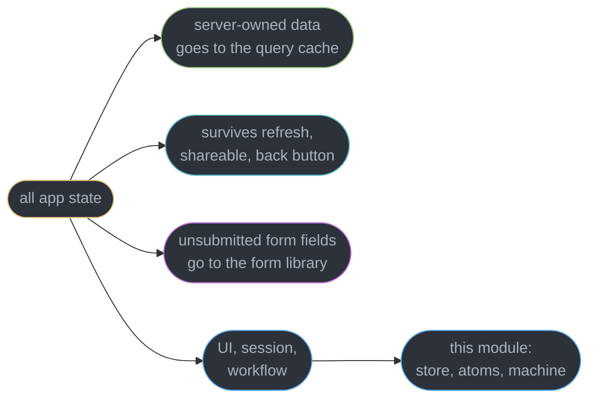
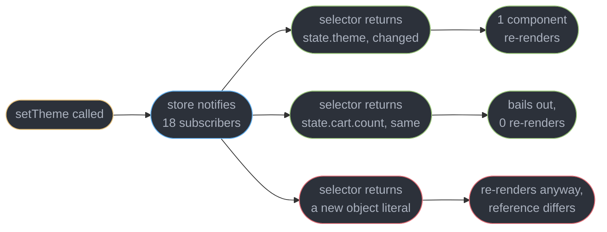
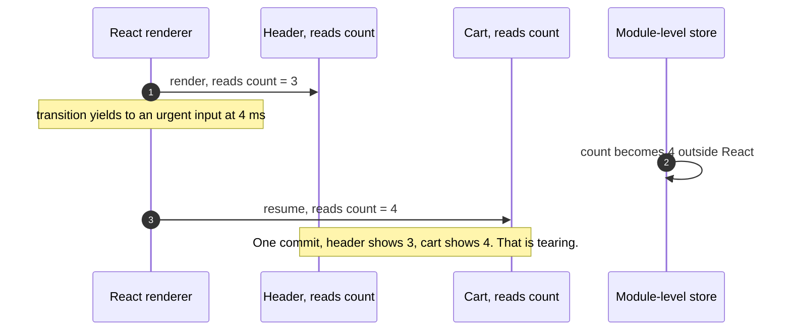
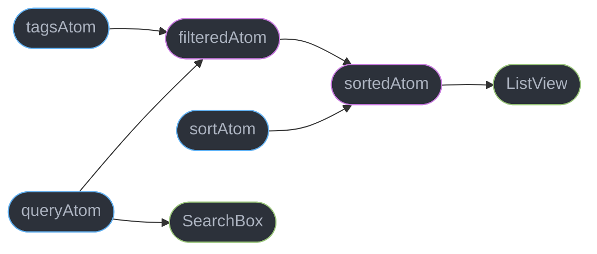
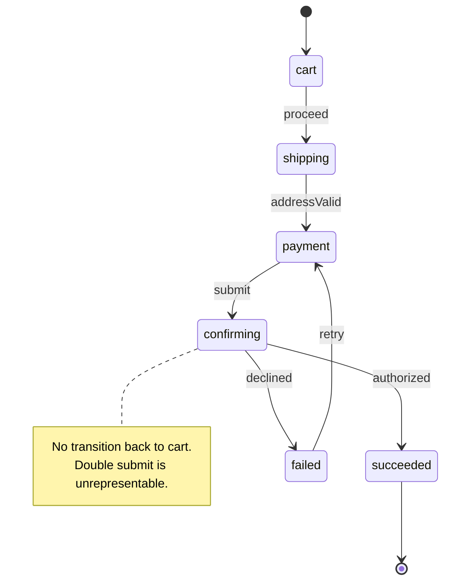
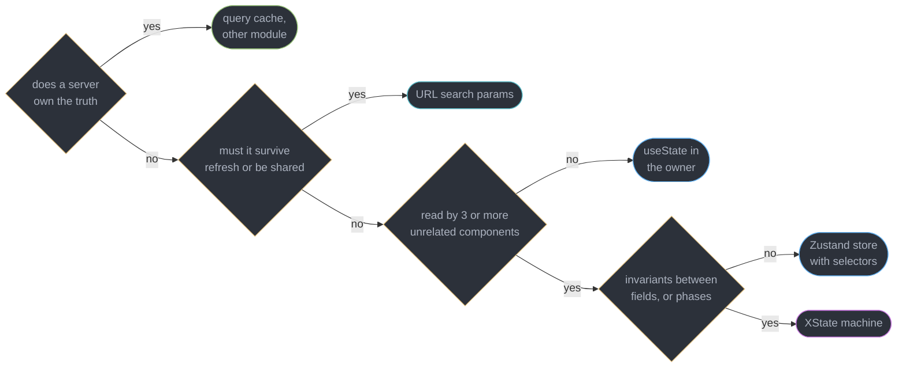

# Client State Management

---

## 1. Concept Overview

Client state management is best defined by subtraction. Take an application's state, remove everything that is a copy of something a server owns, and manage what is left. That remainder is smaller than most teams expect, and it is the entire subject of this module.

The reason the subtraction matters is that the industry's most repeated architecture decision — "the app got big, we need Redux" — is usually a misdiagnosis. What actually happened is that a component fetched data, a sibling needed the same data, and the only sharing tool anyone reached for was a global store. So the store filled with server data, and with it came the loading flags, the error flags, the manual invalidation, the stale entries after a mutation, and the 400-line reducer that exists to reimplement a cache. Adopting a server-state cache instead deletes 60-80% of a typical Redux store outright: in a real migration described in §7, 41 of 47 slices disappeared and the remaining 6 fit in one 90-line Zustand store. [Server State and Data Fetching](../server_state_and_data_fetching/server_state_and_data_fetching.md) owns that half — TanStack Query v5, caching, invalidation, `staleTime`. This module starts where that one ends.

What genuinely remains after the subtraction is five things:

- **UI state** — is the sidebar collapsed, which accordion panel is open, is the tooltip visible, what is the drag position.
- **Ephemeral form state** — the in-progress values of a form that has not been submitted. Owned by [Forms and Validation](../forms_and_validation/forms_and_validation.md); named here only so it is not put in a global store.
- **Cross-cutting session state** — theme, locale, feature flags, the current workspace, an auth token's derived claims. Small, read by many components, changed rarely.
- **Complex workflow state** — a checkout, an onboarding wizard, a multi-part upload. State with invariants *between* fields, where certain combinations must be impossible.
- **URL state** — filters, tabs, pagination, sort order, the selected row, whether a modal is open. This one is not really client state at all; it belongs in the address bar, and §6.1 argues it should be your first stop, not your last.

The tools that serve the remainder are Zustand v5, Jotai, Valtio, Redux Toolkit and XState v5, and they are genuinely different in kind rather than in branding: an external store read through a selector, a graph of atoms, a mutable proxy, a strict action log, and a state machine. Choosing between them is a five-question procedure, not a preference, and §6.7 gives it.

One mechanism runs underneath all of them and is worth naming up front. Any store that lives outside React must be read through `useSyncExternalStore`, because concurrent rendering can pause a render mid-tree and resume it after the store changed, producing two components in the same commit that disagree. That is tearing, and [Context and Component Communication](../context_and_component_communication/context_and_component_communication.md) owns it; §6.3 covers only why it forces every store to expose a subscribe API. Target is React 19.2, Zustand v5, XState v5, verified 2026-09-02.

---

## 2. Intuition

> **One-line analogy**: client state is what is left in your pockets after you empty out everything borrowed from someone else. Most people never empty their pockets, then buy a bigger bag.

**Mental model**: draw three boxes. The **server's box** holds data the server owns and you cache — that is a cache, and a cache library manages it. The **URL's box** holds anything that must survive a refresh, be pasteable into Slack, and respond to the back button. The **client's box** holds the genuinely local remainder. Every state question is first a routing question: which box. A store is only for the third box, and the third box is small.

**Why it matters**: the cost of putting state in the wrong box is not aesthetic. Server data in a store means hand-written invalidation that goes wrong after every mutation. URL state in a store means a user who filters a table to 3 of 900 rows, sends the link to a colleague, and the colleague sees all 900 — a support ticket that no amount of store tuning fixes. Form state in a global store means every keystroke re-renders whatever else reads that store: in one measured case, 34 components per character typed.

**Key insight**: **the question is never "which state library", it is "does this state need to exist as client state at all".** Three of the five remaining categories have a better home — server state in a cache, URL state in the address bar, form state in a form library. What is left over is small enough that a 1.2 kB store handles it, which is why the 2026 default is a small store rather than a framework.

---

## 3. Core Principles

- **Subtract before you choose.** Establish the server-state cache first; the client-state requirement you are left with is a different, much smaller requirement than the one you started with.
- **The URL is a store you already have.** It persists across refresh, serializes for sharing, integrates with back and forward, and costs zero bytes of bundle.
- **State outside React is read through a subscription.** A module-level variable is not enough; `useSyncExternalStore` is the contract that makes an external store safe under concurrent rendering.
- **A selector is a subscription filter, not a getter.** What a component selects decides what re-renders it — that is the entire performance argument for external stores over context.
- **Selector return values are compared by reference.** A selector building a new object every call defeats the comparison and re-renders on every store change, which is the single most common Zustand bug.
- **Granularity is a design axis.** One store with selectors, many atoms, or one machine are three different answers to "how small is the unit that changes".
- **Invariants between fields mean a machine.** If certain field combinations must be impossible, encode them in transitions rather than defending them with `if` statements in twelve places.
- **Derive, do not store.** Anything computable from other state should be computed during render or in a derived atom, because a stored copy is a second source of truth that will drift.

---

## 4. Types / Architectures / Strategies

### 4.1 The five remaining categories and where each belongs

| Category | Example | Correct home | Wrong home you will see |
|----------|---------|--------------|-------------------------|
| Server state | orders, user profile, search results | TanStack Query v5 | a Redux slice with `isLoading` |
| URL state | filters, tab, page, selected id, modal open | `useSearchParams` or a typed router | `useState` in a page component |
| Ephemeral form state | in-progress field values | React Hook Form or TanStack Form | a global store, one write per keystroke |
| UI state | sidebar open, hovered row, drag offset | `useState`, or a store if 3+ components read it | context around the whole app |
| Cross-cutting session | theme, locale, workspace, flags | a small store, or context if it never changes | a store with 40 unrelated fields |
| Workflow state | checkout, onboarding, upload | XState v5 machine | eight booleans and a `step` number |

### 4.2 The library landscape

| Library | Shape | Read as | Re-render unit | Approx. min gzip |
|---------|-------|---------|----------------|------------------|
| Zustand v5 | one external store, top-down | `useStore(selector)` | whatever the selector returns | ~1.2 kB |
| Jotai | many atoms, bottom-up | `useAtom(atom)` | one atom's value | ~3.5 kB core |
| Valtio | one proxy object, mutable writes | `useSnapshot(state)` | the properties actually accessed | ~3 kB |
| Redux Toolkit | one store, actions and reducers | `useSelector(fn)` | selector result, `===` compared | ~13 kB with react-redux |
| XState v5 | a machine's finite state plus context | `useSelector` on the actor | selected slice of the snapshot | ~15 kB core |
| `useState` | per component | direct | the owning component's subtree | 0 |

### 4.3 Three sharing mechanisms, three re-render behaviours

| Mechanism | Who re-renders on a change | Tearing-safe | Notes |
|-----------|---------------------------|--------------|-------|
| Lift state to a common parent | the parent's whole subtree | yes | fine for 2-3 nearby components |
| Context provider | every consumer, regardless of which field changed | yes | the value is the unit; splitting contexts is the only lever |
| External store + selector | only components whose selected slice changed | only via `useSyncExternalStore` | the reason stores beat context at scale |

### 4.4 Persistence strategies

| Strategy | Survives refresh | Shareable | Back button | Cost |
|----------|-----------------|-----------|-------------|------|
| In-memory store | no | no | no | none |
| URL search params | yes | yes | yes | ~2 kB practical length ceiling |
| `sessionStorage` | per tab | no | no | sync read, client-only |
| `localStorage` via a persist middleware | yes | no | no | client hydration mismatch risk on SSR |
| Server-side user preferences | yes, across devices | no | no | a round trip, and it is server state again |

---

## 5. Architecture Diagrams

### What is left after the subtraction



Four arrows, and only the last one needs a state library. Teams that skip the first three arrive at a 47-slice store.

### Selector subscription versus a whole-store read



The bail-out in the middle branch is the whole point of a store. The right branch is how teams lose it by accident.

### Why an external store needs a subscription API



`useSyncExternalStore` closes this by re-reading the snapshot before commit and restarting the render if it moved. Tearing itself belongs to [Context and Component Communication](../context_and_component_communication/context_and_component_communication.md).

### Jotai's atom graph



Changing `sortAtom` recomputes `sortedAtom` and re-renders `ListView` only. `SearchBox` is not downstream of it and never hears about the change.

### A checkout as a machine



The graph is the specification. "Editing the cart while a payment is authorizing" is not a bug to defend against — there is no edge for it.

### Choosing a home for one piece of state



Four questions, five destinations, and only two of them are a state library. Run it per piece of state, never per application.

---

## 6. How It Works — Detailed Mechanics

### 6.1 The URL is the first store, not the last resort

Filters, the active tab, the page number, the sort column, the selected row id, and whether a detail modal is open share one property: a user expects a refresh to keep them, a paste to reproduce them, and the back button to undo them. `useState` fails all three. A store fails two of three. The URL passes all three and ships in every browser.

```tsx
// Tabs, filters and pagination read and write the query string directly.
function OrdersPage() {
  const [params, setParams] = useSearchParams();
  const status = params.get("status") ?? "all";
  const page = Number(params.get("page") ?? "1");

  function setStatus(next: string) {
    const p = new URLSearchParams(params);
    next === "all" ? p.delete("status") : p.set("status", next);
    p.delete("page");                       // a filter change resets pagination
    setParams(p, { replace: true });        // replace: filters should not stack in history
  }
  return <OrdersTable status={status} page={page} onStatus={setStatus} />;
}
```

Two decisions in that snippet are the ones teams get wrong. **Deleting a default instead of writing `status=all`** keeps the canonical URL clean, so the shared link and the crawled link are the same string. And **`replace` versus `push`** is a product decision: typing in a filter box should not add 14 history entries, so filters use `replace`, while opening a detail modal uses `push` so that the back button closes it — which is exactly the behaviour users expect on mobile.

Raw search params are strings, which is where the friction comes from and why typed wrappers exist.

```ts
// A typed param hook: parse and serialize in one place, defaults included.
function useParam<T>(key: string, def: T, parse: (raw: string) => T, ser: (v: T) => string) {
  const [params, setParams] = useSearchParams();
  const raw = params.get(key);
  const value = raw === null ? def : parse(raw);
  const set = (v: T) => {
    const p = new URLSearchParams(params);
    Object.is(v, def) ? p.delete(key) : p.set(key, ser(v));
    setParams(p, { replace: true });
  };
  return [value, set] as const;
}
const [page, setPage] = useParam("page", 1, Number, String);
```

`nuqs` is the library form of this, with parsers for numbers, dates, enums, JSON and arrays, plus a transition-aware setter. TanStack Router goes further and validates the whole search object against a schema, so a malformed `?page=abc` is caught at the route boundary rather than producing `NaN` in a component.

**The practical ceiling is length.** Browsers and CDNs tolerate far more, but roughly 2 kB is the safe budget once a URL passes through email clients and chat previews. A filter set that exceeds it is a saved-view feature — persist it server-side, put its id in the URL, and you are back to server state.

### 6.2 Zustand v5

A Zustand store is a plain object with a subscription list, created outside React and imported like any module.

```ts
// The store lives outside the component tree. No provider, no Context.
import { create } from "zustand";

type UiStore = {
  sidebarOpen: boolean;
  theme: "light" | "dark";
  toggleSidebar: () => void;
  setTheme: (t: "light" | "dark") => void;
};

export const useUi = create<UiStore>((set) => ({
  sidebarOpen: true,
  theme: "dark",
  toggleSidebar: () => set((s) => ({ sidebarOpen: !s.sidebarOpen })),
  setTheme: (t) => set({ theme: t }),      // set merges at the top level, unlike useState
}));
```

Reading is where the design shows. The hook takes a selector, and **the selector is a subscription filter**: Zustand runs it on every store change and re-renders the component only when the result differs from the previous result by `Object.is`.

```tsx
// Each component subscribes to exactly what it reads.
function ThemeToggle() {
  const theme = useUi((s) => s.theme);              // re-renders only on theme changes
  const setTheme = useUi((s) => s.setTheme);        // an action, stable forever
  return <button onClick={() => setTheme(theme === "dark" ? "light" : "dark")}>{theme}</button>;
}

function Sidebar() {
  const open = useUi((s) => s.sidebarOpen);         // ignores every theme change
  return <aside data-open={open} />;
}
```

With 18 components subscribed to one store, `setTheme` notifies all 18, 18 selectors run — each one a property read costing well under a microsecond — and 1 component re-renders. Calling `useUi()` with no selector subscribes to the entire state object and re-renders all 18 on every change, which is the context behaviour the store was adopted to avoid.

**Object selectors need `shallow`.** A selector returning `{ a, b }` builds a new object on every run, so `Object.is` is always false and the component re-renders on every store change forever. Zustand v5 removed the deprecated auto-shallow behaviour of the old `create` overloads, so this is now explicit — `useUi(useShallow((s) => ({ theme: s.theme, sidebarOpen: s.sidebarOpen })))`, importing `useShallow` from `zustand/shallow`, which compares one level of keys instead of the reference. Two atomic selectors are usually simpler and equally fast; reach for `useShallow` when you genuinely need three or more fields together. The broken form is in §10.

**Why the store lives outside the tree.** Three consequences follow, and they are the real argument for this shape: any module can call `useUi.getState().setTheme("light")` — a router loader, a WebSocket handler, an analytics wrapper — with no hook and no provider; tests import the store and call `useUi.setState()` directly with no wrapper component; and there is no provider re-render, because writes go to the store, not through the tree. The cost is that a store is a singleton, so per-subtree instances (two independent editors on one page) need the factory pattern with a Context holding the store instance, not the state.

**Zustand v5 uses React's native `useSyncExternalStore`.** The `use-sync-external-store` shim that v4 carried for React 17 is gone from the dependency list, which is where most of the size reduction to roughly 1.2 kB came from. That is not a detail — it is why the store is safe under transitions at all, and §6.3 explains the mechanism.

### 6.3 Why any external store needs `useSyncExternalStore`

Reading a module-level variable during render looks harmless and is not. Concurrent rendering may render part of a tree, yield to an urgent update, and resume milliseconds later; if the external value changed in between, two components in the same commit read different values and the screen shows a header saying 3 items beside a cart saying 4. That is tearing, and no amount of correct store code prevents it, because the store is not the thing that is wrong — the read is.

```ts
// Every store library reduces to these three functions.
const store = {
  subscribe(cb: () => void) { listeners.add(cb); return () => listeners.delete(cb); },
  getSnapshot() { return state; },              // must be referentially stable if unchanged
  getServerSnapshot() { return initialState; }, // SSR and client hydration read the same value
};

function useCount() {
  return useSyncExternalStore(store.subscribe, () => store.getSnapshot().count, () => 0);
}
```

React calls `getSnapshot` again immediately before commit; if the value moved, it discards the work and re-renders synchronously with the new one. Correctness is bought with a possible restart, which is why the snapshot must be cheap and must return the *same reference* when nothing changed — a `getSnapshot` that builds a fresh object throws `The result of getSnapshot should be cached to avoid an infinite loop`.

`getServerSnapshot` is the third argument and is not optional under SSR. Omitting it throws during server rendering; returning a different value than the client's first read produces a client hydration mismatch, which is the standard failure of a `localStorage`-persisted theme (§10). The tearing mechanism, and the `useSyncExternalStore` contract in full, belong to [Context and Component Communication](../context_and_component_communication/context_and_component_communication.md).

### 6.4 Jotai — bottom-up atoms

Jotai inverts the shape. Instead of one store carved into slices by selectors, state is composed from many small atoms, and derived atoms declare their dependencies by reading them.

```ts
import { atom } from "jotai";

export const queryAtom = atom("");
export const tagsAtom = atom<string[]>([]);
export const sortAtom = atom<"date" | "name">("date");

// A derived atom: its dependencies are whatever it read, tracked automatically.
export const filteredAtom = atom((get) =>
  ALL_ITEMS.filter((i) => i.name.includes(get(queryAtom)) &&
    get(tagsAtom).every((t) => i.tags.includes(t))));

export const sortedAtom = atom((get) =>
  [...get(filteredAtom)].sort(BY[get(sortAtom)]));
```

```tsx
function ListView() {
  const items = useAtomValue(sortedAtom);   // recomputes only when an upstream atom changes
  return <ul>{items.map((i) => <li key={i.id}>{i.name}</li>)}</ul>;
}
function SearchBox() {
  const [q, setQ] = useAtom(queryAtom);     // not downstream of sortAtom, never re-renders for it
  return <input value={q} onChange={(e) => setQ(e.target.value)} />;
}
```

The dependency graph is built by the `get` calls at evaluation time, so it is dynamic — a conditional `get` genuinely changes the subscription set. Compared with Zustand, the difference is where correctness lives: Zustand's granularity depends on every consumer writing a good selector, and one bad selector costs re-renders. Jotai's granularity is structural, so the wrong-selector bug does not exist. The price is that state is scattered across many exported atoms, cross-atom invariants are harder to see in one place, and debugging means reading a graph rather than one object. Atomic granularity wins when the state is a web of small interdependent values recomputed constantly — an editor's selection, a canvas, a filter pipeline. A single store wins when the state is a handful of flat flags.

Jotai uses a Provider-scoped store by default, so per-subtree instances come free: two `<Provider>` elements give two independent copies of every atom, which is the case Zustand needs a factory for.

### 6.5 Valtio — a proxy that makes mutation safe

Valtio takes the third position: keep the mutable object, and make the runtime track reads and writes for you.

```ts
import { proxy, useSnapshot } from "valtio";

export const cart = proxy({ items: [] as Item[], coupon: null as string | null });

export function addItem(item: Item) {
  cart.items.push(item);            // a real mutation, no spread, no immer
  cart.coupon = null;
}
```

```tsx
function CartBadge() {
  const snap = useSnapshot(cart);   // frozen, immutable snapshot
  return <span>{snap.items.length}</span>;   // subscribed to items.length only
}
```

The mechanism is `Proxy`. `proxy()` wraps the object in a `Proxy` whose `set` trap records the write and notifies subscribers, and `useSnapshot` returns an immutable snapshot wrapped in a second `Proxy` whose `get` trap records *which properties this component actually read*. Subscription is therefore derived from access, not declared: `CartBadge` touched `items.length`, so a change to `coupon` does not re-render it. [JavaScript Language Semantics](../../frontend_platform/javascript_language_semantics/javascript_language_semantics.md) owns `Proxy` and `Reflect` themselves.

```ts
// The shape of what a proxy does, reduced to its two traps.
const tracked = new Proxy(target, {
  get(t, k, r) { record(k); return Reflect.get(t, k, r); },     // read tracking
  set(t, k, v, r) { const ok = Reflect.set(t, k, v, r); notify(); return ok; },
});
```

The tradeoff against explicit immutability is real and cuts both ways. Valtio deletes the most boilerplate of any option — no reducers, no `set`, no spreads, and updates from outside React are one assignment. But the reactivity is invisible: nothing in `snap.items.length` says a subscription was created, so a refactor that hoists a read out of a component silently changes what re-renders, and reviewing a diff for subscription correctness is much harder than reviewing a selector. `Proxy` also cannot be polyfilled, and it does not trap everything — a `Map` or `Set` needs `proxyMap`/`proxySet`, and a class instance with private fields will break. Prefer Valtio where mutation-heavy code is genuinely clearer, such as a document model or a game loop; prefer explicit immutability where a reviewer needs to see the update.

### 6.6 Redux Toolkit and XState v5

**Redux Toolkit is the official way to write Redux, and it is not the 2026 default.** Both halves of that sentence are true, and this module presents it honestly rather than as a punchline. Hand-written Redux with switch reducers, action-type constants and `connect` is genuinely obsolete; RTK's `createSlice` with Immer under the hood is a fraction of that code.

```ts
import { createSlice } from "@reduxjs/toolkit";

const wizard = createSlice({
  name: "wizard",
  initialState: { step: 0, answers: {} as Record<string, string> },
  reducers: {
    answered(state, action: { payload: { id: string; value: string } }) {
      state.answers[action.payload.id] = action.payload.value;  // Immer makes this immutable
      state.step += 1;
    },
  },
});
```

What RTK still buys that no smaller library does: every change is a **named, serializable action**, so the DevTools give a scrubbable log of what happened in what order, time-travel replay, and a session export you can attach to a bug report. That log is worth real money on a 40-engineer codebase where the question "what set this field" must be answerable without a debugger, and it is worth very little on a 4-engineer app. RTK also imposes conventions — one obvious place for a slice, one obvious way to write an update — and on a large team convention beats elegance. The costs are ~13 kB gzipped, a provider, and the fact that time-travel requires every action to be serializable, which forbids putting a `Date`, a `Map` or a class instance in the store without disabling a check.

RTK Query exists in the same package and is a competent server-state cache, so if you have already paid for RTK it is a reasonable choice — but that is a [Server State and Data Fetching](../server_state_and_data_fetching/server_state_and_data_fetching.md) decision, not a client-state one.

**XState v5 is for state that is genuinely a machine.** The signal is not complexity, it is *invariants between fields*: a checkout must never authorize twice, an upload must not accept a new file while finalizing, a player cannot be simultaneously buffering and seeking.

```ts
import { setup, assign } from "xstate";

export const checkout = setup({
  types: { context: {} as { error: string | null }, events: {} as CheckoutEvent },
}).createMachine({
  id: "checkout",
  initial: "cart",
  context: { error: null },
  states: {
    cart: { on: { PROCEED: "shipping" } },
    shipping: { on: { VALID: "payment" } },
    payment: { on: { SUBMIT: "confirming" } },
    confirming: {                                  // no SUBMIT here: double submit cannot happen
      invoke: { src: "authorize", onDone: "succeeded", onError: { target: "failed",
        actions: assign({ error: ({ event }) => String(event.error) }) } },
    },
    failed: { on: { RETRY: "payment" } },
    succeeded: { type: "final" },
  },
});
```

```tsx
import { useMachine } from "@xstate/react";
function Checkout() {
  const [snap, send] = useMachine(checkout);
  const busy = snap.matches("confirming");
  return <button disabled={busy} onClick={() => send({ type: "SUBMIT" })}>{busy ? "Working" : "Pay"}</button>;
}
```

The button does not need a `isSubmitting` boolean, and the guard is not defensive code — an unhandled event in `confirming` is simply ignored by the interpreter. Impossible states are unrepresentable because there is no edge to them, and the transition graph is the specification: designers, QA and backend read the same diagram. In v5, `setup()` replaced v4's `Machine(config, options)` split for typing actors and actions, and `createActor` replaced `interpret`.

**Do not reach for it for a toggle.** A sidebar has two states and one event; expressing that as a machine costs ~15 kB and a config block to replace `useState(false)`. The threshold is roughly four states, or any pair of booleans whose combination is illegal.

### 6.7 The decision procedure

Five questions, run per piece of state, in order. Stop at the first that answers.

1. **Does a server own the truth?** Then it is server state, and it belongs in the query cache. Roughly 70% of what teams call "global state" stops here.
2. **Must it survive a refresh, be shareable, or respond to the back button?** Then it is URL state. Filters, tabs, pagination, selection, modal-open.
3. **How many components read it, and are they related?** One component or a parent with two children: `useState` and props. Three or more unrelated components across the tree: a store. The count is the criterion, not a feeling that the app is getting big.
4. **Are there invariants between fields, or distinct phases?** Then a machine. Otherwise a plain store.
5. **Does the team need enforced conventions, an action log, or time travel?** A large team with many contributors and a compliance requirement to answer "what changed this" gets real value from Redux Toolkit. A small team does not.

Between Zustand, Jotai and Valtio at step 4, the tiebreaker is the shape of the state rather than the size of the app: flat flags read by many components suit a single store with selectors; a dense graph of interdependent derived values suits atoms; a nested document mutated constantly suits a proxy. All three are correct choices, and none of them is worth a migration on its own. Measuring which components actually re-render is [React Performance and Profiling](../react_performance_and_profiling/react_performance_and_profiling.md).

---

## 7. Real-World Examples

**The 47-slice store that was a cache.** A logistics dashboard had 47 Redux slices and a 6,200-line `store/` directory. An audit classified each slice: 41 held API responses with `isLoading` and `error` fields, 6 held UI state. Adopting TanStack Query for the 41 and moving the 6 into one 90-line Zustand store removed 5,400 lines and cut the main bundle by 31 kB gzipped. The decisive detail was that nobody had ever chosen Redux for global state — it was adopted in 2019 as the only way two components could share a fetch result.

**The filter link that shared nothing.** A B2B reporting tool kept eight filters in a Zustand store. Users filtered 40,000 rows down to 12, pasted the link into Slack, and colleagues saw all 40,000. Support handled 60-90 tickets a month described as "the link is broken". Moving the eight filters to search params with `nuqs` closed the ticket class in one release and, unplanned, made the analytics team's saved dashboards possible, since a saved view became a stored string.

**The selector that re-rendered everything.** A trading UI showed 220 rows against a Zustand store updated by a WebSocket at 40 messages per second. Each row selected `(s) => ({ price: s.prices[id], size: s.sizes[id] })`. The new object literal defeated the reference comparison, so all 220 rows re-rendered on every message — about 8,800 component renders per second, pinning a core and dropping the interface to 12 fps. Splitting into two atomic selectors took it to roughly 6 rows re-rendering per message and back to 60 fps, with no change to the store.

**The checkout that charged twice.** A subscription flow tracked its progress with `step`, `isSubmitting`, `hasError` and `isRetrying`. A slow 3DS redirect let a user click Pay again before `isSubmitting` was committed, producing double authorizations on 0.4% of orders. Rewriting the flow as an XState machine with no `SUBMIT` event in the `confirming` state removed the class of bug outright — not by adding a guard, but by removing the edge. Double authorizations went to zero in the following quarter.

---

## 8. Tradeoffs

| Design choice | Bought | Paid |
|---------------|--------|------|
| Server-state cache instead of store slices | 60-80% of the store deletes itself | a second library, and a boundary to explain |
| URL over a store for filters | refresh, sharing and back button for free | string parsing, and a ~2 kB length ceiling |
| Selector-based store over context | only the readers of a changed slice re-render | one bad selector silently costs all of it |
| Store outside the component tree | writes from routers, sockets and tests with no hook | a singleton, so per-subtree instances need a factory |
| Jotai's atomic granularity | correctness is structural, not per-consumer | state scattered across many atoms, invariants less visible |
| Valtio's mutable proxy | the least boilerplate of any option | subscriptions are invisible, and `Proxy` cannot be polyfilled |
| Redux Toolkit's action log | time travel, a scrubbable history, enforced convention | ~13 kB, a provider, serializable-only state |
| XState machines | impossible states become unrepresentable | ~15 kB and a config block, overkill under four states |
| `useState` in the owner | zero bundle, zero indirection | prop drilling once a third unrelated reader appears |

---

## 9. When to Use / When NOT to Use

**Reach for a client store when:**

- Three or more unrelated components across the tree read the same non-server, non-URL value — theme, workspace, a command palette's open state.
- Code outside React must write state: a router loader, a WebSocket handler, a keyboard shortcut registered on `document`.
- Context is already in place and profiling shows consumers re-rendering for fields they do not read.

**Reach for a machine when:**

- The state has named phases and illegal transitions between them, especially any flow that spends money or uploads.
- Two or more booleans exist whose combinations are partly invalid — the classic `isLoading && isError` pair.

**Do not reach for either when:**

- A server owns the value. That is a cache, and hand-written invalidation in a store is the single most expensive mistake in this topic.
- The value must survive a refresh or be shareable. Use the URL.
- Only one component and its direct children read it. `useState` and a prop are smaller than any store.
- It is unsubmitted form state. Per-keystroke writes into a global store re-render everything subscribed to it.
- The value is derivable from other state. Compute it during render instead of storing a copy that will drift.

---

## 10. Common Pitfalls

**A selector that returns a new object.** The most common Zustand bug and the most expensive.

```tsx
// BROKEN: the selector builds a fresh object on every store change, so Object.is is
// always false and every row re-renders on every unrelated update. 220 rows x 40 msg/s.
function Row({ id }: { id: string }) {
  const { price, size } = usePrices((s) => ({ price: s.prices[id], size: s.sizes[id] }));
  return <tr><td>{price}</td><td>{size}</td></tr>;
}

// FIX: two atomic selectors return primitives, compared by value. A row re-renders
// only when its own price or size changes — about 6 rows per message instead of 220.
function Row({ id }: { id: string }) {
  const price = usePrices((s) => s.prices[id]);
  const size = usePrices((s) => s.sizes[id]);
  return <tr><td>{price}</td><td>{size}</td></tr>;
}
// If three or more fields are genuinely needed together, wrap in useShallow instead.
```

**Storing server data in the store.** It arrives with `isLoading`, `error` and `lastFetched` fields, and within a month there is hand-written invalidation after every mutation that will be forgotten for one endpoint. Use the query cache.

**Filters in a store instead of the URL.** Refresh loses them, links do not reproduce them, and the back button does nothing. This is a product bug reported as "the link is broken", not a performance issue.

**Persisting to `localStorage` without a server snapshot.** The server renders `theme=dark`, the client reads `light` from storage on the first render, and React reports a client hydration mismatch and discards the server HTML.

```tsx
// BROKEN: the persisted value is read during the first client render, which must
// match the server's HTML exactly. It cannot, because the server has no localStorage.
const theme = usePrefs((s) => s.theme);            // "light" from storage, "dark" from SSR

// FIX: render the server value first, then apply the persisted one after client hydration.
const [hydrated, setHydrated] = useState(false);
useEffect(() => setHydrated(true), []);
const theme = hydrated ? usePrefs.getState().theme : "dark";
```

The alternative, and the better one when the value affects the first paint, is to store the preference in a cookie so the server renders the correct value in the first place.

**Persisting the whole store.** A persist middleware with no `partialize` writes transient UI flags and stale entities to storage, then restores a modal-open state from three days ago. Whitelist the two or three fields that should survive.

**One giant store with 40 unrelated fields.** It works, because selectors keep re-renders correct, but it becomes an untyped global namespace nobody can safely delete from. Split by domain into two or three stores.

**Calling the hook with no selector.** `useUi()` subscribes to the whole state object and re-renders on every change from every field, which is precisely the context behaviour the store replaced.

**Derived state stored as a field.** A `total` written alongside `items` drifts the first time an item is removed by a path that forgets to update it. Compute it in the selector or in a derived atom.

**A machine for a toggle.** ~15 kB and a config block to replace `useState(false)`. Machines earn their weight at four or more states, or when a boolean pair has an illegal combination.

**Reading a module-level variable during render instead of subscribing.** No re-render when it changes, and tearing when it changes mid-render. Every external value needs `useSyncExternalStore` or a library built on it.

---

## 11. Technologies & Tools

| Tool | Purpose |
|------|---------|
| Zustand | ~1.2 kB external store with selector subscriptions, v5 on native `useSyncExternalStore` |
| Jotai | Bottom-up atoms with an automatically tracked derived-value graph |
| Valtio | Proxy-based store where mutations are tracked and reads define subscriptions |
| Redux Toolkit | Official Redux with `createSlice`, Immer, and a serialized action log |
| Redux DevTools | Time-travel scrubbing and session export, also consumable by Zustand middleware |
| XState | Statecharts for flows with phases and illegal transitions, v5 `setup` API |
| Stately Inspector | Live visualization of a running XState actor's transitions |
| nuqs | Typed search-param hooks with parsers, defaults and transition-aware setters |
| TanStack Router | Schema-validated typed search params as first-class route state |
| Immer | Structural sharing behind RTK's mutable-looking reducers |
| React DevTools | The Profiler's highlight-updates mode shows which selectors are over-subscribing |

---

## 12. Interview Questions with Answers

**Q: Do I still need Redux in 2026?**
**Short:** Removing server state from the question usually deletes most of the store, because 60-80% of a typical Redux codebase is a hand-written cache rather than client state.

Redux Toolkit is still the official way to write Redux and is a reasonable choice for a large team that needs enforced conventions, a serialized action log and time-travel DevTools — that log is genuinely valuable when "what set this field" must be answerable without a debugger. It is not the 2026 default, and it is not dead. The honest sequence is to adopt a server-state cache first, look at what is left, and choose from `useState`, the URL, a small store or a machine on the remainder. In one audit, 41 of 47 slices were API responses and the surviving 6 fit in a 90-line Zustand store.

**Q: Why does a selector prevent a re-render that context cannot?**
**Short:** Subscribing to a slice means the store runs your selector on every change and skips the re-render when the result is `Object.is`-equal to the previous one.

A context provider has no such filter: its value is the unit of change, so every consumer re-renders when any field in it changes, and the only lever is splitting into more providers. A store notifies all 18 subscribers, runs 18 cheap selectors, and re-renders only the components whose selected value actually moved. The catch is that the comparison is by reference, so a selector returning a new object literal never bails out and re-renders on every store change. That failure re-rendered 220 rows at 40 messages per second in one trading UI until it was split into two atomic selectors.

**Q: What belongs in the URL rather than in a store?**
**Short:** Refresh, share and back-button survival is the test — filters, the active tab, pagination, sort, the selected row and modal-open all pass it and belong in search params.

Users expect a refresh to keep their filters, a pasted link to reproduce what the sender saw, and the back button to close a modal. `useState` fails all three and a store fails two of three, so reaching for a store before the URL is the most common misplacement in this topic. Delete defaults rather than writing `status=all` so the canonical URL stays clean, use `replace` for filters so typing does not stack 14 history entries, and `push` for a modal so back closes it. The practical ceiling is roughly 2 kB, past which it becomes a saved-view feature with an id in the URL.

**Q: Why does an external store need useSyncExternalStore instead of a plain module variable?**
**Short:** Concurrent rendering can pause mid-tree and resume after the external value changed, so two components in one commit read different values and the screen shows contradictory numbers.

That is tearing, and it is invisible in tests because it needs an interrupted render to reproduce. `useSyncExternalStore` takes `subscribe`, `getSnapshot` and `getServerSnapshot`, and React re-reads the snapshot immediately before commit, discarding and re-rendering synchronously if it moved. The snapshot must return the same reference when nothing changed, or React throws about caching `getSnapshot` to avoid an infinite loop. Zustand v5 uses React's native implementation rather than the v4 shim, which is where much of its size reduction came from.

**Q: When do Jotai's atoms beat a single store with selectors?**
**Short:** Bottom-up atoms compose into a dependency graph built from the `get` calls a derived atom makes, so granularity is structural instead of depending on every consumer writing a good selector.

With Zustand, one careless object selector silently costs the whole re-render benefit; with Jotai that bug cannot be written, because a component subscribes to the atom it reads and nothing else. The fit is a dense web of small interdependent values recomputed constantly — an editor's selection, a canvas, a filter pipeline where `sortedAtom` depends on `filteredAtom` depends on `queryAtom`. The price is state scattered across many exported atoms and cross-field invariants that are harder to see in one place. A handful of flat flags is better served by one store.

**Q: What is Valtio's Proxy actually doing, and what does it cost?**
**Short:** A Proxy intercepts both directions — the `set` trap records writes and notifies, and the snapshot's `get` trap records which properties a component read, so subscriptions are derived from access.

That is why `CartBadge` reading `snap.items.length` does not re-render when `coupon` changes, without any selector being written. It buys the least boilerplate of any option: mutations are plain assignments, and an update from outside React is one line. It costs visibility — nothing in the code says a subscription was created, so hoisting a read out of a component silently changes what re-renders, and a diff cannot be reviewed for subscription correctness the way a selector can. `Proxy` also cannot be polyfilled, and `Map`, `Set` and class instances need special handling.

**Q: What does shallow do in Zustand, and when do you need it?**
**Short:** Reference equality is the default comparison, so a selector returning an object or array is never equal to its previous result and `useShallow` switches to a one-level key comparison instead.

Zustand v5 made this explicit by removing the older automatic shallow behaviour, so an object selector without `useShallow` re-renders on every store change forever. Two atomic selectors returning primitives are usually simpler and just as fast, which is the right default for one or two fields. Reach for `useShallow` when three or more fields are genuinely needed together and splitting would be noise. Note that shallow is one level deep: a selector returning nested objects still compares those by reference.

**Q: When is XState the right tool, and when is it overkill?**
**Short:** Transitions declared as a graph make impossible states unrepresentable, which pays off exactly when there are invariants between fields rather than merely a lot of state.

Checkout, onboarding, a media player and a multi-step upload qualify: a `confirming` state with no `SUBMIT` event means a double authorization has no edge to travel, so it stops being a bug to guard against. The transition graph doubles as the specification that design, QA and backend all read. The threshold is roughly four states, or any pair of booleans whose combination is illegal — the classic `isLoading && isError`. A sidebar toggle does not qualify; ~15 kB and a config block to replace `useState(false)` is a bad trade.

**Q: What does Redux Toolkit still buy that Zustand does not?**
**Short:** Serialized actions plus a single reducer path give a scrubbable history of what changed in what order, time-travel replay, and a session export attachable to a bug report.

RTK also imposes conventions: one obvious place for a slice, one obvious way to write an update, which matters more on a 40-engineer codebase than any elegance argument. The costs are around 13 kB gzipped with react-redux, a provider, and a serializable-state requirement that forbids a `Date`, a `Map` or a class instance without disabling a check. `createSlice` with Immer underneath means the mutable-looking reducer body is a fraction of hand-written Redux, so the comparison should never be against 2019 Redux. RTK Query is competent, but choosing it is a server-state decision.

**Q: Why does a Zustand store live outside the component tree?**
**Short:** Living outside the tree means any module can read or write it — a router loader, a WebSocket handler, a test — with no hook, no provider and no provider re-render.

`useUi.getState().setTheme("light")` works from anywhere, and tests call `useUi.setState()` directly instead of wrapping components in a provider. Writes go to the store and out through subscriptions rather than down through the tree, so there is no re-rendering provider in the middle. The cost is that the store is a module singleton, so two independent instances on one page — two editors, two side-by-side panels — need a factory that creates a store per subtree with a Context carrying the store instance, not the state. Jotai gets that case free through its Provider scoping.

**Q: When should state stay in context rather than move to a store?**
**Short:** Broadcasting a new context value re-renders every consumer, so context is right when the value is stable and wrong when it changes often.

A dependency-injection value — an API client, a theme object set once at boot, a locale — is a good context because it effectively never changes and the broadcast never fires. State that updates on interaction is a bad context, because a component reading only `theme` re-renders when an unrelated field in the same value object changes. The intermediate fix is splitting one provider into several, which works but scales badly past three or four. Past that, an external store with selectors gives per-field subscription without multiplying providers.

**Q: What goes wrong when you persist a store to localStorage?**
**Short:** Persisting a whole store without a partialize whitelist writes transient flags and stale entities to storage, then restores a three-day-old modal-open state on the next visit.

The second failure is worse and only appears with SSR: the server has no `localStorage`, so its HTML says `dark` while the client's first render reads `light` and React reports a client hydration mismatch and discards the server output. The fix is either to render the server value first and apply the persisted one in an effect after client hydration, or — better when the value affects the first paint — to store the preference in a cookie so the server renders it correctly. Also version the persisted shape and supply a migration, because a shipped schema change against old stored data crashes on load.

**Q: Why should derived values be computed instead of stored?**
**Short:** Deriving during render keeps one source of truth, while a stored copy becomes a second one that drifts the first time an update path forgets to recompute it.

A `total` field written next to `items` is correct until an item is removed by a code path that updates `items` and not `total`, and that bug reproduces only through one specific interaction. Computing it in the selector, in a derived atom, or in a plain expression during render is always consistent by construction. The performance objection is usually wrong: a `reduce` over 200 items costs microseconds, far less than a re-render caused by the extra field changing. Reach for `useMemo` only when profiling shows a genuinely expensive derivation.

**Q: Where should an in-progress form's values live?**
**Short:** Keeping every keystroke in a global store re-renders every component subscribed to it, so unsubmitted field values belong in a form library or in local state.

React Hook Form keeps values in uncontrolled refs and re-renders only on subscribed changes; TanStack Form and Conform take comparable positions. A global store means a 12-field wizard writes 12 times per second while someone types, and anything reading that store re-renders with it. The exception is a genuinely multi-page wizard whose partial answers must survive navigation — and even then, the store should hold the committed answers per step, not the live field values. Validation and field arrays belong to the forms module.

**Q: How do you debug an external store that re-renders too much?**
**Short:** Time-travel replay needs an action log, but for a store the first tool is the Profiler's highlight-updates mode, which shows which components flash on an unrelated change.

Record an interaction in the React Profiler, look for components whose commit reason is a store update they should not care about, then read their selectors: an object literal, a missing `useShallow`, or a bare `useStore()` with no selector explains almost every case. Zustand can be attached to the Redux DevTools through its devtools middleware, which gives named actions and a diff per change without adopting Redux. XState has the Stately Inspector for live transition visualization. The measurement methodology itself belongs to the performance and profiling module.

**Q: How do you decide between useState, a store and a machine?**
**Short:** Five questions decide it, run per piece of state and not per application, stopping at the first one that answers.

Does a server own the truth — then it is a query cache, and roughly 70% of what teams call global state stops here. Must it survive refresh or be shareable — then the URL. How many unrelated components read it — one or a parent with children means `useState` and props, three or more means a store. Are there invariants between fields or distinct phases — then a machine. Does the team need enforced conventions and an action log — then Redux Toolkit. The count of readers is the criterion at step three, not a feeling that the app has become large.

---

## 13. Best Practices

- Establish the server-state cache before choosing a client-state library, then re-ask the question against what is left.
- Put filters, tabs, pagination, sort and selection in search params before considering a store, with `replace` for filters and `push` for modals.
- Delete a param when it equals its default so the canonical, shared and crawled URLs are the same string.
- Select the narrowest value a component actually uses, and prefer two primitive selectors over one object selector.
- Wrap any genuinely multi-field selector in `useShallow`, and never call the store hook with no selector at all.
- Read every external value through `useSyncExternalStore` or a library built on it, and give `getServerSnapshot` a real value under SSR.
- Whitelist persisted fields with `partialize`, version the persisted shape, and prefer a cookie for anything that affects the first paint.
- Compute derived values in a selector or derived atom rather than storing a second copy that can drift.
- Reach for a machine when a pair of booleans has an illegal combination, and not before roughly four states.
- Keep unsubmitted form values in a form library, and split a store by domain once it passes about a dozen unrelated fields.

---

## 14. Case Study

**Problem.** A B2B analytics product had 47 Redux slices, a 6,200-line `store/` directory, and three standing complaints. Interaction latency on the main table was 180-260 ms per keystroke in the filter box. Support handled 60-90 tickets a month reporting that shared dashboard links "did not work". And a data-refresh bug appeared after every mutation, because one of eleven endpoints was always missing from the manual invalidation list.

**Investigation.** Classifying the 47 slices took one afternoon: 41 held API responses with `isLoading`, `error` and `lastFetched` fields, 4 held filter and pagination values, and 2 held genuine UI state — the sidebar and the command palette. Nobody had chosen Redux for global state; it was adopted in 2019 because two components needed the same fetch result and a store was the only sharing tool anyone knew. The Profiler showed 34 components re-rendering per keystroke, all of them subscribing to a filter object that was rebuilt on every change.

**Root cause.** Server state and URL state living in a client store, read through an object selector.

```tsx
// BROKEN: filters live in the store, are read as a fresh object, and drive a fetch
// whose result is also stored. Every keystroke re-renders 34 components and the
// filter set exists nowhere the URL can see.
function FilterBar() {
  const { status, region, from, to } = useStore((s) => ({
    status: s.filters.status, region: s.filters.region,
    from: s.filters.from, to: s.filters.to,      // new object every store change
  }));
  const dispatch = useDispatch();
  return <StatusPicker value={status} onChange={(v) => dispatch(setStatus(v))} />;
}
```

**Fix.** Three moves, in order: the 41 server slices to TanStack Query, the 4 filter slices to search params, and the 2 UI slices into one Zustand store with atomic selectors.

```tsx
// FIX: filters are URL state, the data is a query keyed by them, and the only
// client state left is the sidebar and the palette.
function FilterBar() {
  const [params, setParams] = useSearchParams();
  const status = params.get("status") ?? "all";
  const setStatus = (v: string) => {
    const p = new URLSearchParams(params);
    v === "all" ? p.delete("status") : p.set("status", v);
    p.delete("page");
    setParams(p, { replace: true });
  };
  return <StatusPicker value={status} onChange={setStatus} />;
}

function Table() {
  const [params] = useSearchParams();
  const { data } = useQuery({ queryKey: ["orders", params.toString()], queryFn: fetchOrders });
  const dense = useUi((s) => s.dense);          // primitive selector, no shallow needed
  return <Grid rows={data ?? []} dense={dense} />;
}
```

The query key is the serialized search params, so the URL is now the cache key as well as the shareable link — invalidation stopped being a hand-maintained list because the key changes when the filters do.

**Results.**

- Store size: 47 slices and 6,200 lines to 1 store and 90 lines.
- Main bundle: 31 kB gzipped smaller, after removing `redux`, `react-redux` and 5,400 lines.
- Re-renders per keystroke in the filter box: 34 components to 2.
- Interaction latency on the table: 180-260 ms to 22-40 ms.
- Shared-link tickets: 60-90 a month to zero in the first full month after release.
- Stale-data-after-mutation bugs: 4 open to 0, since invalidation became a key change.

**Lesson.** Nothing in this migration was a state-management improvement in the usual sense — no reducer was optimized and no selector library was tuned. Three of the four categories in the old store simply did not belong there, and moving each to its correct home deleted the problems rather than solving them. The question that produced the whole result was not "which store should we use" but "what is actually left once the server's data and the URL's data are taken away", and the answer was two booleans.
