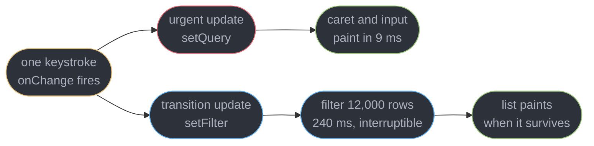
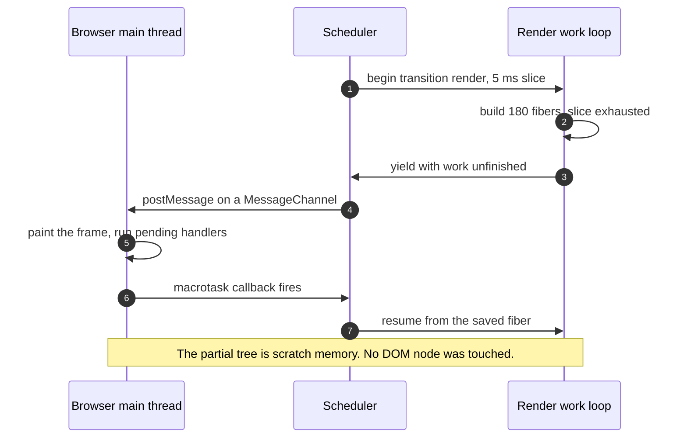
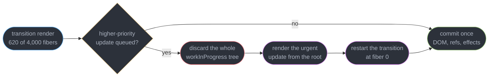
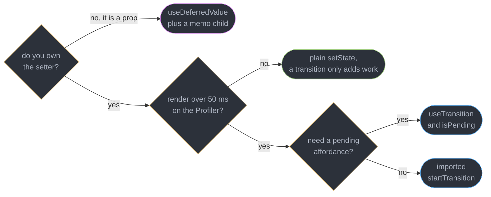
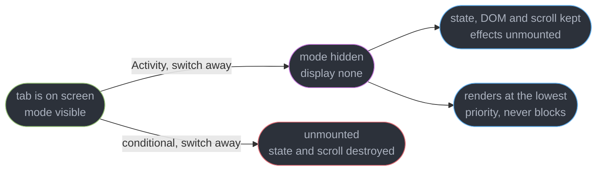
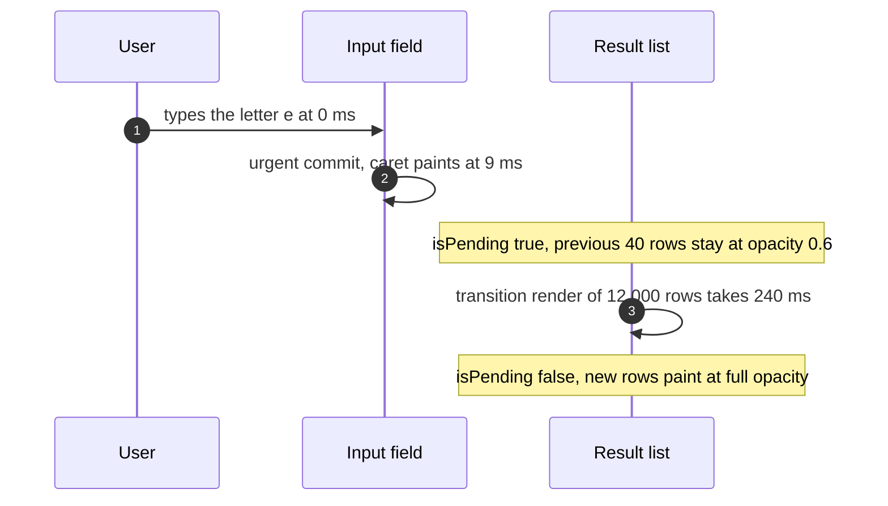

# Concurrent Rendering and Transitions

---

## 1. Concept Overview

Before React 18, a render was a single uninterruptible function call. Once `setState` started a render of a 12,000-row table, the main thread belonged to React until the last fiber was built and the DOM was patched — 380 ms during which the caret did not move, the button did not depress, and the browser could not paint. The only tools were to render less or to render later.

Concurrent rendering removes that constraint by making the render phase **interruptible and abandonable**. React builds the work-in-progress tree in slices, checks a deadline roughly every 5 ms, and hands the thread back to the browser through a `MessageChannel` macrotask so a frame can paint and an event handler can run. If a higher-priority update arrives during that gap, React throws the partial tree away and starts again from the root. Nothing the user could observe was ever produced, because a render that has not committed has touched no DOM node, fired no effect, and flushed no ref.

This is not multithreading. There is exactly one thread, one call stack, and one `document`. What React gained is the ability to **stop**, and what you gained is the ability to say which updates may be stopped. That is the entire API surface of this module: `startTransition` and `useTransition` mark an update you trigger as interruptible, `useDeferredValue` marks a value you received as safe to lag, and `<Activity>` `[19.2]` marks a whole subtree as still-alive-but-not-urgent.

The work loop, the fiber pair and the lane bitmask that implement all of this belong to [Fiber and Reconciliation](../fiber_and_reconciliation/fiber_and_reconciliation.md) and are not re-derived here. This module is about the priority *decisions* layered on top of them, and about the two obligations concurrency puts on your code: render must be pure, because it may run and be discarded several times per visible update, and any external store you read during render must be subscribed through `useSyncExternalStore`, or a single tree can paint two different values of the same store. Target is React 19.3 (released 2026-09-09, patch 19.3.1 on 2026-10-14), which renders unrelated transitions independently and makes `<ViewTransition>` stable, so a transition now also decides what animates.

---

## 2. Intuition

> **One-line analogy**: a transition is a background print job. It is queued, it is preemptible, and it can be cancelled and restarted from page one — but the moment it lands on paper it is final.

**Mental model**: every update goes into one of two queues. The urgent queue must reach the screen in the current frame because the user's fingers are attached to it — the caret, the checkbox, the drag. The transition queue may take as long as the work honestly takes, because the user reads its result rather than aiming at it. React drains urgent work synchronously and drains transition work in 5 ms slices between frames.

**Why it matters**: the failure this fixes has one signature. A search box over 12,000 rows filters on every keystroke, so each character costs a 240 ms render, so typing at 5 characters per second queues 1.2 seconds of work per second of typing and the input falls further behind with every letter. The keystrokes are not lost, they are merely rendered 800 ms after they were typed, which users report as "the box is broken" rather than "the list is slow".

**Key insight**: React cannot make the 240 ms filter cheaper. Concurrency does not add throughput — it reallocates latency. The filter still costs 240 ms; what changes is that the 9 ms of work the caret needs is allowed to jump the queue, and the filter is allowed to be thrown away and restarted when it becomes stale. **You are trading total CPU for the latency of the one update the user is actually looking at.**

---

## 3. Core Principles

- **Interruptible means abandonable.** A render that yields may never resume — a newer update discards the partial tree and restarts from the root. Partial work is scratch memory, not progress.
- **Priority is per update, not per component.** The same `setState` in the same component is urgent when called directly and a transition when called inside `startTransition`.
- **Nothing is observable until commit.** The DOM mutation, the effects, the refs and the browser paint all happen in one uninterruptible commit phase. An abandoned render produces none of them.
- **Purity is a runtime requirement, not a style rule.** A component body that mutates anything outside itself corrupts state when its render is discarded and replayed.
- **Yielding costs time.** Slicing a render into 5 ms chunks adds scheduler overhead and restarts, so a transition is a *net loss* on work that was already fast.
- **`isPending` is a render-phase signal only.** It says a transition render has not committed. It says nothing about a network request, a promise, or data freshness.
- **Anything read during render must be safe to read twice.** External stores need `useSyncExternalStore`, or two components in one tree can read two different values.
- **Hidden is not unmounted.** `<Activity mode="hidden">` `[19.2]` keeps state and DOM while unmounting effects, which is a third state React did not previously have.

---

## 4. Types / Architectures / Strategies

### 4.1 The priority levels you can actually address

| Level | How you create it | Can be interrupted | Typical use |
|-------|-------------------|--------------------|-------------|
| Discrete / urgent | any `setState` in a click, keypress, input or submit handler | No — flushed synchronously | caret, checkbox, toggle, drag |
| Continuous | scroll, pointer move, drag-over handlers | Effectively no | hover highlight, drag preview |
| Transition | `setState` inside `startTransition` | Yes | filtering, tab switch, route change |
| Deferred | the second render `useDeferredValue` schedules | Yes | expensive children fed by a prop |
| Offscreen | a subtree inside `Activity mode="hidden"` `[19.2]` | Yes, at the lowest priority | prerendered tabs, back-navigation cache |

You never name a lane. You choose one of five call shapes and React maps it onto the lane bitmask described in [Fiber and Reconciliation](../fiber_and_reconciliation/fiber_and_reconciliation.md).

### 4.2 The three transition APIs and what distinguishes them

| API | You control | Gives you | Costs |
|-----|-------------|-----------|-------|
| `startTransition` (imported) | the update you trigger | interruptibility, no pending flag | 0 extra renders |
| `useTransition` | the update you trigger | interruptibility plus `isPending` | 1 extra render when `isPending` flips, and again when it clears |
| `useDeferredValue` | a value handed to you | a lagging copy you can compare against the live one | 1 extra render per change, always |

The dividing question is ownership. If you are holding the setter, mark the update. If the expensive value arrives as a prop from a parent or a library hook you cannot reach into, defer the value.

### 4.3 Ways to keep an expensive list off the critical path, cheapest first

| Strategy | Mechanism | Use when |
|----------|-----------|----------|
| Render fewer rows | virtualization, pagination, a server-side filter | the list is over 500 rows — this beats every option below |
| `useDeferredValue` | second render at transition priority | the value is a prop and the child is already memoized |
| `useTransition` | the update is marked interruptible, `isPending` drives the UI | you own the setter and want a pending affordance |
| `<Activity mode="hidden">` `[19.2]` | the subtree stays mounted at the lowest priority | tabs, wizard steps, back-navigation restore |
| Debounce | a timer delays the work entirely | the work hits the network, where dropping requests is the point |

Debounce and transitions are not alternatives. A debounce decides **whether** the work happens, a transition decides **when it may be interrupted**. A typeahead usually wants a debounce on the request and a transition on the rendering of the response.

---

## 5. Architecture Diagrams

### The two lanes one keystroke feeds



Both updates start from the same event. Splitting them is what lets the 9 ms path finish inside the frame while the 240 ms path runs on borrowed time.

### Yielding to the browser roughly every 5 ms



`MessageChannel` is used rather than `setTimeout` because a nested timeout is clamped to 4 ms, and rather than `requestIdleCallback` because idle callbacks can be starved for hundreds of milliseconds.

### What interruption actually throws away



There is no resume-from-620. React restarts from the root, so the 620 fibers of component bodies are executed a second time — which is exactly why a body with a side effect in it corrupts state under load and not in development.

### Choosing between the two APIs



The left branch is the one people skip. A transition on a 6 ms render adds a scheduler round trip and a second commit for `isPending`, so it makes a fast interaction measurably slower.

### Activity hidden versus conditional rendering



Hidden is a third state. A conditionally rendered tab loses its scroll position, its draft text and its fetched data, and pays the whole mount cost again on return.

### What the user sees while isPending is true



The old rows staying on screen is the feature. Replacing them with a spinner throws away readable content and produces a layout jump in both directions.

---

## 6. How It Works — Detailed Mechanics

### 6.1 The work loop that can stop

React's concurrent work loop is a `while` loop with a deadline check between units:

```ts
// The shape of the concurrent loop (react-reconciler, simplified).
function workLoopConcurrent() {
  while (workInProgress !== null && !shouldYield()) {
    workInProgress = performUnitOfWork(workInProgress);   // one fiber
  }
}
// shouldYield() is true once ~5 ms of the slice has been consumed,
// or once the scheduler sees a pending input event.
```

Each `performUnitOfWork` runs one component body and produces its children. `shouldYield()` compares `performance.now()` against a deadline set 5 ms ahead, so a component body that itself takes 80 ms cannot be interrupted — the granularity of interruption is **one component**, not one line. A single monolithic component that renders 12,000 rows inline is therefore un-yieldable no matter how many transitions you wrap it in.

When the loop yields, the scheduler posts a message on a `MessageChannel` port. The browser treats it as a macrotask, which means style, layout and paint run before the callback fires. That is the whole mechanism by which a frame gets out during a long render. The fiber cursor, the double-buffered tree and the lane bitmask that record where the loop stopped belong to [Fiber and Reconciliation](../fiber_and_reconciliation/fiber_and_reconciliation.md).

### 6.2 `useTransition` — marking an update you trigger

```tsx
import { useState, useTransition } from "react";

function ProductSearch({ all }: { all: Product[] }) {
  const [query, setQuery] = useState("");        // urgent: the input's own value
  const [filter, setFilter] = useState("");      // transition: what the list reads
  const [isPending, startTransition] = useTransition();

  function onChange(e: React.ChangeEvent<HTMLInputElement>) {
    setQuery(e.target.value);                    // stays urgent, caret paints in 9 ms
    startTransition(() => setFilter(e.target.value));   // interruptible, may be discarded
  }

  return (
    <>
      <input value={query} onChange={onChange} />
      <ResultList query={filter} all={all} dimmed={isPending} />
    </>
  );
}
```

Two state variables for one string is not redundancy — it is the entire pattern. `query` drives the controlled input and must land in the same frame as the keypress. `filter` drives a 240 ms render over 12,000 rows and is allowed to lag, be interrupted, and be restarted. Typing 8 characters in 1.6 seconds produces 8 urgent commits and typically 2 or 3 transition commits, because the intermediate ones are abandoned before they finish.

The rule that catches people: **the update must be scheduled synchronously inside the callback.** React marks whatever `setState` calls happen on the current call stack, and once the stack unwinds the marking is over.

```tsx
// BROKEN: the callback returns immediately, so setFilter runs at urgent priority.
startTransition(() => {
  setTimeout(() => setFilter(next), 0);          // outside the transition scope
});

// FIX: schedule the state update on the same stack.
startTransition(() => setFilter(next));
```

### 6.3 The async form `[19]` and the rule about `await`

React 19 made `startTransition` accept an async function, which keeps `isPending` true across the whole awaited sequence — the foundation Actions and `useActionState` are built on.

```tsx
const [isPending, startTransition] = useTransition();

function onSave() {
  startTransition(async () => {
    const saved = await saveDraft(draft);        // isPending stays true across this
    startTransition(() => setDoc(saved));        // MUST be re-wrapped after the await
  });
}
```

The reason is mechanical rather than stylistic. `await` splits the function at the suspension point, and everything after it runs on a **fresh call stack** in a later microtask. React's transition marking lives on the synchronous stack, so a `setState` after the `await` is no longer inside it.

```tsx
// BROKEN: setDoc runs after the await, on a new stack, at urgent priority.
// The 900 ms re-render it triggers blocks the caret and every click.
startTransition(async () => {
  const saved = await saveDraft(draft);
  setDoc(saved);
});

// FIX: every await is a boundary. Re-enter the transition after each one.
startTransition(async () => {
  const saved = await saveDraft(draft);
  startTransition(() => setDoc(saved));
});
```

Two consequences worth holding on to. The nested `startTransition` does not create a second pending state — `isPending` from the outer `useTransition` covers both halves and only clears once the last update commits. And an async transition that throws propagates to the nearest error boundary, which [Suspense and Error Boundaries](../suspense_and_error_boundaries/suspense_and_error_boundaries.md) owns.

### 6.4 `useDeferredValue` — lagging a value you did not trigger

```tsx
import { useDeferredValue, memo } from "react";

function ResultsPane({ query }: { query: string }) {
  const deferred = useDeferredValue(query);       // query is a prop: you own no setter
  const isStale = query !== deferred;             // strictly better than a boolean flag

  return (
    <div style={{ opacity: isStale ? 0.6 : 1, transition: "opacity 120ms" }}>
      <ExpensiveList query={deferred} />
    </div>
  );
}

const ExpensiveList = memo(function ExpensiveList({ query }: { query: string }) {
  // 12,000 rows filtered and formatted: 240 ms. memo is what makes deferring work.
  return <List rows={filterRows(query)} />;
});
```

The mechanism is a **double render**. When `query` changes to `"iphone"`, React renders once immediately with `deferred` still holding `"iphon"` — that render is cheap because `ExpensiveList` is memoized on an unchanged prop — then schedules a second render at transition priority with `deferred` caught up. Both renders happen for every change, which is the price of the API.

`memo` is not optional here. Without it, the first render re-runs `ExpensiveList` anyway with an unchanged prop, so you pay 240 ms twice and the deferral buys nothing. This is the single most common reason `useDeferredValue` "does not work". The React Compiler memoizes the child for you in a compiled codebase, which is why the same code can behave differently across two projects.

The second argument `[19]` supplies an initial value for the very first render:

```tsx
// Without the second argument, the first render passes the real query straight through.
// With it, the first render is cheap and the real value arrives in a follow-up render.
const deferred = useDeferredValue(query, "");
```

That matters on client hydration and on mount, where the expensive child would otherwise run at full cost on the critical path.

Comparing `query !== deferred` is more useful than `isPending` from `useTransition`, because it is scoped to this one value rather than to any transition in the tree.

### 6.5 Interruption, abandonment, and why purity is not optional

A discarded render leaves nothing behind — no DOM change, no ref write, no effect, no layout effect. But it *did* execute your component bodies. Under load, a body may run three or four times for one visible update.

```tsx
// BROKEN: renderCount is module state mutated during render. Under a transition
// that is interrupted twice, one visible update increments it 3 times.
let renderCount = 0;
function Row({ item }: { item: Item }) {
  renderCount++;                                  // side effect in the render phase
  item.seen = true;                               // mutating a prop, worse
  return <li>{item.name}</li>;
}

// FIX: read-only during render. Counting belongs to an effect or a ref write in commit.
function Row({ item }: { item: Item }) {
  return <li>{item.name}</li>;
}
```

The tell for this class of bug is that it appears only on slow machines and only under fast input, because those are the conditions under which renders actually get interrupted. StrictMode's double render in development is the cheap simulation of it, and [Effects and Synchronization](../effects_and_synchronization/effects_and_synchronization.md) covers why the same double-invoke logic governs effects.

The commit phase is the boundary. It is synchronous and uninterruptible, and it is where DOM mutation, ref attachment, layout effects and passive effects happen. So **an effect never runs for an abandoned render** — you cannot use an effect to observe a discarded pass, and you cannot leak a subscription from one, because the setup never executed.

### 6.6 Tearing, and why `useSyncExternalStore` exists

Because a render can pause between two components, an external store can change during it. The first half of the tree reads `count = 5`, the loop yields, a WebSocket message pushes `count = 6`, the second half reads 6 — and both halves commit together, painting a single screen showing two different values of one store. That is tearing, and it is impossible in a synchronous renderer.

```ts
// The subscription contract that makes an external store concurrent-safe.
const value = useSyncExternalStore(store.subscribe, store.getSnapshot);
```

`useSyncExternalStore` forces the read to a synchronous, consistent path and re-renders the whole tree if the snapshot changed mid-render. Zustand v5 and Redux Toolkit route through it for exactly this reason. The full contract — snapshot identity, the server snapshot argument, and why `getSnapshot` must not allocate — belongs to [Context and Component Communication](../context_and_component_communication/context_and_component_communication.md).

Component state, props and context are never at risk. React state is versioned per lane, so a transition render reads a consistent snapshot of it by construction. Tearing is strictly a problem of values living outside React.

### 6.7 `<Activity>` `[19.2]`

`<Activity>` gives a subtree a third state between mounted and unmounted:

```tsx
import { Activity } from "react";

function Tabs({ active }: { active: "search" | "reports" | "settings" }) {
  return (
    <>
      <Activity mode={active === "search" ? "visible" : "hidden"}>
        <SearchPanel />        {/* keeps its query, scroll position and fetched rows */}
      </Activity>
      <Activity mode={active === "reports" ? "visible" : "hidden"}>
        <ReportsPanel />       {/* prerendered at the lowest priority before first view */}
      </Activity>
    </>
  );
}
```

In `hidden` mode React sets `display: none` on the subtree's host nodes, **keeps all state and DOM**, and **unmounts every effect** — subscriptions close, intervals clear, observers disconnect, exactly as if the subtree had unmounted, while `useState` values survive. Going back to `visible` re-runs the setups. Rendering of a hidden subtree happens at a priority below every transition, so prerendering a tab the user has not opened cannot delay the tab they are looking at.

Against the two things it replaces: a conditional `{active === "search" && <SearchPanel />}` destroys state, scroll and data, and pays a full mount on return. A CSS-only `display: none` keeps everything but leaves the effects running, so a hidden tab's polling interval keeps hitting the server. `<Activity>` is the only option that keeps state while stopping work.

The subtlety to plan for: because effects unmount, a hidden panel's data goes stale silently, and its `useEffect` fetch re-runs on return. Treat hidden as "paused", not as "still live".

### 6.8 When a transition makes things worse

Three costs, all real and all measurable in the Profiler.

```tsx
// BROKEN: a 6 ms toggle wrapped in a transition. Now it costs 2 commits and a
// scheduler round trip -- measured 6 ms to 19 ms, and isPending flickers a spinner
// for a frame on every click.
const [isPending, startTransition] = useTransition();
const onToggle = () => startTransition(() => setOpen((o) => !o));

// FIX: fast updates stay urgent. Reach for a transition when the Profiler says over 50 ms.
const onToggle = () => setOpen((o) => !o);
```

First, `useTransition` adds a commit when `isPending` turns true and another when it clears. Second, slicing adds scheduler overhead and, on interruption, re-executes component bodies from the root — so total CPU for a burst of typing goes *up* even as perceived latency goes down. Third, a transition delays the update, so wrapping something the user expects to be instantaneous makes the UI feel unresponsive in the other direction.

The threshold in practice: profile first, and mark an update as a transition when the render it triggers exceeds roughly 50 ms. [React Performance and Profiling](../react_performance_and_profiling/react_performance_and_profiling.md) owns the measurement, including the React Performance Tracks `[19.2]` that show transition renders and their interruptions directly in the Chrome performance panel.

### 6.9 Independent transitions `[19.3]`

Through React 19.2 the reconciler entangled concurrent transitions into one render. Start a 900 ms report filter, then 200 ms later switch a sidebar tab inside its own `startTransition`, and the tab switch waited for the filter: both committed together when the slower one finished. React 19.3 turns on `enableParallelTransitions` (PR #37290, merged 2026-08-14), so the tab switch commits as soon as its own render finishes while the filter is still working. A slow transition no longer holds up an unrelated one.

The consequence for application code: two separate `startTransition` calls, for example one for a list and one for its count, can now commit at different times. Put both setters in one callback when they must land in the same commit. The lane mechanics behind this belong to [Fiber and Reconciliation](../fiber_and_reconciliation/fiber_and_reconciliation.md).

### 6.10 `<ViewTransition>` and `addTransitionType` `[19.3]`

`<ViewTransition>` is stable in React 19.3 and drives the browser View Transition API from React's commit. It animates only updates React already treats as non-urgent: a `setState` inside `startTransition`, a `<Suspense>` reveal, and the catch-up render of `useDeferredValue`. An urgent `setState` commits with no animation. The animation type comes from how the tree changed: **enter** when the `<ViewTransition>` mounts, **exit** when it unmounts, **update** when its children change, and **share** when a named `<ViewTransition>` unmounts in one place and mounts in another.

```tsx
import { ViewTransition, addTransitionType, startTransition, useState } from "react";

function Slides({ slides }: { slides: Slide[] }) {
  const [index, setIndex] = useState(0);

  function go(step: 1 | -1) {
    startTransition(() => {
      addTransitionType(step === 1 ? "next" : "previous");   // why the update happened
      setIndex((i) => i + step);
    });
  }

  return (
    <>
      <ViewTransition
        key={slides[index].id}
        enter={{ next: "from-right", previous: "from-left" }}   // CSS view transition classes
        exit={{ next: "to-left", previous: "to-right" }}
      >
        <SlideView slide={slides[index]} />
      </ViewTransition>
      <button onClick={() => go(-1)}>Back</button>
      <button onClick={() => go(1)}>Next</button>
    </>
  );
}
```

`addTransitionType` tags the cause of a transition so one state update can animate two ways. React also registers each type as a browser view transition type, so CSS can scope on `:active-view-transition-type(next)`. The default animation is a cross-fade, and `onEnter`, `onExit`, `onUpdate` and `onShare` hand you the Web Animations API when CSS is not enough. `<ViewTransition>` works only in the DOM renderer. The Suspense-reveal pattern, `update="auto" default="none"` around a boundary, belongs to [Suspense and Error Boundaries](../suspense_and_error_boundaries/suspense_and_error_boundaries.md).

---

## 7. Real-World Examples

**The admin table that "broke the keyboard".** A back-office console filtered 14,000 orders client-side on every keystroke. Typing at 5 characters per second against a 260 ms render meant the input lagged 900 ms behind the user, and QA filed it as a keyboard-input bug. Splitting into an urgent `query` and a transitional `filter` left keystroke-to-caret at 11 ms while the list settled 300 ms after typing stopped. Total CPU for a 10-character search rose from 2.6 s to 3.1 s — the trade was explicit.

**The tab switcher that lost the draft.** A support tool rendered three tabs conditionally. Agents switching to look up an order lost the reply they had half-written, plus 4 seconds of refetch on return. Wrapping each panel in `<Activity>` `[19.2]` kept the draft and the scroll position, and moved the return from 4,100 ms to 40 ms. The follow-up defect was the interesting one: a polling effect in a hidden tab stopped, so the queue count went stale until the agent came back.

**The dashboard that showed two totals.** A metrics dashboard read a WebSocket-backed store through a plain module getter and a `useState` mirror. Once concurrent rendering was enabled, the header showed 1,284 events while the chart beneath it showed 1,291 — a tear across a yield boundary. Support could never reproduce it, because it required a message to arrive inside a 5 ms window during a transition render. Moving the store to `useSyncExternalStore` removed it entirely.

**The async save that blocked anyway.** A document editor wrapped its save in `startTransition(async () => ...)` and set the returned document after the `await`. `isPending` behaved correctly, the spinner appeared and cleared on cue, and yet every save froze the editor for 900 ms while a 6,000-node document re-rendered. The post-`await` `setDoc` had run on a fresh microtask stack at urgent priority. Re-wrapping it in an inner `startTransition` moved the freeze to 0 dropped frames.

**The transition that made the toggle slow.** A team wrapped every `setState` in `startTransition` after reading a migration guide. A sidebar toggle went from a 6 ms commit to 19 ms with a one-frame spinner flash, and the `isPending` spinner on a 12 ms tab switch read as a flicker. Reverting everything under 50 ms of render time removed 31 of 34 transitions in the codebase.

---

## 8. Tradeoffs

| Design choice | Bought | Paid |
|---------------|--------|------|
| Interruptible render over a single blocking pass | Input latency decoupled from render cost | Component bodies may run several times per visible update |
| Abandon rather than resume on interruption | No stale partial trees, no consistency bugs | Wasted CPU — 620 fibers of work discarded per interruption |
| Yielding every 5 ms via `MessageChannel` | A frame can paint mid-render | Scheduler overhead, and one slow component body is still un-yieldable |
| `useTransition` over `startTransition` | An `isPending` flag for the UI | 2 extra commits per interaction |
| `useDeferredValue` over `useTransition` | Works on a value you do not own | A double render on every change, and useless without `memo` |
| `<Activity mode="hidden">` over conditional rendering | State, scroll and DOM survive a tab switch | Hidden subtrees hold memory, and their effects are unmounted so data goes stale |
| Purity enforced by the runtime | Interruption is safe | A render-phase side effect fails only under load, never in a unit test |

---

## 9. When to Use / When NOT to Use

**Mark an update as a transition when:**

- The render it triggers measures over roughly **50 ms** in the Profiler, and a faster interaction shares the same event.
- The user is **aiming at something else** — typing in a box while a list filters, dragging a slider while a chart redraws.
- A navigation swaps a large subtree and you want the previous screen to stay readable instead of collapsing to a spinner.
- You need the previous UI to survive a suspending child, which only happens for updates inside a transition.

**Do not reach for a transition when:**

- The update is already fast. Below 50 ms of render, a transition adds a scheduler round trip and, with `useTransition`, two commits.
- The user expects immediacy — a checkbox, a text input's own value, an open/close toggle. Deferring these reads as lag.
- The real fix is rendering less. Virtualizing 12,000 rows down to the 40 on screen turns a 240 ms render into 4 ms, and no scheduling trick competes with that.
- The cost is network, not CPU. A transition does not make a request faster — debounce the request and use Suspense for the wait.
- The value comes from an unsubscribed external store. Fix the tearing with `useSyncExternalStore` first, or concurrency turns a latent bug into a visible one.

---

## 10. Common Pitfalls

**Deferring the value the input itself displays.** The highest-volume defect in this topic, and it makes the input feel broken rather than fast.

```tsx
// BROKEN: the controlled input reads the deferred copy, so the caret lags behind
// the keystrokes by a full transition render -- 240 ms of visible input delay.
function Search({ all }: { all: Product[] }) {
  const [query, setQuery] = useState("");
  const deferred = useDeferredValue(query);
  return (
    <>
      <input value={deferred} onChange={(e) => setQuery(e.target.value)} />
      <ExpensiveList query={deferred} all={all} />
    </>
  );
}

// FIX: the input reads the live value, only the expensive child reads the deferred one.
function Search({ all }: { all: Product[] }) {
  const [query, setQuery] = useState("");
  const deferred = useDeferredValue(query);
  return (
    <>
      <input value={query} onChange={(e) => setQuery(e.target.value)} />
      <ExpensiveList query={deferred} all={all} />
    </>
  );
}
```

**A `setState` after an `await` inside an async transition.** It runs on a new stack at urgent priority, so the expensive commit you were protecting blocks the thread anyway. Re-wrap after every `await`.

**`useDeferredValue` without a memoized child.** The cheap first render is not cheap, because the child re-runs on an unchanged prop. You pay 240 ms twice and gain nothing.

**Wrapping everything in `startTransition`.** A 6 ms toggle measured 19 ms wrapped, with a one-frame `isPending` flash. Mark updates by measurement, not by habit.

**Treating `isPending` as a data-loading flag.** It reports that a transition render has not committed. A fetch started inside the transition callback is entirely outside its scope unless you `await` it in an async transition.

**Reading a module-level store during render.** Concurrency turns this from a latent bug into a visible tear, and the reproduction window is a 5 ms yield gap. Subscribe through `useSyncExternalStore`.

**Mutating anything in a component body.** A counter, a cache write, a prop mutation. Interrupted renders replay the body from the root, so the mutation happens two or three times for one visible update, on slow devices only.

**Assuming a hidden `<Activity>` keeps polling.** Its effects are unmounted, so intervals stop and subscriptions close. The state survives, the synchronization does not — plan the refresh on return.

**Expecting `startTransition` to batch across a `setTimeout`.** Only synchronously scheduled updates are marked. A callback that merely *starts* a timer transitions nothing.

---

## 11. Technologies & Tools

| Tool | Purpose |
|------|---------|
| React | 19.3 ships `useTransition`, `useDeferredValue` with an initial value, `Activity`, independent transitions and stable `ViewTransition` |
| Scheduler | The `MessageChannel`-based package that implements the 5 ms yield |
| React DevTools | Profiler flame chart shows which commits were transition-priority and which restarted |
| React Performance Tracks | 19.2 Chrome performance-panel tracks for scheduler, render and commit phases |
| react-scan | Highlights the extra render `useDeferredValue` costs, live in the page |
| Chrome DevTools | CPU throttling at 4x is how you reproduce interruption on a fast laptop |
| TanStack Virtual | Renders 40 rows instead of 12,000, which beats every scheduling technique |
| Zustand | v5 reads through `useSyncExternalStore`, so it is tear-safe by construction |
| Redux Toolkit | `react-redux` v9 routes selectors through `useSyncExternalStore` |
| babel-plugin-react-compiler | Auto-memoizes the child `useDeferredValue` needs memoized |
| Playwright | Scripted 5-characters-per-second typing measures real keystroke-to-paint latency |
| Vitest | `act()` plus fake timers assert that a transition commits exactly once |

---

## 12. Interview Questions with Answers

**Q: What is the difference between useTransition and useDeferredValue?**
**Short:** Ownership of the trigger decides: mark an update with useTransition when you hold the setter, defer a value with useDeferredValue when it arrives as a prop you cannot reach.

`useTransition` tags a specific `setState` call as interruptible and hands you `isPending`. `useDeferredValue` takes a value you already have and produces a lagging copy, scheduling a second render at transition priority to catch it up.

The costs differ too. `useDeferredValue` always renders twice per change and does nothing unless the expensive child is memoized, while `useTransition` renders once but adds two commits for the `isPending` flag. Use the deferred form inside a component that receives an expensive prop from a parent or a library hook you do not control.

**Q: Why does React throw away the work an interrupted render already did?**
**Short:** Discarded work costs nothing observable because a workInProgress tree is scratch memory that never touched the DOM, and resuming it would mean committing a mix of two state versions.

When a higher-priority update arrives, React abandons the partial tree and re-renders from the root, then restarts the transition from fiber 0. There is no resume-from-620.

Resuming would be incorrect, not merely complicated: the fibers already built read the old state while the remaining ones would read the new state, producing a committed screen that is internally inconsistent. Restarting is the price of correctness, and it is why total CPU rises under a transition even as perceived latency falls.

**Q: What does isPending actually tell you?**
**Short:** Pending flags report that a transition render has been scheduled and not yet committed, which says nothing about a network request, a promise, or data freshness.

It flips true synchronously when `startTransition` is called and false when the resulting render commits. For a purely CPU-bound filter that is exactly the window you want to dim the stale rows over.

The trap is a fetch fired inside the transition callback: unless you use the async form and `await` it, `isPending` clears the moment the render commits, long before the data arrives. For per-value staleness, comparing `query !== deferred` is sharper, because `isPending` is true for any transition in that component, not just the one you care about.

**Q: Can a slow transition delay an unrelated transition?**
**Short:** Through React 19.2 yes, because concurrent transitions were entangled into one render, but from 19.3 each transition renders independently and commits on its own.

Before 19.3, a 900 ms filter transition and a tab switch started 200 ms later in a separate `startTransition` were batched into one render, so the tab switch waited for the filter and both committed together. React 19.3 enables `enableParallelTransitions` (PR #37290), so the tab switch commits when its own render finishes. The flip side is that two `startTransition` calls meant to update a list and its count together can now commit at different times; put both setters in one callback when they must land in the same commit.

**Q: Does concurrent rendering mean React runs on multiple threads?**
**Short:** Yielding on one thread, not parallelism — there is a single call stack, and React simply returns control to the browser between units of work instead of holding it.

The work loop builds one fiber at a time and checks a deadline roughly every 5 ms, then posts a `MessageChannel` message so the browser can run style, layout, paint and pending event handlers before resuming.

Nothing runs simultaneously, so total CPU is unchanged or slightly worse. What changes is who gets the thread next. The granularity is one component body, which means a single component that renders 12,000 rows inline cannot be interrupted no matter how it is wrapped.

**Q: Why must a state update come after every await inside an async startTransition?**
**Short:** Scope ends at the first await, so any setState placed after one runs on a fresh microtask stack at urgent priority unless it is re-wrapped in its own startTransition.

React marks updates by inspecting the synchronous call stack at the moment the setter runs. `await` splits the function, and the continuation is a new stack that React's marking never saw.

The symptom is that the expensive commit you were protecting blocks the main thread anyway, while `isPending` still looks correct. The nested call does not create a second pending state — the outer `useTransition` covers both halves and clears only after the last update commits.

**Q: Why does useDeferredValue do nothing in my component?**
**Short:** Memoization of the child is what makes deferral work, and without it the cheap first render re-executes the expensive component with an unchanged prop.

The API works by rendering once with the old deferred value and once with the new one. The first render is only cheap if the child bails out on an unchanged prop, which requires `memo` or the React Compiler.

Without it you pay the 240 ms cost twice per change and end up slower than before. The other failure is deferring the value a controlled input reads, which lags the caret behind the keystrokes and makes the input itself feel broken.

**Q: Why does an effect never run for an interrupted render?**
**Short:** Commit is the only observable phase, and effects, ref writes and DOM mutation all live inside it, so a render abandoned before commit produces none of them.

The render phase builds an in-memory tree and nothing else. Commit is synchronous and uninterruptible, which is what makes it safe to fire side effects there.

The practical consequences are two. You cannot observe a discarded pass from an effect, and you cannot leak a subscription from one, because the setup never ran. It also means an effect cannot be used to count renders — the count you would see is commits, not render attempts.

**Q: What is tearing and why does useSyncExternalStore exist?**
**Short:** Torn output appears when an external store mutates during a yield gap, so the components rendered before the pause and after it commit two different values of one store.

A synchronous renderer cannot tear, because nothing can change during a render that never pauses. Concurrent rendering introduces 5 ms gaps in which a WebSocket message or a timer can write to a module-level store.

`useSyncExternalStore` gives React a subscribe function and a snapshot getter, so it can detect a mid-render change and re-render the whole tree consistently. React state, props and context are never at risk — they are versioned per lane. Zustand v5 and react-redux v9 both route through it. The full contract lives in the context module.

**Q: When does marking an update as a transition make things worse?**
**Short:** Cheap updates get slower under a transition, because slicing adds scheduler overhead and useTransition adds a commit when isPending sets and another when it clears.

A 6 ms toggle measured 19 ms once wrapped, with a one-frame spinner flash from `isPending` on every click. On a fast interaction that is pure regression.

There is a second cost: interruption re-executes component bodies from the root, so total CPU for a burst of typing goes up even where perceived latency goes down. Profile first and mark updates whose render exceeds roughly 50 ms.

**Q: How does Activity differ from conditional rendering?**
**Short:** Hidden mode is a third state between mounted and unmounted, keeping state, DOM and scroll position while unmounting every effect and rendering at the lowest priority.

A conditional `{active && <Panel />}` destroys the subtree, so a half-written draft, the scroll offset and any fetched data are gone, and returning pays the full mount cost — measured at 4,100 ms in one support tool versus 40 ms with `Activity`.

A CSS-only `display: none` keeps everything but leaves effects running, so a hidden tab keeps polling. `Activity` is the only option that preserves state while stopping work, which also means a hidden panel's data silently goes stale.

**Q: What is the right UX while a transition is pending?**
**Short:** Stale content dimmed in place reads better than a spinner, because the previous rows stay legible and no layout jump happens in either direction.

The pattern is `opacity: isPending ? 0.6 : 1` with a 120 ms CSS transition on the container holding the old results, leaving the input and any controls at full opacity.

Replacing 40 readable rows with a skeleton throws away information the user can still act on and shifts the layout twice. Reserve a spinner for the case where there is no previous content at all, which is a Suspense fallback rather than a transition concern.

**Q: How often does React yield to the browser and how?**
**Short:** Deadline checks between fibers fire roughly every 5 ms, after which the scheduler posts a MessageChannel message so style, layout and paint run before work resumes.

`shouldYield()` compares `performance.now()` against a deadline and also returns true when the scheduler observes a pending input event, so a keystroke can cut a slice short.

`MessageChannel` is used rather than `setTimeout` because nested timeouts are clamped to 4 ms of forced delay, and rather than `requestIdleCallback` because idle callbacks can be starved for hundreds of milliseconds under sustained load.

**Q: Why is render purity non-negotiable under concurrent rendering?**
**Short:** Bodies replay from the root after every interruption, so a mutation, a counter increment or a cache write inside a component executes two or three times for one visible update.

Before React 18 a body ran once per commit, so a sloppy side effect was usually invisible. Now an interrupted transition re-executes the whole subtree it had already built.

The signature of the resulting bug is that it appears only on slow devices under fast input, which is precisely where it will not reproduce in a unit test or on a developer laptop. StrictMode's development double render is the cheap simulation of this condition.

**Q: Is a transition a replacement for a debounce?**
**Short:** Scheduling and skipping answer different questions — a debounce decides whether the work happens at all, a transition decides whether work already started may be interrupted.

For CPU-bound rendering, a transition is better: the work starts immediately, so results appear as soon as they can, and stale passes are discarded rather than waited out.

For network work, a debounce is still required, because a transition issues every request and only reorders the rendering of the responses. A typeahead usually wants both — a 250 ms debounce on the request and a transition on rendering the response.

**Q: My input still lags even though I wrapped the filter in startTransition. Why?**
**Short:** Granularity of interruption is one component body, so a single component rendering 12,000 rows inline blocks the thread for its whole duration regardless of priority.

The work loop can only check its deadline between fibers. If one body takes 180 ms, no keystroke gets through during it.

The other two causes are the controlled input reading a deferred or transitional value instead of the urgent one, and a `setState` placed after an `await` that escaped the transition scope. Split the expensive component into rows, or virtualize it, so the loop has yield points.

**Q: What does the second argument to useDeferredValue do?**
**Short:** Initial-value seeding lets the very first render use a cheap placeholder, so the expensive child is kept off the mount and client hydration critical path.

Written as `useDeferredValue(query, "")`, the first render passes the empty string and React immediately schedules a follow-up render at transition priority with the real value.

Without it, the first render passes the real value straight through and pays full cost synchronously — which on mount is exactly the moment you can least afford 240 ms. It is a React 19 addition, so it is unavailable on 18.

**Q: Do transitions change how Suspense behaves?**
**Short:** Suspending inside a transition keeps the previous screen on display instead of replacing it with the nearest fallback, which is why navigations are usually wrapped.

An urgent update that suspends swaps the committed content for the boundary's fallback. The same update inside `startTransition` leaves the old UI mounted and commits only when the new content is ready, with `isPending` marking the interval.

That is what makes a route change feel like a transition rather than a flash of skeletons. Boundary placement, `use()` and streaming belong to the Suspense and error boundaries module.

**Q: Why does a ViewTransition not animate a plain setState?**
**Short:** ViewTransition in React 19.3 animates only Transition updates, Suspense reveals and useDeferredValue catch-up renders, so an urgent setState commits with no animation.

The rule ties animation to priority: work the user is aiming at, such as typing or a checkbox, must commit in the current frame, and a 250 ms cross-fade on it would read as lag. Wrap the update in `startTransition` and the same `setState` animates. Inside the transition, `addTransitionType("next")` tags the cause, and the `enter`/`exit` props map each type to a CSS view transition class, so one state change can slide left or right. The four animation types follow the tree change: enter on mount, exit on unmount, update when children change, share when a named `ViewTransition` moves between places.

**Q: How do you verify a transition actually helped?**
**Short:** Keystroke-to-paint latency under scripted typing is the number that moves, not total CPU, which usually rises because interrupted renders are re-executed.

Measure with Chrome CPU throttling at 4x and a Playwright script typing at 5 characters per second, recording input-event to paint. The admin-console example went from 900 ms of input lag to 11 ms while total CPU for a 10-character search rose from 2.6 s to 3.1 s.

React Performance Tracks `[19.2]` shows transition renders and their restarts directly in the performance panel. The profiling workflow itself belongs to the performance and profiling module.

---

## 13. Best Practices

- Profile before marking anything. A render under roughly 50 ms should stay urgent, and a transition on it is a measurable regression.
- Keep two state variables when one string drives both an input and an expensive list — urgent for the field, transitional for the consumer.
- Re-wrap in `startTransition` after every `await` in an async transition, and treat each `await` as a scope boundary rather than a formality.
- Pair `useDeferredValue` with `memo` on the expensive child, or verify the React Compiler memoized it, before claiming the deferral works.
- Prefer `query !== deferred` over `isPending` when you want staleness for one specific value.
- Show stale content at reduced opacity rather than a spinner, and never dim the input the user is typing into.
- Subscribe to every external store through `useSyncExternalStore` before enabling anything concurrent, since concurrency makes latent tears visible.
- Keep component bodies free of mutation, counters, cache writes and logging — they replay from the root on every interruption.
- Reach for `<Activity>` `[19.2]` for tabs, wizard steps and back-navigation, and plan an explicit refresh on return because hidden effects are unmounted.
- Virtualize or paginate before scheduling. Turning 12,000 rendered rows into 40 beats every priority technique in this module.

---

## 14. Case Study

**Problem.** A logistics dispatch console showed a filterable table of 18,000 active shipments with a detail drawer and three tabs. Three complaints arrived from three directions. Dispatchers said the search box "eats characters" — measured keystroke-to-paint was 780 ms after the fourth character. Switching from the map tab back to the table lost the filter and the scroll position and took 3.8 seconds to refetch. And a support escalation described the header count disagreeing with the row count on screen, reproduced twice in four months.

**Investigation.** The Profiler showed one commit per keystroke at 310 ms, all of it inside a single `ShipmentTable` component that mapped 18,000 rows inline. Chrome CPU throttling at 4x turned the count mismatch from unreproducible into reliable: the header read a module-level `liveStore.counts` during render, and a WebSocket tick landing inside a yield gap left the header and the rows one version apart. The tab panels were conditionally rendered, so every switch was a full unmount.

**Root cause.** One component doing three things concurrency is hostile to.

```tsx
// BROKEN
function Dispatch({ shipments }: { shipments: Shipment[] }) {
  const [query, setQuery] = useState("");
  const [tab, setTab] = useState<"table" | "map">("table");

  // 1. One urgent 310 ms render per keystroke. The caret cannot paint until it ends,
  //    and the whole table is ONE component body, so nothing can be interrupted.
  const rows = shipments.filter((s) => s.ref.includes(query));

  // 2. Module store read during render. A tick inside a 5 ms yield gap tears the
  //    header away from the rows -- two counts on one screen, no error thrown.
  const total = liveStore.counts.active;

  return (
    <>
      <input value={query} onChange={(e) => setQuery(e.target.value)} />
      <Header total={total} />
      {/* 3. Conditional tabs: the filter, the scroll offset and 3.8 s of fetched
             map data are destroyed on every switch and rebuilt on every return. */}
      {tab === "table" && <ShipmentTable rows={rows} />}
      {tab === "map" && <ShipmentMap />}
    </>
  );
}
```

**Fix.** Split the priorities, subscribe the store, and keep the tabs alive.

```tsx
// FIX
function Dispatch({ shipments }: { shipments: Shipment[] }) {
  const [query, setQuery] = useState("");          // urgent: the input's own value
  const [filter, setFilter] = useState("");        // transitional: what the table reads
  const [isPending, startTransition] = useTransition();
  const [tab, setTab] = useState<"table" | "map">("table");

  // 2. Tear-proof: a mid-render tick forces a consistent re-render of the whole tree.
  const total = useSyncExternalStore(liveStore.subscribe, liveStore.getCounts);

  function onChange(e: React.ChangeEvent<HTMLInputElement>) {
    setQuery(e.target.value);                                    // paints this frame
    startTransition(() => setFilter(e.target.value));            // interruptible
  }

  return (
    <>
      <input value={query} onChange={onChange} />
      <Header total={total.active} />
      {/* 3. Both panels stay mounted. Hidden keeps state and DOM, drops effects. */}
      <Activity mode={tab === "table" ? "visible" : "hidden"}>
        {/* 1. VirtualTable renders 45 rows, so the body is 4 ms and yields freely. */}
        <VirtualTable query={filter} all={shipments} dimmed={isPending} />
      </Activity>
      <Activity mode={tab === "map" ? "visible" : "hidden"}>
        <ShipmentMap />
      </Activity>
    </>
  );
}
```

Virtualization did the heavy lifting and the transition covered what was left: 45 rendered rows took the filter render from 310 ms to 4 ms, and the transition kept even that off the keystroke path during the 120 ms bursts when a re-sort ran long. One follow-up defect appeared in staging — the map's position-polling effect stopped while hidden, so returning showed 90-second-old markers. A refresh on the `visible` transition fixed it, and it was cheaper than the 3.8 s remount it replaced.

**Results.**

- Keystroke-to-paint at the fourth character: 780 ms to 11 ms, measured with Playwright typing at 5 characters per second under 4x CPU throttling.
- Commits per 10-character search: 10 urgent plus 10 transitional, of which 7 were abandoned before commit — 13 commits total against 10 blocking ones before.
- Tab return to interactive: 3,800 ms to 40 ms, with filter text and scroll offset preserved.
- Header and row count disagreement: reproducible at 4x throttling, to zero across 2,000 scripted ticks.
- Total CPU for a 10-character search: 3.1 s against 2.9 s before — slightly worse, and the trade the team accepted deliberately.

**Lesson.** None of the three complaints was filed as a rendering-priority problem. They arrived as a broken keyboard, a lost draft, and a wrong number. The unifying cause was a component written for a renderer that could not stop, running on one that can: an un-splittable body offered no yield points, an unsubscribed store could be read twice, and conditional tabs threw away state that had no reason to die. Concurrency did not create any of those defects. It made two of them visible and gave the third a fix.
