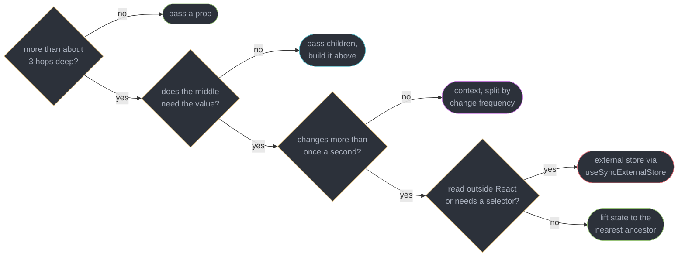
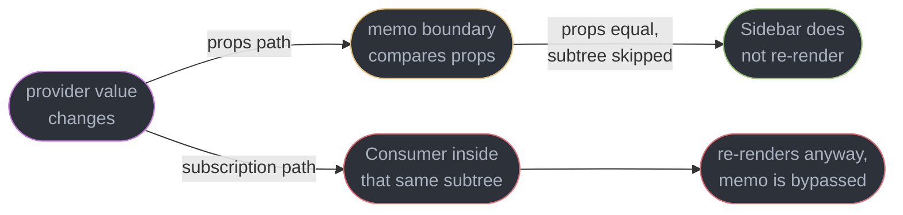
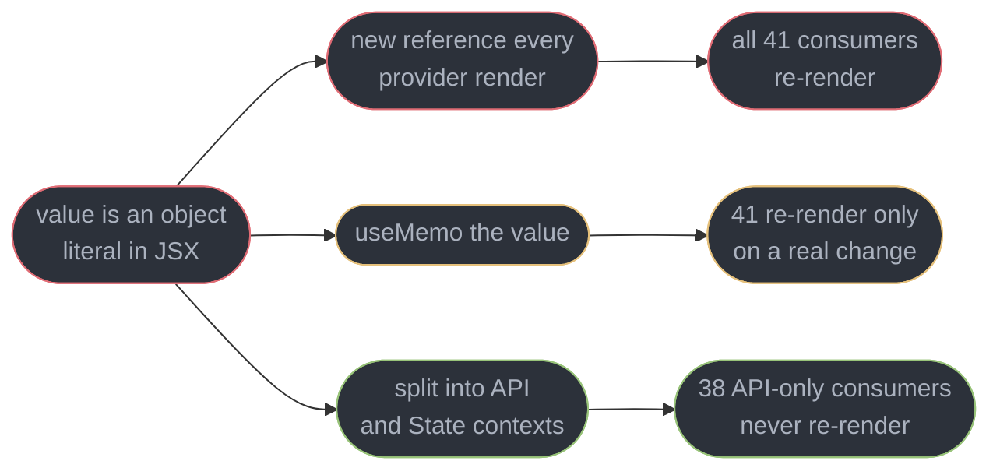
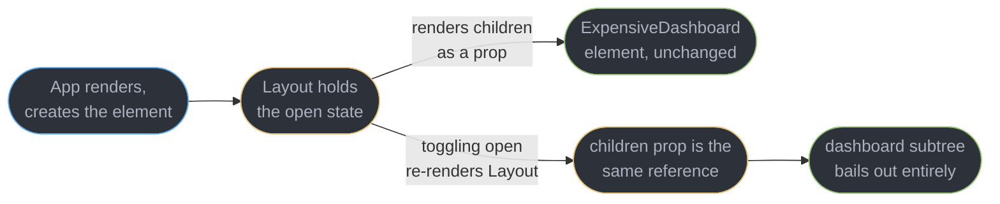
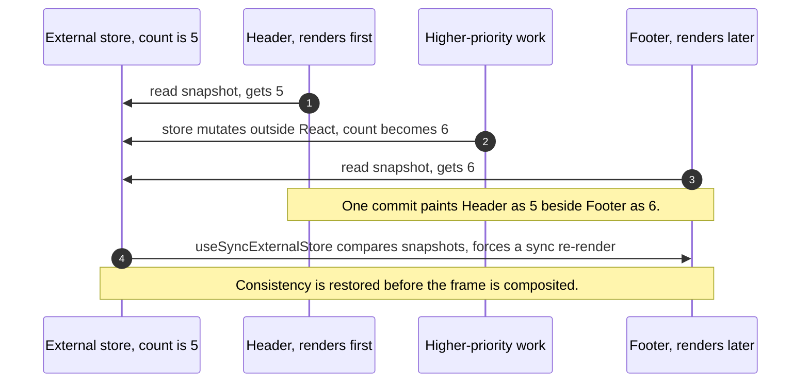
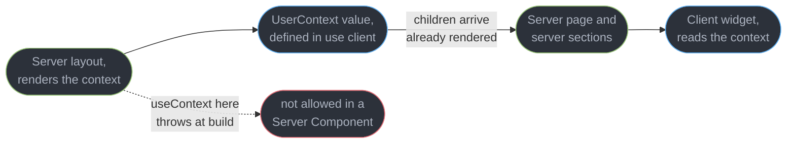

# Context and Component Communication

---

## 1. Concept Overview

Two components need to agree on a value. That is the whole problem, and React gives you five answers to it: pass a prop, pass `children` and let the parent build the subtree, lift the state to a common ancestor, provide a context, or subscribe to a store that lives outside React entirely. They are not five flavours of the same thing. Four of them move a value; one of them changes *who owns* it.

The thesis of this module is that **context is a dependency-injection mechanism, not a state manager**. It answers "how does a value reach a component thirty levels down without every intermediate component naming it" — theme, locale, a router instance, an authenticated user, a design-system tokens object. It does not answer "where should this value live" or "how do I keep re-renders small". Those are different questions, and reaching for context because prop drilling feels tedious usually trades three explicit props for one implicit subscription that re-renders 40 components you never looked at.

The trade is real and measurable, and it comes from the propagation mechanism. A consumer does not receive the context value through props; it subscribes to the provider directly. So `React.memo` — which works by comparing props — cannot stop a context update. That single sentence explains almost every "why is my whole app re-rendering" bug filed against context, and it is the most-asked context question in interviews.

This module assumes [React Fundamentals and the Render Model](../react_fundamentals_and_the_render_model/react_fundamentals_and_the_render_model.md) for what a re-render is and [Effects and Synchronization](../effects_and_synchronization/effects_and_synchronization.md) for subscription lifecycles. Comparing Zustand, Jotai and Redux Toolkit belongs to [Client State Management](../client_state_management/client_state_management.md); measuring any of this belongs to [React Performance and Profiling](../react_performance_and_profiling/react_performance_and_profiling.md); lanes and bailouts belong to [Fiber and Reconciliation](../fiber_and_reconciliation/fiber_and_reconciliation.md). Target is React 19.2 (released 2025-10-01, latest patch 19.2.8 as of 2026-07-21).

---

## 2. Intuition

> **One-line analogy**: context is the building's electrical wiring, not its furniture. It gets power to every room without running a cable through each doorway — but rewiring the building because you wanted to move a lamp is the wrong operation.

**Mental model**: a provider is a labelled socket somewhere up the tree; `useContext` is a plug. React walks up from the consumer looking for the nearest socket with that label. Nothing in between knows the wire exists, which is exactly the benefit and exactly the cost — the intermediate components are freed from carrying a prop, and are also freed from being able to stop anything.

**Why it matters**: the two production symptoms are opposite in shape. A context that carries frequently-changing state re-renders every consumer on every change, and since `memo` cannot intercept it, the profiler shows 41 components re-rendering when 2 needed to. The other symptom is quieter: a `value={{ user, login, logout }}` object literal that allocates a new reference on every provider render, so consumers re-render even when `user` did not change at all.

**Key insight**: before adding a context, ask **"is this dependency injection, or is it shared state?"** Injection is a value the subtree needs to *exist* — a theme, a locale, a client instance, a form's field registry. Shared state is a value the subtree *watches*. Injection is what context is for and is usually stable for the page's lifetime. Watched state through context is a subscription with no selector, and a store gives you the selector.

---

## 3. Core Principles

- **Context is injection, not storage.** It transports a value that already lives somewhere; it does not decide where. `useState` in the provider is what holds the state, and context merely publishes it.
- **A consumer subscribes to the provider, not to its parent's props.** This is why `React.memo` between provider and consumer changes nothing about a context update.
- **The provider's `value` is compared by `Object.is`.** A fresh object or array literal is a new value every render, whatever its contents.
- **Frequency of change is the design axis.** Split a context by how often each part changes, not by what topic it belongs to. Dispatch never changes; state changes 30 times a second.
- **Composition beats both drilling and context.** `children` passed from above means the expensive subtree is created once by the owner and merely relocated by the intermediate component.
- **Anything outside React needs `useSyncExternalStore`.** `useState` plus an effect cannot see a store mutation that lands mid-render, and concurrent rendering makes that window real.
- **Read the value through one guard hook, never `useContext` at call sites.** The hook throws when the provider is missing, so consumers never type `undefined` handling.
- **A Server Component cannot read context, but it can provide one.** From React 19.3 it renders a `"use client"` context directly, `<UserContext value={user}>`; a provider that holds client state is still a Client Component wrapping server-rendered `{children}`.

---

## 4. Types / Architectures / Strategies

### 4.1 The five mechanisms, ranked by reach for them first

| # | Mechanism | Moves the value how | Re-render blast radius | Reach for it when |
|---|-----------|---------------------|------------------------|-------------------|
| 1 | **Props** | explicitly, one hop | exactly the child, and `memo` can stop it | the default, up to about 3 hops |
| 2 | **Composition (`children`)** | the parent builds the element, the middle relocates it | none — the subtree is not re-created | an intermediate component holds state the subtree does not need |
| 3 | **Lifting state** | to the nearest common ancestor, back down as props | that ancestor's whole subtree, minus `memo` boundaries | two siblings must agree on one value |
| 4 | **Context** | implicitly, any depth, via subscription | every consumer, `memo`-proof | a stable dependency the whole subtree needs to exist |
| 5 | **External store** | subscription with a selector | only components whose selected slice changed | high-frequency state, or state read outside React |

The ranking is a default, not a law. What makes it a useful default: each step down buys reach and pays observability. At step 1 you can read the data flow off the JSX. At step 5 you cannot tell from a component's source where its value came from without opening the store.

### 4.2 Kinds of value people put in context, and whether they should

| Value | Change frequency | Verdict |
|-------|------------------|---------|
| Theme, locale, feature flags | once per session | Ideal. Pure injection |
| Auth user object, permissions | once per login | Ideal, if the object identity is stable |
| A client instance (query client, i18n, analytics) | never | Ideal. This is textbook injection |
| `dispatch` or a set of action callbacks | never | Ideal, and it should be its OWN context |
| Form field registry, dialog open/close API | rarely | Good, and the natural design-system pattern |
| Current route params | per navigation | Acceptable — a navigation re-renders anyway |
| A list being edited, a text draft, mouse position | per keystroke or per frame | Wrong. Use an external store with selectors |
| Server data with caching needs | per fetch | Wrong. That is [Server State and Data Fetching](../server_state_and_data_fetching/server_state_and_data_fetching.md) |

### 4.3 Ways to cut the blast radius, in order of preference

| Strategy | Mechanism | Cost |
|----------|-----------|------|
| Don't use context | composition, or 3 explicit props | you have to look at the tree |
| Split into two contexts | consumers of the stable half never re-render | two providers, two hooks |
| Move the provider down | fewer components are inside the subtree at all | the value stops being global |
| `useMemo` the value | prevents identity churn only, not real changes | does nothing if the state genuinely changed |
| `children` inside the provider | the provider re-renders, its children element does not | only helps the non-consumers |
| External store with a selector | per-component subscription, compared by slice | a dependency, and state outside React |

Note what is missing from that list: `React.memo` on the consumer. It is not a partial fix, it is not a fix at all, and putting it there is the single most common wrong answer to this problem.

---

## 5. Architecture Diagrams

### Which communication mechanism



Only one leaf is a context, and it is gated on change frequency rather than on depth. Depth is what makes people reach for context; frequency is what makes it cost.

### Why memo cannot stop a context update



The subscription path does not travel through props, so the comparison `memo` performs is never asked about the context value. React schedules the consumer fiber directly, past the bailout that stopped the props path.

### The value-identity trap and its two fixes



`useMemo` removes churn; splitting removes the subscription itself for consumers that only ever needed the callbacks. The second number is the one that matters in a real app, because most consumers of a store-shaped context read only its actions.

### Composition relocates a subtree instead of re-creating it



`Layout` re-renders 60 times as a drawer animates, and the dashboard renders 0 additional times, because `props.children` is the identical element object each time.

### Tearing across an interrupted concurrent render



Tearing needs three ingredients: a source outside React, a render that can be interrupted, and two components reading at different moments. Pure React state cannot tear because a render pass reads one immutable snapshot of the state for its whole duration.

### Context across the Server Component boundary



The context is a client reference whose `children` are server-rendered output passed through it. A server layout renders `<UserContext value={user}>` itself `[19.3]`, the subtree stays on the server, and only the leaf consumers ship JavaScript.

---

## 6. How It Works — Detailed Mechanics

### 6.1 The provider is the context object itself `[19]`

React 19 made a context usable directly as a provider component. `<ThemeContext.Provider>` still works, but new code does not write it.

```tsx
import { createContext, useContext, useMemo, useState } from "react";

type Theme = "light" | "dark";
const ThemeContext = createContext<Theme>("light");

function App() {
  const [theme, setTheme] = useState<Theme>("dark");
  return (
    <ThemeContext value={theme}>          {/* 19: no .Provider */}
      <Toolbar onToggle={() => setTheme((t) => (t === "dark" ? "light" : "dark"))} />
    </ThemeContext>
  );
}

function ThemedButton() {
  const theme = useContext(ThemeContext);  // nearest provider above, or "light"
  return <button className={theme} />;
}
```

The `"light"` argument to `createContext` is used **only when no matching provider exists above the consumer**. It is not a fallback for `value={undefined}` — a provider that supplies `undefined` supplies `undefined`, and the consumer gets that. This distinction is why §6.6 exists.

`use()` is the second reader, and it is the one that can be called conditionally.

```tsx
import { use } from "react";

function Row({ compact, id }: { compact: boolean; id: string }) {
  if (compact) {
    return <span>{id}</span>;                  // no context read at all on this path
  }
  const { locale } = use(SettingsContext);     // legal: use() is not bound to hook order
  return <span>{new Intl.NumberFormat(locale).format(Number(id))}</span>;
}
```

`use(Context)` reads the same value `useContext` would. The difference is that it is exempt from the rules-of-hooks ordering constraint, so it may sit inside a condition, a loop, or an early-return branch. It can also be called inside a `try`/`catch`, which `useContext` cannot. `use()` additionally unwraps promises, which belongs to [Suspense and Error Boundaries](../suspense_and_error_boundaries/suspense_and_error_boundaries.md); here it is simply a conditional context read.

### 6.2 Propagation: what a context change actually notifies

When a provider renders with a `value` that is not `Object.is`-equal to the previous one, React does not diff its way down. It walks the subtree looking for fibers that have registered a dependency on that specific context object, and marks each of them for re-render — **regardless of what sits between the provider and the consumer**.

```tsx
const CountContext = createContext(0);

const Middle = memo(function Middle({ label }: { label: string }) {
  renderLog("Middle");        // renders once, then never again
  return <Deep label={label} />;
});

const Deep = memo(function Deep({ label }: { label: string }) {
  const count = useContext(CountContext);   // <- the subscription
  renderLog("Deep");          // renders on EVERY count change
  return <span>{label}: {count}</span>;
});
```

Increment `count` 100 times with a static `label`. `Middle` logs 1 render; `Deep` logs 101. `Middle` bailed out because its props were equal — that is `memo` working exactly as designed. `Deep` sits *inside* the bailed-out subtree and re-renders anyway, because React reached it through the context dependency list rather than through `Middle`. The context update forces past the bailout; the mechanism is [Fiber and Reconciliation](../fiber_and_reconciliation/fiber_and_reconciliation.md)'s territory.

The practical readings of this fact:

- Wrapping a consumer in `memo` to stop context re-renders is a no-op. Measured on a 41-consumer settings context, adding `memo` to all 41 changed the per-update render count from 41 to 41.
- The only levers that work are: change the value less often, subscribe fewer components, or split the value so most consumers subscribe to a part that did not change.
- `memo` is still worth having on the intermediates, because it stops the *props* path. It just cannot be the answer to a context question.

### 6.3 The value-identity trap

A provider re-renders for any reason — its own state, its parent, a route change. If `value` is an object literal in the JSX, every one of those renders publishes a brand-new reference, and every consumer re-renders even when nothing inside changed.

```tsx
// Partial fix: memoize the value so identity tracks content.
function AuthProvider({ children }: { children: React.ReactNode }) {
  const [user, setUser] = useState<User | null>(null);

  const login = useCallback(async (c: Credentials) => setUser(await api.login(c)), []);
  const logout = useCallback(() => setUser(null), []);

  const value = useMemo(() => ({ user, login, logout }), [user, login, logout]);
  return <AuthContext value={value}>{children}</AuthContext>;
}
```

That removes the churn: 41 consumers now re-render only when `user` actually changes. It does not remove the real problem, which is that 38 of those 41 consumers only ever call `logout` and do not care about `user` at all. They subscribe to the whole object because the object is the unit of subscription.

The better fix splits by change frequency. The API half is created once and never changes; the state half changes on login and logout.

```tsx
const AuthStateContext = createContext<User | null | undefined>(undefined);
const AuthApiContext = createContext<AuthApi | undefined>(undefined);

function AuthProvider({ children }: { children: React.ReactNode }) {
  const [user, setUser] = useState<User | null>(null);

  // Stable for the provider's whole life: setUser identity never changes.
  const api = useMemo<AuthApi>(
    () => ({
      login: async (c: Credentials) => setUser(await api2.login(c)),
      logout: () => setUser(null),
    }),
    [],
  );

  return (
    <AuthApiContext value={api}>
      <AuthStateContext value={user}>{children}</AuthStateContext>
    </AuthApiContext>
  );
}
```

Now a `LogoutButton` calls `useContext(AuthApiContext)` and re-renders 0 times across the session, because `api` is `Object.is`-equal forever. Only the 3 components that render the user's name re-render on a login. Measured on the same 41-consumer tree: 41 re-renders per auth change became 3.

The same shape appears everywhere a context looks store-shaped: `state` and `dispatch` from a `useReducer` go in two contexts, not one. `dispatch` is guaranteed stable by React, so its context is free.

### 6.4 Composition: pass `children`, not props

This is the underused answer, and it solves the case where an intermediate component holds state that the deep subtree does not need. Drilling and context are both attempts to get *past* the intermediate; composition removes the need to get past it.

```tsx
// BROKEN-ish: Layout owns "open", so every toggle re-renders the whole dashboard.
function Layout() {
  const [open, setOpen] = useState(false);
  return (
    <div className={open ? "wide" : "narrow"}>
      <Drawer open={open} onToggle={() => setOpen((o) => !o)} />
      <ExpensiveDashboard />       {/* re-created on every toggle */}
    </div>
  );
}
```

`ExpensiveDashboard` renders 400 chart rows. Animating the drawer toggles `open` 60 times, so the dashboard element is re-created 60 times. Adding `memo` works here (its props are empty), but the moment it takes one prop the fix evaporates. Composition is structural instead.

```tsx
// FIX: App creates the dashboard element. Layout only relocates it.
function Layout({ children }: { children: React.ReactNode }) {
  const [open, setOpen] = useState(false);
  return (
    <div className={open ? "wide" : "narrow"}>
      <Drawer open={open} onToggle={() => setOpen((o) => !o)} />
      {children}                   {/* same element object every time */}
    </div>
  );
}

function App() {
  return (
    <Layout>
      <ExpensiveDashboard />       {/* created by App, which did not re-render */}
    </Layout>
  );
}
```

`children` is an ordinary prop holding an already-created element. `Layout` re-rendering does not re-create it, so reconciliation sees the identical element and bails the subtree out. Dashboard renders on a toggle: 60 to 0. No `memo`, no context, no dependency array.

The generalized form is **slots**: a component takes `header`, `sidebar` and `footer` as element props, and every one of them is created by the owner. This is how a design-system layout avoids both prop drilling and a layout context, and it composes with context rather than competing with it — the provider itself is usually written as `({ children }) => <Ctx value={v}>{children}</Ctx>`, which is why a provider's own re-render does not re-create its subtree.

### 6.5 Tearing and `useSyncExternalStore`

**Tearing** is two components in one committed frame showing different values of the same source. It requires a source React does not own, plus a render that can be interrupted.

Concurrent rendering makes the interruption real. React may render `Header`, yield to a higher-priority update or to the browser, and resume with `Footer` some milliseconds later. If both read `store.getState()` directly and the store mutated in the gap, the commit paints `5` in one place and `6` in another. Pure React state cannot do this: a render pass reads one immutable snapshot of each hook's state for its entire duration, and a `setState` schedules a new pass rather than mutating the current one.

```ts
// A minimal external store: mutable value, a subscriber set, a stable getSnapshot.
type Listener = () => void;

function createStore<T>(initial: T) {
  let state = initial;
  const listeners = new Set<Listener>();
  return {
    getSnapshot: () => state,                       // returns the SAME ref until a real change
    setState(next: T) {
      if (Object.is(next, state)) return;
      state = next;
      listeners.forEach((l) => l());
    },
    subscribe(l: Listener) {
      listeners.add(l);
      return () => listeners.delete(l);             // the unsubscribe React will call
    },
  };
}
```

```tsx
import { useSyncExternalStore } from "react";

const cartStore = createStore<CartItem[]>([]);

function useCart(): CartItem[] {
  return useSyncExternalStore(
    cartStore.subscribe,       // 1. how React registers for change notifications
    cartStore.getSnapshot,     // 2. how React reads the current value on the client
    () => EMPTY_CART,          // 3. what the server render and client hydration read
  );
}
```

The three arguments, and what each one is for:

1. **`subscribe(onStoreChange)`** — React calls this in a passive effect and keeps the returned unsubscribe. It must be a **stable function reference**; an inline arrow re-subscribes on every render, which is a resubscribe storm rather than a correctness bug, but it is the most common misuse.
2. **`getSnapshot()`** — called during render *and again* just before commit. If the two reads differ, React knows the store changed mid-render and re-renders synchronously, which is precisely how tearing is prevented.
3. **`getServerSnapshot()`** — used during server rendering and during client hydration. Without it, a server render throws `Missing getServerSnapshot, which is required for server-rendered content.` The client and server snapshots must match, or the first client hydration reports a mismatch.

`getSnapshot` must return a **cached reference**, and this is the sharpest trap in the API.

```ts
// BROKEN: a new array every call. React compares the render-time snapshot with the
// pre-commit one, sees a different reference, re-renders, compares again, forever.
// React reports: The result of getSnapshot should be cached to avoid an infinite loop.
getSnapshot: () => cart.items.filter((i) => i.qty > 0);

// FIX: derive on write, not on read. The reference changes only when the data does.
let visible = computeVisible(cart.items);
function setItems(next: CartItem[]) { cart.items = next; visible = computeVisible(next); }
getSnapshot: () => visible;
```

The same rule kills naive selectors: `useSyncExternalStore(sub, () => ({ a: s.a }))` loops for the same reason. Selector support with a custom equality check is what `useSyncExternalStoreWithSelector` (in `use-sync-external-store/shim/with-selector`) exists for, and it is what store libraries wrap. **Zustand v5 uses `useSyncExternalStore` natively** with no shim dependency — the store comparisons themselves are [Client State Management](../client_state_management/client_state_management.md)'s subject.

You need this hook when the source is outside React: a Redux-style store, a browser API you want to subscribe to (`window.matchMedia`, `navigator.onLine`, `document.visibilityState`), a third-party imperative library, or `localStorage` synchronized across tabs. You do not need it for anything held in `useState` or `useReducer`.

### 6.6 The typed-context pattern

`createContext` forces you to supply a default, and for most real contexts there is no honest one. A `null` default pushes an `if (!auth)` branch into every consumer that can never actually be taken. The pattern is to make the *absence* of a provider a loud error at the one place that reads it.

```tsx
type AuthApi = { login: (c: Credentials) => Promise<void>; logout: () => void };

// No sensible default, so the type includes undefined and the guard removes it.
const AuthApiContext = createContext<AuthApi | undefined>(undefined);

export function useAuthApi(): AuthApi {
  const api = useContext(AuthApiContext);
  if (api === undefined) {
    throw new Error("useAuthApi must be used within an AuthProvider");
  }
  return api;                    // narrowed to AuthApi, never undefined
}
```

Export `useAuthApi` and the provider; **do not export the context object**. Consumers get a non-optional type and a stack trace naming the missing provider instead of a `Cannot read properties of undefined (reading 'logout')` fifteen frames away. The narrowing is ordinary control-flow narrowing on a union — the generics side, including how to write this as a reusable `createSafeContext` factory, belongs to [Typing React Components](../typing_react_components/typing_react_components.md).

One caveat worth stating: `undefined` as the sentinel is better than `null`, because `null` is a plausible *legitimate* value for something like "the current user, who is logged out". If both a missing provider and a real absence are representable, use `undefined` for the first and `null` for the second, and the guard stays honest.

### 6.7 Context and Server Components

A Server Component runs once, on the server, with no state, no effects and no hooks. It therefore cannot call `useContext` — attempting it fails the build with `useContext only works in Client Components. Add the "use client" directive at the top of the file to use it.`

Providing is different from reading. Since React 19.3 a Server Component can render a context created in a `"use client"` module directly, so a value the server already knows needs no wrapper component:

```tsx
// user-context.ts
"use client";
import { createContext } from "react";

export const UserContext = createContext<User | null>(null);
```

```tsx
// app/layout.tsx -- a Server Component
import { UserContext } from "./user-context";

export default async function RootLayout({ children }: { children: React.ReactNode }) {
  const user = await getCurrentUser();               // server-only work, no hooks
  return (
    <html><body>
      <UserContext value={user}>{children}</UserContext>   {/* value crosses as a prop */}
    </body></html>
  );
}
```

The value crosses the client boundary like any prop, so it must be serializable: a plain object, not a class instance or a function. Before 19.3 the same layout needed a separate `Providers.tsx` client component whose only job was to forward the value.

A provider that owns client state, such as a theme toggle with `useState`, is still a Client Component. The pattern that keeps almost everything on the server is a thin client provider that renders `{children}`:

```tsx
// theme-provider.tsx
"use client";
import { createContext, useState } from "react";

export const ThemeContext = createContext<"light" | "dark">("light");

export function ThemeProvider({ children }: { children: React.ReactNode }) {
  const [theme, setTheme] = useState<"light" | "dark">("dark");
  return <ThemeContext value={theme}>{children}</ThemeContext>;
}
```

```tsx
// app/layout.tsx -- still a Server Component
import { ThemeProvider } from "./theme-provider";

export default async function RootLayout({ children }: { children: React.ReactNode }) {
  return (
    <html><body>
      <ThemeProvider>{children}</ThemeProvider>       {/* children stay server-rendered */}
    </body></html>
  );
}
```

`{children}` here is already-rendered server output passed *through* the client provider as a prop. The provider ships JavaScript; the pages inside it do not. This is the same composition trick as §6.4, applied across the server boundary.

The consequence for design: **prefer props for server-to-client data**, since the client boundary is a serialization boundary anyway and a prop is explicit. Use context only for values genuinely needed by many scattered client leaves. Serialization rules, `"use server"`, and the boundary's full contract belong to [Server Components and Server Functions](../server_components_and_server_functions/server_components_and_server_functions.md).

---

## 7. Real-World Examples

**The settings context that re-rendered a data grid.** An admin console kept `{ user, prefs, updatePref }` in one context. Toggling a density preference re-rendered all 41 consumers, including a 2,000-row virtualized grid whose only interest was `updatePref`. A developer added `React.memo` to the grid and the render count stayed at 41. Splitting into `SettingsStateContext` and `SettingsApiContext` took it to 3, and the density toggle went from 210 ms to 9 ms.

**The auth provider that logged everyone in twice a second.** `value={{ user, login, logout }}` sat inline in the JSX of a provider that also owned a 1-second clock for a session-expiry countdown. Every tick re-rendered the provider, allocated a new value object, and re-rendered all 27 consumers once per second on an idle page. The `useMemo` alone dropped it to 0 renders per second; moving the countdown into its own leaf component removed the provider re-render entirely.

**The drawer that re-rendered a dashboard 60 times.** A layout component owned an `open` boolean and rendered `<Dashboard />` directly. The 400-row dashboard re-created on every animation frame of the drawer, dropping 14 frames per open. Converting `Layout` to take `children` and moving `<Dashboard />` up to `App` reduced dashboard renders per toggle from 60 to 0, with a 4-line diff and no memoization.

**The store that tore under a transition.** A trading dashboard read a price store with `useState` plus a subscribe effect. Under `startTransition` on a filter change, the header showed one price and the table another for a single commit — reported as "the numbers flicker and disagree". Moving both readers to `useSyncExternalStore` fixed it; the first attempt regressed into `The result of getSnapshot should be cached to avoid an infinite loop.` because the snapshot mapped the price map into a fresh object on every read.

---

## 8. Tradeoffs

| Design choice | Bought | Paid |
|---------------|--------|------|
| Context over prop drilling | intermediates stop naming a value they do not use | data flow is no longer readable from the JSX |
| Consumers subscribe directly | any depth reachable, no intermediate cooperation needed | `memo` cannot intercept, so the blast radius is every consumer |
| `Object.is` on the whole `value` | comparison is O(1) and predictable | no per-field granularity, so one field's change wakes every reader |
| One context per concern | fewer providers, simpler tree | couples stable APIs to churning state |
| Two contexts split by frequency | API-only consumers re-render 0 times | two providers, two hooks, a naming convention |
| Composition with `children` | subtree is not re-created, and no subscription exists | the owner must know the subtree, so it is less dynamic |
| External store with selectors | per-slice subscriptions, readable outside React | a dependency, and state that lives outside React's model |
| `useSyncExternalStore` | tearing is impossible under concurrent rendering | `getSnapshot` must be cached, which pushes derivation to write time |
| Guard hook that throws | consumers never handle `undefined` | a runtime error path, and the context must not be exported |

---

## 9. When to Use / When NOT to Use

**Use context when:**

- The value is a **dependency the subtree needs to exist** — a theme, a locale, a design-system tokens object, a query client, an i18n instance, an analytics client.
- It is **stable for most of the page's life**, so a change is a real event rather than a stream.
- Many scattered leaves need it and the intermediates genuinely do not, so drilling would add a prop to 12 components that ignore it.
- You are building a **compound component** — a `Tabs`/`TabList`/`Tab` set, an accordion, a form's field registry — where the context is scoped to one small subtree by construction.
- You need `dispatch` or a set of action callbacks anywhere below. Put those in their own context, where they cost nothing.

**Do not use context when:**

- The value changes **more than about once a second** — a text draft, a mouse position, a live price feed. That is an external store with selectors.
- It is **server data with caching, deduplication or retry needs**. That is [Server State and Data Fetching](../server_state_and_data_fetching/server_state_and_data_fetching.md), and a context around a fetch result reimplements a cache badly.
- The value only travels **2 or 3 hops**. Props are cheaper, visible, and `memo`-stoppable.
- The intermediate component is the whole problem. Try `children` first; it removes the need for any transport.
- You want it because prop drilling *felt* tedious. Tedium is not a re-render budget, and the trade is 3 explicit props for 40 implicit subscriptions.

---

## 10. Common Pitfalls

**An object literal as `value`.** The single highest-volume context defect, and it re-renders consumers when nothing changed.

```tsx
// BROKEN: a new object every provider render. The clock ticking once a second
// re-renders all 27 consumers, even though `user` has not changed since login.
function AuthProvider({ children }: { children: React.ReactNode }) {
  const [user, setUser] = useState<User | null>(null);
  const seconds = useSessionClock();                    // updates 1x per second
  return (
    <AuthContext value={{ user, seconds, logout: () => setUser(null) }}>
      {children}
    </AuthContext>
  );
}

// FIX: memoize the value, and split the churning field into its own context.
function AuthProvider({ children }: { children: React.ReactNode }) {
  const [user, setUser] = useState<User | null>(null);
  const api = useMemo(() => ({ logout: () => setUser(null) }), []);
  return (
    <AuthApiContext value={api}>
      <AuthUserContext value={user}>
        <SessionClockProvider>{children}</SessionClockProvider>
      </AuthUserContext>
    </AuthApiContext>
  );
}
```

The fixed version renders 0 consumers per tick instead of 27, because only the components that actually display the countdown subscribe to the clock.

**Wrapping a consumer in `React.memo` to stop context re-renders.** It does nothing. Verified on a 41-consumer tree: 41 renders before, 41 after. `memo` compares props, and the context value never arrived as one.

**`useContext` at 30 call sites instead of one guard hook.** Every site then handles `undefined`, and a missing provider surfaces as `Cannot read properties of undefined` deep in an unrelated component instead of as a named error at the read.

**Expecting `createContext(default)` to cover `value={undefined}`.** The default applies only when **no provider exists above**. A provider that publishes `undefined` publishes `undefined`, and the consumer never sees the default.

**An inline arrow as `subscribe`.** `useSyncExternalStore((cb) => store.subscribe(cb), ...)` allocates a new function every render, so React unsubscribes and resubscribes on every commit. Pass the store's own stable method.

**A `getSnapshot` that derives on read.** Returning `items.filter(...)` or `{ ...slice }` produces a new reference each call and React reports `The result of getSnapshot should be cached to avoid an infinite loop.` Derive on write, or use a selector wrapper with an equality function.

**Omitting `getServerSnapshot` in a server-rendered app.** The render throws `Missing getServerSnapshot, which is required for server-rendered content.`, and supplying one that disagrees with the client value produces a client hydration mismatch instead.

**A single global provider at the app root for a value used in one route.** Every consumer anywhere is now inside it, so its blast radius is the entire tree. Move the provider down to the smallest subtree that needs it — this is the cheapest fix available and it is almost never tried.

**Putting a context provider inside a component that re-renders often.** The provider's own re-render is what publishes a new value. Keep providers near the top of their subtree and give them no state they do not publish.

---

## 11. Technologies & Tools

| Tool | Purpose |
|------|---------|
| React | 19.2: context as a provider component, `use()` for conditional reads |
| use-sync-external-store | Ships `useSyncExternalStoreWithSelector` for selector plus equality |
| use-context-selector | Community hook giving per-field subscriptions over one context |
| Zustand | v5, built on native `useSyncExternalStore`, selectors with no provider |
| Jotai | Atom-level subscriptions, so the blast radius is one atom |
| Redux Toolkit | `useSelector` on a store read through `useSyncExternalStore` |
| Valtio | Proxy-tracked reads, subscribing only to fields actually touched |
| React DevTools | The Profiler's "why did this render" says context changed vs props changed |
| react-scan | Highlights every re-rendering component live, which makes a blast radius visible |
| eslint-plugin-react-hooks | Catches unstable `value` dependencies feeding a provider |
| babel-plugin-react-compiler | Auto-memoizes the provider value, removing most identity churn |
| Next.js | 16 App Router: the client-provider-wrapping-children pattern |
| React Testing Library | Renders a consumer with and without a provider to assert the guard throws |

---

## 12. Interview Questions with Answers

**Q: Why does React.memo not prevent a re-render when a context value changes?**
**Short:** Consumers subscribe directly to the provider rather than receiving the value as a prop, so the props comparison memo performs is never asked about it.

React marks every fiber that registered a dependency on that context object, walking past any memoized boundary in between. On a tree with a memoized `Middle` wrapping a consuming `Deep`, incrementing the value 100 times gives `Middle` 1 render and `Deep` 101. Adding `memo` to all 41 consumers of a settings context changed the per-update count from 41 to 41. The levers that do work are changing the value less often, splitting the context, or moving the provider down.

**Q: Why do all my consumers re-render when I pass an object literal as the provider value?**
**Short:** Inline object literals allocate a fresh reference on every provider render, and the value is compared with Object.is, so identity churn looks exactly like a real change.

`value={{ user, login, logout }}` publishes a new object whenever the provider renders for any reason — its own state, its parent, a route change. An auth provider that also owned a one-second session clock re-rendered 27 consumers per second on a completely idle page. Wrapping the value in `useMemo` keyed on its parts fixes the churn; splitting the churning field into its own provider fixes the subscription. React Compiler 1.0 memoizes this automatically in compiled code.

**Q: When should you NOT use context?**
**Short:** Dependency injection is the job it does well, so high-frequency state, cached server data, and values travelling only two or three hops all belong elsewhere.

Anything changing more than about once a second — a text draft, a cursor position, a price feed — needs per-slice subscriptions that context cannot give, because the unit of subscription is the whole value. Server data with caching, deduplication and retry needs is a query library's job. Two or three hops is what props are for, and props are visible in the JSX and stoppable by `memo`. Reaching for context purely because drilling felt tedious trades 3 explicit props for 40 implicit subscriptions.

**Q: What is tearing, and why can it not happen with plain React state?**
**Short:** Interrupted concurrent renders let two components read an external mutable source at different moments, so one commit can paint two different values of the same thing.

React may render the header, yield to higher-priority work or to the browser, then resume with the footer milliseconds later. If a store outside React mutated in that gap, the header shows 5 and the footer shows 6 in a single committed frame. Pure React state is immune because a render pass reads one immutable snapshot of each hook for its whole duration, and a `setState` schedules a new pass rather than mutating the current one. `useSyncExternalStore` closes the gap by re-reading the snapshot before commit and re-rendering synchronously if it changed.

**Q: How do you write a context provider in React 19?**
**Short:** Rendering the context object directly as a component replaced the .Provider wrapper, so it is now written as ThemeContext with a value prop.

`<ThemeContext value={theme}>{children}</ThemeContext>` is the modern form; `<ThemeContext.Provider>` still works but is not what new code writes. Consumers read it with `useContext(ThemeContext)` or `use(ThemeContext)`. The argument given to `createContext` is the value used only when no provider exists above the consumer — it is not a fallback for a provider that supplies `undefined`, which is a distinction that surprises people during migrations.

**Q: How do you stop a context from re-rendering components that only need its callbacks?**
**Short:** Splitting one provider into a stable API context and a changing state context lets action-only consumers keep an Object.is-equal value forever.

Most consumers of a store-shaped context call `logout` or `dispatch` and never read the state, yet they subscribe to the whole object because the object is the subscription unit. Two contexts, one holding the memoized action set and one holding the state, let 38 of 41 consumers re-render 0 times per auth change instead of 41. `dispatch` from `useReducer` is guaranteed stable by React, so its context is free. The same split applies to any provider whose value mixes an API with churning data.

**Q: How does passing children avoid both prop drilling and context?**
**Short:** Passing children through means the subtree is created by the owner above and merely relocated, so an intermediate component's re-render never re-creates it.

A `Layout` that owns an `open` boolean and renders `<Dashboard />` directly re-creates the 400-row dashboard on all 60 frames of a drawer animation. Change `Layout` to take `children` and move `<Dashboard />` up to `App`, and `props.children` is the identical element object every time, so reconciliation bails the subtree out: 60 renders become 0. No memoization, no dependency array, a 4-line diff. The generalized form is slots — `header`, `sidebar` and `footer` as element props.

**Q: What are the three arguments to useSyncExternalStore?**
**Short:** Three arguments wire a store into React: a stable subscribe function, a getSnapshot that reads the current value, and a getServerSnapshot for server rendering.

`subscribe(onStoreChange)` is called in a passive effect and must return an unsubscribe; passing an inline arrow resubscribes on every commit. `getSnapshot()` is called during render and again just before commit, and a difference between the two reads is how React detects a mid-render mutation and prevents tearing. `getServerSnapshot()` is used during server rendering and client hydration — omitting it throws `Missing getServerSnapshot, which is required for server-rendered content.`

**Q: Why must getSnapshot return a cached reference?**
**Short:** Returning a fresh object or array on every call makes the pre-commit read differ from the render read forever, which React reports as an infinite loop.

`getSnapshot: () => items.filter(i => i.qty > 0)` allocates a new array each time, so React sees a change, re-renders, compares again, and never converges. The error text is `The result of getSnapshot should be cached to avoid an infinite loop.` The fix is to derive on write rather than on read, recomputing the cached value inside the setter. Naive inline selectors fail the same way, which is why `useSyncExternalStoreWithSelector` exists and why store libraries wrap it.

**Q: What is the difference between use(Context) and useContext?**
**Short:** Conditional reads are the difference: use is exempt from the hook-ordering rule, so it can sit inside an if, a loop, or an early-return branch.

Both read the same value from the nearest matching provider. `useContext` is an ordinary hook and must be called unconditionally at the top level of every render, so a component with a compact fast path still pays for the read. `use()` may also be called inside a `try`/`catch`, which `useContext` cannot. `use()` additionally unwraps promises, which is a separate capability belonging to Suspense; for context specifically it is simply a conditional read.

**Q: How do you type a context that has no sensible default value?**
**Short:** Throwing from a single guard hook lets the context type be a union with undefined while every consumer receives the narrowed non-optional type.

Declare `createContext<AuthApi | undefined>(undefined)`, then export one `useAuthApi()` that reads it and throws `useAuthApi must be used within an AuthProvider` when the value is `undefined`. Do not export the context object itself, so nobody bypasses the guard. Consumers get a named error with a useful stack instead of `Cannot read properties of undefined` fifteen frames away. Prefer `undefined` over `null` as the sentinel, so `null` stays available for a genuine absence such as a logged-out user.

**Q: Can a Server Component use context?**
**Short:** A Server Component cannot read context because it runs no hooks, but from React 19.3 it can provide one by rendering a context defined in a use-client module with a value prop.

Calling `useContext` in a Server Component fails with `useContext only works in Client Components. Add the "use client" directive at the top of the file to use it.` Providing works: a context created in a `"use client"` module can be rendered from a server layout as `<UserContext value={user}>{children}</UserContext>`, with the value serialized like any prop, so a provider that only forwards a server value needs no wrapper file. A provider holding client state, such as a theme toggle with `useState`, is still a thin `"use client"` component that wraps `{children}`. In both shapes the `{children}` are already-rendered server output passed through as a prop, so the pages inside ship no JavaScript. Prefer explicit props for server-to-client data and keep context for values many scattered client leaves need.

**Q: When is the default passed to createContext actually used?**
**Short:** Default values only apply when no matching provider exists anywhere above the consumer, never as a substitute for a provider that publishes undefined.

React walks up the fiber tree looking for the nearest provider of that exact context object; the default is the answer when the walk finds none. A provider rendering `value={undefined}` therefore hands `undefined` straight to the consumer. This makes a plausible-looking default actively dangerous, because a component rendered outside its provider silently works with wrong data instead of failing. That is the argument for `undefined` plus a guard hook rather than a convenient fake default.

**Q: How deep does prop drilling have to get before context is the better answer?**
**Short:** Three levels of explicit passing is roughly the point where props stop paying, but depth alone is the wrong test if the value changes constantly.

Up to about three hops, props win on every axis: visible in the JSX, stoppable by `memo`, no subscription. Past that, weigh two questions before adding a context — do the intermediates need the value, and how often does it change. If the intermediates do not need it, `children` or slots removes the transport entirely and costs nothing. If it changes many times a second, context replaces a tedious prop chain with 40 unstoppable re-renders, and an external store with selectors is the right destination.

**Q: When should you replace a context with an external store?**
**Short:** External stores notify per selected slice, so the moment you need granularity, high update frequency, or reads from outside React, context has run out.

Context has exactly one subscription granularity: the whole value. Splitting into two or three contexts buys coarse granularity and stops being maintainable somewhere past that. A store subscribes each component to a selected slice compared by an equality function, so a 2,000-row grid reading one field does not re-render when a sibling field changes. Stores are also readable in event handlers and imperative code without a hook. Zustand v5, Jotai, Valtio and Redux Toolkit all sit on `useSyncExternalStore` and are compared in [Client State Management](../client_state_management/client_state_management.md).

**Q: How do you find out which components a context change is re-rendering?**
**Short:** Every consumer below a provider is a candidate, and the DevTools Profiler names the cause per component as either a context change or a props change.

Record an interaction, open the flame chart, and select a component — "Why did this render?" distinguishes a context update from a props update, which is exactly the distinction a `memo` fix depends on. `react-scan` highlights re-rendering components live, so the blast radius of one toggle is visible without recording. Counting matters more than intuition here: a settings toggle that re-rendered 41 components at 210 ms was assumed to be a virtualization problem until the profiler named the context.

---

## 13. Best Practices

- Ask "injection or shared state?" before creating any context. Injection is what it is for; watched state wants a store.
- Try `children` or slots first. It removes the transport rather than making the transport cheaper, and it needs no memoization.
- Split every store-shaped context into a stable API half and a changing state half, in the same commit you create it. Retrofitting the split is a much larger diff.
- Never ship an object literal as `value`. `useMemo` it, or let React Compiler do it — but do not rely on the compiler in a published library.
- Put the provider at the smallest subtree that needs it, not at the app root. Moving a provider down is the cheapest blast-radius fix and the least attempted.
- Export a guard hook and the provider; keep the context object module-private so every read goes through the throw.
- Use `undefined` as the missing-provider sentinel and reserve `null` for a real absence, so the two are distinguishable.
- Reach for `useSyncExternalStore` for anything outside React, pass the store's own stable `subscribe` method, and cache `getSnapshot` by deriving on write.
- Never answer a context re-render problem with `React.memo`. Verify with the Profiler's "why did this render" before and after any change.
- Across the server boundary, prefer explicit props and keep the client provider a thin `{children}` shell.

---

## 14. Case Study

**Problem.** A B2B analytics console kept everything in one `AppContext`: the authenticated user, the current workspace, a theme, a `filters` object, and eight callbacks. 63 components consumed it. Changing any filter chip took 380 ms before the chart updated, and the React Profiler recorded 63 component renders per keystroke in the filter's search box. Two engineers had already added `React.memo` to the 12 heaviest consumers, with no measured change.

**Investigation.** The Profiler's "Why did this render" said *Context changed* on all 63, including the memoized 12 — the first clue that `memo` was the wrong tool. A `console.count` in the provider showed it re-rendering 4 times per keystroke, once for the debounce timer and three times for cascading state updates. And `value` was an inline object literal, so even the theme consumers — 38 components that never read `filters` — re-rendered on every one of those 4 renders.

**Root cause.** One context doing five jobs, with an unmemoized value.

```tsx
// BROKEN
function AppProvider({ children }: { children: React.ReactNode }) {
  const [user, setUser] = useState<User | null>(null);
  const [workspace, setWorkspace] = useState<Workspace | null>(null);
  const [theme, setTheme] = useState<Theme>("dark");
  const [filters, setFilters] = useState<Filters>(EMPTY_FILTERS);   // per keystroke

  // A brand-new object on every one of the 4 renders per keystroke, so all 63
  // consumers re-render even when only `filters` changed.
  return (
    <AppContext value={{ user, workspace, theme, filters, setFilters, setTheme, /* +6 */ }}>
      {children}
    </AppContext>
  );
}

// And the layout re-created the chart subtree on every provider render:
function Shell() {
  const { theme } = useContext(AppContext);
  return <div className={theme}><Chart /></div>;   // 3,400-point chart, re-created
}
```

**Fix.** Three changes, none of them a memoization of a consumer: split by change frequency, move the high-frequency slice to a store, and turn the shell into a `children` container.

```tsx
// FIX
const AppApiContext = createContext<AppApi | undefined>(undefined);      // never changes
const IdentityContext = createContext<Identity | undefined>(undefined);  // per login
const ThemeContext = createContext<Theme>("dark");                       // per toggle
const filterStore = createStore<Filters>(EMPTY_FILTERS);                 // per keystroke

export function useFilters<S>(select: (f: Filters) => S, eq = Object.is): S {
  return useSyncExternalStoreWithSelector(
    filterStore.subscribe, filterStore.getSnapshot, filterStore.getSnapshot, select, eq,
  );
}

function AppProvider({ children }: { children: React.ReactNode }) {
  const [identity, setIdentity] = useState<Identity | null>(null);
  const [theme, setTheme] = useState<Theme>("dark");
  const api = useMemo<AppApi>(() => makeApi(setIdentity, setTheme), []);  // stable forever
  return (
    <AppApiContext value={api}>
      <IdentityContext value={identity ?? undefined}>
        <ThemeContext value={theme}>{children}</ThemeContext>
      </IdentityContext>
    </AppApiContext>
  );
}

// The shell relocates the chart instead of re-creating it.
function Shell({ children }: { children: React.ReactNode }) {
  const theme = useContext(ThemeContext);
  return <div className={theme}>{children}</div>;
}
```

The 12 `React.memo` wrappers added earlier were deleted; none of them had ever prevented a render. `useFilters` gives each chart a selector, so a chip that changes only `dateRange` wakes the 2 components reading `dateRange` rather than all 63.

**Results.**

- Component renders per filter keystroke: 63 to 2, measured with the Profiler on the same interaction.
- Filter chip to chart update: 380 ms to 21 ms.
- Provider renders per keystroke: 4 to 0 — `filters` no longer lives in React state at the provider.
- Theme toggle: 63 renders to 9, the components that actually read `theme`.
- Lines in the provider: 41 to 26, with 12 `memo` wrappers removed elsewhere.

**Lesson.** The team's instinct was to make the consumers cheaper, and `memo` is the tool that sounds like it does that. It could never have worked, because a consumer's subscription does not travel through props. The three fixes that did work all changed *who subscribes to what*: split so most consumers subscribe to something stable, use a store where a selector is genuinely needed, and use `children` where nothing needed to subscribe at all.
