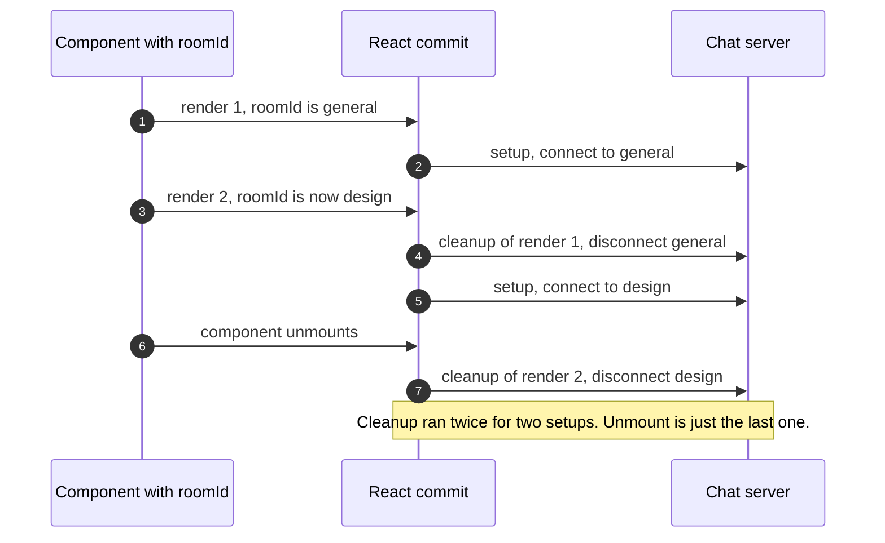
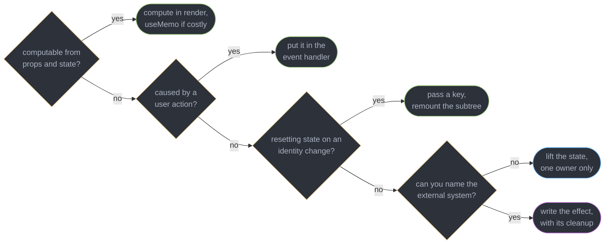
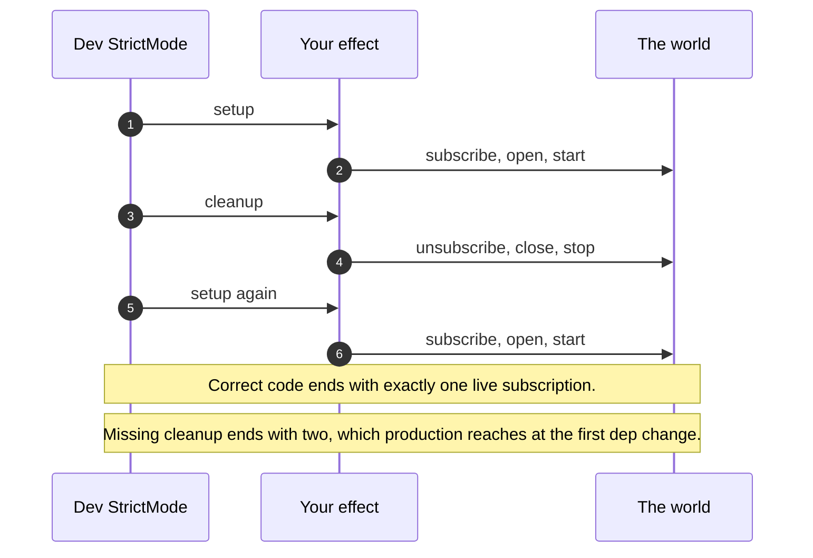
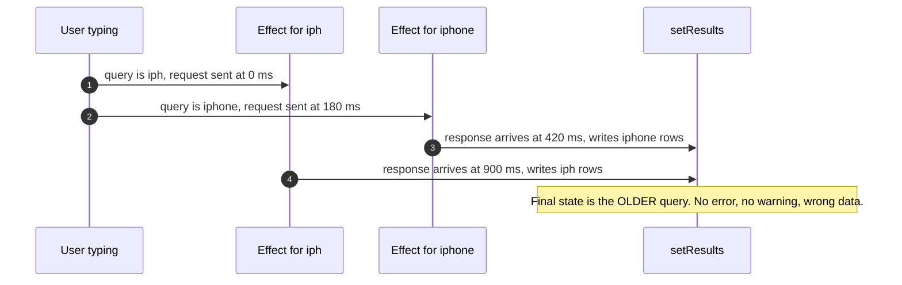
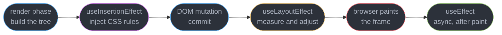
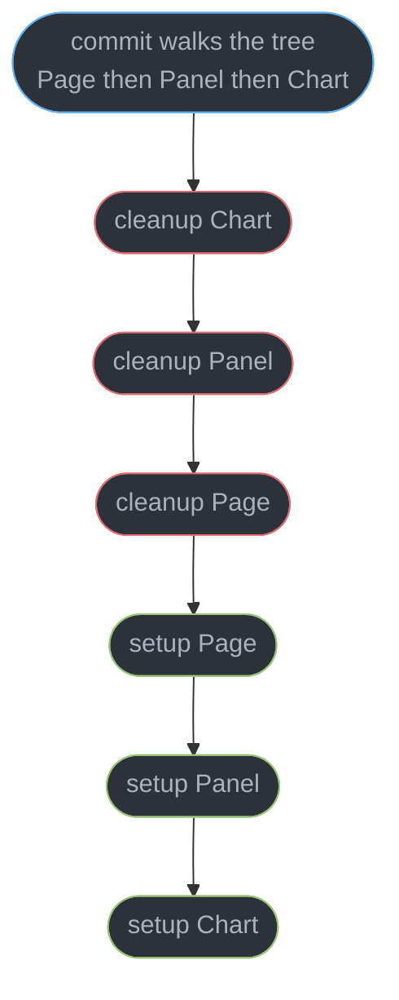

# Effects and Synchronization

---

## 1. Concept Overview

`useEffect` is named after a side effect and taught as a lifecycle hook, and both of those are why it is the most misused API in React. It is neither. An effect is a **declaration of synchronization**: it says *while these values hold, this external system should be in this state*, and it hands React two functions — one that starts the sync and one that stops it. React calls them as often as it needs to in order to keep the claim true. Mount, unmount, and every dependency change are the same event to the runtime, distinguished only by whether a setup or a teardown happens to be first.

Once you read it that way, the rules stop being trivia. Cleanup is not "unmount code" — it is the inverse of setup, and it runs before every re-sync, which is a hundred times more often than it runs at unmount. The dependency array is not a performance knob — it is the list of values the claim depends on. StrictMode's double invocation in development is not a bug to suppress — it is React asserting that your teardown really does undo your setup, by doing exactly what a dependency change would do.

And the largest category of effect bugs is not a misused effect at all. It is an effect that should not exist: state derived in an effect instead of during render, a reset written as an effect instead of a `key`, a POST fired from an effect instead of from the click that caused it. Those cost an extra render pass each, run on causes you did not intend, and are the reason `react-hooks/set-state-in-effect` shipped as a rule in `eslint-plugin-react-hooks` 6.0.

This module assumes [Hooks Rules and the Hook Model](../hooks_rules_and_the_hook_model/hooks_rules_and_the_hook_model.md) for the hook chain, closure capture and dependency-array identity, and does not re-derive them. Server data with caching and deduplication belongs to [Server State and Data Fetching](../server_state_and_data_fetching/server_state_and_data_fetching.md). Target is React 19.2 (released 2025-10-01, latest patch 19.2.8 as of 2026-07-21).

---

## 2. Intuition

> **One-line analogy**: an effect is a thermostat, not an alarm clock. You do not tell it *when* to fire; you tell it what temperature the room should hold, and it turns the heater on and off as the target moves.

**Mental model**: write every effect as a pair of sentences that mirror each other. "Open a socket to room A." / "Close the socket to room A." React composes them into a tape: setup A, teardown A, setup B, teardown B. If your teardown does not cancel exactly what your setup started, the tape leaks — one extra listener, one extra socket, one extra interval, once per change.

**Why it matters**: the two production symptoms that dominate this topic are invisible in a screenshot. A subscription without cleanup grows one listener per dependency change, so a page that survives 400 filter switches ends up dispatching 400 handlers per message and dies of CPU, not of a crash. A fetch without cancellation resolves out of order, so a user who types `iph` then `iphone` sees results for `iph` — correct-looking data, wrong query, no error anywhere.

**Key insight**: the question "when does this run?" has no useful answer, and asking it is the source of the misuse. The useful question is **"what external system is this keeping in sync, and what does un-syncing it look like?"** If you cannot name the external system, you almost certainly do not need an effect — you need a render-time computation, a `key`, or an event handler.

---

## 3. Core Principles

- **An effect synchronizes, it does not sequence.** It describes a steady state to maintain, not a step in a lifecycle. There is no "on mount" in the model, only "sync started because there was nothing to sync before".
- **Cleanup is the exact inverse of setup, and runs far more often than at unmount.** Every dependency change is a teardown followed by a setup.
- **Reactive values are the dependencies, and the list is derived, not chosen.** Props, state, context and anything computed from them inside the body. `react-hooks/exhaustive-deps` computes the same list you should.
- **If the code has no external system, it does not belong in an effect.** Derivation belongs in render, resets belong to `key`, user-initiated work belongs in the handler.
- **StrictMode's double invocation is a test of your cleanup, and it is development-only.** Production mounts once. A ref guard added to silence it hides the defect it found.
- **Effect timing is a spectrum, not a choice of style.** `useInsertionEffect` before layout reads, `useLayoutEffect` before paint, `useEffect` after paint. Moving up the list costs frame time.
- **Cleanups run child-first before any of the next setups run parent-first.** No effect may assume another effect has already executed.
- **Any effect that only calls `setState` from props or state is a rendering bug wearing effect clothing.** It costs a full extra commit and briefly paints a value that is wrong.

---

## 4. Types / Architectures / Strategies

### 4.1 The four effect-shaped hooks

| Hook | Fires | Blocks paint | Use for |
|------|-------|--------------|---------|
| `useEffect` | after the browser paints, asynchronously | No | Every synchronization with an external system: sockets, listeners, timers, analytics, imperative widgets |
| `useLayoutEffect` | after DOM mutation, before paint, synchronously | Yes | Measuring a node and adjusting position in the same frame, so the user never sees the intermediate |
| `useInsertionEffect` | before any layout effect, before DOM reads | Yes | CSS-in-JS rule injection only. No refs, no state |
| `useEffectEvent` `[19.2]` | never on its own — only when your effect calls it | n/a | Reading the latest value of something that must not re-trigger the effect |

### 4.2 The "you might not need an effect" catalogue

| Symptom in the code | What it should be | What the effect costs |
|---------------------|-------------------|-----------------------|
| `useEffect(() => setFull(first + " " + last), [first, last])` | a `const` computed during render | 1 extra render per change, plus a frame showing the old value |
| `useEffect(() => { setDraft(""); setError(null) }, [userId])` | `key={userId}` on the component | 1 extra render, plus every field you forgot to reset |
| `useEffect(() => { if (submitted) post(form) }, [submitted])` | the work inside `onSubmit` | fires on any render that leaves `submitted` true, including a remount |
| `useEffect(() => setSorted(bigSort(rows)), [rows])` | `useMemo(() => bigSort(rows), [rows])` | 1 extra render, and the sort still runs on the same schedule |
| `useEffect(() => onChange(value), [value])` in a child | state lifted to the parent, value passed down | a render ping-pong between two owners of one truth |
| `useEffect(() => setItems(await fetchAll()), [q])` | a query library, or a Server Component | no caching, no dedupe, no retry, plus a race |

### 4.3 Dependency-array forms, read as claims about synchronization

| Form | The claim | Honest when |
|------|-----------|-------------|
| No array | "re-sync after every single render" | almost never — usually a forgotten array |
| `[]` | "this sync depends on no reactive value" | a listener on `window`, a one-time third-party init |
| `[roomId]` | "re-sync whenever the room changes" | the default and the target shape |
| `[options]` where `options` is built in the body | "re-sync every render" — a new identity each time | never; depend on `options.roomId` |

### 4.4 Fixing an over-firing effect, in order of preference

| Fix | Mechanism | Use when |
|-----|-----------|----------|
| Delete the effect | the work belongs in render, a handler, or a `key` | the catalogue in 4.2 matches |
| Depend on primitives | strings and numbers compare by value under `Object.is` | an object or array dependency is churning |
| Move the read into `useEffectEvent` | the value is read but is not part of the claim | a theme, a callback prop, a logging context |
| Move the object creation inside the effect | nothing outside the effect needs it | the object is only used by the setup |
| Accept the re-sync | cleanup tears down, setup rebuilds | the value genuinely changes the external system |

---

## 5. Architecture Diagrams

### Setup and cleanup across a dependency change



Steps 4 and 5 are the whole model. The teardown at unmount is indistinguishable from the teardown at a dependency change, which is why writing cleanup as "unmount code" produces a leak on every change.

### Do you actually need an effect



Four questions, and only the last leaf is an effect. In an audit of a 320-component codebase, 61 of 94 effects exited at one of the first three branches.

### What StrictMode is really asserting



Production runs the middle pair only once, at unmount. The double invocation simulates a dependency change on the very first render, when it is cheapest to notice.

### The out-of-order response race



The slow request wins because nothing orders the writes. A cleanup that sets `ignore = true` makes the late response a no-op, and an `AbortController` also stops the byte transfer.

### Where each effect hook sits in the frame



Everything to the left of paint is inside the user's frame budget of roughly 16 ms at 60 Hz. A 12 ms layout effect on a list of 200 rows drops that frame outright.

### Cleanup order versus setup order



All cleanups complete before any setup begins. So `Chart`'s setup may read a ref that `Page`'s setup wrote, but `Page`'s setup may never read one that `Chart` wrote — and that asymmetry is why cross-effect ref communication is fragile.

---

## 6. How It Works — Detailed Mechanics

### 6.1 An effect is a setup function that returns its own inverse

```tsx
// The canonical shape. Two mirrored statements, one reactive value.
function ChatRoom({ roomId }: { roomId: string }) {
  const [messages, setMessages] = useState<Message[]>([]);

  useEffect(() => {
    const conn = createConnection(roomId);          // SETUP: start syncing
    conn.on("message", (m) => setMessages((ms) => [...ms, m]));
    conn.connect();
    return () => conn.disconnect();                 // CLEANUP: stop syncing
  }, [roomId]);                                     // the claim depends on roomId

  return <MessageList items={messages} />;
}
```

Mounting with `roomId = "general"` runs setup once. Changing the prop to `"design"` runs `conn.disconnect()` for `general` and *then* a fresh setup for `design`. Unmounting runs `conn.disconnect()` for `design`. There is no fourth case. React stores the returned function on the effect node in the fiber's circular effect list and calls it as `destroy` at the start of the next commit that touches this effect, whatever the reason.

The failure this shape prevents is arithmetic. Drop the `return`, and 12 room switches during a session leave 12 open WebSockets, all pushing into the same `setMessages`, so every message appears 12 times. The symptom presents as a duplicate-message bug on the server team's ticket queue.

### 6.2 You might not need an effect — the catalogue and its fixes

**Derive during render instead of storing derived state.**

```tsx
// BROKEN: two renders per keystroke, and the first one paints a stale total.
const [total, setTotal] = useState(0);
useEffect(() => { setTotal(items.reduce((s, i) => s + i.price, 0)); }, [items]);

// FIX: it is a computation, not a synchronization. One render, always correct.
const total = items.reduce((s, i) => s + i.price, 0);
```

The broken version renders with the previous `total`, commits, runs the effect, sets state, and renders again — so on a 24-row cart the user briefly sees the pre-edit total for one frame. `react-hooks/set-state-in-effect` flags exactly this pattern.

**Reset state with a `key`, not with an effect.**

```tsx
// BROKEN: the effect clears two fields, and the third one added later is forgotten.
function ProfileForm({ userId }: { userId: string }) {
  const [draft, setDraft] = useState("");
  const [error, setError] = useState<string | null>(null);
  useEffect(() => { setDraft(""); setError(null); }, [userId]);   // and setTouched(false)?
}

// FIX: the parent remounts the subtree, so ALL state resets by construction.
<ProfileForm key={userId} userId={userId} />
```

Remounting discards the whole hook chain for that fiber, so nothing can be missed. It also removes the frame in which the previous user's draft text is visible under the new user's name.

**Put user-initiated work in the handler that caused it.**

```tsx
// BROKEN: an effect cannot see WHY it ran. Any render with submitted true re-posts.
useEffect(() => { if (submitted) postOrder(cart); }, [submitted, cart]);

// FIX: the click is the cause, so the click is the place.
async function onSubmit() {
  const res = await postOrder(cart);
  setConfirmation(res.id);
}
```

The broken form fires again whenever `cart` changes while `submitted` is still true, and again after a StrictMode remount in development. A duplicate order is an idempotency-key problem in production and a code-placement problem here.

**Cache an expensive derivation with `useMemo`, not with state.**

```tsx
// FIX: still computed during render, but only when rows or sortKey change.
const sorted = useMemo(() => rows.slice().sort(byKey(sortKey)), [rows, sortKey]);
```

On 8,000 rows the sort measures 34 ms. Moving it to an effect does not make it cheaper — it makes it later, and adds a commit. `useMemo` is an escape hatch here rather than the default, since React Compiler 1.0 places this memoization automatically for code that follows the rules.

**Lift state instead of syncing two copies.**

```tsx
// BROKEN: the child mirrors the prop into state, then pushes it back up.
function Slider({ value, onChange }: { value: number; onChange: (n: number) => void }) {
  const [local, setLocal] = useState(value);
  useEffect(() => { setLocal(value); }, [value]);      // parent to child
  useEffect(() => { onChange(local); }, [local]);      // child to parent, ping-pong
}

// FIX: one owner. The child is fully controlled and holds nothing.
function Slider({ value, onChange }: { value: number; onChange: (n: number) => void }) {
  return <input type="range" value={value} onChange={(e) => onChange(+e.target.value)} />;
}
```

Two hooks maintaining one truth is the shape that produces `Maximum update depth exceeded` the moment either side normalizes a value — the parent rounds, the child re-reports, the parent rounds again.

### 6.3 StrictMode double-invoke

Inside `<StrictMode>`, development React mounts a component, runs its effects, runs every cleanup, and runs every setup again. It is not "running your effect twice for no reason" — it is running the **full remount sequence** you will hit the first time a dependency changes, on render 1, when the code is fresh in your head.

```tsx
// BROKEN under StrictMode, and broken in production on the second dependency change.
useEffect(() => {
  window.addEventListener("resize", onResize);        // no cleanup: 2 listeners in dev
}, []);

useEffect(() => {
  fetch(`/api/users/${userId}`).then((r) => r.json()).then(setUser);   // 2 requests, racy
}, [userId]);

// FIX: both get an inverse. The second also becomes race-proof.
useEffect(() => {
  window.addEventListener("resize", onResize);
  return () => window.removeEventListener("resize", onResize);
}, []);

useEffect(() => {
  const ac = new AbortController();
  fetch(`/api/users/${userId}`, { signal: ac.signal })
    .then((r) => r.json()).then(setUser)
    .catch((e) => { if (e.name !== "AbortError") setError(e); });
  return () => ac.abort();
}, [userId]);
```

Two rules about the double invocation. It **does not happen in production builds**, so measuring "my app makes two requests" from a development server proves nothing about traffic. And the fix is never a `didInit` ref guard — a guard makes the second setup a no-op without giving the first one a cleanup, so the leak survives to the first real dependency change, where StrictMode is not watching. The only effects that legitimately need a mount-once guard are non-idempotent third-party initializations with no teardown API at all, and even those are better handled outside React.

### 6.4 `useEffectEvent` `[19.2]`

The problem is precise: an effect reads a value it must always have the newest copy of, but that value is not part of what the effect synchronizes.

```tsx
// BROKEN: the theme is read once, at connect time, so it must be a dependency.
// Listing it means switching from dark to light DISCONNECTS AND RECONNECTS the chat.
function ChatRoom({ roomId, theme }: { roomId: string; theme: Theme }) {
  useEffect(() => {
    const conn = createConnection(roomId);
    conn.on("connected", () => showToast("Connected", theme));
    conn.connect();
    return () => conn.disconnect();
  }, [roomId, theme]);            // theme is read, so the linter demands it
}
```

A theme toggle should not cost a 240 ms reconnect and a lost message window. `useEffectEvent` extracts the non-reactive read into a function that always sees the latest render's values but is itself stable, so it never appears in the array.

```tsx
// FIX: onConnected always sees the current theme, and roomId alone drives the sync.
import { useEffect, useEffectEvent } from "react";

function ChatRoom({ roomId, theme }: { roomId: string; theme: Theme }) {
  const onConnected = useEffectEvent(() => showToast("Connected", theme));

  useEffect(() => {
    const conn = createConnection(roomId);
    conn.on("connected", () => onConnected());
    conn.connect();
    return () => conn.disconnect();
  }, [roomId]);                   // the linter accepts this: an effect event is not reactive
}
```

The rules are narrow and enforced by `eslint-plugin-react-hooks`. Call it **only from inside an effect in the same component** — calling one during render throws `A function wrapped in useEffectEvent can't be called during rendering.` Never pass it to a child, into a `useCallback`, or to a third-party library, because its identity is only meaningful while the owning component is rendering. And never list it in a dependency array; the linter treats it as non-reactive by design.

The test for whether something belongs in an effect event: **does changing this value mean the sync is now wrong?** A room id changes what the socket should be connected to — reactive. A theme changes what a toast looks like when the socket happens to connect — not reactive.

### 6.5 Effect timing

`useEffect` runs **after the browser has painted**, asynchronously, so it never delays the frame. React flushes it in a scheduler callback after the commit, which is why an effect body that takes 40 ms shows up as jank in the *next* interaction, not the current one.

`useLayoutEffect` runs **synchronously after DOM mutation and before paint**. The browser cannot paint until it returns, so any state you set inside it produces a second render and a second layout pass — and the user sees only the final one. That is precisely the point.

```tsx
// The one case that REQUIRES useLayoutEffect: measure, then reposition, in one frame.
function Tooltip({ anchor, children }: TooltipProps) {
  const ref = useRef<HTMLDivElement>(null);
  const [above, setAbove] = useState(false);

  useLayoutEffect(() => {
    const h = ref.current!.getBoundingClientRect().height;
    setAbove(anchor.top - h < 0 ? false : true);      // flips before the user sees anything
  }, [anchor]);

  return <div ref={ref} className={above ? "tip-above" : "tip-below"}>{children}</div>;
}
```

With `useEffect` here, the tooltip paints below the anchor, the effect runs after paint, state flips, and it paints above — a visible jump of one frame, 16 ms at 60 Hz, which reads as a flicker on every hover. With `useLayoutEffect` the intermediate position is never composited.

The cost of reaching for it by default is direct: it is on the critical path of every frame it participates in. A layout effect doing 12 ms of `getBoundingClientRect` per row across 200 rows blocks paint for well over a full frame, and because layout reads force style recalculation, interleaving reads and writes triggers layout thrashing. Use it only when the intermediate state is *visible*; everything else — analytics, subscriptions, timers, network — belongs in `useEffect`.

`useInsertionEffect` runs before every layout effect and before React reads any DOM. It exists for one audience: CSS-in-JS libraries injecting `<style>` rules, which must be in the document before a layout effect measures anything that depends on them. It cannot use refs (they are not attached yet) and cannot schedule updates. Application code should never call it — Emotion and styled-components call it for you.

### 6.6 Data fetching in an effect, and the race

```tsx
// BROKEN: nothing orders the responses. The slow early one overwrites the fast late one.
function SearchResults({ query }: { query: string }) {
  const [rows, setRows] = useState<Row[]>([]);
  useEffect(() => {
    fetch(`/api/search?q=${encodeURIComponent(query)}`)
      .then((r) => r.json())
      .then(setRows);                       // whichever resolves LAST wins
  }, [query]);
  return <ResultList rows={rows} />;
}
```

Type `iph` and then `iphone` 180 ms later. If the first request takes 900 ms and the second 420 ms, the state ends up holding results for `iph`. Nothing throws. The user sees plausible results for a query they no longer have on screen, and the bug reproduces only under a network profile you are not using.

```tsx
// FIX A — the ignore flag. Cleanup makes the stale response a no-op.
useEffect(() => {
  let ignore = false;
  fetch(`/api/search?q=${encodeURIComponent(query)}`)
    .then((r) => r.json())
    .then((data) => { if (!ignore) setRows(data); });
  return () => { ignore = true; };
}, [query]);
```

This is the minimum correct version and it is 3 lines. Every stale response still travels the wire and still costs the server a query — it is only prevented from writing.

```tsx
// FIX B — AbortController. Also cancels the in-flight request.
useEffect(() => {
  const ac = new AbortController();
  fetch(`/api/search?q=${encodeURIComponent(query)}`, { signal: ac.signal })
    .then((r) => r.json())
    .then(setRows)
    .catch((e) => { if (e.name !== "AbortError") setError(e); });
  return () => ac.abort();
}, [query]);
```

The `AbortError` filter is mandatory: aborting rejects the promise, and an unfiltered `.catch` will render an error state on every keystroke. On a typeahead firing 6 requests per second of typing, abort cuts backend load by roughly 70% compared with the ignore flag.

**And then the honest conclusion: effects are the wrong layer for fetching.** Correcting the race gets you to *not wrong*, not to *good*. What is still missing: no cache, so navigating back re-fetches everything; no deduplication, so three components asking for the same user issue three requests; no retry and no backoff; no `staleTime`, so you cannot tell fresh data from a cached render; and a **client-side waterfall**, because a child's effect cannot start until its parent has rendered, committed and painted. A three-level nested fetch costs three sequential round trips — measured at 640 ms on a 180 ms link where a single server-side query returns in 200 ms.

The layers that solve this are a query library (TanStack Query v5), a framework loader, or a Server Component that fetches before the client ever renders. [Server State and Data Fetching](../server_state_and_data_fetching/server_state_and_data_fetching.md) owns all three, and [Suspense and Error Boundaries](../suspense_and_error_boundaries/suspense_and_error_boundaries.md) owns the boundary placement that makes the waterfall visible.

### 6.7 Dependency arrays as the claim, not as a knob

Every reactive value read in the setup body must be listed — props, state, context, and any local `const` derived from them. That is not a lint preference, it is the definition of what the effect claims. [Hooks Rules and the Hook Model](../hooks_rules_and_the_hook_model/hooks_rules_and_the_hook_model.md) derives the identity rules; the effect-specific reading is that **`[]` does not mean "on mount", it means "this synchronization depends on nothing reactive"**. When the body does read something reactive, `[]` is simply a false claim, and the linter is reporting a falsehood rather than a style issue.

The object-identity trap is the same one the hook module covers, with a sharper consequence here: an effect keyed on an object literal re-synchronizes on every render, which for a socket means disconnect-and-reconnect at render frequency. If the object is only used inside the effect, **move its construction inside the setup** and depend on the primitives — the cleanest fix, and one the linter accepts without argument.

A function prop is the same problem: `useEffect(fn, [onDone])` re-fires whenever the parent re-renders with a fresh arrow. Three exits, in order — move the call into `useEffectEvent` if the function is not part of the claim; let the React Compiler stabilize it in an application codebase; wrap it in `useCallback` in a published library that cannot assume its consumers compile.

### 6.8 Cleanup ordering

Within one commit, React runs **every cleanup for the whole tree before any setup runs**. Cleanups go bottom-up (child before parent); setups go top-down (parent before child). Both orders are stable, and both matter.

The consequence people trip over: an effect cannot rely on another effect having run. A parent effect that writes `mapRef.current = new Map()` runs *before* its children's setups, so a child reading it works — until someone extracts the child into a sibling, or wraps it in a `<Suspense>` boundary that lets it commit in a different pass. A child effect that writes a ref its parent's effect reads never works at all, because the parent's setup already ran.

The robust patterns are the ordinary ones: pass the value down as a prop, put it in context, or subscribe through `useSyncExternalStore`. If two effects genuinely must coordinate, that is one effect in the common ancestor, not two effects and a ref.

The bottom-up teardown also explains a class of "cannot read property of null" errors during unmount. A child's cleanup that calls into a parent-owned object is safe; a parent's cleanup that expects a child's DOM node is not, because by the time it runs the child has already torn itself down.

---

## 7. Real-World Examples

**The dashboard with 400 chart subscriptions.** An ops dashboard subscribed to a metrics stream in an effect keyed on `[metricId]` with no cleanup. Each filter change added a listener. After a 6-hour shift with roughly 400 switches, each incoming frame ran 400 handlers and the tab used 2.1 GB. The fix was one `return () => stream.unsubscribe()` line. StrictMode had been disabled in that repo two years earlier because it "made effects run twice".

**The typeahead that searched the previous word.** A product search wrote results directly from a `.then(setRows)` with no cancellation. Support tickets described "search shows the wrong products sometimes" and went unreproduced for 5 weeks because the office network never made the race window wide enough. Adding the `ignore` flag closed it; adding `AbortController` afterwards cut search-service QPS from 4,100 to 1,200.

**The reconnecting chat.** A support console reconnected its WebSocket every time an agent toggled dark mode, because `theme` was read inside the effect to style a toast and the linter had demanded it as a dependency. Each toggle cost a 240 ms reconnect and dropped any message in flight. Moving the toast call into `useEffectEvent` `[19.2]` removed `theme` from the array and the reconnects went to zero.

**The form that reset half of itself.** A profile editor cleared `draft` and `error` in an effect on `[userId]`. Six months later a `touched` flag was added and not cleared, so switching users showed validation errors from the previous user's session. Replacing the effect with `key={userId}` on the form deleted 4 lines and made the entire class of bug unrepresentable.

---

## 8. Tradeoffs

| Design choice | Bought | Paid |
|---------------|--------|------|
| Synchronization model over lifecycle callbacks | One mental model covers mount, update and unmount; concurrent rendering stays safe | "When does this run" has no answer, which is unintuitive at first |
| Cleanup on every re-sync, not only unmount | Correct by construction under dependency changes | A missing cleanup leaks once per change, not once per page |
| StrictMode double-invoke in development | Non-idempotent setups fail on render 1 instead of in production | Development network panels show doubled requests, which misleads |
| `useEffect` after paint | Effects never block a frame | A visible flicker for anything that must adjust layout |
| `useLayoutEffect` before paint | No intermediate frame is ever composited | Sits on the critical path; a 12 ms body drops the frame |
| `useEffectEvent` for non-reactive reads | A value can be read fresh without re-triggering the sync | Only callable from an effect in the same component, never passed down |
| Fetching in effects | No dependency, works anywhere | No cache, no dedupe, no retry, plus a per-level client waterfall |
| Exhaustive dependencies enforced by lint | The array always states the true claim | Churny object and function deps need a real fix, not a disable comment |

---

## 9. When to Use / When NOT to Use

**Write an effect when:**

- You can name an **external system** it keeps in sync — a WebSocket, an `IntersectionObserver`, a `window` listener, a `setInterval`, a non-React map or chart widget, `document.title`.
- The synchronization has a real inverse you can write in the same breath. If you cannot write the cleanup, you do not yet understand the setup.
- The work must happen because the component is *on screen with these values*, not because a user did something.
- You are bridging to an imperative library whose lifecycle you must mirror: create on setup, destroy on cleanup, re-create when its configuration changes.

**Do not write an effect when:**

- The value is computable from props and state. Compute it during render, and reach for `useMemo` only when a profile shows the computation matters.
- A user action caused the work. The click handler knows *why*; the effect only knows *that a render happened*.
- You want to reset state because an identity changed. That is `key`, and it resets everything rather than the fields you remembered.
- Two components must agree on one value. Lift it to a common owner; syncing two `useState` values through effects is a ping-pong with a stale window in the middle.
- You are fetching server data with any need for caching, deduplication, retry or freshness. That is [Server State and Data Fetching](../server_state_and_data_fetching/server_state_and_data_fetching.md).

---

## 10. Common Pitfalls

**An effect that only copies props into state.** The highest-volume defect in this topic, and the reason `react-hooks/set-state-in-effect` exists.

```tsx
// BROKEN: renders with the OLD label, commits, sets state, renders again.
// On a list of 24 rows that is 24 wasted commits and one frame of wrong text.
function Row({ user }: { user: User }) {
  const [label, setLabel] = useState("");
  useEffect(() => { setLabel(`${user.first} ${user.last}`); }, [user]);
  return <td>{label}</td>;
}

// FIX: it was never a synchronization. One render, no stale frame, 3 lines shorter.
function Row({ user }: { user: User }) {
  const label = `${user.first} ${user.last}`;
  return <td>{label}</td>;
}
```

**A `didInit` ref to silence StrictMode.** The guard makes the second setup a no-op without adding a cleanup, so the leak simply waits for the first real dependency change in production. Write the cleanup instead.

**Forgetting the `AbortError` filter.** `ac.abort()` rejects the fetch promise, so a bare `.catch(setError)` renders an error banner on every keystroke of a typeahead. Filter on `e.name !== "AbortError"`.

**An effect with no dependency array that sets state.** This is the infinite loop, and React reports it as `Maximum update depth exceeded. This can happen when a component calls setState inside useEffect, but useEffect either doesn't have a dependency array, or one of the dependencies changes on every render.` The second clause is the more common cause — an object dependency built in the body.

**Treating cleanup as unmount code.** `return () => analytics.endSession()` in an effect with `[userId]` ends the session on every user change, not at unmount. If the work truly belongs to the component's whole life, its dependency array must be `[]` and the body must read nothing reactive.

**Reaching for `useLayoutEffect` because it "runs earlier".** It blocks paint. Measured on a 200-row table, moving a 12 ms measurement pass from `useEffect` to `useLayoutEffect` took the interaction from 0 dropped frames to 1 dropped frame per scroll step, for no visual benefit.

**Passing a `useEffectEvent` function to a child or a library.** It throws `A function wrapped in useEffectEvent can't be called during rendering.` when called at the wrong time, and its whole guarantee — always the latest render's values — is only meaningful inside the owning component's effect.

**Assuming a parent effect ran before a child's.** Setups run parent-first only within one commit, and a `<Suspense>` boundary or a code-split child can commit in a different pass. Pass the value as a prop rather than through a ref.

---

## 11. Technologies & Tools

| Tool | Purpose |
|------|---------|
| React | 19.2 adds `useEffectEvent` for non-reactive reads inside effects |
| eslint-plugin-react-hooks | `exhaustive-deps` and `set-state-in-effect` catch most misuse statically |
| React DevTools | Highlights re-renders and shows which effects re-fired on a commit |
| babel-plugin-react-compiler | Stabilizes function props, removing a common cause of effect churn |
| TanStack Query | The layer effects are the wrong substitute for: cache, dedupe, retry |
| AbortController | Cancels an in-flight fetch from an effect's cleanup |
| React Testing Library | `rerender` and `unmount` assert setup and cleanup counts directly |
| Vitest | Fake timers let a test prove an interval is cleared on unmount |
| MSW | Delays responses per request so the out-of-order race is reproducible |
| Playwright | Route-level throttling reproduces the typeahead race end to end |
| react-scan | Shows the extra commit an effect-set state produced |

---

## 12. Interview Questions with Answers

**Q: Why does my effect run twice when the page loads?**
**Short:** Development StrictMode intentionally mounts, unmounts and remounts each component so a setup without a matching cleanup fails immediately instead of in production.

It runs setup, then cleanup, then setup again — the exact sequence a dependency change produces later. The assertion is that your teardown restores the world to its pre-effect state, so correct code ends with one live subscription and buggy code ends with two. It does not happen in production builds, so a doubled request in a development network panel says nothing about real traffic. The fix is always to write the cleanup, never to add a `didInit` ref guard, which suppresses the symptom while leaving the leak for the first real dependency change.

**Q: How do you fix an out-of-order response race when fetching in an effect?**
**Short:** Two responses can arrive in either order, so the cleanup must mark the older request stale before the newer one writes.

Typing `iph` then `iphone` sends two requests; if the first takes 900 ms and the second 420 ms, the older result lands last and wins. The minimal fix is a `let ignore = false` in the setup, `if (!ignore) setRows(data)` in the continuation, and `return () => { ignore = true; }` as cleanup. `AbortController` is strictly better because `ac.abort()` also stops the transfer — measured at roughly 70% less backend load on a typeahead — but requires filtering `AbortError` out of the catch, or every keystroke renders an error state.

**Q: When should you NOT use an effect?**
**Short:** Anything computable from props and state, triggered by a user action, resetting state on an identity change, or synchronizing two components belongs somewhere other than an effect.

Derived values are computed during render, with `useMemo` only when a profile justifies it. Work caused by a click belongs in the handler, because the handler knows *why* while an effect only knows that a render happened. Resetting on identity change is a `key` prop, which discards the whole subtree rather than the fields you remembered to clear. Two components needing one value means lifting the state. In one audit, 61 of 94 effects in a 320-component codebase exited at one of those four branches.

**Q: When does an effect's cleanup function run?**
**Short:** Cleanup runs before every re-synchronization as well as at unmount, so it fires once per dependency change rather than once per page.

Changing `roomId` from `general` to `design` runs the previous setup's cleanup and then a fresh setup. Unmount is simply the last cleanup with no setup after it, which is why writing cleanup as "unmount code" leaks once per change: 12 room switches leave 12 open sockets. Setup and cleanup must be exact mirrors — subscribe/unsubscribe, connect/disconnect, `setInterval`/`clearInterval`. If you cannot write the cleanup, you do not yet understand what the setup started.

**Q: What problem does useEffectEvent solve?**
**Short:** Non-reactive extraction lets an effect read the newest value of something without listing it as a dependency, so a value that is merely read stops re-triggering the whole synchronization.

A chat effect that shows a themed toast on connect must read `theme`, and the linter correctly demands it in the array — so toggling dark mode disconnects and reconnects the socket, costing 240 ms and any message in flight. Wrapping the toast call in `useEffectEvent` gives a stable function that always sees the latest render's values, leaving `[roomId]` as the only dependency. The test is whether changing the value makes the sync *wrong*: a room id does, a theme does not.

**Q: What is the difference between useEffect and useLayoutEffect?**
**Short:** Blocking measurement before paint is the only reason to reach for useLayoutEffect, which runs synchronously after DOM mutation while useEffect runs asynchronously after the frame is composited.

A tooltip that measures its own height and flips above the anchor must use the layout variant, or the user sees it painted below for one frame — 16 ms at 60 Hz, which reads as a flicker on every hover. The cost is that the browser cannot paint until the body returns, so it sits on the critical path: a 12 ms measurement across 200 rows drops the frame outright, and interleaving reads with writes causes layout thrashing. Everything not visually observable — analytics, sockets, timers, network — belongs in `useEffect`.

**Q: Why is deriving state in an effect worse than computing it during render?**
**Short:** Computing during render produces one commit, while an effect renders with the old value, commits, sets state and renders again, briefly painting something wrong.

`useEffect(() => setTotal(sum(items)), [items])` costs two full render passes per change, and on a 24-row cart the pre-edit total is visible for one frame. The derived value is not synchronization with anything external, so there is nothing for React to keep in sync. `react-hooks/set-state-in-effect` in `eslint-plugin-react-hooks` 6.0 flags exactly this. Compute it as a plain `const`, and reach for `useMemo` only after a profile shows the computation itself is expensive.

**Q: How do you reset a component's state when a prop identity changes?**
**Short:** Changing the key remounts the subtree, discarding its entire hook chain in one step rather than clearing individual fields inside an effect.

Writing `useEffect(() => { setDraft(""); setError(null); }, [userId])` resets exactly the fields you remembered on the day you wrote it, so a `touched` flag added six months later carries the previous user's validation errors across a switch. `<ProfileForm key={userId} userId={userId} />` makes that unrepresentable — every hook slot on that fiber is thrown away. It also removes the frame in which the old draft is visible under the new user's name, since there is no intermediate commit at all.

**Q: What does an empty dependency array actually mean?**
**Short:** An empty array is a claim that this synchronization depends on no reactive value, which is a different statement from the lifecycle idea of running once on mount.

If the setup body reads a prop, a state value, a context value or anything derived from them, `[]` is a false claim and the effect will keep using values captured at render 0. The linter reporting a missing dependency is reporting a falsehood, not a style preference. Honest `[]` cases exist — a `window` listener, a one-time third-party initialization — and share the property that nothing inside the body is reactive. Under StrictMode the effect still runs setup, cleanup and setup again, because `[]` never meant "once".

**Q: In what order do cleanups and setups run across a component tree?**
**Short:** Teardown walks child-first and completes for the entire tree before any setup begins, and setups then walk parent-first.

So in a Page/Panel/Chart tree, a commit runs cleanup Chart, cleanup Panel, cleanup Page, then setup Page, setup Panel, setup Chart. The practical consequence is asymmetric: a child's setup may read a ref a parent's setup wrote, but a parent's setup can never see one a child wrote. Even the working direction is fragile, because a `<Suspense>` boundary or a code-split child can commit in a separate pass. Pass the value as a prop, put it in context, or collapse the two effects into one in the common ancestor.

**Q: Which is better, the ignore flag or AbortController?**
**Short:** The ignore flag only prevents a stale write while AbortController also cancels the in-flight request, saving the round trip and the backend query.

Both fix the correctness bug identically: whichever result arrives last no longer wins. The flag is three lines and works with any promise, including ones from libraries that expose no cancellation. Abort additionally stops the transfer, which took a search service from 4,100 to 1,200 requests per second in one measured case. Its one hazard is that aborting rejects the promise, so an unfiltered `.catch(setError)` shows an error banner on every keystroke — always test `e.name !== "AbortError"` first.

**Q: Why are effects the wrong layer for data fetching even after the race is fixed?**
**Short:** Fetching in effects gives no cache, no deduplication, no retry and a client-side waterfall, so correcting the race only gets you to not-wrong.

Navigating back re-fetches everything because nothing was cached. Three components asking for the same user issue three requests. There is no `staleTime`, so you cannot distinguish fresh data from a cached render. Worst is the waterfall: a child's effect cannot start until its parent has rendered, committed and painted, so a three-level nested fetch costs three sequential round trips — 640 ms on a 180 ms link where one server-side query returns in 200 ms. A query library, a framework loader, or a Server Component fixes all five.

**Q: What is useInsertionEffect for?**
**Short:** CSS-in-JS libraries use it to inject style rules before any layout effect reads geometry, and application code should never call it directly.

It fires before every `useLayoutEffect` and before React reads any DOM, which is the only window in which injected rules are guaranteed to be in the document before a measurement depends on them. It cannot use refs, because they are not attached yet, and it cannot schedule updates. Emotion and styled-components call it on your behalf. If you find yourself reaching for it in application code, the thing you want is almost always `useLayoutEffect`.

**Q: Why does an object in a dependency array make an effect fire every render?**
**Short:** Identity comparison with Object.is means an object literal built in the component body is a brand-new dependency on every render, so the array never matches.

`const opts = { roomId, limit: 20 }` allocates a fresh object each render, so `[opts]` re-synchronizes at render frequency — for a socket that is disconnect-and-reconnect dozens of times a second, and it is the usual cause behind `Maximum update depth exceeded`. The cleanest fix when the object is only used by the setup is to move its construction *inside* the effect and depend on the primitives. A function prop behaves identically: hoist it into `useEffectEvent`, let the React Compiler stabilize it, or wrap it in a published library.

**Q: Does the StrictMode double-invoke happen in production?**
**Short:** Production builds mount once, so the doubled setup is a development-only assertion and must never be worked around with a mount guard.

Development React runs setup, cleanup and setup again inside `<StrictMode>` to simulate the remount that the first dependency change would cause anyway. Measuring request volume from a development server therefore overstates it by exactly 2x for mount-time fetches. Adding a `didInit` ref to skip the second setup is the wrong response twice over: it hides the finding, and it leaves the missing cleanup in place for production, where the leak appears on the first real dependency change instead.

**Q: Why should user-initiated work live in the event handler rather than an effect?**
**Short:** User-initiated work belongs in the handler that caused it, because an effect knows only that a render happened and cannot tell which of several causes produced it.

`useEffect(() => { if (submitted) postOrder(cart); }, [submitted, cart])` re-posts whenever `cart` changes while `submitted` is still true, and posts a second time after a StrictMode remount in development. The handler has the cause, the parameters and a natural place for `await` and error handling. The general rule: an effect answers "the component is on screen with these values, so this system should be in this state", and a click is not one of those values.

**Q: What goes wrong when two components sync one value through effects?**
**Short:** Shared state has exactly one legitimate owner, and mirroring it in a child with two effects produces a render ping-pong plus a window where the two copies disagree.

A child that does `useEffect(() => setLocal(value), [value])` downward and `useEffect(() => onChange(local), [local])` upward has two hooks maintaining one truth. Add any normalization — the parent rounds, the child re-reports the rounded value, the parent rounds again — and you get `Maximum update depth exceeded`. Even without a loop there is a commit in which the parent and child hold different values. Make the child fully controlled, holding no state at all.

**Q: When should an expensive derivation use useMemo instead of an effect?**
**Short:** Expensive derivation caches inside the render pass, whereas an effect plus state pays an extra commit and paints the stale result first.

Sorting 8,000 rows measures 34 ms; moving that into an effect does not make it cheaper, only later, and adds a full render pass in which the previous ordering is on screen. `useMemo(() => rows.slice().sort(byKey(sortKey)), [rows, sortKey])` runs on the same schedule with one commit and no stale frame. Note that this is an escape hatch rather than the default in 2026 — React Compiler 1.0 places the same memoization automatically for code that follows the rules of React.

---

## 13. Best Practices

- Write the cleanup in the same keystroke as the setup. If you cannot describe the inverse, you do not yet know what the setup started.
- Before writing an effect, answer "what external system does this keep in sync?" out loud. No answer means render, `key`, handler, or lifted state.
- Keep `<StrictMode>` on in development permanently, and treat a doubled effect as a finding about your cleanup, never as noise to guard away.
- Default to `useEffect`. Promote to `useLayoutEffect` only when the intermediate frame is visibly wrong, and never touch `useInsertionEffect` outside a CSS-in-JS library.
- Cancel every fetch from an effect, with `AbortController` where the API supports a signal and an `ignore` flag where it does not, filtering `AbortError` out of the catch.
- Move a read that is not part of the claim into `useEffectEvent` `[19.2]`, and never pass that function to a child or store it in a dependency array.
- Depend on primitives. When an object is only used by the setup, construct it inside the setup rather than in the body.
- Keep `react-hooks/exhaustive-deps` and `react-hooks/set-state-in-effect` at error, and fix the churn the first rule reveals instead of disabling it.
- Assert cleanup in tests: render, `rerender` with a new dependency, `unmount`, and check that the teardown count matches the setup count exactly.

---

## 14. Case Study

**Problem.** A B2B pricing console showed a product list and a detail panel. Three tickets over four months, all closed as "cannot reproduce". The detail panel occasionally displayed the previously selected product's price alongside the newly selected product's name. Support QPS on the pricing service was 3.4x what the product team's traffic model predicted. And after roughly two hours of use the tab's memory sat above 1.8 GB, with typing latency in the filter box at 340 ms.

**Investigation.** Throttling the network to a 400 ms round trip in DevTools reproduced the mismatched price on the first try — clicking two products 200 ms apart landed the slower first response last. A `console.count` in the price-stream subscribe callback printed a monotonically rising number that matched the number of product selections made in the session, never resetting. And the React Profiler showed two commits for every selection, the first of which rendered the previous product's formatted price string.

**Root cause.** One component with three separate instances of the same misunderstanding: the effect treated as a lifecycle callback.

```tsx
// BROKEN
function PriceDetail({ productId, currency }: { productId: string; currency: string }) {
  const [product, setProduct] = useState<Product | null>(null);
  const [formatted, setFormatted] = useState("");

  // 1. No cancellation. Two clicks 200 ms apart resolve in either order, and the
  //    slower earlier response overwrites the newer one. No error is thrown.
  useEffect(() => {
    fetch(`/api/products/${productId}`).then((r) => r.json()).then(setProduct);
  }, [productId]);

  // 2. No cleanup. One live subscription per selection, forever. After ~600
  //    selections every price tick ran 600 handlers, which is the 340 ms latency.
  useEffect(() => {
    priceStream.subscribe(productId, (p) => setProduct((x) => ({ ...x!, price: p })));
  }, [productId]);

  // 3. Derived state in an effect. Renders with the OLD formatted string, commits,
  //    then sets state and renders again -- the visible name/price mismatch frame.
  useEffect(() => {
    if (product) setFormatted(format(product.price, currency));
  }, [product, currency]);

  return <Panel name={product?.name} price={formatted} />;
}
```

The three defects reinforced each other. The stale subscriptions kept writing prices for products no longer on screen, and the derived-state effect then painted each of those writes one commit late, which is why the mismatch looked intermittent rather than deterministic.

**Fix.** One deletion, one cancellation, one cleanup.

```tsx
// FIX
function PriceDetail({ productId, currency }: { productId: string; currency: string }) {
  const [product, setProduct] = useState<Product | null>(null);

  // 1. Abort on cleanup: a superseded request is cancelled, not merely ignored.
  useEffect(() => {
    const ac = new AbortController();
    fetch(`/api/products/${productId}`, { signal: ac.signal })
      .then((r) => r.json()).then(setProduct)
      .catch((e) => { if (e.name !== "AbortError") setProduct(null); });
    return () => ac.abort();
  }, [productId]);

  // 2. The subscription's inverse, written in the same breath as the subscription.
  useEffect(() => {
    const sub = priceStream.subscribe(productId, (p) =>
      setProduct((x) => (x ? { ...x, price: p } : x)));
    return () => sub.unsubscribe();
  }, [productId]);

  // 3. Derivation belongs in render. The third effect and its state are deleted.
  const formatted = product ? format(product.price, currency) : "";

  return <Panel name={product?.name} price={formatted} />;
}
```

`<StrictMode>` was then re-enabled — it had been removed 14 months earlier by a commit whose message read "stop double-fetching in dev". With it on, defect 2 fails on the very first mount, since the double invocation leaves two live subscriptions where there should be one.

**Results.**

- Mismatched name and price after a fast double click: reproducible at a 400 ms round trip, to zero across 500 scripted clicks.
- Pricing-service requests per session: 3.4x the model to 1.1x, with aborted requests never reaching the origin.
- Tab memory after two hours: 1.8 GB to 210 MB; filter-box typing latency 340 ms to 12 ms.
- Commits per product selection: 2 to 1, removing the intermediate frame entirely.
- Lines in the component: 24 to 19, with one `useState` and one whole effect deleted.

**Lesson.** None of the three defects was reported as an effect bug. They arrived as "wrong price sometimes", "unexpected API traffic", and "the app gets slow" — three teams, three backlogs. All three were the same misreading: an effect written as "code that runs after render" rather than as a claim about what should stay in sync, with an inverse that undoes it. The cheapest detector for all of it was the one that had been switched off, because it was doing its job loudly on day one.
