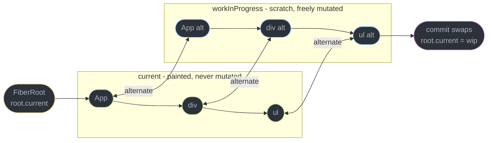
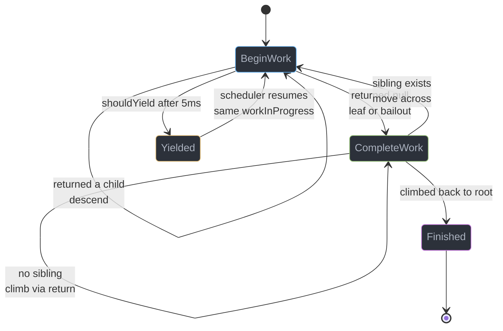
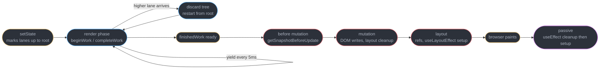
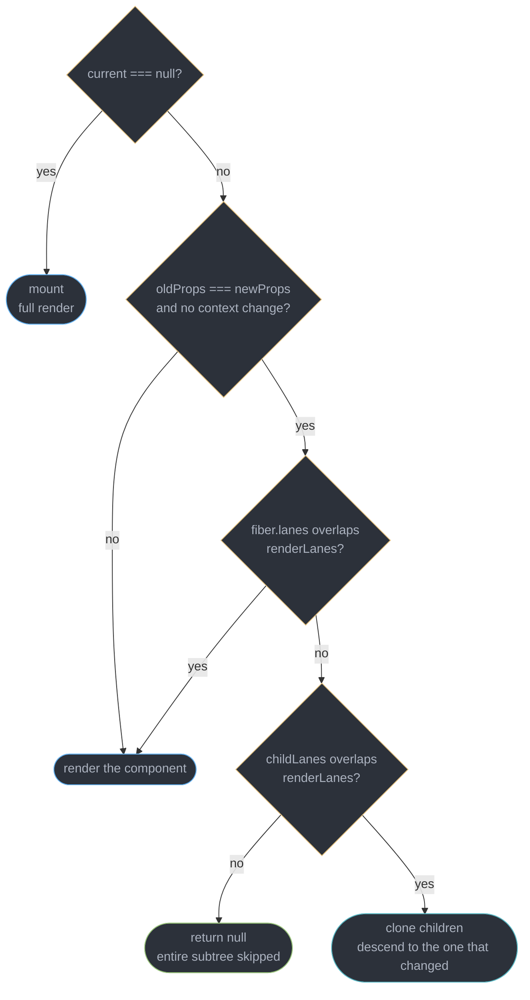
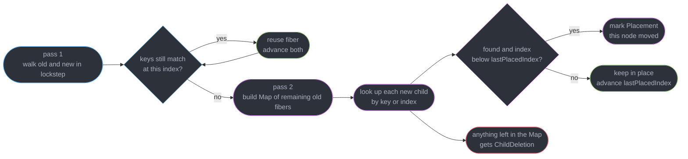
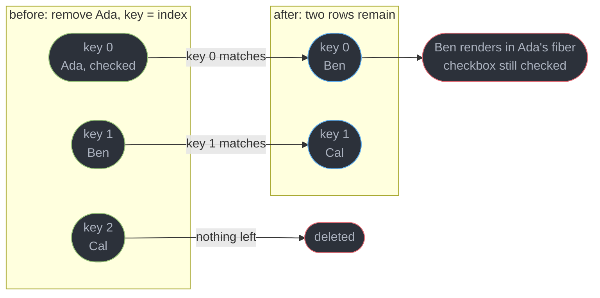

# Fiber and Reconciliation

---

## 1. Concept Overview

Reconciliation is the algorithm React runs to decide what changed between two descriptions of a UI. Fiber is the data structure that algorithm walks. React 19.2 ships the same fiber architecture introduced in React 16 (2017), refined by lanes (17), the removal of the effect list (18), and Server Components and `<Activity>` (19.x) — the reconciler itself has been stable for eight years and every concurrent feature is built on top of it.

The pre-16 **stack reconciler** walked the element tree with plain recursion. `mountComponent` called itself for each child, so the traversal state lived on the JavaScript call stack — and a call stack cannot be paused. Once React began rendering, it finished the entire tree before returning control to the browser. On a 3,000-node tree at roughly 0.03 ms of reconciliation work per node, that is a 90 ms block: five and a half dropped frames on a 60 Hz display (16.67 ms per frame), eleven on a 120 Hz one (8.33 ms).

Fiber solves that by **reifying the call stack onto the heap**. Each unit of work becomes a plain JavaScript object — a fiber — holding its own inputs (`pendingProps`), its outputs (`memoizedProps`, `memoizedState`), and explicit pointers to where the traversal goes next (`child`, `sibling`, `return`). Because the traversal state is data rather than stack frames, React can stop after any single fiber, hand the main thread back to the browser, and resume exactly where it left off. That single change is what makes `startTransition`, `useDeferredValue`, Suspense, selective client hydration and time-slicing possible at all.

The other half of the architecture is the **render/commit split**. The render phase builds a new fiber tree and is interruptible, restartable and discardable — which is precisely why it must be pure. The commit phase applies that tree to the DOM and is synchronous and uninterruptible — because a half-applied DOM is a torn UI that a user can see.

---

## 2. Intuition

> **One-line analogy**: the stack reconciler was a phone call you could not put on hold. Fiber is the same conversation written down on index cards — you can stop after any card, take a more urgent call, and pick the stack back up on the exact card you left.

**Mental model**: a fiber is a *unit of work with a resume pointer*. React holds exactly one variable, `workInProgress`, pointing at the current fiber. Every fiber knows its first `child`, its next `sibling`, and its parent via `return` — so from that one pointer React can always compute the next unit of work, with no auxiliary stack to save and restore. Pausing is just "stop looping"; resuming is just "keep looping from this pointer".

**Why it matters**: nearly every React performance question resolves to one of three facts about this machine. A component re-rendered because its fiber had a lane in the current render's lane set, not because "its props changed". A list lost its state because keys are the identity function React reconciles by, and index-as-key makes identity mean position. An expensive tree froze the browser because its update was scheduled on a synchronous lane where the work loop never checks `shouldYield()`.

**Key insight**: React does not diff the DOM, and it does not diff two virtual trees against each other. It walks **one** tree — the new work-in-progress tree — while consulting the corresponding node of the old tree through the `alternate` pointer, and records what changed as a bitmask on each fiber. Diffing and building are the same pass. That is why the whole render phase can be thrown away and redone with no cleanup: nothing outside the work-in-progress tree has been touched yet.

---

## 3. Core Principles

- **A fiber is a mutable object, an element is an immutable description.** `createElement()` (or the compiled `jsx()` call) returns a frozen-in-spirit element `{ type, key, props }` on every render. Fibers are long-lived, reused across renders, and mutated in place. Roughly one fiber exists per element position that has ever rendered.
- **Traversal is data, not stack frames.** `child`, `sibling` and `return` encode a depth-first walk that can be suspended between any two units of work.
- **Two trees, never three.** `current` is on screen; `workInProgress` is being built. `fiber.alternate` cross-links them, and the pair is recycled forever, so a steady-state update on an unchanged tree shape allocates zero new fibers.
- **The render phase must be pure.** It runs zero to N times per commit, can be discarded mid-flight, and in `StrictMode` development builds is deliberately run twice to make impurity visible.
- **The commit phase is atomic.** Once React starts mutating the DOM it does not yield until refs are attached and layout effects have run. The user never observes a partially applied tree.
- **Priority is a set, not a number.** Lanes are a 31-bit bitmask, so React can express "render these two unrelated updates and skip that one" — something the single-number expiration-time model could not represent.
- **Skipping work is the fast path, not an optimization.** `childLanes` lets `beginWork` prune an entire subtree in one bitmask test, which is why an update deep in a 5,000-fiber tree costs a walk of the path to it, not a walk of the tree.

---

## 4. Types / Architectures / Strategies

### 4.1 The fiber node

Every fiber is a plain object created by `createFiber()`. These are the fields that matter for reconciliation:

| Field | Holds | Why it exists |
|-------|-------|---------------|
| `tag` | `WorkTag` number — `FunctionComponent` 0, `ClassComponent` 1, `HostRoot` 3, `HostComponent` 5, `HostText` 6, `Fragment` 7, `SuspenseComponent` 13, `MemoComponent` 14, `OffscreenComponent` 22 | `beginWork` switches on it |
| `key` | The `key` prop, or `null` | The identity React reconciles siblings by |
| `elementType` / `type` | The function, class or tag string. `type` is the resolved one — `elementType` keeps the `memo()` or `lazy()` wrapper | A change in `type` destroys the subtree |
| `stateNode` | DOM node for a host component, class instance for a class, `FiberRoot` for `HostRoot`, `null` for a function component | The bridge from fiber to the real world |
| `child` | First child fiber | Descend |
| `sibling` | Next sibling fiber | Move across |
| `return` | Parent fiber | Climb, without a stack |
| `index` | Position among siblings | Feeds the `lastPlacedIndex` move detection |
| `pendingProps` | Props for the render about to run | The unit of work's input |
| `memoizedProps` | Props the last completed render used | `oldProps === newProps` is the bailout test |
| `memoizedState` | Head of the hooks linked list for a function component, the state object for a class, the element for `HostRoot` | Where your `useState` values actually live |
| `updateQueue` | Circular linked list — class updates, or the effect ring for a function component | Drained during render or commit |
| `flags` | Side-effect bitmask — `Placement` 2, `Update` 4, `ChildDeletion` 16, `Ref`, `Snapshot`, `Passive`, `Visibility` | What the commit phase must do to this fiber |
| `subtreeFlags` | Union of every descendant's `flags` | Lets commit skip whole subtrees |
| `lanes` | Pending work on this fiber | Feeds the bailout test |
| `childLanes` | Union of every descendant's `lanes` | The O(1) subtree prune |
| `alternate` | The paired fiber in the other tree | Double buffering |
| `mode` | `ConcurrentMode`, `StrictMode` bits | Inherited down the tree |

### 4.2 The two trees

| Tree | Role | Mutated during render? |
|------|------|------------------------|
| `current` | Exactly what is on screen. Reachable from `root.current`. | Never |
| `workInProgress` | The tree being built. Reachable from `root.current.alternate`. | Freely — nothing observes it yet |

Commit is a single pointer swap: `root.current = finishedWork`. The tree that was on screen becomes the scratch buffer for the next update.

### 4.3 Lanes

A `Lane` is one bit; `Lanes` is a set of them. React reserves 31 bits so the value stays a V8 small integer.

| Lane group | Bit position | Scheduled by |
|------------|--------------|--------------|
| `SyncLane` | 1 | `flushSync`, legacy roots, discrete input in some paths |
| `InputContinuousLane` | 3 | `scroll`, `mousemove`, `drag` handlers |
| `DefaultLane` | 5 | A plain `setState` outside any transition |
| `TransitionLanes` (14 of them) | 7 to 20 | `startTransition`, `useTransition`, `useDeferredValue` |
| `RetryLanes` (4) | 21 to 24 | A Suspense boundary retrying after a promise resolves |
| `IdleLane` | 27 | Work with no deadline |
| `OffscreenLane` | 28 | A hidden `Activity` subtree |

A **lower bit number is higher priority**. There are fourteen distinct transition lanes rather than one so that two unrelated transitions started 200 ms apart do not get fused into a single batch that finishes only when the slower one does.

### 4.4 Diffing strategies

| Situation | React's strategy | Cost |
|-----------|------------------|------|
| Same `type`, same position | Update the fiber in place, reuse `stateNode`, keep state | O(1) per fiber |
| Different `type` | Delete the old subtree (with all effect cleanups), mount a fresh one | O(size of subtree), state lost |
| Keyed children, no reorder | Single forward pass, keys match in order | O(n) |
| Keyed children, reordered | Forward pass until a key mismatch, then a `Map` of the remainder | O(n), one extra `Map` allocation |
| Unkeyed children | Matched by index — position *is* identity | O(n), state follows position |

---

## 5. Architecture Diagrams

### The fiber tree: `child`, `sibling`, `return`

The pointer layout is the whole trick, and it is alignment-critical, so it stays ASCII:

```
  Legend:   child   = first child ONLY (never a list of children)
            sibling = next sibling in source order
            return  = parent (present on every node, drawn once below)

  HostRoot
     | child
     v
  App .......................... tag=FunctionComponent, stateNode=null
     | child
     v
  div .......................... tag=HostComponent, stateNode -> real div node
     | child
     v
  h1  --sibling-->  ul  --sibling-->  footer
                     | child
                     v
                    li(key=a) --sibling--> li(key=b) --sibling--> li(key=c)

  return pointers (drawn separately to keep the tree readable):
     li(a).return === li(b).return === li(c).return === ul
     h1.return    === ul.return     === footer.return === div
     div.return   === App           App.return        === HostRoot
```

Each node stores one downward pointer, not an array. A parent with 500 children has one `child` pointer; the other 499 hang off `sibling`. Resuming a paused render therefore needs a single variable — the fiber to continue from — because `sibling` and `return` reconstruct the rest of the walk on demand.

### Double buffering



The two trees are permanent partners. `createWorkInProgress()` reuses the existing `alternate` when one is there, so a re-render of an unchanged tree shape allocates no fibers at all — it only overwrites `pendingProps`, `flags` and `lanes` on objects that already exist.

### The work loop



`beginWork` goes down and across, `completeWork` goes up. The `Yielded` transition only exists on concurrent lanes — `workLoopSync` has no `shouldYield()` call, which is exactly why `flushSync` can freeze a tab.

### Render phase versus commit phase



Everything blue can be thrown away with no consequence; everything red has already touched the DOM and therefore runs to completion in one uninterrupted task. The purple step is deliberately after paint, which is why `useEffect` cannot be used to measure layout without a visible flash.

### Bailout: how a subtree gets skipped



The `childLanes` test at the bottom is the reason a state update in one leaf of a 5,000-fiber tree costs a walk of the ~12 fibers on the path from the root to that leaf, plus that leaf's own subtree — not 5,000 `beginWork` calls.

---

## 6. How It Works — Detailed Mechanics

### 6.1 What the stack reconciler could not do

```ts
// Pre-React-16, in spirit. The traversal state IS the call stack.
function mountComponent(element: ReactElement, parentNode: Node): void {
  const instance = instantiate(element);
  const rendered = instance.render();
  const node = createHostNode(rendered);
  for (const childElement of rendered.props.children) {
    mountComponent(childElement, node);   // no way to pause here
  }
  parentNode.appendChild(node);
}
```

There is no place to insert "and if 5 ms have elapsed, return and resume later" — returning would unwind every frame and lose the position. The fix is not a faster loop; it is moving the position out of the stack.

### 6.2 The work loop

```ts
function workLoopConcurrent(): void {
  while (workInProgress !== null && !shouldYield()) {
    performUnitOfWork(workInProgress);
  }
}

function workLoopSync(): void {
  while (workInProgress !== null) {          // no yield check at all
    performUnitOfWork(workInProgress);
  }
}

function performUnitOfWork(unit: Fiber): void {
  const current = unit.alternate;
  const next = beginWork(current, unit, renderLanes);
  unit.memoizedProps = unit.pendingProps;    // input consumed
  if (next === null) {
    completeUnitOfWork(unit);                // no child: complete, then sibling or climb
  } else {
    workInProgress = next;                   // descend
  }
}

function completeUnitOfWork(unit: Fiber): void {
  let node: Fiber | null = unit;
  do {
    completeWork(node.alternate, node, renderLanes);
    if (node.sibling !== null) {
      workInProgress = node.sibling;         // move across
      return;
    }
    workInProgress = node = node.return;     // climb
  } while (node !== null);
}
```

`shouldYield()` lives in the `scheduler` package and returns true once `getCurrentTime()` passes a deadline set `frameYieldMs = 5` milliseconds after the slice began. The scheduler re-enters through a `MessageChannel` `postMessage`, a macrotask that runs after the browser has had a chance to paint and handle input — `setTimeout(fn, 0)` is clamped to about 4 ms and `requestAnimationFrame` does not run at all in a background tab. Five milliseconds is not a frame budget; it is a deliberately short slice so React hands the main thread back many times inside the same 16.67 ms frame.

### 6.3 `beginWork` and `completeWork`

`beginWork` is the downward pass. It receives the old fiber (`current`) and the new one, runs the component, reconciles the returned children into fibers, and returns the first child — or `null` to signal a leaf or a bailout.

```ts
function beginWork(current: Fiber | null, wip: Fiber, renderLanes: Lanes): Fiber | null {
  if (current !== null) {
    const oldProps = current.memoizedProps;
    const newProps = wip.pendingProps;
    if (oldProps === newProps && !hasContextChanged()) {
      didReceiveUpdate = false;
      if (!includesSomeLane(renderLanes, wip.lanes)) {
        return bailoutOnAlreadyFinishedWork(current, wip, renderLanes);
      }
    } else {
      didReceiveUpdate = true;               // props are referentially different
    }
  }
  wip.lanes = NoLanes;                       // this fiber's work is being done now

  switch (wip.tag) {                         // ClassComponent, Fragment, Suspense, Memo, ...
    case FunctionComponent: return updateFunctionComponent(current, wip, renderLanes);
    case HostComponent:     return updateHostComponent(current, wip, renderLanes);
  }
}

function bailoutOnAlreadyFinishedWork(current: Fiber, wip: Fiber, renderLanes: Lanes) {
  if (!includesSomeLane(renderLanes, wip.childLanes)) {
    return null;                             // whole subtree skipped in one test
  }
  cloneChildFibers(current, wip);            // some descendant has work: clone and descend
  return wip.child;
}
```

`completeWork` is the upward pass. For a host component on an update it runs `prepareUpdate` to diff the props into a payload and tags the fiber with the `Update` flag; on a mount it creates the DOM node and appends every already-completed child into it, so the whole subtree exists off-document before it is ever inserted. It also bubbles `flags` and `lanes` into the parent's `subtreeFlags` and `childLanes` — the two unions that make both the bailout and the commit traversal cheap.

Before React 18 the render phase also threaded every flagged fiber onto a singly linked **effect list** (`firstEffect` / `nextEffect`). React 18 deleted it: commit now walks the tree recursively and uses `subtreeFlags` to skip any branch with nothing to do, removing one pointer-chasing pass and three fields per fiber.

### 6.4 `didReceiveUpdate` and the state-equality bailout

`didReceiveUpdate` is a module-level boolean in the reconciler, not a fiber field. It answers one question: did anything about this component's inputs actually change during this render?

```ts
function updateFunctionComponent(current: Fiber | null, wip: Fiber, renderLanes: Lanes) {
  const children = renderWithHooks(current, wip, wip.type, wip.pendingProps, renderLanes);

  if (current !== null && !didReceiveUpdate) {
    bailoutHooks(current, wip, renderLanes);              // drop the update queue
    return bailoutOnAlreadyFinishedWork(current, wip, renderLanes);
  }
  reconcileChildren(current, wip, children, renderLanes);
  return wip.child;
}
```

`renderWithHooks` sets `didReceiveUpdate = true` if any `useState` or `useReducer` produced a value that is not `Object.is`-equal to the previous one. If every hook produced an identical value and props were referentially identical, the component body ran but its children are skipped entirely.

One level earlier, `dispatchSetState` has an **eager state** fast path: if the fiber has no pending updates, React applies the reducer immediately and compares. Equal means no work is scheduled at all — the component does not even re-render.

```tsx
const [count, setCount] = useState(0);

// Nothing is scheduled. dispatchSetState computed 0, Object.is(0, 0) is true, it returns.
<button onClick={() => setCount(0)}>no-op</button>

// A new object identity every time: Object.is fails, a render is always scheduled.
const [filters, setFilters] = useState({ q: "" });
<button onClick={() => setFilters({ q: "" })}>always re-renders</button>
```

The eager path only applies to an empty queue: `setCount(1)` then `setCount(0)` in one handler cannot bail eagerly, so React renders once and falls back to the `didReceiveUpdate` bailout.

### 6.5 The two diffing heuristics

A general tree-diff is O(n^3). React gets O(n) by assuming two things.

**Different type means a different tree.** If `type` changes, React does not attempt to reconcile — it deletes the old fiber and everything under it, running every cleanup, then mounts fresh.

```tsx
// The two branches produce DIFFERENT types at the same position.
// Every toggle unmounts EditorPanel and remounts it: state gone, effects re-run, DOM rebuilt.
{isEditing ? <EditorPanel doc={doc} /> : <ViewerPanel doc={doc} />}

// Same type at that position, so the fiber and its state survive the toggle.
<Panel mode={isEditing ? "edit" : "view"} doc={doc} />
```

This also fires on the sneaky version: a component defined *inside* another component's body is a new function identity on every render, so `type` differs every time and the child remounts on every parent render.

**Keys mark identity among siblings.** Keys are scoped to one array of siblings, not to the document. Two `li` elements in different lists may both use `key="a"` with no conflict.

### 6.6 Array reconciliation, in two passes



The first pass is the common case: append, or change one item's props, and the loop never breaks, so no `Map` is allocated. The second pass runs only on a genuine reorder or a mid-list removal. `lastPlacedIndex` is a monotonic watermark — a reused fiber whose old index is below it must have moved and gets a `Placement` flag; everything else stays put, which is how React marks a *minimal* set of moves rather than repositioning every node after an insertion.

### 6.7 Why index-as-key corrupts state



React deleted the **last** fiber and re-labelled the first two, because with index keys, key 0 means "the row at position 0" rather than "Ada". Ada's fiber — with its DOM node, its uncontrolled input value, its `useState`, its scroll offset and its focus — is handed to Ben. Nothing warns. The list looks right until you interact with it.

### 6.8 Lane arithmetic

```ts
export const NoLanes = 0b0000000000000000000000000000000;
export const SyncLane = 0b0000000000000000000000000000010;
export const DefaultLane = 0b0000000000000000000000000100000;
export const IdleLane = 0b0100000000000000000000000000000;

// A lower bit is higher priority, so the lowest SET bit wins.
const getHighestPriorityLane = (lanes: Lanes): Lane => lanes & -lanes;
const includesSomeLane = (a: Lanes, b: Lanes): boolean => (a & b) !== NoLanes;
const mergeLanes = (a: Lanes, b: Lanes): Lanes => a | b;
```

When you call `setState`, React picks a lane from the current update context, ORs it into `fiber.lanes`, then walks `return` pointers to the root ORing it into every ancestor's `childLanes`. That upward walk is what makes the downward bailout test possible.

**Why lanes replaced expiration times.** Through React 16 each update carried a single expiration timestamp and React rendered everything at or above a threshold. A total order cannot express a *set*: React could not render a low-priority transition while a higher-priority update sat suspended, could not keep two unrelated transitions from fusing, and had no way to say "include this offscreen work but not that retry". A bitmask makes selection, exclusion and entanglement all one machine instruction.

### 6.9 The commit phase

```ts
function commitRoot(root: FiberRoot, finishedWork: Fiber): void {
  commitBeforeMutationEffects(finishedWork);   // getSnapshotBeforeUpdate
  commitMutationEffects(root, finishedWork);   // useLayoutEffect CLEANUP, DOM insert/update/delete
  root.current = finishedWork;                 // the swap: wip becomes current, here
  commitLayoutEffects(finishedWork);           // refs attached, useLayoutEffect SETUP
  scheduleCallback(NormalPriority, flushPassiveEffects);  // useEffect, after paint
}
```

The pointer swap sits between mutation and layout on purpose: a `useLayoutEffect` or a ref callback must see `root.current` already pointing at the new tree, while `getSnapshotBeforeUpdate` must still see the old one. None of these three sub-phases yields — a `shouldYield()` between DOM mutation and ref attachment would let the browser paint a tree whose refs point at removed nodes.

---

## 7. Real-World Examples

**Resetting state with a key.** The reconciler's identity rule is a public API. Changing `key` on a component is a supported instruction to unmount and remount it, and it replaces the entire "reset derived state in an effect" pattern.

```tsx
// The comment draft must not survive switching to a different post.
// The key change destroys the fiber, so useState re-initializes with no effect involved.
<CommentBox key={postId} postId={postId} />
```

**`Activity` [19.2] changes what "unmount" means.** Conditional rendering destroys a subtree; `Activity` in `hidden` mode keeps the fiber tree and all its state, applies `display: none`, unmounts only the effects, and re-renders the subtree at `OffscreenLane` — below every user-visible lane.

```tsx
import { Activity } from "react";

// Tab state, scroll position and any uncontrolled input survive the switch.
// Effects still run their cleanup on hide and their setup again on show,
// so a subscription or an interval is correctly torn down while hidden.
<Activity mode={tab === "reports" ? "visible" : "hidden"}>
  <ReportsTab />
</Activity>
```

**A 12,000-row table.** Reconciliation cost is linear in *rendered* fibers, so virtualization is a reconciler-level fix and not merely a DOM one: rendering 30 visible rows instead of 12,000 takes the per-update fiber count from roughly 48,000 (four fibers per row) to about 120. **React Performance Tracks [19.2]** then attribute a long task to a specific lane on its own row in the Chrome DevTools performance panel, instead of leaving you to guess from a flame chart of anonymous scheduler callbacks.

---

## 8. Tradeoffs

| Design choice | Bought | Paid |
|---------------|--------|------|
| Fiber tree over recursion | Interruptible, resumable, prioritizable rendering | Roughly 60 to 130 bytes of object overhead per element position, plus a second tree |
| Two trees (double buffering) | Zero-allocation steady-state updates, atomic swap, trivial rollback | Peak memory is two fiber trees, not one |
| O(n) heuristic diff | Linear reconciliation instead of O(n^3) | Wrong keys silently corrupt state; a type change discards a healthy subtree |
| Interruptible render phase | 5 ms slices, responsive input under load | Render must be pure, and may run more than once per commit |
| Uninterruptible commit | The user never sees a torn DOM | A single commit of 4,000 mutations is one unyieldable long task |
| Lanes as a bitmask | Non-contiguous priority sets, entanglement, 14 transition lanes | Capped at 31 lanes, and lane assignment is opaque from userland |

| Scheduling path | Yields? | Typical use | Failure mode |
|-----------------|---------|-------------|--------------|
| `workLoopSync` | No | `flushSync`, discrete input needing a synchronous DOM | One long task, dropped frames |
| `workLoopConcurrent` | Every 5 ms | Default lane, transitions, retries | Render runs more than once, so impurity shows up |

---

## 9. When to Use / When NOT to Use

**Reach for reconciler knowledge when:**

- A profile shows a component rendering that should have bailed out — the answer is always `oldProps === newProps` failing, a context value changing, or a lane on that fiber.
- A list loses state, focus, scroll position or input text on reorder or deletion. That is a key problem, every time.
- You need a deliberate remount. Change the `key`, do not orchestrate it with effects.
- A layout measurement flashes, which is the passive-effect phase running after paint — `useLayoutEffect` runs before it — or a transition is not deferring, meaning the update never landed on a transition lane.

**Do not reach for it when:**

- You are choosing an optimization. Measure with the Profiler and Performance Tracks first — the fiber-level explanation is how you *interpret* the measurement, not a substitute for it.
- You are tempted to read or mutate a fiber through `__reactFiber$...` on a DOM node. Those fields are internal, unversioned, and change between patch releases.
- The real problem is data fetching, bundle size or an unindexed query. Reconciling a 2,000-fiber tree costs single-digit milliseconds; a 400 ms request does not shrink because you understood `beginWork`.

---

## 10. Common Pitfalls

**Index as a key on a mutable list.** The single most expensive React bug by volume.

```tsx
// BROKEN: key is position, so deleting row 0 shifts every row's identity down one.
// The user checks Ada, deletes Ada, and Ben is now checked.
{people.map((p, i) => (
  <PersonRow key={i} person={p} onDelete={() => remove(p.id)} />
))}

// FIX: key is the stable identity of the DATA, not of the position.
{people.map((p) => (
  <PersonRow key={p.id} person={p} onDelete={() => remove(p.id)} />
))}
```

There is no warning for this. React only warns when a key is missing entirely: `Each child in a list should have a unique "key" prop.` Duplicate keys get their own message — `Encountered two children with the same key, 'a'. Keys should be unique so that components maintain their identity across updates.` — but a *wrong yet unique* index key is indistinguishable from a correct one at the reconciler level.

**A component declared inside another component.** Every parent render creates a new function object, so `type` differs, so the child is destroyed and remounted with fresh state on every keystroke.

```tsx
// BROKEN: Field is a new function identity on every Form render.
function Form() {
  const [q, setQ] = useState("");
  function Field() { return <input defaultValue={q} />; }   // remounts every keystroke
  return <><Field /><button onClick={() => setQ("")}>clear</button></>;
}

// FIX: hoist it. The type is now stable, so the fiber and the DOM node survive.
function Field({ initial }: { initial: string }) { return <input defaultValue={initial} />; }
```

**Impure render.** The render phase can run twice for one commit — `StrictMode` forces it in development precisely to expose this.

```tsx
// BROKEN: mutates a module-level counter during render. Double-invoked render doubles it,
// and a discarded interruptible render leaves the counter permanently wrong.
let renderCount = 0;
function Widget({ items }: { items: Item[] }) {
  renderCount += 1;
  items.sort((a, b) => a.rank - b.rank);   // also mutates the caller's array in place
  return <List items={items} rank={renderCount} />;
}

// FIX: derive, never mutate. toSorted returns a new array and leaves the prop untouched.
function Widget({ items }: { items: Item[] }) {
  const sorted = items.toSorted((a, b) => a.rank - b.rank);
  return <List items={sorted} />;
}
```

**Blaming `React.memo` for a re-render that came from context or state.** `memo` compares props, and both a context change and the component's own `setState` bypass it entirely — `beginWork` never reaches the props comparison, because the fiber already carries a lane.

**Expecting `flushSync` to be free.** It runs `workLoopSync`, which has no `shouldYield()`, so a 3,000-fiber update wrapped in it becomes one unyieldable 90 ms task. React also logs `Warning: flushSync was called from inside a lifecycle method.` when it is called during render or commit.

**Reordering a list of uncontrolled inputs.** DOM state React does not own — an uncontrolled `input`'s text, a `video` element's playback position, a `details` open state — moves with the fiber. Correct keys make that the *right* behaviour; index keys make it wrong.

---

## 11. Technologies & Tools

| Tool | Purpose |
|------|---------|
| React DevTools Profiler | Flame chart per commit, plus the "why did this render" reason per fiber |
| React Performance Tracks | Chrome performance-panel rows for the render phase, commit phase and scheduler lanes, added in React 19.2 |
| react-scan | Overlays a live outline on every component that just re-rendered, no code changes |
| eslint-plugin-react-hooks | Ships the React Compiler lint rules that catch render impurity statically |
| babel-plugin-react-compiler | React Compiler 1.0 — auto-memoization built on the same bailout mechanics |
| react-window | List and grid virtualization, cutting rendered fiber count by one to two orders of magnitude |
| Scheduler | The standalone package implementing `shouldYield`, the 5 ms slice and the MessageChannel post |

---

## 12. Interview Questions with Answers

**Q: Why does using the array index as a key corrupt list state?**
**Short:** Index keys make a key mean position rather than identity, so removing an item hands one row's fiber, DOM node and state to a different row.

Reconciliation matches siblings by key. With `key={i}`, deleting the first of three rows produces new keys 0 and 1, so React matches old fiber 0 to the new
row 0 and deletes the last fiber instead of the first. Everything the fiber owns — `useState` values, an uncontrolled input's text, focus, scroll offset, a
`video` element's playback position — moves to the wrong item. There is no warning, because a unique-but-wrong key is indistinguishable from a correct one at
the reconciler level. Use the data's stable id, and only fall back to the index for an append-only list of stateless items.

**Q: A component re-rendered even though none of its props changed — what actually happened?**
**Short:** A re-render means the fiber carried a lane in the current render's lane set, or its parent's bailout failed a referential props comparison.

Three causes cover almost every case. The component called its own state setter, which ORs a lane into `fiber.lanes` and forces `beginWork` past the bailout.
A consumed context value changed, which sets `didReceiveUpdate` before props are ever compared — this is why `React.memo` does not stop it. Or the parent
re-rendered and passed a new object, array or inline arrow, so `oldProps === newProps` fails on identity even though the values look equal. The Profiler's
"why did this render" field names which of the three it was, and guessing between them wastes more time than measuring.

**Q: What is the difference between the render phase and the commit phase?**
**Short:** Render builds a new fiber tree and can be paused or discarded, while commit applies that tree to the DOM in one uninterruptible task.

The render phase runs `beginWork` and `completeWork` over the work-in-progress tree, calling component bodies and recording side effects as `flags` bitmasks.
It touches nothing observable, so React can yield to the browser every 5 ms, restart from the root when a higher lane arrives, or throw the tree away
entirely. The commit phase then runs three sub-phases — before-mutation, mutation, layout — swapping `root.current` between the last two, and schedules
passive effects after paint. The split is the whole architecture: interruptibility is only safe because nothing before commit is visible.

**Q: Does calling a state setter with the same value cause a re-render?**
**Short:** Usually not — dispatchSetState eagerly applies the reducer and drops the update when Object.is reports the result is unchanged.

If the fiber's update queue is empty, `dispatchSetState` computes the next state immediately and compares it with `Object.is`. Equal means no lane is
scheduled and no render happens at all. Two caveats bite. A non-empty queue — a second setter call in the same handler — skips the eager path, so React
renders once and then bails out of its children via `didReceiveUpdate`. And `setState({ q: "" })` allocates a new object every call, so `Object.is` always
fails.

**Q: Why does React destroy the entire subtree when an element's type changes?**
**Short:** Different types are assumed to produce different trees, so React deletes the old fiber with everything under it instead of attempting a match.

This is the first of the two heuristics that make reconciliation O(n) instead of O(n^3). When `type` differs at a position, React calls `deleteChild`, which
schedules cleanup for every effect in the subtree, detaches every ref, removes the DOM, and mounts a fresh tree. The cost is real: state, DOM node identity
and scroll position are all lost. The subtle trigger is a component defined inside another component's body: a new function identity each render is a new
`type` each render, so the child remounts on every keystroke.

**Q: At the fiber level, what does a changed key cost that a changed prop does not?**
**Short:** The old fiber is marked ChildDeletion and its alternate is dropped, so both trees are rebuilt for that subtree instead of one being reused in place.

`reconcileChildFibers` compares `key` before `type`. A mismatch means no `useFiber` clone is possible, so the existing fiber is pushed onto the parent's
deletions array with a `ChildDeletion` flag and a fresh fiber is created with `memoizedState` null. The discarded fiber's `alternate` goes with it, which is
why the next two renders of that subtree allocate rather than ping-ponging between two cached trees — the steady-state zero-allocation property described in
§6.3 has to be re-established. A changed prop keeps both fibers and only updates `pendingProps`. See
[React Fundamentals and the Render Model](../react_fundamentals_and_the_render_model/react_fundamentals_and_the_render_model.md) for when to reach for a key
as a deliberate state reset.

**Q: Why must the render phase be pure, and how does StrictMode enforce it?**
**Short:** An interruptible render may run several times per commit, so StrictMode double-invokes component bodies in development to surface any side effect.

React can discard a partially built work-in-progress tree at any yield point and restart from the root, and it can render the same component more than once
before committing. Any side effect in the body — mutating a module variable, pushing to an array prop, calling an analytics function, writing to
`localStorage` — therefore happens an unpredictable number of times. `StrictMode` deliberately calls component bodies, initializers and reducers twice in
development builds, so a doubled counter or a duplicated log becomes obvious before production.

**Q: What is a fiber node, and how does it differ from a React element?**
**Short:** An element is a throwaway description created every render, while a fiber is a long-lived mutable work object holding pointers, props, state and flags.

`jsx("div", { children })` returns an element — a small immutable object of `type`, `key` and `props`, allocated fresh on every render and discarded
immediately. A fiber is created once per element position and reused for the life of that position, holding `stateNode` (the real DOM node or class instance),
`memoizedProps`, `memoizedState` (the head of the hooks linked list), `flags`, `lanes`, and the `child` / `sibling` / `return` traversal pointers. Elements
describe *what*; fibers track *the work of getting there*.

**Q: Why does React maintain two fiber trees instead of one?**
**Short:** Double buffering keeps the painted tree untouched while a scratch tree is built, so an interrupted render costs nothing and commit is a single pointer swap.

`current` is what is on screen and is never mutated during render; `workInProgress` is the tree being built, and `fiber.alternate` cross-links the pair.
Because the painted tree is intact, abandoning a render needs no rollback — React simply drops the `workInProgress` pointer. Commit is `root.current =
finishedWork`, so the UI is never observed half-updated. There are exactly two trees, never more: `createWorkInProgress` recycles the existing alternate, so
re-rendering an unchanged tree shape allocates zero fibers.

**Q: Walk through how the work loop traverses the tree without recursion.**
**Short:** performUnitOfWork calls beginWork to descend, then completeWork to move across a sibling or climb a return pointer, looping on one workInProgress variable.

`workLoopConcurrent` loops while `workInProgress` is non-null and `shouldYield()` is false. Each iteration calls `beginWork`, which runs the component,
reconciles its children into fibers and returns the first child. A non-null child becomes the next `workInProgress`. A null return means leaf or bailout, so
`completeUnitOfWork` runs `completeWork` — creating or diffing the host node and bubbling `flags` and `lanes` into the parent — then moves to `sibling` if
there is one, otherwise climbs `return` and repeats. Pausing is just leaving the loop; resuming is re-entering it with the same pointer, because all traversal
state is in the fiber, not on the stack.

**Q: Why is the fiber tree a child/sibling/return linked list rather than an array of children?**
**Short:** Singly-linked pointers let a paused traversal resume from one saved fiber, whereas an array of children would need an index-and-parent stack saved and restored.

With arrays, "where am I" is a list of `(node, childIndex)` frames — exactly the call stack fiber was built to eliminate. With `child`, `sibling` and
`return`, the complete position is one pointer: `sibling` gives the next unit at this level and `return` gives the way up, so the scheduler saves and restores
a single variable across a yield. `return` also makes the upward walk that marks `childLanes` on every ancestor an O(depth) pointer chase with no allocation.
The tradeoff is that random access to the nth child is O(n), which reconciliation never needs.

**Q: How does React skip an entire subtree that has no pending work?**
**Short:** bailoutOnAlreadyFinishedWork tests childLanes against the render lanes and returns null, pruning every descendant in one bitmask comparison.

Each `setState` walks `return` pointers to the root, ORing its lane into every ancestor's `childLanes`. On the way down, `beginWork` first checks that props
are referentially equal, context is unchanged and `fiber.lanes` has nothing in the render lanes. If all three hold it calls `bailoutOnAlreadyFinishedWork`,
which tests `childLanes`: no overlap returns `null` and the subtree is never visited. That is why a state update in one leaf of a 5,000-fiber tree costs a
walk of the dozen fibers on the root-to-leaf path plus that leaf's own subtree, not 5,000 `beginWork` calls.

**Q: What is didReceiveUpdate and when does it flip?**
**Short:** It is a module-level reconciler flag set true when props are referentially different, context changed, or a hook produced a value that is not Object.is-equal.

`beginWork` sets it false when `oldProps === newProps` and no context changed, and true otherwise. `renderWithHooks` can set it true if any `useState` or
`useReducer` yields a changed value, and can leave it false if every hook produced an identical one. After the component body runs, `updateFunctionComponent`
checks it: still false means React calls `bailoutHooks` and skips the children entirely, even though the body did execute. That is the state-equality bailout
— the component rendered, but nothing beneath it did.

**Q: What are lanes and why did they replace expiration times?**
**Short:** Lanes are a 31-bit priority bitmask, and a set can express selection and entanglement that a single ordered expiration number could not.

Each priority is one bit — `SyncLane` at bit 1, `InputContinuousLane`, `DefaultLane`, fourteen transition lanes, four retry lanes, `IdleLane`, `OffscreenLane`
— and a lower bit is higher priority, so `getHighestPriorityLane` is `lanes & -lanes`. Expiration times were a total order: React rendered everything above a
threshold and could not say "include these two updates but not that one". A set can. That is what allows a transition to keep rendering while a
higher-priority update is suspended, keeps two unrelated transitions from fusing into one slow batch, and makes entanglement expressible. The 31-bit cap keeps
the value a V8 small integer.

**Q: Describe how React reconciles a keyed array of children.**
**Short:** One forward lockstep pass handles matching keys, then a Map of the remaining old fibers resolves reorders, with lastPlacedIndex marking which nodes moved.

`reconcileChildFibers` walks the old fiber list and the new element array together, reusing a fiber whenever the keys match at the same slot. Appending or
changing one item's props never breaks that loop, so no extra allocation happens. On the first key mismatch it builds a `Map` from key (or index, for unkeyed
children) to the remaining old fibers and looks each new child up. `lastPlacedIndex` is a monotonic watermark: a reused fiber whose old index falls below it
must have moved, so it gets a `Placement` flag, while everything else stays put. Whatever is left in the `Map` gets `ChildDeletion`.

**Q: Why can the commit phase not be interrupted?**
**Short:** Yielding mid-commit would let the browser paint a half-applied DOM, with refs pointing at removed nodes and layout effects not yet run.

Commit is where React touches the outside world: it inserts, updates and removes DOM nodes, attaches and detaches refs, and runs `useLayoutEffect` cleanups
and setups. Those three sub-phases must be observed as one atomic step, because a paint between them shows the user a tree that no render ever produced. It is
also where `root.current = finishedWork` happens, between mutation and layout, so `getSnapshotBeforeUpdate` sees the old tree and layout effects see the new
one. The cost is real: a commit of 4,000 mutations is one unyieldable long task, which is why virtualization beats interruptibility for very large lists.

**Q: How does the Activity component change what unmounting means?**
**Short:** Activity in hidden mode tears down effects but preserves fibers, state and DOM behind display none, re-rendering that subtree on OffscreenLane.

Before `Activity` [19.2], hiding a subtree meant conditional rendering, which deletes the fibers and loses all state, or `display: none` in CSS, which keeps
state but leaves effects, subscriptions and intervals running. `<Activity mode="hidden">` splits the difference: effect cleanups run so subscriptions are
correctly torn down, while the fiber tree, `useState` values, uncontrolled input text and scroll positions survive. React then keeps updating the hidden
subtree at `OffscreenLane`, below every user-visible lane, so a background tab stays warm without competing for the main thread. Showing it again re-runs the
effect setups.

**Q: What does the React Compiler change about reconciliation?**
**Short:** Nothing inside the reconciler — the compiler only stabilizes prop identity and caches computations, so the same bailout path simply fires more often.

React Compiler 1.0 rewrites component bodies to read and write a cache array via `useMemoCache`, which is auto-memoization at the source level. The fiber
tree, the `child`/`sibling`/`return` walk, double buffering, the render/commit split, lanes, keys and both diffing heuristics are untouched. What changes is
how often `oldProps === newProps` holds, so `bailoutOnAlreadyFinishedWork` prunes more subtrees — Meta reported up to 12% faster loads and around 2.5x on some
interactions. What it does *not* fix: a component still renders when its own state changes, a type change still destroys a subtree, and index-as-key is still
corrupt. `useMemo`, `useCallback` and `memo` become escape hatches.

---

## 13. Best Practices

- Key by the data's stable identity, never by index, on any list that can be filtered, sorted, reordered or have items removed from anywhere but the end.
- Use a `key` change to reset state on a prop change. It is one line and one render, versus an effect that renders twice and shows stale data in between.
- Treat the component body as a pure function: derive with `toSorted` and `toSpliced`, never mutate props, and leave `StrictMode` on in development.
- Measure with the Profiler and React Performance Tracks [19.2] before optimizing. The fiber model explains a measurement; it does not replace one.
- Let the React Compiler place memoization. Reach for `useMemo`, `useCallback` or `memo` only where a profile shows the compiler bailed out, and note that a ref is an ordinary prop in React 19 — `forwardRef` still works but is not how new code is written.
- Virtualize past roughly 200 rendered rows. Reconciliation and commit are both linear in rendered fibers, and no amount of slicing makes a 48,000-fiber commit cheap.

---

## 14. Case Study

**Problem.** A logistics dashboard rendered a shipment table of 800 rows, each with a status
`select`, an uncontrolled "notes" `input` and a row-level `useState` for an expanded detail panel. A websocket pushed status updates roughly every 400 ms. Two
bugs were filed the same week: typing in the filter box dropped frames on a 60 Hz display, and — the one that reached a customer — a user's typed note jumped
to a different shipment whenever a row was removed by the live feed.

**Investigation.** The Profiler showed a single commit at 118 ms, well past the 16.67 ms frame
budget, with all 800 `ShipmentRow` fibers re-rendering on every websocket message. Performance Tracks attributed the long task to the commit phase, not the
render phase — so slicing could not help, and `flushSync` was not involved. The state-corruption bug reproduced deterministically: filter to 12 rows, type
into the third row's notes field, let the feed remove the first row, and the typed text appeared in the row above.

**Root cause.** Both bugs came out of the same code.

```tsx
// BROKEN
export function ShipmentTable({ shipments, filter }: Props) {
  const visible = shipments.filter((s) => s.code.includes(filter));
  return (
    <tbody>
      {visible.map((s, i) => (
        // 1. key is the index into a FILTERED, live-mutating array
        // 2. a new object literal every render defeats every bailout below
        <ShipmentRow key={i} shipment={s} actions={{ onOpen, onArchive }} />
      ))}
    </tbody>
  );
}
```

Two independent defects. The `key={i}` made identity mean position inside an array whose membership changed on every feed message and on every keystroke in
the filter box, so removing a row shifted every fiber below it up one slot — carrying its DOM node, its uncontrolled input text and its `useState` with it.
Separately, `actions={{ onOpen, onArchive }}` allocated a fresh object on every render, so `oldProps === newProps` failed for all 800 rows, `didReceiveUpdate`
went true, and no row ever reached `bailoutOnAlreadyFinishedWork`.

**Fix.**

```tsx
// FIX
const ShipmentRow = memo(function ShipmentRow({ shipment, onOpen, onArchive }: RowProps) {
  // ... unchanged
});

export function ShipmentTable({ shipments, filter }: Props) {
  const visible = useMemo(
    () => shipments.filter((s) => s.code.includes(filter)),
    [shipments, filter],
  );
  const rows = useVirtualizer({ count: visible.length, estimateSize: () => 44, overscan: 8 });

  return (
    <tbody>
      {rows.getVirtualItems().map((v) => {
        const s = visible[v.index];
        // 1. stable identity from the data, not the position
        // 2. flat, referentially stable props so the bailout can fire
        return <ShipmentRow key={s.id} shipment={s} onOpen={onOpen} onArchive={onArchive} />;
      })}
    </tbody>
  );
}
```

Three changes, each aimed at a different part of the reconciler. `key={s.id}` moved identity from position to data, so a removal marks exactly one
`ChildDeletion` and every surviving fiber keeps its own DOM node and state. Flattening `actions` into two stable function props let `beginWork` reach the
props comparison, so a websocket message that changed one shipment now bails out of the other rows via `childLanes` instead of re-rendering them. Virtualizing
cut rendered rows from 800 to about 25, which is what fixed the commit, since commit cost is linear in mutated fibers and is the one phase that cannot be
sliced.

**Results.**

- Worst commit on a websocket message: **118 ms to 6 ms**, back inside a single 60 Hz frame.
- `ShipmentRow` renders per message: **800 to 1** — the one shipment whose data changed.
- Fibers walked per update: roughly **3,200 to 110** — the path to the changed row plus the visible window. Notes-field corruption: gone.

**Lesson.** The dropped frames and the corrupted input looked like a performance bug and a data bug,
but both were the reconciler doing exactly what it was told. Keys tell React what a node *is*, and referential prop equality tells it what to *skip* — get
either wrong and the symptom shows up somewhere that looks unrelated to the line that caused it.
