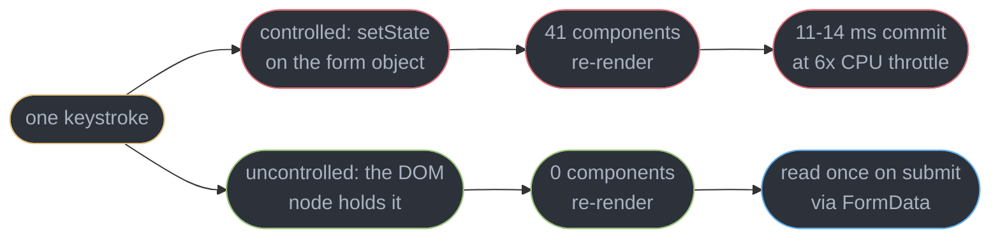
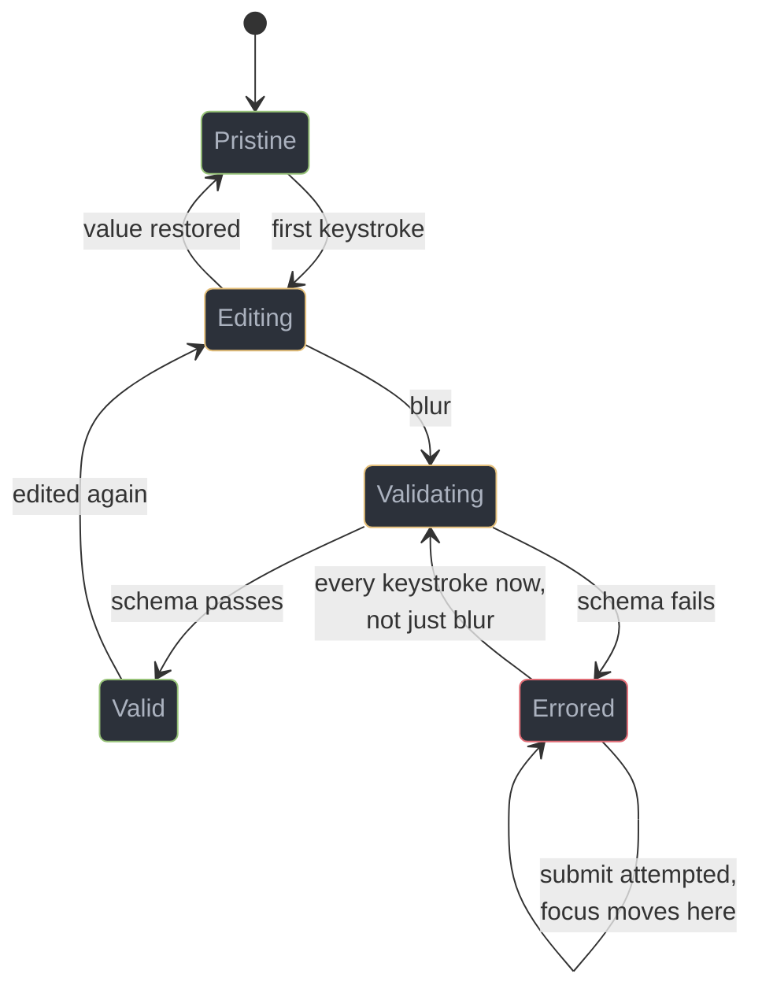
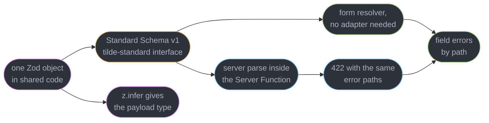
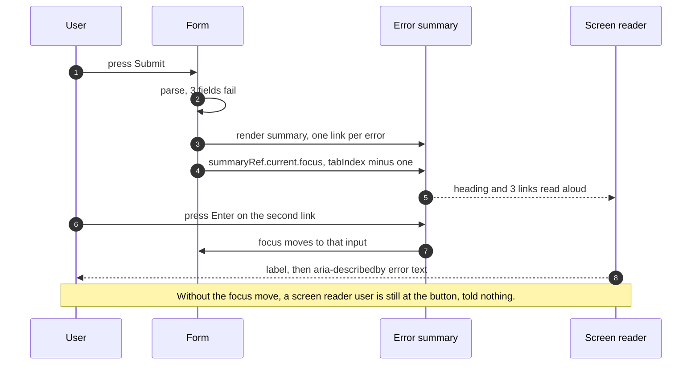
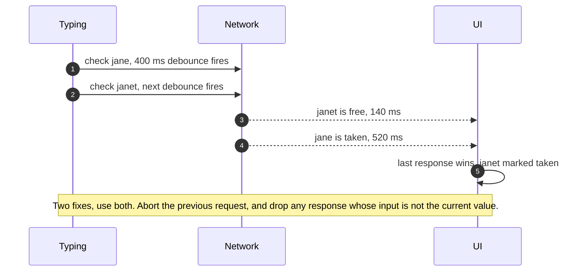
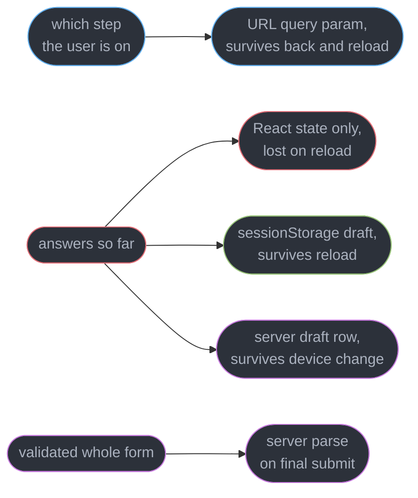

# Forms and Validation

---

## 1. Concept Overview

A form is the narrowest place in a product where the user's intent has to survive contact with a type system, a network, and a screen reader. Everything else on a page can be read-only and still be useful. A form has to accept arbitrary keystrokes, decide when they are wrong, say so in a way a blind user can act on, hold the answer across a refresh, and finally hand a payload to a server that does not trust a single byte of it.

Most of that is a client concern, and this module owns it. The pieces that look like forms but are not are owned elsewhere: `"use server"`, the Server Function wire format and the CSRF story belong to [Server Components and Server Functions](../server_components_and_server_functions/server_components_and_server_functions.md); this module cross-links them and never re-explains them. The ARIA machinery of a combobox or a dialog belongs to [Accessible Component Patterns](../accessible_component_patterns/accessible_component_patterns.md), and the WCAG 2.2 AA criteria themselves to [Accessibility and WCAG](../../frontend_platform/accessibility_and_wcag/accessibility_and_wcag.md); what stays here is the form-specific pattern set — label association, the error summary, focus after a failed submit.

Three decisions determine whether a form is pleasant or a support burden, and they are usually made accidentally. **Where the value lives** — in React state on every keystroke, or in the DOM until submit — sets the render cost of the whole screen. **When validation runs** decides whether the form feels like a coach or a critic. **Where the schema lives** decides whether the client and the server can ever disagree about what a valid order looks like. This module takes each one on numbers, then covers the four things that turn a working form into a shippable one: dynamic field arrays, accessibility, async server checks, and durability across steps and refreshes.

Target is React 19.2, whose `useActionState`, `useFormStatus` and `useOptimistic` changed what the submit half of a form looks like. Zod 4.5.4 is the schema, and Standard Schema v1 (spec 1.1.0) is the interface that decouples the form library from the validator.

---

## 2. Intuition

> **One-line analogy**: a controlled input asks React's permission for every character. An uncontrolled one types into the DOM and shows React the result when it is done.

**Mental model**: the browser already has a form state machine. Every `<input>` holds its own value, `FormData` can read the whole form in one call, and `required`/`type="email"` already validate. A React form library is not building that machine — it is deciding how much of it to take over. React Hook Form takes over almost none of it and subscribes to the parts it needs. A hand-rolled `useState`-per-field form takes over all of it, which is why it is slow.

**Why it matters**: a 40-field controlled form re-renders 41 components on every keystroke. On a 6x-throttled CPU that commit measures 11-14 ms, so a user typing at 9 characters per second spends roughly 120 ms of every second re-rendering a form nobody has submitted yet. The same form built uncontrolled re-renders **zero** components per keystroke and one component on submit.

**Key insight**: **validation is a conversation, not a verdict.** Running it on the first keystroke tells someone their email is invalid while they are typing the `j` of `jane@`. Running it only on submit makes them fix six things one page-scroll apart. The shape almost every good product converges on is: validate on blur, and once a field has errored, re-validate on change so the error clears the instant it is fixed.

---

## 3. Core Principles

- **The DOM is already a store.** Keeping a value in React state as well is a copy that must be kept in sync, and the sync runs on every keystroke.
- **Render cost scales with subscription breadth, not field count.** A 200-field form is cheap if each field subscribes only to itself.
- **One schema, two runtimes.** The client's copy is a convenience; the server's copy is the enforcement. They must be the same object or they will drift.
- **Client validation is never authorization.** Every rule runs again on the server, because the client can be bypassed with one `curl`.
- **An error nobody can find is not reported.** Reporting means moving focus, not painting a border red.
- **Announce errors where the user's focus already is,** not from forty live regions scattered down the page.
- **Async validation is advisory.** A uniqueness check answers about the past; only the write can answer about now.
- **A long form is a document, and documents get saved.** A wizard that loses everything on refresh is a wizard people abandon.
- **The submit button's state belongs to the submission,** not to a boolean you maintain by hand.

---

## 4. Types / Architectures / Strategies

### 4.1 Where the value lives

| Approach | Re-renders per keystroke | Reads the value | Right for |
|----------|--------------------------|-----------------|-----------|
| Controlled `useState` per field | 1 form subtree | any time, in render | 1-6 fields, or live formatting and dependent fields |
| Controlled with per-field state | 1 field | any time | small forms that need live cross-field logic |
| Uncontrolled, `ref` plus `FormData` | 0 | on submit | large static forms, progressive enhancement |
| Uncontrolled with subscriptions (RHF) | 0 unless subscribed | on demand via `watch` | the default for anything past 8 fields |
| Signals-based fields (TanStack Form) | 0 outside the field | per-field selector | deeply nested and dynamic shapes |

### 4.2 Validation timing

| Mode | Feels like | Use for |
|------|-----------|---------|
| `onSubmit` | a form that trusts you | short forms, and the mandatory final gate |
| `onBlur` | a proofreader | the sensible default for text fields |
| `onChange` from the first keystroke | a critic reading over your shoulder | almost nothing — see §10 |
| `onTouched`, then `onChange` after an error | a coach | **the hybrid most products want** |
| `onChange` for one field only | live feedback | password strength, character counters, slug preview |

### 4.3 The three libraries, on criteria

| | React Hook Form | TanStack Form v1 | Conform |
|---|---|---|---|
| Field model | uncontrolled `register`, refs into the DOM | signals-based store, per-field subscription | native `FormData`, server-first |
| Wins when | anything typical: the safest default | deeply nested objects, dynamic schemas, cross-framework reuse | progressive enhancement with Server Functions |
| Type inference | strongest in the ecosystem for flat and moderately nested shapes | strong, and framework-portable | driven by the schema and the parse result |
| Works without JS | no | no | **yes** — a plain HTML POST still validates and errors |
| Validator | Standard Schema, or `zodResolver` | Standard Schema natively | `parseWithZod` on both sides |
| Bundle, gzipped | ~9 KB | ~13 KB core | ~6 KB plus the schema |
| Ecosystem | largest by a wide margin | growing, shared with TanStack Query and Router | small, Remix and Next-shaped |

### 4.4 Where the schema is enforced

| Layer | Catches | Can be bypassed | Latency |
|-------|---------|-----------------|---------|
| HTML attributes (`required`, `type`, `pattern`) | typos before any JS runs | yes | 0 ms |
| Client schema parse | 95% of mistakes, instantly | yes | under 1 ms |
| Async client check | uniqueness, existence | yes | 120-400 ms |
| Server schema parse | everything the client claimed | **no** | the round trip |
| Database constraint | the race between check and write | **no** | the write |

---

## 5. Architecture Diagrams

### The keystroke render cost



The red path is not wrong at six fields — it is wrong at forty, and the crossover is invisible because it arrives one field at a time.

### A field's validation lifecycle



The one asymmetric edge is the loop out of `Errored`: before a field has failed, silence is kind, and after it has failed, instant feedback is the fastest route back to correct.

### One schema, three consumers



Because both sides speak error paths, a rule the server enforces and the client does not still lands on the right field instead of in a toast.

### What a failed submit must actually do



Painting three borders red is a change nobody perceives without sight. Focus is the notification channel.

### The uniqueness race



The bug survives a debounce entirely, because debouncing controls when requests start and says nothing about the order they finish in.

### Wizard state, and what survives what



Step number in the URL is what makes the browser Back button do the obvious thing, which is the single most-reported wizard bug and the cheapest to fix.

---

## 6. How It Works — Detailed Mechanics

### 6.1 Controlled and uncontrolled, on numbers

A controlled input is one whose `value` prop comes from React state, so React must re-render to show the character that was just typed.

```tsx
// Every keystroke setStates the whole form object, so the form component and all 40
// field children re-render before the character appears.
function ControlledForm() {
  const [values, setValues] = useState(EMPTY_40_FIELDS);
  const onChange = (e: React.ChangeEvent<HTMLInputElement>) =>
    setValues((v) => ({ ...v, [e.target.name]: e.target.value }));
  return (
    <form>
      {FIELDS.map((f) => <input key={f} name={f} value={values[f]} onChange={onChange} />)}
    </form>
  );
}
```

Measured with the React Profiler on a 40-field version: 41 components rendered per keystroke, 11-14 ms per commit under a 6x CPU throttle (a mid-range Android phone), 2.4 ms on an unthrottled laptop. At 9 characters per second the throttled device spends about 120 ms of every second inside React, which is enough to make the caret visibly lag the keyboard.

The React Compiler does not rescue this. It memoizes components whose props did not change, and here they did — `values[f]` is new for the edited field and the object identity changed for every sibling, unless each field is split into its own component reading its own slice.

The uncontrolled version keeps the value where the browser already keeps it:

```tsx
// No value prop, no state, no re-render. The DOM holds the value and FormData reads it.
function UncontrolledForm({ action }: { action: (fd: FormData) => Promise<void> }) {
  return (
    <form action={action}>
      {FIELDS.map((f) => <input key={f} name={f} defaultValue="" />)}
      <button type="submit">Save</button>
    </form>
  );
}
```

Zero renders per keystroke, one render when the action's pending state flips. React Hook Form generalizes exactly this: `register("email")` returns `{ name, ref, onChange, onBlur }`, the `ref` puts the DOM node in an internal map, and the library reads values out of that map instead of out of React state. Adding the 41st field then costs nothing, because the render count was never a function of the field count.

The subscription model is the other half. `formState` is a `Proxy`, so a component re-renders only for the properties it actually read — reading `formState.errors.email`, or scoping with `useFormState({ name: "email" })`, subscribes to that one error rather than to every error in the form.

Controlled still wins in three places: a field whose value formats as you type (currency, phone masks), a field whose value drives another field's options, and any third-party input that only accepts a `value` prop. RHF's `Controller` wraps those individually, so the controlled cost is paid on one field instead of forty.

### 6.2 Validation timing

React Hook Form expresses the hybrid directly with two options:

```ts
const form = useForm<Values>({
  mode: "onTouched",          // first validation happens on blur
  reValidateMode: "onChange", // after a field has errored, re-check every keystroke
  resolver: standardSchemaResolver(OrderSchema),
  shouldFocusError: true,     // focus the first invalid field on a failed submit
});
```

`mode: "onTouched"` keeps a pristine field silent until the user leaves it. `reValidateMode: "onChange"` turns an errored field valid the moment it becomes valid, rather than making the user blur again to find out. Conform expresses the same shape as `shouldValidate: "onBlur"` with `shouldRevalidate: "onInput"`, and TanStack Form as `validators: { onBlur: schema, onChange: schema }` with the change validator gated on the field's error state.

Three timing rules that are not negotiable. **The submit gate always runs the whole schema**, because a field the user never focused was never blurred and therefore never validated. **Async validation never runs on change** — it runs debounced, and again on blur (§6.7). And **an error is removed as eagerly as it is added**: a rule that only clears on blur leaves a red field the user has already fixed, which is the fastest way to make people distrust the form.

A form doing custom validation should also carry `noValidate` so the browser's own bubble does not fire first and fight the React error, while the inputs keep `required` and `type="email"` for the no-JS path.

### 6.3 One schema, shared, behind Standard Schema

The schema is an ordinary Zod 4.5.4 object in code both runtimes import.

```ts
// shared/order-schema.ts — imported by the client form and the server handler.
import { z } from "zod";

export const OrderSchema = z.object({
  email: z.email("Enter an email address like name@example.com"),
  quantity: z.coerce.number().int().min(1).max(500),
  shipBy: z.iso.date(),
  couponCode: z.string().regex(/^[A-Z0-9]{6}$/).optional(),
}).refine((v) => v.quantity <= 50 || v.couponCode === undefined, {
  message: "Coupons do not apply to orders over 50 units",
  path: ["couponCode"],                    // the path is what puts it on the right field
});

export type OrderInput = z.infer<typeof OrderSchema>;
```

Three things fall out of that one object: the runtime check on the client, the runtime check on the server, and `OrderInput` as the payload type, so field names are checked by the compiler. `z.coerce.number()` matters because every `FormData` value is a string — a schema written against `z.number()` fails every native submit with `Invalid input: expected number, received string`.

The `path` on a cross-field `refine` is the load-bearing detail. Without it the issue lands at the object root, where no field is listening, and the user sees an error in the summary that no input is highlighted for.

**Standard Schema v1** (spec 1.1.0, `@standard-schema/spec`) is what lets a form library accept that object without knowing it is Zod. The entire interface is one property, `"~standard"`, carrying `version: 1`, a `vendor` string, and a `validate(value)` function returning either `{ value }` or `{ issues }`, where each issue is a `message` plus a `path` array. Zod 4, Valibot and ArkType all implement it, so `@hookform/resolvers` v5 ships a single `standardSchemaResolver` instead of one adapter per library, and TanStack Form accepts a schema with no resolver at all. Swapping Zod for Valibot to cut bundle size is then a one-line import change in the shared schema file, not a rewrite of every form.

On the server the same object is parsed inside the Server Function, and the failure is returned as field errors rather than thrown:

```ts
"use server";
import { OrderSchema } from "@/shared/order-schema";

export async function submitOrder(_prev: FormState, formData: FormData): Promise<FormState> {
  const parsed = OrderSchema.safeParse(Object.fromEntries(formData));
  if (!parsed.success) {
    return { ok: false, fieldErrors: z.flattenError(parsed.error).fieldErrors };
  }
  if (await couponAlreadyUsed(parsed.data.couponCode)) {
    return { ok: false, fieldErrors: { couponCode: ["This coupon has already been redeemed"] } };
  }
  await orders.create(parsed.data);
  return { ok: true, fieldErrors: {} };
}
```

`z.flattenError` gives `{ formErrors, fieldErrors }` keyed by field name, which is the shape the client needs in §6.7. The `"use server"` directive, the serialization rules and why this endpoint needs its own authorization check are owned by [Server Components and Server Functions](../server_components_and_server_functions/server_components_and_server_functions.md).

### 6.4 Choosing between the three libraries

**React Hook Form is the default**, and "the default" covers most forms: uncontrolled, roughly 9 KB gzipped, the strongest type inference of the three for flat and moderately nested shapes, and an ecosystem large enough that the input library you already use probably ships an adapter.

**TanStack Form v1** is the answer when the form's shape is the problem rather than its size. Fields are addressed by path and subscribe individually through a signal-like store — `<form.Field name="contacts[0].email">` renders a child receiving `field.state.value`, `field.handleChange` and `field.state.meta.errors`. Every field is technically controlled, but each re-renders alone, so the 41-component commit from §6.1 never occurs. That is why deeply nested and dynamic forms are its home ground, and the same core runs under Vue, Svelte and Solid.

**Conform** is the answer when the form must work before JavaScript loads, or without it. It validates `FormData` with the same schema on both sides and threads the server's result back through `useActionState`.

```tsx
const [lastResult, action] = useActionState(submitOrder, undefined);
const [form, fields] = useForm({
  lastResult,                                       // server errors re-enter here
  onValidate: ({ formData }) => parseWithZod(formData, { schema: OrderSchema }),
  shouldValidate: "onBlur",
  shouldRevalidate: "onInput",
});

<form {...getFormProps(form)} action={action} noValidate>
  <input {...getInputProps(fields.email, { type: "email" })} />
  {fields.email.errors && <p id={fields.email.errorId}>{fields.email.errors[0]}</p>}
</form>
```

`getInputProps` emits `id`, `name`, `required`, `aria-invalid` and `aria-describedby` together, which is the accessibility wiring of §6.6 generated rather than typed by hand. Before the client bundle arrives, the same markup posts natively and the server returns the errored page — real progressive enhancement, not a claim about it.

### 6.5 Field arrays and dynamic fields

```tsx
const { fields, append, remove } = useFieldArray({ control, name: "lineItems" });

{fields.map((field, i) => (
  // field.id is a generated stable id, NOT the array index and NOT the row's data id
  <fieldset key={field.id}>
    <legend>Line item {i + 1}</legend>
    <input {...register(`lineItems.${i}.sku`)} />
    <input {...register(`lineItems.${i}.qty`)} />
    <button type="button" onClick={() => remove(i)}>Remove line {i + 1}</button>
  </fieldset>
))}
<button type="button" onClick={() => append({ sku: "", qty: 1 })}>Add line</button>
```

`useFieldArray` generates `field.id` for exactly one reason: the index is the wrong key. Delete row 2 of five and every row below shifts up an index, so React reconciles row 3's DOM node as row 2 — and because that DOM node is where an uncontrolled input's value lives, the deleted row's text stays on screen attached to the wrong record. Focus follows the same wrong node. The reconciliation mechanism is owned by [React Fundamentals and the Render Model](../react_fundamentals_and_the_render_model/react_fundamentals_and_the_render_model.md); the form-specific consequence is that an index key does not merely misorder a list, it silently corrupts the payload.

Validating a variable-length list is a schema concern, and the useful part is the array-level rules no individual row can see:

```ts
const LineItems = z.array(
  z.object({ sku: z.string().regex(/^[A-Z]{3}-\d{4}$/), qty: z.coerce.number().int().min(1) })
).min(1, "Add at least one line item")
 .max(50, "Orders are limited to 50 line items")
 .refine((rows) => new Set(rows.map((r) => r.sku)).size === rows.length, {
   message: "Each SKU may appear only once",
   path: [],                                     // an array-level error, not a row error
 });
```

Issue paths come back as `["lineItems", 2, "sku"]`, which RHF maps to `errors.lineItems?.[2]?.sku`, and the array-level issue to `errors.lineItems?.root`. The error summary in §6.6 needs both: a row error links to that row's input, an array error links to the fieldset.

Two operational details. Removing a row must also remove its error, or the summary counts an error for a row that no longer exists — `remove(i)` handles this, a hand-rolled `filter` over the values does not. And a row removal is destructive in a way a text edit is not, so an undo affordance for 5-8 seconds is cheaper than a confirmation dialog on every row.

### 6.6 Accessibility — the form-specific patterns

Four attributes carry a field's entire accessible state, and they are almost never all present.

```tsx
function Field({ label, hint, error, ...input }: FieldProps) {
  const id = useId();                                  // React 19.2 emits ids like _r_3_
  const hintId = `${id}-hint`;
  const errorId = `${id}-error`;
  return (
    <div>
      <label htmlFor={id}>{label}{input.required && <span> (required)</span>}</label>
      {hint && <p id={hintId} className="hint">{hint}</p>}
      <input
        {...input}
        id={id}
        aria-invalid={error ? true : undefined}                 // absent, not "false"
        aria-describedby={[hint && hintId, error && errorId].filter(Boolean).join(" ") || undefined}
      />
      {error && <p id={errorId} className="error">{error}</p>}
    </div>
  );
}
```

`htmlFor` pointing at the input's `id` is what makes the label clickable, what makes a screen reader read it when focus lands, and what gives the input an accessible name. `useId` generates that id safely in a component rendered more than once per page; the React 19.2 format `_r_3_` is a valid HTML id and a valid CSS selector, which the older `«r0»` format was not.

`aria-describedby` takes a **space-separated list in announcement order**, so hint first, error second. `aria-invalid` should be **absent** when the field is valid rather than `"false"`, and belongs on a field only after that field has been validated — putting it on every empty required field at first render announces a form that is entirely broken before the user has typed anything.

**The error summary is the part that is usually missing.** On a failed submit, render a container at the top of the form, give it `tabIndex={-1}`, and move focus to it.

```tsx
function ErrorSummary({ errors }: { errors: Array<{ id: string; label: string; message: string }> }) {
  const ref = useRef<HTMLDivElement>(null);
  useEffect(() => {
    if (errors.length > 0) ref.current?.focus();        // announced by being focused
  }, [errors]);
  if (errors.length === 0) return null;
  return (
    <div ref={ref} tabIndex={-1} className="error-summary">
      <h2>There is a problem with {errors.length} of your answers</h2>
      <ul>
        {errors.map((e) => (
          <li key={e.id}><a href={`#${e.id}`}>{e.label}: {e.message}</a></li>
        ))}
      </ul>
    </div>
  );
}
```

Four properties make this work. It is at the **top**, so a user scrolled to the submit button is taken back to the problems. It is **focusable but not tabbable** (`tabIndex={-1}`), so it adds no stop to the tab order once dismissed. Its entries are **links to field ids**, so activating one moves focus into the input, which then announces its own label and `aria-describedby` error. And the heading **counts** the errors, so the user knows whether they are fixing one thing or nine. Do not add `role="alert"` to a container you also focus — NVDA and JAWS announce the live-region insertion and then the focus change, so the summary is read twice.

**Why `aria-live` on individual fields is usually wrong.** Forty fields means forty live regions. Errors fire on blur, so the announcement arrives while the user is already typing in the *next* field, interrupting the character echo. Simultaneous errors queue and are read in DOM order rather than importance order, and a polite region that changes while focus is elsewhere is frequently dropped. The correct channel is `aria-describedby`: the error is announced when the user returns to the field, which is exactly when they can act on it. The two genuine exceptions are a single live region for **asynchronous** results the user cannot otherwise learn about ("Username is available"), and the submit result itself.

Required-field indication needs a visible text marker, not only a red asterisk — colour alone fails WCAG 1.4.1, and a bare `*` is read as "star" or skipped. Use the native `required` attribute, which already exposes required-ness, and drop `aria-required` as redundant; when most fields are required, mark the *optional* ones instead. Autocomplete tokens (`autoComplete="email"`, `"street-address"`, `"one-time-code"`) satisfy WCAG 1.3.5 and matter more in practice, because they let people fill the form without typing. The criteria themselves, including WCAG 2.2's 3.3.7 Redundant Entry and 3.3.8 Accessible Authentication, are owned by [Accessibility and WCAG](../../frontend_platform/accessibility_and_wcag/accessibility_and_wcag.md); combobox, dialog and focus-trap mechanics by [Accessible Component Patterns](../accessible_component_patterns/accessible_component_patterns.md).

### 6.7 Async validation, races, and server errors

```ts
// One in-flight check at a time, and a response is only accepted for the value it asked about.
function useUsernameCheck() {
  const controller = useRef<AbortController>(null);
  return useCallback(async (username: string) => {
    controller.current?.abort();                       // cancel the previous check
    const ac = new AbortController();
    controller.current = ac;
    try {
      const res = await fetch(`/api/username-free?u=${encodeURIComponent(username)}`,
        { signal: ac.signal });
      const { free } = await res.json();
      return free ? true : "That username is taken";
    } catch (e) {
      if ((e as Error).name === "AbortError") return true;   // superseded, not a failure
      return true;                                            // a network failure is not a rejection
    }
  }, []);
}

register("username", { validate: { unique: debounce(check, 400) } });   // 400 ms is the usual sweet spot
```

Both guards are needed. Aborting kills the previous request, but a response already in flight when `abort` is called can still resolve first, so RHF's own rule — only the latest `validate` call's result is applied — is the second line of defence. A hand-rolled version must compare the response's input against the current field value before writing an error. A network error must never read as "taken": treating an unreachable check as a rejection blocks a user who did nothing wrong, on a rule the server enforces anyway.

**Async client validation is advisory, always.** Between the check at t=0 and the submit at t=8s, someone else can claim the name. The database's unique constraint is the only real answer, and its 409 has to land back on the field:

```tsx
const [state, formAction, isPending] = useActionState(submitOrder, INITIAL);

useEffect(() => {
  if (!state.fieldErrors) return;
  for (const [name, messages] of Object.entries(state.fieldErrors)) {
    setError(name as keyof OrderInput, { type: "server", message: messages[0] });
  }
  setFocus(Object.keys(state.fieldErrors)[0] as keyof OrderInput);   // move focus, not just paint
}, [state, setError, setFocus]);
```

Server errors get `type: "server"` so the next client re-validation can clear them — an error the client cannot reproduce would otherwise stick forever, because nothing on the client knows how to make it go away.

Two React 19 hooks finish the submit path. `useFormStatus()` reads the enclosing form's `pending` flag from a **child** component, which is what lets a shared `SubmitButton` disable itself with no prop threading; called in the same component that renders the `<form>`, it returns `pending: false` forever, because it reads a context the form provides to its subtree. And `useOptimistic(state, reducer)` renders the pending row before the server confirms it — the optimistic value is discarded automatically when the action settles, so there is no rollback to write. What it does not do is report failure: the row simply vanishes, which reads as the app eating what somebody typed, so pair it with an error path that restores the text or offers a retry, and mark the pending item `aria-busy`.

**The automatic reset fires `onReset` `[19.3]`.** After an action passed to `<form action>` succeeds, React resets the form's uncontrolled fields. From React 19.3 that reset dispatches the form's `reset` event, so `onReset` is the one hook for clearing state the DOM reset cannot reach: RHF's `reset()`, a "dirty" banner, or client-side error messages left from the previous attempt.

```tsx
<form action={formAction} onReset={() => reset()}>
  {/* fields registered with RHF */}
</form>
```

Without it, the DOM inputs clear while RHF still holds the old values and errors, and the next keystroke validates against stale state. React 19.3 also includes the `submitter` in `submit` events, so `onSubmit` can tell which of two submit buttons, such as Save draft and Publish, sent the form.

### 6.8 Wizards, durability and autosave

Put the step in the URL and the answers in a draft.

```tsx
// Step in the URL: Back works, reload works, a shared link resumes at the right place.
const step = Number(useSearchParams().get("step") ?? 1);

const form = useForm<Values>({
  defaultValues: () => JSON.parse(sessionStorage.getItem(`draft:${draftId}`) ?? "null") ?? EMPTY,
});
useEffect(() => {
  const sub = form.watch(debounce((v) => {
    sessionStorage.setItem(`draft:${draftId}`, JSON.stringify(v));
  }, 500));
  return () => sub.unsubscribe();
}, [form, draftId]);

// Advance only if this step's fields pass. The final submit still parses the whole schema.
const next = async () => {
  if (await form.trigger(STEP_FIELDS[step])) router.push(`?step=${step + 1}`);
};
```

`sessionStorage` rather than `localStorage` for anything carrying a name, address or date of birth: session storage dies with the tab, so a shared or kiosk machine does not hand the next user a filled-in form. Anything that must survive a device change belongs in a server-side draft row keyed by the draft id, which is also what makes "continue on your phone" possible.

`STEP_FIELDS` is derived from the one schema rather than a second smaller schema per step, so step 2's rules and the final rules cannot diverge. The whole schema still runs on the server at the end, because a user can edit the URL to `?step=3` and skip steps 1 and 2 entirely — per-step validation is a user-experience feature, never a gate.

Unsaved-changes guards come in two flavours because there are two kinds of leaving:

```tsx
// Full-page unload: the browser shows its own generic message, and only if the user has
// interacted with the page at least once.
useEffect(() => {
  if (!form.formState.isDirty) return;
  const onBeforeUnload = (e: BeforeUnloadEvent) => e.preventDefault();
  window.addEventListener("beforeunload", onBeforeUnload);
  return () => window.removeEventListener("beforeunload", onBeforeUnload);
}, [form.formState.isDirty]);

// In-app navigation: the router never unloads the page, so beforeunload never fires.
// React Router v8 exposes a blocker; Next.js App Router intercepts via onNavigate on Link.
const blocker = useBlocker(form.formState.isDirty);
```

The mistake is shipping only the first and testing it by closing the tab. Clicking a nav link inside a single-page application does not unload anything, so the guard that "works" in manual testing protects nothing in the flow where users actually lose data.

Autosave adds a conflict question the moment two tabs exist. Send the version the edit was based on as an `If-Match` header on every save; a `412 Precondition Failed` means someone else wrote first, and the right response is neither a silent overwrite nor a silent reload — both lose somebody's work — but a UI showing theirs against yours. Debounce autosave at 800-1500 ms and also flush on blur and on step change, so the last thing typed is never the thing that is lost. Last-write-wins is a legitimate choice for a single-user draft and a data-loss bug for anything collaborative; make it a decision rather than a default.

---

## 7. Real-World Examples

**The 40-field form that lagged on Android.** An insurance quote form kept every field in one `useState` object. Support reports were "the keyboard is slow", which nobody could reproduce on a laptop. The Profiler showed 41 components per keystroke and a 13 ms commit on a 6x throttle. Migrating to React Hook Form with `register` took the per-keystroke render count to 0 and the p95 input latency on a Moto G from 190 ms to 24 ms. No field's behaviour changed; only where the value lived did.

**The signup that validated too soon.** A product ran `mode: "onChange"` from the first keystroke, so `j` produced "Enter a valid email address" in red under the field. Session recordings showed 31% of users deleting the whole field and starting over at least once. Switching to `onTouched` with `reValidateMode: "onChange"` moved signup completion from 62% to 74% in an A/B test over 11 days — one config line, no visual redesign.

**The government-service audit.** A benefits application failed an accessibility audit on one finding: on a failed submit, the page painted three fields red and announced nothing. A screen-reader user pressed Submit and heard silence, then pressed it again. Adding a focused error summary with links to each field, and moving focus on submit failure, closed the finding and dropped average time-to-correct-and-resubmit from 4:10 to 1:35 across all users, sighted included.

**The username that was free and taken.** A checkout typed-ahead a vanity URL and marked it available after a debounced check. Two requests raced, the slower "taken" response for the shorter prefix landed after the faster "free" response for the longer one, and 1 in 40 signups hit a 409 on submit for a name the UI had shown a green tick against. Adding an `AbortController` plus a check that the response's input still equalled the current value removed it; the constraint violation on the server dropped from 2.4% of signups to 0.06%, which is the genuine race the client can never win.

**The wizard that lost step 3.** A 6-step onboarding kept everything in React state. Any refresh, any expired session redirect, any Back button press dropped every answer. 18% of starts never reached step 4. Moving the step number into the query string and the answers into a debounced `sessionStorage` draft took drop-off between steps 3 and 4 from 18% to 5%, and the largest single contributor was the Back button behaving normally.

---

## 8. Tradeoffs

| Design choice | Bought | Paid |
|---------------|--------|------|
| Controlled fields | live formatting, dependent fields, simple mental model | render cost scales with field count |
| Validate on blur, re-validate on change | errors arrive when useful and clear when fixed | two config options and a per-field state to reason about |
| One shared Zod schema | client and server cannot disagree | shared code must be importable by both runtimes |
| Standard Schema resolver | swap validators without touching forms | one more indirection when debugging an issue path |
| TanStack Form | per-field subscriptions, portable across frameworks | every field is controlled, more code per field |
| Conform | works with JS disabled or still loading | server round trip for validation the client could have done |
| Error summary with focus | the only reporting a screen-reader user perceives | a component and a focus effect on every form |
| Async uniqueness checks | catches the collision before submit | a request per pause, and it is still advisory |
| `useOptimistic` | the row appears in under 16 ms | a failed write makes the row vanish with no explanation |
| Autosave with `If-Match` | no lost work, conflicts surfaced | a version column and a conflict UI somebody must design |

---

## 9. When to Use / When NOT to Use

**Reach for uncontrolled fields when:**

- The form has more than about 8 fields, or is on a page that also renders anything expensive.
- Values are only needed on submit — which is the overwhelming majority of forms.
- Progressive enhancement matters, because uncontrolled markup already posts natively.

**Reach for controlled fields when:**

- The value must be transformed as it is typed: currency, phone masks, uppercase codes.
- One field's value changes another field's options or visibility on every keystroke.
- A third-party input only accepts a `value` prop — wrap that one field in `Controller`, not the form.

**Reach for a form library when:**

- There is a schema, a submit gate, and errors that must land on specific fields. That is roughly the point where hand-rolled state stops being cheaper.
- Field arrays exist. `useFieldArray` and its stable ids are 40 lines you would otherwise write and get wrong.

**Do not reach for one when:**

- The form is a single search box. `useState` plus one `onSubmit` is complete, and the search behaviour belongs to [Server State and Data Fetching](../server_state_and_data_fetching/server_state_and_data_fetching.md).
- The "form" is a filter bar whose state belongs in the URL — see [Client State Management](../client_state_management/client_state_management.md).
- It is a Server Function taking three fields with server-side validation and no interactive error display. A plain `<form action={fn}>` is the whole solution.

---

## 10. Common Pitfalls

**Reporting errors without moving focus.** The single most common accessibility defect in forms, and it looks completely fine on a sighted developer's screen.

```tsx
// BROKEN: submit fails, three fields turn red, and focus is still on the submit button.
// A screen reader announces nothing at all. The user presses Submit again, and again.
function Checkout() {
  const { handleSubmit, register, formState: { errors } } = useForm<Values>();
  return (
    <form onSubmit={handleSubmit(save)}>
      <input {...register("email")} className={errors.email ? "is-error" : ""} />
      <input {...register("postcode")} className={errors.postcode ? "is-error" : ""} />
      <button type="submit">Pay</button>
    </form>
  );
}

// FIX: a summary at the top receives focus on every failed submit, each entry links to
// its field, and each field carries aria-invalid plus a described-by error message.
function Checkout() {
  const { handleSubmit, register, formState: { errors, submitCount } } = useForm<Values>({
    resolver: standardSchemaResolver(CheckoutSchema),
    shouldFocusError: false,          // the summary takes focus instead of the first field
  });
  const summary = useRef<HTMLDivElement>(null);
  useEffect(() => {
    if (submitCount > 0 && Object.keys(errors).length > 0) summary.current?.focus();
  }, [submitCount, errors]);
  return (
    <form onSubmit={handleSubmit(save)} noValidate>
      <div ref={summary} tabIndex={-1}>
        {Object.entries(errors).map(([name, e]) => (
          <a key={name} href={`#${name}`}>{LABELS[name]}: {e.message}</a>
        ))}
      </div>
      <input id="email" {...register("email")} aria-invalid={errors.email ? true : undefined}
             aria-describedby={errors.email ? "email-error" : undefined} />
      {errors.email && <p id="email-error">{errors.email.message}</p>}
      <button type="submit">Pay</button>
    </form>
  );
}
```

**Using the array index as a field-array key.** Removing a row shifts every index below it, React reuses the DOM nodes, and an uncontrolled input's value — which lives in that node — stays behind attached to the wrong record. Use `field.id` from `useFieldArray`.

**Validating on change from the first keystroke.** "Enter a valid email address" appears after the letter `j`. Measured cost in one A/B test: 12 percentage points of signup completion.

**`useFormStatus` in the component that renders the form.** It reads a context the `<form>` provides to its *children*, so calling it alongside the form returns `pending: false` permanently. Put the submit button in its own component.

**Debouncing an async check and calling it race-free.** Debouncing controls when requests start, not what order they finish in. A slow early response overwrites a fast late one, so a taken name shows as free. Abort the previous request *and* discard any response whose input is no longer current.

**`aria-invalid="false"` on every field at first render.** Some screen readers announce the invalid state on focus regardless of the value, so the whole form reads as broken before the user types. Omit the attribute entirely until the field has actually failed.

**`aria-live` on each field's error.** Forty live regions firing on blur interrupt the character echo of the field the user has just moved into, and simultaneous errors queue in DOM order. `aria-describedby` announces the error when the user returns to the field, which is when it is actionable.

**Only guarding `beforeunload`.** In-app router navigation never unloads the page, so the guard that passes a manual tab-close test protects nothing when someone clicks a nav link mid-form. Add the router-level blocker too.

**PII in `localStorage`.** A draft with a name and date of birth persists past the session on a shared machine. `sessionStorage` for local drafts, a server-side draft row for anything that must survive a device change.

**Trusting the client's uniqueness check.** Between the check and the submit, someone else takes the name. The unique constraint is the answer; the client check is a courtesy, and the 409 still has to land on the field.

---

## 11. Technologies & Tools

| Tool | Purpose |
|------|---------|
| React Hook Form | Uncontrolled fields, proxy-based `formState` subscriptions, `useFieldArray` |
| TanStack Form | v1 signals-based per-field store, framework-portable, native Standard Schema |
| Conform | `FormData`-first validation with progressive enhancement and Server Functions |
| Zod | 4.5.4 schema, top-level formats, `z.flattenError` for field-keyed errors |
| Valibot | Modular Standard Schema validator, tree-shakes to roughly a tenth of Zod |
| ArkType | Type-syntax Standard Schema validator with 1:1 TypeScript parity |
| Standard Schema | The v1 spec that makes validators interchangeable behind one interface |
| React Hook Form Resolvers | v5 `standardSchemaResolver` plus per-library resolvers |
| React Aria | Accessible field, listbox and date primitives with the ARIA already wired |
| Base UI | Unstyled accessible primitives, the shadcn default since 2026-07 |
| axe DevTools | Catches missing labels, orphan `aria-describedby` ids, colour-only errors |
| NVDA | The screen reader to verify an error summary against on Windows |
| Testing Library | Role and label queries, which fail when the label association is missing |
| Playwright | End-to-end submit, error-focus and multi-step wizard flows |

---

## 12. Interview Questions with Answers

**Q: What does a controlled form actually cost compared to an uncontrolled one?**
**Short:** Every keystroke in a controlled form triggers a state update and re-renders the form subtree, so a 40-field form commits 41 components before the character appears.

Measured with the Profiler, that commit is 11-14 ms on a 6x-throttled CPU and 2.4 ms on a laptop, so at 9 characters per second a mid-range phone spends about 120 ms of every second inside React. An uncontrolled form renders zero components per keystroke because the DOM node holds the value, and reads everything once on submit through `FormData` or a ref map. The React Compiler does not fix the controlled case — the edited field's props genuinely changed. Default to uncontrolled past roughly 8 fields, and pay the controlled cost per field with `Controller` only where live formatting or a dependent field needs it.

**Q: When should validation run, and why is on-change from the first keystroke hostile?**
**Short:** Validate on blur, then re-validate on change once a field has already errored, so feedback arrives when the user is done and clears the moment it is fixed.

Validating from the first keystroke tells someone their email is invalid while they are typing `j` of `jane@`, which is factually true and useless. One A/B test moved signup completion from 62% to 74% purely by switching `mode: "onChange"` to `mode: "onTouched"` with `reValidateMode: "onChange"`. The asymmetry is the point: silence before a field has failed is kind, and instant feedback after it has failed is the fastest route back to correct. The submit gate always runs the entire schema regardless, because a field nobody focused was never blurred and therefore never validated.

**Q: What must happen when a form submit fails validation?**
**Short:** Focus has to move — to an error summary at the top of the form or to the first invalid field — because a red border is invisible to a screen reader and to a user scrolled to the button.

The standard pattern is a container at the top with `tabIndex={-1}`, a heading counting the errors, and one link per error pointing at that field's `id`. Focusing it announces the heading and the list; activating a link moves focus into the input, which then announces its label and its `aria-describedby` error text. Do not add `role="alert"` to a container you also focus, because NVDA and JAWS then announce it twice. One government service cut average time from failed submit to successful resubmit from 4:10 to 1:35 for all users, sighted included, by adding exactly this.

**Q: Why share one schema between the client and the server, and how?**
**Short:** Two copies of a validation rule drift the first time one is edited, and the drift shows up as a rule the server enforces that the client has no way to display.

Define one Zod object in code both runtimes import, derive the payload type from it with `z.infer`, and parse it in both places: the client parse is the fast feedback, the server parse is the enforcement, since anyone can bypass the client with one `curl`. The server returns field-keyed errors — `z.flattenError` gives `{ formErrors, fieldErrors }` — so a server-only rule still lands on the right input instead of in a toast. Watch the `FormData` trap: every value arrives as a string, so schemas need `z.coerce.number()` rather than `z.number()`.

**Q: How does React Hook Form avoid re-rendering on every keystroke?**
**Short:** Registering an input hands its ref to an internal map, so values live in the DOM and the library reads them on demand instead of storing them in React state.

`register("email")` returns `{ name, ref, onChange, onBlur }`, and the ref is what puts the DOM node where the library can read it. On top of that, `formState` is a `Proxy`, so a component re-renders only for the properties it actually read — reading `errors.email` subscribes to that one error, not to every error in the form. The consequence is that render cost stops scaling with field count: the 41st field is free. `watch` and `useWatch` opt a specific subtree back into re-rendering when a value genuinely must be read during render.

**Q: What is Standard Schema and what problem does it remove?**
**Short:** A tiny three-method interface published under a tilde-standard property lets any form library accept Zod, Valibot or ArkType with no per-validator adapter.

The spec is version 1.1.0 and the whole contract is `"~standard": { version, vendor, validate }`, where `validate` returns either `{ value }` or `{ issues }` with message-and-path entries. Because Zod 4, Valibot and ArkType all implement it, `@hookform/resolvers` v5 ships one `standardSchemaResolver` instead of one adapter each, and TanStack Form accepts a schema directly with no resolver at all. The practical payoff is that swapping Zod for Valibot to save bundle size is a one-line import change in the shared schema file, not a rewrite of every form in the application.

**Q: Why must a field-array row not be keyed by its index?**
**Short:** Stable generated ids are required because deleting a row shifts every index below it, so React reuses the wrong DOM nodes and an uncontrolled input keeps the deleted row's text.

The value of an uncontrolled input lives in the DOM node, so when React reconciles former-row-3 into position 2 it brings the old text with it — the payload is now silently wrong, not merely misordered, and focus lands on the wrong record too. `useFieldArray` generates `field.id` for precisely this, and it is not the row's data id, because a newly appended row does not have one yet. Removing a row must also drop its error, which `remove(i)` handles and a hand-rolled `filter` over the values does not.

**Q: Why is aria-live on each field's error usually the wrong choice?**
**Short:** Announcing each field error through its own live region interrupts the user in whatever field they moved to next, and simultaneous errors queue in DOM order rather than importance order.

Errors typically fire on blur, so the announcement arrives while the user is already typing in the following field, cutting across the character echo. Forty fields means forty live regions, and a polite region that changes while focus is elsewhere is often dropped entirely. The right channel is `aria-describedby`: the error is announced when focus returns to the field, which is exactly when the user can act on it. Reserve a single live region for asynchronous results the user cannot otherwise discover, such as "Username is available", and for the submit result.

**Q: How do aria-describedby and aria-invalid work together on a field?**
**Short:** Two attributes carry the state — describedby points at the hint and error text in announcement order, and invalid marks the field as failing once it actually has.

`aria-describedby` takes a space-separated list of ids read in order, so put the hint id first and the error id second. `aria-invalid` should be absent rather than `"false"` when the field is valid, and should only appear after that field has been validated — setting it on every empty required field at first render announces a form that is entirely broken before anyone has typed. Both are per-field state and both are generated for you by Conform's `getInputProps` and by React Aria's field primitives, which is a good reason to use one of them rather than hand-writing the wiring 40 times.

**Q: How do you make a debounced uniqueness check race-free?**
**Short:** Out-of-order responses defeat a debounce entirely, so abort the previous request and additionally discard any response whose input no longer matches the current field value.

Debouncing controls when requests start and says nothing about the order they finish in: a check for `jane` fired first can resolve at 520 ms after the check for `janet` resolved at 140 ms, and last-write-wins then marks the wrong value taken. Use an `AbortController` for the previous request and compare the response's input against the live value before writing an error. A network failure must resolve as valid, not as taken, because blocking a user on an unreachable check punishes them for your outage — and the check was only advisory anyway, since the database's unique constraint is what actually decides.

**Q: How do server-returned field errors get back onto the form?**
**Short:** Server-returned field errors arrive keyed by field name, and are applied with setError plus a focus move so they behave exactly like a client-side failure.

The Server Function returns `{ fieldErrors }` rather than throwing, `useActionState` surfaces it as state, and an effect walks the entries calling `setError(name, { type: "server", message })` and then `setFocus` on the first one. The `type: "server"` tag matters because the next client re-validation can clear it — an error the client cannot reproduce would otherwise stick forever, since nothing on the client knows the condition that would make it go away. A 409 on a uniqueness constraint is the canonical case, and it must land on the field rather than in a toast.

**Q: What do useActionState and useFormStatus each give a form?**
**Short:** Action state threads the previous result back into the next render, while form status lets a nested child read the enclosing form's pending flag with no prop threading.

`useActionState(action, initial)` returns `[state, formAction, isPending]`, and passing `formAction` to `<form action>` means the action's return value becomes the state on the next render — which is how server field errors get back to the client. `useFormStatus()` reads a context that the `<form>` provides to its subtree, so a shared `SubmitButton` component knows it is submitting. The trap is calling `useFormStatus` in the same component that renders the `<form>`: it is not inside the subtree, so it returns `pending: false` forever, on a page that otherwise looks correct.

**Q: What does useOptimistic do for a form, and what does it not do?**
**Short:** Rendering the pending row immediately makes a submit feel instant, and the optimistic value is discarded automatically when the action settles, so there is no rollback to write.

`useOptimistic(state, reducer)` returns a value that includes the in-flight change and reverts to the real state as soon as the action resolves — the whole appeal is that failure handling is not a snapshot-and-restore dance. What it does not do is tell anyone the write failed: the optimistic row simply vanishes, which reads as the app eating the comment somebody typed. Pair it with an error path that either restores the text into the input or offers a retry. Mark the pending item with `aria-busy` so assistive tech does not present it as saved.

**Q: How do you choose between React Hook Form, TanStack Form and Conform?**
**Short:** Three criteria decide it — the shape of the data, whether the form must work without JavaScript, and whether the same form logic runs outside React.

React Hook Form is the default for typical flat-to-moderately-nested forms: uncontrolled, roughly 9 KB gzipped, the strongest type inference and by far the largest ecosystem of input adapters. TanStack Form wins on deeply nested or dynamically shaped data because fields are path-addressed with per-field subscriptions, and because the same core runs under Vue, Svelte and Solid. Conform wins when progressive enhancement is a requirement — it validates `FormData` with the same schema on the client and inside a Server Function, so the form posts natively and errors correctly before the client bundle has arrived.

**Q: How do you make a multi-step wizard survive a refresh?**
**Short:** Persisting draft answers to storage covers the values, but only putting the step number in the URL makes the Back button and a reload land where the user expects.

Step in a query parameter is the cheapest fix and the one users notice most, because a wizard whose Back button exits the whole flow is the single most-reported wizard complaint. Answers go in a debounced `sessionStorage` draft keyed by a draft id — session rather than local storage, so a shared or kiosk machine does not hand the next person a form full of someone's date of birth. Anything that must survive a device change belongs in a server-side draft row. One 6-step onboarding took drop-off between steps 3 and 4 from 18% to 5% with exactly these two changes.

**Q: How does per-step validation relate to the final submit?**
**Short:** Per-step checks are a user-experience affordance and never a gate, because a user can edit the step parameter in the URL and skip straight to the end.

Derive each step's field list from the one schema and call the form library's `trigger(fields)` before advancing, which validates only those fields and focuses the first failure. The final submit still parses the complete schema, and the server parses it again independently — that server parse is the only real gate. Deriving the per-step field lists from the shared schema rather than writing a second smaller schema per step is what stops step 2's rules and the final rules from diverging over time.

**Q: What does an unsaved-changes guard actually have to cover?**
**Short:** Blocking navigation needs two independent mechanisms, because in-app router navigation never unloads the page and therefore never fires beforeunload.

`beforeunload` covers closing the tab, reloading and typing a new URL, it shows only the browser's own generic message, and it fires only if the user has interacted with the page at least once. Clicking a link inside a single-page application does none of that, so a router-level blocker — React Router's `useBlocker`, or Next.js `onNavigate` interception — is required for the flow where people actually lose work. Gate both on the form's `isDirty` flag, and test the router case explicitly, because the manual test everyone runs is closing the tab.

**Q: How should autosave handle a conflict between two tabs?**
**Short:** Version-stamped autosave lets the server reject a stale write with a 412, turning a silent overwrite into a choice the user gets to make.

Send the version the edit was based on as `If-Match` on every autosave; on a 412, do not overwrite and do not silently reload, because both directions lose somebody's work — show the two versions and let the user pick. Debounce autosave at 800-1500 ms and also flush on blur and on step change, so the last thing typed is never the thing that goes missing. Last-write-wins is a defensible choice for a single-user draft and a data-loss bug for anything collaborative; the point is to make it a decision rather than a default nobody noticed.

---

## 13. Best Practices

- Default every form past 8 fields to uncontrolled fields, and pay the controlled cost per field with `Controller` only where formatting or dependency genuinely requires it.
- Set `mode: "onTouched"` with `reValidateMode: "onChange"` once, in a shared `useForm` wrapper, so no form in the codebase has to rediscover the timing.
- Define the schema once in code both runtimes import, derive the payload type with `z.infer`, and parse it again on the server on every submit, returning field-keyed errors rather than throwing.
- Give every field a `<label htmlFor>` with `useId`, `aria-describedby` listing hint then error, and `aria-invalid` only after it has failed.
- Render an error summary at the top on failed submit, focus it, and link each entry to its field id — this is the reporting, not the red border.
- Key field-array rows with `field.id` from `useFieldArray`, never the index, and remove errors with the row.
- Abort the previous async check and discard any response whose input is stale, then re-enforce the same rule with a database constraint.
- Put the wizard step in the URL and the answers in a debounced `sessionStorage` draft, or a server draft row when it must cross devices.
- Guard both exits — `beforeunload` for the page and the router's blocker for in-app navigation — and flush autosave on blur and step change.
- Send a version with every autosave and surface a 412 as a choice, never as a silent overwrite in either direction.

---

## 14. Case Study

**Problem.** A B2B procurement tool's 6-step purchase-order wizard had a 41% completion rate. Three signals came from three different places: mobile users reported "typing lag" that nobody could reproduce internally, an accessibility audit failed the form on WCAG 3.3.1, and 2.4% of final submits returned a 409 on a PO number the UI had shown as available. Support also logged 60-90 tickets a month from users who lost everything to a refresh.

**Investigation.** The React Profiler on step 2, the largest step at 34 fields, showed 35 components rendering per keystroke and a 12 ms commit at 6x CPU throttle. A screen-reader pass found that a failed submit changed only CSS classes. Server logs showed the PO-number uniqueness endpoint returning out of order in 4.1% of typing sessions. And every answer lived in a single `useState` object in the wizard component, with the step number in state as well — so a refresh reset both.

**Root cause.** One controlled state object holding everything, with errors reported visually only.

```tsx
// BROKEN: 34 controlled fields in one state object, the step in state so Back and reload
// both lose everything, errors expressed as CSS only, and the async check writing whichever
// response lands last.
function Wizard() {
  const [step, setStep] = useState(1);
  const [values, setValues] = useState(EMPTY);
  const [errors, setErrors] = useState<Record<string, string>>({});
  const [poFree, setPoFree] = useState(true);

  const onChange = (e: React.ChangeEvent<HTMLInputElement>) => {
    setValues((v) => ({ ...v, [e.target.name]: e.target.value }));    // 35 renders
    if (e.target.name === "poNumber") {
      fetch(`/api/po-free?n=${e.target.value}`)                        // no debounce, no abort
        .then((r) => r.json()).then((d) => setPoFree(d.free));         // last response wins
    }
  };

  const submit = () => {
    const errs = validate(values);
    setErrors(errs);                       // paints red borders, announces nothing
    if (Object.keys(errs).length === 0) save(values);
  };
  return <form>{/* 34 controlled inputs, step rendered from state */}</form>;
}
```

**Fix.** Uncontrolled fields under one shared schema, step in the URL, a draft in storage, and a focused error summary.

```tsx
// FIX: register puts values in the DOM, so a keystroke renders nothing. The step comes from
// the URL so Back and reload work. A failed submit focuses a summary that links to each field.
const PoSchema = z.object({ poNumber: z.string().regex(/^PO-\d{6}$/), /* ...33 more */ });

function Wizard({ draftId }: { draftId: string }) {
  const step = Number(useSearchParams().get("step") ?? 1);
  const form = useForm<z.infer<typeof PoSchema>>({
    mode: "onTouched",
    reValidateMode: "onChange",
    resolver: standardSchemaResolver(PoSchema),
    shouldFocusError: false,
    defaultValues: () => JSON.parse(sessionStorage.getItem(`po:${draftId}`) ?? "null") ?? EMPTY,
  });
  const summary = useRef<HTMLDivElement>(null);
  const { errors, submitCount } = form.formState;

  useEffect(() => {
    if (submitCount > 0 && Object.keys(errors).length > 0) summary.current?.focus();
  }, [submitCount, errors]);

  const next = async () => {
    if (await form.trigger(STEP_FIELDS[step])) router.push(`?step=${step + 1}`);
  };

  return (
    <form onSubmit={form.handleSubmit(save)} noValidate>
      <div ref={summary} tabIndex={-1}>{/* one link per error, to its field id */}</div>
      <input {...form.register("poNumber", { validate: { free: debouncedAbortableCheck } })} />
      <button type="button" onClick={next}>Continue</button>
    </form>
  );
}
```

The PO check gained a 400 ms debounce, an `AbortController` and a stale-response guard; the server kept its unique constraint and now returns a 409 as a field error that `setError` places on `poNumber` with `type: "server"`.

**Results.**

- Renders per keystroke on step 2: 35 to 0. p95 input latency on a Moto G, 210 ms to 26 ms.
- WCAG 3.3.1 finding: closed. Average time from failed submit to successful resubmit, 3:50 to 1:20 across all users.
- PO-number 409s at final submit: 2.4% of submissions to 0.05%, the residual being the genuine race the client cannot win.
- Lost-work support tickets: 60-90 a month to 4, all from users on a browser with storage disabled.
- Wizard completion: 41% to 68% over 6 weeks, with no change to the questions asked.
- Bundle: 9 KB gzipped added for React Hook Form, 51 KB of hand-rolled validation and state code deleted.

**Lesson.** Four unrelated-looking bug reports had one shape: the form was modelled as React state that the user was allowed to type into, rather than as a document the browser already held. Moving the values to the DOM fixed the lag, moving the step to the URL fixed the refresh, moving the schema to shared code fixed the client and server disagreeing, and moving the error report from CSS to focus fixed the audit. The completion-rate change came from all four at once, and the largest single contributor was the one that cost the least code — focusing the error summary.

