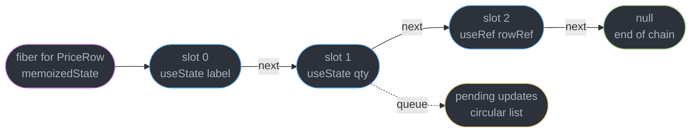
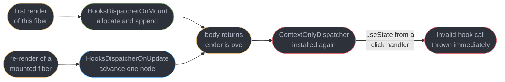
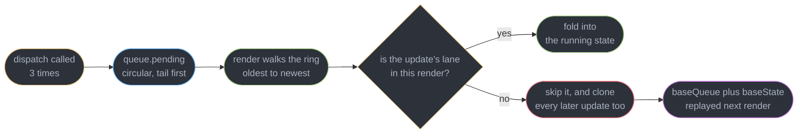
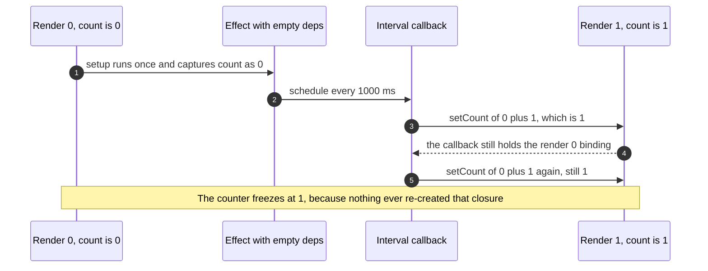
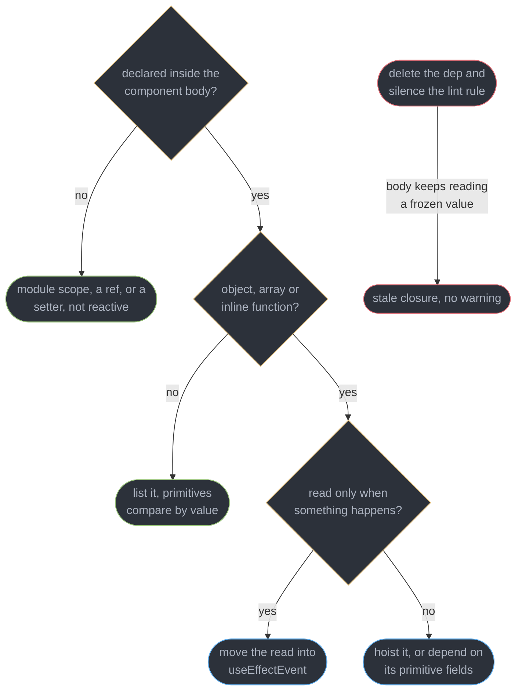
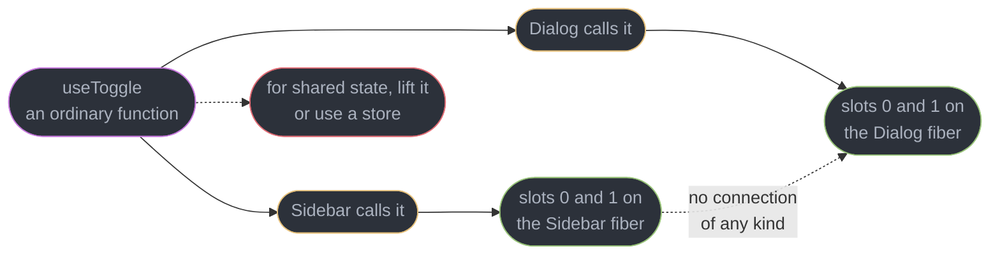

# Hooks Rules and the Hook Model

---

## 1. Concept Overview

A hook looks like a named API — `useState`, `useRef`, `useEffect` — and it is not. Nothing about the name reaches React. When your component body runs, React is walking a **singly linked list of hook objects** hanging off the fiber's `memoizedState` field, one node per hook call, matched **by call order and nothing else**. The first `useState` you write gets slot 0 on every render for as long as that fiber lives; the second gets slot 1. Rename the variable, rename the hook, move the file — the slot does not care. Change the *order*, and slot 1's stored value gets handed to whatever hook now occupies position 1.

That single implementation fact generates every rule you have been told to obey. "Only call hooks at the top level" means "do not let the call sequence differ between renders". "Only call hooks from React functions" means "the dispatcher is only installed while a component body is executing". Neither rule is a style preference, and neither is enforceable by anything except the linter and a pair of development-only warnings.

The second fact is the **dispatcher**. React does not export a working `useState`; it exports a shim that reads `ReactSharedInternals.H` and forwards the call. React installs `HooksDispatcherOnMount` before a fiber's first render, `HooksDispatcherOnUpdate` before every later one, and a throwing `ContextOnlyDispatcher` the instant rendering ends. That is *why* a hook called from a click handler throws a clear error instead of quietly corrupting a neighbouring component's state.

This module is about the machine, so the rules stop being arbitrary. It assumes [React Fundamentals and the Render Model](../react_fundamentals_and_the_render_model/react_fundamentals_and_the_render_model.md) for elements, re-render causes, state-as-a-snapshot, `useReducer` and `useId`. Effect semantics, cleanup, the StrictMode double-mount and the "you might not need an effect" catalogue belong to [Effects and Synchronization](../effects_and_synchronization/effects_and_synchronization.md). Fiber fields, double buffering, lanes and the work loop belong to [Fiber and Reconciliation](../fiber_and_reconciliation/fiber_and_reconciliation.md). Target is React 19.2 (released 2025-10-01, latest patch 19.2.8 as of 2026-07-21).

---

## 2. Intuition

> **One-line analogy**: hooks are a row of numbered lockers on the fiber, not a set of labelled drawers. You get locker 1 because you were the second person through the door, not because your name is on it. Skip a person and everyone behind them opens the wrong locker.

**Mental model**: your component body is a *tape head*. Each render rewinds it to slot 0 and plays forward, one step per hook call. React never learns which hook you called — it learns only how many times and in what order. The names in your source exist for you and for `eslint-plugin-react-hooks`, not for the runtime.

**Why it matters**: three of the four highest-frequency React bugs live here. A hook inside an `if` that silently returns another hook's value. A `setInterval` that logs `0` forever because its closure froze at render 0. A dependency array with the lint rule disabled above it, so an effect reads a value from four renders ago. All three are the same defect in different clothes: **the runtime kept something you thought the source had replaced**.

**Key insight**: a hook stores nothing in the function it appears in. `const [count, setCount] = useState(0)` creates a fresh `const` on every render, holding a copy of whatever `hook.memoizedState` currently is. The variable is a per-render snapshot; the linked-list node is the durable thing. Every stale-closure bug is that gap, and every fix is a way to re-read the node instead of the variable.

---

## 3. Core Principles

- **Position is identity.** A hook's state is addressed by its index in the render's call sequence. Nothing else — not the name, not the file, not the variable — participates in the match.
- **The dispatcher is a global that React swaps.** `ReactSharedInternals.H` points at a mount dispatcher, an update dispatcher, or a throwing one. Your `import { useState } from "react"` is a one-line forwarder to whichever is installed.
- **Two renders of one fiber must issue the same hook calls in the same order.** Not the same *values* — the same *sequence*. Branches, loops, early returns and `&&` short-circuits all break it.
- **Every render creates new closures.** A handler, an effect body and a callback are all allocated fresh, closing over that render's `const` bindings. Nothing retroactively updates a closure that was already handed away.
- **A dependency array is a cache key compared with `Object.is`.** A new object, array or arrow literal is a new key every render, so the memo never hits.
- **A custom hook composes calls, it does not share state.** Two components calling `useToggle()` allocate two independent slot chains on two different fibers. Code is shared; storage never is.
- **`use()` is not a hook in the dispatcher sense.** It reads a promise or context through a per-render counter that resets on every render attempt, so it is legal inside conditions and loops.
- **The linter is the only enforcement at build time.** Production React performs no order check at all; the two order warnings are development-only.

---

## 4. Types / Architectures / Strategies

### 4.1 Hook categories and what each stores in its slot

| Hook | `hook.memoizedState` holds | Has a `queue`? |
|------|---------------------------|----------------|
| `useState` | the current state value | Yes — `useState` is `useReducer` with `basicStateReducer` |
| `useReducer` | the current state value | Yes |
| `useRef` | the ref object `{ current }` itself | No |
| `useMemo` | a `[value, deps]` tuple | No |
| `useCallback` | a `[fn, deps]` tuple | No |
| `useEffect` | an effect node in the fiber's circular effect list | No |
| `useContext` | nothing — it reads the provider directly | No |
| `useSyncExternalStore` | the last snapshot value | Yes, for a forced re-render |
| `useTransition` | the pending boolean, backed by a state hook | Yes |

### 4.2 The four dispatchers

| Dispatcher | Installed when | `useState` behaviour |
|-----------|----------------|----------------------|
| `HooksDispatcherOnMount` | the fiber has no `memoizedState` yet | Allocate a hook object, append it, run the initializer |
| `HooksDispatcherOnUpdate` | a re-render of a mounted fiber | Advance to the next node, drain its update queue |
| `HooksDispatcherOnRerender` | a render-phase update re-runs the same body | Reuse the just-built chain instead of appending |
| `ContextOnlyDispatcher` | rendering is not in progress | Throw `Invalid hook call` |

### 4.3 Rules-of-Hooks violations, ranked by how they fail

| Violation | Failure mode | Caught by |
|-----------|-------------|-----------|
| Early `return` above a hook | Throws `Rendered fewer hooks than expected` | Runtime, dev and production |
| Hook added inside an `if` | Throws `Rendered more hooks than during the previous render` | Runtime, dev and production |
| Ternary swapping one hook for another | **Silent wrong value** — counts match | Dev order warning and the linter only |
| Hook in a `for` over variable-length data | Intermittent count mismatch, only when the length changes | Runtime, once the length moves |
| Hook in an event handler or `setTimeout` | Throws `Invalid hook call` | Runtime, always |
| Hook in a plain helper not named `use*` | Works until the helper is called conditionally | The linter, if the name convention is followed |

### 4.4 Dependency-array forms

| Form | Runs the body | Correct for |
|------|--------------|-------------|
| No array | Every render | Almost nothing; usually a mistake |
| `[]` | Once per mount | A subscription that reads no reactive value at all |
| `[a, b]` | When `Object.is` says `a` or `b` changed | The default, and what the linter derives |
| `[obj]` where `obj` is built in render | Every render — new identity each time | Nothing; depend on `obj.id` instead |
| `[ref]` | Never re-fires — refs are stable | Correct, and the linter knows to omit it |

### 4.5 The three fixes for a stale closure

| Fix | Mechanism | Use when |
|-----|-----------|----------|
| Functional update `setX(x => x + 1)` | React hands the updater the pending value, so nothing is captured | The callback only needs to *write* state |
| A ref written on every render | The ref object is stable, `.current` is re-read at call time | A long-lived callback needs the latest value but must not re-subscribe |
| Re-subscribe on change | List the value as a dependency and let cleanup tear the old one down | The subscription itself depends on the value |

---

## 5. Architecture Diagrams

### Where a hook's state actually lives



The chain is per fiber, so two mounted `PriceRow` elements own two separate chains. The `const` in your source is a copy of a node's `memoizedState`, taken once per render.

### The dispatcher swap



There is exactly one dispatcher slot for the whole application, which is why two copies of `react` in `node_modules` produce this error: one copy's shim reads the field the other copy never wrote.

### The update queue and why `baseQueue` exists



The red path is the subtle half. A skipped low-priority update forces every *later* update to be replayed as well, because dropping one link would apply the later ones against a state that never existed.

### A stale closure, one interval, forever



The interval keeps firing at 1 Hz and keeps writing `1`. `Object.is(1, 1)` is true after the first tick, so React does not even re-render — the bug looks like a dead timer rather than a stale one.

### Deciding what belongs in a dependency array



The detached pair on the right is not a branch of the decision. It is what people do when the rule complains, and it converts a re-run you can measure into a wrong value you cannot see.

### A custom hook shares code, never storage



Inlining the custom hook's body into both components would behave identically. That is the test for whether something is really a custom hook: it must be a pure textual factoring of hook calls.

### The index shift, drawn

The diagram below is the module's centrepiece: a ternary that swaps one hook for another keeps the hook *count* identical, so neither runtime throw fires, and slot 1's stored number is handed to `useRef`.

```
  RENDER 1  editable = true             RENDER 2  editable = false
  ---------------------------           ----------------------------
  call 0  useState("Line 1")            call 0  useState("Line 1")
  call 1  useState(41)                  call 1  useRef(41)   <-- type flips
  call 2  useRef(null)                  call 2  useRef(null)

  fiber.memoizedState  (allocated in render 1, walked positionally in render 2)

     slot 0                slot 1                slot 2
    +---------------+     +---------------+     +---------------+
    | mS: "Line 1"  | --> | mS: 41        | --> | mS: {current} | --> null
    | q : setLabel  |     | q : setQty    |     | q : null      |
    +---------------+     +---------------+     +---------------+
        ^                     ^                     ^
        |                     |                     |
   render 2 call 0       render 2 call 1       render 2 call 2
   useState -> "Line 1"  useRef reads slot 1   useRef -> the real ref
   correct               and returns 41        correct by luck

   qty is now the NUMBER 41, so qty.current is undefined, not 41.
   Three calls before, three calls after, so React throws nothing in production.
```

Both renders issue three hook calls, so the count checks pass. Only the development-only order check and `react-hooks/rules-of-hooks` see the swap; a production build ships the wrong value.

---

## 6. How It Works — Detailed Mechanics

### 6.1 The hook object

Every hook call on a mount allocates one of these and appends it to the chain:

```ts
// One node of fiber.memoizedState. Five fields, no name field anywhere.
type Hook = {
  memoizedState: unknown;   // the value this hook hands back this render
  baseState: unknown;       // state before any skipped update was applied
  baseQueue: Update | null; // updates that must be replayed at a lower priority
  queue: UpdateQueue | null; // where dispatch() pushes new updates
  next: Hook | null;        // the ONLY link — position is the identity
};
```

The queue on a `useState` or `useReducer` hook carries the dispatch machinery:

```ts
type UpdateQueue = {
  pending: Update | null;        // circular list, `pending` points at the NEWEST
  lanes: Lanes;                  // which priorities have pending work
  dispatch: (action: unknown) => void;  // the stable setter you destructure
  lastRenderedReducer: Reducer;  // basicStateReducer for useState
  lastRenderedState: unknown;    // used for the eager bailout, see 6.5
};
```

Note what is absent: there is no `"useState"` string, no key, no slot number stored on the node. The slot number exists only as a cursor React advances while your body runs. That is the whole reason order is load-bearing.

`dispatch` is created once, on mount, bound to the fiber and this queue, and stored on the node. It is therefore **referentially stable for the fiber's entire life** — which is why a setter never needs to appear in a dependency array and why the linter omits it.

### 6.2 The dispatcher

`useState` as exported from `react` is a forwarder, roughly:

```ts
// packages/react/src/ReactHooks.js, condensed.
function resolveDispatcher() {
  const dispatcher = ReactSharedInternals.H;   // `H` in React 19; was ReactCurrentDispatcher.current
  if (dispatcher === null) throw new Error("Invalid hook call. ...");
  return dispatcher;
}

export function useState<S>(initialState: S | (() => S)) {
  return resolveDispatcher().useState(initialState);
}
```

The renderer writes that field. `renderWithHooks()` sets `ReactSharedInternals.H` to `HooksDispatcherOnMount` when `current === null || current.memoizedState === null`, otherwise to `HooksDispatcherOnUpdate`, calls your component, then immediately restores `ContextOnlyDispatcher` — a table whose every entry throws. So calling a hook outside a render hits the throwing table and produces:

```
Uncaught Error: Invalid hook call. Hooks can only be called inside of the body of a
function component. This could happen for one of the following reasons:
1. You might have mismatching versions of React and the renderer (such as React DOM)
2. You might be breaking the Rules of Hooks
3. You might have more than one copy of React in the same app
See https://react.dev/link/invalid-hook-call for tips about how to debug and fix this problem.
```

Cause 3 is the one that wastes the most hours, because the code is correct. Two copies of `react` — a linked package with its own `node_modules`, a monorepo hoisting failure, or a library listing `react` as a dependency rather than a peer dependency — mean copy A's shim reads a dispatcher field that only copy B ever wrote. Diagnose it with `npm ls react`, which should print exactly one resolved version, and fix it with a bundler `resolve.dedupe: ["react", "react-dom"]` or an npm `overrides` block.

### 6.3 Why order matters — the conditional-hook trace

```tsx
// BROKEN: the ternary swaps a state hook for a ref hook at slot 1.
// react-hooks/rules-of-hooks flags both calls. If the rule is off, this ships.
function PriceRow({ editable }: { editable: boolean }) {
  const [label] = useState("Line 1");                  // slot 0, always
  const qty = editable ? useState(41) : useRef(41);    // slot 1, TYPE FLIPS
  const rowRef = useRef<HTMLTableRowElement>(null);    // slot 2, always
  return <tr ref={rowRef}>{label}</tr>;
}
```

Render 1 with `editable` true allocates slot 1 as a state hook with `memoizedState = 41` and a queue. Render 2 with `editable` false reaches slot 1 through `useRef`, whose update path is one line — return `hook.memoizedState`. It returns the number `41`, not `{ current: 41 }`. Every later read of `qty.current` is `undefined`, and writing `qty.current = 5` silently sets a property on a primitive wrapper that is thrown away.

Both renders made three hook calls, so neither runtime guard fires. Development React keeps a parallel `hookTypesDev` array and logs:

```
Warning: React has detected a change in the order of Hooks called by PriceRow.
This will lead to bugs and errors if not fixed. For more information, read the
Rules of Hooks: https://react.dev/link/rules-of-hooks

   Previous render            Next render
   ------------------------------------------------------
1. useState                   useState
2. useState                   useRef
   ^^^^^^^^^^^^^^^^^^^^^^^^^^^^^^^^^^^^^^^^^^^^^^^^^^^^^^
```

That array does not exist in a production build. The two guards that *do* survive minification are count-based, and they only fire when the counts differ:

```
Error: Rendered more hooks than during the previous render.
Error: Rendered fewer hooks than expected. This may be caused by an accidental early return statement.
```

The second is the classic `if (!data) return <Spinner />;` sitting above a `useEffect`. The fix is always the same shape — hoist every hook above every branch, and branch on the *returned elements* instead:

```tsx
// FIX: all hooks run unconditionally; the branch moves into the JSX.
function PriceRow({ editable }: { editable: boolean }) {
  const [label] = useState("Line 1");
  const [qty, setQty] = useState(41);
  const rowRef = useRef<HTMLTableRowElement>(null);
  return <tr ref={rowRef}>{editable ? <input value={qty} onChange={(e) => setQty(+e.target.value)} /> : label}</tr>;
}
```

Loops fail the same way for the same reason. `items.map(i => useState(i))` is stable only while `items.length` is, and the day a filter removes one row you get `Rendered fewer hooks than expected` from a component that has not been touched in months. If a variable number of things need state, render a variable number of *child components*, each with a fixed hook count.

### 6.4 The update queue

`dispatch` builds an update node and splices it into a **circular** list:

```ts
const update = {
  lane,                 // the priority this update was scheduled at
  revertLane: NoLane,   // used by useOptimistic
  action,               // the value or the updater function you passed
  hasEagerState: false,
  eagerState: null,
  next: null,           // closed into a ring by enqueueConcurrentHookUpdate
};
```

`queue.pending` points at the **newest** update, and `pending.next` is the **oldest** — a one-pointer ring that gives O(1) append and O(1) access to the head. On the next render, `updateReducer` walks from `pending.next` forward and folds each action into a running state value: a plain value replaces, a function transforms.

`baseState` and `baseQueue` handle interruption. If an update's lane is not included in the render's lanes — a `startTransition` update being rendered at a higher urgency, for instance — React cannot simply drop it, because the updates *after* it were written expecting it to have applied. So it clones the skipped update into `baseQueue`, sets `baseState` to the state as of just before the skip, and then clones **every subsequent update too**, whether or not their lanes match. The next render at the lower priority starts from `baseState` and replays the whole tail in order.

That is why a low-priority `setCount(c => c + 1)` never gets lost and never gets applied twice, and it is also why an **impure updater is corrupting**: React replays it. An updater that pushes to an array, increments a module counter or calls `Date.now()` produces different results on the replay than it did on the first pass.

### 6.5 The eager bailout

Before scheduling any work, `dispatchSetState` tries to compute the result immediately:

```ts
// Only when the queue is empty — no pending updates to fold in first.
if (fiber.lanes === NoLanes && (alternate === null || alternate.lanes === NoLanes)) {
  const currentState = queue.lastRenderedState;
  const eagerState = queue.lastRenderedReducer(currentState, action);
  update.hasEagerState = true;
  update.eagerState = eagerState;
  if (Object.is(eagerState, currentState)) return;   // schedule nothing at all
}
```

So `setStatus("idle")` when the status is already `"idle"` costs nothing — the component body does not even run. But `setFilters({ q: "" })` allocates a new object, fails `Object.is`, and always renders. The bailout only applies when the queue was empty, which is why the *second* `setCount(0)` in the same handler still schedules work even though the first one bailed.

One consequence surprises people: React may render the component **once more** after a bailout, then discard the result. The eager check happens at dispatch time; if a re-render was already in flight, the equality is re-checked during the render and React bails out of the children instead. Seeing one extra render in the Profiler after a no-op setter is expected.

### 6.6 Closure capture and stale values

Every render allocates every function in the body again, closing over that render's bindings.

```tsx
// BROKEN: empty deps mean the effect runs once, so `count` is frozen at 0 forever.
useEffect(() => {
  const id = setInterval(() => setCount(count + 1), 1000);
  return () => clearInterval(id);
}, []);
```

The interval fires 60 times a minute and writes `1` every time. After the first tick `Object.is(1, 1)` is true, so React schedules nothing — the UI looks frozen, which reads as a broken timer rather than a stale closure. Three fixes, and they are not interchangeable:

```tsx
// FIX A — functional update. The callback never reads count at all.
useEffect(() => {
  const id = setInterval(() => setCount((c) => c + 1), 1000);
  return () => clearInterval(id);
}, []);

// FIX B — a ref, when the callback must READ a value it does not own.
const rateRef = useRef(rate);
rateRef.current = rate;                       // rewritten every render
useEffect(() => {
  const id = setInterval(() => report(rateRef.current), 1000);
  return () => clearInterval(id);
}, []);

// FIX C — re-subscribe, when the subscription itself depends on the value.
useEffect(() => {
  const socket = new WebSocket(`wss://feed/${roomId}`);
  return () => socket.close();
}, [roomId]);                                  // roomId change tears down and rebuilds
```

Fix A is correct only when the callback writes and never reads. Fix B keeps one long-lived subscription and pays for it by opting out of reactivity — if the value should *cause* the subscription to change, a ref hides that and you get a socket connected to the wrong room. Fix C is the honest default: list the dependency and let cleanup do its job. The cost is a teardown and setup per change, which is 200 ms of reconnect on a WebSocket and nothing at all on a `setInterval`.

`useEffectEvent` `[19.2]` is the fourth option for the "read the latest, do not re-fire" case, and [Effects and Synchronization](../effects_and_synchronization/effects_and_synchronization.md) owns it.

### 6.7 Dependency arrays and reactive values

A **reactive value** is anything declared inside the component body that could differ between renders: props, state, context values, and any local `const` computed from them. Those are exactly what the linter requires. Not reactive: module-scope constants, imported functions, `useState` setters, `dispatch` from `useReducer`, and the ref object returned by `useRef` — all referentially stable for the fiber's life.

```tsx
// BROKEN: `options` is a new object every render, so the effect fires every render.
function Feed({ topic }: { topic: string }) {
  const options = { topic, limit: 20 };
  useEffect(() => { subscribe(options); }, [options]);   // 60 subscribes in 60 renders
}

// FIX: depend on the primitives. Two strings compare by value, so this fires
// only when `topic` actually changes.
function Feed({ topic }: { topic: string }) {
  useEffect(() => { subscribe({ topic, limit: 20 }); }, [topic]);
}
```

An inline arrow has the same problem: `useEffect(fn, [onDone])` where the parent writes `onDone={() => log()}` in JSX re-fires on every parent render. Hoist the function, wrap it where the compiler bailed out, or move the call into `useEffectEvent`.

`react-hooks/exhaustive-deps` is right far more often than the engineer overriding it. The legitimate exceptions are narrow and each has a real fix that is not the disable comment: a value that should be read-latest-but-not-reactive belongs in `useEffectEvent` or a ref; a mount-only imperative call belongs behind a `didInit` ref guard; a value the linter cannot prove stable (a mutable object from a non-React library) belongs hoisted out of the component. **Disabling the rule does not remove the dependency — it removes the re-run, so the body keeps reading a value from an earlier render with nothing to signal it.** That is a silent wrong value in exchange for a silent lint line.

### 6.8 Custom hooks

A custom hook is a function whose name starts with `use` and which calls other hooks. It is composition, not sharing:

```ts
export function useToggle(initial = false) {
  const [on, setOn] = useState(initial);              // one slot per CALLER
  const toggle = useCallback(() => setOn((v) => !v), []);
  return [on, toggle] as const;                        // tuple: caller names it
}
```

`Sidebar` calling `useToggle()` and `Dialog` calling `useToggle()` allocate slots on two different fibers. Closing the sidebar does nothing to the dialog. If two components must agree, the state has to live somewhere they both reach — lifted to a common parent, in context, or in an external store read through `useSyncExternalStore`, which [Context and Component Communication](../context_and_component_communication/context_and_component_communication.md) owns along with tearing.

The `use` prefix is **load-bearing for tooling, not for the runtime**. `eslint-plugin-react-hooks` decides whether a function is a component or a hook purely from its name: capitalised means component, `use` followed by an uppercase letter means hook, anything else is a plain function where hook calls are errors. Name it `getToggle` and every call inside it is reported as a violation; name a plain helper `useFormatDate` and the linter stops checking that its callers obey the rules.

Two rules for the returned API. Return a **tuple** when the caller should rename the values (`useToggle`, `useState`-alike, at most three items) and an **object** otherwise, because an object with five fields is unreadable positionally. And keep the returned identities stable — wrap returned callbacks so a consumer can put them in a dependency array without re-firing every render. The React Compiler handles this automatically in a compiled codebase; write it by hand in a published library, which cannot assume its consumers compile.

### 6.9 `use()` — the one that may be conditional

```tsx
// LEGAL. `use` may sit inside an if, a loop, or after an early return.
function Comments({ enabled, promise }: { enabled: boolean; promise: Promise<Row[]> }) {
  if (!enabled) return null;
  const rows = use(promise);           // suspends until the promise settles
  const theme = use(ThemeContext);     // same API reads context
  return <ul>{rows.map((r) => <li key={r.id}>{r.text}</li>)}</ul>;
}
```

`use()` is not stored in the hook chain. For context it delegates to `readContext`, which walks providers and has no per-fiber slot. For a promise it uses a **thenable index counter** that resets to zero at the start of every render *attempt* — and when a component suspends, React discards the partial render and re-runs the body from the top, so the counter realigns with the same call sequence the retry produces. There is no cross-render position to corrupt, which is exactly why the restriction does not apply.

The restrictions that *do* apply: `use()` must still be called during render, never in an event handler, a `setTimeout`, or a `try`/`catch` block that would swallow the thrown thenable. And the promise must come from somewhere stable — creating it in the render body means a new promise every render and an infinite suspend loop; it belongs in a Server Component, a cache, or a data library. [Suspense and Error Boundaries](../suspense_and_error_boundaries/suspense_and_error_boundaries.md) owns boundary placement and the streaming story.

### 6.10 The linter in 2026

`eslint-plugin-react-hooks` used to ship two rules. Since 6.1.1 (2025-10-03) it also ships the compiler's **Rules of React** checks, and 7.0 (2025-10-08, the day after React Compiler 1.0) turns them on by default, so one plugin covers both:

| Rule | Catches |
|------|---------|
| `react-hooks/rules-of-hooks` | Conditional, looped, nested or non-React hook calls |
| `react-hooks/exhaustive-deps` | A reactive value read in an effect or memo but missing from its deps |
| `react-hooks/set-state-in-render` | `setState` called during the render pass, the infinite-loop generator |
| `react-hooks/set-state-in-effect` | An effect that only copies props or state into other state |
| `react-hooks/refs` | Reading or writing `ref.current` during render, which breaks purity |
| `react-hooks/purity` | A render body calling `Date.now()`, `Math.random()` or mutating a prop |

Since 7.0 the `recommended` preset turns the whole set on, and `recommended-latest` adds the experimental compiler rules on top. These are static checks over the same analysis the compiler runs, so a file that passes them is a file the compiler can memoize; a file that fails often gets a compiler bailout instead of an error, which is worse because it is silent. `useMemo` and `useCallback` still exist as escape hatches; [The React Compiler](../the_react_compiler/the_react_compiler.md) owns when to keep them.

---

## 7. Real-World Examples

**A design-system library shipping two copies of React.** A component library listed `react` under `dependencies` instead of `peerDependencies`. Consumers on npm 7+ got a nested `node_modules/@acme/ui/node_modules/react`, and every component from the library threw `Invalid hook call` on first render. `npm ls react` printed two resolved versions. Moving it to `peerDependencies` plus `devDependencies` fixed 40 downstream apps in one release.

**The filter that ate the hooks.** An analytics dashboard rendered one `useState` per active metric via `metrics.map(m => useState(m.default))`. It worked for eight months because the metric list was a constant. The day a "hide empty series" toggle shipped, unchecking it threw `Rendered fewer hooks than expected` on the next keystroke. The fix was one component per metric — 6 lines added, the hook count per fiber now fixed at 2.

**A search box that searched for nothing.** `useEffect(() => search(query), [])` with the deps rule disabled shipped because the reviewer read the disable comment as intentional. Every search after the first returned results for the empty string. Time to detection was 11 days, because the first search on a fresh page load was always correct.

**A chat room stuck on the old channel.** A `useRef` was used to avoid re-subscribing a WebSocket on `roomId` change — fix B applied where fix C was needed. Switching rooms updated the header and left the socket on the previous room, so messages arrived in the wrong room for as long as the tab stayed open. Listing `roomId` as a dependency cost one 180 ms reconnect per switch and made the bug impossible.

---

## 8. Tradeoffs

| Design choice | Bought | Paid |
|---------------|--------|------|
| Position-indexed hooks over named slots | No key bookkeeping, no per-hook string, ~5 fields per node | Order is load-bearing, and production performs no order check |
| A single global dispatcher | A hook call is one property read plus one call | Two copies of React in a bundle break every component |
| Closures capturing per-render values | Renders are reproducible and testable in isolation | Stale closures wherever a callback outlives its render |
| `Object.is` on dependency arrays | O(1) comparison regardless of value size | Any object, array or inline function dependency never matches |
| Eager state with a bailout | A no-op setter costs zero renders | Only fires when the queue was empty, so it is easy to misread in a profile |
| `baseQueue` replay of skipped updates | Low-priority updates are never lost or misapplied | Updaters may run more than once, so impure ones corrupt state |
| The linter as the enforcement layer | Zero runtime cost, catches violations before a build | A disable comment silently removes the protection |

| Sharing approach | Custom hook | Lifted state | External store |
|-----------------|-------------|--------------|----------------|
| What is shared | Code only | One value, downward | One value, anywhere |
| Re-render blast radius | The calling component | The owner subtree | Only subscribed components |
| Works outside React | No | No | Yes |
| Right when | Two components need the same behaviour | Two siblings need the same value | Many components, or a non-React writer |

---

## 9. When to Use / When NOT to Use

**Reach for this model when:**

- A value read inside a `setInterval`, `addEventListener` or `setTimeout` is one or more renders behind. That is closure capture, and §6.6's three fixes are the whole answer.
- A component throws `Rendered more hooks` or `Rendered fewer hooks` after a data shape changed. Look for a hook below an early return or inside a `.map()`.
- An effect re-fires on every render with no visible cause. Check the dependency array for an object, array or arrow literal built in the body.
- You are about to write `// eslint-disable-next-line react-hooks/exhaustive-deps`. Every legitimate case has a named alternative; the disable is the one option that leaves a silent wrong value.

**Do not reach for it when:**

- Two components need to agree on a value. A custom hook cannot do that by construction — lift the state or use a store.
- You want to memoize something for speed. React Compiler 1.0 places memoization automatically; hand-written `useMemo` is now an escape hatch justified by a profile.
- The value is server data with caching, deduplication and staleness. That is [Server State and Data Fetching](../server_state_and_data_fetching/server_state_and_data_fetching.md), not a hook you write.
- The subscription is to something outside React — a media query, a store, `navigator.onLine`. `useSyncExternalStore` exists so concurrent rendering cannot tear those reads.

---

## 10. Common Pitfalls

**A hook below an early return.** The single highest-volume Rules-of-Hooks violation.

```tsx
// BROKEN: on the first render `data` is null, so useEffect never runs and the
// hook count is 1. When data arrives the count becomes 2.
// Error: Rendered more hooks than during the previous render.
function Report({ data }: { data: Row[] | null }) {
  const [sort, setSort] = useState("date");
  if (!data) return <Spinner />;
  useEffect(() => track("report_view"), []);
  return <Table rows={data} sort={sort} />;
}

// FIX: every hook above every return. Branch on what you render, not on what you call.
function Report({ data }: { data: Row[] | null }) {
  const [sort, setSort] = useState("date");
  useEffect(() => track("report_view"), []);
  if (!data) return <Spinner />;
  return <Table rows={data} sort={sort} />;
}
```

**Disabling `exhaustive-deps` instead of fixing the dependency.** The rule is telling you the body reads a value the array does not list. Removing the warning does not remove the read — it guarantees the read is stale. Reach for `useEffectEvent`, a ref, or the primitive fields instead.

**Depending on an object built in the render body.** `const opts = { limit: 20 }` inside the component is a new identity on every render, so `[opts]` never matches and the effect fires unconditionally. Depend on `20`, or hoist `opts` to module scope where it is not reactive at all.

**Writing `ref.current` during render.** `react-hooks/refs` flags it because the render pass may be discarded and re-run, so a counter incremented in the body counts abandoned attempts. Write refs in effects or in event handlers.

**Calling a hook from a plain helper.** `function formatRow() { const t = useContext(ThemeContext); ... }` works until someone calls `formatRow()` inside an `if`. Rename it `useRowFormatter` so the linter treats it as a hook, or pass the theme in as an argument.

**Expecting a custom hook to share state.** Two `useAuth()` calls give two independent states. This is the most common reason a "global" flag flips in one component and not the other. Put the value in context or a store.

**Putting a setter in a dependency array and thinking it matters.** `dispatch` and `setState` are created once on mount and stored on the hook node, so they never change. Listing them is harmless noise; the linter omits them for that reason.

**An impure updater function.** `setRows(rs => { rs.push(row); return rs; })` mutates and returns the same reference, so `Object.is` reports no change and nothing renders. Worse, `baseQueue` replay means React may call the updater twice on the same render, so even a correct-looking `rs => [...rs, row]` that also increments a module counter double-counts.

---

## 11. Technologies & Tools

| Tool | Purpose |
|------|---------|
| React | 19.2 is the current line; `ReactSharedInternals.H` is the dispatcher slot |
| eslint-plugin-react-hooks | `rules-of-hooks`, `exhaustive-deps`, and the compiler's Rules of React set |
| babel-plugin-react-compiler | React Compiler 1.0 — memoizes automatically for code that obeys the rules |
| React DevTools | Shows a component's hook tree by index, with custom hooks grouped |
| react-scan | Live outline of what just re-rendered, for spotting an effect that re-fires |
| TypeScript | `as const` on a custom hook's returned tuple keeps the caller's types exact |
| Vite | `resolve.dedupe` for `react` and `react-dom` — the duplicate-copy fix |
| npm | `npm ls react` diagnoses cause 3 of the Invalid hook call error |
| Vitest | Runs a custom hook under a test renderer without mounting a real tree |
| React Testing Library | `renderHook` for asserting a custom hook's API across re-renders |
| Biome | Alternative linter; its React rules do not yet cover the compiler set |

---

## 12. Interview Questions with Answers

**Q: What actually happens when you call a hook inside an if, and why is it sometimes silent?**
**Short:** Slot indices shift, so a later hook reads the value a different hook stored, and nothing throws unless the total hook count also changed.

Hooks are matched by position in a singly linked list, so a ternary swapping `useState(41)` for `useRef(41)` at slot 1 keeps three calls in both renders. The ref hook's update path returns `hook.memoizedState` directly, handing back the number `41` instead of `{ current: 41 }`, and every later `.current` read is `undefined`. Both runtime guards are count-based, so they stay quiet. Only the development-only order check and `react-hooks/rules-of-hooks` see it, and neither exists in a production build.

**Q: A setInterval keeps writing the same value forever — what is going on?**
**Short:** The callback closed over one render's bindings and the empty dependency array means it was never re-created, so it computes from a frozen value.

`setInterval(() => setCount(count + 1), 1000)` inside an effect with `[]` deps captures `count` at 0. Every tick computes `0 + 1`, and after the first one `Object.is(1, 1)` is true, so React schedules nothing — the UI looks like a dead timer rather than a stale one. Three fixes, chosen by what the callback needs: `setCount(c => c + 1)` when it only writes, a ref rewritten each render when it must read a value without re-subscribing, and listing the value as a dependency when the subscription itself depends on it.

**Q: Why is disabling react-hooks/exhaustive-deps almost always wrong?**
**Short:** Silencing the rule does not remove the read from the body, it removes the re-run, so the code keeps using a value from an earlier render with nothing signalling it.

The warning means a reactive value appears inside the effect but not in its array. The disable comment leaves the read in place and stops the effect from ever seeing a newer value, converting a measurable extra re-run into an invisible wrong result — a search box that searches the empty string, a socket subscribed to the previous room. Each genuine exception has a named alternative: `useEffectEvent` for read-latest-do-not-re-fire, a ref for the same shape in a library, a `didInit` ref for a one-time imperative call, and hoisting for a value that is not reactive at all.

**Q: Why can a hook not be called inside a loop over an array?**
**Short:** The call count varies with the array length, so the day the length changes React finds a different number of slots than the previous render allocated.

`items.map(i => useState(i.value))` is stable only while `items.length` is. Add or remove one element and the next render issues a different number of calls, producing `Rendered more hooks than during the previous render` or `Rendered fewer hooks than expected` from code nobody edited. It typically survives months in production because the list is a constant until a filter ships. The fix is to render one child component per item, each with a fixed hook count on its own fiber.

**Q: What are the three documented causes of an Invalid hook call error?**
**Short:** Mismatched React and renderer versions, an actual Rules of Hooks violation, or more than one copy of React resolved in the same application.

React exports a shim that reads `ReactSharedInternals.H` and forwards; outside a render that field holds `ContextOnlyDispatcher`, whose every entry throws. Cause 2 is the obvious one — a hook in a click handler or a class method. Cause 3 is the expensive one because the code is correct: a library listing `react` as a dependency rather than a peer dependency gets its own nested copy, whose shim reads a field only the other copy writes. Diagnose with `npm ls react` expecting exactly one version, and fix with bundler dedupe or an npm `overrides` entry.

**Q: Why may use() be called conditionally when every other hook may not?**
**Short:** It stores nothing in the fiber's positional chain, reading context through the provider walk and promises through a counter that resets on every render attempt.

For context, `use()` delegates to `readContext`, which walks up the provider chain and has no per-fiber slot to misalign. For a promise it uses a thenable index that starts at zero on each render attempt, and because a suspended component re-runs its body from the top, the retry reproduces the same call sequence and the index realigns. The restrictions that remain: it must still run during render, never in an event handler or a `try`/`catch` that swallows the thrown thenable, and the promise must come from a stable source or the component suspends forever.

**Q: Do two components calling the same custom hook share its state?**
**Short:** No — each caller allocates its own slots on its own fiber, so a custom hook shares code and never shares storage.

`useToggle()` inside `Sidebar` and inside `Dialog` produce two independent `useState` nodes on two unrelated fibers. Toggling one has no effect on the other, and this is the most common reason a "global" flag appears to update in one place only. The test is textual: inlining the custom hook's body into both components must behave identically. When two components genuinely must agree, lift the state to a common parent, put it in context, or subscribe both to an external store via `useSyncExternalStore`.

**Q: Why does the use prefix on a custom hook matter?**
**Short:** It is how the ESLint plugin classifies a function, since the runtime has no concept of a custom hook at all.

`eslint-plugin-react-hooks` decides from the name alone: a capitalised identifier is a component, `use` followed by an uppercase letter is a hook, everything else is a plain function where hook calls are reported as violations. Name a real hook `getToggle` and every internal `useState` is flagged. Name a plain helper `useFormatDate` and the linter starts trusting it, so it stops checking that its callers obey the rules — the more dangerous of the two mistakes. React itself never reads the name.

**Q: What fields does a hook object hold, and what is missing from it?**
**Short:** Five fields — memoizedState, baseState, baseQueue, queue and next — with no name, no key and no stored slot number anywhere.

`memoizedState` is the value handed back this render; `queue` carries `pending`, `dispatch`, `lastRenderedReducer` and `lastRenderedState`; `next` is the only link, which is what makes position the identity. `baseState` and `baseQueue` hold the replay state for updates skipped at a lower priority. The absence of a name field is the whole story: the slot cursor exists only while your body runs, and React learns how many hooks you called but never which ones.

**Q: How does React install and remove the hook dispatcher around a render?**
**Short:** renderWithHooks writes a mount or update table into ReactSharedInternals.H before calling your body and restores a throwing table the moment it returns.

The choice is one condition: `current === null || current.memoizedState === null` selects `HooksDispatcherOnMount`, which allocates a node and appends it; otherwise `HooksDispatcherOnUpdate`, which advances the cursor and drains that node's queue. A third table, `HooksDispatcherOnRerender`, handles a render-phase update re-running the same body without re-appending. When the body returns, `ContextOnlyDispatcher` goes back in, so any later call throws rather than corrupting a neighbouring fiber's chain.

**Q: How is the update queue structured, and why does a skipped update force a replay?**
**Short:** Updates form a circular list whose pending pointer holds the newest, and skipping one requires cloning every later update because they were written expecting it to have applied.

`queue.pending` points at the newest node and `pending.next` at the oldest, giving O(1) append and O(1) head access. During render, `updateReducer` walks from the oldest, folding each action into a running state — a plain value replaces, a function transforms. When an update's lane is absent from the current render, React clones it into `baseQueue`, records the pre-skip value in `baseState`, and clones the entire tail regardless of lane. That replay is exactly why an impure updater is corrupting: React may run it more than once.

**Q: How does React decide a setter call needs no work at all?**
**Short:** When the queue is empty it computes the next value eagerly at dispatch time and returns without scheduling if Object.is says nothing changed.

`dispatchSetState` checks that the fiber and its alternate have no pending lanes, then runs `lastRenderedReducer(lastRenderedState, action)` immediately, stores the answer on the update as `eagerState`, and compares. `setStatus("idle")` on an already-idle component therefore never runs the body. A fresh object literal fails the comparison every time, which is why `setFilters({ q: "" })` always renders. The bailout only applies to an empty queue, so a second setter in the same handler still schedules even if the first one bailed.

**Q: Why does an object in a dependency array defeat memoization entirely?**
**Short:** Dependencies are compared with Object.is, which is reference equality for objects, so a literal built in the render body is a new key every time.

`const opts = { topic, limit: 20 }` in the component body allocates a fresh object per render, so `[opts]` never matches the previous array and the effect fires on every render — 60 subscribe calls across 60 renders. The same applies to array literals and to inline arrow props written in a parent's JSX. Fix it by depending on the primitive fields (`[topic]`), which compare by value, or by hoisting a truly constant object to module scope where it is not a reactive value at all.

**Q: When should you reach for a ref instead of a functional update to fix a stale value?**
**Short:** Use a ref only when a long-lived callback must read a value it does not own and re-creating the subscription would be too expensive.

The functional update is the first choice because it captures nothing — `setCount(c => c + 1)` works no matter how old the closure is, but only when the callback writes and never reads. A ref rewritten on every render gives you the latest value at call time and keeps one subscription alive, at the cost of opting that value out of reactivity. That is a bug when the value should *cause* a change: using a ref for `roomId` leaves the WebSocket on the old room while the header updates. Prefer listing the dependency and paying the reconnect.

**Q: What is the difference between the two hook-count errors and the order warning?**
**Short:** The count errors are thrown in every build when the number of calls changes, while the order warning is development-only and prints a numbered comparison table.

`Rendered more hooks than during the previous render` and `Rendered fewer hooks than expected. This may be caused by an accidental early return statement.` both come from comparing how far the cursor advanced against the chain length, so they survive minification. The order warning — `React has detected a change in the order of Hooks called by X` — is backed by a parallel `hookTypesDev` array of hook names that only development builds maintain. A violation with matching counts is therefore invisible in production, which is what makes the linter the real protection.

**Q: What did eslint-plugin-react-hooks gain alongside React Compiler 1.0?**
**Short:** It absorbed the compiler's Rules of React checks, adding set-state-in-render, set-state-in-effect, refs and purity to the original two rules.

Version 6.1.1 (2025-10-03) added rules backed by the compiler's static analysis, and since 7.0.0 (2025-10-08) the `recommended` preset enables the whole set. `set-state-in-render` catches the infinite-loop generator; `set-state-in-effect` catches an effect that only copies props into state; `refs` catches reading or writing `ref.current` during render. These matter beyond hygiene: a file that fails them is a file the compiler will bail out of rather than error on, so the memoization silently does not happen.

**Q: What makes a custom hook's returned API stable enough to depend on?**
**Short:** Return a tuple for up to three values and an object beyond that, and keep every returned callback referentially stable across renders.

A consumer will put your returned functions in a dependency array, so a fresh arrow each render re-fires their effects. Wrap them, or let the React Compiler place the memoization in an application codebase — but write it by hand in a published library, which cannot assume consumers compile. The tuple-versus-object choice is about renaming: `const [on, toggle] = useToggle()` reads well because the caller names both, while five positional values do not. Setters and `dispatch` are already stable, since they are created once on mount and stored on the hook node.

**Q: Does the React Compiler make the Rules of Hooks unnecessary?**
**Short:** It makes them more binding, because the compiler only memoizes code it can prove follows them and silently skips whatever it cannot.

React Compiler 1.0 replaces hand-placed `useMemo`, `useCallback` and `memo` with automatic memoization, and Meta reported up to 12% faster loads and roughly 2.5x on some interactions. But its analysis assumes positional hooks, pure render bodies and honest dependencies. Break a rule and it bails out of that component rather than failing the build, so the observable result is a component that simply got no optimization — with no error to lead you there. The rules were the contract before the compiler existed; the compiler turned them into the input.

---

## 13. Best Practices

- Put every hook call above every `return`, every `if` and every loop in the body. Branch on the elements you return, never on the hooks you call.
- Keep `react-hooks/rules-of-hooks` and `react-hooks/exhaustive-deps` at error, and adopt the `recommended-latest` preset so the compiler's Rules of React checks come with them.
- When the linter asks for a dependency, add it and then fix the churn — with `useEffectEvent`, a ref, or the primitive fields. Reach for the disable comment last and never without a comment saying why.
- Depend on primitives, not on objects, arrays or inline functions built in the render body. `[topic]` compares by value; `[{ topic }]` never matches.
- Use the functional update whenever a callback writes state it does not need to read. It is correct in an interval, in a promise continuation, and inside a replayed low-priority update.
- Name every function that calls a hook `useSomething`, and never name a plain helper that way. The linter reads nothing but the name.
- Return a tuple from a custom hook when the caller renames the values and an object otherwise, and keep returned callbacks referentially stable if the hook is published.
- Run `npm ls react` before debugging an `Invalid hook call` in code you believe is correct. Two resolved versions is the answer more often than a rule violation.
- Never write `ref.current` from a render body. A discarded render attempt would leave the write behind, and `react-hooks/refs` flags it for that reason.

---

## 14. Case Study

**Problem.** An internal ops console had a "live orders" page that engineers had learned to reload every couple of minutes. Two symptoms, filed as separate tickets six weeks apart. The order count in the header stopped advancing after roughly 30 seconds, even though new rows kept appearing in the table below it. And switching the region filter from `eu-west` to `us-east` updated the table header immediately while the streaming feed kept delivering `eu-west` orders — for as long as the tab stayed open, up to a measured 4 hours.

**Investigation.** React DevTools showed the header component re-rendering exactly twice after mount, then never again. The Profiler showed the polling effect firing once, with a 30-second interval still alive in the Performance panel. Adding a log inside the interval printed the same `count` value on every tick — the value from render 0. The region bug reproduced instantly once someone checked the WebSocket URL in the Network panel: it still carried `region=eu-west` after the switch.

**Root cause.** One file, two stale closures, and a disabled lint rule sitting above each.

```tsx
// BROKEN
function LiveOrders({ region }: { region: string }) {
  const [count, setCount] = useState(0);
  const [rows, setRows] = useState<Order[]>([]);
  const regionRef = useRef(region);
  regionRef.current = region;

  // 1. `count` is captured at 0. Every tick computes 0 + 1 and writes 1.
  //    After the first tick Object.is(1, 1) is true, so React renders nothing
  //    and the header freezes at 1 while rows keep arriving.
  useEffect(() => {
    const id = setInterval(() => setCount(count + 1), 30_000);
    return () => clearInterval(id);
    // eslint-disable-next-line react-hooks/exhaustive-deps
  }, []);

  // 2. A ref was used to avoid reconnecting on every region change. But the URL
  //    is read ONCE, at subscribe time, so the socket stays on the first region
  //    forever. The ref hides exactly the dependency that should re-fire.
  useEffect(() => {
    const socket = new WebSocket(`wss://ops.internal/orders?region=${regionRef.current}`);
    socket.onmessage = (e) => setRows((rs) => [JSON.parse(e.data), ...rs].slice(0, 500));
    return () => socket.close();
    // eslint-disable-next-line react-hooks/exhaustive-deps
  }, []);
  ...
}
```

Both defects are the same defect. The effect bodies were written once, at render 0, and closed over that render's bindings; the empty dependency arrays guaranteed they were never written again. The disable comments were added in the same commit as the effects, by an engineer who read the warnings as noise because the code "obviously only needs to run on mount".

**Fix.** Two different repairs, because the two effects need different things — one writes without reading, the other subscribes on a value.

```tsx
// FIX
function LiveOrders({ region }: { region: string }) {
  const [count, setCount] = useState(0);
  const [rows, setRows] = useState<Order[]>([]);

  // 1. The updater receives the pending value, so the callback captures nothing
  //    and the empty deps array is now honestly correct.
  useEffect(() => {
    const id = setInterval(() => setCount((c) => c + 1), 30_000);
    return () => clearInterval(id);
  }, []);

  // 2. The subscription depends on the region, so the region is a dependency.
  //    Cleanup closes the old socket, setup opens the new one. One reconnect
  //    per switch, measured at 180 ms, in exchange for correctness.
  useEffect(() => {
    setRows([]);
    const socket = new WebSocket(`wss://ops.internal/orders?region=${region}`);
    socket.onmessage = (e) => setRows((rs) => [JSON.parse(e.data), ...rs].slice(0, 500));
    return () => socket.close();
  }, [region]);
  ...
}
```

The `regionRef` was deleted rather than kept, because it existed only to hold the disable comment up. Both `eslint-disable` lines came out with it, and the repository added `react-hooks/exhaustive-deps` at `error` with a CI check that fails on any new disable comment for that rule without a trailing justification.

**Results.**

- Header count: frozen at 1 to advancing every 30 seconds, matching the row count exactly.
- Wrong-region orders after a filter switch: from every message for up to 4 hours, to zero.
- Reconnects introduced: 1 per region switch, at 180 ms — an average of 3 per session.
- `eslint-disable` comments for `exhaustive-deps` in the repository: 14 to 0 over the following sprint, which surfaced 2 more stale-closure bugs of the same shape.

**Lesson.** Neither bug was reported as a React bug and neither symptom named its cause: a frozen number looked like a dead timer, and a wrong data feed looked like a backend routing problem. Both were one closure allocated at render 0 and never replaced, and in both cases the linter had said so at the time and been overruled. The functional update and the honest dependency are the same idea from two directions — stop reading a value the closure froze, either by never capturing it or by rebuilding the closure when it changes.
