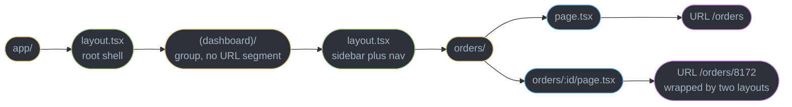
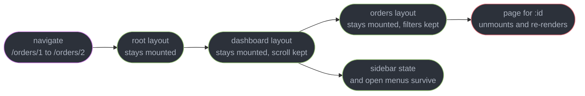
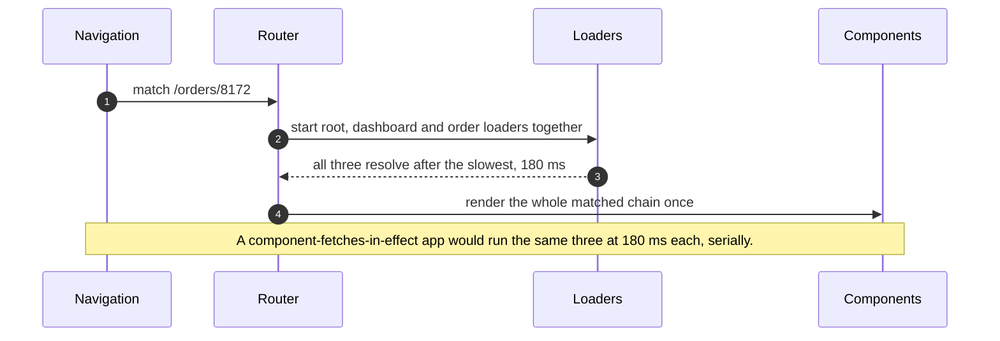
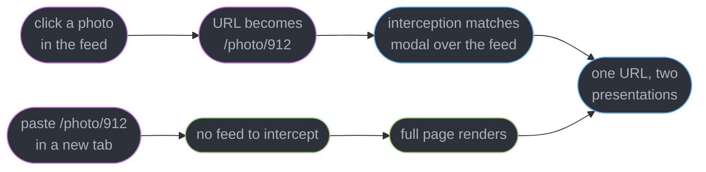
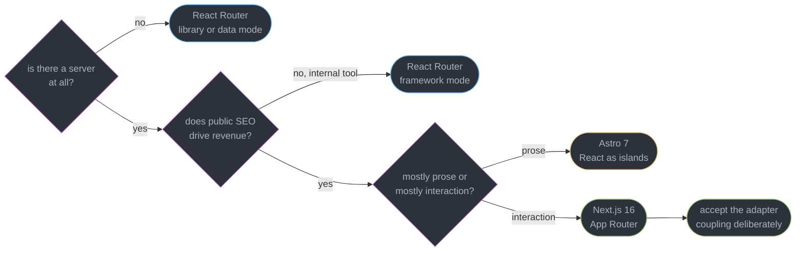
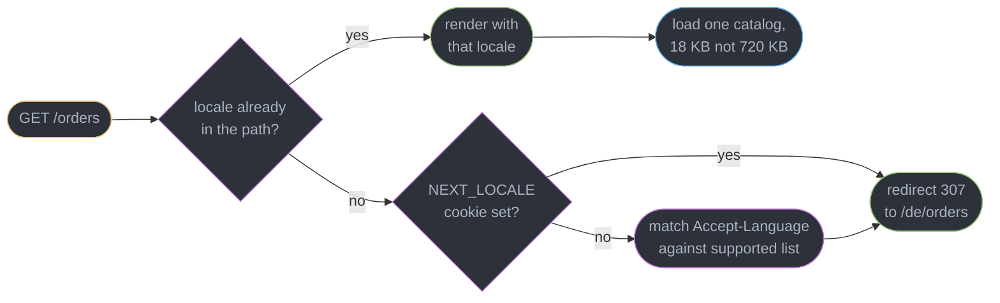

# Meta-Frameworks and Routing

---

## 1. Concept Overview

React ships a renderer and nothing else. It has no router, no server, no build pipeline, no data-loading convention and no notion of a deployment target. Everything that turns a component tree into a website — matching a URL, deciding which code chunk to download, knowing when to start a database query, choosing what gets cached — lives outside the library. A meta-framework is the package that supplies all five.

The omission is deliberate, not an oversight anyone is waiting to fix. React renders to the DOM, to native views through React Native, to a PDF, to a terminal and to a static string. A built-in router would have to assume URLs exist, which excludes three of those targets. A built-in data layer would have to assume a fetch model, and React is used in front of REST, GraphQL, tRPC, SQLite-over-WASM and no network at all. Since the **React Foundation** took stewardship in February 2026, that boundary has if anything hardened: the library owns the component model and the reconciler, and the frameworks own the application shell.

The consequence is that "which React framework" is a real architectural decision with real lock-in, not a preference. The choice determines your routing syntax, where your data-loading code runs, what your caching primitives are called, and — this is the part teams underestimate — which hosting platforms can run your build output unmodified. Moving between frameworks is not a refactor of a few files; it is rewriting every route module in the application.

This module covers the routing and application-shell layer: file-based routing, nested layouts, data-loading conventions, the Next.js 16 App Router specifics, React Router v8's three modes, the landscape and how to choose within it, and i18n routing. What a Server Component *is*, and how `"use client"` and `"use server"` work, belongs to [Server Components and Server Functions](../server_components_and_server_functions/server_components_and_server_functions.md). Which rendering strategy runs when, client hydration and SEO belong to [Rendering Strategies, Hydration and SEO](../rendering_strategies_hydration_and_seo/rendering_strategies_hydration_and_seo.md). Client-side caching of fetched data belongs to [Server State and Data Fetching](../server_state_and_data_fetching/server_state_and_data_fetching.md). Bundling is [Modules, Bundling and the Build Pipeline](../../frontend_platform/modules_bundling_and_the_build_pipeline/modules_bundling_and_the_build_pipeline.md), and shipping the result is [Frontend Delivery and Observability](../../frontend_platform/frontend_delivery_and_observability/frontend_delivery_and_observability.md).

---

## 2. Intuition

> **One-line analogy**: React knows how to draw a screen. The meta-framework is the only thing in the stack that knows what a URL *means*.

**Mental model**: file-based routing compiles a directory tree into a static route map at build time. Because that map exists before any request arrives, the framework can answer three questions the moment a URL is matched and before a single component renders — which layouts wrap this page, which JavaScript chunks it needs, and which data functions must run. Prefetching on hover, running four loaders in parallel, streaming a slow segment and code-splitting per route are all consequences of that one fact.

**Why it matters**: a hand-rolled `<Routes>` tree in a client bundle can only discover requirements by rendering. It renders a page, that page's effect fires, the effect fetches, the response reveals a nested component, that component fetches again. Three sequential round trips at 180 ms each is 540 ms of blank screen that a static route map would have collapsed into 180 ms of parallel work.

**Key insight**: **the route tree is a data structure, not a rendering artefact.** Everything a meta-framework does better than a client-side router — parallel data loading, per-route code splitting, persistent layouts, streaming, prefetch — comes from being able to inspect that structure ahead of the render rather than discovering it during one.

---

## 3. Core Principles

- **The directory tree is the route tree.** Structure lives in the filesystem, so it is greppable, diffable and impossible to get out of sync with a config file.
- **A layout is a segment, not a wrapper component.** It persists across navigation within its subtree and does not re-render when a sibling page swaps.
- **Data loading is declared per route, not per component.** That is what allows every loader in a matched chain to start at once.
- **A waterfall is a dependency you did not declare.** Any fetch that begins only because a previous fetch finished costs a full round trip.
- **The URL is the state.** A modal, a filter set, a tab, a page number belong in the URL if a user could reasonably bookmark or share them.
- **Caching is now explicit.** Frameworks that guessed what to cache produced surprises; the current generation makes you name the lifetime.
- **A framework's server runtime is part of its API surface.** Where code runs — Node, an edge runtime, a build step — changes which APIs exist.
- **Vendor coupling is bounded by the adapter, not the framework.** Judge lock-in by how much of the app assumes one host's primitives.
- **A locale is a routing concern before it is a translation concern.** It has to be in the URL or the domain before any message catalog is loaded.
- **No server means no server framework.** A static export or a pure SPA build forecloses half the feature list, and that is a legitimate place to be.

---

## 4. Types / Architectures / Strategies

### 4.1 The five things a meta-framework adds

| Layer | What React gives you | What the framework adds | Cost of doing it yourself |
|-------|---------------------|-------------------------|---------------------------|
| Routing | nothing | URL to component tree, code splitting per route, prefetch | a config file that drifts from reality |
| Server runtime | nothing | request handling, streaming SSR, request-scoped context | your own Node server plus a render harness |
| Build pipeline | nothing | dev server, bundling, two module graphs for RSC | RSC is not achievable without bundler integration |
| Data conventions | nothing | where fetching starts, how it parallelises, revalidation | manual waterfall avoidance in every component |
| Deployment target | nothing | build output an adapter can deploy | hand-written Dockerfile plus cache headers |

### 4.2 Routing segment syntax

| Shape | Next.js 16 App Router | React Router v8 | Matches |
|-------|----------------------|-----------------|---------|
| Static | `app/settings/page.tsx` | `route("settings", "./settings.tsx")` | `/settings` |
| Dynamic | `app/orders/[id]/page.tsx` | `route("orders/:id", "./order.tsx")` | `/orders/8172` |
| Catch-all | `app/docs/[...slug]/page.tsx` | `route("docs/*", "./docs.tsx")` | `/docs/a/b/c` |
| Optional catch-all | `app/shop/[[...path]]/page.tsx` | two routes | `/shop` and `/shop/a/b` |
| Grouping, no URL segment | `app/(marketing)/about/page.tsx` | `layout("./marketing.tsx", [...])` | `/about` |
| Parallel slot | `app/@modal/...` | nested outlets | renders two trees at one URL |
| Interception | `app/feed/(..)photo/[id]/page.tsx` | manual | modal over the current page |

### 4.3 The landscape, as of October 2026

| Framework | Version | Server model | Where it wins |
|-----------|---------|--------------|---------------|
| Next.js | **16.4.x**; 16.0 released 2025-10-21, 16.4 on 2026-10-06 | Node or edge runtime, RSC-first | app-shaped products needing SSR, ISR and RSC in one stack |
| React Router | **v8**, released 2026-06-17; 8.4.0 on 2026-09-15 | optional, three modes; RSC mode still unstable | migrating an SPA, or wanting a server without RSC-first design |
| TanStack Start | **1.0**, stable since 2026-10-13 | Vite plus Nitro; RSC opt-in | type-inference-first teams already on TanStack Query and Router |
| Astro | **7**, released 2026-06-22 | static-first with optional SSR | content-heavy sites where React is one island among many |
| Waku | minimal, RSC-first | Node | learning RSC, or a small RSC app without Next.js |

`@vitejs/plugin-rsc` and Parcel also implement Server Components, which is the answer to "is RSC a Next.js feature": it is not, though the RSC-safe library ecosystem outside Next.js is thinner. The two Next.js alternatives treat RSC as optional. TanStack Start 1.0 integrates RSC without changing its application model, and its author stopped using RSC on tanstack.com. React Router's RSC framework mode still ships under `unstable_` APIs in 8.4.

### 4.4 The Remix lineage, because it is the most-confused fact here

| Name | What it actually is |
|------|--------------------|
| Remix v1 and v2 | the React framework, now merged away |
| **React Router v7** | what would have shipped as Remix v3 — the merge that moved Remix v2's bundler and server runtime into React Router as **framework mode** |
| **React Router v8** | the current React framework, released 2026-06-17 |
| **Remix v3** | a **separate, non-React framework with its own UI runtime**, release candidate 2026-08-31 and `remix@3.0.0` on npm 2026-10-01, focused on web-platform primitives |

**Remix v3 is not an upgrade path from Remix v2 and is not a React framework.** A Remix v2 application upgrades to React Router v7 and then v8. This is the single easiest factual error in the whole front-end ecosystem, and it appears in interviews precisely because it separates people who read release notes from people who read headlines.

---

## 5. Architecture Diagrams

### The directory tree compiles to a route tree



The `(dashboard)` folder contributes a layout but no path segment, which is why `/orders` and not `/dashboard/orders` is the URL. Grouping and nesting are separate axes.

### What re-renders on navigation



Only the deepest changed segment unmounts. This is the structural advantage over a flat router, where the whole tree below the matched route is replaced and every piece of layout state is lost.

### Loaders in parallel versus a render-time waterfall



The route map is what makes this possible: the router knows all three loaders belong to this URL before any component has rendered.

### Intercepted routes give a modal a real URL



The same URL is shareable and refreshable. Without interception you either lose the URL or lose the in-place modal, and teams usually pick the first and then rebuild it badly with query strings.

### Choosing a framework



Every branch is a fact about the product, not a taste. "Is there a server" and "does SEO drive revenue" eliminate most of the field before anyone argues about syntax.

---

## 6. How It Works — Detailed Mechanics

### 6.1 File-based routing and the special files

In the Next.js 16 App Router a folder is a URL segment and a small set of reserved filenames give that segment its behaviour.

```
app/
  layout.tsx              root shell, must render html and body
  page.tsx                /
  (dashboard)/            route group: layout only, contributes no URL segment
    layout.tsx            sidebar, persists across every route below
    orders/
      layout.tsx          filter bar, persists across /orders and /orders/:id
      page.tsx            /orders
      loading.tsx         Suspense fallback for this segment
      error.tsx           error boundary for this segment, must be a client file
      [id]/
        page.tsx          /orders/8172
        not-found.tsx     rendered when notFound() is called below here
  api/
    webhooks/
      route.ts            a real HTTP handler, not a page
```

| File | Becomes | Notes |
|------|---------|-------|
| `layout.tsx` | a persistent wrapper for its subtree | does **not** re-render on navigation within it |
| `page.tsx` | the leaf UI for a URL | only a folder with a `page.tsx` is routable |
| `loading.tsx` | a `<Suspense>` fallback around the segment | the framework writes the boundary for you |
| `error.tsx` | an error boundary around the segment | must carry `"use client"`, receives `error` and `reset` |
| `not-found.tsx` | the UI for `notFound()` and unmatched URLs | |
| `route.ts` | an HTTP handler exporting `GET`, `POST` and so on | cannot coexist with `page.tsx` in one folder |
| `template.tsx` | like a layout, but **remounts** on every navigation | for enter animations and per-navigation effects |
| `default.tsx` | the fallback for an unmatched parallel slot | required or a hard refresh 404s the slot |

Dynamic segments arrive as a Promise, because request-scoped data is async in Next.js 15 and later:

```tsx
// app/(dashboard)/orders/[id]/page.tsx — a Server Component
export default async function OrderPage({
  params,
  searchParams,
}: {
  params: Promise<{ id: string }>;
  searchParams: Promise<{ tab?: string }>;
}) {
  const { id } = await params;
  const { tab = "summary" } = await searchParams;
  const order = await db.order.findUnique({ where: { id } });
  if (!order) notFound();
  return <OrderDetail order={order} tab={tab} />;
}
```

Forgetting the `await` is the most common Next.js 16 compile error in a codebase migrated from 13 or 14, and the message is explicit: `params` is now a Promise and must be unwrapped.

### 6.2 Nested layouts and why they matter

A layout receives `children` and wraps every route below it. The router keeps it mounted across navigations within its subtree, so its state — a scroll position, an open accordion, a video that is playing, a WebSocket that is connected — survives.

```tsx
// app/(dashboard)/orders/layout.tsx — a Server Component wrapping a client filter bar
export default async function OrdersLayout({ children }: { children: React.ReactNode }) {
  const savedViews = await db.savedView.findMany({ take: 20 });
  return (
    <div className="grid grid-cols-[280px_1fr]">
      <FilterSidebar views={savedViews} />
      <main>{children}</main>
    </div>
  );
}
```

Navigating from `/orders` to `/orders/8172` swaps only `{children}`. `FilterSidebar` is not unmounted, its `useState` is not reset, and `savedViews` is not re-fetched. In a flat router the equivalent structure is a wrapper component rendered by both routes, which React unmounts and remounts because it sits at a different position in two different element trees — losing the state and re-running the query on every navigation.

`template.tsx` is the deliberate opposite. It has the same signature and the same position, but the router gives it a fresh key on every navigation, so it remounts and its effects re-run. Use a template when you want an enter transition or a per-navigation analytics event, and a layout for everything else. Reaching for `template.tsx` because state "should reset" is usually a sign the state belongs in the URL.

### 6.3 Parallel and intercepted routes: the modal-URL problem

A photo grid where clicking opens a lightbox has a genuine conflict: the lightbox should be dismissible back into the feed with scroll position intact, and it should also have a shareable URL that renders a full page for someone opening it cold.

```
app/
  feed/
    layout.tsx           renders {children} and {modal}
    page.tsx             the grid
    @modal/
      default.tsx        returns null when no modal is active
      (..)photo/
        [id]/page.tsx    intercepts /photo/:id when navigated from the feed
  photo/
    [id]/page.tsx        the full page, used on a cold load or refresh
```

```tsx
// app/feed/layout.tsx — a parallel slot is just another prop
export default function FeedLayout({
  children,
  modal,
}: {
  children: React.ReactNode;
  modal: React.ReactNode;
}) {
  return (
    <>
      {children}
      {modal}
    </>
  );
}
```

`@modal` is a named slot, not a URL segment. The `(..)` prefix means "intercept a route one level up in the path". A client-side navigation from the feed matches the intercepting route and renders the modal over the still-mounted grid; a hard load of the same URL finds nothing to intercept and renders the full page. `default.tsx` is mandatory — without it, a refresh on a URL that does not fill the slot produces a 404 for the whole route rather than an empty slot.

### 6.4 Data loading: two conventions, one goal

**Next.js** puts the fetch inside the Server Component that needs the data. There is no loader function; `await` in the component is the convention.

```tsx
// Both queries start before either is awaited, so the page waits 210 ms, not 380 ms.
export default async function Dashboard() {
  const revenuePromise = db.revenue.monthly();   // 210 ms, not awaited yet
  const churnPromise = db.churn.monthly();       // 170 ms, not awaited yet
  const [revenue, churn] = await Promise.all([revenuePromise, churnPromise]);
  return <Charts revenue={revenue} churn={churn} />;
}
```

The trap is that nesting produces a serial chain silently. A parent that awaits, then renders a child that awaits, costs the sum — and nothing in the code looks wrong. The fix is either hoisting the queries into a common ancestor as above, or passing an unawaited promise down and wrapping the child in `<Suspense>` so the slow branch streams while its siblings paint.

**React Router** declares a `loader` per route. Every loader in the matched chain runs concurrently before the component tree renders at all.

```ts
// app/routes/order.tsx
import type { Route } from "./+types/order";

export async function loader({ params, request }: Route.LoaderArgs) {
  const session = await requireSession(request);
  return { order: await db.order.findUnique({ where: { id: params.id, orgId: session.orgId } }) };
}

export async function action({ request, params }: Route.ActionArgs) {
  const form = await request.formData();
  await db.order.update({ where: { id: params.id }, data: { name: String(form.get("name")) } });
  return { ok: true };   // loaders for the matched chain automatically re-run
}

export default function Order({ loaderData }: Route.ComponentProps) {
  return <OrderDetail order={loaderData.order} />;
}
```

Three loaders in a chain cost one round trip, not three, because the router started them together. `action` is the write half: it handles the `POST` from a `<Form>`, and on completion the router revalidates the loaders for every matched route, so the UI reflects the write without any cache-invalidation call. `clientLoader` runs the same contract in the browser — useful for data that must not touch the server, or as a client-side cache in front of a server loader by calling `serverLoader()` only on a miss.

Neither convention replaces a client-side cache. A list that is polled, a query that several unrelated routes share, an infinite scroll accumulating pages, optimistic updates across components — those are client state, and they belong to [Server State and Data Fetching](../server_state_and_data_fetching/server_state_and_data_fetching.md). The rule of thumb: the framework owns data that is a function of the URL, and a client cache owns data that outlives a navigation.

### 6.5 Next.js 16 caching: Cache Components and `"use cache"`

Next.js 16 removed `experimental.ppr` and `experimental.dynamicIO` and replaced both with **Cache Components** and an explicit `"use cache"` directive. The previous model inferred cacheability from which APIs you happened to call, which meant adding a `cookies()` read three components deep could silently make a whole route dynamic. The current model makes you say it.

```ts
// lib/catalog.ts
import { unstable_cacheLife as cacheLife, unstable_cacheTag as cacheTag } from "next/cache";

export async function getCategories() {
  "use cache";
  cacheLife("hours");                    // a named profile, not a magic number
  cacheTag("categories");                // the handle you invalidate by
  return db.category.findMany({ orderBy: { rank: "asc" } });
}
```

The directive works at file, component or function level. Everything a cached function returns must be serializable, and everything it reads must be an argument — reading `cookies()` inside a `"use cache"` scope is an error by construction, because the cached value could not be correct for the next user.

Invalidation changed shape with it:

```ts
"use server";
import { revalidateTag, updateTag } from "next/cache";
import { after } from "next/server";

export async function renameCategory(id: string, name: string) {
  await db.category.update({ where: { id }, data: { name } });

  updateTag("categories");                 // read-your-writes: this request sees it now
  revalidateTag("categories", "hours");    // the cacheLife profile is REQUIRED, second arg
  after(() => analytics.track("category.renamed", { id }));   // runs after the response flushes
}
```

`revalidateTag()` taking a `cacheLife` profile as a mandatory second argument is a genuine breaking change, and a one-argument call from a Next.js 15 codebase is a type error. `updateTag()` is the one that solves a long-standing annoyance: after a Server Action mutates data, `revalidateTag` marks the cache stale but the response being streamed back may already have read the old value, so the user submits a rename and sees the old name for one render. `updateTag` makes the current request see its own write. `after()` moves non-blocking work — analytics, logging, cache warming — off the response path without a floating promise the runtime might kill.

**Navigation is the other half of the model.** Next.js 16.4 recommends Cache Components as two flags, `cacheComponents: true` and `partialPrefetching: true`. With Partial Prefetching (16.3), the router extracts a loading shell from any route's cached UI and Suspense fallbacks and prefetches it, so a click paints at once instead of waiting on the server. Two 16.4 APIs tune the cost: `export const ensureStatic = "navigation"` on a layout fails the build if a page beneath it would render at request time, and `await navigation()` from `next/cache` keeps a component's cached content out of every prefetch until the user actually navigates. The rendering-side mechanics are in [Rendering Strategies, Hydration and SEO](../rendering_strategies_hydration_and_seo/rendering_strategies_hydration_and_seo.md).

### 6.6 `proxy.ts` — code that runs before routing

Next.js 16 renamed `middleware.ts` to **`proxy.ts`** and runs it on the **Node runtime**, which is the more consequential half of the change: the old edge-runtime middleware could not use most of the Node standard library, so a session check that needed a database driver or a crypto library had to be duplicated or deferred. `middleware.ts` still works on the edge runtime, but new code goes in `proxy.ts`.

```ts
// proxy.ts — project root, alongside app/
import { NextResponse, type NextRequest } from "next/server";

export default function proxy(request: NextRequest) {
  const token = request.cookies.get("session")?.value;
  if (!token && request.nextUrl.pathname.startsWith("/orders")) {
    const url = new URL("/login", request.url);
    url.searchParams.set("next", request.nextUrl.pathname);
    return NextResponse.redirect(url);
  }
  return NextResponse.next();
}

export const config = {
  matcher: ["/((?!_next/static|_next/image|favicon.ico).*)"],
};
```

Keep it thin. It runs on every matched request including prefetches, so a 40 ms database call in `proxy.ts` is 40 ms added to every navigation in the application. Cheap checks — a cookie's presence, a locale decision, a redirect — belong here; authorization against a specific row belongs in the Server Function or route handler that touches that row.

### 6.7 React Router v8's three modes

| Mode | You provide | Router provides | Use when |
|------|-------------|-----------------|----------|
| Library (declarative) | your own data fetching | matching, `<Link>`, `<Outlet>`, history | adding routing to an existing SPA, smallest surface |
| Data | route objects with `loader` and `action` | the above plus parallel loading, revalidation, pending UI | an SPA that wants waterfall-free loading without a server |
| Framework | `routes.ts` plus route modules | the above plus the Vite build, SSR, code splitting, typegen | a full-stack app, formerly Remix v2's territory |

```ts
// app/routes.ts — framework mode
import { type RouteConfig, route, index, layout, prefix } from "@react-router/dev/routes";

export default [
  index("routes/home.tsx"),
  layout("routes/dashboard-layout.tsx", [
    ...prefix("orders", [index("routes/orders.tsx"), route(":id", "routes/order.tsx")]),
  ]),
] satisfies RouteConfig;
```

**What v8 actually broke** (2026-06-17) is short, and every item is a migration question:

| Change | Consequence |
|--------|-------------|
| **`react-router-dom` was dropped** | the mirror package that eased v6 to v7 no longer exists. Import core APIs from `react-router` and browser-only ones from `react-router/dom` |
| **ESM-only** | no CommonJS build. A `require("react-router")` anywhere in your pipeline — a Jest transform, a legacy config loader, a CJS server entry — is the most common upgrade blocker. The published `tsconfig` baseline moved to ES2022 |
| **Middleware is on by default** | the v7 `future.unstable_middleware` flag became the behaviour. Remove the flag; a route that assumed no middleware chain now runs one |
| **Raised baselines** | Node **22.22.0+**, React **19.2.7+**, Vite **7+** |

```ts
// BROKEN on v8 — the package does not exist any more.
import { BrowserRouter, Link, useNavigate } from "react-router-dom";

// FIX — everything comes from react-router; react-router/dom is the small
// browser-only surface: RouterProvider, HydratedRouter, and the RSC helpers.
import { BrowserRouter, Link, useNavigate } from "react-router";
import { RouterProvider, HydratedRouter } from "react-router/dom";
```

`react-router@8.3` declares `"engines": { "node": ">=22.22.0" }` and a `react` / `react-dom` peer of `>=19.2.7`, so the version floor is enforced by the install, not by a runtime warning.

Most of v8 is otherwise uneventful, because the behavioural changes shipped as opt-in future flags across v7. That is the point of the release: if you had already enabled the flags, the upgrade is an import rewrite and a Node bump.

**8.4.0 (2026-09-15) cut re-renders.** The data router splits its internal state across four contexts: current location (`useLocation`, `useSearchParams`, `useMatches`), pending navigation and revalidation (`useNavigation`, `useRevalidator`), loader and action data, and fetchers. A component that only calls `useLocation` no longer re-renders when `navigation.state` turns to `loading`. Code that read the exported `UNSAFE_` contexts has breaking changes. 8.4 also adds `future.unstable_routePatternMatching`, a Data Mode matcher built on `@remix-run/route-pattern` that cut navigation and fetcher completion time by about 19-38% with 100 routes and 71-88% with 1,000 routes in synthetic Chromium benchmarks. It is an unstable flag, and `matchRoutes`, `matchPath` and `useMatch` keep the old matcher, so results can differ.

The upgrade path matters as much as the feature list. A Remix v2 application becomes a React Router v7 application, then v8; a v6 SPA can stay in library mode indefinitely, adopt data mode when waterfalls hurt, and adopt framework mode only if it turns out to need a server. That gradient is React Router's real differentiator against Next.js, where the App Router is the entry price.

**A SPA with a data router is the right answer more often than framework marketing suggests.** An authenticated internal tool — an admin console, a support desk, a trading dashboard — has no SEO stake, no cold-load first-paint story worth optimising because users keep a tab open all day, and an existing API. Adding a server rendering tier buys nothing and costs a deployment target, a Node process to operate and a second place where environment variables must be correct.

### 6.8 i18n routing

Neither Next.js's App Router nor React Router ships built-in i18n routing, and the `i18n` key in `next.config.js` was a Pages Router feature that does not apply. You build it from a locale segment plus a negotiation step.



The locale segment versus the locale domain is the first decision:

| Approach | URL | Buys | Costs |
|----------|-----|------|-------|
| Path segment | `example.com/de/orders` | one deployment, one cookie jar, trivial to add a locale | weaker geo signal than a ccTLD |
| Subdomain | `de.example.com/orders` | per-locale analytics and CDN routing | cross-subdomain auth and cookie work |
| Country domain | `example.de/orders` | strongest local ranking signal, local trust | a certificate, DNS and a deploy per domain |

The path segment is right for most products. Domains earn their cost when local search ranking is the business, which is retail and travel and almost nothing else.

```ts
// proxy.ts — negotiate once, then let the [locale] segment do the work
import { match } from "@formatjs/intl-localematcher";
import Negotiator from "negotiator";

const LOCALES = ["en", "de", "fr", "ja"] as const;

export default function proxy(request: NextRequest) {
  const { pathname } = request.nextUrl;
  if (LOCALES.some((l) => pathname.startsWith(`/${l}/`) || pathname === `/${l}`)) {
    return NextResponse.next();
  }
  const cookie = request.cookies.get("NEXT_LOCALE")?.value;
  const headers = { "accept-language": request.headers.get("accept-language") ?? "en" };
  const wanted = new Negotiator({ headers }).languages();
  const locale = cookie ?? match(wanted, LOCALES as unknown as string[], "en");
  return NextResponse.redirect(new URL(`/${locale}${pathname}`, request.url), 307);
}
```

Negotiate on the server, never in a `useEffect`. A client-side redirect ships the wrong locale's HTML first, causes a visible flash, and gives crawlers a page whose language does not match its URL.

**Reading the locale without prop-drilling.** A `[lang]` segment above the root layout is effectively global, yet page `params` reach only the page and its layouts, so every nested formatter used to receive `lang` as a prop. Next.js 16.3 root params read it from any Server Component:

```tsx
// app/[lang]/orders/order-total.tsx -- a Server Component three levels down
import { lang } from "next/root-params";

export async function OrderTotal({ cents }: { cents: number }) {
  const locale = await lang();
  return <span>{new Intl.NumberFormat(locale, { style: "currency", currency: "EUR" }).format(cents / 100)}</span>;
}
```

Root params also work inside `"use cache"` scopes, where `cookies()` and headers are forbidden. They are available in Server Components only, so a route handler still reads the segment from `params` and a Server Action takes the locale as an argument.

**Catalog splitting is where the bytes are.** A 40-locale application with an 18 KB catalog each is 720 KB if every locale is in one bundle, and 18 KB if the import is dynamic and keyed by the negotiated locale.

```ts
// One dynamic import per locale means the bundler emits 40 chunks and the browser fetches 1.
const catalogs = {
  en: () => import("./messages/en.json"),
  de: () => import("./messages/de.json"),
  fr: () => import("./messages/fr.json"),
  ja: () => import("./messages/ja.json"),
} as const;

export async function getMessages(locale: keyof typeof catalogs) {
  return (await catalogs[locale]()).default;
}
```

A static `import * as messages from "./messages"` defeats this entirely, because the bundler cannot know which keys you will read and must include all 40.

Formatting stays with the platform. `Intl` is built into every runtime you target and needs no dependency:

```ts
new Intl.NumberFormat("de-DE", { style: "currency", currency: "EUR" }).format(1234.5);
// "1.234,50 €"
new Intl.RelativeTimeFormat("ja", { numeric: "auto" }).format(-3, "day");   // "3 日前"
new Intl.PluralRules("ru").select(3);                                       // "few"
```

`Intl.PluralRules` is the one people reinvent badly. English has two plural forms, Russian has four and Arabic has six, so a hand-rolled `count === 1 ? a : b` is wrong in most of the world. Finally, emit `hreflang` alternates from the route's metadata so search engines can pair the locale variants of one page.

---

## 7. Real-World Examples

**The layout that was a wrapper component.** A React Router v6 SPA rendered `<DashboardShell>` inside each of 14 route components. Every navigation unmounted the shell, which reset an open filter panel, dropped the sidebar's scroll position and re-ran a 340 ms saved-views query. Moving to a `layout()` route in framework mode kept the shell mounted: the query ran once per session instead of once per navigation, and the panel stopped closing. No component logic changed — only where the shell sat in the route tree.

**The proxy that cost 60 ms per page.** A team put a full session lookup, including a database round trip and a permissions join, into `proxy.ts` so that every route could assume an authenticated user. Prefetching made it worse: hovering a nav item triggered a prefetch, which ran the proxy, which ran the query. At 60 ms a call and roughly 9 prefetches per screen, one dashboard visit generated 540 ms of database time nobody could see in a page-load trace. The fix verified a signed cookie in the proxy — 0.4 ms, no I/O — and moved the permissions check into the Server Functions that actually needed it.

**The modal with no URL.** A photo feed opened its lightbox from React state. Users shared links and their friends landed on the grid instead of the photo, the browser back button closed the whole feed instead of the modal, and a refresh lost the selection. Rebuilding it with a parallel slot and a `(..)` interception fixed all three at once and deleted the `isModalOpen` state entirely; the URL became the state, as it always should have been.

**The 720 KB dictionary.** A commerce site supporting 40 locales imported its messages through a barrel file. Every user on the planet downloaded all 40 catalogs — 720 KB gzipped, more than the rest of the JavaScript combined. Switching to one dynamic import per locale cut it to 18 KB and took 1.9 s off Largest Contentful Paint on a mid-range Android over 4G. The change was six lines and its entire difficulty was noticing.

---

## 8. Tradeoffs

| Choice | Bought | Paid |
|--------|--------|------|
| File-based routing | route tree is greppable and cannot drift from a config | folder churn on refactors, and the syntax is framework-specific |
| Nested layouts | persistent state and one round trip per navigation | a deep tree where a `page.tsx` alone tells you almost nothing |
| Loaders declared per route | every fetch in a chain runs in parallel | data logic sits beside the route, not beside the component |
| Fetching inside Server Components | no loader indirection, colocation with the UI | serial waterfalls appear silently as the tree deepens |
| Explicit `"use cache"` | cacheability is stated, not inferred | every cached function must be audited for what it reads |
| `proxy.ts` on the Node runtime | full Node APIs available before routing | it runs on prefetches too, so cost multiplies invisibly |
| Full framework | SSR, streaming, RSC, a deployment story | a server tier to operate and framework-shaped lock-in |
| SPA with a data router | no server tier, no adapter, deploy to a bucket | no SEO, no first-paint story, no RSC |
| Astro islands | zero JavaScript by default for prose pages | React is a guest, not the application model |
| Locale path segment | one deployment, one cookie jar | a weaker geo-ranking signal than a country domain |

---

## 9. When to Use / When NOT to Use

**Reach for a full meta-framework when:**

- Public URLs need to rank, be previewed by a link unfurler, or paint before JavaScript arrives.
- The page is a function of the URL and the database, and a server can produce it faster than a browser can request it.
- You want Server Components, which cannot exist without bundler integration.
- The team is large enough that a routing convention is worth more than routing flexibility.

**Reach for a SPA with a data router when:**

- Everything is behind a login, so no crawler will ever see it.
- Users keep one tab open for hours, making cold-load time a rounding error.
- A stable API already exists and adding a rendering tier duplicates its authorization.
- You are migrating a React Router v6 app and want to buy parallel loading without buying a server.

**Do NOT reach for one when:**

- The deliverable is a static marketing site of mostly prose. Astro 7 ships zero JavaScript by default and hydrates only the islands you mark; a React framework ships a runtime to render text.
- The whole application is one canvas, one editor or one game loop. There is one route; the framework is overhead.
- You cannot operate a server. That constraint is legitimate and it forecloses SSR, ISR and RSC — decide it first, not after choosing a framework that assumes them.
- Server Components are the requirement and the candidate is TanStack Start or React Router. Start 1.0 treats RSC as an opt-in its own author stopped using on tanstack.com, and React Router's RSC mode is still `unstable_` in 8.4, so Next.js is the stack where RSC is the primary model.

---

## 10. Common Pitfalls

**`"use client"` on a layout to fix a context error.** It works, and it drags every route below it into the client bundle with no warning at all.

```tsx
// BROKEN: the layout is a door into the client graph. Every page, every component and every
// import below this file is now client code, including the ORM types and the 210 KB
// currency table that only a Server Component ever needed.
"use client";
import { ThemeProvider } from "@/providers/theme";

export default function DashboardLayout({ children }: { children: React.ReactNode }) {
  return <ThemeProvider>{children}</ThemeProvider>;
}
```

```tsx
// FIX: the provider is a 5-line client file. The layout stays a Server Component, so
// everything inside {children} stays on the server.
"use client";
export function Providers({ children }: { children: React.ReactNode }) {
  return <ThemeProvider>{children}</ThemeProvider>;
}

export default function DashboardLayout({ children }: { children: React.ReactNode }) {
  return <Providers>{children}</Providers>;
}
```

**Awaiting a parent's data before starting a child's.** A layout that awaits, then a page that awaits, then a component that awaits, is three sequential round trips. Hoist the queries or pass an unawaited promise into a `<Suspense>` boundary.

**Calling `revalidateTag()` with one argument.** In Next.js 16 the `cacheLife` profile is a required second argument. The one-argument form is a type error, and copying it out of a 2025 blog post is the most likely way to hit it.

**Expecting `revalidateTag` to be visible in the same request.** It marks the server cache stale for the *next* read. Use `updateTag()` when the Server Action's own response must show the new value, or the user renames something and watches the old name render back.

**A database call in `proxy.ts`.** It runs on prefetches, on image requests that slip past the matcher, and on every navigation. Measure it as cost-per-navigation multiplied by the number of prefetchable links on screen, not as one request.

**A missing `default.tsx` for a parallel slot.** Client navigation works, then a hard refresh 404s the entire route because the slot has nothing to render. It is a one-line file returning `null` and it is not optional.

**Reaching for `template.tsx` to reset state.** It remounts on every navigation, which re-runs effects and re-fetches. If the state should reset per URL, the state belongs in the URL.

**Client-side locale redirects.** A `useEffect` that reads `navigator.language` and redirects serves the wrong language's HTML first, flashes, and shows crawlers a mismatch between URL and content. Negotiate in `proxy.ts`.

**Barrel-importing message catalogs.** `import * as messages from "./messages"` forces the bundler to include every locale. One dynamic import per locale is the difference between 18 KB and 720 KB.

**Believing `middleware.ts` is gone.** It still works on the edge runtime. New code goes in `proxy.ts` on the Node runtime, which is where the full Node API surface is available before routing.

---

## 11. Technologies & Tools

| Tool | Purpose |
|------|---------|
| Next.js | 16.4.x App Router, Cache Components (on in new `create-next-app` projects since 16.4), `proxy.ts`, Turbopack by default |
| React Router | v8 (8.4.0) in library, data or framework mode |
| TanStack Start | Full-stack React framework on Vite and Nitro, 1.0 since 2026-10-13 |
| Astro | 7, islands architecture, Rust compiler, running on Vite 8 |
| Waku | Minimal RSC-first React framework |
| Parcel | Bundler with first-class React Server Components support |
| Vite | Build tool hosting `@vitejs/plugin-rsc` and TanStack Start |
| Turbopack | Next.js 16 default bundler for dev and build |
| Nitro | Server engine and deployment adapters under TanStack Start |
| negotiator | Parses `Accept-Language` into an ordered preference list |
| Intl | Platform formatting for numbers, dates, plurals and lists |
| next-intl | Locale routing and message catalogs for the App Router |

---

## 12. Interview Questions with Answers

**Q: How do Remix v3, Remix v2 and React Router v7 relate to each other?**
**Short:** What shipped as React Router v7 was the Remix merge, while Remix v3 is a separate non-React framework with its own UI runtime.

The React lineage runs Remix v1 to v2, then into React Router v7 (Remix v2's bundler and server runtime became React Router's **framework mode**), and on to React Router v8, released 2026-06-17. Remix v3 is an entirely different project with its own UI runtime, oriented around web-platform primitives: its release candidate shipped 2026-08-31 and `remix@3.0.0` reached npm on 2026-10-01. It is **not an upgrade path from Remix v2 and not a React framework**. So a Remix v2 application upgrades to React Router v7 and then v8; adopting Remix v3 would be a rewrite onto a different runtime. Getting this backwards is the single most common factual error in the front-end ecosystem, which is exactly why it is asked.

**Q: What did Cache Components and the "use cache" directive change in Next.js 16?**
**Short:** An explicit directive replaced the experimental ppr and dynamicIO flags, so cacheability is now declared per function rather than inferred from which APIs a component happened to call.

Under the old model, adding a `cookies()` read three components deep could flip a whole route from static to dynamic silently, and nobody could tell by reading the file whether a page was cached. Now you write `"use cache"` at the top of a file, component or function, name a lifetime with `cacheLife("hours")` and a handle with `cacheTag("categories")`. Everything the cached scope reads must arrive as an argument, so request-scoped APIs inside it are an error by construction rather than a subtle correctness bug. `experimental.ppr` and `experimental.dynamicIO` were removed, so a config carrying either fails to build.

**Q: When is a meta-framework the wrong choice?**
**Short:** Skip the server framework when everything sits behind a login, no crawler will see it, and an API already exists — a data router in a SPA buys the parallel loading without a server tier.

An admin console or support desk has no SEO stake and users keep a tab open for hours, so cold-load time is a rounding error and a rendering tier only duplicates the API's authorization in a second place. A prose-heavy marketing site is the opposite failure: Astro 7 ships zero JavaScript by default and hydrates only marked islands, where a React framework ships a runtime to render text. A single-canvas application — an editor, a game, a design tool — has one route, so routing conventions are pure overhead. And if you genuinely cannot operate a server, that forecloses SSR, ISR and RSC, which is a constraint to settle before picking a framework rather than after.

**Q: What is the difference between a layout and a page, and why does it matter?**
**Short:** Layouts persist across navigation within their subtree and do not re-render, while the page below them unmounts and is replaced on every URL change.

A layout receives `children` and stays mounted, so its state survives — an open filter panel, a scroll position, a connected WebSocket, a playing video. Navigating from `/orders` to `/orders/8172` swaps only the deepest changed segment; the sidebar's `useState` is intact and its 340 ms saved-views query does not re-run. The flat-router equivalent, a wrapper component rendered inside each route, sits at a different tree position for each route, so React unmounts and remounts it and all of that is lost. This is the main structural advantage of a nested router, and it is why "which layout owns this state" is a real design question rather than a file-organisation preference.

**Q: What changed when middleware.ts became proxy.ts in Next.js 16?**
**Short:** Renaming middleware to proxy moved the file onto the Node runtime, so the full Node API surface is available before routing instead of the edge runtime's narrow subset.

The old edge-runtime middleware could not use most of the Node standard library, so anything needing a database driver or a native crypto library had to be duplicated elsewhere or deferred until after routing. `proxy.ts` sits at the project root, exports a default function taking a `NextRequest`, and takes the same `config.matcher`. `middleware.ts` still works on the edge runtime, so this is not an emergency migration. The rule that survives the rename is unchanged: it runs on every matched request including prefetches, so a 60 ms database call there multiplies by the number of prefetchable links on screen.

**Q: Why does layout state survive a navigation while page state does not?**
**Short:** Persistent state survives because the router swaps only the segments below the deepest shared layout, leaving everything above it mounted in the same tree position.

React preserves component state by position in the element tree, so a component that stays at the same position across two renders keeps its hooks, its DOM and its subscriptions. The router's job is to compute the shared prefix of the old and new matched chains and re-render only the divergent tail. That is a property of the route tree, not of React — the same component rendered from two different route files has two different positions and is therefore two different instances. It also explains `template.tsx`: the framework gives it a fresh key on every navigation, deliberately forcing the remount that a layout avoids.

**Q: How do parallel and intercepted routes solve the modal-URL problem?**
**Short:** Intercepting a route renders it as a modal over the current page while the URL points at the full page, so a share or refresh lands on the real thing.

A `@modal` folder is a named parallel slot arriving as a prop on the layout alongside `children`, and a `(..)photo/[id]` route inside it intercepts `/photo/912` when the navigation comes from the feed. Client-side, the grid stays mounted with its scroll intact and the modal renders over it; a cold load of the same URL has nothing to intercept and renders the full page instead. This gets you a shareable URL, a working back button and an in-place modal at once, where a `isModalOpen` boolean gets you none of the three. The mandatory piece people forget is `default.tsx` returning `null` — without it a hard refresh 404s the whole route rather than leaving the slot empty.

**Q: How does a loader-based router avoid request waterfalls?**
**Short:** Loaders for every matched route start concurrently as soon as the URL matches, so a three-deep chain costs one round trip instead of three.

The router has the whole matched chain before any component renders, so it can fire the root, section and leaf loaders together and render once when the slowest resolves — 180 ms rather than 540 ms for three 180 ms queries. A component that fetches in an effect cannot do this, because the child's existence is only discovered after the parent has rendered, which requires the parent's data. React Router's `action` closes the loop on writes: after it completes, the loaders for every matched route revalidate automatically, so the UI reflects a mutation without an explicit invalidation call. `clientLoader` runs the same contract in the browser and can call `serverLoader()` only on a cache miss.

**Q: Does fetching inside Server Components avoid waterfalls automatically?**
**Short:** Sibling fetches parallelise only if they start before anything is awaited, and a child that awaits data derived from its parent serialises with no warning at all.

Two queries kicked off as promises and combined with `Promise.all` in one component cost the slower of the two — 210 ms rather than 380 ms. But a layout that awaits, rendering a page that awaits, rendering a component that awaits, costs the sum, and the code looks completely ordinary at every level. The two fixes are hoisting the queries into a common ancestor, or passing an unawaited promise down into a component wrapped in `<Suspense>` so the slow branch streams while its siblings paint. The colocation is real ergonomic value; the waterfall is the price, and it has to be measured rather than assumed away.

**Q: What are the current rules for revalidateTag and updateTag in Next.js 16?**
**Short:** Revalidation now takes a cacheLife profile as a required second argument, and updateTag exists so a Server Action's own response can see the write it just made.

`revalidateTag("categories", "hours")` marks the tagged cache entries stale for the next read; a one-argument call copied from a 2025 example is a type error. The subtler problem it does not solve is read-your-writes: the response streaming back from a Server Action may already have read the old value, so a user renames a category and watches the old name render. `updateTag("categories")` makes the current request observe its own mutation. Pair both with `after()` from `next/server` for work that must not block the response — analytics, logging, cache warming — rather than a floating promise the runtime may terminate.

**Q: What are React Router v8's three modes and how do you choose between them?**
**Short:** Library, data and framework mode differ in whether the router owns data loading and whether it also owns the build and the server runtime.

Library mode gives you matching, `<Link>`, `<Outlet>` and history, and you fetch however you already fetch — the smallest surface, right for bolting routing onto an existing SPA. Data mode adds `loader` and `action` per route, so navigations load in parallel and the router owns pending and error UI, all still without a server. Framework mode adds the Vite build, SSR, per-route code splitting and route-module typegen, and it is what Remix v2 became after the v7 merge. The value is the gradient: you can start in library mode, adopt data mode when waterfalls hurt, and only take on a server tier if it turns out you need one.

**Q: When is a SPA with a data router better than a full-stack framework?**
**Short:** An authenticated internal tool has no crawler to serve and no cold-load story worth optimising, so a rendering tier only duplicates the API's authorization somewhere else.

Admin consoles, support desks and trading dashboards are opened once and left open, so the first paint that SSR improves happens a handful of times a day per user. Meanwhile the server tier is a real operational cost: another process to run, another place environment variables must be right, another deployment target, and a second copy of every permission check. Data mode in React Router gives you the part that actually helps — parallel loaders, pending states, automatic revalidation after an action — while the build output stays a static bundle you can put in a bucket behind a CDN. Choose the server when SEO, link previews or first paint have a business value you can name.

**Q: Should a locale live in a path segment or a domain?**
**Short:** A locale path segment keeps one deployment and one cookie jar, while a per-locale domain buys a stronger local ranking signal at the cost of a certificate and a deploy per country.

`example.com/de/orders` is right for most products: adding a locale is a folder, authentication is unchanged, and a single deployment serves everyone. `de.example.com` sits in between, buying per-locale analytics and CDN routing at the price of cross-subdomain cookie and auth work. `example.de` is the strongest signal to search engines and to users who trust local domains, and it costs DNS, a certificate and a deployment per market — worth it for retail and travel, rarely for anything else. Whichever you pick, emit `hreflang` alternates so crawlers can pair the variants of one page.

**Q: How do you keep an i18n application from shipping every locale to every user?**
**Short:** Splitting catalogs per locale behind a dynamic import keyed on the negotiated locale means a 40-locale app downloads one 18 KB dictionary instead of 720 KB.

A barrel file — `import * as messages from "./messages"` — defeats this completely, because the bundler cannot know which keys you will read and must include all 40. A map of arrow functions each doing `import("./messages/de.json")` produces 40 chunks and one fetch. Negotiate the locale on the server in `proxy.ts` using `Accept-Language` through `negotiator` and `@formatjs/intl-localematcher`, or a `NEXT_LOCALE` cookie when one exists, then 307 to the locale path. Never negotiate in a `useEffect`: that serves the wrong language's HTML first, flashes visibly, and shows crawlers a page whose language contradicts its URL.

**Q: What do loading.tsx, error.tsx and route.ts actually compile to?**
**Short:** Special filenames map to structural wrappers the framework writes for you, so loading becomes a Suspense fallback and error becomes an error boundary scoped to that segment.

`loading.tsx` is wrapped around the segment as `<Suspense fallback={...}>`, which is why a slow page streams its shell immediately instead of blocking. `error.tsx` must carry `"use client"` because an error boundary needs state, and it receives `error` and a `reset` function that re-renders the segment. `not-found.tsx` renders when `notFound()` is thrown below it, and `global-error.tsx` catches what the root layout throws. `route.ts` is a different thing entirely — a real HTTP handler exporting `GET`, `POST` and friends — and it cannot live in the same folder as a `page.tsx`, since one URL cannot be both a page and an endpoint.

**Q: What is the difference between a route group and a dynamic segment?**
**Short:** Parentheses around a folder name group routes for layout purposes without contributing a URL segment, where square brackets create a parameter that does.

`app/(dashboard)/orders/page.tsx` serves `/orders`, not `/dashboard/orders` — the group exists so several routes can share a `layout.tsx` without that layout's name leaking into every URL. `app/orders/[id]/page.tsx` serves `/orders/8172` and hands `{ id: "8172" }` to the page. Two more shapes matter: `[...slug]` is a catch-all matching one or more segments, and `[[...slug]]` is an optional catch-all that also matches the bare parent path. A common structural use of groups is one `(marketing)` group with a public layout and one `(app)` group with an authenticated layout, both at the root of the URL space.

**Q: What breaks when upgrading a Next.js 15 application to 16?**
**Short:** Turbopack became the default bundler, AMP support and next lint were removed, the floor moved to Node 20.9 and TypeScript 5.1, and the experimental caching flags no longer exist.

The caching change is the largest: `experimental.ppr` and `experimental.dynamicIO` were removed in favour of Cache Components and `"use cache"`, and `revalidateTag()` gained a required `cacheLife` second argument that turns every existing call site into a type error. `middleware.ts` is superseded by `proxy.ts` on the Node runtime, though the old file still works on the edge runtime. A custom webpack configuration is the usual source of friction, since Turbopack is now the default for both `next dev` and `next build`; 16.3 added large dev-memory reductions and disk caching for builds on top of that. React Compiler support is a **stable opt-in flag**, not on by default, so it is a decision rather than an upgrade side effect.

**Q: When would you choose Astro over a React framework for a site that uses React?**
**Short:** Zero JavaScript by default with per-island client hydration wins whenever most of a page is static prose and interactivity is confined to a few components.

Astro 7 — released 2026-06-22, with a Rust compiler and Rust Markdown pipeline, running on Vite 8 — renders pages to HTML and ships JavaScript only for components you explicitly mark, with directives choosing whether an island hydrates on load, when idle, or when scrolled into view. A documentation site, a blog or a marketing site is mostly text with a search box and a pricing calculator, so a React framework there ships a runtime whose main job is rendering paragraphs. The tradeoff is that React is a guest: shared client state across islands is deliberately awkward, because the architecture is betting there is very little of it. When the page is genuinely an application — shared state everywhere, a router-driven shell, per-user data on every view — that bet is wrong and Next.js or React Router is the honest answer.

---

## 13. Best Practices

- Put state that a user could bookmark, share or reach with the back button in the URL, and everything else in a component.
- Push shared shell state into the highest layout that owns it, so navigations below it stay cheap.
- Keep `proxy.ts` free of I/O: cookie checks, locale decisions and redirects only, since it runs on every prefetch.
- Hoist sibling queries so they start together, and pass an unawaited promise into a `<Suspense>` boundary when one branch is slow.
- Name a `cacheLife` profile and a `cacheTag` for every `"use cache"` scope, and pair a mutation's `revalidateTag` with `updateTag` when the same response must show the write.
- Give every parallel slot a `default.tsx`, or a hard refresh 404s the whole route.
- Reach for `template.tsx` only for enter animations; if state should reset per URL, move it to the URL.
- Negotiate locale on the server, load exactly one message catalog by dynamic import, and format with `Intl` rather than a dependency.
- Never put `"use client"` on a layout — extract a small providers file and keep the layout on the server.
- Choose the framework from product facts in order: is there a server, does SEO drive revenue, is the page prose or interaction, is adapter coupling acceptable.
- Treat a pre-1.0 framework as a risk decision made deliberately, not as a version number that will be 1.0 soon.

---

## 14. Case Study

**Problem.** A B2B logistics dashboard on Next.js 15 was migrated to 16 and slowed down. Navigating between two shipment pages took 1.9 s, the filter sidebar closed on every navigation, First Load JS on the shipments route was 540 KB, and support kept receiving screenshots of the grid from users who had been sent a link to a specific shipment. A separate ticket reported that renaming a shipment showed the old name until a manual refresh.

**Investigation.** A route-level trace showed three sequential queries per navigation: a session lookup in `proxy.ts` at 62 ms, a saved-views query in the layout at 340 ms, and the shipment query at 180 ms. The saved-views query re-ran on every navigation because `DashboardShell` was a component rendered inside each page rather than a layout. The bundle report traced the ORM types and a 210 KB currency table to a `"use client"` on `app/(dashboard)/layout.tsx`, added eleven months earlier to silence a `createContext is not a function` error. The link problem was a lightbox driven by `useState`, so its URL never changed. The rename problem was `revalidateTag` marking the cache stale after the response had already read the old value.

**Root cause.** Structure in the wrong files. A shell that was not a layout, a directive on a layout, a modal with no route, and a cache invalidation that ran too late to be seen.

```tsx
// BROKEN: the layout is a door into the client graph, so every route below ships the ORM
// types and the currency table. The shell is a component inside each page, so it remounts
// on every navigation and re-runs its 340 ms query.
"use client";
import { ThemeProvider } from "@/providers/theme";
export default function DashboardLayout({ children }: { children: React.ReactNode }) {
  return <ThemeProvider>{children}</ThemeProvider>;
}

// app/(dashboard)/shipments/page.tsx
export default async function Shipments() {
  return <DashboardShell><ShipmentGrid /></DashboardShell>;   // remounts every navigation
}

// actions.ts
"use server";
export async function rename(id: string, name: string) {
  await db.shipment.update({ where: { id }, data: { name } });
  revalidateTag("shipments", "hours");   // stale for the NEXT read, not for this response
}
```

**Fix.** Move the shell into a layout, move the provider out of it, give the modal a route, and make the mutation visible in its own response.

```tsx
// FIX: the shell is a layout, so it stays mounted and its query runs once per session.
// The provider is a 5-line client file; the layout is a Server Component again.
export default async function ShipmentsLayout({ children }: { children: React.ReactNode }) {
  const views = await db.savedView.findMany({ take: 20 });
  return (
    <div className="grid grid-cols-[280px_1fr]">
      <FilterSidebar views={views} />
      <main>{children}</main>
    </div>
  );
}

// actions.ts — updateTag makes this request see its own write.
"use server";
export async function rename(id: string, name: string) {
  await db.shipment.update({ where: { id }, data: { name } });
  updateTag("shipments");
  revalidateTag("shipments", "hours");
  after(() => audit.log("shipment.renamed", { id }));
}
```

The lightbox became a `@modal` parallel slot with a `(..)shipment/[id]` interception and a `default.tsx` returning `null`, so the URL now changes when it opens. `proxy.ts` was reduced to verifying a signed cookie at 0.4 ms, and the permissions join moved into the three Server Functions that needed it.

**Results.**

- Navigation between two shipment pages: 1.9 s to 240 ms, because three serial queries became one.
- Saved-views query executions per session: once per navigation to once, roughly 40 to 1.
- First Load JS on the shipments route: 540 KB to 96 KB, with identical rendered output.
- Filter sidebar state lost per navigation: every time to never.
- Shared links landing on the grid instead of the shipment: about 30 support tickets a month to zero.
- Renames showing a stale name: fixed by `updateTag`, one line.
- Files changed: 7, one of which deleted a single directive line.

**Lesson.** Not one of these was a performance bug in the usual sense, and nothing was optimised. A shell that was not a layout re-ran its query 40 times a session; a directive on the wrong file quadrupled the bundle; a modal with no route generated support tickets; and an invalidation that was correct for the next reader was wrong for this one. Routing is structure, and in a meta-framework structure is a runtime property — which file a thing lives in decides what re-renders, what ships, what has a URL and what a user sees.
