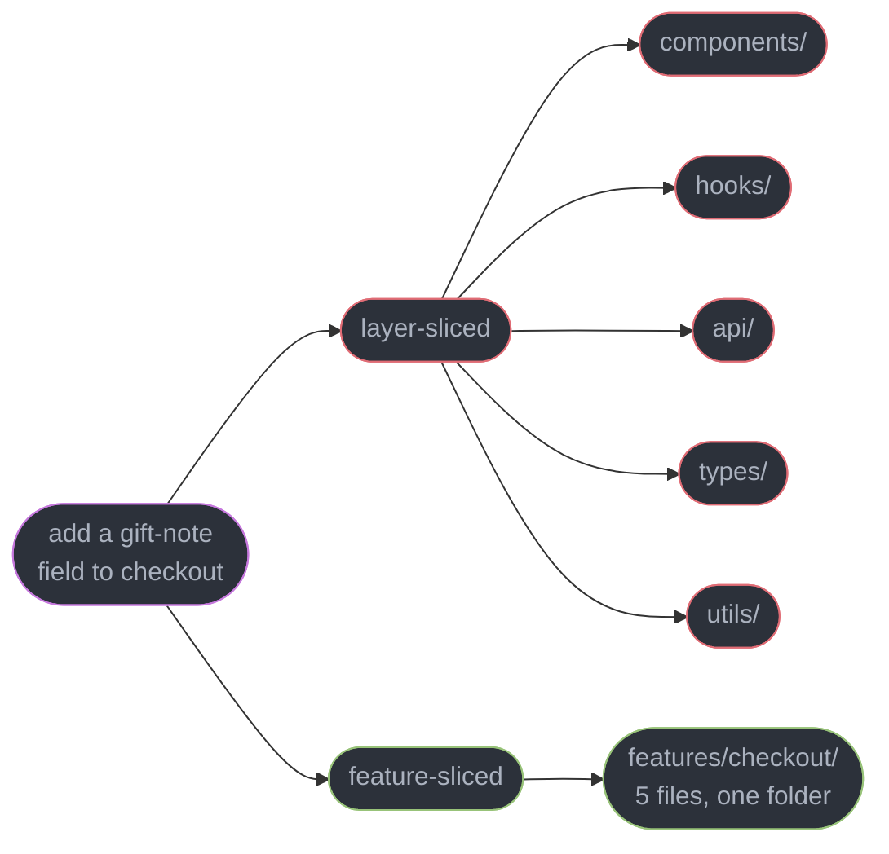
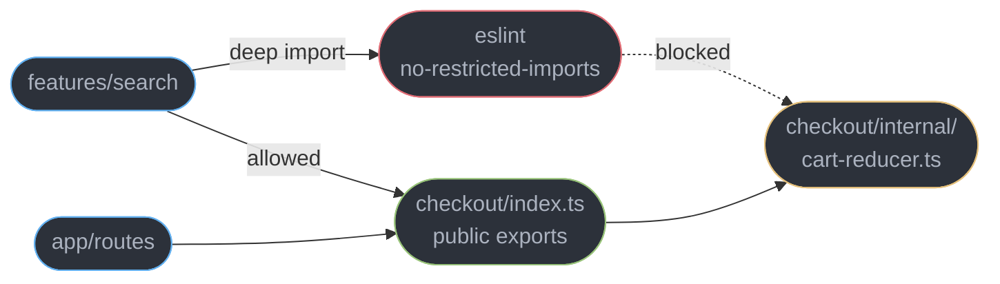
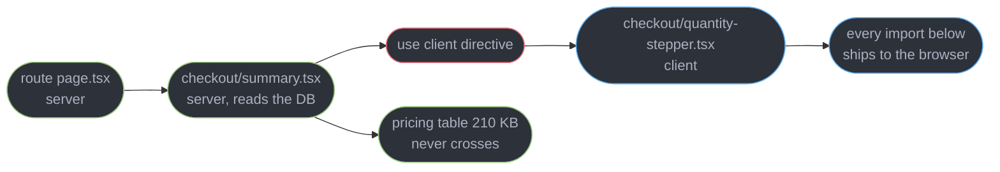
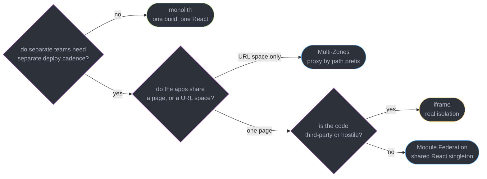
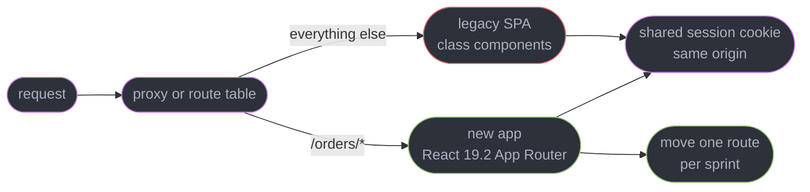
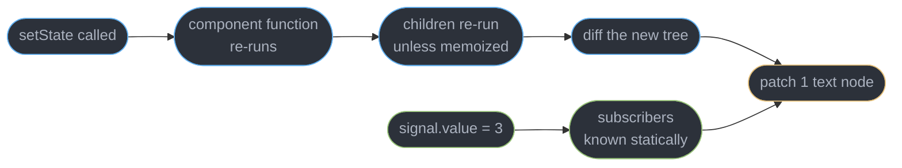

# React Architecture and Antipatterns

---

## 1. Concept Overview

Every module before this one answered a question about a mechanism: how a render is scheduled, what an effect synchronizes, where a Server Component runs. This one answers a question about a codebase: given 400 files and nine engineers, where does a thing go, and what stops it from going somewhere else.

Two forces decide that. The first is **change locality** — the number of directories a typical feature change has to open. A codebase organized by technical kind (`components/`, `hooks/`, `utils/`, `types/`, `api/`) has perfect locality for the first 40 components and none by the 200th, because by then every change to checkout touches five directories that also contain every other feature's files. A codebase organized by feature has the opposite property and a different failure mode: features quietly reach into each other until the slices are a fiction.

The second force is that in a React Server Components application the folder tree is no longer the only structure that matters. The `"use client"` directive draws a second boundary straight through it, deciding which modules end up in the browser bundle and which never leave the server. That seam is the one with a measurable cost — a directive on the wrong file moves 210 KB across it — and it does not follow your directory names unless you make it.

On top of those sits the organizational question: whether to split the application into independently deployed micro-frontends at all. The honest answer for most teams is no. Micro-frontends solve a coordination problem between teams, and a team that does not have that problem pays the shared-dependency, cross-app-auth and design-system-versioning bill for nothing.

The last third of this module is the antipattern catalogue: the nine failures that recur across React codebases, each named with the module that already taught the fix. This is the last module in the section, so its value is diagnosis and a pointer, not re-explanation. The architectural argument for splitting a user interface across teams belongs to [User Interfaces in Building Microservices](../../book/building_microservices/14_user_interfaces/14_user_interfaces.md); what is here is the React-level mechanics of doing it.

---

## 2. Intuition

> **One-line analogy**: a directory tree is a filing cabinet, and a lint rule is the lock. Without the lock, the labels on the drawers are decoration.

**Mental model**: think of the codebase as a graph of import edges, not a tree of folders. The folder tree is how humans navigate it; the import graph is what the bundler, the compiler and the blast radius of a change actually follow. Feature-slicing is an attempt to make the two match, and it only works while the import graph respects the slice boundaries the folders describe.

**Why it matters**: 12 unenforced cross-feature imports are enough to make a "modular" 300-file codebase behave exactly like the layer-sliced one it replaced. The refactor was real work, the folders look right in a screenshot, and the change locality is identical because the graph never changed.

**Key insight**: **structure is only structure when something rejects a violation.** A convention nobody enforces converges on the path of least resistance within one sprint, and the path of least resistance is always a deep import into another feature's internals.

---

## 3. Core Principles

- **Organize by change, not by kind.** Things that change together live together; a folder named for a technical category groups things that never change together.
- **A thing lives next to its only consumer until a second one appears.** Promotion out of a feature is triggered by a second import, not by a guess.
- **A boundary that is not enforced is a suggestion.** The enforcement is a lint rule or a package manifest, not a code-review habit.
- **Each feature exposes a public surface and hides everything else.** One `index.ts` per feature; everything else is internal by construction.
- **`shared/` needs an entry rule or it becomes the new dumping ground.** Two consumers and no feature knowledge, or it stays where it is.
- **The `"use client"` seam is the boundary with a bundle-size price tag.** Make it visible in file names, not implied by folder depth.
- **Split the deployment only to split the team.** Independent deploys are an organizational purchase with a technical bill.
- **The monolith is the default, and it is a good default.** One build, one router, one React copy, one design-system version.
- **Migrate by routing a subtree, not by rewriting a tree.** A strangler boundary at the route level is reversible; a big-bang rewrite is not.
- **Every antipattern in the catalogue is a mechanism misunderstood, not a style violation.** The fix is in the module that owns the mechanism.

---

## 4. Types / Architectures / Strategies

### 4.1 Two ways to slice a codebase

| Axis | Layer-by-type | Feature-sliced |
|------|--------------|----------------|
| Top-level folders | `components/`, `hooks/`, `utils/`, `api/`, `types/` | `features/checkout/`, `features/search/`, `shared/` |
| Adding a field to checkout | opens 5 directories | opens 1 directory |
| Deleting a feature | grep and pray | delete a folder, fix what the compiler reports |
| Finding "everything about search" | 6 places, none complete | 1 place |
| Where it holds | under roughly 40-60 components, one to three engineers | 100+ components, or 3+ engineers on separate features |
| Failure mode | every change is cross-cutting; ownership is unassignable | cross-feature deep imports make the slices fictional |

The 40-60 component figure is where the crossover is usually observed, not a law. The real signal is a pull request that touches four top-level directories to change one screen; when that stops being unusual, the layer slice has expired.

### 4.2 What goes where in a feature slice

| Location | Holds | Rule to move out |
|----------|-------|-----------------|
| `features/x/components/` | components only `x` renders | a second feature imports it |
| `features/x/hooks/` | hooks only `x` calls | a second feature calls it |
| `features/x/api/` | the queries and Server Functions for `x` | almost never — the endpoint is the feature's |
| `features/x/index.ts` | the public surface, 5-15 named exports | grows past ~20, meaning `x` is two features |
| `shared/ui/` | primitives with zero domain knowledge | never; it is already the floor |
| `shared/lib/` | pure helpers, no React, no domain | never |
| `app/` | routes, providers, the composition root | it is the only place allowed to import every feature |

### 4.3 Micro-frontend integration mechanisms

| Mechanism | Composition point | Shared React | Failure isolation | Real cost |
|-----------|-------------------|--------------|-------------------|-----------|
| **Module Federation** (Rspack, webpack, Vite plugin) | runtime, in one page | yes, as a singleton — and that is the whole problem | none by default: a remote's error crashes the host tree unless boundaried | version negotiation, shared-scope config, remote-down handling |
| **Next.js Multi-Zones** | the CDN or proxy, per path prefix | no — separate documents | total; a zone being down is a 502 on its paths only | full page load when crossing a zone boundary |
| **iframes** | the browser, per element | no — separate realms | total, including memory and crashes | `postMessage` for everything, focus and a11y trees are severed, sizing is manual |
| **Build-time packages** | the build | yes, one copy | none | it is not a micro-frontend; it is a monolith with npm ceremony |

Build-time packages are in the table because teams reach for them thinking they have bought independence. They have bought a version bump and a rebuild — which is the right answer surprisingly often, and should be called what it is.

### 4.4 The antipattern catalogue

| Antipattern | The tell | Owning module |
|-------------|----------|---------------|
| Index as key | reordering a list moves the wrong input's value | [Fundamentals and the Render Model](../react_fundamentals_and_the_render_model/react_fundamentals_and_the_render_model.md) |
| The effect that is a derived value | `useState` plus `useEffect` computing from props | [Effects and Synchronization](../effects_and_synchronization/effects_and_synchronization.md) |
| Prop drilling answered with context | a provider created to skip three levels | [Context and Component Communication](../context_and_component_communication/context_and_component_communication.md) |
| Context as a state manager | one provider, 40 consumers, a value that changes per keystroke | [Context and Component Communication](../context_and_component_communication/context_and_component_communication.md) |
| Hand-memoizing everything | `useMemo` on every expression, unverified | [The React Compiler](../the_react_compiler/the_react_compiler.md) |
| `useEffect` fetch instead of a cache | loading and error `useState` in 30 components | [Server State and Data Fetching](../server_state_and_data_fetching/server_state_and_data_fetching.md) |
| God component | one file, 600 lines, 14 `useState` | this module |
| Boolean prop explosion | `isPrimary`, `isDanger`, `isGhost`, 3 illegal combinations | [Typing React Components](../typing_react_components/typing_react_components.md) |
| Premature abstraction | a config-driven component used twice, with 9 props | this module |

The catalogue is diagnostic. Each row's fix is taught where the mechanism is taught, and re-teaching it here would be the same mistake in prose that it is in code.

---

## 5. Architecture Diagrams

### One change, two blast radii



The same diff, five directories versus one. Each of those five also contains every other feature's files, which is why a layer-sliced repository makes ownership and code-owner rules impossible to express.

### The public surface, and what enforces it



Only `index.ts` is importable from outside. The lint rule is what makes that sentence true rather than aspirational, and it fails the build rather than a review comment.

### The seam the folder tree does not draw



The directive, not the directory, decides what ships. A feature folder contains modules on both sides of this line, so the seam has to be visible in file names and lint configuration rather than inferred from where a file sits.

### Choosing a micro-frontend mechanism, or not



Every branch is a fact about the organization or the trust boundary. None of them is about React, which is the point: this decision is made on team topology and reversed at enormous cost.

### Strangling a legacy subtree



The proxy owns the cutover, so a bad migration is one rewrite rule away from being reverted. Same origin and one session cookie is what keeps auth from becoming its own project.

---

## 6. How It Works — Detailed Mechanics

### 6.1 The slice, and the colocation rule

A feature slice is a folder that owns its components, hooks, data access and types, and exposes a deliberately small surface.

```
src/
  app/                        composition root: routes, providers, the only importer of every feature
    routes/checkout.tsx
  features/
    checkout/
      index.ts                the public API, 9 named exports
      checkout-page.tsx
      components/
        quantity-stepper.tsx  used by exactly one file, so it lives here
        gift-note-field.tsx
      hooks/use-cart-totals.ts
      api/cart.ts
      internal/cart-reducer.ts   never exported from index.ts
    search/
    account/
  shared/
    ui/button.tsx             zero domain knowledge
    lib/format-currency.ts    no React, no imports from features/
```

The colocation rule is mechanical: **a module lives beside its only consumer until a second consumer appears.** Not when it "feels reusable" — when a second import statement exists. This is a rule about evidence, and it deletes an entire class of argument. `quantity-stepper.tsx` sits in `checkout/components/` because checkout is the only caller; the day search needs it, it moves to `shared/ui/` in the same pull request that adds the second call site.

The public surface is one file:

```ts
// features/checkout/index.ts — everything importable from outside checkout
export { CheckoutPage } from "./checkout-page";
export { useCartTotals } from "./hooks/use-cart-totals";
export type { CartLine, CartTotals } from "./types";
// cart-reducer, quantity-stepper and api/cart are deliberately absent
```

When this file passes roughly 20 exports, the feature has become two features. That is the only reliable signal for splitting one, and it is worth more than any up-front decomposition.

`app/` is the composition root and is deliberately privileged: it is the **only** directory allowed to import from every feature, because someone has to assemble them and that someone should be exactly one place. Routes, providers, the error boundary hierarchy and the router configuration live there. The inverse rule matters as much — no feature may import from `app/`. A feature that needs something the route knows should receive it as a prop or read it from a shared context that `shared/` owns, because the moment `features/checkout` imports `app/routes`, the dependency graph has a cycle and the feature is no longer independently testable or deletable.

### 6.2 Enforcing the boundary

ESLint's `no-restricted-imports` with `patterns` is the cheapest enforcement that exists and needs no plugin:

```json
{
  "rules": {
    "no-restricted-imports": ["error", {
      "patterns": [
        {
          "group": ["@/features/*/*"],
          "message": "Import a feature through its index.ts. Deep imports couple you to internals."
        },
        {
          "group": ["@/app/*"],
          "message": "Features must not import the composition root. Invert the dependency."
        }
      ]
    }]
  }
}
```

`@/features/*/*` matches two segments past `features`, so `@/features/checkout` resolves and `@/features/checkout/internal/cart-reducer` errors. Add a per-directory override so a feature may still deep-import its own files, and one more rule forbidding `shared/**` from importing `features/**` — that single rule is what keeps `shared/` from accumulating domain knowledge and becoming the coupling point it was created to avoid.

For a directed graph rather than a blanket ban — checkout may import `catalog`, catalog may not import `checkout` — `eslint-plugin-boundaries` expresses element types and allowed edges, and TypeScript project references enforce the same thing at compile time with the added benefit of incremental builds. Pick one. Two enforcement systems that disagree are worse than one that is slightly too coarse.

In a monorepo there is a third enforcement layer that costs nothing at all, because the package manager already does it. A feature published as a workspace package can restrict what is reachable with `exports`:

```json
{
  "name": "@acme/checkout",
  "exports": { ".": "./src/index.ts", "./client": "./src/index.client.ts" }
}
```

Anything not listed is unresolvable — `@acme/checkout/internal/cart-reducer` fails at module resolution, before ESLint or TypeScript is consulted, and it fails identically in the editor, the bundler and CI. Nx layers a tag system on top of the same idea, letting you declare that `scope:checkout` may depend on `scope:shared` and not on `scope:search`. The tradeoff against a plain `src/features/` directory is real: a workspace package means a `package.json`, a build or a source-condition export, and TypeScript project references to keep incremental builds fast. Take it when features are already owned by different people; the lint rule is enough before that.

The `shared/` entry rule is the part teams skip, and it is the reason `shared/` becomes the dumping ground in every codebase that lacks it. State it as a check: a module may enter `shared/` only if it has **two or more consumers** and **zero imports from `features/`**. Anything failing the second test is a feature module wearing a disguise, and it will drag its feature's types across the whole application within a month.

### 6.3 The client/server boundary as the primary seam

In an RSC application, the folder tree describes ownership and the `"use client"` directive describes deployment. They are independent, and only one of them has a byte cost. The mechanics of the directive, serialization rules and Server Functions belong to [Server Components and Server Functions](../server_components_and_server_functions/server_components_and_server_functions.md); what belongs here is that the seam is an architectural artifact you design rather than a keyword you sprinkle.

```tsx
// features/checkout/checkout-summary.tsx — a Server Component: no directive, never bundled
import { getPricing } from "./api/pricing";          // 210 KB currency table, stays server-side
import { QuantityStepper } from "./components/quantity-stepper";   // the client leaf

export default async function CheckoutSummary({ cartId }: { cartId: string }) {
  const pricing = await getPricing(cartId);
  return (
    <section>
      <PriceLines lines={pricing.lines} />
      <QuantityStepper cartId={cartId} initial={pricing.quantity} />
    </section>
  );
}
```

Three structural rules follow from the directive being a one-way door into the client graph:

- **Push the directive to the leaves.** A directive on a route layout drags every module below it into the browser bundle, silently. The interactive stepper is 4 KB; the summary that renders it is not client code at all.
- **Name the seam.** A convention of `*.client.tsx` for every file carrying the directive makes an import from a Server Component into a client module visible in the diff, and makes it lintable.
- **Feature boundaries must not fight the seam.** A feature's `index.ts` re-exporting both server and client modules turns the barrel into a client module for any importer that touches one export, which is how a "pure server" route quietly acquires a 90 KB bundle. Export the client surface from a separate `index.client.ts`.

### 6.4 Micro-frontend mechanics

**Module Federation** composes at runtime. The host loads a remote's entry, and both negotiate a shared scope so one copy of React is used:

```ts
// rspack.config.ts — the host. The shared block is the entire risk surface.
new ModuleFederationPlugin({
  name: "shell",
  remotes: { checkout: "checkout@https://checkout.example.com/remoteEntry.js" },
  shared: {
    react: { singleton: true, requiredVersion: "19.2.8", strictVersion: true },
    "react-dom": { singleton: true, requiredVersion: "19.2.8", strictVersion: true },
  },
});
```

`singleton: true` says both apps must use one instance. Without it — or with `strictVersion: false` and incompatible ranges — the remote loads its own React, and the browser now runs two copies. The symptom is not a version warning; it is `Invalid hook call. Hooks can only be called inside of the body of a function component.` thrown from a component that is unambiguously a function component, because the remote's `useState` reaches into the remote's dispatcher while the host's renderer holds the current fiber. Context is equally broken across the divide: `createContext` produces a different object per copy, so a provider from the host is invisible to a consumer in the remote.

With `strictVersion: true` a mismatch fails loudly at load instead, which is the correct trade. The operational consequence is that **React version upgrades become a cross-team synchronized deploy**, and that is the cost nobody budgets. The independence you bought applies to feature code and stops at the shared singleton list.

**Multi-Zones** composes at the proxy, one Next.js application per path prefix:

```ts
// next.config.ts on the shell — /checkout is a different deployment entirely
export default {
  async rewrites() {
    return [
      { source: "/checkout", destination: "https://checkout.example.com/checkout" },
      { source: "/checkout/:path*", destination: "https://checkout.example.com/checkout/:path*" },
    ];
  },
  assetPrefix: "https://shell.example.com",
};
```

Each zone sets a distinct `assetPrefix` so their `/_next/static` paths do not collide. There is no shared React because there is no shared document — crossing a zone boundary is a full page load, roughly 400-900 ms against 80 ms for a client-side navigation. That is the trade: total isolation and zero version negotiation, paid for at every boundary crossing. Zones work when the seams are infrequent (marketing, app, admin) and fail when users cross them constantly.

**iframes** are the only mechanism with real isolation — separate JavaScript realm, separate memory, a crash that cannot take the host down. Everything is `postMessage`:

```tsx
// shared/embed/remote-panel.tsx — always check origin, never trust event.data shape
export function RemotePanel({ src, origin }: { src: string; origin: string }) {
  const ref = useRef<HTMLIFrameElement>(null);
  useEffect(() => {
    function onMessage(e: MessageEvent) {
      if (e.origin !== origin) return;                      // the whole security model
      if (e.data?.type === "resize" && typeof e.data.height === "number") {
        ref.current!.style.height = `${e.data.height}px`;   // iframes do not size themselves
      }
    }
    window.addEventListener("message", onMessage);
    return () => window.removeEventListener("message", onMessage);
  }, [origin]);
  return <iframe ref={ref} src={src} sandbox="allow-scripts allow-same-origin allow-forms" />;
}
```

The costs are not subtle: focus does not move across the boundary with the keyboard in a way screen readers follow, the accessibility tree is severed, modals cannot escape the frame's box, and every interaction becomes a serialized message with a versioned schema. Use an iframe when the code is third-party or the isolation is a security requirement, and almost never otherwise.

**Three costs common to all three, all underestimated.** Cross-app authentication needs one session cookie on one parent origin, or you are building token relay through `postMessage`. Routing needs a single owner — two routers both writing `history.pushState` produce a back button that skips entries. And the design system must version independently and support two adjacent majors at once, because if every remote must upgrade the design system on the same day you have re-created the monolith's coupling while keeping the micro-frontend's overhead.

### 6.5 Incremental migration

The strangler-fig shape is the same at every scale: put a router in front, route one subtree to the new implementation, move one route per sprint, delete the old code when its last route is gone.

**At the route level**, the proxy from the diagram above is the cutover switch. A Next.js `proxy.ts` rewrite, an nginx `location` block or a CDN rule all work; what matters is that both applications sit on **one origin** so the session cookie is shared and no CORS or token-relay work is needed.

**Inside one application**, a legacy client router can host the new tree at a mount point:

```tsx
// Legacy React Router v6 SPA hosting the new implementation for one subtree.
<Routes>
  <Route path="/orders/*" element={<NewOrdersApp />} />   {/* new tree owns everything below */}
  <Route path="/*" element={<LegacyShell />} />
</Routes>
```

Two routers in one document is workable for a bounded window and painful past it. Exactly one may own `window.history`; the inner tree must use a memory router or the shared one, never a second browser router, or every navigation writes two history entries and the back button appears to require two presses.

**Class components** migrate mechanically, and the compiler is a reason to bother — [The React Compiler](../the_react_compiler/the_react_compiler.md) does not memoize class components at all, so a class is permanently outside auto-memoization.

```tsx
// The mapping is mechanical: state to useState, both lifecycle halves to one effect.
class OrderPanel extends React.Component<Props, State> {
  state = { orders: [] as Order[] };
  componentDidMount() { this.sub = watch(this.props.id, (o) => this.setState({ orders: o })); }
  componentWillUnmount() { this.sub.unsubscribe(); }
  render() { return <OrderList orders={this.state.orders} />; }
}

function OrderPanel({ id }: Props) {
  const [orders, setOrders] = useState<Order[]>([]);
  useEffect(() => {
    const sub = watch(id, setOrders);
    return () => sub.unsubscribe();      // one effect, both lifecycle halves
  }, [id]);
  return <OrderList orders={orders} />;
}
```

Two traps. `componentDidMount` plus `componentDidUpdate` usually collapse into a single effect with a dependency array, and mechanically translating them into two effects re-introduces the bug the class had. And `getDerivedStateFromProps` is almost always the derived-value antipattern from §4.4 — it should become a plain expression during render, not a `useState` plus `useEffect`. See [Effects and Synchronization](../effects_and_synchronization/effects_and_synchronization.md).

**Two design systems during the window.** The old and new trees will render adjacent to each other for months, and a user seeing two button styles on one screen will file it as a bug. The cheapest answer is a shared CSS custom-property token layer that both stacks consume — colours, spacing, radii, type scale — so the two component libraries diverge in implementation but not in appearance. Do not attempt to make the legacy components import the new library; that is the rewrite you were avoiding, arriving through a side door. Token parity is achievable in a week and buys the entire migration window. Owned by [Styling and Design Systems](../styling_and_design_systems/styling_and_design_systems.md).

### 6.6 The version-skew window

Whenever the client and the server deploy separately — and in every micro-frontend they always do — there is a window where a browser is running the old bundle against the new API. A tab open for six hours during three deploys is running a build from three deploys ago.

```ts
// The server stamps every response with the build it came from; the client compares.
const BUILD = process.env.NEXT_PUBLIC_BUILD_ID!;    // baked into the bundle at build time

export async function api<T>(path: string, init?: RequestInit): Promise<T> {
  const res = await fetch(path, { ...init, headers: { ...init?.headers, "x-build": BUILD } });
  if (res.status === 409 || res.headers.get("x-build") !== BUILD) {
    staleBuild.set(true);          // render a non-blocking "Reload to update" banner
  }
  if (!res.ok) throw new HttpError(res.status);
  return res.json();
}
```

Three rules make the window survivable. **Keep the old API contract for at least one deploy cycle** — additive changes only, removals in the deploy after the client that stopped calling them. **Fingerprint every asset and never delete the previous build's chunks for 24 hours**, or a lazily loaded route chunk 404s for anyone who was mid-session; a `React.lazy` boundary that fails to import is the classic "chunk load error" a stale tab produces. **Prompt, never force.** A forced reload during checkout loses the user's form state, and version skew is not urgent enough to justify that. Next.js sends a deployment id header for exactly this purpose; the pattern above works on any stack.

### 6.7 Signals, and what React trades away

Fine-grained reactivity — Solid's signals, Preact Signals, Svelte 5 runes, Vue's refs — inverts React's update model. A signal knows which DOM nodes read it, so writing to it updates those nodes directly. No component function re-runs, no virtual tree is produced, no diff happens.



**What React trades away** is that update cost scales with tree size rather than with the number of readers, which is why memoization exists as a concept at all. **What it buys** is that a component is a plain function of props and state with no reactive-graph subscription to reason about, and that this holds identically on the server, in React Native and in a static render. Server Components are hard to express in a fine-grained model precisely because a signal graph is a live client-side object, and React's willingness to re-run the whole function is what lets that function be a server function instead.

[The React Compiler](../the_react_compiler/the_react_compiler.md) narrows the practical gap by making memoization automatic rather than manual, so the re-render model's cost is paid without the developer paying attention. It does not close it: the compiler still skips work per component, where a signal skips it per DOM node. Treat this as landscape knowledge and a good interview conversation, not a migration recommendation — you do not switch frameworks over an update algorithm.

---

## 7. Real-World Examples

**The 12 imports that erased a refactor.** A team spent five weeks moving a 340-file application from `components/hooks/utils` into eleven feature slices, and change locality did not improve. An import-graph scan found 12 cross-feature deep imports — a reducer, three types, a formatting helper reached for from four features. The folders were right and the graph was unchanged. Adding the `@/features/*/*` lint rule surfaced them in 40 seconds and fixing all 12 took two days: four moved to `shared/`, six were duplicated at eight lines each, two revealed that "orders" and "fulfilment" were genuinely one feature. The lesson was that the enforcement, not the move, was the refactor.

**Two Reacts and a hook call.** A retail shell loaded a checkout remote through Module Federation with `shared: { react: {} }` — federated but not a singleton. It worked in staging because both apps happened to build 19.2.8. Six weeks later checkout shipped a patch bump to 19.2.9 and production threw `Invalid hook call. Hooks can only be called inside of the body of a function component.` on a component that had not changed in a year. The host's provider was also invisible to the remote's consumer, because `createContext` had run twice. `singleton: true, strictVersion: true` turned a silent runtime break into a load-time failure, and the team accepted that React upgrades are now a coordinated deploy across four repositories.

**The configurable component with one real user.** A design-system team extracted a `DataPanel` after seeing it used on two screens, and gave it 9 props to cover both — `variant`, `dense`, `showHeader`, `headerSlot`, `emptyState`, `onRowClick`, `stickyFooter`, `columns`, `loadingRows`. Eighteen months later it had 23 props, 4 of which were only ever passed by a single call site, and the file was 480 lines of branching. The third genuine use case had arrived and did not fit, so it was added as prop 24. Deleting the abstraction and inlining it back into the three screens produced 210 lines total across three files, each readable in one pass, with the two lines that were genuinely shared moved to `shared/ui/`. The second occurrence had been a coincidence and the abstraction had been built on it.

**The chunk that 404ed.** A single-page app deployed roughly nine times a day and pruned old assets on every deploy. Users with a tab open for more than one deploy hit `Failed to fetch dynamically imported module` the moment they navigated to a lazily loaded route — about 180 Sentry events a day, all of them from healthy application code. Keeping the previous 24 hours of hashed chunks and adding a build-id banner took the errors to under 5 a day, all genuine. Nothing about the React code was wrong; the deployment pipeline was deleting files a running client still needed.

---

## 8. Tradeoffs

| Choice | Bought | Paid |
|--------|--------|------|
| Feature slices | one directory per change, deletable features, real ownership | more folders, and a `shared/` that needs an entry rule |
| Layer-by-type | trivially obvious for the first 40 components | every change is cross-cutting past that point |
| Enforced boundaries by lint | violations fail CI instead of surviving review | a per-directory override list to maintain |
| One `index.ts` per feature | internals are free to change | one more file, and a barrel that can pull in client code |
| Module Federation | independent deploys with one page and one React | shared singletons make React upgrades a synchronized deploy |
| Multi-Zones | total isolation, no version negotiation | 400-900 ms full page load at every zone crossing |
| iframes | real crash, memory and security isolation | severed a11y tree, manual sizing, everything through `postMessage` |
| Monolith | one build, one router, one design-system version | teams block each other on a shared release train |
| Strangler migration | reversible, shippable each sprint | two stacks, two bundles and two routers for the duration |

---

## 9. When to Use / When NOT to Use

**Feature-slice when:**

- The application is past roughly 40-60 components, or two engineers routinely edit the same directory for unrelated reasons.
- Features have identifiable owners and you want `CODEOWNERS` to be expressible.
- Features get deleted — an experiment, a deprecated flow, a sunset market.

**Stay layer-sliced when:**

- The codebase is under 40 components and one or two people touch all of it. The overhead is real and the benefit has not arrived.
- The application is genuinely one feature: a single editor, a single dashboard, a single game loop.

**Split into micro-frontends when:**

- Three or more teams need to deploy on independent cadences and the release train is measurably blocking them.
- A section must survive the failure of another, or is third-party code you do not trust in your realm.
- Two applications are on genuinely different stacks and merging them is not on any roadmap.

**Do NOT split when:**

- There is one team. You will pay every micro-frontend cost and receive no independence.
- The motivation is "the codebase is large". That is a modularity problem, and feature slices with enforced boundaries solve it inside one build.
- Users cross the boundary constantly, which turns every crossing into a full page load or a shared-state negotiation.
- Nobody has budgeted for shared-dependency version policy, cross-app auth, or a design system that must support two majors at once. Those three are the actual project.

---

## 10. Common Pitfalls

**The deep import that couples two features.** This is the single failure that makes feature-slicing decorative, and it never arrives as a decision — it arrives as an autocomplete accepting a path.

```tsx
// BROKEN: features/search/result-card.tsx
// Reaching past checkout's public surface into its internals. Search now depends on the
// shape of a reducer's state, so any refactor inside checkout breaks a file in another
// feature, and the compiler reports it in search — where nobody thinks to look.
import { cartReducer, type CartState } from "@/features/checkout/internal/cart-reducer";
import { formatLineTotal } from "@/features/checkout/components/price-lines";

export function ResultCard({ item }: { item: Item }) {
  const inCart = (cartReducer as unknown as { peek(): CartState }).peek().lines.some(
    (l) => l.sku === item.sku,
  );
  return <Card subtitle={formatLineTotal(item.price)} badge={inCart ? "In cart" : null} />;
}
```

```tsx
// FIX: checkout exports a named, intentional surface; the formatter had two consumers, so it
// moved to shared/. Checkout's internals are now free to change without touching search.
import { useIsInCart } from "@/features/checkout";        // added to checkout/index.ts
import { formatCurrency } from "@/shared/lib/format-currency";

export function ResultCard({ item }: { item: Item }) {
  const inCart = useIsInCart(item.sku);
  return <Card subtitle={formatCurrency(item.price)} badge={inCart ? "In cart" : null} />;
}
```

The lint rule is what makes the fix stick. Without `@/features/*/*` restricted, the broken version is back within a sprint.

**Boolean prop explosion where a union belongs.** Four booleans encode 16 states of which 5 are legal, and the illegal ones typecheck.

```tsx
// BROKEN: isPrimary + isDanger + isGhost + isLink. Nothing prevents three being true at once,
// and the component's body is a cascade of conditionals resolving contradictions.
type Props = { isPrimary?: boolean; isDanger?: boolean; isGhost?: boolean; isLink?: boolean };
<Button isPrimary isDanger isGhost />   // typechecks, renders something nobody designed
```

```tsx
// FIX: one prop, four legal values, illegal combinations unrepresentable.
type Props = { variant: "primary" | "danger" | "ghost" | "link" };
<Button variant="danger" />
```

Discriminated unions and props that make illegal states unrepresentable belong to [Typing React Components](../typing_react_components/typing_react_components.md).

**A `shared/` with no entry rule.** It starts as three primitives and becomes 90 modules, 40 of which import from `features/`. At that point `shared/` is the coupling point, and every feature transitively depends on every other. Two consumers and zero feature imports, enforced by lint.

**A barrel that drags client code across the seam.** `features/checkout/index.ts` re-exporting one `"use client"` module makes the whole barrel a client module for a Server Component importing anything from it. Keep `index.ts` and `index.client.ts` separate.

**God components.** 600 lines and 14 `useState` calls is not a length problem, it is a count-of-reasons-to-change problem. Split along the state that changes together, not at an arbitrary line count; if two `useState` values always change in the same handler they belong in one `useReducer` in one component, and if they never do they belong in two components.

**Premature abstraction of a component used twice.** Two call sites and nine configuration props is not reuse, it is a switch statement with a JSX interface. Duplicate until the third call site tells you what is actually common — the second occurrence is a coincidence, the third is a pattern.

**One directive, one bundle.** `"use client"` on a route layout to silence a context error is the highest-cost single line in an RSC codebase. Extract a five-line providers file. Owned by [Server Components and Server Functions](../server_components_and_server_functions/server_components_and_server_functions.md).

**Manual memoization added after the compiler shipped.** A `useMemo` around every expression is now noise the compiler already handles, and it obscures the two or three places where a manual escape hatch is genuinely required. Measure first with the Profiler and Performance Tracks — [React Performance and Profiling](../react_performance_and_profiling/react_performance_and_profiling.md) — then read [The React Compiler](../the_react_compiler/the_react_compiler.md) for when `"use no memo"` is the right answer.

**Two browser routers in one document.** During a strangler migration, exactly one router may own `window.history`. Two produce duplicate entries and a back button that needs two presses.

**Index as key on a reorderable list.** The classic, and it is a keys bug rather than a performance one: reordering makes React match the wrong fiber to the wrong element, so an uncontrolled input's DOM value stays with position 2 while the data moves to position 5. Use a stable id from the data. Owned by [Fundamentals and the Render Model](../react_fundamentals_and_the_render_model/react_fundamentals_and_the_render_model.md).

**A migration with no deletion criterion.** Two stacks running side by side is a temporary state that becomes permanent when nobody has written down which routes are left. Track it as a countdown of legacy routes with a date, and treat the second bundle, second router and second design-system version as debt accruing weekly.

---

## 11. Technologies & Tools

| Tool | Purpose |
|------|---------|
| ESLint | `no-restricted-imports` patterns for feature boundaries |
| eslint-plugin-boundaries | Declared element types and allowed dependency edges |
| dependency-cruiser | Import-graph rules and cycle detection in CI |
| Madge | Circular-dependency and graph visualization |
| Nx | Monorepo tagging with enforced module boundaries |
| Turborepo | Monorepo task graph and remote build caching |
| Module Federation | Runtime composition of independently deployed bundles |
| Rspack | Rust bundler with first-class Module Federation |
| Next.js | Multi-Zones via rewrites and `assetPrefix` |
| single-spa | Framework-agnostic micro-frontend lifecycle orchestration |
| Knip | Finds unused files, exports and dependencies after a slice migration |
| TypeScript | Project references for compile-time boundary enforcement |
| Storybook | Independent design-system versioning and visual contracts |
| Solid | Fine-grained signal reactivity, the main model contrast |
| Preact Signals | Signals usable inside React, for landscape comparison |

---

## 12. Interview Questions with Answers

**Q: When are micro-frontends the wrong answer?**
**Short:** Independent deploys are an organizational purchase, so a single team splitting one product pays every cost of the split and receives none of the autonomy it exists to buy.

The problem micro-frontends solve is three or more teams blocking each other on one release train. If that is not your problem, what you get is shared-dependency version negotiation, a second copy of routing and auth, a design system that must support two adjacent majors, and a runtime failure mode where a remote being down breaks a page. "The codebase is large" is a modularity problem, and enforced feature slices inside one build solve it without any of that. Users crossing the boundary constantly is a second disqualifier: every crossing becomes a full page load or a shared-state negotiation. Split the deployment to split the team, and if the team is not split, do not.

**Q: What is the difference between feature-slicing and layer-slicing, and when does layer-slicing stop working?**
**Short:** Grouping by technical kind puts every feature's files in the same five directories, so past roughly 40-60 components a single-feature change becomes a five-directory diff.

Layer-slicing — `components/`, `hooks/`, `utils/`, `api/`, `types/` — is genuinely the right default while one or two people touch all of it, because there is nowhere to look but everywhere. It expires when adding one field to checkout opens five folders that also contain search's and account's files, at which point ownership is unassignable, `CODEOWNERS` cannot be expressed, and deleting a feature means grepping. Feature-slicing moves the axis to what changes together, giving one directory per change and making a feature deletable by deleting a folder. Its own failure mode is different and worse if unenforced: features reach into each other's internals until the slices are fiction.

**Q: How do you actually enforce a module boundary in a React codebase?**
**Short:** ESLint no-restricted-imports with a pattern like features slash star slash star blocks any path deeper than a feature's index, failing CI rather than relying on review.

The convention is the folder; the enforcement is the rule. `@/features/*/*` matches two segments past `features`, so `@/features/checkout` resolves and `@/features/checkout/internal/cart-reducer` errors with a message explaining the fix. Add a per-directory override so a feature may deep-import its own files, and a second rule forbidding `shared/**` from importing `features/**` — that one keeps `shared/` from accumulating domain knowledge. For a directed graph rather than a blanket ban, `eslint-plugin-boundaries` or TypeScript project references express which element type may depend on which. Use exactly one enforcement system; two that disagree are worse than one that is slightly coarse.

**Q: What is the duplicate-React problem in a micro-frontend and how does it show up?**
**Short:** Duplicate React instances give you two dispatchers and two context registries, surfacing as an invalid-hook-call error thrown from code that is unambiguously correct.

Module Federation's `shared` block is where this is decided. With `react: { singleton: true, strictVersion: true }` a version mismatch fails loudly at load; without the singleton, the remote quietly loads its own copy. Then the remote's `useState` reaches into the remote's dispatcher while the host's renderer holds the current fiber, producing `Invalid hook call. Hooks can only be called inside of the body of a function component.` from a component nobody has touched in a year. Context breaks in the same way and more silently: `createContext` runs twice, so a host provider is invisible to a remote consumer and the consumer falls back to the default value. The consequence teams do not budget for is that React version upgrades become a synchronized deploy across every repository in the shared scope.

**Q: Why is the client/server boundary the primary architectural seam in an RSC application?**
**Short:** Directives, not directories, decide what ships to the browser, so the seam is the only structural line in the codebase with a measurable byte cost.

A folder tree describes ownership; `"use client"` describes deployment, and the two are independent. The directive is a one-way door — every module imported below it joins the client graph — which is why a directive on a route layout can move an ORM's types and a 210 KB currency table into the bundle with no warning. Three rules follow: push the directive to interactive leaves rather than shells, name the seam in filenames like `*.client.tsx` so a crossing is visible in a diff, and keep a feature's client exports in a separate `index.client.ts` so the barrel does not drag client code into a server route. The mechanics are owned by the Server Components module; what is architectural is that this line is designed, not sprinkled.

**Q: What is the colocation rule and when does something move to a shared directory?**
**Short:** A module stays beside its only consumer until a second import statement exists, and a promotion to shared additionally requires that it import nothing from any feature.

The rule is deliberately about evidence rather than judgment, because "this feels reusable" is unfalsifiable and produces a `shared/` full of things one caller uses. A stepper component used only by checkout lives in `features/checkout/components/`; the day search imports it, it moves to `shared/ui/` in the same pull request that adds the second call site. The second half of the rule is the one teams skip: a module may enter `shared/` only with two or more consumers **and** zero imports from `features/`. Anything failing the second test is a feature module in disguise and will drag its feature's types across the whole application, making `shared/` the coupling point it was created to prevent.

**Q: How do you choose between Module Federation, Multi-Zones and iframes?**
**Short:** The composition point decides: runtime in one page, a proxy per URL prefix, or a separate browser realm, and each trades isolation against navigation cost.

Module Federation composes at runtime in one document with a shared React singleton — the most seamless UX and the tightest coupling, since a version mismatch is a synchronized deploy. Multi-Zones composes at the proxy with one Next.js app per path prefix and distinct `assetPrefix` values; there is no shared React because there is no shared document, so isolation is total and crossing a boundary costs a 400-900 ms full page load against roughly 80 ms for a client navigation. iframes are the only mechanism with real crash, memory and security isolation, paid for with a severed accessibility tree, manual sizing over `postMessage` and modals trapped in a box. Pick zones when seams are infrequent, federation when apps share a page, and an iframe when the code is third-party or hostile.

**Q: How do you migrate a large legacy React application incrementally?**
**Short:** Put a router in front, send one route subtree to the new implementation, move one route per sprint, and delete the old code when its last route is gone.

The strangler shape works at two scales. At the deployment level a proxy rewrite or CDN rule routes `/orders/*` to the new application while everything else stays legacy; both must sit on one origin so a single session cookie is shared and no token relay is needed, and reverting is one rewrite rule. Inside a single application, a legacy router can mount the new tree at `path="/orders/*"`, with the strict constraint that exactly one router owns `window.history` — two browser routers produce duplicate entries and a back button that needs two presses. Class components migrate mechanically, and it is worth doing because the React Compiler does not memoize classes at all, leaving them permanently outside auto-memoization.

**Q: What is the version-skew window and how do you survive it?**
**Short:** Between two deploys a browser runs the old bundle against the new API, so assets must outlive their deploy and the contract must stay additive for at least one cycle.

A tab left open through three deploys is running a three-deploy-old client. Three rules make that survivable. Keep the previous 24 hours of fingerprinted chunks — pruning them on deploy is what produces `Failed to fetch dynamically imported module` from a `React.lazy` boundary in otherwise healthy code, and it looks like an application bug in the error tracker. Make API changes additive, removing a field only in the deploy after the client that stopped reading it. And detect skew by stamping a build id on every request and response, then prompt with a non-blocking banner rather than forcing a reload — a forced reload mid-checkout loses the user's form state, and skew is never urgent enough to justify that.

**Q: When is context the wrong answer to prop drilling?**
**Short:** Composition removes the intermediate levels entirely, so a provider created only to skip three layers adds a re-render surface that passing children as a prop would not have needed.

Prop drilling three levels is usually a symptom that the intermediate components should not have been given the data at all. Making the middle component accept `children` and rendering the leaf at the top means the data never traverses those levels — no provider, no consumer, no subscription. Context earns its place when the value is genuinely ambient across an unbounded subtree, like a theme or the current user, not when the tree between producer and consumer is a fixed three components you control. The distinction matters because a provider is a re-render surface: every consumer re-renders on every value identity change, which is a cost composition does not have. Owned by the Context and Component Communication module.

**Q: Which useEffect calls should have been derived values?**
**Short:** Computing state from props inside an effect renders once with a stale value, then sets state and renders again, where a plain expression during render would be correct on the first pass.

The shape is a `useState` whose only writer is a `useEffect` reading props. It costs two renders instead of one, briefly displays a value the props no longer justify, and creates a synchronization bug the moment a dependency is forgotten. The fix is almost always to delete both and compute during render — `const total = lines.reduce(...)` — because a value derivable from props and state is not state. Two related cases: resetting state when a prop changes usually means the component should have a `key`, and `getDerivedStateFromProps` in a class being migrated is this antipattern wearing a lifecycle method's name. Full treatment in the Effects and Synchronization module.

**Q: When does context become a state manager, and why is that a problem?**
**Short:** A provider holding a value that changes per keystroke re-renders all 40 of its consumers on every change, because context has no selector and no per-field subscription.

Context is a dependency-injection mechanism: it moves a value down a tree without threading it through props. It has no mechanism for "notify only the components that read this field", so a single provider holding an entire application's state broadcasts every change to every consumer. The symptom is a search input dropping frames while a sidebar three routes away re-renders on each character. Splitting into several providers by change frequency helps and stops working past a handful; at that point an external store with selectors — Zustand or Jotai via `useSyncExternalStore` — is the right shape, and it also fixes tearing under concurrent rendering. See Context and Component Communication and Client State Management.

**Q: Should you still hand-memoize now that React Compiler 1.0 has shipped?**
**Short:** Auto-memoization is the default story since Compiler 1.0 stabilized in October 2025, so manual memo hooks are escape hatches for cases the compiler bails out on, not a general technique.

The compiler analyzes mutability and inserts memoization the developer would have had to reason about by hand, which is what makes it more reliable — a `useMemo` with a wrong dependency array was never verifiable by review. A `useMemo` around every expression is now noise that obscures the two or three places a manual hatch is genuinely needed: a value whose identity is consumed by non-React code, or a component the compiler has bailed out of and marked. The workflow is measure first with the Profiler and React Performance Tracks, read the compiler's own bailout diagnostics, and reach for `"use no memo"` or a manual hook only against a measurement. Owned by The React Compiler and React Performance and Profiling.

**Q: What is wrong with fetching in a useEffect instead of using a cache?**
**Short:** Hand-rolled fetching duplicates loading, error, deduplication, revalidation and race-cancellation logic in every component, and the out-of-order response bug is the one that reaches production.

An effect that fetches on mount needs an `AbortController` or a mounted flag or a fast second navigation resolves stale data over fresh, and that bug appears only under latency nobody reproduces locally. It also cannot deduplicate two components requesting the same resource, cannot revalidate on focus or reconnect, and gives every consumer its own copy of the same data with no way to invalidate after a mutation. A server-state cache — TanStack Query v5, or a framework loader — makes all of that one configuration decision, and reduces the component to reading a value. The effect is still correct for genuine synchronization with a non-React system; it was never the right tool for a read. Owned by Server State and Data Fetching.

**Q: How do you recognize a God component, and how do you split it?**
**Short:** Count reasons to change rather than lines: fourteen state variables belonging to four unrelated concerns is the defect, and a 600-line component with one concern is fine.

The split follows state that changes together. Two `useState` values written by the same handler belong in one place, ideally one `useReducer`; two that are never written together belong in two components. Splitting at an arbitrary line count produces the worse outcome — a parent threading eleven props into three children that are not independently meaningful, which is more coupling than the original. The related failure is the opposite: extracting a component used twice into a configuration-driven abstraction with nine props. Two call sites is a coincidence, three is a pattern, so duplicate until the third one shows you what is actually common.

**Q: How does fine-grained reactivity differ from React's re-render model, and what does React gain by not adopting it?**
**Short:** Signals track which DOM nodes read a value and patch them directly, so update cost scales with readers, while React re-runs component functions and diffs a tree.

In Solid, Preact Signals or Svelte 5 runes, writing to a signal updates its known subscribers without any component function re-running — which is why those models need no memoization concept at all. React's cost scales with tree size instead, and that is precisely what memoization and now the compiler exist to manage. What React buys is that a component stays a plain function of props and state with no reactive graph to reason about, and that this holds identically on the server, in React Native and in a static render. Server Components depend on that: a signal graph is a live client-side object, and React's willingness to re-run the whole function is what allows the function to run on a server instead. Treat this as landscape knowledge; nobody changes frameworks over an update algorithm.

---

## 13. Best Practices

- Slice by feature once the application passes roughly 40-60 components; below that, layer-by-type is genuinely simpler and the overhead is not repaid.
- Give every feature one `index.ts`, and treat it growing past 20 exports as the signal that the feature is two features.
- Enforce the boundary with `no-restricted-imports` on `@/features/*/*` on day one — a convention added later has already been violated.
- Admit a module to `shared/` only with two consumers and zero imports from `features/`.
- Keep a module beside its only consumer until a second import exists; promote in the same pull request that creates it.
- Push `"use client"` to interactive leaves, name those files distinctly, and keep the client surface out of the feature's server barrel.
- Choose micro-frontends from team topology and trust boundaries, never from codebase size, and default to the monolith.
- If you federate, set `singleton: true` and `strictVersion: true`, and accept that React upgrades are now a coordinated deploy.
- Migrate by routing one subtree at a time behind a proxy on one origin, with exactly one router owning `window.history`.
- Keep the previous 24 hours of hashed chunks, keep API changes additive for one deploy cycle, and prompt for a reload rather than forcing one.
- Duplicate a component until the third call site; two occurrences do not tell you what is common.
- Give any two-stack migration a written countdown of remaining legacy routes with a date, or the temporary state becomes the architecture.
- Reach for a manual `useMemo` only against a Profiler measurement and a compiler bailout, never as a default.

---

## 14. Case Study

**Problem.** A 340-file B2B logistics application had been "modularized" into eleven feature slices five weeks earlier, and nothing had improved. A typical pull request still touched four features. The shipments route shipped 540 KB of First Load JS. Support tickets reported a `Failed to fetch dynamically imported module` error roughly 180 times a day. Leadership had begun discussing a micro-frontend split because "the codebase is too big for one team", and the team had two engineers.

**Investigation.** An import-graph scan with dependency-cruiser found 12 cross-feature deep imports: a cart reducer read by search, a price formatter imported from a component file by four features, and three types pulled from `internal/`. None had been reviewed as a decision; each was an accepted autocomplete. The bundle report traced 310 KB of the 540 to one `"use client"` on `app/(dashboard)/layout.tsx`, added eleven months earlier to silence a `createContext is not a function` error, and 90 KB more to `features/checkout/index.ts` re-exporting a client-only stepper, which made the whole barrel client code for the server route importing a type from it. The chunk errors correlated exactly with deploys: the pipeline pruned old assets, so any tab open across a deploy failed on its next `React.lazy` navigation.

**Root cause.** No enforcement. The folders had been moved and nothing rejected a violation, so the import graph — the thing that actually determines blast radius and bundle contents — was unchanged from before the refactor. The proposed micro-frontend split would have shipped that same graph across three deployments and added version negotiation to it.

```tsx
// BROKEN: search reaches into checkout's internals, so a refactor inside checkout breaks a
// file in another feature. The barrel below re-exports a client module, which drags the
// stepper and its dependencies into every server route that imports any checkout type.
import { cartReducer } from "@/features/checkout/internal/cart-reducer";
import { formatLineTotal } from "@/features/checkout/components/price-lines";

// features/checkout/index.ts
export { QuantityStepper } from "./components/quantity-stepper";   // "use client" inside
export type { CartLine } from "./types";
```

```tsx
// FIX: an intentional public hook, a formatter promoted to shared/ on its second consumer,
// and the client surface split into its own entry so the server barrel stays server-only.
import { useIsInCart } from "@/features/checkout";
import { formatCurrency } from "@/shared/lib/format-currency";

// features/checkout/index.ts        — server-safe only
export type { CartLine } from "./types";
export { useIsInCart } from "./hooks/use-is-in-cart";
// features/checkout/index.client.ts — imported only from client modules
export { QuantityStepper } from "./components/quantity-stepper";
```

**Fix.** The `@/features/*/*` lint rule landed first and reported all 12 violations in 40 seconds; fixing them took two days. Four modules moved to `shared/`, six were duplicated at eight lines each, and two showed that "orders" and "fulfilment" were one feature and were merged. The layout directive was replaced by a five-line providers file. The barrel was split. The deploy pipeline stopped pruning assets younger than 24 hours and started stamping a build id, with a non-blocking reload banner. The micro-frontend proposal was withdrawn.

**Results.**

- Cross-feature deep imports: 12 to 0, with CI failing on the thirteenth.
- First Load JS on the shipments route: 540 KB to 140 KB, identical rendered output.
- Directories touched by a median feature pull request: 4 to 1.
- Chunk-load errors: about 180 a day to under 5, all genuine network failures.
- Features: 11 to 10, after two were found to be one.
- Engineering weeks spent on a micro-frontend split: 0.

**Lesson.** The five-week refactor had moved folders without changing the import graph, and the import graph is the architecture. The enforcement rule was 14 lines of configuration and did more than the refactor it was added to protect. The proposed micro-frontend split would have taken a coupling problem inside one build and distributed it across three deployments with a shared React singleton on top — buying independence for a team that was two people and had never been blocked by a release train. Structure is what rejects a violation; everything else is a folder name.
