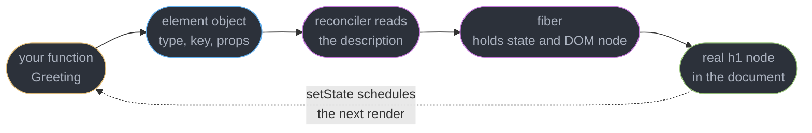
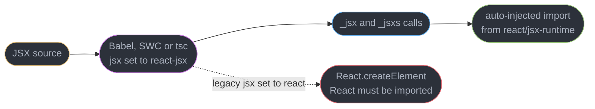
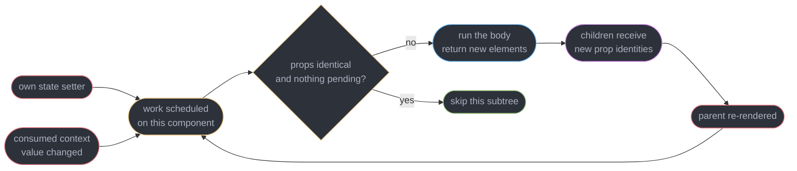
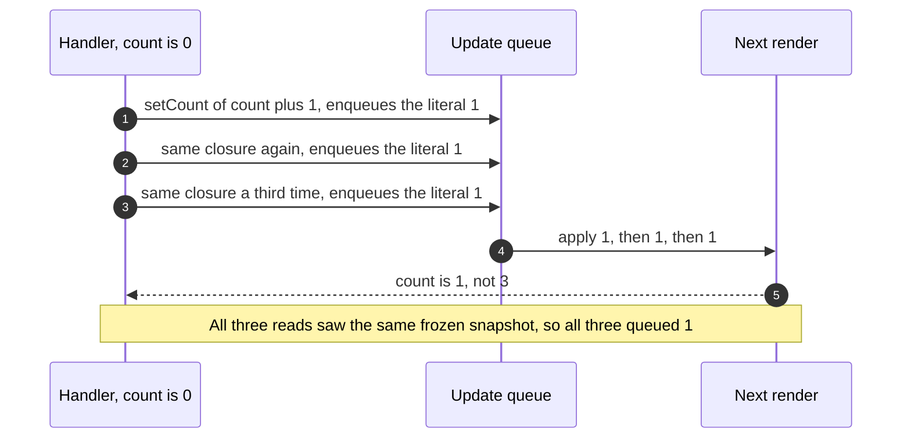
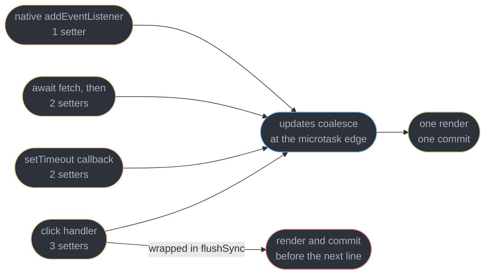
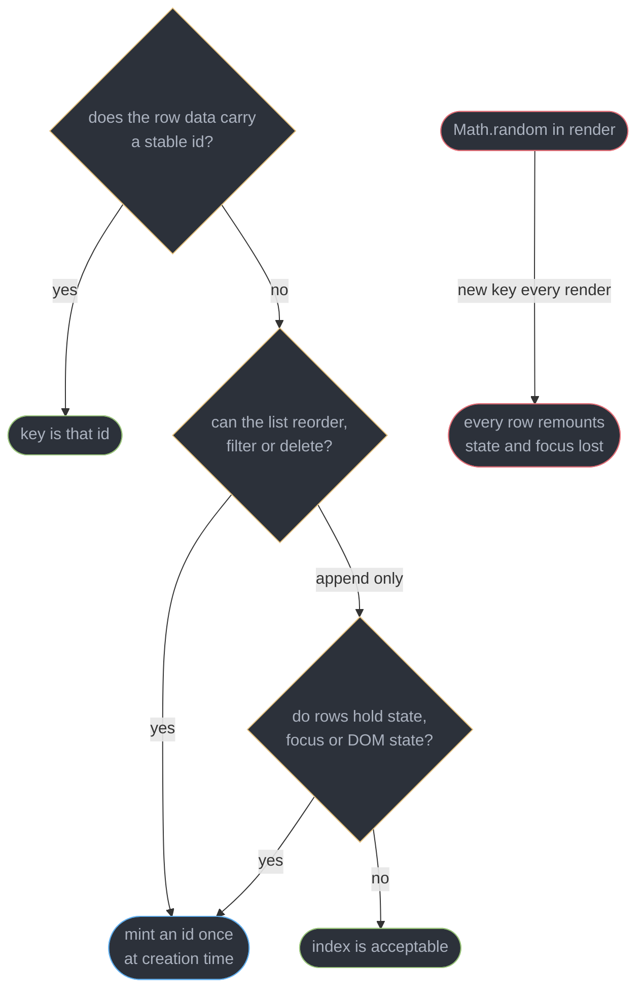

# React Fundamentals and the Render Model

---

## 1. Concept Overview

React is a library for describing a user interface as a function of state. You write functions that return a *description* of what the screen should look like; React compares successive descriptions and applies the minimum set of changes to the real DOM. Nothing you write ever touches a DOM node directly, and that indirection is the entire value proposition — it lets React batch, defer, discard and re-run your rendering work without you knowing.

Three nouns get confused constantly, and every later module depends on keeping them apart. A **component** is your function. An **element** is the plain immutable JavaScript object that function returns — `{ type, key, props }`, roughly 80 bytes, allocated fresh on every render and thrown away immediately. An **instance** is what React keeps behind the scenes: a fiber node holding your state, your DOM node and the traversal pointers. `<Greeting name="Ada" />` is not a call to `Greeting`; it is an object saying "React, when you get here, call `Greeting` with these props".

React 19.3 (released 2026-09-09; there is no React 20, and the patches as of 2026-10-14 are 19.3.1 / 19.2.9 / 19.1.10 / 19.0.9) changed almost nothing about this core model, which is the point: the element/render/reconcile loop has been stable since 2013. What has changed underneath it is who runs the work and when: automatic batching since 18, concurrent lanes, Server Components, and React Compiler 1.0 placing memoization for you. The mental model in this module is what all of those are built on.

**Governance:** since 2026-02-24 React, React Native and JSX have been stewarded by the **React Foundation** under the Linux Foundation, rather than by Meta directly — the answer to every "what happens if Meta walks away" question in an architecture review.

This module owns **keys** and the index-as-key bug, deliberately, because a learner writes their first list within an hour. The underlying two-pass keyed diff, the fiber node's fields, double buffering and lanes belong to [Fiber and Reconciliation](../fiber_and_reconciliation/fiber_and_reconciliation.md); this page cross-links there rather than repeating it.

---

## 2. Intuition

> **One-line analogy**: each render is a photograph of the UI, not a live video feed. React develops the photo, compares it with the last one, and repaints only the pixels that differ. Your event handler is holding an old photo, not a window onto the present.

**Mental model**: `UI = f(state)`. Calling a state setter does not mutate a variable — it schedules a *new call* to `f`. Between that call and the next one, every `const` in the component body, every closure inside a handler, and every value captured by an effect is frozen at the value it had when that render ran. State is a snapshot, and the classic three-`setCount(count + 1)` bug is the direct consequence.

**Why it matters**: the four most common React bugs a mid-level engineer ships all come from breaking one of these rules. A counter that increments by one instead of three (snapshot). A list where deleting a row moves someone else's typed text (keys). An expensive function running on every keystroke (`useState(expensive())` instead of `useState(() => expensive())`). A component re-rendering 800 times because a parent allocates a new object literal in JSX.

**Key insight**: React does not track *what* changed — it re-runs your function and finds out. A re-render is not evidence that something changed; it is a re-execution triggered by one of exactly three things: the component's own setter, its parent rendering, or a context it consumes changing. "Props changed" is not on that list, because props changing is a *consequence* of the parent rendering, never an independent cause.

---

## 3. Core Principles

- **An element is a description, not a thing.** `_jsx("div", {})` allocates an object. No DOM node exists, no component function has run, and nothing is scheduled until React reaches that element while rendering.
- **Rendering is calling your function.** "React re-rendered" means "React called the component body again". It does not mean the DOM changed — a render that produces identical output commits zero mutations.
- **The render function must be pure.** Same props, same state, same context implies the same returned elements, with no side effects along the way. React may call it zero, one or two times per commit, and may throw the result away.
- **State is a snapshot per render.** Each render closes over its own `count`. Setters queue work against the *next* render; they never write into the current one.
- **Identity is referential.** `Object.is` decides whether a state update is a no-op and whether a bailout can fire. `{a: 1} !== {a: 1}` — value equality is never checked anywhere in React.
- **Keys are sibling-scoped identity.** A key answers "which of last render's siblings is this one?" — nothing more. It is not a global id, not a DOM id, and not read by your component.
- **Composition, not inheritance.** A component's only extension point is its props, `children` included. React has no `extends` story and has never needed one.

---

## 4. Types / Architectures / Strategies

### 4.1 The three nouns

| Noun | What it is | Lifetime | You can hold a reference? |
|------|-----------|----------|---------------------------|
| Component | Your function, `(props) => elements` | Module lifetime | Yes — it is just a function |
| Element | `{ $$typeof, type, key, props }` object | One render | Yes, but it is inert data |
| Instance (fiber) | React's internal work object holding state, DOM node, pointers | As long as the position exists with a matching key and type | No public API — never reach through `__reactFiber$` |

### 4.2 JSX compilation modes

| Mode | `tsconfig` `jsx` | Emits | `React` in scope? |
|------|------------------|-------|-------------------|
| Automatic (current) | `react-jsx` | `_jsx` / `_jsxs` from `react/jsx-runtime` | Not required |
| Automatic, dev | `react-jsxdev` | `_jsxDEV` from `react/jsx-dev-runtime`, with file, line and column | Not required |
| Classic (legacy) | `react` | `React.createElement` | Required, or `ReferenceError` |
| Preserve | `preserve` | JSX untouched, for a downstream tool | N/A |

### 4.3 The three causes of a re-render

| Cause | What React does | Can it be stopped? |
|-------|-----------------|--------------------|
| The component called its own setter | Marks work on that fiber directly | Only by `Object.is` equality on the new state |
| A parent re-rendered | Renders children unless a bailout fires | `React.memo` plus referentially stable props, or the React Compiler |
| A consumed context value changed | Forces a render even through `memo` | Split the context, or select with `useSyncExternalStore` |

### 4.4 State primitives

| Primitive | Reach for it when | Cost |
|-----------|-------------------|------|
| `useState(initial)` | One independent value, updated from one or two places | Simplest; `initial` is evaluated every render if it is a call |
| `useState(() => initial())` | The initial value costs more than roughly 1 ms to compute | Lazy initializer runs once per mount |
| `useReducer(fn, initial)` | Three or more fields that change together, or updates that read like events | One function, testable in isolation, zero React imports |
| `useReducer(fn, arg, init)` | Reducer state that also needs lazy initialization | `init(arg)` runs once per mount |
| `useId()` | An id that must match between the server render and client hydration | One string per call, `_r_0_` shaped in 19.2 |

### 4.5 Key strategies

| Strategy | Correct when | Failure mode |
|----------|--------------|--------------|
| `key={item.id}` | Always, if the data has an id | None |
| `key={crypto.randomUUID()}` minted at creation | Client-created rows with no server id yet | None, if minted once and stored, not in render |
| `key={index}` | Append-only list of stateless, uncontrolled-input-free rows | State and DOM state slide to the wrong row on any delete or reorder |
| `key={Math.random()}` | Never | Every row remounts on every render — state lost, focus lost, DOM rebuilt |
| Composite `key={`${a}-${b}`}` | No single field is unique | Fine, if the pair genuinely is |

---

## 5. Architecture Diagrams

### From your function to the screen



Only the green box is a real DOM node. The blue box is a throwaway object; the purple one is the only thing that survives between renders, and it is the thing your `useState` value actually lives on.

### The JSX transform



The dashed branch is what every pre-2020 tutorial shows. On the automatic runtime the import is inserted by the compiler, which is why a file full of JSX and no `import React` compiles cleanly.

### Why a re-render happens



The loop at the bottom is why one setter call at the root can render 800 components: rendering a parent is itself cause number two for every child.

### State as a snapshot



Swap the three calls for `setCount(c => c + 1)` and the queue holds three functions instead of three literals. React then applies them in order against the running result — 0 to 1 to 2 to 3 — because each updater receives the *pending* value, not the snapshot.

### Automatic batching



Before React 18 only the first row batched; the other three rendered once per setter. Upgrading a React 17 app therefore *reduces* render counts, and the only way to opt out is `flushSync`.

### Choosing a key



The disconnected node on the right is not part of the decision — it is the answer people reach for when the missing-key warning fires, and it is strictly worse than the index key it replaces.

---

## 6. How It Works — Detailed Mechanics

### 6.1 What JSX actually compiles to

```tsx
// Source. Note: no `import React` anywhere in the file.
type Props = { name: string; count: number };

export function Greeting({ name, count }: Props) {
  return (
    <h1 className="title" data-count={count}>
      Hello {name}
    </h1>
  );
}
```

```ts
// Compiled output, tsconfig "jsx": "react-jsx" (or Babel's automatic runtime).
import { jsxs as _jsxs } from "react/jsx-runtime";

export function Greeting({ name, count }) {
  return _jsxs("h1", {
    className: "title",
    "data-count": count,
    children: ["Hello ", name],
  });
}
```

`_jsxs` (with the `s`) is used when the children are a static list known at compile time; `_jsx` is used for zero or one child. The distinction lets React skip the "did you forget a key" check on children the compiler already proved are not an array from `.map()`. Development builds emit `_jsxDEV` from `react/jsx-dev-runtime` with two extra arguments — a `{ fileName, lineNumber, columnNumber }` object and `this` — which is what puts a source location in a warning.

The returned element is a frozen-in-development plain object:

```ts
{
  $$typeof: Symbol.for("react.transitional.element"),  // renamed in React 19
  type: "h1",           // a string for a host element, the function for a component
  key: null,            // hoisted OUT of props — key is never readable as a prop
  props: { className: "title", "data-count": 3, children: ["Hello ", "Ada"] },
  _owner: null,
}
```

Two consequences worth internalizing. `key` lives on the element, not in `props`, so a component can never read its own key — pass the value twice (`key={id} id={id}`) if you need it. And `ref` *is* an ordinary prop in React 19, so a function component receives it in `props` with no wrapper.

`$$typeof` being a `Symbol` is a security measure: JSON cannot encode a symbol, so a server that echoes user-supplied JSON into a render position cannot forge an element and inject markup.

### 6.2 Why a re-render happens

```tsx
function Dashboard() {
  const [tab, setTab] = useState<"sales" | "ops">("sales");
  const theme = use(ThemeContext);          // cause 3 for Dashboard

  // Every Dashboard render creates a NEW array literal, so Chart's props are
  // never referentially equal, so `memo` on Chart buys nothing.
  return <Chart series={[1, 2, 3]} theme={theme} />;   // cause 2 for Chart
}
```

Cause one is `setTab` — the setter marks pending work on `Dashboard`'s own fiber. Cause two is `Dashboard` rendering at all, which re-renders `Chart` unless a bailout fires. Cause three is `ThemeContext` changing, which reaches every consumer directly and **bypasses `React.memo` entirely**, because context propagation happens before props are compared. The bailout mechanics live in [Fiber and Reconciliation §6.4](../fiber_and_reconciliation/fiber_and_reconciliation.md).

"Props changed" is never an independent cause. Props can only change because the parent rendered, so the parent's render is the event and the new props are its consequence.

### 6.3 State is a snapshot

```tsx
// BROKEN: three reads of the same frozen `count`. Result is 1, not 3.
function Counter() {
  const [count, setCount] = useState(0);
  function handleTriple() {
    setCount(count + 1);   // count is 0 in this closure -> queues 1
    setCount(count + 1);   // still 0 -> queues 1
    setCount(count + 1);   // still 0 -> queues 1
  }
  return <button onClick={handleTriple}>{count}</button>;
}

// FIX: the updater receives the PENDING value, not the render's snapshot.
function handleTriple() {
  setCount((c) => c + 1);  // 0 -> 1
  setCount((c) => c + 1);  // 1 -> 2
  setCount((c) => c + 1);  // 2 -> 3
}
```

A setter with a plain value enqueues a *replace*; a setter with a function enqueues a *transform*. React drains the queue in order at the start of the next render, threading the result through. This is also why a `setTimeout` fired 3,000 ms after a click still logs the old value — the callback closed over that render's snapshot and nothing can retroactively update it.

The rule generalizes: **read the latest value with an updater, not with the variable in scope.** Any handler that needs the current state to compute the next one should be a function form.

### 6.4 The `Object.is` bailout and lazy initialization

```tsx
const [count, setCount] = useState(0);
const [filters, setFilters] = useState({ q: "" });

// No render at all. React applies the reducer eagerly, Object.is(0, 0) is true, it stops.
<button onClick={() => setCount(0)}>no-op</button>

// ALWAYS renders. A fresh object literal is never Object.is-equal to the old one.
<button onClick={() => setFilters({ q: "" })}>always re-renders</button>

// BROKEN: parseHugeCsv runs on EVERY render, and its result is thrown away
// on all but the first. On a 4 MB CSV that is roughly 90 ms per keystroke.
const [rows, setRows] = useState(parseHugeCsv(raw));

// FIX: pass the function itself. React calls it once, on mount only.
const [rows, setRows] = useState(() => parseHugeCsv(raw));
```

`Object.is` differs from `===` in exactly two places: `Object.is(NaN, NaN)` is `true` and `Object.is(0, -0)` is `false`. Neither matters day to day; what matters is that it is a *reference* check for objects and arrays.

The lazy-initializer difference is one arrow. `useState(x)` evaluates `x` before the call, every render; `useState(() => x)` hands React a function it invokes only when the hook has no stored value. `useReducer(reducer, arg, init)` is the same idea with a third argument: `init(arg)` runs once.

### 6.5 `useReducer`

`useReducer` and `useState` share one implementation — `useState` is literally `useReducer` with a built-in `basicStateReducer`. Same update queue, same batching, same `Object.is` bailout, same functional-update semantics.

```ts
type State = { status: "idle" | "loading" | "error"; rows: Row[]; page: number };
type Action =
  | { type: "fetch_started" }
  | { type: "page_loaded"; rows: Row[]; page: number }
  | { type: "fetch_failed" };

// A pure function of (state, action). No React import, testable with plain asserts.
export function reducer(state: State, action: Action): State {
  switch (action.type) {
    case "fetch_started":
      return { ...state, status: "loading" };
    case "page_loaded":
      return { status: "idle", rows: action.rows, page: action.page };
    case "fetch_failed":
      return { ...state, status: "error" };
  }
}
```

Reach for it when three or more fields must move together — the four-`useState` version of the above can render an impossible `status: "error"` with fresh `rows`, because nothing forces the fields to change atomically. Reach for it when a transition is expressible as an event (`page_loaded`) rather than as an assignment. Stay with `useState` for a single boolean or string, where a reducer is 20 lines of ceremony around `setOpen(true)`.

The reducer contract is strict: pure, synchronous, no fetching, no `Date.now()`, no mutation of `state`. `StrictMode` calls reducers twice in development for exactly this reason, so an impure one produces visibly doubled output.

### 6.6 `useId`

```tsx
function EmailField() {
  const id = useId();                       // "_r_0_" shaped in React 19.2
  return (
    <>
      <label htmlFor={id}>Email</label>
      <input id={id} type="email" aria-describedby={`${id}-hint`} />
      <p id={`${id}-hint`}>We never share it.</p>
    </>
  );
}
```

`useId` exists for one job: generating an identifier that is **identical on the server render and during client hydration**. A counter or `Math.random()` produces a different string in each environment, so the markup mismatches and React discards the server HTML for that subtree. The generated id encodes the component's position in the tree, which is what makes it deterministic.

The prefix changed in **React 19.2** to the `_r_` form (ids look like `_r_0_`), because the earlier `«r0»` and `:r0:` shapes contained characters that are illegal in a CSS `view-transition-name` and require escaping in `querySelector`. If you have a snapshot test asserting the old shape, that is the reason it broke.

What `useId` is **not** for: list keys. It returns the same value on every render of the same component instance, so every row in a `.map()` calling `useId` would need its own component, and the ids would still not be tied to the data. Key by the data's id.

### 6.7 Automatic batching and `flushSync`

```tsx
async function save() {
  setSaving(true);
  const res = await fetch("/api/order", { method: "POST" });
  // React 17: TWO renders here. React 18+: ONE — updates after an await batch too.
  setSaving(false);
  setResult(await res.json());
}
```

Since React 18, every update batches regardless of where it originates: event handlers, `setTimeout`, `queueMicrotask`, promise continuations, and native `addEventListener` callbacks. React coalesces the setters and renders once at the microtask boundary. Three setters in one handler cost one render and one commit, not three.

`flushSync` is the deliberate escape, for the rare case where the DOM must be updated before the next statement runs:

```tsx
function addRow(row: Row) {
  flushSync(() => setRows((rs) => [...rs, row]));   // DOM now has the new row
  listRef.current?.lastElementChild?.scrollIntoView({ behavior: "smooth" });
}
```

It renders and commits synchronously, so it costs a full uninterruptible render pass — wrapping a 3,000-fiber update in it produces one 90 ms long task. Use it for scroll-into-view after an insert, for measuring a just-rendered node, and for printing. Nothing else.

### 6.8 Keys and list reconciliation

Keys answer one question: *which of last render's siblings is this element?* They are scoped to a single array of siblings, not to the document — two different lists may both use `key="a"` with no conflict, and a key is never visible to the component that carries it.

Omit them and React warns, verbatim:

```
Warning: Each child in a list should have a unique "key" prop.

Check the render method of `TodoList`. See https://react.dev/link/warning-keys for more information.
```

Duplicate them and you get a different message: `Encountered two children with the same key, 'a'. Keys should be unique so that components maintain their identity across updates.`

There is **no warning at all** for a key that is unique but wrong, which is what makes the index key so expensive. With `key={i}`, key `0` means "whatever is in slot 0", so deleting the first of three rows leaves keys `0` and `1` matching the surviving elements — React re-labels the first two fibers and deletes the *last* one. Everything the first fiber owned goes to the second item: its `useState`, its uncontrolled `<input>` text, its checkbox state, DOM focus, scroll offset, a `<video>` element's playback position. The two-pass algorithm that produces this is in [Fiber and Reconciliation §6.6](../fiber_and_reconciliation/fiber_and_reconciliation.md).

Index keys are acceptable under three conditions holding **simultaneously**: the list is append-only, the rows hold no state, and the rows contain no uncontrolled DOM state. A static footer nav rendered from a constant array qualifies. A filterable table never does — filtering re-indexes the array on every keystroke.

`key={Math.random()}` is worse than the index, not better. A new key on every render means every row's fiber is deleted and remounted every render: state reset, focus lost, every DOM node rebuilt, and effects torn down and re-run. It silences the warning by making the bug continuous instead of intermittent.

### 6.9 Purity and the Rules of React

The render function must be a pure calculation: given the same props, state and context, it returns the same elements and changes nothing outside itself. No fetching, no `localStorage` writes, no analytics calls, no mutating props, no writing to a module-level variable, no reading `Date.now()` into rendered output.

```tsx
// BROKEN: mutates the caller's array during render.
function List({ items }: { items: Item[] }) {
  items.sort((a, b) => a.rank - b.rank);
  return <ul>{items.map((i) => <li key={i.id}>{i.name}</li>)}</ul>;
}

// FIX: toSorted returns a new array and leaves the prop untouched.
function List({ items }: { items: Item[] }) {
  const sorted = items.toSorted((a, b) => a.rank - b.rank);
  return <ul>{sorted.map((i) => <li key={i.id}>{i.name}</li>)}</ul>;
}
```

`StrictMode` enforces this in development by **double-invoking** component bodies, state initializers, updaters and reducers. It is a detector, not a behaviour change: if calling your function twice produces a different result or a duplicated side effect, an interrupted concurrent render would too. `StrictMode` also double-mounts effects (setup, cleanup, setup) — that half belongs to [Effects and Synchronization](../effects_and_synchronization/effects_and_synchronization.md), which owns effect semantics in depth.

### 6.10 Composition over inheritance

React has no component inheritance and never has. The extension points are props and `children`.

```tsx
// `children` is an ordinary prop that happens to have JSX sugar.
function Card({ title, children }: { title: string; children: React.ReactNode }) {
  return (
    <section className="card">
      <h2>{title}</h2>
      {children}
    </section>
  );
}

// Named slots are just more props holding elements.
function Layout({ sidebar, main }: { sidebar: React.ReactNode; main: React.ReactNode }) {
  return <div className="grid">{sidebar}{main}</div>;
}
```

**Render props** — passing a function that returns elements — are the older way to share *behaviour*. Since hooks, a custom hook does that job with less nesting, and a render prop is worth reaching for only when the shared thing is genuinely a piece of *markup* parameterized by internal state, such as a virtualizer's `renderItem`. Component composition is otherwise the default: `<Modal><ConfirmForm /></Modal>` beats any `ModalWithConfirmForm`.

### 6.11 A landscape note on signals

Solid, Preact Signals and Svelte 5 runes use **fine-grained reactivity**: reading a signal inside a template subscribes that exact expression, so writing `count.value = 5` re-runs the one text node that read it, with no component function called and no diffing. React re-runs the whole component and reconciles the result. The tradeoff is real in both directions — signals do less work per update but require every read to go through a tracked accessor, and stale-closure bugs are replaced by "I destructured the signal and lost reactivity" bugs. React's model keeps plain JavaScript values and pays for it with re-render volume, which is what the React Compiler exists to reduce. Neither is a strict improvement; do not treat a benchmark of one against the other as an architecture argument.

---

## 7. Real-World Examples

**Resetting state with a key.** Changing a component's `key` is the supported instruction to unmount and remount it, replacing an effect that watches a prop and resets derived state.

```tsx
// Switching posts must discard the half-typed comment draft.
// One render, no effect, no stale-data flash in between.
<CommentBox key={postId} postId={postId} />
```

**A form that renders once instead of five times.** A five-field signup with five `useState` calls and a "reset" button that calls all five setters renders once, not five times, because of automatic batching. The same code on React 17 rendered five times if the reset happened inside a `.then()`.

**Server-rendered form ids.** A Next.js page renders 12 labelled inputs on the server. With a module-level counter the client starts at 0 again while the server ended at 11, so every `htmlFor` mismatches and React logs a client hydration warning and re-renders the subtree from scratch. `useId` makes all 12 pairs match, and the mismatch disappears.

**A 4,000-row admin table.** Switching from `key={i}` to `key={row.id}` changed nothing visible in a steady state and eliminated a bug class outright: sorting by a column no longer moved typed filter text between rows, and expanded-detail panels stayed attached to the row that was expanded. Render counts were identical; correctness was not.

---

## 8. Tradeoffs

| Design choice | Bought | Paid |
|---------------|--------|------|
| Re-run the component vs track fine-grained reads | Plain JavaScript values, no tracked accessors, trivial mental model | Whole-component re-renders; memoization needed at scale |
| Elements as immutable descriptions | Render is pure and discardable, output is testable data | One object allocated per element per render, roughly 80 bytes |
| State as a per-render snapshot | Renders are reproducible, no torn reads mid-render | Stale closures; every "read the latest value" needs an updater |
| `Object.is` identity checks | O(1) equality regardless of object size | A structurally identical new object always re-renders |
| Automatic batching everywhere | Fewer renders, consistent behaviour across sync and async | A test asserting a render count per setter breaks on upgrade |
| Keys as sibling identity | O(n) list reconciliation instead of O(n^3) | A wrong-but-unique key silently corrupts state with no warning |
| Composition only, no inheritance | One extension mechanism, no fragile base class | Deep prop drilling until you reach for context |

| State choice | `useState` | `useReducer` |
|--------------|-----------|--------------|
| One value | Right | Ceremony |
| 3+ correlated fields | Impossible states become representable | Right |
| Update logic tested standalone | Needs a component | Plain function, plain asserts |
| Handler passed to memoized children | New closure per render unless wrapped | `dispatch` is referentially stable forever |

---

## 9. When to Use / When NOT to Use

**Reach for this model when:**

- A value is wrong by exactly one step, or a `setTimeout` logs a stale value — that is the snapshot rule, and the fix is a functional update.
- A list loses typed text, focus, scroll position or checkbox state on delete, sort or filter — that is keys, every single time.
- A profile shows a component rendering with visually identical props — walk the three causes in order: own setter, parent render, context.
- Something runs twice in development and once in production — that is `StrictMode` finding an impure render or an unguarded effect, not a React bug.

**Do not reach for it when:**

- The problem is a 400 ms network request or an unindexed query. Reconciling a 2,000-fiber tree costs single-digit milliseconds; understanding the render model does not shrink a slow API.
- You are about to hand-place `useMemo` and `useCallback` everywhere. React Compiler 1.0 (stable since 2025-10-07) does this automatically; manual memoization is now an escape hatch for the cases a profile shows the compiler bailed out of.
- You want to read a component's own `key`. It is not a prop and never will be — pass the value a second time under a normal name.
- The state belongs to the server. A cache with request deduplication and staleness is a different problem; see [Server State and Data Fetching](../server_state_and_data_fetching/server_state_and_data_fetching.md).

---

## 10. Common Pitfalls

**Index as a key on a mutable list.** The highest-volume React bug by a wide margin.

```tsx
// BROKEN: `key` is position, so deleting row 0 shifts every identity down one.
// The user types a note into Ben's row, deletes Ada, and the note is now on Cal.
{people.map((p, i) => (
  <PersonRow key={i} person={p} onDelete={() => remove(p.id)} />
))}

// FIX: key by the stable identity of the DATA, never of the slot it happens to occupy.
{people.map((p) => (
  <PersonRow key={p.id} person={p} onDelete={() => remove(p.id)} />
))}
```

React never warns here, because a unique-but-wrong key is indistinguishable from a correct one.

**Calling the initializer instead of passing it.** `useState(buildIndex(docs))` on a 12,000-document array ran `buildIndex` on every one of 340 renders in one measured app — about 38 ms each, 13 seconds of wasted main thread over a session. `useState(() => buildIndex(docs))` runs it once.

**Expecting state to update synchronously.** `setOpen(true); console.log(open);` logs `false`. The variable is a `const` in this render's scope, and the new value only exists in the next render. Log the value you passed, not the state.

**Mutating state in place.** `items.push(x); setItems(items)` passes the same array reference, `Object.is` reports no change, and nothing renders. Use `setItems([...items, x])` or `setItems((is) => [...is, x])`.

**Defining a component inside another component.** A new function identity every render means a new element `type` every render, so the child is destroyed and remounted with fresh state on every keystroke. Hoist it to module scope.

**Reaching for `Math.random()` to silence the key warning.** It replaces an intermittent corruption bug with a permanent remount, resetting state and losing focus on every single render.

**Spreading props into a host element blindly.** `<div {...props} />` forwards `onSelect`, `variant` and every other custom prop to the DOM, producing `Warning: React does not recognize the 'onSelect' prop on a DOM element.` Destructure what the component owns and spread only the rest.

**Expecting `propTypes` or `defaultProps` on a function component.** Both were **removed in React 19** — `propTypes` is ignored entirely and `defaultProps` on a function component is a silent no-op. Type props with TypeScript and default them with destructuring defaults: `function Btn({ size = "md" }: Props)`.

---

## 11. Technologies & Tools

| Tool | Purpose |
|------|---------|
| React | The library itself. 19.3 is the current line, with 19.3.1 the latest patch (2026-10-14) |
| Vite | Dev server and build for a client React app; the automatic JSX runtime is the default |
| Babel | `@babel/preset-react` with `runtime: "automatic"` — the reference JSX transform |
| SWC | Rust JSX transform used by Next.js and Vite plugins, roughly 20x faster than Babel |
| TypeScript | `"jsx": "react-jsx"` in `tsconfig.json` — types every prop and element in this section |
| React DevTools | Component tree, props and state inspection, and the "why did this render" reason |
| react-scan | Live outline over every component that just re-rendered, no code changes needed |
| eslint-plugin-react-hooks | Ships the React Compiler lint rules that flag impure render bodies statically |
| babel-plugin-react-compiler | React Compiler 1.0 — auto-memoization, making manual memo an escape hatch |
| Vitest | Test runner for reducers and components; a reducer needs no renderer at all |

---

## 12. Interview Questions with Answers

**Q: When is the array index actually safe as a key, and what breaks when it is not?**
**Short:** Index keys are safe only for an append-only list of stateless rows, because a key then means slot position instead of item identity.

Three conditions must hold at once: the list never reorders, filters or deletes from anywhere but the end; the rows hold no `useState`; and the rows contain no uncontrolled DOM state such as input text, focus, scroll offset or video playback position. Break any one and deleting an item re-labels the surviving fibers, handing one row's state and DOM node to a different item. There is no warning, because a unique-but-wrong key looks identical to a correct one. A static footer nav qualifies; a filterable table never does, since filtering re-indexes the array on every keystroke.

**Q: Why does calling setCount(count + 1) three times in one handler only increment by one?**
**Short:** Each of the three closures read the same frozen snapshot of count, so all three enqueued the identical literal and the last one won.

A render captures its state values as ordinary `const` bindings. With `count` at 0, all three calls compute `0 + 1` and enqueue a *replace with 1*. React drains the queue in order at the next render — 1, then 1, then 1 — and lands on 1. The fix is the updater form: `setCount(c => c + 1)` enqueues a *transform*, and React threads the pending result through each one, giving 0 to 1 to 2 to 3. The general rule is to compute from the argument the updater hands you, never from the variable in scope.

**Q: A component re-rendered but its props look identical — what are the possible causes?**
**Short:** Exactly three things trigger a re-render: the component's own state setter, its parent rendering, or a context it consumes changing.

Walk them in order. Its own setter marks pending work on that component directly and nothing stops it except an `Object.is` no-op. Its parent rendering re-renders it unless a bailout fires, and a bailout needs referentially equal props — an inline object, array or arrow literal in the parent's JSX defeats it every time even though the values look equal. A context change reaches consumers before props are compared, which is why `React.memo` does not stop it. "Props changed" is not a fourth cause; it is what cause two looks like from below.

**Q: What changed about batching in React 18, and how do you opt out?**
**Short:** Since 18 every update coalesces into one render regardless of origin, including promises, timeouts and native listeners, and flushSync is the only escape.

React 17 batched only inside its own synthetic event handlers; two setters after an `await` produced two renders and two commits. Automatic batching extended that to every context, so the same code now renders once — upgrading typically *reduces* render counts and breaks tests that asserted one render per setter. `flushSync(() => setRows(next))` forces a synchronous render and commit before the next statement, which is what you need to scroll to a just-inserted row or measure a freshly rendered node. It costs a full uninterruptible pass, so a 3,000-node update inside it is one 90 ms long task.

**Q: What is the difference between an element, a component and an instance?**
**Short:** A component is your function, an element is the throwaway object it returns, and an instance is the internal fiber that holds state and the DOM node.

`<Greeting name="Ada" />` does not call `Greeting`. It evaluates to `{ $$typeof, type: Greeting, key: null, props: { name: "Ada" } }` — roughly 80 bytes, allocated fresh every render and discarded immediately. React reads that description, decides whether a fiber already exists at that position with a matching key and type, and either reuses it or creates one. Only the fiber survives between renders, and only the fiber holds your `useState` value. Elements describe; fibers remember.

**Q: What does modern JSX compile to, and why is importing React no longer required?**
**Short:** The automatic runtime emits _jsx and _jsxs calls plus an auto-injected import from react/jsx-runtime, so React itself is never referenced by name.

With `"jsx": "react-jsx"`, `<h1 className="t">Hi {n}</h1>` becomes `_jsxs("h1", { className: "t", children: ["Hi ", n] })`, and the compiler inserts `import { jsxs as _jsxs } from "react/jsx-runtime"` at the top of the file. `_jsxs` handles a static list of children, `_jsx` handles zero or one — the split lets React skip the missing-key check on children it knows did not come from `.map()`. Development builds use `_jsxDEV` from `react/jsx-dev-runtime`, which carries file, line and column so warnings can point at source. The legacy `"jsx": "react"` mode still emits `React.createElement` and still throws a `ReferenceError` without the import.

**Q: Why does useState(expensive()) behave differently from useState(() => expensive())?**
**Short:** The first evaluates the argument on every render and throws the result away after mount, while the second is a lazy initializer React invokes once.

`useState(x)` is an ordinary function call, so `x` is computed before React sees it — every render, forever. React uses the value only on the first render and ignores it afterwards, so the work is pure waste. Passing a function instead defers the computation: React calls it only when the hook has no stored value. One measured app ran a 38 ms index build 340 times in a session because of the missing arrow. `useReducer(reducer, arg, init)` offers the same escape with its third argument, where `init(arg)` runs once on mount.

**Q: When should you replace useState with useReducer?**
**Short:** Switch when three or more fields must change together, or when updates read naturally as named events rather than as assignments.

Four separate `useState` calls for `status`, `rows`, `page` and `error` make impossible states representable — nothing prevents `status: "error"` sitting beside freshly loaded rows, because each setter moves one field independently. A reducer forces every transition through one function, so `page_loaded` sets all four fields atomically. Two practical bonuses: the reducer is a plain pure function you can assert against with no renderer, and `dispatch` is referentially stable for the component's whole life, so it never invalidates a memoized child. Keep `useState` for a single boolean, where a reducer is 20 lines wrapping `setOpen(true)`.

**Q: How does React decide that a state update is a no-op?**
**Short:** It applies the update eagerly when the queue is empty and compares with Object.is, scheduling nothing when the result is unchanged.

`Object.is` is reference equality for objects and arrays, with two curiosities that rarely matter: `NaN` equals `NaN` and `0` does not equal `-0`. So `setCount(0)` when count is already 0 schedules no work at all — the component body does not even run. But `setFilters({ q: "" })` allocates a new object every call, fails the identity check every time, and always renders even though the contents are identical. The same reference rule is why `items.push(x); setItems(items)` renders nothing: you handed back the array React already had.

**Q: What is useId for, and why must you not use it for list keys?**
**Short:** It generates a tree-position-derived identifier that matches between the server render and client hydration, for label and aria wiring only.

Server-side rendering and client hydration must produce byte-identical markup for a subtree, so a module counter or `Math.random()` mismatches and makes React discard the server HTML for that subtree. `useId` encodes the component's position in the tree, so both environments derive the same string. It returns one value per component instance and stays constant across renders, so it carries no relationship to the item a row displays — key by the data's id instead. React 19.2 changed the prefix to the `_r_` form because the earlier `«r0»` and `:r0:` shapes are illegal in a CSS `view-transition-name` and need escaping in `querySelector`.

**Q: Why must the render function be pure, and what is StrictMode double-invoking checking?**
**Short:** A render may run more than once per visible update or be discarded mid-flight, so any side effect in the body happens an unpredictable number of times.

Concurrent rendering can abandon a partially built tree and restart from the root, and React may call a component body twice before committing anything. Mutating a module variable, pushing to a prop array, firing an analytics event or writing to `localStorage` from the body therefore fires an unknowable number of times. `StrictMode` deliberately calls component bodies, state initializers, updaters and reducers twice in development builds so a doubled counter or duplicated log becomes visible immediately. It is a detector, not a behaviour change — production calls each once.

**Q: What does the key prop actually mean to React, and what is its scope?**
**Short:** A key answers which of the previous render's siblings an element corresponds to, and it is scoped to one array of siblings, never globally.

Reconciliation matches children by key within a single parent's child list. Two separate lists may both use `key="a"` with no collision, and a key is never a DOM id, never unique across the page, and never readable by the component that carries it — it is hoisted out of `props` onto the element itself. If a component needs its own identifier, pass it twice: `key={id} id={id}`. Changing a key is a supported instruction to destroy the old instance and mount a fresh one, which is the one-line way to reset state on a prop change.

**Q: How does changing a component's key differ from changing its props?**
**Short:** A new key destroys the instance and mounts a new one with freshly initialized state, whereas new props reuse the same instance and its state.

`<CommentBox key={postId} postId={postId} />` guarantees that switching posts throws away the half-typed draft, because a key change means "this is a different thing at this position". The alternative — watching `postId` in an effect and resetting state — renders twice and shows stale content in between. The cost is real: effects tear down and re-run, the DOM node is rebuilt, and focus is lost, so use it only where a genuine identity change happened rather than as a general refresh mechanism.

**Q: Why is Math.random() as a key worse than the array index?**
**Short:** A fresh random key on every render makes every row a new identity, so the whole list is destroyed and remounted on every single render.

An index key is wrong only when the list mutates; a random key is wrong always. Every render produces keys that match nothing from the previous render, so React deletes every fiber and mounts replacements: `useState` resets, effects run their cleanup and setup, the DOM nodes are rebuilt, and any focused input loses focus mid-keystroke. It also converts a linear diff into a full delete-and-mount of the list, so a 500-row table pays 500 unmounts and 500 mounts per render. It is reached for because it silences the missing-key warning, which is exactly the wrong reason.

**Q: What does composition over inheritance mean concretely in React?**
**Short:** The only extension mechanism is props, with children being an ordinary prop that has JSX sugar, and there is no component inheritance at all.

Wrapping is done by passing elements: `<Modal><ConfirmForm /></Modal>` puts `ConfirmForm` in `Modal`'s `children` prop, and `Modal` decides where to place it. Named slots are just more props holding `ReactNode` — `<Layout sidebar={<Nav />} main={<Feed />} />`. A render prop, a function returning elements, shares *markup* parameterized by internal state and is still the right tool for a virtualizer's `renderItem`, but sharing *behaviour* is a custom hook's job now and produces far less nesting. Nothing here needs a base class, which is why React never shipped one.

**Q: How do signal-based frameworks differ from React's render model?**
**Short:** Fine-grained reactivity re-runs the single expression that read a value, while React re-runs the whole component and reconciles its output.

In Solid, Preact Signals or Svelte 5, reading a signal inside a template subscribes that exact expression, so writing to it updates one text node with no component call and no diffing. React instead calls the component body again and compares the returned elements. Signals do strictly less work per update; the price is that every read must go through a tracked accessor, so destructuring a signal silently drops reactivity — a bug class React does not have, in exchange for the stale-closure class React does. React's answer to the volume problem is the compiler, not a change to the model.

**Q: Why can a component not read its own key?**
**Short:** The key is hoisted out of props onto the element object itself, where it is metadata for reconciliation rather than data for the component.

The element is `{ $$typeof, type, key, props }` — `key` and `props` are siblings, so `props.key` is undefined and accessing it in React 19 logs a warning telling you it was removed from the props object. This is deliberate: a key is an instruction to React's matching algorithm, not input to your rendering, and letting components read it would make the reconciler's identity decisions leak into application logic. Pass the value under a second, ordinary name when the component genuinely needs it.

**Q: Why is the $$typeof field on an element a Symbol rather than a string?**
**Short:** A Symbol cannot survive JSON serialization, which blocks a server that echoes user-supplied JSON from forging an element and injecting markup.

If elements were identified by `$$typeof: "react.element"`, any endpoint that stored and returned attacker-controlled JSON could produce an object React would treat as a valid element — including one with a `dangerouslySetInnerHTML` prop. `Symbol.for("react.transitional.element")` has no JSON representation, so a parsed payload can never carry it and React rejects the object. React 19 renamed the symbol from `react.element` to `react.transitional.element`, which matters only if you wrote a library that hard-coded the old string.

---

## 13. Best Practices

- Key by the data's stable identity on any list that can be filtered, sorted, reordered, or have items removed from anywhere but the end. Mint an id at creation time for client-created rows; never mint one in render.
- Use the updater form of a setter whenever the next value depends on the current one. It is correct under batching, inside async callbacks, and inside a `setTimeout` — the snapshot form is correct in none of them.
- Pass an initializer function to `useState` whenever the initial value costs more than about 1 ms to produce, and use `useReducer`'s third argument for the same reason.
- Reach for `useReducer` at three correlated fields, not at three `useState` calls. The reducer is testable with plain asserts, and `dispatch` never invalidates a memoized child.
- Keep the render body pure, leave `StrictMode` on in development, and derive with `toSorted` and `toSpliced` rather than mutating a prop.
- Let the React Compiler place memoization. `useMemo`, `useCallback` and `memo` are escape hatches for cases a profile shows the compiler bailed out of, not a default style.
- Type props with TypeScript and default them by destructuring — `propTypes` and `defaultProps` on function components were removed in React 19 and do nothing.
- Reset state with a `key` change, not with an effect that watches a prop. One render instead of two, and no stale-data flash in between.

---

## 14. Case Study

**Problem.** A B2B invoicing app shipped an "edit line items" screen: a table of up to 40 rows, each with an uncontrolled quantity `<input>`, a per-row `useState` for an inline validation message, and a delete button. Two bugs arrived in the same sprint. Support reported that deleting a line item sometimes moved a *different* row's typed quantity up one row — reproducible only with a specific delete order, so it was triaged as low priority for three weeks. Separately, opening the screen froze the tab for 400 ms every time, and the freeze got worse as customers accumulated tax rules.

**Investigation.** The React DevTools Profiler showed the initial mount at 412 ms, with 380 ms of it inside a single `LineItems` render — not in reconciliation, not in commit, but in the component body itself. The state-corruption bug reproduced deterministically once the trigger was found: type into row 3, delete row 1, and row 3's text appeared in row 2. Render counts were unremarkable, which is exactly why it had been misfiled as a data bug.

**Root cause.** Two independent defects in eleven lines.

```tsx
// BROKEN
export function LineItems({ items, taxRules }: Props) {
  // 1. buildTaxIndex runs on EVERY render, not just the first. Measured at 380 ms
  //    on a 4,100-rule set. Its result is discarded on all renders after the mount.
  const [taxIndex, setTaxIndex] = useState(buildTaxIndex(taxRules));

  // 2. key is the index into an array that shrinks whenever a row is deleted,
  //    so identity means slot, and every row below a deletion inherits the
  //    fiber above it: its useState message, its uncontrolled input text, its focus.
  return (
    <tbody>
      {items.map((item, i) => (
        <LineRow key={i} item={item} taxIndex={taxIndex} onDelete={() => remove(item.id)} />
      ))}
    </tbody>
  );
}
```

The freeze was the missing arrow in `useState`. `buildTaxIndex(taxRules)` is an ordinary call evaluated before `useState` ever runs, so it executed on every render and its output was thrown away after the first. The corruption was `key={i}`: deleting the row at index 0 leaves the remaining elements at keys 0 and 1, so React re-labelled the surviving fibers and deleted the *last* one — handing each row the previous row's DOM node, uncontrolled input text and validation state.

**Fix.**

```tsx
// FIX
export function LineItems({ items, taxRules }: Props) {
  // 1. Lazy initializer: React calls it once, on mount. Same value, 1/340th the work.
  const [taxIndex] = useState(() => buildTaxIndex(taxRules));

  return (
    <tbody>
      {items.map((item) => (
        // 2. Identity comes from the data. A delete marks exactly one row for removal
        //    and every survivor keeps its own fiber, DOM node and state.
        <LineRow key={item.id} item={item} taxIndex={taxIndex} onDelete={() => remove(item.id)} />
      ))}
    </tbody>
  );
}
```

Rows created client-side before a save had no server id, so the create action was changed to mint `crypto.randomUUID()` once when the row is pushed into state — not in render, where it would be a fresh key every time and remount the whole table.

**Results.**

- Mount time: **412 ms to 34 ms**. The 380 ms was one call that should have happened once and happened on every render.
- `buildTaxIndex` calls per session: **340 to 1**.
- Quantity-text corruption on delete: gone. Rows walked per delete dropped from 40 re-labelled fibers to 1 deletion.
- Lines changed: **3**.

**Lesson.** Neither bug was a React bug, and neither symptom pointed at its cause. A 400 ms freeze looked like a slow data structure and was a missing arrow function; a data-corruption report looked like a backend problem and was the reconciler faithfully doing what an index key told it to. Both come from the same two ideas: React re-runs your function, so anything expensive written as a plain call runs every time, and React matches siblings by key, so a key that means position makes position mean identity.
