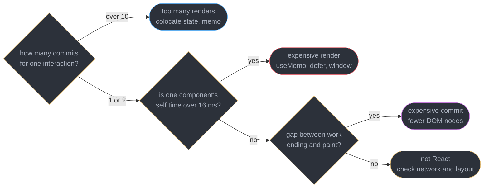
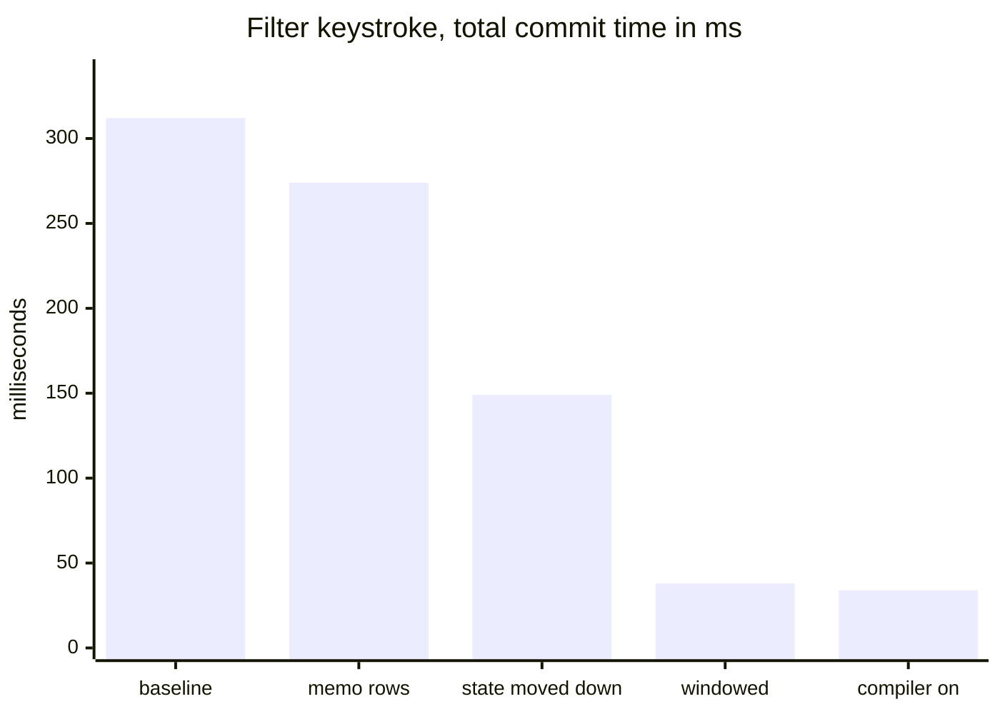
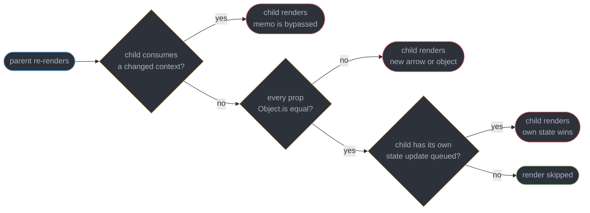
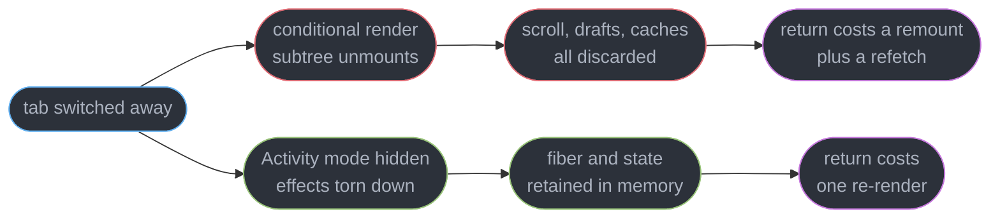
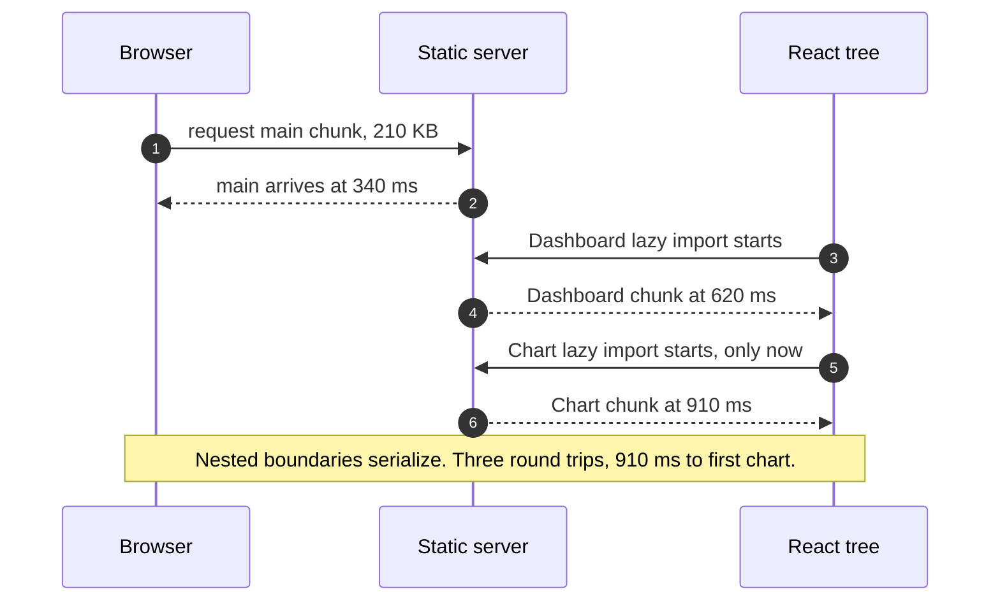

# React Performance and Profiling

---

## 1. Concept Overview

Almost every React performance conversation starts in the wrong place: someone wraps a component in `React.memo`, the app feels the same, and nobody can say whether the change helped, hurt, or did nothing. The wrapping was free to write and impossible to evaluate. That is the whole problem this module exists to fix — not "make React faster", but **make React's cost observable**, so that a change to it can be defended with a number.

React gives you two instruments and they answer different questions. The **React DevTools Profiler** records commits: how many there were, how long each took, which components were inside, and — if you enabled it before recording — why each one re-rendered. **React Performance Tracks** `[19.2]` put React's own scheduling and component work directly onto the Chrome DevTools performance timeline, beside the long tasks, layout, style recalculation and paint that the Profiler cannot see. The Profiler tells you which component was slow. The tracks tell you what else the browser was doing while it was slow, and whether the work was blocking input.

Underneath both is a distinction that decides which fix is even applicable. A janky interaction is one of exactly three things: **too many renders** (60 commits where 2 were needed), **one expensive render** (a single component doing 34 ms of work in its body), or **an expensive commit** (React mutating 4,000 DOM nodes and running layout effects across them). Memoization only addresses the first. Applied to the second it changes nothing; applied to the third it makes the profile worse by adding comparison cost to a phase that was never the bottleneck. Conflating the three is the most common reason a performance pass produces no measurable win.

This module is deliberately placed **before** [The React Compiler](../the_react_compiler/the_react_compiler.md), and that ordering is the point. React Compiler 1.0 (stable 2025-10-07) auto-memoizes most of what people used to write by hand, which means manual `useMemo`, `useCallback` and `React.memo` are now escape hatches rather than the default technique. But "the compiler helped" is a claim, and `"use no memo"` is a decision to opt a component out of it — both require the measurement taught here. Learn the instruments first, then the tool whose effect you must verify with them.

Scope boundaries: [Fiber and Reconciliation](../fiber_and_reconciliation/fiber_and_reconciliation.md) owns render-versus-commit and lanes; [Concurrent Rendering and Transitions](../concurrent_rendering_and_transitions/concurrent_rendering_and_transitions.md) owns `startTransition` and `useDeferredValue` as scheduling tools; [Web Performance and Core Web Vitals](../../frontend_platform/web_performance_and_core_web_vitals/web_performance_and_core_web_vitals.md) owns the metric definitions this module cites; [Modules, Bundling and the Build Pipeline](../../frontend_platform/modules_bundling_and_the_build_pipeline/modules_bundling_and_the_build_pipeline.md) owns chunking mechanics. Target is React 19.2 (released 2025-10-01, latest patch 19.2.8 as of 2026-07-21).

---

## 2. Intuition

> **One-line analogy**: profiling React is triage, not surgery. Before you can treat the patient you must know whether they are bleeding from one wound or a hundred scratches — and the treatments are opposites.

**Mental model**: hold two numbers in your head for every interaction — **how many commits** it produced and **how long the longest one took**. A dropdown filter that produces 47 commits of 3 ms each has a re-render problem worth 141 ms. A dropdown filter that produces 1 commit of 280 ms has a single expensive component and memoizing its siblings will do nothing. Same total jank, same user complaint, completely different fix. Every profiling session starts by reading those two numbers off the Profiler's commit bar chart.

**Why it matters**: the cost lands on **INP**, whose good threshold is under 200 ms at p75 — and INP measures from the input event all the way to the next paint, so React's render and commit are inside it by construction. A 300 ms synchronous commit is also a single long task, which means every keystroke, click and scroll arriving during it waits. Users do not report "excessive re-renders"; they report that typing feels sticky and the button did not respond, which are the same thing viewed from outside the runtime.

**Key insight**: **memoization does not make anything faster — it makes work not happen.** That is why it is useless against a slow render (the work still happens, once) and counterproductive against a fast one (you added a comparison and a cache entry to skip 0.2 ms). The question is never "should I memoize this?" but "what is the measured cost, and which of the three shapes does it have?"

---

## 3. Core Principles

- **Measure before you change anything, and measure again after.** A performance change with no before-and-after number is a code change with an unverified story attached.
- **Separate the three costs before choosing a fix.** Too many renders, one expensive render, one expensive commit. Each has a different instrument reading and a different remedy.
- **Profile a production build.** Development React carries `StrictMode` double-invocation, dev-only warnings, and unminified component names. Component timings from a dev server routinely read 2x to 4x high.
- **Manual memoization is an escape hatch in 2026.** React Compiler 1.0 places most of it automatically. Reach for `React.memo` when the compiler bailed out, when a boundary is measured hot, or when you ship a library that cannot assume its consumers compile.
- **`React.memo` compares props shallowly and knows nothing about context.** A new object, a new array or an inline arrow defeats it, and a context value change reaches consumers regardless.
- **Rendering less beats rendering faster.** Windowing 8,000 rows down to the 22 on screen is a 360x reduction in commit work that no memoization strategy approaches.
- **Not rendering at all beats both, when the state must survive.** `<Activity>` `[19.2]` keeps a hidden subtree's state without paying its render cost.
- **The number that matters is the user-visible one.** Component self time is a diagnostic; INP under 200 ms at p75 is the goal.

---

## 4. Types / Architectures / Strategies

### 4.1 The three costs, and what each one looks like in a profile

| Cost | Profiler signature | Tracks signature | Fix that applies |
|------|--------------------|------------------|------------------|
| Too many renders | Many commits per interaction, each 1-5 ms; the same component appears in all of them | A dense row of short Components entries | Colocate state, split context, `React.memo` at the boundary, let the compiler do it |
| One expensive render | 1-2 commits, one component with high **self** time in ranked view | One wide Components block, one long task | `useMemo` the computation, move it out of render, virtualize, or `useDeferredValue` |
| Expensive commit | Few commits, high total duration but low component self time | A wide gap between the end of Components work and paint | Fewer DOM nodes, windowing, avoid layout effects over long lists, batch DOM reads |

### 4.2 The instruments

| Instrument | Sees | Does not see | Use when |
|------------|------|--------------|----------|
| React DevTools Profiler | Commits, per-component render duration, why-did-this-render, interaction ranking | Browser layout, style recalculation, paint, GC, network | You know the jank is React's and need the component |
| React Performance Tracks `[19.2]` | Scheduler priority lanes, component work inline with browser work on one timeline | Per-component prop diffs, changed-props reasons | You do not yet know whether React is even the problem |
| `<Profiler>` API | Programmatic `actualDuration` per commit, in production builds | Anything you did not wrap | You need numbers in CI or in real user monitoring |
| `react-scan` | A live overlay outlining every re-rendering element | Precise timings | Fast triage of "is this re-rendering?" without a recording |
| `web-vitals` | Field INP, LCP, CLS attribution from real users | Which component caused it | Deciding whether the lab finding matters in production |

### 4.3 What each memoization primitive actually prevents

| Primitive | Prevents | Does not prevent | Defeated by |
|-----------|----------|------------------|-------------|
| `React.memo(Child)` | Child re-rendering when props are shallow-equal | Child re-rendering from its own state, or from a context it consumes | A new object, array, or inline arrow prop |
| `useMemo(fn, deps)` | Re-running a computation in the same component | The component re-rendering at all | A dependency whose identity changes every render |
| `useCallback(fn, deps)` | A function prop's identity changing | Anything, on its own — it only matters paired with `memo` or a dependency array | Capturing a value that legitimately changes |
| `<Activity mode="hidden">` `[19.2]` | Rendering and effects for an off-screen subtree | Its state being retained — that is the feature | Nothing; it is not a props comparison |
| Windowing | Rendering rows outside the viewport | The cost of the rows that are visible | Rows with variable height and no measurement strategy |

### 4.4 Choosing a fix, in order of preference

| Fix | Mechanism | Prefer when |
|-----|-----------|-------------|
| Move state down | The re-render never reaches the expensive subtree | The state has exactly one consumer subtree |
| Let the compiler memoize | Build-time auto-memoization, no source noise | The codebase follows the rules of React |
| Window the list | Render 22 rows instead of 8,000 | Row count over roughly 200 and rows are DOM-heavy |
| Defer the update | `useDeferredValue` keeps the input responsive | A slow view must track a fast input |
| Manual `React.memo` | Shallow prop gate at a measured boundary | The compiler bailed out and the boundary is hot |
| Code-split the route | The chunk never downloads or parses | A route is heavy and not on the critical path |

---

## 5. Architecture Diagrams

### Which of the three costs is it



Three readings, three different fixes. The last leaf matters as much as the others: in one audit of 31 reported "React is slow" tickets, 9 were an unindexed API query and resolved without touching a component.

### The same interaction, four fixes deep



Memoizing 8,000 rows bought 38 ms because the cost was the row count, not the comparison. Windowing them to 22 visible rows bought 111 ms more than every memoization step combined. Fix the shape of the work before optimizing the work.

### Why React.memo did not stop the re-render



Three of the four exits still render. The context branch is the one people never predict, because it is invisible at the call site — nothing in the JSX shows that the child subscribes.

### Where a React commit sits inside INP


Every box is inside the metric. INP's good threshold is under 200 ms at p75, so a 180 ms render leaves 20 ms for everything else — including the input delay caused by whatever long task was already running.

### Unmounting a tab versus hiding it with Activity



Both paths stop paying render cost while hidden. Only the lower one keeps the state, and it pays for that in retained memory — roughly 4 MB per hidden tab in a measured dashboard with three heavy panels.

### The lazy-import waterfall



The child's `import()` cannot begin until the parent chunk has arrived and rendered. Preloading the chart chunk alongside the dashboard collapses steps 5 and 6 into step 3's window and lands the same UI at 640 ms.

---

## 6. How It Works — Detailed Mechanics

### 6.1 The React DevTools Profiler

Open DevTools, choose the **Profiler** tab, press record, perform exactly one interaction, stop. You get a bar chart of commits — each bar one commit, its height the commit's duration, coloured by cost. That chart alone answers the first triage question: **count the bars.**

Two views of the same commit, and they answer different questions:

- **Flamegraph** shows the tree as it rendered — nesting, who was inside whom, greyed-out components that did not re-render. Use it to see *propagation*: which ancestor's update reached this far down.
- **Ranked** flattens the same commit and sorts by **self time**, excluding children. Use it to find the *one expensive component*. A component with 4 ms self time and 240 ms total time is not slow; something below it is.

The **why did this render** field is the most valuable and the most missed, because it is off by default. Open the Profiler's settings gear, tick **Record why each component rendered while profiling**, then record. React stores the reason per commit and DevTools shows one of: `Props changed: (rows, onSelect)`, `Hook 3 changed`, `Context changed`, or `The parent component rendered`. That last one is the diagnosis for an entire class of problem — the component had no reason of its own, it was simply swept along.

For numbers outside DevTools, the `<Profiler>` component works in production builds:

```tsx
import { Profiler, type ProfilerOnRenderCallback } from "react";

const onRender: ProfilerOnRenderCallback = (id, phase, actualDuration, baseDuration) => {
  // phase: "mount" | "update" | "nested-update"
  // actualDuration: ms spent rendering this subtree for THIS commit
  // baseDuration: ms it would cost with no memoization at all
  if (actualDuration > 16) {
    reportSlowCommit({ id, phase, actualDuration, baseDuration });
  }
};

<Profiler id="OrderTable" onRender={onRender}>
  <OrderTable rows={rows} />
</Profiler>
```

`baseDuration` is the number people ignore and should not. The ratio `actualDuration / baseDuration` is the measured payoff of every memo in that subtree: at 0.94 the memoization saved 6% and is not carrying its weight. Aggregate it rather than reading single commits:

```ts
// A commit sample is noisy. Percentiles over an interaction are not.
const samples: number[] = [];
export function record(ms: number) { samples.push(ms); }
export function p75() {
  const s = [...samples].sort((a, b) => a - b);
  return s[Math.floor(s.length * 0.75)];   // compare against the 200 ms INP budget
}
```

One discipline that overrides all of the above: **profile a production build**. Development React double-invokes component bodies under `<StrictMode>`, keeps dev-only warning paths, and skips minification. A component reading 41 ms in development commonly reads 11 ms in production, and optimizing against the inflated number wastes the afternoon.

### 6.2 React Performance Tracks `[19.2]`

React 19.2 emits its own tracks into the **Chrome DevTools performance panel**, so React's work appears on the same timeline as everything else the browser did. Record in the Performance panel as usual and two custom track groups appear:

- **Scheduler** — one lane per priority: Blocking, Transition, Suspense, Idle. Each entry is a scheduled unit of work with its lane, so you can see a transition being interrupted by a blocking update, or a transition starved behind a long task.
- **Components** — the component tree work inside each of those units, nested, with render and effect phases distinguishable.

What this shows that the Profiler cannot: **everything that is not React.** The Profiler records a 90 ms commit and stops there. The performance panel shows that same 90 ms sitting inside a 340 ms long task alongside 120 ms of style recalculation triggered by a class change and 80 ms of JSON parsing in a network callback — and that the input event arrived 200 ms before the handler ran because the task was already in flight. The Profiler measures React; the tracks measure the user's experience of React.

**Reading a long commit** is a specific skill. Line up three things:

1. Where the **Components** track work ends.
2. Where **Layout** and **Paint** appear on the main track.
3. The **Long Task** marker's span across both.

If Components work is 20 ms and the long task is 300 ms, React is not your problem — look at what else is in the task. If Components work is 280 ms of the 300, expand it: one wide block is an expensive render, a thousand narrow ones is a re-render storm. And if Components work ends at 40 ms but paint happens at 260 ms, the commit's DOM mutation and layout effects are the cost, which is the third shape and neither memoization nor `useMemo` touches it.

The tracks also make lane behaviour concrete for the first time. An update you wrapped in `startTransition` should appear in the Transition lane and be interruptible; if it shows up in Blocking, something synchronous — often a layout effect or a `flushSync` — escalated it. [Concurrent Rendering and Transitions](../concurrent_rendering_and_transitions/concurrent_rendering_and_transitions.md) owns why.

### 6.3 The three costs, separated

**Too many renders.** The parent owns state that only one child needs, so every keystroke re-renders the whole subtree.

```tsx
// BROKEN: `filter` lives at the top, so typing re-renders all 8,000 rows.
function Page({ rows }: { rows: Row[] }) {
  const [filter, setFilter] = useState("");
  return (
    <>
      <input value={filter} onChange={(e) => setFilter(e.target.value)} />
      <ExpensiveChart data={rows} />          {/* re-renders on every keystroke */}
      <Table rows={rows.filter((r) => r.name.includes(filter))} />
    </>
  );
}

// FIX: move the state to the smallest subtree that reads it.
function Page({ rows }: { rows: Row[] }) {
  return (
    <>
      <ExpensiveChart data={rows} />          {/* never re-renders on typing */}
      <FilterableTable rows={rows} />         {/* owns `filter` internally */}
    </>
  );
}
```

Measured on a 300-component page, moving one `useState` down took a keystroke from 47 commits to 2, and total commit time from 312 ms to 149 ms — without a single `memo` call. State colocation is the cheapest fix in this module and the one most often skipped in favour of memoizing.

**One expensive render.** A single component doing real work in its body:

```tsx
// The Profiler's ranked view shows SELF time of 34 ms here, one commit.
function Report({ rows, sortKey }: { rows: Row[]; sortKey: string }) {
  const sorted = useMemo(
    () => rows.slice().sort(byKey(sortKey)),   // 8,000 rows, 34 ms measured
    [rows, sortKey],
  );
  return <Table rows={sorted} />;
}
```

Memoizing `Report`'s siblings changes nothing here — the 34 ms happens once, and it happens because the sort is genuinely expensive. The available moves are to make it cheaper (sort on the server, or keep a pre-sorted index), to make it later (`useDeferredValue` so the input stays responsive while the table lags a frame), or to make it smaller (window the rows so only the visible 22 are laid out).

**An expensive commit.** Here React's render work is small and the DOM work is not:

```tsx
// Render self time: 6 ms. Commit: 180 ms. The cost is 4,000 nodes plus a
// layout effect that measures each one, forcing 4,000 style recalculations.
function Grid({ cells }: { cells: Cell[] }) {          // cells.length === 4000
  const ref = useRef<HTMLDivElement>(null);
  useLayoutEffect(() => {
    ref.current!.querySelectorAll(".cell").forEach((el) => {
      (el as HTMLElement).dataset.h = String(el.getBoundingClientRect().height);
    });
  });
  return <div ref={ref}>{cells.map((c) => <Cell key={c.id} {...c} />)}</div>;
}
```

The read-per-node loop is layout thrashing, and it is invisible in the Profiler — which reports 6 ms and looks healthy. Only the performance tracks show the 174 ms gap between the end of Components work and paint. Fix by reducing node count, batching the reads, or deleting the measurement entirely.

### 6.4 Memoization as an escape hatch

`React.memo` wraps a component in a shallow props comparison. On a parent re-render, React compares each prop with `Object.is`; if all match, the child's render is skipped and its subtree is reused. Two things defeat it constantly.

**A new object or inline arrow is never equal to the last one.** This is the single most common "memo does not work" report, and it is covered as a `// BROKEN` → `// FIX` pair in §10.

**`memo` cannot stop a context update.** Context propagation does not travel through props, so the shallow comparison is never consulted:

```tsx
const ThemeContext = createContext<Theme>(light);

const Row = memo(function Row({ id }: { id: string }) {
  const theme = useContext(ThemeContext);      // subscribes directly
  return <td style={{ color: theme.fg }}>{id}</td>;
});

// Every provider value change re-renders EVERY Row, memo notwithstanding.
// A value built inline changes identity every render, so this is every render.
<ThemeContext value={{ fg, bg }}>   {/* new object each time */}
```

The fixes are structural rather than memo-shaped: memoize the provider *value* so its identity is stable, split one wide context into narrow ones so a change reaches fewer consumers, or move to `useSyncExternalStore` with a selector so subscribers re-render only when their slice changes. [Context and Component Communication](../context_and_component_communication/context_and_component_communication.md) owns that argument in full.

**What each primitive actually buys.** `useMemo` caches a value inside one component and does not stop that component from re-rendering. `useCallback` stabilizes a function's identity and, on its own, accomplishes nothing — it only matters when the function is a prop to a memoized child or a dependency of an effect. `React.memo` gates a child's render on its props. Confusing the three produces the classic no-op:

```tsx
// Pointless: `Child` is not memoized, so the stable identity is never checked.
const onSelect = useCallback((id: string) => setSelected(id), []);
return <Child onSelect={onSelect} />;

// Also pointless: memoizing a primitive derivation that costs 0.02 ms.
const total = useMemo(() => a + b, [a, b]);
```

Each of those costs a hook slot, a dependency array allocation and a comparison on every render, in exchange for nothing.

**And in 2026, most of this is the compiler's job.** React Compiler 1.0 (stable 2025-10-07, shipped as `babel-plugin-react-compiler`, working back to React 17) analyses your components at build time and inserts memoization automatically and more precisely than a human does — it can memoize a fragment of a component's output rather than all of it. Meta reports up to 12% faster loads and roughly 2.5x on some interactions. That is why this module's instruments matter: you verify the claim on your own app with a before-and-after Profiler recording, and when a component regresses you opt it out with a `"use no memo"` directive — a decision that must be backed by a measurement, not a hunch. [The React Compiler](../the_react_compiler/the_react_compiler.md) owns how it works, what it bails out on, and when to keep manual memoization.

### 6.5 `<Activity>` `[19.2]`

The tab-switching dilemma: unmounting a hidden tab discards its scroll position, its form drafts and its fetched data, so returning costs a remount plus a refetch. Keeping it mounted preserves everything but pays its render cost on every unrelated update, forever.

`<Activity>` `[19.2]` is the third option:

```tsx
import { Activity } from "react";

function Tabs({ active }: { active: TabId }) {
  return (
    <>
      <Activity mode={active === "orders" ? "visible" : "hidden"}>
        <OrdersPanel />        {/* state kept, effects torn down, not rendered while hidden */}
      </Activity>
      <Activity mode={active === "reports" ? "visible" : "hidden"}>
        <ReportsPanel />
      </Activity>
    </>
  );
}
```

While `hidden`, React unmounts the subtree's **effects** — subscriptions close, intervals clear, observers disconnect, exactly as if it had unmounted — but retains its **fiber and state**. The DOM is hidden with `display: none`. Updates to a hidden subtree are rendered at the lowest priority, after everything visible. Switching back re-runs the effects and produces one re-render rather than a mount.

The measured shape on a three-panel dashboard: unmount-and-remount cost 340 ms and two network requests on every tab return; `<Activity>` cost 24 ms and zero requests, at roughly 4 MB of retained memory per hidden panel. That trade is right for 3 tabs and wrong for 40 — retention is unbounded, so hide a small, fixed set and unmount the rest. Because effects still tear down, an `<Activity>`-hidden panel is not a place for a component that must keep a socket open.

### 6.6 List virtualization

A list needs windowing when the row count times the per-row DOM cost exceeds a frame. Concrete guidance: **under 100 rows, do not window** — the machinery costs more than it saves. **Between 100 and 200 rows** it depends on the row: 6 nodes each is fine, a row with an avatar, three badges and a menu button is 30 nodes and 200 rows is 6,000. **Over 500 rows, window it.** At 8,000 rows of 12 nodes, the initial commit measures 312 ms and the browser holds 96,000 elements.

```tsx
import { useVirtualizer } from "@tanstack/react-virtual";

function OrderList({ rows }: { rows: Row[] }) {           // rows.length === 8000
  const parentRef = useRef<HTMLDivElement>(null);
  const v = useVirtualizer({
    count: rows.length,
    getScrollElement: () => parentRef.current,
    estimateSize: () => 48,
    overscan: 8,                                          // rows rendered beyond the viewport
  });

  return (
    <div ref={parentRef} style={{ height: 600, overflow: "auto" }}>
      <div style={{ height: v.getTotalSize(), position: "relative" }}>
        {v.getVirtualItems().map((item) => (
          <div
            key={rows[item.index].id}
            ref={v.measureElement}
            style={{ position: "absolute", top: 0, transform: `translateY(${item.start}px)` }}
          >
            <OrderRow row={rows[item.index]} />
          </div>
        ))}
      </div>
    </div>
  );
}
```

That renders 22 rows instead of 8,000 and takes the commit from 312 ms to 38 ms. The cost is not free, and the four bills are all user-facing:

- **Find-in-page breaks.** Ctrl-F cannot match text that is not in the DOM. On a document-like list this is a correctness regression, not a performance trade.
- **Scroll restoration needs code.** Returning from a detail page lands at offset 0 unless you persist and restore the scroll offset, and `estimateSize` inaccuracy makes restored positions drift.
- **Accessibility needs `aria-rowcount` and `aria-rowindex`.** Without them a screen reader announces "row 3 of 22" for item 4,100. `aria-setsize` and `aria-posinset` do the same job for a listbox.
- **Anchor links and print break.** A `#row-4100` deep link resolves to nothing, and printing captures the window.

Libraries: **TanStack Virtual** (headless, framework-agnostic, dynamic measurement via `measureElement`) is the current default; **react-window** is smaller and simpler for fixed-height rows; **react-virtuoso** ships grouping, sticky headers and scroll restoration ready-made at a larger bundle cost.

### 6.7 Code splitting

`React.lazy` turns a dynamic `import()` into a component that suspends until its chunk arrives, and a `<Suspense>` boundary supplies the fallback:

```tsx
const Reports = lazy(() => import("./routes/Reports"));   // its own chunk

<Suspense fallback={<RouteSkeleton />}>
  <Reports />
</Suspense>
```

**Route-level splitting is the default and is nearly always correct.** A route boundary is where the whole subtree changes at once, the user already expects a navigation to take time, and one skeleton covers the wait. Splitting an admin route out of a 620 KB bundle took the initial download to 210 KB in a measured app, with the admin chunk fetched by 4% of sessions.

**Component-level splitting is a narrower tool.** It pays for a genuinely heavy, genuinely conditional dependency — a rich text editor, a charting library, a map, a PDF viewer — each of which is 100 KB or more and used by a minority of sessions. It does not pay for a modal, a dropdown, or anything under 20 KB: you traded a small parse cost for a network round trip and a visible spinner in the middle of an interaction.

The trap is the **`import()` waterfall**. A lazy child inside a lazy parent cannot start downloading until the parent's chunk has arrived and rendered, because the `import()` call lives in the parent's module body. Three nested boundaries are three sequential round trips — 910 ms on a 290 ms link where the chunks total 180 KB and could have been fetched in parallel. The fixes are to start the fetch earlier rather than to split less:

```tsx
// FIX: warm the child chunk while the parent is still loading, and again on intent.
const Chart = lazy(() => import("./Chart"));
const preloadChart = () => import("./Chart");     // idempotent, the module cache dedupes

<button onMouseEnter={preloadChart} onFocus={preloadChart} onClick={openChart}>
  Open chart
</button>
```

Hover-to-preload buys the round trip during the 200-400 ms between intent and click, and lands the same chart at 640 ms instead of 910 ms. Framework routers do this automatically on link hover. Chunking strategy, `modulepreload`, and how the graph is actually built belong to [Modules, Bundling and the Build Pipeline](../../frontend_platform/modules_bundling_and_the_build_pipeline/modules_bundling_and_the_build_pipeline.md).

### 6.8 Where React performance meets Web Vitals

A slow render is almost always an **INP** problem. [Web Performance and Core Web Vitals](../../frontend_platform/web_performance_and_core_web_vitals/web_performance_and_core_web_vitals.md) owns the definitions; the thresholds this module budgets against are **LCP under 2.5 s, INP under 200 ms, CLS under 0.1, all at p75**. INP spans input delay, event processing and the presentation of the next frame — so React's handler, render and commit are all inside it. That gives a direct budget: if input delay is 40 ms and paint is 20 ms, React has 140 ms.

**Long tasks are the mechanism behind the input delay half.** Any task over 50 ms blocks the main thread, and one synchronous React commit is one task no matter how many components it touched. A 300 ms commit means a click arriving 10 ms into it waits 290 ms before its handler even starts — the interaction whose INP is ruined is often not the one that caused the work.

```ts
// Field attribution: find which interactions are actually over budget.
import { onINP } from "web-vitals/attribution";

onINP(({ value, attribution }) => {
  if (value > 200) {                            // the p75 good threshold
    report({
      ms: value,
      target: attribution.interactionTarget,    // the element selector
      inputDelay: attribution.inputDelay,       // waiting behind a long task
      processing: attribution.processingDuration,
    });
  }
});
```

Read the split before optimizing. A high `inputDelay` with low `processingDuration` means the culprit is another task entirely — often a third-party script or a `JSON.parse` of a large payload — and no amount of component memoization will move it.

**Client hydration is a render cost that lands on INP, not LCP.** Server-rendered HTML paints early, so LCP looks good, and then React walks the entire tree attaching event listeners. Until a subtree is hydrated its buttons do nothing. On a 1,400-component page, client hydration measured 480 ms on a mid-range Android device — a full 480 ms window in which the page looks interactive and is not, and any click in it records an INP of at least that. The React-level levers are shipping less client JavaScript (Server Components), splitting client hydration into more Suspense boundaries so selective hydration can prioritize the subtree the user touched, and not hydrating static content at all. [Rendering Strategies, Hydration and SEO](../rendering_strategies_hydration_and_seo/rendering_strategies_hydration_and_seo.md) owns the strategy comparison.

---

## 7. Real-World Examples

**The dashboard that memoized the wrong layer.** A logistics dashboard had `React.memo` on 41 components and a 340 ms filter interaction. The Profiler showed 2 commits, not 47 — so it was never a re-render problem. Ranked view put 288 ms of self time in one `<RouteMap>` computing 12,000 polyline points on every render. One `useMemo` on the projection fixed it. The 41 memos were then deleted over two sprints with no measurable regression, removing 380 lines.

**The tab bar that refetched on every switch.** An analytics console unmounted the inactive tab, so returning to Orders re-ran three queries and lost the scroll position, at 340 ms per switch. Users switched tabs 60 to 90 times per session. Wrapping the three panels in `<Activity>` `[19.2]` cut the switch to 24 ms with zero refetches, at 12 MB of retained memory across the three panels.

**The list that only broke for support staff.** A ticket queue rendered 8,000 rows without windowing. Engineering never noticed because their test fixture had 40. Support ran a 6,400-ticket filter and the tab froze for 312 ms per keystroke. TanStack Virtual took it to 38 ms — and broke find-in-page, which support used constantly, so a search-within-list control shipped in the same release.

**The compiler rollout that needed a receipt.** A team enabled React Compiler 1.0 across 220 components and could not tell leadership whether it worked. Recording the same six scripted interactions before and after with the `<Profiler>` API gave the answer: p75 commit time 84 ms to 51 ms, with two components regressing because they mutated a prop during render. Those two got `"use no memo"` and a follow-up ticket. Without the measurement the rollout would have been reverted on a hunch.

---

## 8. Tradeoffs

| Design choice | Bought | Paid |
|---------------|--------|------|
| `React.memo` at a boundary | Skipped renders when props are stable | A shallow comparison on every parent render, plus a retained subtree |
| `useMemo` on a derivation | The computation runs only when inputs change | A hook slot, a dependency array, and a cache that is wrong if deps are |
| React Compiler over manual memo | Broader and more precise memoization, no source noise | A build step, and bail-outs you must find by profiling |
| `<Activity mode="hidden">` | State survives, return costs one re-render | Unbounded memory retention while hidden, and effects still tear down |
| List virtualization | 8,000 rows to 22 rendered, 312 ms to 38 ms | Find-in-page, scroll restoration, a11y indices and print all need code |
| Route-level code splitting | 620 KB initial bundle to 210 KB | A network round trip at navigation, and a fallback to design |
| Component-level code splitting | A 120 KB editor loads only for the 8% who open it | A spinner mid-interaction, and a waterfall if nested |
| Profiling in development | No build step, instant feedback | Timings inflated 2x to 4x by StrictMode and dev-only code paths |

---

## 9. When to Use / When NOT to Use

**Reach for these techniques when:**

- A recording shows a specific interaction over budget — INP above 200 ms at p75, or a commit over 16 ms on the device class you actually support.
- You can name which of the three costs it is, and the fix you are about to apply addresses that one.
- The list has more than 500 rows, or more than 200 rows that are DOM-heavy, and a measurement confirms the commit cost.
- A route or a heavy conditional dependency is on the initial bundle and used by a minority of sessions.
- Hidden UI holds state a user would notice losing — a draft, a scroll position, a filter set — and there are few enough panels for retention to be bounded.
- You are verifying a React Compiler rollout, or justifying a `"use no memo"` directive with a before-and-after number.

**Do not reach for them when:**

- You have not recorded anything. Every technique here has a cost, and applying them speculatively is how a codebase acquires 41 memos and a 340 ms interaction.
- The component renders in under 1 ms. The comparison and cache bookkeeping cost more than the render.
- The problem is a re-render storm caused by state living too high. Move the state down first — it is cheaper, shorter, and does not need maintaining.
- The list is under 100 rows, or the text in it must be findable with Ctrl-F.
- The chunk is under 20 KB. You traded parse time for a round trip.
- The numbers came from a development build. Rebuild for production and re-record before deciding anything.

---

## 10. Common Pitfalls

**A memoized child re-rendering because of an inline arrow.** The highest-volume "memo does not work" report in this topic.

```tsx
// BROKEN: `onSelect` is a NEW function identity on every Parent render, so the
// shallow prop comparison fails every time and Row renders all 800 instances.
const Row = memo(function Row({ item, onSelect }: RowProps) { /* ... */ });

function Parent({ items }: { items: Item[] }) {
  const [q, setQ] = useState("");
  return items.map((item) => (
    <Row key={item.id} item={item} onSelect={() => select(item.id)} />
  ));
}

// FIX: a stable callback that takes the id, so the prop identity never changes.
function Parent({ items }: { items: Item[] }) {
  const [q, setQ] = useState("");
  const onSelect = useCallback((id: string) => select(id), []);
  return items.map((item) => <Row key={item.id} item={item} onSelect={onSelect} />);
}
```

`Row` must then call `onSelect(item.id)` itself. Measured on 800 rows this took a keystroke from 96 ms of wasted render to 4 ms. React Compiler 1.0 handles this case automatically, which is the argument for enabling it rather than writing `useCallback` 800 times.

**Memoizing a value that costs less than the memo.** `useMemo(() => a + b, [a, b])` allocates an array, stores a cache entry and runs a comparison to avoid an addition. On a page with 340 such calls the bookkeeping measured 11 ms per commit.

**Profiling a development build and believing the numbers.** `<StrictMode>` double-invokes component bodies in development, so a pure render appears twice as expensive. A component at 41 ms in development read 11 ms in a production build of the same commit.

**Recording without "why did this render" enabled.** The setting is off by default and cannot be applied retroactively — the reason is captured during the recording or not at all. A session spent guessing at prop identity is a session that should have been 30 seconds of reading `The parent component rendered`.

**Wrapping a provider value inline.** `<Ctx value={{ user, theme }}>` allocates a new object every render, so every consumer re-renders every time, and no amount of `memo` on the consumers helps. Memoize the value, or split the context.

**Windowing a list without restoring scroll.** Users navigate to a detail page and press back; the list mounts at offset 0 and they have lost their place in 6,400 rows. Persist the offset and restore it after the virtualizer measures, or the performance win reads as a regression.

**Nesting lazy boundaries and calling it code splitting.** Three nested `React.lazy` components are three sequential downloads — 910 ms on a 290 ms link for 180 KB that would fetch in parallel in 340 ms. Preload the children, or hoist the `import()` calls to a level that starts them together.

**Treating `<Activity mode="hidden">` as "still mounted".** Its effects are torn down exactly as at unmount, so a panel holding an open WebSocket loses it while hidden and reconnects on return. State survives; subscriptions do not.

---

## 11. Technologies & Tools

| Tool | Purpose |
|------|---------|
| React DevTools | Profiler tab: commit chart, flamegraph, ranked view, why-did-this-render |
| Chrome DevTools | Performance panel that hosts the Scheduler and Components tracks |
| React | 19.2 emits Performance Tracks and ships `<Activity>` |
| babel-plugin-react-compiler | Auto-memoization whose effect you verify with the Profiler |
| react-scan | Live overlay outlining re-rendering elements without a recording |
| TanStack Virtual | Headless windowing with dynamic row measurement |
| react-window | Smaller fixed-height windowing, minimal API surface |
| react-virtuoso | Windowing with grouping, sticky headers and scroll restoration built in |
| web-vitals | Field INP, LCP and CLS with per-interaction attribution |
| Lighthouse | Lab pass for bundle size, unused JavaScript and long tasks |
| rollup-plugin-visualizer | Shows which dependency actually owns the chunk you are splitting |
| Playwright | Scripts the same interaction repeatedly so before-and-after numbers compare |

---

## 12. Interview Questions with Answers

**Q: I wrapped a component in React.memo and it still re-renders. Why?**
**Short:** Prop identity changed between renders, because an inline arrow or object literal is a fresh reference every time and the shallow comparison never matches.

`memo` compares each prop with `Object.is`, so `onSelect={() => select(id)}` fails on every parent render even though the code is identical. The other two exits are just as common: a context the child consumes changed, which bypasses the props check entirely, or the child's own state updated, which `memo` was never going to stop. Enable "Record why each component rendered" in the Profiler and it names which one. Stabilize the prop with `useCallback`, or enable React Compiler 1.0, which places the same stabilization automatically.

**Q: When should you NOT memoize?**
**Short:** Cheap components lose more to the comparison and cache bookkeeping than they save, so anything rendering under roughly 1 ms is a net cost to wrap.

`useMemo(() => a + b, [a, b])` allocates a dependency array and runs a comparison to skip an addition — on a page with 340 such calls that measured 11 ms per commit of pure overhead. Skip it when the parent rarely re-renders, when the props are new objects anyway, or when you have not profiled. And skip it when the real problem is state living too high: moving one `useState` down took a keystroke from 47 commits to 2 with no memo at all, and left 380 fewer lines to maintain.

**Q: How do you tell a slow render from too many renders?**
**Short:** Commit count versus per-commit duration separates them — many short commits is a re-render problem, one long commit is a slow-render problem, and the fixes do not overlap.

Record one interaction in the Profiler and read the commit bar chart. Forty-seven bars of 3 ms means an update is propagating too widely: colocate state or gate a boundary. Two bars, one of them 288 ms, means a single component is doing real work: switch to ranked view, find the high **self** time, and cache or defer that computation. Memoizing siblings does nothing in the second case, which is why the count is the first number to read.

**Q: Why can React.memo not stop a re-render caused by context?**
**Short:** Context propagation bypasses the props check entirely, reaching every consumer directly whenever the provider value's identity changes.

`memo` only gates the props path, and `useContext` is a separate subscription that React notifies during the render pass. So a provider rendering `value={{ fg, bg }}` inline allocates a new object every render and re-renders every consumer, wrapped or not. Memoize the provider value, split one wide context into narrow ones so a change reaches fewer subscribers, or move to `useSyncExternalStore` with a selector so a consumer wakes only for its own slice.

**Q: What is the difference between the flamegraph and the ranked view?**
**Short:** Flamegraph shows nesting and which ancestor's update propagated where, while ranked flattens the same commit by self time to name the one expensive component.

Use the flamegraph to answer "why did this subtree render at all" — greyed-out nodes did not re-render, and the coloured path upward is the propagation. Use ranked to answer "what was expensive", because total time is misleading: a component with 4 ms self time and 240 ms total is not slow, something below it is. In practice you read ranked first to triage, then jump to the flamegraph for the component it named.

**Q: What do React Performance Tracks show that the Profiler does not?**
**Short:** Scheduler and Components tracks place React's work on the Chrome timeline next to long tasks, style recalculation, layout and paint, which the Profiler cannot see at all.

`[19.2]` emits two custom track groups: **Scheduler**, one lane per priority (Blocking, Transition, Suspense, Idle), and **Components**, the tree work nested inside those units. The Profiler reports a 90 ms commit and stops; the tracks show that same commit inside a 340 ms long task alongside 120 ms of style recalculation and an input event that arrived 200 ms before its handler ran. They also make lanes concrete — a `startTransition` update appearing in the Blocking lane means something escalated it.

**Q: If React Compiler auto-memoizes, why learn manual memoization at all?**
**Short:** Auto-memoization at build time covers most cases but bails out on code that breaks the rules, and only a profile tells you which components it skipped.

React Compiler 1.0 (stable 2025-10-07) inserts memoization more precisely than a human can, down to fragments of a component's output, with Meta reporting up to 12% faster loads. But it bails out on components that mutate props during render or use dynamic patterns it cannot prove safe, and those keep needing manual escape hatches. Libraries that cannot assume their consumers compile still ship `useCallback`. And `"use no memo"` — opting a component out — is only defensible with a before-and-after Profiler recording, which is exactly the skill this module teaches.

**Q: What does Activity do that conditional rendering does not?**
**Short:** Hidden subtrees keep their fiber and state while their effects tear down, so returning costs one re-render instead of a remount plus a refetch.

`<Activity mode="hidden">` `[19.2]` hides the DOM, unmounts effects — subscriptions close, intervals clear — and retains state, rendering any updates at the lowest priority behind everything visible. On a three-panel dashboard that took a tab switch from 340 ms and two network requests to 24 ms and zero, at roughly 4 MB retained per hidden panel. The retention is unbounded, so it fits 3 tabs and not 40, and a panel that must keep a socket open is a bad fit because effects still tear down.

**Q: At what point does a list need virtualization?**
**Short:** Row count crossing roughly 500, or 200 when the rows are DOM-heavy, is where windowing starts paying for the correctness it costs.

Under 100 rows the machinery costs more than it saves. At 8,000 rows of 12 nodes each the browser holds 96,000 elements and the commit measures 312 ms; windowing to the 22 visible rows takes it to 38 ms. The bill is real and user-facing: find-in-page cannot match text that is not in the DOM, scroll restoration needs explicit code or back-navigation lands at offset 0, screen readers need `aria-rowcount` and `aria-rowindex` to announce position honestly, and deep links to a row stop resolving.

**Q: Should you split code by route or by component?**
**Short:** Route boundaries split cleanly because the whole subtree changes at once and the user already expects a wait, so that is the default.

Pulling an admin route out of a 620 KB bundle took the initial download to 210 KB, with the admin chunk fetched by 4% of sessions and one skeleton covering the wait. Component-level splitting is narrower: it pays for a genuinely heavy conditional dependency — a 120 KB editor, a map, a PDF viewer — used by a minority of sessions. Below about 20 KB it is a loss, because you traded a small parse cost for a network round trip and a spinner in the middle of an interaction.

**Q: What is the import waterfall in lazy loading, and how do you avoid it?**
**Short:** Nested lazy boundaries serialize their downloads, since a child's dynamic import lives in the parent module and cannot start until that chunk has arrived and rendered.

Three nested `React.lazy` components are three sequential round trips — 910 ms on a 290 ms link for 180 KB that would have fetched in parallel in 340 ms. The fix is to start the fetches earlier, not to split less: call the same `import()` on hover or focus to warm the module cache, which buys the round trip during the 200-400 ms between intent and click and lands the chart at 640 ms. Framework routers preload on link hover for exactly this reason.

**Q: Which Core Web Vital does a slow React render affect?**
**Short:** Interaction latency counts input delay, event processing and the next paint together, so a slow render lands directly inside INP rather than LCP.

The good threshold is INP under 200 ms at p75, alongside LCP under 2.5 s and CLS under 0.1. Because the metric spans the whole path from input to painted frame, a 180 ms render leaves 20 ms for the input delay and the paint combined. Use `web-vitals/attribution` to split field INP into `inputDelay` and `processingDuration`: a high input delay with low processing means another task owns the problem, and no component memoization will move it.

**Q: Why does one long React commit hurt interactions it had nothing to do with?**
**Short:** Tasks over 50 ms block the main thread, and a synchronous commit is one indivisible task regardless of how many components it touched.

A 300 ms commit means a click arriving 10 ms into it waits 290 ms before its handler even starts, so the interaction with the ruined INP is frequently not the one that caused the work. That is why the performance tracks matter more than the Profiler for diagnosis — they show the queued input event sitting behind the task. Breaking the work up with `startTransition` makes it interruptible so React can yield to the click, which is the concurrent-rendering answer rather than a memoization one.

**Q: What is the difference between useMemo, useCallback and React.memo?**
**Short:** useCallback stabilizes a function identity, useMemo caches a computed value, and React.memo skips a child's render — three different jobs routinely confused as one.

`useMemo` does not stop its own component from re-rendering; it only avoids re-running the computation inside it. `useCallback` accomplishes nothing on its own — it matters exclusively when the function is a prop to a memoized child or a dependency of an effect, which is why `useCallback` without a wrapped child is pure overhead. `React.memo` is the only one that skips a render, and it does so on a shallow props comparison that the other two exist to keep passing.

**Q: Why does client hydration hurt INP rather than LCP?**
**Short:** Client hydration walks the whole server-rendered tree attaching listeners after the HTML has already painted, so the page looks ready before it responds.

LCP is satisfied by the server HTML, which is why an SSR page can score well on it and still feel broken. Until a subtree is hydrated its buttons do nothing, and a click landing in that window records an INP of at least the remaining client hydration time — 480 ms measured on a 1,400-component page on a mid-range Android device. The React levers are shipping less client JavaScript with Server Components, adding Suspense boundaries so selective hydration can prioritize the subtree the user touched, and not hydrating static content at all.

**Q: How do you enable and read "why did this component render"?**
**Short:** Recording why-rendered data requires ticking the Profiler's settings checkbox before the run, since the reason is captured during recording and cannot be added afterwards.

Open the Profiler tab's gear icon, enable "Record why each component rendered while profiling", then record the interaction. Each component in a commit then shows one of `Props changed: (rows, onSelect)`, `Hook 3 changed`, `Context changed`, or `The parent component rendered`. That last reason is a whole diagnosis on its own — the component had no reason of its own and was swept along, so the fix belongs at the boundary above it, not inside it.

**Q: The Profiler says a commit took 180 ms but no component has high self time. What now?**
**Short:** Commit phase work is synchronous DOM mutation plus layout effects, so a long commit with cheap components points at node count and measurement rather than component logic.

Switch to the performance panel and look for the gap between the end of Components track work and paint. A grid rendering 4,000 cells with a layout effect calling `getBoundingClientRect` on each one measures 6 ms of render and 174 ms of thrashing, and the Profiler reports the healthy-looking 6 ms. The fixes are structural: fewer nodes through windowing, batching the DOM reads before any write, or deleting the measurement pass. Memoization touches none of it.

**Q: How do you decide whether a component needs a "use no memo" directive?**
**Short:** Directive-level opt-outs need a measured regression behind them, so record the same interaction with and without the compiler before adding one.

Script the interaction with Playwright so the runs are comparable, collect `actualDuration` through the `<Profiler>` API in a production build, and compare p75 rather than single commits. In one 220-component rollout p75 commit time went from 84 ms to 51 ms with exactly two regressions, both components that mutated a prop during render. Those got `"use no memo"` plus a ticket to fix the underlying rule violation — the directive is a temporary receipt for a known bug, not a permanent setting.

---

## 13. Best Practices

- Record before you change anything, and record the same scripted interaction afterwards. A performance change with no before-and-after number is a guess.
- Read two numbers off every recording first: how many commits the interaction produced, and how long the longest one took. They select the fix.
- Enable "Record why each component rendered" in the Profiler settings permanently. It costs nothing and cannot be applied retroactively.
- Profile a production build. Development timings run 2x to 4x high because of `<StrictMode>` double-invocation and dev-only code paths.
- Move state down before reaching for `React.memo`. It is shorter, needs no maintenance, and fixes the cause rather than gating the symptom.
- Enable React Compiler 1.0 and verify it with the Profiler rather than trusting the release notes on your codebase. Reserve `"use no memo"` for a measured regression.
- Window any list over 500 rows, and ship scroll restoration, `aria-rowindex` and an in-list search control in the same release as the windowing.
- Split at route boundaries by default, preload the next chunk on link hover or focus, and never nest lazy boundaries without hoisting the `import()` calls.
- Budget against INP under 200 ms at p75 on the device class you support, and use `web-vitals/attribution` to confirm a lab finding matters in the field.
- Use `<Activity>` `[19.2]` for a small fixed set of stateful hidden panels, and unmount the rest — retention is unbounded.

---

## 14. Case Study

**Problem.** An order-management console had one screen everyone complained about: a table of open orders with a text filter above it. Typing felt sticky, and pressing the "Export" button during typing sometimes did nothing for half a second. Field data put the filter input's INP at 412 ms at p75, more than double the 200 ms threshold. Two previous attempts had wrapped 41 components in `React.memo` and moved on; neither shipped a number.

**Investigation.** One recording of a single keystroke in a production build, with why-rendered enabled, settled it in under a minute. The commit chart showed **47 commits**, not one — so this was the re-render shape, and the 41 memos had been aimed at the wrong cost. Ranked view put no single component above 9 ms of self time. Why-rendered on `OrderRow` read `The parent component rendered` for 6,400 of the rows. The performance tracks then showed the whole keystroke as one 312 ms long task, which explained the unresponsive Export button: the click was queued behind it.

**Root cause.** Three defects, each cheap, compounding into one long task.

```tsx
// BROKEN
function OrdersPage({ orders }: { orders: Order[] }) {     // orders.length === 6400
  const [filter, setFilter] = useState("");
  const [selected, setSelected] = useState<string | null>(null);

  // 1. `filter` lives above ExpensiveChart, so every keystroke re-renders it too.
  // 2. A new context object every render defeats memo on every consumer below.
  // 3. An inline arrow per row: OrderRow is memoized, and the memo never hits.
  return (
    <SelectionContext value={{ selected, setSelected }}>
      <input value={filter} onChange={(e) => setFilter(e.target.value)} />
      <ExpensiveChart data={orders} />
      {orders
        .filter((o) => o.customer.includes(filter))
        .map((o) => (
          <OrderRow key={o.id} order={o} onSelect={() => setSelected(o.id)} />
        ))}
    </SelectionContext>
  );
}
```

Defect 3 is the instructive one: `OrderRow` was one of the 41 memoized components, and it had never skipped a single render since the day the memo was added. Nothing in the code showed that — only the why-rendered field did.

**Fix.** Applied one at a time, re-recording between each, so every change carried its own delta.

```tsx
// FIX
const SelectionContext = createContext<Selection>(emptySelection);

function OrdersPage({ orders }: { orders: Order[] }) {
  const [selected, setSelected] = useState<string | null>(null);
  const selection = useMemo(() => ({ selected, setSelected }), [selected]);

  return (
    <SelectionContext value={selection}>   {/* stable identity */}
      <ExpensiveChart data={orders} />              {/* outside the filter's state */}
      <FilterableOrders orders={orders} />          {/* owns `filter` internally */}
    </SelectionContext>
  );
}

function FilterableOrders({ orders }: { orders: Order[] }) {
  const [filter, setFilter] = useState("");
  const { setSelected } = useContext(SelectionContext);
  const onSelect = useCallback((id: string) => setSelected(id), [setSelected]);
  const rows = useMemo(
    () => orders.filter((o) => o.customer.includes(filter)),
    [orders, filter],
  );
  const v = useVirtualizer({ count: rows.length, estimateSize: () => 48, overscan: 8 });

  return (
    <div>
      <input value={filter} onChange={(e) => setFilter(e.target.value)} />
      {v.getVirtualItems().map((it) => (
        <OrderRow key={rows[it.index].id} order={rows[it.index]} onSelect={onSelect} />
      ))}
    </div>
  );
}
```

Windowing was applied last, deliberately: it is the largest change and the one carrying the accessibility and find-in-page bill, so it had to be justified by what remained after the free fixes. It was — 149 ms was still over budget. `aria-rowcount`, `aria-rowindex`, scroll restoration and a search-within-list control shipped in the same release. React Compiler 1.0 was enabled two sprints later and the remaining `useCallback` and `useMemo` calls were deleted after a recording confirmed p75 held.

**Results.**

| Measure | Before | After |
|---------|--------|-------|
| Commits per keystroke | 47 | 2 |
| Total commit time per keystroke | 312 ms | 34 ms |
| Rows in the DOM | 6,400 | 22 |
| Filter input INP at p75 (field) | 412 ms | 88 ms |
| Longest task during typing | 312 ms | 29 ms |
| `React.memo` wrappers in the file | 41 | 1 |

**Lesson.** The two failed attempts were not wrong about memoization being a tool — they were wrong about which cost they had. Forty-one memos aimed at a re-render problem that was actually caused by state placement, a churning context value and an inline arrow, and not one of them was ever verified. The recording that solved it took under a minute and existed for the entire two years the bug was open. Measure first is not advice about diligence; it is the only thing that tells you which of the three fixes is even applicable.
