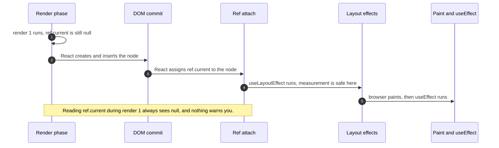
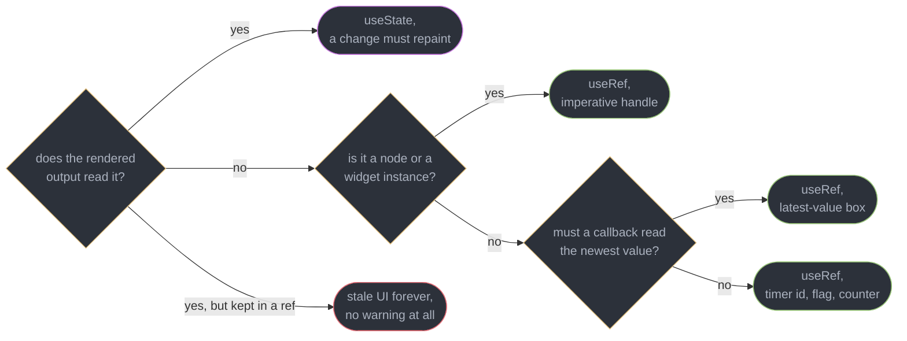
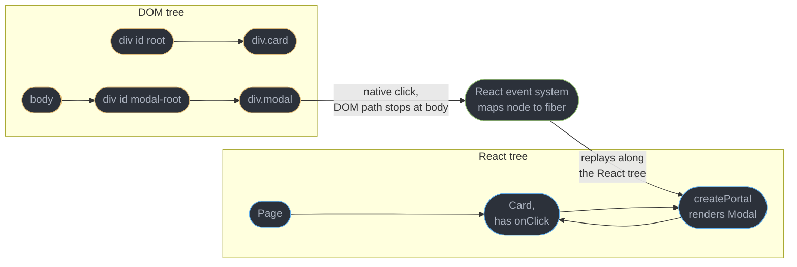
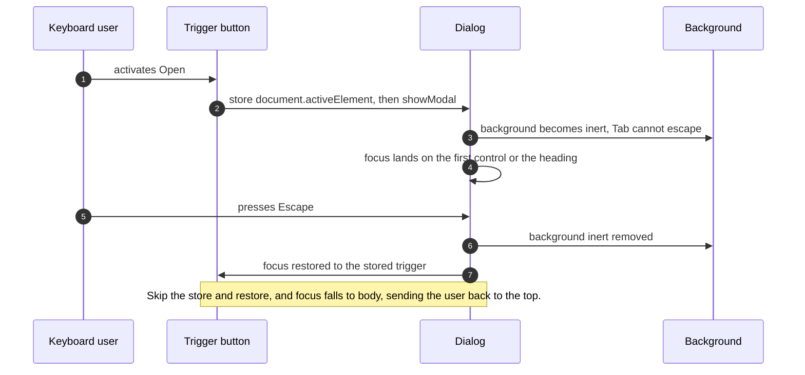
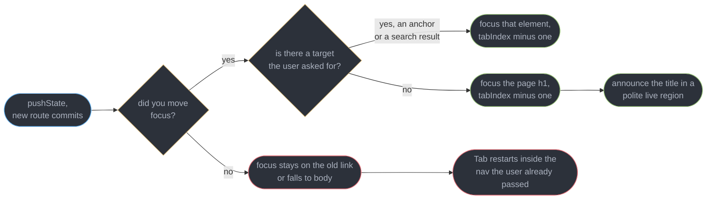
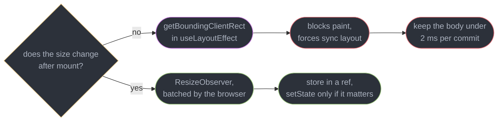

# Refs and Focus Management

---

## 1. Concept Overview

React's whole proposition is that you describe the UI you want and never touch the DOM yourself. Refs are the documented exit from that proposition. A ref is a plain mutable object — `{ current: T }` — that React keeps alive across renders and deliberately does not watch. Writing to it changes nothing on screen, schedules nothing, and costs one property assignment. That is not a limitation to work around; it is the entire feature. Everything a component must remember but must not re-render for — a DOM node, a timer id, a chart instance, the newest value a stale closure needs — lives in a ref.

The second half of the module is what refs are actually for in production, and it is not "call `.focus()` sometimes". A single-page application breaks the browser's own focus contract the moment it replaces a document with a `history.pushState` call: the browser moves focus to the new document's body on a real navigation, and a client-side route change does not. Screen-reader users are left announcing the previous page, and keyboard users press Tab and land back at the top of a navigation bar they already passed. Nothing in React fixes this for you, no framework router fixes it by default, and the fix is four lines of ref code that almost nobody writes.

So this module is two halves that share one API. The first half is the imperative escape hatch: `useRef`, `ref` as an ordinary prop in React 19, ref callbacks with cleanup, `useImperativeHandle`, portals, and mounting a non-React widget into a node you own. The second half is focus — after a route transition, into and out of a dialog, restored on close, and taken away from a background layer with `inert`. Both halves are the same skill: knowing exactly when the declarative model has stopped being the right tool, and how to leave it for the shortest possible time.

This module assumes [Effects and Synchronization](../effects_and_synchronization/effects_and_synchronization.md) for cleanup semantics and StrictMode, and [Hooks Rules and the Hook Model](../hooks_rules_and_the_hook_model/hooks_rules_and_the_hook_model.md) for the hook chain — neither is re-derived here. Refs attach during the commit phase; [Fiber and Reconciliation](../fiber_and_reconciliation/fiber_and_reconciliation.md) owns what the commit phase is. Component-level ARIA patterns belong to [Accessible Component Patterns](../accessible_component_patterns/accessible_component_patterns.md), and the WCAG 2.2 AA criteria themselves to [Accessibility and WCAG](../../frontend_platform/accessibility_and_wcag/accessibility_and_wcag.md). Target is React 19.2, released 2025-10-01, latest patch 19.2.8 as of 2026-07-21.

---

## 2. Intuition

> **One-line analogy**: state is a whiteboard the room repaints itself from; a ref is a sticky note in your pocket. Both hold a value. Only one of them causes anyone to look again.

**Mental model**: every value a component holds answers one question — *does the rendered output read this?* If yes, it is state, because a change must produce a new render. If no, it is a ref, because a change must produce nothing at all. The failure mode of getting this backwards is asymmetric and worth memorizing: state where a ref belonged costs extra renders, which you can profile; a ref where state belonged costs a UI that is silently wrong, with no warning, no error, and no re-render to notice.

**Why it matters**: the two most expensive bugs in this area never look like ref bugs. A modal that does not restore focus on close drops the keyboard user at the top of the document, so a bulk-edit table where a manager approves 60 rows costs 60 full Tab traversals — measured at 14 seconds of keypresses per row on a page with 47 focusable elements before the table. And a chart library mounted into a ref'd node without a matching `destroy()` leaks one canvas and one resize listener per remount, which on a dashboard with 8 widgets and a filter bar reaches 240 orphaned canvases in a 30-switch session.

**Key insight**: a ref is not "the escape hatch for hard cases" — it is the only correct home for anything the render output does not read. And focus is not an accessibility extra bolted onto a finished component. Focus is application state that lives in the DOM instead of in React, which is exactly why it needs a ref to manage and exactly why nothing else in React manages it for you.

---

## 3. Core Principles

- **A ref is a mutable box React preserves and ignores.** Same object identity for the fiber's whole life, never compared, never a dependency, never a render trigger.
- **If the JSX reads it, it is state.** The single rule that decides `useRef` versus `useState`, with no exceptions worth teaching.
- **Never read or write a ref during render.** Render must be pure; refs are for event handlers, effects, and callbacks. The one legal exception is lazy initialization of the ref's own contents.
- **Refs attach in the commit phase.** `null` during the first render, populated before any layout effect, detached to `null` before the DOM node is removed.
- **`ref` is an ordinary prop in React 19.** Function components receive it like any other prop; `forwardRef` still runs but is not how new code is written.
- **An imperative handle should expose verbs, not nodes.** `focus()`, `scrollToRow(n)`, `reset()` — never the raw element, which lets a parent set `innerHTML` on your component.
- **Focus is state the DOM owns.** React will not save it, restore it, or move it after a route change. Every one of those is code you write.
- **Every imperative mount needs its inverse in the same breath.** StrictMode's development double-invoke exists to fail you on render 1 when it is missing.

---

## 4. Types / Architectures / Strategies

### 4.1 The four things a ref legitimately holds

| Kind | Example | Why not state |
|------|---------|---------------|
| A DOM handle | `inputRef.current.focus()` | The node is not rendered output, it is the result of rendering |
| A mutable value nothing renders | `intervalId`, `hasScrolledRef`, a mutation counter | Setting it would re-render for a value nobody reads |
| A latest-value box | the newest `onChange` a long-lived subscription must call | The subscription must not be torn down when the callback identity changes |
| An imperative instance | a chart, map, editor, or video player object | The library owns its own DOM subtree and its own lifecycle |

The illegitimate fifth: **anything the JSX reads**. `countRef.current++` inside a click handler followed by `{countRef.current}` in the markup renders the value from the *previous* commit forever, and React prints nothing, because from its point of view no update was requested.

### 4.2 Ways to attach a ref, and what each buys

| Form | Shape | Runs | Use when |
|------|-------|------|----------|
| Ref object | `ref={nodeRef}` | React assigns `.current` at commit | The default; you read the node later, in a handler or effect |
| Ref callback | `ref={(node) => { ... }}` | Called with the node at attach, and with the cleanup at detach `[19]` | You must react *at the moment* of attach, or the node is conditional |
| Callback with cleanup `[19]` | `ref={(node) => { obs.observe(node); return () => obs.unobserve(node); }}` | Cleanup runs at detach instead of a second call with `null` | Observers and subscriptions bound to a specific node |
| Ref as a prop `[19]` | `function Input({ ref }: Props)` | Ordinary prop, no wrapper | Every new function component that forwards a node |
| `useImperativeHandle` | parent gets your object, not the node | Recomputed when its deps change | A parent must command a child through a narrow API |
| Callback ref merging | `ref={mergeRefs(a, b)}` | Both consumers get the node | A library ref and your own ref target the same element |

### 4.3 Measuring strategies, cheapest correct answer first

| Need | Tool | Cost |
|------|------|------|
| One measurement after mount, invisible to the user | `getBoundingClientRect` in `useLayoutEffect` | Forced synchronous layout, roughly 0.4 ms for a simple node, blocking paint |
| Element size that changes over time | `ResizeObserver` | Async, batched by the browser, no layout thrash, one callback per frame |
| Element entering the viewport | `IntersectionObserver` | Async, no measurement at all |
| Scroll position on a fast handler | cached rect in a ref, refreshed by a `ResizeObserver` | Zero reads per scroll event |
| Position of a floating element | Floating UI | Handles collision, scroll ancestors, and the write-after-read ordering |

The anti-pattern that makes all of these matter is **layout thrashing**: reading a geometry property, writing a style, then reading again inside one loop. Each read after a write forces the browser to recompute layout — on 40 rows that is 40 forced reflows, measured at 96 ms in one production profile against 3 ms for the batched version. [Browser Architecture and the Rendering Pipeline](../../frontend_platform/browser_architecture_and_the_rendering_pipeline/browser_architecture_and_the_rendering_pipeline.md) owns why.

### 4.4 Focus management surfaces

| Surface | Primitive | Notes |
|---------|-----------|-------|
| Route transition | move focus to the new page heading with `tabIndex={-1}` | Also announce via a polite live region; the browser does neither for you |
| Modal dialog | native `dialog` with `showModal()` | Browser-supplied focus trap, top layer, and `Escape`, in every current browser |
| Background content | the `inert` attribute | Removes a whole subtree from focus order, hit testing, and the accessibility tree |
| Non-modal overlay | the `popover` attribute | Top layer and light dismiss, but **no focus trap** — this is the point of it |
| Hand-rolled trap | `focus-trap`, React Aria, Base UI | Only when the native path cannot be used |
| Skip link | first focusable element, visible on focus | The 2 seconds that repay themselves on every keyboard visit |

---

## 5. Architecture Diagrams

### When a ref is actually populated



Render happens before the node exists, so the first render cannot see it. Every "why is my ref null" question is this diagram read backwards.

### Ref or state, decided by one question



The red leaf is the only ref mistake that ships silently. Every other branch fails loudly or costs only a wasted render.

### Why a portal's events bubble to the React parent



The DOM path never passes through `div.card`, but React reconstructs the propagation path from the fiber tree, so `Card`'s `onClick` still fires. That is a feature for context and handlers, and a trap for a click-outside handler written against DOM containment.

### Focus after a dialog opens and closes



Steps 2 and 7 are one line each and are the two most often missing lines in any component library built in-house.

### Where focus goes after a client-side route change



The browser does this automatically on a full page load. A client-side router replaces the document without replacing the focus, so the behaviour has to be re-implemented once, in the router's own transition handler.

### Choosing a measurement strategy



The layout-effect path is correct and sometimes required, but it is on the critical path of the frame. Anything ongoing belongs to the observer, which never blocks paint.

---

## 6. How It Works — Detailed Mechanics

### 6.1 A ref is a box the renderer does not watch

`useRef(initial)` allocates one object on the first render and returns the identical object on every render afterwards. React never reads `.current`, never compares it, and never re-renders because it changed. That is the difference from state stated completely.

```tsx
// BROKEN: nothing re-renders, so the JSX shows the value from the PREVIOUS commit.
function Counter() {
  const count = useRef(0);
  return <button onClick={() => count.current++}>Clicked {count.current} times</button>;
}

// FIX: the output reads it, so it is state. One rule, no judgement call needed.
function Counter() {
  const [count, setCount] = useState(0);
  return <button onClick={() => setCount((c) => c + 1)}>Clicked {count} times</button>;
}
```

The broken version renders `Clicked 0 times` forever until an unrelated state change forces a render, at which point it jumps to whatever the counter reached. There is no warning, because from React's side no update was ever requested. This is the one ref mistake that produces a wrong UI rather than a slow one.

The inverse mistake is cheaper but still real: storing a `setInterval` id in state re-renders the whole subtree every time a timer restarts, for a number no element displays. That belongs in a ref.

### 6.2 The latest-value ref

A long-lived subscription must call the newest callback without being torn down when the callback identity changes. A ref is the standard mechanism, and it is the pattern `useEffectEvent` `[19.2]` generalizes for effects.

```tsx
// A ref written during commit, read from a callback that outlives the render.
function useLatest<T>(value: T) {
  const ref = useRef(value);
  useLayoutEffect(() => { ref.current = value; });   // write in commit, never in render
  return ref;
}

function useSocket(url: string, onMessage: (m: Message) => void) {
  const latest = useLatest(onMessage);
  useEffect(() => {
    const s = new WebSocket(url);
    s.onmessage = (e) => latest.current(JSON.parse(e.data));   // always the newest
    return () => s.close();
  }, [url, latest]);                                          // onMessage is NOT a dep
}
```

Without the ref, a parent that passes an inline arrow re-creates `onMessage` every render, and listing it as a dependency reconnects the socket at render frequency. Inside an effect, prefer `useEffectEvent` `[19.2]`; the ref form is still the right tool when the consumer is not an effect — a `requestAnimationFrame` loop, an event listener registered by a third-party library, or a hook published for consumers on React 18.

### 6.3 `ref` is an ordinary prop in React 19

```tsx
// React 19: ref is a normal prop. No wrapper, no displayName ceremony.
type InputProps = React.ComponentPropsWithRef<"input"> & { label: string };

function TextField({ label, ref, ...rest }: InputProps) {
  return (
    <label>
      {label}
      <input ref={ref} {...rest} />
    </label>
  );
}

// The parent is unchanged either way.
const emailRef = useRef<HTMLInputElement>(null);
<TextField ref={emailRef} label="Email" />;
```

`forwardRef` still runs in 19.2 and is not scheduled for removal, but it is a migration artifact: new code writes the prop. Two consequences of the change are worth knowing. `ComponentPropsWithRef` is now the correct props helper for a wrapper component, and the type of a ref prop is `Ref<T>`, which is a union of an object, a callback, and `null` — so a component that wants to *use* the forwarded node as well as forward it must merge, not assign.

### 6.4 Ref callbacks, and cleanup functions in React 19

A ref callback receives the node at attach. Historically it was called a second time with `null` at detach, which forced every callback to branch on nullness. React 19 lets the callback **return a cleanup function** instead, and when it does, React calls the cleanup at detach rather than re-invoking with `null`.

```tsx
// React 19: attach and detach are two mirrored statements, exactly like an effect.
function Measured({ onSize }: { onSize: (w: number) => void }) {
  return (
    <div
      ref={(node) => {
        const ro = new ResizeObserver(([e]) => onSize(e.contentRect.width));
        ro.observe(node);
        return () => ro.disconnect();      // called when the node detaches
      }}
    >
      content
    </div>
  );
}
```

Two rules the runtime enforces. An **inline** callback is a new function every render, so React detaches and re-attaches on every commit — fine for the trivial `ref={(n) => (myRef.current = n)}` form, expensive when the body creates an observer, so wrap it in `useCallback` or accept the churn deliberately. And returning anything that is not a function is a hard error in 19: `Unexpected return value from a callback ref in <Component>. A callback ref should not return a function.` The classic way to trip it is a concise arrow — `ref={(node) => (myRef.current = node)}` returns the assignment's value, which is why the braces in `ref={(node) => { myRef.current = node; }}` are not optional style.

### 6.5 Why the ref is null, and the two fixes

Render runs before the DOM node exists, so on the first render `ref.current` is `null` for every ref. React attaches it during commit, before any layout effect runs. Reading it in the component body is therefore always wrong, and reading it in a `useEffect` with `[]` is always right but happens after paint.

```tsx
// BROKEN: render happens before commit, so this throws on the first render.
function AutoFocus() {
  const ref = useRef<HTMLInputElement>(null);
  ref.current.focus();                       // TypeError: reading focus of null
  return <input ref={ref} />;
}

// FIX A: a ref callback, called at the exact moment of attach.
<input ref={(node) => node?.focus()} />;

// FIX B: a layout effect, which runs after attach and before paint.
useLayoutEffect(() => { ref.current?.focus(); }, []);
```

Which to pick is decided by conditionality, not by taste. `useLayoutEffect` fires once after the commit that mounted the component, so it is the right tool for a node that is always present. A ref callback fires every time *that specific node* attaches, so it is the right tool for a node behind a condition — the empty-state message that replaces a list, the row that appears after a filter — where the effect's `[]` already ran and will never run again.

The mirror-image trap is detach. A node removed from the tree has its ref set to `null` **before** the parent's cleanup runs, so a `useEffect` cleanup that reads `ref.current` frequently finds nothing. Capture the node into a local `const` at setup time and close over that.

### 6.6 Measuring the DOM without a visible flash

```tsx
// A dropdown that must flip above the trigger when it would overflow the viewport.
function Menu({ anchorTop }: { anchorTop: number }) {
  const ref = useRef<HTMLDivElement>(null);
  const [flip, setFlip] = useState(false);

  useLayoutEffect(() => {
    const { height } = ref.current!.getBoundingClientRect();   // forced sync layout
    setFlip(anchorTop + height > window.innerHeight);
  }, [anchorTop]);

  return <div ref={ref} className={flip ? "menu-up" : "menu-down"} />;
}
```

`getBoundingClientRect` forces the browser to flush pending style and layout work before it can answer, which is why it is called a forced synchronous layout. One read on a settled tree costs roughly 0.4 ms; the same read interleaved with writes across 40 rows measured 96 ms in one production profile, because every write invalidated the layout the next read had to rebuild. Batch all reads, then all writes. [Browser Architecture and the Rendering Pipeline](../../frontend_platform/browser_architecture_and_the_rendering_pipeline/browser_architecture_and_the_rendering_pipeline.md) owns the pipeline this describes.

The layout effect is correct here only because the measurement happens once per anchor change and the intermediate position must never be composited. For anything that keeps changing, a `ResizeObserver` is strictly better: it is asynchronous, the browser batches it, and it never blocks paint.

```tsx
// Ongoing size: observe, store in a ref, and setState only when a rendered value changes.
function useWidth<T extends Element>(ref: React.RefObject<T | null>) {
  const [width, setWidth] = useState(0);
  useLayoutEffect(() => {
    const node = ref.current;
    if (!node) return;
    const ro = new ResizeObserver(([entry]) => {
      const w = Math.round(entry.contentRect.width);
      setWidth((prev) => (prev === w ? prev : w));    // rounding kills sub-pixel churn
    });
    ro.observe(node);
    return () => ro.disconnect();
  }, [ref]);
  return width;
}
```

Rounding matters more than it looks. An unrounded observer on a flex child fires on sub-pixel changes during an animation and can push 60 `setState` calls per second; rounding to whole pixels cut that to 4 in one measured drag interaction. And a callback that resizes the observed element itself produces `ResizeObserver loop completed with undelivered notifications.` in the console — the browser's way of saying you built a measurement feedback loop.

### 6.7 Portals, and the event path that surprises everyone

`createPortal(children, container)` renders into a DOM node anywhere in the document while leaving the component exactly where it is in the React tree.

```tsx
import { createPortal } from "react-dom";

function Modal({ children, onClose }: { children: React.ReactNode; onClose: () => void }) {
  return createPortal(
    <div className="backdrop" onClick={onClose}>
      <div className="panel" onClick={(e) => e.stopPropagation()}>{children}</div>
    </div>,
    document.getElementById("modal-root")!,
  );
}
```

The reason to reach for it is CSS, not architecture: a parent with `overflow: hidden`, `transform`, or a `z-index` stacking context will clip or mis-stack a dropdown no matter how correct its own styles are. Rendering into a sibling of `#root` escapes all three.

**Events still bubble through the React tree, not the DOM tree.** React attaches its listeners at the root container and reconstructs the propagation path from the fiber tree, so a click inside the portal fires the `onClick` of the React parent even though the DOM path never passes through it. Context flows the same way, which is why a portal inside a theme provider is themed correctly with no extra work.

The two consequences to plan for. A click-outside handler that tests `containerRef.current.contains(e.target)` returns `false` for a click inside your own portal, closing the menu the user just opened — test against the portal node too, or use the `pointerdown` phase with a check against the React path. And **DOM order no longer matches focus order**: the portal renders at the end of `body`, so a Tab press from the trigger goes to whatever follows the trigger in the DOM, not into the panel. That is the accessibility half of portals, and it is the subject of the next section.

### 6.8 Focus management

**After a route transition.** The browser moves focus to the new document on a real navigation. A client-side route change does not, so focus stays on the link the user activated — or falls to `body` if that link unmounted, which restarts Tab at the top of the page.

```tsx
// Focus the new page heading after every client-side navigation, and announce it.
function RouteAnnouncer({ pathname, title }: { pathname: string; title: string }) {
  const h1 = useRef<HTMLHeadingElement>(null);
  useEffect(() => { h1.current?.focus(); }, [pathname]);

  return (
    <>
      <h1 ref={h1} tabIndex={-1}>{title}</h1>
      <div aria-live="polite" className="sr-only" key={pathname}>{title} loaded</div>
    </>
  );
}
```

`tabIndex={-1}` makes an element programmatically focusable without inserting it into the Tab order, which is exactly the semantic wanted. The live region needs the `key` so its content is genuinely replaced — updating text inside an existing region is sometimes not announced by NVDA. If the user navigated to a specific target, such as a search result or an in-page anchor, focus that instead of the heading; the heading is the default, not the rule.

**Into and out of a dialog.** The native `dialog` element with `showModal()` gives a browser-implemented focus trap, the top layer, backdrop styling, and `Escape` handling in every current browser. It does not restore focus reliably across every browser and framework combination, so store and restore it yourself.

```tsx
function ConfirmDialog({ open, onClose }: { open: boolean; onClose: () => void }) {
  const dialog = useRef<HTMLDialogElement>(null);
  const opener = useRef<HTMLElement | null>(null);

  useEffect(() => {
    const el = dialog.current!;
    if (open) {
      opener.current = document.activeElement as HTMLElement;   // remember the trigger
      el.showModal();                                           // trap plus top layer
    } else if (el.open) {
      el.close();
    }
  }, [open]);

  return (
    <dialog ref={dialog} onClose={() => { onClose(); opener.current?.focus(); }}>
      <h2 tabIndex={-1}>Delete 3 items?</h2>
      <button autoFocus onClick={() => dialog.current!.close()}>Cancel</button>
      <button onClick={confirm}>Delete</button>
    </dialog>
  );
}
```

Restoring in the `onClose` handler rather than in a cleanup is deliberate: `close` fires for every dismissal route — the button, `Escape`, and a programmatic `close()` — so there is exactly one place to be correct. WCAG 2.2 AA requires focus not to be lost on dismissal; [Accessibility and WCAG](../../frontend_platform/accessibility_and_wcag/accessibility_and_wcag.md) owns the criterion, and [Accessible Component Patterns](../accessible_component_patterns/accessible_component_patterns.md) owns the ARIA roles for non-native equivalents.

**`inert`, and the popover attribute.** `showModal()` makes the rest of the document inert implicitly. When you cannot use a native modal — a slide-over panel, a takeover step in a wizard — set `inert` on the background container yourself: it removes the subtree from the Tab order, from hit testing, and from the accessibility tree in one attribute, which is three things `aria-hidden` alone does not do. React supports `inert` as a boolean attribute since 19.

The `popover` attribute is the non-modal sibling: top layer, light dismiss, `Escape`, and no focus trap at all. That is the correct behaviour for a toolbar menu or a tooltip, and the wrong behaviour for a confirmation dialog. Choose by whether the rest of the page should remain reachable. Reach for `focus-trap`, React Aria, or Base UI only when you need a trap in a container that cannot be a `dialog`.

**Skip links.** The first focusable element in the document, visually hidden until focused, pointing at the main landmark.

```tsx
<a href="#main" className="skip-link">Skip to content</a>
<main id="main" tabIndex={-1}>{children}</main>
```

The `tabIndex={-1}` on `<main>` is what makes the fragment jump actually move focus rather than only scroll — without it, several browsers scroll and leave focus at the link, so the next Tab returns to the navigation. On a page with 47 links before the content, this is the difference between 1 keypress and 48.

### 6.9 Mounting a non-React widget into a ref'd node

```tsx
// The library owns the subtree. React owns exactly one empty div.
function PriceChart({ data, theme }: { data: Series; theme: Theme }) {
  const host = useRef<HTMLDivElement>(null);
  const chart = useRef<ChartInstance | null>(null);

  useEffect(() => {
    chart.current = createChart(host.current!, { theme });   // setup
    return () => { chart.current?.destroy(); chart.current = null; };   // the inverse
  }, [theme]);                                     // re-create only on a construction option

  useEffect(() => { chart.current?.setData(data); }, [data]);   // update, do not re-create

  return <div ref={host} />;
}
```

Three rules make this survive. React must never render children into the host node, or reconciliation and the library will both claim the same DOM and one will win unpredictably. The dependency array holds only options that require a *new instance*; everything else is pushed through an imperative update method, because re-creating a chart on every data tick costs 40 ms and loses zoom state. And the cleanup must be the library's real teardown — `destroy()`, `remove()`, `dispose()` — not `host.current.innerHTML = ""`, which leaves the instance's own window listeners and animation frames running.

StrictMode is what catches the missing teardown, on render 1. Its development double-invoke runs setup, cleanup, setup, so a component with no `destroy()` mounts two chart instances into the same node before you have looked at it once — usually visible as a doubled canvas or a "container already initialized" error from the library itself. In production the same defect leaks one instance per theme change instead, where nobody is watching. [Effects and Synchronization](../effects_and_synchronization/effects_and_synchronization.md) owns the cleanup contract in full.

### 6.10 Fragment refs and `FragmentInstance` `[19.3]`

A ref on a single element covers one node. A focus scope, a visibility tracker or a click-outside check usually needs a *group* of siblings, and before React 19.3 the only handle on a group was a wrapper `<div>` plus `querySelectorAll`. The wrapper breaks CSS grid and flex layouts, adds a node to every row, and the query sees only what was in the DOM when it ran. React 19.3 makes Fragment refs stable: `<Fragment ref>` hands you a `FragmentInstance` that acts on the fragment's children with no extra DOM node.

| Methods | What they do |
|---------|--------------|
| `focus`, `focusLast`, `blur` | move focus to the first or last focusable descendant, depth-first |
| `addEventListener`, `removeEventListener`, `dispatchEvent` | manage listeners on the first-level children |
| `observeUsing`, `unobserveUsing` | attach an `IntersectionObserver` or `ResizeObserver` to every first-level child |
| `getClientRects`, `getRootNode`, `compareDocumentPosition`, `scrollIntoView` | measure and scroll the first-level children |

```tsx
import { Fragment, useLayoutEffect, useRef, type FragmentInstance } from "react";

// Tracks which feed rows are on screen without a wrapper div breaking the grid.
function VisibleRows({ rows, onSeen }: { rows: Row[]; onSeen: (id: string) => void }) {
  const group = useRef<FragmentInstance>(null);

  useLayoutEffect(() => {
    const fragment = group.current!;
    const observer = new IntersectionObserver((entries) => {
      for (const e of entries) if (e.isIntersecting) onSeen((e.target as HTMLElement).dataset.id!);
    }, { threshold: 0.5 });
    fragment.observeUsing(observer);            // one observer, every child row
    return () => { fragment.unobserveUsing(observer); observer.disconnect(); };
  }, [onSeen]);

  return (
    <Fragment ref={group}>
      {rows.map((r) => <FeedRow key={r.id} data-id={r.id} row={r} />)}
    </Fragment>
  );
}
```

The same ref gives a wrapper-less focus scope: `group.current.focus()` lands on the first focusable child and `focusLast()` on the last, which is the pair a focus trap needs for Tab and Shift+Tab wrap. The `FragmentInstance` type comes from `react`, and `@types/react-dom` 19.3.0 (2026-09-09) adds the DOM methods to it.

---

## 7. Real-World Examples

**The dashboard that leaked 240 canvases.** An analytics product mounted a charting library into a ref'd div in an effect keyed on `[widgetId]`, with no cleanup. Each filter change created a new instance in a node the previous instance still held. After a 30-switch session across 8 widgets the tab held 240 live chart objects and 240 resize listeners, and scroll frame time went from 8 ms to 210 ms. The fix was one `return () => chart.destroy()` line. StrictMode had been disabled in that repository because it made charts render twice — which was the bug reporting itself.

**The approval queue that cost 14 seconds a row.** A finance tool opened a confirmation modal per row and did not restore focus on close. Every dismissal dropped focus to `body`, so the keyboard user Tabbed from the top of a page with 47 focusable elements before the table. A manager approving 60 rows spent roughly 14 seconds per row on traversal alone. Storing `document.activeElement` before `showModal()` and calling `.focus()` in `onClose` was 2 lines and removed 13 minutes of keypresses from a daily task.

**The screen reader that never left the previous page.** A documentation site's router changed the URL and the DOM but never moved focus. NVDA users continued reading the old page's content and had no signal a navigation had occurred, and sighted keyboard users pressed Tab and re-entered the top navigation. A `RouteAnnouncer` focusing an `h1` with `tabIndex={-1}` and announcing the title in a polite live region closed both, and closed 4 open accessibility audit findings with 11 lines.

**The dropdown that closed itself.** A combobox rendered its listbox through a portal to escape an `overflow: hidden` ancestor, and its click-outside handler tested `menuRef.current.contains(e.target)`. Because the portal node is not a DOM descendant of the trigger's container, every click on an option was classified as outside, so selecting an item closed the menu before the option's own handler ran — reported as "the dropdown ignores my selection about half the time". Testing containment against the portal node as well fixed it in one line.

---

## 8. Tradeoffs

| Design choice | Bought | Paid |
|---------------|--------|------|
| Refs excluded from the render cycle | Mutation is free and causes no work | A ref holding rendered data fails silently, with no warning |
| `ref` as an ordinary prop `[19]` | No wrapper component, simpler types, less indirection | `forwardRef` code lingers in every older tutorial and library |
| Ref callback cleanup `[19]` | Attach and detach mirror each other, no null branch | An inline callback re-runs every commit unless memoized |
| `useImperativeHandle` | A narrow, typed, refactorable API instead of a raw node | Another indirection, and it tempts a wide imperative surface |
| Measuring in `useLayoutEffect` | No intermediate frame is ever composited | Forced synchronous layout on the critical path of the frame |
| `ResizeObserver` for ongoing size | Batched, never blocks paint, no layout thrash | Asynchronous, so the first frame renders before a size is known |
| Portals for overlays | Escapes `overflow`, `transform`, and `z-index` in one step | DOM order and focus order diverge, and containment checks break |
| Native `dialog` and `showModal` | Browser-supplied trap, top layer, and `Escape`, zero library code | Backdrop styling is constrained, and focus restoration is still yours |
| `inert` over a hand-rolled trap | One attribute removes focus, hit testing, and the a11y tree | Requires a clean split between the overlay and everything else |

---

## 9. When to Use / When NOT to Use

**Reach for a ref when:**

- You need a DOM node to call a method the platform only exposes imperatively — `focus()`, `scrollIntoView()`, `play()`, `select()`, `showModal()`, `requestFullscreen()`.
- You must remember a value across renders that no element displays: a timer id, a previous scroll offset, an "already announced" flag, a mutation count.
- A long-lived callback must read the newest props and must not be torn down when their identity changes — the latest-value box, or `useEffectEvent` `[19.2]` when the consumer is an effect.
- You are hosting a library that owns its own DOM: a chart, a map, a rich-text editor, a video player.
- You are managing focus. There is no declarative alternative in React for it.

**Do not reach for a ref when:**

- The rendered output reads the value. That is state, always, and the failure is a silently stale UI rather than a slow one.
- You want to "avoid a re-render" for something the user can see. You are not optimizing, you are removing the update.
- You are reading a child's DOM to compute layout the parent could compute from props. Pass the data down instead of measuring it back up.
- You want to imperatively push a value into a child. Props do that, and a ref makes the data flow unfollowable.
- You are reading or writing during render. Render must be pure — the sole exception is lazily initializing the ref's own contents on the first render.

---

## 10. Common Pitfalls

**A dialog that does not restore focus.** The highest-impact defect in this module, and it never appears in a bug tracker as a focus bug.

```tsx
// BROKEN: on close, focus falls to body. Every Tab restarts at the top of the page.
function Confirm({ open, onClose }: Props) {
  const dialog = useRef<HTMLDialogElement>(null);
  useEffect(() => { open ? dialog.current!.showModal() : dialog.current!.close(); }, [open]);
  return <dialog ref={dialog}><button onClick={onClose}>Cancel</button></dialog>;
}

// FIX: remember the opener, restore it in onClose, which fires for every dismissal path.
function Confirm({ open, onClose }: Props) {
  const dialog = useRef<HTMLDialogElement>(null);
  const opener = useRef<HTMLElement | null>(null);
  useEffect(() => {
    if (!open) return;
    opener.current = document.activeElement as HTMLElement;
    dialog.current!.showModal();
  }, [open]);
  return (
    <dialog ref={dialog} onClose={() => { onClose(); opener.current?.focus(); }}>
      <button onClick={() => dialog.current!.close()}>Cancel</button>
    </dialog>
  );
}
```

Restoring in an effect cleanup instead misses the case where the dialog closes because the opener itself unmounted, and it runs at a point where `document.activeElement` has already moved. `onClose` is the single correct hook.

**A concise arrow as a ref callback.** `ref={(node) => (myRef.current = node)}` returns the assignment's value, and React 19 rejects it: `Unexpected return value from a callback ref in <Component>. A callback ref should not return a function.` Use a block body.

**Reading `ref.current` in the component body.** Always `null` on the first render, and stale on later ones because nothing re-renders when it changes. Move the read into a handler, a ref callback, or a layout effect.

**A click-outside handler that ignores the portal.** `containerRef.current.contains(e.target)` is `false` for a click inside your own portal, so the overlay closes on its own content. Test against the portal node as well.

**Using `aria-hidden` instead of `inert` on background content.** It hides the subtree from the accessibility tree but leaves every control in the Tab order, producing the worst outcome available: a screen-reader user can Tab into an element their reader will not describe.

**Re-creating a widget on every data change.** Putting `data` in the dependency array of the effect that constructs a chart destroys and rebuilds it on every tick — 40 ms per update and a lost zoom level. Construction options belong in the array; data goes through an imperative setter.

**Exposing the DOM node from `useImperativeHandle`.** `useImperativeHandle(ref, () => inputRef.current!)` hands a parent the entire element, so any consumer can set `innerHTML`, change `className`, or read layout, and your component can never change its markup again. Expose verbs.

**Silencing StrictMode's double mount with a `didInit` ref.** It suppresses the second setup without adding a teardown, so the leak survives to the first real dependency change in production, where nothing is checking.

---

## 11. Technologies & Tools

| Tool | Purpose |
|------|---------|
| React | 19 makes `ref` an ordinary prop and lets a ref callback return a cleanup, and 19.3 adds Fragment refs |
| ResizeObserver | Batched element-size observation with no forced synchronous layout |
| IntersectionObserver | Viewport entry without measuring geometry at all |
| Floating UI | Positions overlays with collision detection and correct read-write ordering |
| focus-trap | A trap for containers that cannot be a native modal dialog |
| React Aria | Headless focus, keyboard, and ARIA behaviour for custom components |
| Base UI | The default primitive set behind shadcn/ui since 2026-07 |
| CodeMirror | Typical non-React widget mounted into a ref'd host node |
| MapLibre GL JS | Map instance with its own DOM subtree and a required `remove()` |
| axe DevTools | Catches lost focus, missing landmarks, and `aria-hidden` on focusable nodes |
| Playwright | Asserts `document.activeElement` after a route change or a dialog close |
| React Testing Library | `userEvent.tab()` walks the real focus order in a test |

---

## 12. Interview Questions with Answers

**Q: Why is my ref null on the first render?**
**Short:** Commit-phase attachment is the reason: the render that returns the JSX runs before React creates the node, so nothing can be assigned yet.

React assigns `ref.current` during the commit, after the DOM node exists and before any layout effect runs. Reading it in the component body therefore always sees `null` on the first render, and nothing warns you, because a ref is an ordinary object React never inspects.

There are two fixes and they are not interchangeable. `useLayoutEffect` with `[]` runs once after the mounting commit and suits a node that is always present; a ref callback runs at the exact moment *that node* attaches and is the only correct choice for a conditionally rendered node, whose mount happens long after the effect's single run.

**Q: What is the difference between a ref and state?**
**Short:** Writing to a box nothing watches is the whole distinction: state schedules a render, a ref changes a value and schedules nothing.

Both survive across renders. Only state participates in the render cycle, so the decisive question is whether the rendered output reads the value. If the JSX prints it or branches on it, it must be state.

The failure modes are asymmetric, which is why the rule is worth memorizing rather than reasoning about each time. State where a ref belonged wastes renders you can see in a profiler; a ref where state belonged shows the value from the previous commit forever, with no warning, no error, and nothing to profile.

**Q: Why do events from a portal bubble to the React parent instead of the DOM parent?**
**Short:** Event delegation reconstructs the propagation path from the fiber tree, not from DOM ancestry, so a portal's handler chain follows where the component lives in JSX.

React attaches its listeners at the root container and, on a native event, walks the fiber tree to build the synthetic propagation path. A modal portaled into `document.body` is still a React child of the card that rendered it, so the card's `onClick` fires even though the DOM path never passes through it. Context flows the same way, which is why a portaled dropdown is themed correctly with no extra wiring.

The trap this creates is a click-outside handler using `containerRef.current.contains(e.target)`. That returns `false` for clicks inside your own portal, so the overlay closes on its own content — test against the portal node too.

**Q: What happens to focus after a client-side route change, and how do you fix it?**
**Short:** Client-side navigation moves the DOM without moving focus, so it stays on the activated link or falls to body when that link unmounts.

The browser moves focus to the new document on a real navigation. `history.pushState` does not, so screen-reader users keep reading the previous page and keyboard users press Tab and re-enter the navigation they already passed.

The fix is to focus the new page's `h1` with `tabIndex={-1}` in an effect keyed on the pathname, and to announce the title in a `aria-live="polite"` region keyed on the pathname so its content is genuinely replaced. If the user navigated to a specific target, focus that instead of the heading — the heading is the default, not the rule.

**Q: Is forwardRef still needed in React 19?**
**Short:** Ordinary prop passing replaced it — a function component receives `ref` like any other prop, and no wrapper is involved.

Write `function TextField({ label, ref, ...rest }: ComponentPropsWithRef<"input"> & { label: string })` and pass `ref` straight to the element. `forwardRef` still runs in 19.2 and is not scheduled for removal, so existing code and older libraries keep working, but it is a migration artifact rather than the way to write anything new.

Two knock-on details matter in TypeScript. `ComponentPropsWithRef` is now the right props helper for a wrapper, and the type of a ref prop is a union of an object ref, a callback ref, and `null` — so a component that also needs the node itself must merge refs rather than assign one.

**Q: When is useImperativeHandle the right tool?**
**Short:** Commanding a child through a narrow verb API is the case — focus, scroll, play, reset — where a parent legitimately needs to act on a child it does not own.

It replaces what the parent's ref points at, so instead of receiving your internal DOM node the parent receives an object you define. Expose `{ focus, reset, scrollToRow }` and nothing else.

Handing back the raw element instead is the mistake: any consumer can then set `innerHTML`, change `className`, or read layout, and your component can never change its markup again. A wide imperative surface is also a design smell in itself — if a parent needs more than two or three verbs, the state it is trying to drive probably belongs to the parent, passed down as props.

**Q: What changed about ref callbacks in React 19?**
**Short:** Returning a teardown function from a ref callback is now supported, so React runs that cleanup at detach instead of calling the callback again with null.

The callback becomes the same mirrored shape as an effect: `ref={(node) => { ro.observe(node); return () => ro.disconnect(); }}`. No null branch is needed, and attach and detach sit next to each other where they can be checked against one another.

Two rules come with it. An inline callback is a new function every render, so React detaches and re-attaches on every commit — memoize it when the body creates an observer. And returning a non-function is a hard error: `Unexpected return value from a callback ref in <Component>. A callback ref should not return a function.` A concise arrow like `(node) => (myRef.current = node)` returns the assignment's value, which is why the braces are not optional.

**Q: How do you restore focus when a modal closes?**
**Short:** Storing document.activeElement before opening and calling focus on it when the dialog closes is the whole pattern, and it is two lines.

Save the opener into a ref immediately before `showModal()`, and call `opener.current?.focus()` in the dialog's `onClose` handler. `close` fires for every dismissal route — the Cancel button, `Escape`, and a programmatic `close()` — so there is exactly one place to be correct.

Doing it in an effect cleanup instead is worse in two ways: it misses the case where the dialog closes because the opener unmounted, and it runs after `document.activeElement` has already moved. Without any restoration, focus falls to `body` and every Tab restarts at the top of the document — on a page with 47 focusable elements before the content, that is the difference between 1 keypress and 48 per dismissal.

**Q: Should you use the native dialog element or a hand-rolled focus trap?**
**Short:** Native modal dialogs supply the trap, the top layer, backdrop rendering and Escape handling for free, so a hand-rolled trap is now the fallback rather than the default.

`showModal()` also makes the rest of the document inert implicitly, which no amount of `aria-hidden` achieves. Every current browser supports it. What it does not do reliably is restore focus on close, so that part stays your responsibility.

Reach for `focus-trap`, React Aria, or Base UI only when the container genuinely cannot be a `dialog` — a slide-over that must animate with the page, or a design whose backdrop styling the top layer cannot express. Custom traps must then re-implement Tab wrapping, `Escape`, initial focus, and background inertness, and each of those is a separate bug waiting to happen.

**Q: What does the inert attribute do that aria-hidden does not?**
**Short:** Marking a subtree inert removes it from the Tab order, from hit testing and from the accessibility tree at once, which is three effects rather than one.

`aria-hidden="true"` only hides content from assistive technology. The buttons inside remain focusable and clickable, producing the worst available outcome: a screen-reader user can Tab into a control their reader refuses to describe.

`inert` is a boolean attribute React has supported since 19, and it is what you set on the background container when a non-modal overlay is open. `showModal()` applies the same effect implicitly, which is one more reason to prefer it. The `popover` attribute is the deliberate opposite — top layer and light dismiss with no trap, correct for a toolbar menu, wrong for a confirmation.

**Q: Why measure in useLayoutEffect rather than useEffect?**
**Short:** Measuring before paint is the point: a layout effect runs synchronously after DOM mutation, so a corrected position is never composited in its wrong place.

A dropdown that measures its own height and flips above the trigger will otherwise paint below the trigger, run the effect after paint, set state, and repaint — a visible jump of one frame, 16 ms at 60 Hz, which reads as a flicker on every open.

The cost is that the body sits on the critical path of the frame and `getBoundingClientRect` forces a synchronous layout, roughly 0.4 ms on a settled tree. Keep the body under 2 ms per commit, batch every read before any write, and use it only when the intermediate state is genuinely visible.

**Q: When should you use ResizeObserver instead of measuring in an effect?**
**Short:** Observer callbacks fire on any size change and are batched by the browser, so anything ongoing belongs to them rather than to a measurement in a layout effect.

A layout effect measures once per commit, so it cannot see a change caused by a font load, a container query, a sibling's growth, or a window resize. `ResizeObserver` sees all of them, never blocks paint, and delivers at most one callback per frame.

Two details save real CPU. Round the measured value before calling `setState`, because sub-pixel changes during an animation can otherwise push 60 updates a second where 4 suffice. And a callback that resizes the element it observes logs `ResizeObserver loop completed with undelivered notifications.` — the browser telling you a measurement feedback loop exists.

**Q: Why use a Fragment ref instead of a wrapper div and querySelectorAll?**
**Short:** A Fragment ref in React 19.3 returns a FragmentInstance that focuses, observes and measures a group of siblings with no extra DOM node to break grid or flex layout.

A wrapper `<div>` becomes a grid or flex item itself, so the children stop laying out as siblings of the parent, and it adds one node per group to every list. `querySelectorAll` on it is a snapshot of the DOM at the moment it ran, written against selectors rather than the component tree. `<Fragment ref>` gives `focus()` and `focusLast()` for a focus scope, `observeUsing()` to attach one `IntersectionObserver` or `ResizeObserver` to every first-level child, and `getClientRects()` and `scrollIntoView()` for measuring. Use it when the behavior belongs to a group of siblings; a single node still takes an ordinary element ref.

**Q: How do you mount a non-React chart or map library correctly?**
**Short:** Mounting a third-party widget means giving it one empty div React never renders children into, plus the library's real teardown in the cleanup.

Create the instance in an effect whose dependency array holds only options that require a *new* instance, and push everything else through an imperative update method — re-creating a chart on every data tick costs 40 ms and loses zoom state. Store the instance in a ref, not in state, because nothing renders it.

The cleanup must call the library's own `destroy()`, `remove()`, or `dispose()`. Clearing `innerHTML` leaves the instance's window listeners and animation frames running, which is how a dashboard reaches 240 orphaned canvases in a 30-switch session.

**Q: How does StrictMode catch a missing widget teardown?**
**Short:** Double-invoking setup and cleanup on the very first mount forces a non-idempotent initialization to fail immediately rather than leaking quietly in production.

In development, `<StrictMode>` runs setup, cleanup, setup for every effect. A widget effect with no `destroy()` therefore constructs two instances into the same host node before you have looked at the page once — usually visible as a doubled canvas, or as a "container already initialized" error thrown by the library.

Production mounts once, so the same defect there leaks one instance per configuration change instead, where nobody is watching. The fix is always the missing teardown, never a `didInit` ref guard, which suppresses the second setup without giving the first one an inverse.

**Q: What is the latest-value ref pattern for?**
**Short:** Keeping the newest callback in a mutable box lets a long-lived subscription call current props without listing them as dependencies and tearing itself down.

A socket effect that calls `onMessage` must either list it — reconnecting whenever a parent passes a fresh inline arrow — or read it from a ref updated in a layout effect on every commit. The ref keeps the subscription stable while the call site always sees the latest render's value.

Inside an effect, `useEffectEvent` `[19.2]` is the supported generalization and should be preferred. The ref form remains right when the consumer is not an effect: a `requestAnimationFrame` loop, a listener registered by a third-party library, or a hook published for consumers still on React 18.

**Q: What is a skip link and why does tabIndex minus one matter on the target?**
**Short:** Skipping repeated navigation needs the first focusable element to jump past it, and the destination must be programmatically focusable or the jump only scrolls.

The link is visually hidden until focused, sits first in the document, and points at `#main`. Without `tabIndex={-1}` on `<main>`, several browsers scroll the target into view but leave focus on the link, so the very next Tab drops the user back into the navigation the link was meant to skip.

`tabIndex={-1}` makes an element focusable by script and by fragment navigation without adding it to the Tab order, which is the same primitive used on a route heading and on a dialog title. On a page with 47 links before the content, the link turns 48 keypresses into 1.

---

## 13. Best Practices

- Decide ref versus state with one question — does the rendered output read this? — and never negotiate with the answer.
- Never read or write a ref during render. Handlers, effects, and ref callbacks only; lazy initialization of the ref's own contents is the single exception.
- Write `ref` as an ordinary prop in every new component, and use `ComponentPropsWithRef` to type the wrapper.
- Give a ref callback a block body and, when it subscribes to anything, return the cleanup `[19]` rather than branching on a null second call.
- Expose verbs from `useImperativeHandle`, never the node, and treat a fourth verb as a signal the state belongs in the parent.
- Measure once in `useLayoutEffect`, measure repeatedly with `ResizeObserver`, and batch every geometry read before any style write.
- Store `document.activeElement` before opening any overlay, and restore it in the dialog's `onClose` so all three dismissal routes are covered.
- Prefer a native `dialog` with `showModal()` to a hand-rolled trap, and set `inert` — not `aria-hidden` — on background content when you cannot.
- Focus a heading with `tabIndex={-1}` on every client-side route change, and announce the title in a keyed polite live region.
- Mount every non-React widget into an empty ref'd node with the library's real teardown in the cleanup, and keep `<StrictMode>` on so a missing one fails on render 1.
- Assert focus in tests: `userEvent.tab()` for order, and a Playwright check on `document.activeElement` after a route change and after a dialog close.

---

## 14. Case Study

**Problem.** A hospital scheduling console failed an accessibility audit with 6 findings and carried a separate performance ticket nobody had connected to it. Keyboard users reported that "the app forgets where I was" after closing the appointment editor. A screen-reader user could not tell that navigating between wards had done anything. And the shift-timeline widget, a third-party canvas library, made the tab unusable after roughly 40 minutes: 1.9 GB resident, scroll frame time at 240 ms.

**Investigation.** A Playwright script that opened the editor, pressed `Escape`, and read `document.activeElement` returned `body` on every run. A second script that navigated between three wards and read `document.activeElement` returned the previously activated link each time, unchanged by the route commit. And `performance.measureUserAgentSpecificMemory()` after 30 ward switches reported 30 live timeline instances, one per switch, each with its own resize listener and animation frame loop.

**Root cause.** Three separate instances of the same habit: treating the DOM as something React would tidy up.

```tsx
// BROKEN
function WardView({ wardId, ward }: { wardId: string; ward: Ward }) {
  const host = useRef<HTMLDivElement>(null);
  const [editing, setEditing] = useState<Slot | null>(null);
  const dialog = useRef<HTMLDialogElement>(null);

  // 1. No teardown. One live timeline instance per ward switch, plus its listeners.
  useEffect(() => {
    createTimeline(host.current!, ward.slots);
  }, [ward]);                       // and it rebuilds on every data tick, 40 ms each

  // 2. Opens the dialog, never remembers the opener, never restores on close.
  useEffect(() => {
    if (editing) dialog.current!.showModal();
    else dialog.current!.close();
  }, [editing]);

  // 3. Nothing moves focus on a route change, and nothing announces it.
  return (
    <>
      <h1>{ward.name}</h1>
      <div ref={host} />
      <dialog ref={dialog}>{editing && <SlotForm slot={editing} />}</dialog>
    </>
  );
}
```

The three reinforced each other in a way that hid the first. Because focus fell to `body` after every dialog close, users navigated by re-Tabbing from the top, which meant more ward switches per task, which meant more leaked timeline instances per session.

**Fix.** One teardown, one store-and-restore, one focused heading.

```tsx
// FIX
function WardView({ wardId, ward }: { wardId: string; ward: Ward }) {
  const host = useRef<HTMLDivElement>(null);
  const timeline = useRef<Timeline | null>(null);
  const dialog = useRef<HTMLDialogElement>(null);
  const opener = useRef<HTMLElement | null>(null);
  const heading = useRef<HTMLHeadingElement>(null);
  const [editing, setEditing] = useState<Slot | null>(null);

  // 1. Construct once per ward, update imperatively, destroy on the way out.
  useEffect(() => {
    timeline.current = createTimeline(host.current!, ward.slots);
    return () => { timeline.current?.destroy(); timeline.current = null; };
  }, [wardId]);
  useEffect(() => { timeline.current?.setSlots(ward.slots); }, [ward.slots]);

  // 2. Remember the opener before showModal, restore in onClose for every exit path.
  useEffect(() => {
    if (!editing) return;
    opener.current = document.activeElement as HTMLElement;
    dialog.current!.showModal();
  }, [editing]);

  // 3. Move focus to the heading on every ward change, and announce it politely.
  useEffect(() => { heading.current?.focus(); }, [wardId]);

  return (
    <>
      <h1 ref={heading} tabIndex={-1}>{ward.name}</h1>
      <div aria-live="polite" className="sr-only" key={wardId}>{ward.name} loaded</div>
      <div ref={host} />
      <dialog ref={dialog} onClose={() => { setEditing(null); opener.current?.focus(); }}>
        {editing && <SlotForm slot={editing} />}
      </dialog>
    </>
  );
}
```

`<StrictMode>` was re-enabled in the same change. With it on, defect 1 fails on the first mount — two timelines draw into one host node before anyone touches a filter.

**Results.**

- Focus after closing the editor: `body` on 100% of runs, to the originating cell on 500 of 500 scripted runs.
- Tab presses to resume work after a dialog close: 31 on the median row, to 1.
- Live timeline instances after 30 ward switches: 30 to 1. Tab memory after 40 minutes: 1.9 GB to 240 MB, scroll frame time 240 ms to 9 ms.
- Timeline rebuild cost on a data tick: 40 ms of construction, to a 1.8 ms `setSlots` call.
- Accessibility audit findings: 6 to 0, with 3 of them closed by the 11 lines of route-announcer code.

**Lesson.** None of these arrived as a ref bug. They arrived as "the app forgets where I was", "screen readers do not work", and "the tab gets slow" — three tickets, two teams, four months. All three were the same omission: an imperative action taken without its inverse. A widget created without a `destroy()`, a dialog opened without remembering what it interrupted, a route changed without moving the one piece of state React does not own.
