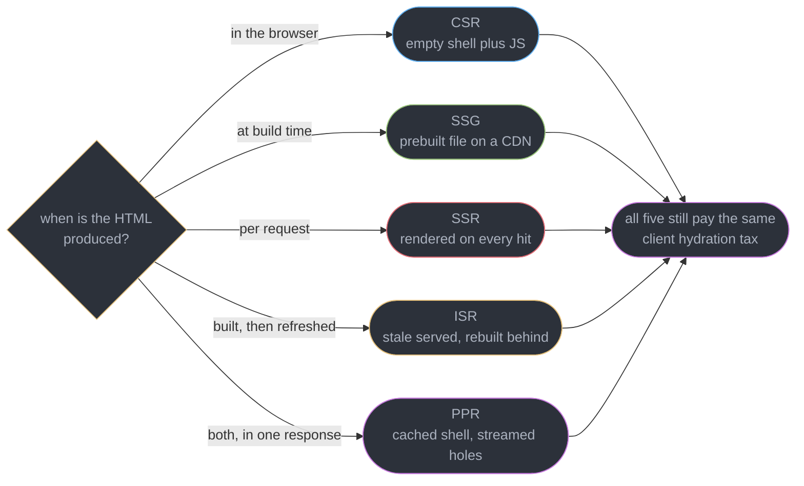
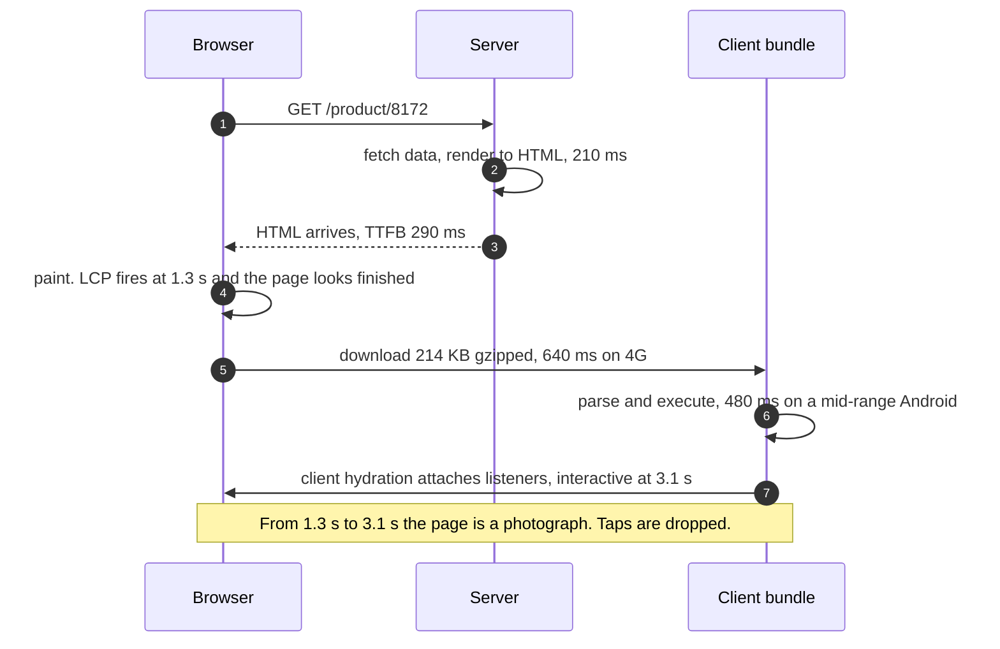
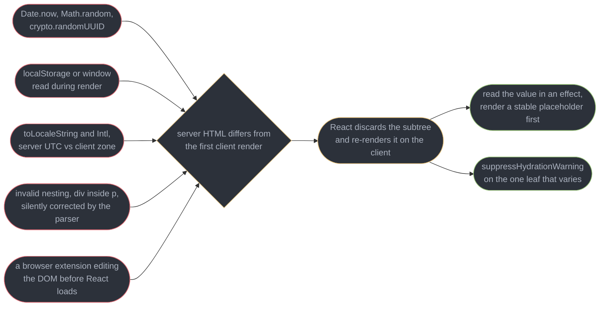
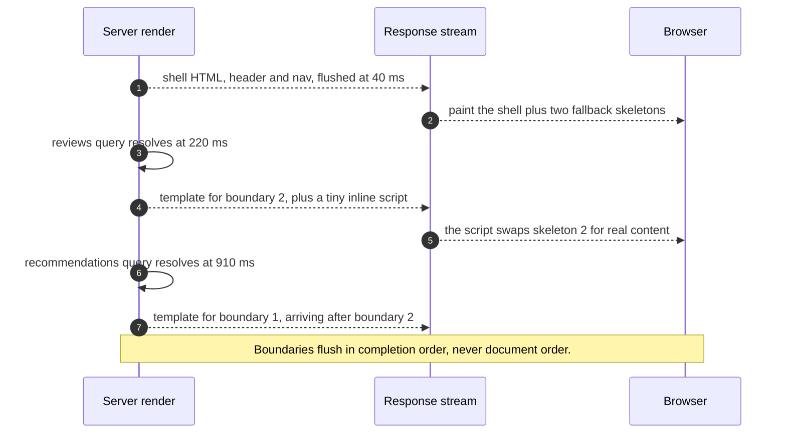
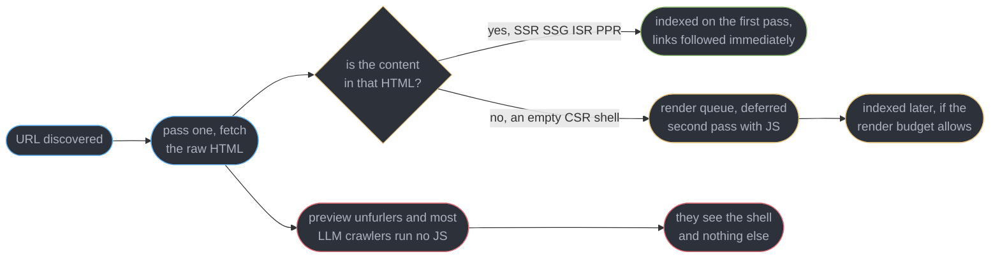
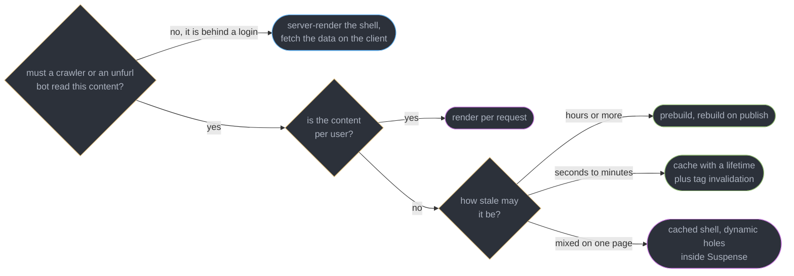

# Rendering Strategies, Hydration and SEO

---

## 1. Concept Overview

Every React application answers one question before it answers any other: **where and when does the HTML get made?** In the browser, after a bundle downloads and executes. On the server, per request. At build time, once, into a file a CDN can serve. Or in two pieces — a cached shell and a per-request hole — inside a single response. Those five answers are CSR, SSR, SSG, ISR and PPR, and the choice between them decides your Time to First Byte, your Largest Contentful Paint, whether a crawler can read your content, and how stale that content is allowed to be.

The second half of the model is the tax. Any HTML produced somewhere other than the browser is inert markup: it has text and layout but no event handlers, no state, no effects. **Client hydration** is React walking that same tree a second time on the client, matching each element against the DOM node the server already produced, and attaching listeners and state to the existing nodes instead of recreating them. It is fast when it works and it produces the single most confusing error class in server-rendered React when it does not, because the failure is a *difference* between two renders rather than a bug in either one.

The third half — and there are three halves, which is exactly the problem — is the business reason server rendering exists at all. Curricula that argue CSR against SSR on latency alone are incomplete. Most teams that pay for a rendering server are paying for **indexability**: a crawler that fetches raw HTML, a Slack or WhatsApp unfurl bot that never runs JavaScript, an LLM crawler that reads the response body once. Latency is a reason; discoverability is usually the reason.

Boundaries with the neighbours are strict. Which component code ships to the browser at all is [Server Components and Server Functions](../server_components_and_server_functions/server_components_and_server_functions.md) — an orthogonal axis to this one, and the pair is the most common conflation in interviews. Framework configuration, routing and layouts are [Meta Frameworks and Routing](../meta_frameworks_and_routing/meta_frameworks_and_routing.md). Suspense semantics are [Suspense and Error Boundaries](../suspense_and_error_boundaries/suspense_and_error_boundaries.md). The metric definitions — LCP under 2.5 s, INP under 200 ms, CLS under 0.1, all at the 75th percentile — belong to [Web Performance and Core Web Vitals](../../frontend_platform/web_performance_and_core_web_vitals/web_performance_and_core_web_vitals.md); this module cites them and does not re-derive them. Edge caching mechanics are [CDN](../../hld/cdn/cdn.md). Target is React 19.2 and Next.js 16.3.

---

## 2. Intuition

> **One-line analogy**: server-rendered HTML is a photograph of a working interface. Client hydration is what turns the photograph back into the interface. Until it finishes, taps land on paper.

**Mental model**: two independent axes, not one spectrum. Axis one is *when the HTML is produced* — build time, request time, or in the browser. Axis two is *how much JavaScript has to arrive before the page answers a click*. CSR pins both to the browser. SSG and SSR move the first axis to the server and leave the second exactly where it was. Server Components move the second. Confusing the two is why teams adopt SSR expecting a faster application and get a faster *screenshot*.

**Why it matters**: the gap between those axes is measurable and large. A route that paints at 1.3 s and becomes interactive at 3.1 s has an excellent LCP and, for 1.8 seconds, a completely unresponsive page. Real user monitoring shows a green LCP and a red INP on the same URL, and neither number is wrong.

**Key insight**: **the strategy question is "when was this HTML made", and the client hydration question is "how long until it answers".** Every strategy in this module changes the first. Only reducing, deferring or eliminating client JavaScript changes the second — which is why the correct fix for a bad INP is almost never a different rendering strategy.

---

## 3. Core Principles

- **HTML production time and JavaScript cost are independent.** Prerendering a page does not shrink its bundle by one byte.
- **Client hydration adopts the DOM, it does not build it.** React reuses the server's nodes, so a mismatch is a correctness problem, not a repaint.
- **A mismatch is a difference, not a defect.** Both renders can be individually correct and still disagree — that is the whole bug class.
- **The first client render must be a pure function of what the server knew.** Anything the server could not know belongs in an effect.
- **Suspense boundaries are the unit of both streaming and client hydration.** They are where the server flushes and where React can attach listeners independently.
- **Streaming trades a complete document for an early one.** The shell leaves before the slow query resolves.
- **Freshness is a cache policy, not a rendering mode.** ISR and PPR are caching applied to rendered output.
- **In Next.js 16 caching is an explicit opt-in.** A route is dynamic until `"use cache"` says otherwise.
- **A crawler that does not execute JavaScript sees exactly your first byte.** Link-preview bots and most LLM crawlers are in that category.
- **Metadata is content.** Title, description, canonical and Open Graph tags decide how the page appears everywhere it is not being viewed directly.

---

## 4. Types / Architectures / Strategies

### 4.1 The five strategies on numbers

Figures below are representative measurements for a content route with a 214 KB gzipped client bundle, on a mid-range Android device over a 4G connection, origin in the same region. They are illustrative of the *shape*, and your own numbers will differ; the ratios will not.

| Strategy | What the server sends | TTFB | Content visible (LCP) | Interactive | Freshness comes from |
|----------|----------------------|------|----------------------|-------------|---------------------|
| CSR | a 1.4 KB shell plus script tags | 40-80 ms | 2.8-4.5 s | 2.9-4.6 s | a client fetch, always live |
| SSR | complete HTML, rendered per request | 190-620 ms | 1.2-1.8 s | 2.9-4.2 s | the request itself |
| SSG | a prebuilt file from the CDN edge | 20-50 ms | 0.6-1.1 s | 2.2-3.4 s | the last build |
| ISR | cached HTML, rebuilt behind the request | 20-50 ms hit, 190-620 ms miss | 0.6-1.1 s | 2.2-3.4 s | a revalidation window or a tag |
| PPR | a cached shell now, dynamic holes streamed | 20-50 ms | 0.7-1.2 s for the shell | 2.3-3.5 s | per hole, independently |

Two rows deserve reading twice. **CSR's TTFB is the best in the table and its LCP is the worst** — a fast first byte of nothing. And **every row's "Interactive" column is within 1.4 s of every other**, because interactivity is gated by the same 214 KB in all five cases. The strategy column moves LCP by 3.9 s and moves interactivity by almost nothing.

### 4.2 Which axis each technique moves

| Technique | Moves LCP | Moves interactivity | Moves freshness |
|-----------|-----------|--------------------|-----------------|
| SSR or SSG instead of CSR | yes, large | no | yes |
| Streaming SSR | yes, on slow-data routes | slightly, boundaries hydrate sooner | no |
| Server Components | slightly, less JS to parse | **yes, large** | no |
| Code splitting and `React.lazy` | no | yes | no |
| ISR or `"use cache"` | yes, turns SSR into a cache hit | no | **yes, directly** |
| PPR | yes, shell is a cache hit | no | yes, per hole |

The only two rows that meaningfully improve interactivity are the two about JavaScript. That is the entire argument for [Server Components](../server_components_and_server_functions/server_components_and_server_functions.md) living beside this module rather than inside it.

---

## 5. Architecture Diagrams

### The five strategies, by when the HTML is made



The convergence at the right is the point of the diagram. The five paths differ entirely in how the first pixel arrives and not at all in what happens after it.

### One SSR request, from byte to interactive



The 1.8 s gap is the reason a green LCP and a red INP appear on the same URL.

### What produces a client hydration mismatch



Only the last cause is outside your code, and it is the one that produces bug reports you cannot reproduce.

### Streaming SSR flushes in completion order



Out-of-order streaming is why one 910 ms query costs that widget 910 ms and costs the rest of the page nothing.

### How a crawler sees each strategy



The bottom branch has no second pass at all. That is the branch that turns a shared link into a blank card.

### Choosing a strategy per route



Four questions, in this order, settle almost every route. The fifth question — what the team can actually operate — overrides all of them and is §9.

---

## 6. How It Works — Detailed Mechanics

### 6.1 What each strategy actually sends

CSR sends a document with nothing in it. The `<div id="root">` is empty, and every visible pixel waits on the bundle:

```html
<!-- CSR: the entire page is one empty element and a script tag. -->
<div id="root"></div>
<script type="module" src="/assets/index-8f2c.js"></script>
```

SSR, SSG, ISR and PPR all send that same div **already full**, plus the same script tag. The client entry differs by one function: a client-only app calls `createRoot`, a server-rendered one calls `hydrateRoot`.

```ts
// Client-only: build the DOM from scratch. React owns every node it creates.
import { createRoot } from "react-dom/client";
createRoot(document.getElementById("root")!).render(<App />);

// Server-rendered: adopt the DOM the server already produced.
import { hydrateRoot } from "react-dom/client";
hydrateRoot(document.getElementById("root")!, <App />);
```

On the server, `renderToPipeableStream` produces the markup (Node streams; `renderToReadableStream` is the Web-streams equivalent for edge runtimes):

```tsx
import { renderToPipeableStream } from "react-dom/server";

app.get("/*", (req, res) => {
  const { pipe, abort } = renderToPipeableStream(<App url={req.url} />, {
    bootstrapModules: ["/assets/index-8f2c.js"],
    onShellReady() {
      res.setHeader("content-type", "text/html");
      pipe(res);                       // shell goes out now, boundaries follow
    },
    onShellError() { res.statusCode = 500; res.send("<h1>Server error</h1>"); },
  });
  setTimeout(abort, 10_000);           // never hold a socket open forever
});
```

### 6.2 Client hydration, mechanically

`hydrateRoot` renders the tree once, but instead of creating DOM nodes it walks the existing ones in parallel. For each element React expects, it takes the next server-produced node, checks that the type matches, attaches props that need JavaScript — event handlers, refs, controlled-input values — and moves on. Text content is compared, not rewritten. When the walk completes, effects run and the tree is live.

The cost is not the walk. On a 1,200-element page the walk itself is 8-20 ms. The cost is everything that must happen before the walk can start: **download, parse, execute**. That is the shape of the gap:

```
  0 ms        290 ms                1.3 s                            3.1 s
  |            |                     |                                |
  |--request-->|-----HTML parse------|                                |
                                     [ LCP: pixels are on screen ]
               |----214 KB JS download (640 ms)----|
                                                   |--parse+exec 480 ms--|
                                                                        |-hydrate 18 ms
  taps: DROPPED . . . . . . . . . . . . . . . . . . . . . . . . . . . . |-> handled

  LCP 1.3 s  -> green, under the 2.5 s threshold
  INP at 2.0 s -> the tap is queued behind script execution, reported over 1,000 ms
```

The 18 ms of client hydration is the smallest number on the line and the one the name gets blamed for. The 1,120 ms of download-plus-execute is the actual problem, and it is a bundle problem. See [React Performance and Profiling](../react_performance_and_profiling/react_performance_and_profiling.md) for measuring it and [Web Performance and Core Web Vitals](../../frontend_platform/web_performance_and_core_web_vitals/web_performance_and_core_web_vitals.md) for the thresholds.

### 6.3 Client hydration mismatches

A mismatch means the first client render produced different output than the server did. Both may be correct in isolation:

```tsx
// BROKEN: the server renders 05:12 UTC into the HTML. Ninety milliseconds later
// the browser renders 10:42 in Asia/Kolkata. Neither is wrong. They disagree.
export function PostedAt({ iso }: { iso: string }) {
  return <time dateTime={iso}>{new Date(iso).toLocaleString()}</time>;
}
```

React 19 reports it once, with a diff, rather than as the pair of vague errors older versions logged:

```
Uncaught Error: Hydration failed because the server rendered HTML didn't match
the client. As a result this tree will be regenerated on the client. This can
happen if a SSR-ed Client Component used:

- A server/client branch `if (typeof window !== 'undefined')`.
- Variable input such as `Date.now()` or `Math.random()` which changes each time
  it's called.
- Date formatting in a user's locale which doesn't match the server.
- External changing data without sending a snapshot of it along with the HTML.
- Invalid HTML tag nesting.

It can also happen if the client has a browser extension installed which messes
with the HTML before React loaded.

https://react.dev/link/hydration-mismatch

  <PostedAt iso="2026-09-03T05:12:03Z">
    <time dateTime="...">
+     3/9/2026, 10:42:03 am
-     9/3/2026, 5:12:03 AM
```

Read the diff as **`+` is what the client rendered, `-` is what the server sent.** Two consecutive lines differing only in a formatted date or number is a timezone or locale mismatch every time.

**What React does when it detects one.** It logs the error, then **discards the server HTML for the nearest Suspense boundary and re-renders that whole subtree on the client**. Nothing crashes, which is why these ship to production routinely. The costs are real: the discarded subtree repaints, which can move layout and register as CLS; the work is done twice; and if the boundary is the root, you have silently converted a server-rendered route into a client-rendered one while still paying to render it on the server.

**Fix one — read client-only values in an effect.** The first client render must match the server, so render a stable placeholder and swap after mount:

```tsx
"use client";
import { useEffect, useState } from "react";

// FIX: the server and the first client render both emit the ISO string. The
// localized text appears on the second client render, which nothing compares.
export function PostedAt({ iso }: { iso: string }) {
  const [text, setText] = useState(iso);
  useEffect(() => setText(new Date(iso).toLocaleString()), [iso]);
  return <time dateTime={iso}>{text}</time>;
}
```

The same shape covers `localStorage`, `window.matchMedia`, `navigator.language` and feature detection. A `typeof window !== "undefined"` check *inside render* is the anti-pattern this replaces: it is precisely a branch that evaluates differently in the two renders.

**Fix two — `suppressHydrationWarning`, narrowly.** It tells React to accept a difference in **that one element's own text and attributes, one level deep**. It is not inherited by children and it is not a mismatch mute button:

```tsx
// Correct use: the value is genuinely unstable and the difference is harmless.
<time dateTime={iso} suppressHydrationWarning>{new Date(iso).toLocaleString()}</time>
```

Put it on the leaf that varies, never on a wrapper, and never as a way to quiet an error you have not explained. Suppressed at a wrapper it hides real structural mismatches beneath it.

**The other causes.** `Math.random()` and `crypto.randomUUID()` in render: generate on the server and pass down, or use `useId()`, which is deterministic across both renders. Invalid nesting — `<div>` inside `<p>`, `<p>` inside `<p>`, a `<div>` inside `<tbody>` — is corrected by the HTML parser before React sees it, so React's expected tree and the real DOM differ structurally; this one is a real markup bug and the fix is valid HTML. Browser extensions that inject attributes or nodes are outside your control; scope `suppressHydrationWarning` to `<body>` if a password manager is rewriting your form, and do not chase it further.

### 6.4 Selective and progressive client hydration

Client hydration is not one atomic pass. **Every Suspense boundary is an independent unit**, and this yields two behaviours worth naming separately.

*Progressive* client hydration: a boundary can be hydrated as soon as its own code has arrived, without waiting for its siblings. A route split into four boundaries with `React.lazy` chunks becomes interactive in four steps rather than one.

*Selective* client hydration: if the user clicks inside a subtree that is not yet hydrated, React records the event, **prioritises that boundary ahead of the queue**, hydrates it, and replays the event into the freshly attached handler. The click is not lost — it is deferred by however long that boundary takes.

```tsx
// Four boundaries, four independent client hydration units. A click on the filter panel
// hydrates the filter panel first, even if the review list was queued ahead of it.
export default function ProductPage({ id }: { id: string }) {
  return (
    <>
      <ProductHeader id={id} />
      <Suspense fallback={<FiltersSkeleton />}><Filters id={id} /></Suspense>
      <Suspense fallback={<ReviewsSkeleton />}><Reviews id={id} /></Suspense>
      <Suspense fallback={<RecsSkeleton />}><Recommendations id={id} /></Suspense>
    </>
  );
}
```

The design lever is boundary placement: **one boundary around the whole page buys nothing**, because there is only one unit and it is the page. Boundaries drawn around independently-loading regions buy both streaming granularity and client hydration granularity from the same edit. Placement rules, fallback design and what boundaries do not catch are [Suspense and Error Boundaries](../suspense_and_error_boundaries/suspense_and_error_boundaries.md).

### 6.5 Streaming SSR

`renderToPipeableStream` sends the document in pieces. Everything above the first unresolved boundary is the **shell**; `onShellReady` fires as soon as the shell can be written, typically 30-60 ms, and the browser starts parsing while the server is still awaiting queries.

Each pending boundary emits its fallback inline. When the boundary's data resolves, the server appends a hidden `<template>` with the real content plus a small inline script that moves it into place. This is why boundaries can arrive **out of order**: a 220 ms boundary that appears second in the document lands before a 910 ms boundary that appears first.

```tsx
// The shell is header + nav + the two skeletons. It flushes at 40 ms.
// LiveInventory awaits a 910 ms upstream call and does not delay any of it.
export default function Page({ sku }: { sku: string }) {
  return (
    <Shell>
      <ProductSummary sku={sku} />                          {/* cached, in the shell */}
      <Suspense fallback={<PriceSkeleton />}>
        <LivePrice sku={sku} />                             {/* 220 ms */}
      </Suspense>
      <Suspense fallback={<StockSkeleton />}>
        <LiveInventory sku={sku} />                         {/* 910 ms */}
      </Suspense>
    </Shell>
  );
}
```

Three consequences. **TTFB stops tracking your slowest query** — it tracks the shell, so a 910 ms dependency no longer sets the whole page's first byte. **A non-200 status must be decided before the shell flushes**, because headers are already sent afterwards; a 404 discovered inside a streamed boundary can only be rendered as content. And **an error inside a boundary after the shell has flushed** is delivered to the client and recovered there rather than becoming a 500.

### 6.6 Next.js 16 Cache Components

Next.js 16 (2025-10-21, current 16.3.x) replaced route-level static-versus-dynamic inference with **Cache Components**: an explicit `"use cache"` directive, turned on once with `cacheComponents: true` in `next.config.ts`. With it on, **everything is dynamic by default** and you mark what may be cached. The directive works at file, component or function scope:

```ts
"use cache";
import { cacheLife, cacheTag } from "next/cache";

export async function getProduct(sku: string) {
  cacheLife("hours");                       // a named staleness profile
  cacheTag(`product:${sku}`);               // an invalidation handle
  return db.product.findUnique({ where: { sku } });
}
```

`cacheLife` takes a profile name — `seconds`, `minutes`, `hours`, `days`, `weeks`, `max`, or your own defined in the config — where each profile sets `stale` (how long a client may reuse it), `revalidate` (how long before the server refreshes) and `expire` (when it must not be served at all). Naming the profile rather than passing raw seconds is what lets invalidation reason about the contract:

```ts
"use server";
import { revalidateTag, updateTag } from "next/cache";

export async function publishPrice(sku: string, price: number) {
  await db.product.update({ where: { sku }, data: { price } });
  revalidateTag(`product:${sku}`, "minutes");   // profile is the second argument
}

export async function renameProduct(sku: string, name: string) {
  await db.product.update({ where: { sku }, data: { name } });
  updateTag(`product:${sku}`);                  // refresh now, for read-your-writes
}
```

The distinction is the one interviewers probe. `revalidateTag` **expires** an entry against a profile: the next reader may still get the stale value while a refresh happens behind it. `updateTag` **refreshes it immediately in the same request**, so the user who just submitted the form sees their own write rather than the version they replaced. Use `updateTag` after a mutation the acting user will look at, `revalidateTag` for everything else.

**How this reframes ISR and PPR.** They stop being route modes. A page whose cached parts are marked and whose uncached parts sit inside Suspense boundaries *is* a partially prerendered page: the cached output becomes the shell served from the edge, the uncached parts become streamed holes. ISR is the same primitive with a `cacheLife` profile instead of a hole. The old `experimental.ppr` and `dynamicIO` flags are gone; there is one mechanism, and the "mode" is now an emergent property of where you put the directive. An uncached read that is *not* inside a Suspense boundary is a build error, which is the whole safety story — you cannot accidentally make a route dynamic. Framework wiring is [Meta Frameworks and Routing](../meta_frameworks_and_routing/meta_frameworks_and_routing.md).

### 6.7 SEO — the reason SSR exists

**Crawling in two passes.** Googlebot fetches raw HTML first, extracts links and content, and indexes what it finds. If content is missing it queues the URL for a second, JavaScript-executing pass off a shared render budget — historically hours to days behind, and not guaranteed. Other crawlers are less generous: Bingbot's execution is partial, and **link-preview unfurlers (Slack, WhatsApp, iMessage, X) and most LLM crawlers execute no JavaScript at all**. A CSR product page therefore gets indexed eventually and shares as a blank card forever.

**Metadata.** React 19 hoists `<title>`, `<meta>` and `<link>` into `<head>` from anywhere in the tree, including a deeply nested component, so the component that knows the data owns its own metadata:

```tsx
export function ArticleHead({ a }: { a: Article }) {
  return (
    <>
      <title>{`${a.title} — Acme Docs`}</title>
      <meta name="description" content={a.summary.slice(0, 155)} />
      <link rel="canonical" href={`https://acme.dev/docs/${a.slug}`} />
      <meta property="og:title" content={a.title} />
      <meta property="og:image" content={a.hero} />
      <meta name="twitter:card" content="summary_large_image" />
    </>
  );
}
```

**Canonical URLs** tell a search engine which of several URLs holding the same content is authoritative — `?utm_source=` variants, `/blog/post` and `/blog/post/`, a preview domain and production. Build it from a configured absolute base, never from the request `Host`: behind a proxy or on a preview deployment, a host-derived canonical points at the wrong origin and de-indexes the real one.

**Structured data** is a JSON-LD block that makes a page eligible for rich results. Every field must match visible page content:

```json
{
  "@context": "https://schema.org",
  "@type": "Product",
  "name": "Aeron Chair",
  "offers": { "@type": "Offer", "price": "1395.00", "priceCurrency": "USD",
              "availability": "https://schema.org/InStock" }
}
```

**Sitemaps** hand crawlers the URL list rather than making them find it by traversal — essential when a route is reachable only through search or filtering:

```ts
// app/sitemap.ts — generated at build, regenerated on revalidation.
export default async function sitemap() {
  const docs = await db.doc.findMany({ select: { slug: true, updatedAt: true } });
  return docs.map((d) => ({
    url: `https://acme.dev/docs/${d.slug}`,
    lastModified: d.updatedAt,
    changeFrequency: "weekly" as const,
  }));
}
```

**Pagination and infinite scroll.** A crawler does not scroll and does not fire your `IntersectionObserver`. Content past page one is invisible unless real URLs exist behind the interaction. The pattern that satisfies both audiences: server-render `/feed?page=N` as an ordinary paginated route, keep a real anchor to page `N+1` in the markup, and let the client intercept that anchor to append instead of navigate.

```tsx
// The anchor is real markup a crawler follows. The client hijacks the click.
<a href={`/feed?page=${page + 1}`} rel="next" onClick={(e) => { e.preventDefault(); loadMore(); }}>
  More stories
</a>
```

---

## 7. Real-World Examples

**The green LCP and the one-star reviews.** A retailer moved from CSR to SSR and celebrated LCP dropping from 4.1 s to 1.4 s. Support tickets about "the buttons don't work" went *up*. The bundle was unchanged at 340 KB, so interactivity still landed at 3.6 s — but users now had a fully painted, apparently finished page to tap at for 2.2 seconds. CSR at least looked like it was loading. The fix was 180 KB of Server Component conversion, not another rendering strategy.

**The timezone that only broke in production.** A dashboard rendered `new Date(row.createdAt).toLocaleString()` in a list. Every developer machine ran in the same timezone as the staging server, so client hydration matched and nothing logged. Production servers ran UTC and users did not, so every one of 40 rows mismatched, React discarded the list boundary and re-rendered it client-side, and the resulting repaint pushed CLS from 0.02 to 0.24 — a failing score caused entirely by a date format.

**The blank Slack card.** A media site rendered article bodies server-side but built `<title>` and `og:image` in a `useEffect`. Google indexed the articles correctly through its second pass. Every link shared into Slack, WhatsApp or iMessage unfurled as the site name and a grey box, because no unfurler executes JavaScript. Referral traffic from shared links was measured at 0.4% of sessions against 6% on a comparable competitor. Moving six tags into the server-rendered head was a one-file change.

**The infinite feed with one indexed page.** A jobs board loaded listings through an `IntersectionObserver` with no URL per page. Google had indexed 43 of 61,000 listings — the 43 in the initial server render. Adding `/jobs?page=N` routes behind the existing scroll, plus a sitemap, brought indexed pages to 48,000 within nine weeks with no change to the user-facing behaviour.

---

## 8. Tradeoffs

| Choice | Bought | Paid |
|--------|--------|------|
| SSR over CSR | indexable content, LCP 2.8-4.5 s down to 1.2-1.8 s | a server on the request path, plus the entire client hydration mismatch class |
| SSG over SSR | 20-50 ms TTFB from the edge, trivial scaling | content is as old as the last build, and build time grows with URL count |
| ISR over SSG | fresh content without a full rebuild | some users see stale output, and cache invalidation becomes your problem |
| PPR over SSR | a cache-hit shell with per-request holes | more moving parts, and every dynamic read must sit inside a boundary |
| Streaming over buffered SSR | TTFB stops tracking the slowest query | status codes and redirects must be decided before the shell flushes |
| More Suspense boundaries | finer streaming and independent client hydration | more skeletons, more layout shift risk, a busier-looking load |
| `suppressHydrationWarning` | a legitimately unstable leaf stops erroring | real mismatches beneath it become invisible |
| Explicit `"use cache"` | caching is visible in the diff, not inferred | every cacheable read needs an intentional annotation |
| `updateTag` over `revalidateTag` | the acting user sees their own write | the mutation request pays the regeneration cost inline |

---

## 9. When to Use / When NOT to Use

**Server-render (SSR, SSG, ISR or PPR) when:**

- The content must be indexed, or the URL will be shared and needs an unfurl card.
- The first paint must not wait on a bundle — landing pages, articles, product detail, anything where a bounce costs revenue.
- The data is available on the server anyway, so a client round trip is pure added latency.

**Prebuild (SSG) when** the content changes on a publish action rather than continuously, the URL count is bounded enough to build in a reasonable window, and the same bytes are correct for every visitor.

**Cache with a lifetime (ISR or `"use cache"`) when** the content is shared across users but must not be as old as the last deploy, and you can name a tolerable staleness in seconds.

**Render per request (SSR) when** the output depends on the user, on cookies, on a request header, or on data that must be correct to the second — pricing, inventory, account balances.

**Stay client-rendered when:**

- Every route is behind a login, so no crawler will ever see it — an internal admin tool, a trading terminal, an editor.
- The application is genuinely one long session on one screen, where first-load cost amortises to nothing.
- **You cannot operate a server.** A team with no on-call rotation shipping to a static host is right to stay on CSR; a rendering server that falls over at 3am is worse than a slow first paint. This criterion overrides all four above and is the one most often left out of the interview answer.

**Do NOT reach for a different rendering strategy when** the complaint is that the page feels sluggish *after* it appears. That is INP, it is bounded by JavaScript, and no amount of prerendering touches it.

---

## 10. Common Pitfalls

**Rendering a locale-formatted date during SSR.** The single most common client hydration mismatch in production, and the one that stays invisible until your users are in a different timezone from your servers.

```tsx
// BROKEN: the server has no idea what timezone or locale the browser will use, so
// the HTML says "9/3/2026, 5:12:03 AM" and the first client render says
// "3/9/2026, 10:42:03 am". React logs a mismatch and throws away the subtree.
export function Row({ order }: { order: Order }) {
  return <td>{new Date(order.createdAt).toLocaleString()}</td>;
}

// FIX: render the stable ISO value on both sides, then localize after mount. The
// first client render matches the server byte for byte, which is the only rule.
"use client";
export function Row({ order }: { order: Order }) {
  const [label, setLabel] = useState(order.createdAt);
  useEffect(() => {
    setLabel(new Date(order.createdAt).toLocaleString());
  }, [order.createdAt]);
  return <td><time dateTime={order.createdAt}>{label}</time></td>;
}
```

**`suppressHydrationWarning` on a wrapper.** One element deep is all it covers, so on a wrapper it silences nothing beneath — but it does teach the team that mismatches are acceptable. Every structural mismatch inside then ships unexamined.

**Reading `localStorage` or `window` during render.** The server has neither, so a theme read in render either crashes SSR or renders the default and mismatches. Render the server-safe default and correct it in an effect, accepting one frame of the wrong theme, or store the preference in a cookie the server can read.

**Treating a client hydration mismatch as cosmetic because nothing crashes.** React recovers by re-rendering the subtree, so the app works. The bill arrives as CLS from the repaint, doubled render work, and — when the mismatch is near the root — a route that pays for SSR and is client-rendered anyway.

**One Suspense boundary wrapped around the whole page.** It looks like streaming and behaves like buffered SSR: there is one flush unit and one client hydration unit, so nothing is independent.

**Deciding a 404 inside a streamed boundary.** The shell has flushed, headers are gone, and the response is a 200 containing a "not found" message. Resolve anything that determines a status code before the shell.

**Building the canonical URL from the request host.** On a preview deployment every page then declares itself canonical at the preview domain, and search engines are told the production URLs are duplicates of a URL nobody should reach.

**Assuming a crawler runs JavaScript because Google does.** Google's second pass is deferred and budgeted; unfurlers and most LLM crawlers have no pass at all. Test with `curl` and read the body — if the content is not there, it does not exist for a large fraction of your audience.

**Marking a whole route `"use cache"` to silence an error.** It caches the personalised parts too, and the first user's data is served to the second. Cache the shared read, leave the per-user read dynamic inside a boundary.

**Streaming without an abort timeout.** `renderToPipeableStream` will hold a socket for as long as a boundary stays pending. A hung upstream call becomes exhausted connections; always call `abort` on a timer.

---

## 11. Technologies & Tools

| Tool | Purpose |
|------|---------|
| React | 19.2 `hydrateRoot`, `renderToPipeableStream`, selective client hydration, metadata hoisting |
| Next.js | 16 Cache Components, `"use cache"`, `cacheLife`, streaming App Router |
| React Router | v8 framework mode with its own SSR and prerender pipeline |
| Astro | 7 islands architecture, prerendered by default with opt-in client JavaScript |
| Vite | Dev server and build for custom SSR setups |
| Lighthouse | Lab LCP, CLS and total blocking time per route |
| Chrome DevTools | Performance panel for the paint-to-interactive gap |
| Google Search Console | Indexing coverage, the rendered HTML a crawler saw, rich-result validity |
| WebPageTest | Filmstrip and throttled first-view measurement on real devices |
| Schema.org | Vocabulary for JSON-LD structured data |
| Open Graph | Metadata protocol behind every link-preview card |
| curl | The fastest check of what a non-executing crawler receives |

---

## 12. Interview Questions with Answers

**Q: What actually causes a client hydration mismatch?**
**Short:** Values that differ between the server render and the first client render cause it: timestamps, random numbers, localStorage reads, locale formatting, invalid HTML nesting, DOM-mutating extensions.

The rule React enforces is that the first client render must produce the same output the server did. `Date.now()` and `Math.random()` change per call; `toLocaleString()` depends on a timezone and locale the server does not have; `localStorage` and `window` do not exist server-side; a `<div>` inside a `<p>` is silently restructured by the HTML parser before React sees it; and a password manager can inject attributes before the bundle loads. In practice, a diff showing two differently formatted dates is a timezone issue and a diff showing a different tag structure is invalid markup. The general fix is to render a server-safe value and correct it in an effect.

**Q: How do Server Components, SSR and SSG relate — are they alternatives?**
**Short:** They answer different questions: SSG and SSR decide when HTML is produced, while Server Components decide which component code ships to the browser, and a route uses both at once.

SSR and SSG are about *when* — request time versus build time — and both still ship every component's code to the browser so it can be hydrated. Server Components remove that second shipment for the components that do not need it: a markdown renderer in a Server Component contributes 0 KB to the bundle regardless of whether the page was prerendered or rendered per request. A Next.js 16 route is commonly Server Components, prerendered at build, streamed, and hydrated at its client leaves — four things at once, not four alternatives. The interview trap is answering "Server Components" to "SSR or SSG?"; they are perpendicular axes, and the details are in [Server Components and Server Functions](../server_components_and_server_functions/server_components_and_server_functions.md).

**Q: Why can a page have an excellent LCP and a terrible INP?**
**Short:** Painting is done by the HTML the server sent, while responding to input needs the client bundle downloaded, parsed and hydrated, so the two metrics measure separate phases.

Server-rendered HTML paints as soon as it parses — 1.3 s is routine — and LCP is satisfied by pixels. Interactivity waits on 214 KB of JavaScript downloading over 4G and executing on a mid-range CPU, which is another 1,100 ms, and a tap during that window is queued behind script execution and reported as an INP over 1,000 ms. So a route shows green LCP and red INP simultaneously, with both numbers correct. The fix is less client JavaScript — Server Components, code splitting, deferring third-party scripts — never a different rendering strategy.

**Q: When is SSR actually required rather than merely nicer?**
**Short:** Indexable content, link previews, and a first paint that must not wait for JavaScript are the three real requirements; everything else is a preference you should measure.

If a crawler must read the content, or a shared URL must unfurl with a title and image, the markup has to be in the first response, because unfurlers and most LLM crawlers run no JavaScript at all and Google's JavaScript pass is deferred onto a budget. If a bounce on a slow first paint costs revenue — landing pages, product detail, checkout entry — the paint cannot wait for a bundle. Everything behind a login has neither constraint, and a static-hosted admin tool with no on-call rotation is a legitimate CSR decision. Say the constraint out loud in an interview; "SSR is faster" is the answer that gets pushed on.

**Q: What does suppressHydrationWarning do, and when is it correct?**
**Short:** It silences the mismatch report for one element's own text or attributes, one level deep, and is correct only for genuinely unstable content like a timestamp.

It does not suppress mismatches in children, and it is not a global switch — it is an assertion that a difference at this specific node is expected. Correct uses are narrow: a rendered clock, a value a browser extension is known to rewrite, `<body>` when a password manager injects attributes. Placed on a wrapper it hides structural mismatches beneath it while normalising the idea that mismatch errors are noise. If you cannot name why the two renders differ, you are not ready to suppress it.

**Q: What does React do when it detects a mismatch during client hydration in React 19?**
**Short:** React discards the server HTML for the nearest Suspense boundary and re-renders that subtree on the client, logging one error with a diff of server against client output.

Nothing throws to the user and the application keeps working, which is why these ship unnoticed. React 19 improved the reporting specifically: one error carrying a diff where `+` lines are client output and `-` lines are server output, instead of two vague warnings. The costs are the discarded subtree repainting, which can register as CLS, and the same render being performed twice. If the mismatch sits near the root, the entire route effectively becomes client-rendered while you continue to pay for server rendering.

**Q: What is selective client hydration and what makes it possible?**
**Short:** Suspense boundaries split the tree into independently hydratable units, so React can attach listeners to one subtree while another is still streaming or waiting for its chunk.

Without boundaries there is one unit — the whole page — and it becomes interactive all at once, at the end. With four boundaries there are four units, each ready as soon as its own code and data have arrived, and React works through them in priority order. This is the same mechanism that makes streaming granular: the boundary is simultaneously the server's flush unit and the client hydration unit, so one edit buys both. Placement rules live in [Suspense and Error Boundaries](../suspense_and_error_boundaries/suspense_and_error_boundaries.md).

**Q: How does React prioritise which subtree to hydrate first?**
**Short:** A click on a not-yet-hydrated subtree is recorded, that subtree jumps the queue, and the event is replayed once its listeners are attached.

React captures events at the root before any boundary has handlers, so it knows a tap landed inside boundary 3 while boundary 1 was next in line. It hydrates boundary 3 first and replays the captured event into the new handler, so the click is delayed rather than dropped. This is why user-facing latency is bounded by one boundary's cost rather than the whole page's — but the delay is still real, and a boundary containing a 90 KB chunk still keeps the user waiting for that chunk.

**Q: What does renderToPipeableStream give you that renderToString does not?**
**Short:** Streaming lets the server flush the shell before slow data resolves, and emit each Suspense boundary out of order as its data lands, instead of buffering the whole document.

`renderToString` produces one string and can only send it when the last query returns, so TTFB tracks your slowest dependency. `renderToPipeableStream` fires `onShellReady` at 30-60 ms with everything above the first pending boundary, then appends each boundary's real content in a hidden template plus a tiny inline script as it resolves — in completion order, not document order. The costs are that status codes and redirects must be decided before the shell flushes, and that a hung upstream will hold the socket unless you call `abort` on a timer. Use `renderToReadableStream` for Web-streams runtimes at the edge.

**Q: What is ISR and how is it different from a CDN cache with a TTL?**
**Short:** Incremental regeneration serves the stale page instantly and rebuilds it in the background at the origin, so no request ever blocks on a rebuild and the entry can be invalidated by tag.

A plain CDN TTL expires the entry and the next request pays a full origin render — a thundering-herd problem on popular URLs. Incremental regeneration serves the stale copy immediately and triggers regeneration behind it, so latency stays at cache-hit levels through the transition, and the cache holds rendered React output keyed by tags you can invalidate on a publish event rather than only by time. The tradeoff is that some users see content up to one window old, so it fits catalogues and articles and does not fit account balances. Edge caching mechanics are [CDN](../../hld/cdn/cdn.md).

**Q: What is Partial Prerendering and how do Cache Components change it?**
**Short:** A prerendered shell streams immediately with dynamic holes filled per request; Next.js 16 rebuilds this around explicit use cache marks rather than inferring a route mode.

Classically PPR was a route-level flag: Next.js analysed your data calls, decided what could be prerendered, and streamed the rest. In Next.js 16 the shell is simply whatever you marked `"use cache"` and the holes are whatever sits inside a Suspense boundary, so PPR is an emergent property of two annotations rather than a mode you enable. The practical difference is diagnosability — under inference, one uninspected `cookies()` call silently made a whole route dynamic; under Cache Components, an uncached read outside a boundary is a build error you can read.

**Q: What does the "use cache" directive change about how you reason about a route?**
**Short:** Caching becomes an explicit per-function opt-in instead of an inferred route-level property, so a route is dynamic until you mark the parts that are not.

Turning on `cacheComponents` inverts the default: nothing is cached, and the directive at file, component or function scope marks what may be. That makes caching visible in code review — a diff shows the annotation — and removes the class of bug where reading a header thirty files down flipped a static route to dynamic without any warning. It replaces the older `experimental.ppr` and `dynamicIO` flags entirely. The cost is that every genuinely cacheable read now needs an intentional line.

**Q: Why does revalidateTag now take a second argument, and what is updateTag for?**
**Short:** The second argument names a cacheLife profile so the invalidation knows the entry's staleness contract, while updateTag refreshes immediately for read-your-writes.

`revalidateTag(tag, "minutes")` expires the entry against that profile: readers may still receive the stale value while a refresh happens behind them, which is correct for a background publish. `updateTag(tag)` refreshes in the same request, so the user who just submitted a form sees their own write rather than the version they replaced. The rule of thumb is that the acting user's own mutation gets `updateTag` and everything else gets `revalidateTag`, and the cost of `updateTag` is that the mutation request pays the regeneration inline.

**Q: How do crawlers handle a client-rendered page in 2026?**
**Short:** Googlebot does execute JavaScript, but in a deferred second pass off a render queue, and other crawlers and link-preview bots mostly do not execute it at all.

Pass one fetches raw HTML and indexes what is there; if the content is missing the URL is queued for a rendering pass that competes with every other site for budget, so indexing lags by hours to days and is not guaranteed. Bingbot's execution is partial. Slack, WhatsApp, iMessage and X unfurlers, and most LLM crawlers, run no JavaScript, which is why a CSR page shares as a blank card no matter how well it eventually ranks. The one-command check is `curl` the URL and read the body.

**Q: Where do you put title and meta tags in React 19?**
**Short:** Document metadata rendered anywhere in the tree is hoisted into head automatically, so a leaf component can own its own title, description and canonical link.

React 19 hoists `<title>`, `<meta>` and `<link>` out of wherever you render them, which removes the need for a side-effect library to reach into the head. The component holding the article therefore declares the article's metadata, and it is server-rendered into the first response where an unfurler can see it. The failure mode this replaces is setting metadata in `useEffect`: Google's second pass may eventually see it, and no preview bot ever will. Frameworks also expose their own metadata API, which is the right choice when the values need to be resolved before render.

**Q: Why does infinite scroll hurt indexing, and what fixes it?**
**Short:** Content reachable only by a scroll event is invisible to a crawler that never scrolls, so pages need real paginated URLs behind the scroll.

A crawler fetches a URL, reads what is in the response, and follows anchors; it does not fire `IntersectionObserver` and does not scroll, so only the first server-rendered batch is ever indexed. The fix keeps both audiences: server-render `/feed?page=N` as an ordinary route, put a real `<a href>` to page `N+1` in the markup with `rel="next"`, and have the client intercept the click to append instead of navigating. A sitemap listing the item URLs directly is the complementary half, and matters most when items are reachable only through search or filters.

**Q: What is a canonical URL for and how does it go wrong?**
**Short:** It tells search engines which of several URLs holding the same content is authoritative, and it breaks when it is generated from the request host behind a proxy or a preview domain.

Tracking parameters, trailing-slash variants, uppercase paths and multiple domains all produce distinct URLs with identical content, and without a canonical the engine picks one for you and splits ranking signals across the rest. Building it from an absolute base in configuration is the whole fix. Deriving it from `Host` means every preview deployment declares itself canonical and tells search engines your production URLs are the duplicates, which is a self-inflicted de-indexing and one that takes weeks to undo.

**Q: How do you choose between SSG, ISR and SSR for a given route?**
**Short:** Ask whether the content is personalised, how stale it may be, and how many distinct URLs exist; personalisation forces per-request, and a huge URL space rules out full prebuilds.

Personalised output cannot be shared between users, so it renders per request or comes from a client fetch after a shared shell. Shared output is a caching question: tolerable staleness measured in hours means prebuild and rebuild on publish, seconds to minutes means a cache lifetime with tag invalidation, and a page mixing both means a cached shell with dynamic holes inside Suspense. URL count is the practical veto — 61,000 product pages will not prebuild in a tolerable window, so they get cached-on-demand instead. Then apply the criterion candidates forget: whether the team can operate a rendering server at 3am.

---

## 13. Best Practices

- Choose per route, never per application. A marketing page, a product page and an admin table have three different correct answers.
- Never render a value the server cannot know. Timestamps, locale formatting, `localStorage`, `window` and random numbers belong in an effect or in a cookie the server can read.
- Read the client hydration mismatch diff before changing anything: `+` is client, `-` is server, and the first differing line names the cause.
- Keep `suppressHydrationWarning` on the leaf that varies, and write a comment saying why it varies.
- Draw Suspense boundaries around independently-loading regions, which buys streaming granularity and client hydration granularity in one edit.
- Decide status codes and redirects before the shell flushes, and always pass an abort timeout to `renderToPipeableStream`.
- Mark caching explicitly with `"use cache"` and a named `cacheLife` profile, so staleness is reviewable in a diff.
- Use `updateTag` when the acting user will immediately look at their own write, `revalidateTag` otherwise.
- Server-render every `<title>`, description, canonical and Open Graph tag; never set them in an effect.
- Put real paginated URLs behind every infinite scroll, and publish a sitemap for anything reachable only through search.
- Verify with `curl` what a non-executing crawler receives, and track LCP and INP separately in real user monitoring, because one being green says nothing about the other.

---

## 14. Case Study

**Problem.** A 61,000-listing property marketplace on Next.js 16 had three unrelated-looking complaints. Organic traffic was flat despite Google reporting 44,000 pages "discovered, currently not indexed". Real user monitoring showed LCP at 1.4 s p75 (green) and INP at 840 ms p75 (failing). And a recurring bug report said search filters "do nothing for a few seconds after the page loads".

**Investigation.** `curl` on a listing URL returned a full server-rendered page, so indexing was not a CSR problem. The 44,000 uncrawled URLs were reachable only through an infinite-scroll results feed with no per-page URLs — Google had 17,000 listings from the sitemap and no path to the rest. The INP failure and the filter complaint were the same defect: 386 KB of client JavaScript, one Suspense boundary around the entire results area, and a client hydration mismatch on every result card discarding and re-rendering that single boundary.

**Root cause.** The listing card formatted its posted date and price with the browser's locale during render, so all 24 cards on a page mismatched, and because they shared one boundary, React threw away and re-rendered the entire results region — 386 KB of work, after which the page finally responded.

```tsx
// BROKEN: three separate defects in fourteen lines.
// 1. toLocaleString and Intl.NumberFormat differ between a UTC server and the browser.
// 2. One Suspense boundary wraps every card, so one mismatch discards all of them.
// 3. The feed advances by scroll only, so no crawler ever reaches page 2.
export default function Results({ page }: { page: number }) {
  const listings = use(fetchListings(page));
  return (
    <Suspense fallback={<ResultsSkeleton />}>
      {listings.map((l) => (
        <article key={l.id}>
          <h3>{l.title}</h3>
          <p>{new Intl.NumberFormat().format(l.price)}</p>
          <time>{new Date(l.postedAt).toLocaleString()}</time>
        </article>
      ))}
      <InfiniteScrollSentinel onVisible={loadMore} />
    </Suspense>
  );
}
```

**Fix.** Format on the server, split the boundaries, and put a real URL behind the scroll.

```tsx
// FIX: the server formats with an explicit locale and timezone, so both renders agree.
// Filters and results are separate boundaries, so a fault in one cannot discard the other.
// The sentinel is now an anchor a crawler follows and the client intercepts.
export default async function Results({ page }: { page: number }) {
  "use cache";
  cacheLife("minutes");
  cacheTag(`results:${page}`);
  const listings = await fetchListings(page);
  const money = new Intl.NumberFormat("en-IN", { style: "currency", currency: "INR" });
  const when = new Intl.DateTimeFormat("en-IN", { dateStyle: "medium", timeZone: "Asia/Kolkata" });
  return (
    <>
      <Suspense fallback={<FiltersSkeleton />}><Filters page={page} /></Suspense>
      <Suspense fallback={<ResultsSkeleton />}>
        {listings.map((l) => (
          <article key={l.id}>
            <h3>{l.title}</h3>
            <p>{money.format(l.price)}</p>
            <time dateTime={l.postedAt}>{when.format(new Date(l.postedAt))}</time>
          </article>
        ))}
        <a href={`/search?page=${page + 1}`} rel="next" onClick={intercept}>More listings</a>
      </Suspense>
    </>
  );
}
```

Server Component conversion of the card, the filter chips and the map preview removed 208 KB from the bundle in the same release, and `app/sitemap.ts` was extended to emit every listing URL.

**Results.**

- Client hydration mismatches per page load: 24 to 0, so the results region stopped being discarded and re-rendered.
- Client bundle for the search route: 386 KB to 178 KB gzipped.
- INP at p75: 840 ms to 156 ms, inside the 200 ms threshold for the first time.
- LCP at p75: 1.4 s to 1.1 s, improved as a side effect of parsing 208 KB less JavaScript.
- CLS at p75: 0.19 to 0.03, because the discarded-and-re-rendered results block was the shift.
- Indexed listing pages: 17,000 to 52,400 over eleven weeks, from paginated URLs plus the sitemap.

**Lesson.** Three symptoms that arrived through three different channels — a search console report, a Core Web Vitals dashboard, and a usability complaint — were one root cause and one adjacent gap. A date formatted during server rendering cost 208 KB of duplicated work on every page load, and the rendering strategy was never the problem: the page was already server-rendered, already fast to paint, and still unusable for two seconds and invisible to a crawler past page one.
