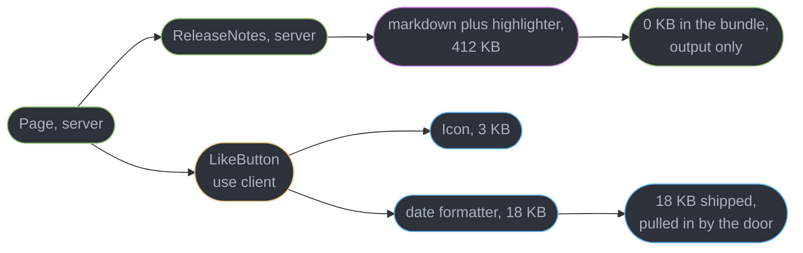
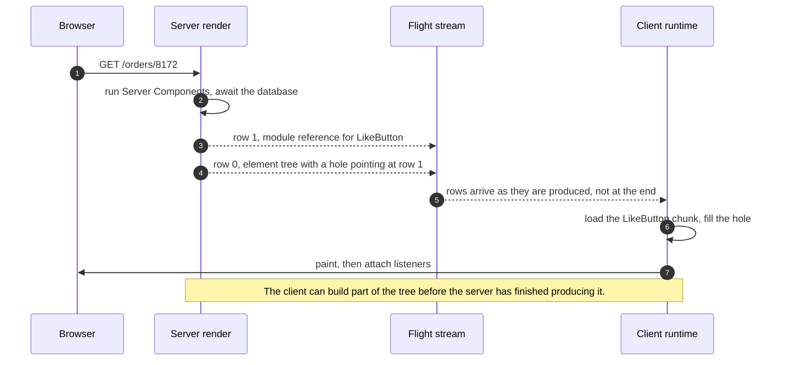
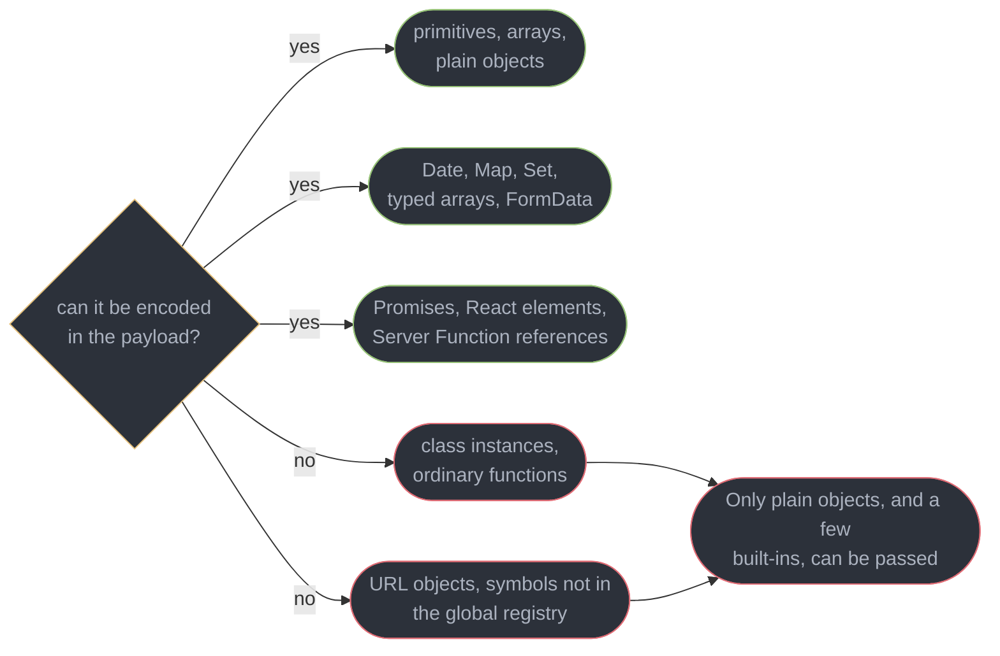
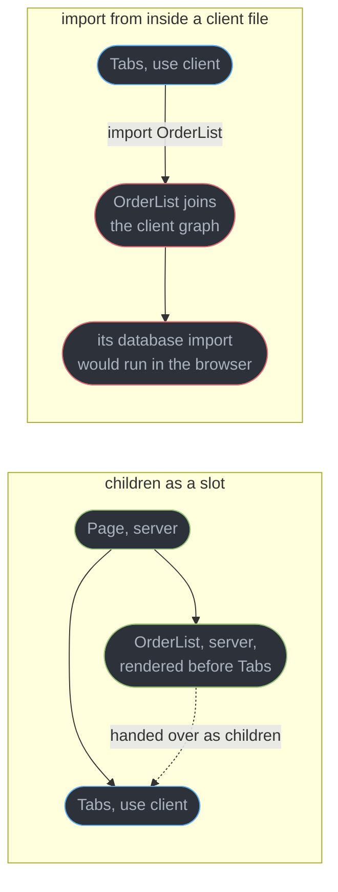
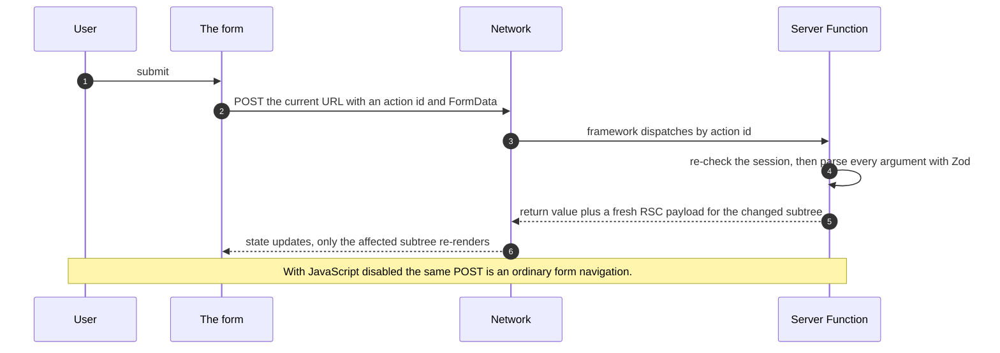
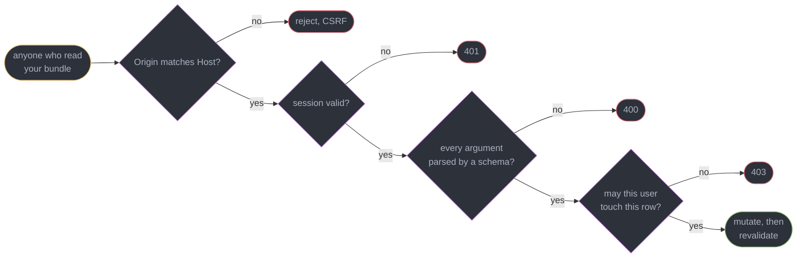

# Server Components and Server Functions

---

## 1. Concept Overview

React Server Components change what a component *is*. Every component you have written until now was code that eventually ran in a browser: it was bundled, downloaded, parsed and executed on the user's device, and its dependencies came with it. A Server Component is a component whose code runs on the server, once, and is never sent to the browser at all. What crosses the network is not the component — it is the *result* of running it.

That single fact is the whole value proposition, and it is routinely mis-stated as "faster server rendering". It is not. Server-side rendering already ran your components on the server; it then shipped the identical component code to the browser again so it could re-run there and attach event listeners. RSC removes the second half. A Server Component that imports a 412 KB markdown-and-syntax-highlighting stack contributes **0 KB** to the client bundle, because the import graph of a server-only module is never walked by the client bundler. The rendered output — headings, paragraphs, `<pre>` blocks — arrives as data. The 412 KB stays on the server forever.

The second half of the model is **Server Functions**: functions marked `"use server"` that the client can call by reference. React gives the client an opaque id, and calling it becomes an HTTP request that the framework routes back to your function. Combined with `useActionState`, `useFormStatus` and `useOptimistic` in React 19.2, this replaces the API-route-plus-fetch-plus-loading-flag pattern with a function call, and it works with JavaScript disabled. It also creates the sharpest new security surface React has ever shipped, which is §6.7 and half of §10.

Boundaries with the neighbours are strict here. Rendering strategies, client hydration mechanics, mismatches and `"use cache"` belong to [Rendering Strategies, Hydration and SEO](../rendering_strategies_hydration_and_seo/rendering_strategies_hydration_and_seo.md). The frameworks that implement RSC — Next.js 16's App Router, the Vite plugin, Waku, Parcel — belong to [Meta Frameworks and Routing](../meta_frameworks_and_routing/meta_frameworks_and_routing.md). Form ergonomics and validation strategy belong to [Forms and Validation](../forms_and_validation/forms_and_validation.md), client caching to [Server State and Data Fetching](../server_state_and_data_fetching/server_state_and_data_fetching.md), and typing the boundary to [Typing React Components](../typing_react_components/typing_react_components.md). Target is React 19.2.

---

## 2. Intuition

> **One-line analogy**: a Server Component is a stencil, not a machine. You ship the pattern it cut, not the tool that cut it.

**Mental model**: your application is not one module graph any more, it is two. The server graph contains everything reachable from the route entry without crossing a `"use client"` file. The client graph contains everything reachable *from* a `"use client"` file. A module can be in both, one, or neither. The bundler builds the client graph by starting at each `"use client"` file and following imports outward — so the question "does this ship to the browser" has a mechanical answer, and it is not "is this component interactive".

**Why it matters**: the cost of a dependency stops being uniform. A date library, a markdown parser, a schema validator, an ORM, a 900-entry country table — used in a Server Component, each costs the browser nothing. The same libraries used one level lower, inside a Client Component, cost their full gzipped weight on every page load. Two versions of the same feature can differ by 300 KB with identical rendered output.

**Key insight**: **`"use client"` is not a label on a component, it is a door into the client graph.** People read it as "this component is interactive" and sprinkle it on leaves. It actually means "everything importable from here downward is client code". Putting it on a leaf changes nothing about that leaf's parents; putting it on a layout drags the entire subtree into the bundle. Almost every RSC bundle-size surprise is this one sentence, misunderstood.

---

## 3. Core Principles

- **Server code is deleted from the client, not hidden from it.** The 412 KB is absent from the bundle, not minified out of view.
- **The boundary is a module boundary, not a component boundary.** The bundler reasons about files and imports, never about which JSX element renders which.
- **What crosses the boundary must be serializable.** Props flow server to client through a wire format, so anything with behaviour attached — a class, a closure — cannot make the trip.
- **Composition beats importing.** A Client Component can *render* server-rendered output passed as `children`; it can never *import* a Server Component.
- **The payload streams.** It is a sequence of rows, not a document, so the client can build part of the tree while the server is still awaiting a query.
- **A Server Function is a public HTTP endpoint with an obscure name.** Obscurity is not authorization.
- **Every argument to a Server Function is attacker-controlled.** Validate at the function, never at the caller.
- **Closed-over variables are serialized.** A Server Function's closure travels to the browser as bound arguments.
- **Server and client caching are different layers.** `revalidateTag` invalidates the server's; nothing about it touches a client query cache.
- **RSC needs a bundler-integrated framework.** It is not a runtime feature you can adopt inside a plain SPA build.

---

## 4. Types / Architectures / Strategies

### 4.1 The three kinds of module

| Kind | Marked by | Runs | Ships to browser | May use |
|------|-----------|------|------------------|---------|
| Server Component | default in a server graph | once, on the server, per request | nothing | `async`/`await`, filesystem, database, secrets |
| Client Component | reachable from `"use client"` | server (SSR pass) and browser | its code plus its imports | state, effects, refs, event handlers, browser APIs |
| Shared module | neither directive, imported by both | wherever it is imported | only if a client file imports it | nothing environment-specific |

The fourth row people expect — "server-only utility" — does not exist by construction. A helper with no directive that a `"use client"` file imports is client code. Enforce intent with the `server-only` package, which throws at build time if a module is pulled into the client graph.

### 4.2 What the two directives actually do

| Directive | Placed at | Means | Common misreading |
|-----------|-----------|-------|-------------------|
| `"use client"` | top of a file, before imports | this file is an **entry point** into the client graph | "this component is interactive" |
| `"use server"` | top of a file, or first line of a function body | these exports are **callable from the client** over HTTP | "this code runs on the server" |

`"use server"` is the one that reads backwards. It does not make code server-side — server code is already server-side. It *exposes* server code, creating an endpoint. A file of pure server helpers that gains a `"use server"` line has just published every export to the internet.

### 4.3 Server Functions by call shape

| Shape | Written as | Progressive enhancement | Use for |
|-------|-----------|-------------------------|---------|
| Server Action | `<form action={fn}>` | works with JavaScript disabled | create, update, delete driven by a form |
| With `useActionState` | `<form action={formAction}>` | works, with `permalink` for the no-JS result page | forms needing returned errors and a pending flag |
| Imperative call | `await fn(args)` in an event handler | none, requires JavaScript | non-form triggers, a delete button in a row menu |
| Passed as a prop | server passes `fn` into a Client Component | inherits the shape it is used in | keeping the mutation next to the data it mutates |

### 4.4 Where the boundary can sit

| Placement | Client bundle effect | When it is right |
|-----------|---------------------|------------------|
| Root layout | everything ships, RSC bought nothing | never, outside a migration's first day |
| Route page | the whole route ships | a genuinely app-like screen, an editor or a canvas |
| Section wrapper | that section plus its imports | a tab strip, a filter panel, a chart container |
| Interactive leaf | that leaf plus its imports | the default target — a button, an input, a menu |
| Leaf, with server `children` | leaf only, content stays server-side | an accordion or modal wrapping server-rendered content |

The rule of thumb that survives contact with real code: **push the boundary as far down as it goes, then pass server content back down through it as `children`.**

---

## 5. Architecture Diagrams

### Two module graphs, one component tree



The two purple-to-green and blue-to-blue paths have the same shape in the tree and opposite costs. Depth in the component tree is irrelevant; which side of the door the file sits on is everything.

### One request, from route to painted pixels



The stream is the reason a slow query does not block the whole page: rows for the fast parts of the tree are already on the wire while the slow row is still pending.

### The serialization gate



The red terminal box is React's actual error text, and it is the single most common message a team hits in its first RSC week.

### Composition: what works, what cannot



The left side works because the server rendered `OrderList` first and passed the finished element through as a prop. The right side is a category error: an import is resolved by the bundler, which has no way to leave the file behind on the server.

### A Server Function call, with and without JavaScript



The two paths differ only in what handles the response — the React runtime patching a subtree, or the browser replacing the document.

### Four gates every Server Function needs



None of the four gates is provided by the fact that the function is imported from a server file. Every one is code you write inside the function body.

---

## 6. How It Works — Detailed Mechanics

### 6.1 The bundle consequence

```tsx
// Server Component. shiki + remark + rehype total 412 KB gzipped in node_modules and
// contribute exactly 0 KB to the client bundle, because no "use client" file imports them.
import { unified } from "unified";
import remarkParse from "remark-parse";
import rehypeShiki from "@shikijs/rehype";
import rehypeStringify from "rehype-stringify";

export default async function ReleaseNotes({ slug }: { slug: string }) {
  const md = await fs.readFile(`content/${slug}.md`, "utf8");
  const html = await unified()
    .use(remarkParse).use(rehypeShiki, { theme: "one-dark-pro" }).use(rehypeStringify)
    .process(md);
  return <article dangerouslySetInnerHTML={{ __html: String(html) }} />;
}
```

Move that same file behind a `"use client"` boundary and nothing about the rendered output changes — the page looks identical, the tests pass, and the JavaScript payload grows by 412 KB, which on a 5 Mbps connection is roughly 660 ms of download before parse. This is why bundle regressions in an RSC codebase are almost never caused by adding a feature; they are caused by moving a directive.

The measurement that catches it is a per-route client-bundle report in CI. In Next.js 16, `next build` prints First Load JS per route; a route that jumps 300 KB between two commits is a boundary that moved, not a dependency that grew.

### 6.2 The RSC payload is not HTML

The server produces a stream React calls the Flight payload: a sequence of numbered rows, each either a value or a reference. It is line-oriented and readable in a network panel — look for a response with `text/x-component`, not `text/html`.

```
1:I["4823",["static/chunks/LikeButton-9f2c.js"],"LikeButton"]
0:["$","main",null,{"children":[
     ["$","h1",null,{"children":"Order 8172"}],
     ["$L1",null,{"orderId":"8172","liked":false}]
   ]}]
2:"$@3"
3:{"total":4820,"currency":"INR"}

  1:I[...]      row 1 is a client module REFERENCE: chunk id, chunk file, export name
  ["$","tag"]   a React element, encoded as a tuple rather than as markup
  "$L1"         a HOLE. render whatever row 1 resolves to, with these props
  "$@3"         a PROMISE whose value arrives later, in row 3
  row order     rows are emitted as they become ready, not in tree order
```

Three properties follow from that shape. It is **not markup**, so the client is patching a React tree rather than re-parsing a document — which is why a Server Function response can update one subtree and leave client state elsewhere untouched. It **carries module references, not module code**, so `LikeButton` is fetched as a normal chunk and everything not referenced is never requested. And it **streams**, so a page whose slowest query takes 900 ms sends the header, nav and static rows immediately and emits the slow row when it resolves — the browser is building the tree the whole time.

An SSR pass usually runs alongside it, turning the same tree into HTML for first paint. Which strategy renders when, and how client hydration attaches to the result, belongs to [Rendering Strategies, Hydration and SEO](../rendering_strategies_hydration_and_seo/rendering_strategies_hydration_and_seo.md).

### 6.3 `"use client"` is a door, not a label

```tsx
// app/products/page.tsx — server, no directive
import { ProductFilters } from "./ProductFilters";   // has "use client"
import { ProductGrid } from "./ProductGrid";         // no directive: stays server-side

export default async function Page({ searchParams }: { searchParams: Promise<Query> }) {
  const q = await searchParams;
  const products = await db.product.findMany({ where: toWhere(q), take: 60 });
  return (
    <>
      <ProductFilters initial={q} />
      <ProductGrid products={products} />
    </>
  );
}
```

```tsx
// ProductFilters.tsx — the door. Everything reachable from here is client code.
"use client";
import { useState } from "react";
import { formatCurrency } from "@/lib/format";   // 18 KB, now in the client bundle
import { CATEGORY_TREE } from "@/lib/catalog";   // 240 KB constant, now in the bundle too
```

`CATEGORY_TREE` has no directive of its own and never asked to be client code. It is in the bundle because a file with the directive imports it, transitively and without limit. The directive is only needed on the file at the *edge* — files imported by a `"use client"` file are already client code and adding the directive to each of them is noise.

The inverse mistake is placing the directive high. A `"use client"` on `app/layout.tsx` puts every descendant in the client graph and the entire RSC benefit disappears in one line, with no error and no warning — only a bundle report shows it.

### 6.4 What can and cannot cross

Props flow from a Server Component into a Client Component through the payload, so they must be encodable.

```ts
// Crosses: primitives, undefined and null, arrays, plain object literals, Date, Map, Set,
// typed arrays and ArrayBuffer, FormData, Promises, React elements, Server Function refs,
// and symbols registered with Symbol.for.
<Chart points={[{ t: new Date(), v: 12.5 }]} tags={new Set(["a"])} onSave={saveChart} />

// Does not cross. React throws at serialization time:
//   Only plain objects, and a few built-ins, can be passed to Server Functions.
//   Classes or null prototypes are not supported.
<Chart series={new TimeSeries(rows)} />            // class instance
<Chart format={(n: number) => n.toFixed(2)} />     // ordinary function, not a Server Function
<Chart href={new URL("/x", base)} />               // URL is a class instance
<Chart mode={Symbol("live")} />                    // symbol not in the global registry
```

Two rules cover the rest. **Only own enumerable data properties survive** — methods, prototypes and identity do not, so `instanceof` on the client side of a boundary is always false for your own classes. And **getters are evaluated once, at serialization**, so `{ get total() { return this.items.reduce(...) } }` crosses as a frozen number computed on the server; mutate `items` on the client and `total` never changes, silently, with no error.

The practical shape is a DTO at every boundary: map the ORM row or class instance to a plain object before it crosses, in a function you can type. Deriving those types is [Typing React Components](../typing_react_components/typing_react_components.md).

A Promise is the interesting exception. Passing one lets the server start work and the client await it, which is how a slow widget streams without blocking its siblings:

```tsx
// Server: start the query, do not await it, hand the promise across the boundary.
export default function Page() {
  const statsPromise = db.stats.compute();          // no await
  return (
    <Suspense fallback={<StatsSkeleton />}>
      <StatsPanel stats={statsPromise} />
    </Suspense>
  );
}

// Client: use() unwraps it, suspending until the row lands in the stream.
"use client";
import { use } from "react";
export function StatsPanel({ stats }: { stats: Promise<Stats> }) {
  const s = use(stats);
  return <dl><dt>Revenue</dt><dd>{s.revenue}</dd></dl>;
}
```

### 6.5 Composition patterns

A Client Component cannot import a Server Component, because an import is resolved by the bundler and the bundler has no way to leave part of a file behind on the server. It can, however, *render* one that was handed to it as a prop.

```tsx
// Server: OrderList is rendered on the server FIRST, then passed as an element.
export default async function Page() {
  return (
    <Collapsible title="Recent orders">
      <OrderList orders={await db.order.findMany({ take: 25 })} />
    </Collapsible>
  );
}
```

```tsx
// Client: it receives an already-rendered element and only decides whether to show it.
"use client";
export function Collapsible({ title, children }: { title: string; children: React.ReactNode }) {
  const [open, setOpen] = useState(false);
  return (
    <section>
      <button onClick={() => setOpen((o) => !o)}>{title}</button>
      {open && children}
    </section>
  );
}
```

`children` here is not a component the client will call — it is a payload hole already filled with server output. `Collapsible` never runs `OrderList`, never sees its imports, and could not call it if it tried. The bundle contains `Collapsible` and nothing beneath it.

The same shape solves providers, which are the most common reason teams give up and mark the root layout as client:

```tsx
// Providers.tsx — a thin client file whose only job is to be the door.
"use client";
export function Providers({ children }: { children: React.ReactNode }) {
  const [qc] = useState(() => new QueryClient());
  return <QueryClientProvider client={qc}><ThemeProvider>{children}</ThemeProvider></QueryClientProvider>;
}

// layout.tsx stays a Server Component. Everything inside {children} stays server-side.
export default function RootLayout({ children }: { children: React.ReactNode }) {
  return <html lang="en"><body><Providers>{children}</Providers></body></html>;
}
```

The layout is a Server Component with a client provider *inside* it, not a client layout. The distinction is worth 200-400 KB on a typical application.

### 6.6 Server Functions, `useActionState`, `useFormStatus`, `useOptimistic`

The settled naming, as of React 19: the feature is a **Server Function**; a Server Function passed to an `action` prop is a **Server Action**. Both names are current, they are not synonyms, and interviewers ask about the distinction because it signals whether you learned the model before or after the rename.

```ts
// app/orders/actions.ts — every export here is a public HTTP endpoint.
"use server";
import { z } from "zod";

const RenameInput = z.object({ id: z.string().uuid(), name: z.string().min(1).max(120) });

export async function renameOrder(_prev: FormState, formData: FormData): Promise<FormState> {
  const session = await getSession();                                   // 1. authenticate
  if (!session) return { ok: false, error: "Sign in to continue." };
  const parsed = RenameInput.safeParse(Object.fromEntries(formData));   // 2. validate
  if (!parsed.success) return { ok: false, error: parsed.error.issues[0].message };
  const order = await db.order.findUnique({ where: { id: parsed.data.id } });
  if (order?.orgId !== session.orgId) return { ok: false, error: "Not found." };  // 3. authorize
  await db.order.update({ where: { id: parsed.data.id }, data: { name: parsed.data.name } });
  revalidateTag(`order:${parsed.data.id}`, "hours");                    // 4. invalidate
  return { ok: true };
}
```

`"use server"` compiles each export into a reference: the client receives an opaque id, and calling it POSTs to the current URL with that id in a header plus the encoded arguments. `useActionState` wires that reference to a form and gives you the returned state, a stable action to pass to `action`, and a pending flag:

```tsx
"use client";
import { useActionState } from "react";

export function RenameForm({ id, name }: { id: string; name: string }) {
  const [state, formAction, isPending] = useActionState(renameOrder, { ok: true });
  return (
    <form action={formAction}>
      <input type="hidden" name="id" value={id} />
      <input name="name" defaultValue={name} disabled={isPending} />
      <SubmitButton />
      {!state.ok && <p role="alert">{state.error}</p>}
    </form>
  );
}
```

**Progressive enhancement is real, not aspirational.** React emits a hidden `$ACTION_ID_…` field into the form's markup, so before the client bundle has loaded — or with JavaScript off entirely — pressing submit performs an ordinary browser form POST that the framework routes to the same function. The window this covers is not hypothetical: on a mid-range Android phone over 4G, the gap between first paint and interactive is commonly 1.2-2.5 s, and every submit in that window would otherwise be dropped. `useActionState`'s third argument, a `permalink`, tells React which URL the no-JS path should land on.

`useFormStatus` reads the enclosing form's submission state, and it has one rule that trips everybody: **it must be called from a component rendered inside the `<form>`, not from the component that renders the `<form>`.** A hook cannot read a form its own return value has not created yet.

```tsx
"use client";
import { useFormStatus } from "react-dom";
// Correct: this component is a CHILD of the form, so there is a form above it to read.
export function SubmitButton() {
  const { pending } = useFormStatus();
  return <button type="submit" disabled={pending}>{pending ? "Saving…" : "Save"}</button>;
}
```

`useOptimistic` covers the gap between click and server response — typically 120-400 ms — by rendering a provisional value that React discards automatically when the action settles:

```tsx
"use client";
export function Likes({ post, like }: { post: Post; like: (id: string) => Promise<void> }) {
  const [optimistic, addOptimistic] = useOptimistic(post.likes, (n: number, d: number) => n + d);
  return (
    <form action={async () => { addOptimistic(1); await like(post.id); }}>
      <button type="submit">{optimistic} likes</button>
    </form>
  );
}
```

There is no rollback code because there is no rollback: the optimistic value is a render-time overlay, so when the action finishes and the tree re-renders from the server's payload, the overlay simply stops applying. That is materially simpler than the snapshot-and-restore dance a client cache needs — see [Server State and Data Fetching](../server_state_and_data_fetching/server_state_and_data_fetching.md).

### 6.7 A Server Function is a public endpoint

This is the part of the model most likely to produce a real incident. `"use server"` publishes a route. The id is in the client bundle, the argument shape is in the bundle, and anyone can `curl` it with arbitrary arguments in any order at any rate. Importing the function from a page that only admins can reach protects nothing — the endpoint does not know which page linked to it.

So every function re-checks, in this order: **authenticate** the session, **validate** every argument with a schema, **authorize** this user against this specific row, then act. Skipping the third is the classic insecure-direct-object-reference: a valid session plus someone else's UUID.

The second hazard is closure capture. A Server Function defined inside a component closes over variables from that render, and React must ship those bound arguments to the client so the call can carry them back:

```tsx
export default async function Page({ params }: { params: { id: string } }) {
  const record = await db.record.findUnique({ where: { id: params.id } });
  // The whole record, including its internalCostBasis and ownerEmail columns, becomes
  // bound arguments travelling to the browser — even though the JSX never renders them.
  async function archive() {
    "use server";
    await db.record.update({ where: { id: record.id }, data: { archived: true } });
  }
  return <ArchiveButton onArchive={archive} />;
}
```

Next.js 16 encrypts closed-over values by default with a per-build key, which stops casual inspection but does not make it safe to capture secrets: the key must be shared and stable across every instance and every build in a rolling deploy, or requests fail mid-rollout, and an encrypted secret is still a secret in the browser's memory. Close over the **id**, re-read the row inside the function.

Third, **CSRF is in scope precisely because the browser invokes it.** A Server Function call is a POST with cookies attached, which is the exact shape of a cross-site forgery. Next.js compares the `Origin` header against `Host` and rejects mismatches, with `serverActions.allowedOrigins` for legitimate proxy setups; behind a proxy that rewrites `Host`, that check silently stops matching and must be configured. Do not disable it, and do not assume a non-Next RSC setup has it — verify.

Finally, patch. The `react-server-dom-*` packages carried **three separate advisories**, and they are routinely conflated — each has its own CVE and its own patch line:

| Advisory | CVE | Class | CVSS | Disclosed | Patched in |
|----------|-----|-------|------|-----------|-----------|
| GHSA-925w-6v3x-g4j4 | CVE-2025-55183 | Source code exposure | 5.3 | 2025-12-11 | 19.0.2 / 19.1.3 / 19.2.2 |
| GHSA-83fc-fqcc-2hmg | CVE-2026-23864 | Multiple denial of service | 7.5 | 2026-01-26 | 19.0.4 / 19.1.5 / 19.2.4 |
| GHSA-479c-33wc-g2pg | CVE-2026-23869 | Denial of service, cyclic deserialization | 7.5 | 2026-04-08 | 19.0.5 / 19.1.6 / 19.2.5 |

**Source exposure** (CVE-2025-55183) is the sharper one for this section: a request to a Server Function that stringifies an argument could come back carrying that function's own compiled source, which turns every hard-coded value in your server code into a disclosed value. Only literals in source are exposed — `process.env.SECRET` read at runtime is not. **The two DoS advisories** (CVE-2026-23864, CVE-2026-23869) are crafted payloads to a Server Function endpoint that crash the process, exhaust memory, or burn CPU for up to a minute; the endpoint is public and unauthenticated on many routes, and the second was found because the first fix was incomplete. The intermediate 19.0.3 / 19.1.4 / 19.2.3 releases are incomplete and do not count as patched. Pin the whole `react`/`react-dom`/`react-server-dom-*` set to one version at or above **19.2.5** (or 19.0.5 / 19.1.6 on an older line) and keep them in step.

### 6.8 Where RSC actually runs

RSC is not a runtime you drop into an existing SPA. It requires a bundler that can build two graphs and a server that can serve the payload, so adoption is a framework decision.

```ts
// vite.config.ts — the framework-agnostic path, Vite plus the RSC plugin.
import { defineConfig } from "vite";
import rsc from "@vitejs/plugin-rsc";
export default defineConfig({ plugins: [rsc()] });
```

**Next.js 16** (Turbopack by default, `proxy.ts` in place of the old middleware file, Cache Components and `"use cache"`) is the reference implementation and where the model is specified in practice. **`@vitejs/plugin-rsc`**, **Waku** and **Parcel** are the answer to "is this a Next.js feature", and it is now genuinely no — but they are younger, and the ecosystem's RSC-safe library set is thinner outside Next. React Router v8 and TanStack Start have RSC support at differing maturity. Framework selection, routing and layout mechanics belong to [Meta Frameworks and Routing](../meta_frameworks_and_routing/meta_frameworks_and_routing.md).

---

## 7. Real-World Examples

**The 412 KB directive.** A documentation site rendered release notes through remark, rehype and Shiki in a Server Component: First Load JS was 94 KB. A refactor added a copy-to-clipboard button and the quickest fix was `"use client"` at the top of the notes component. Nothing looked different in review, every test passed, and First Load JS became 506 KB — Largest Contentful Paint on a mid-range Android went from 1.3 s to 3.1 s. The correct fix was 9 lines: extract the button into its own `"use client"` file and leave the renderer on the server.

**The provider that ate the app.** A team wrapped their root layout in a theme provider, hit "createContext is not a function" in a Server Component, and resolved it by marking `layout.tsx` as `"use client"`. Every route in the application became a Client Component in one line. Nobody noticed for six weeks because the app still worked correctly; the bundle report showed 380 KB of ORM types and server utilities in the client chunk. Moving the provider into a 6-line `Providers.tsx` and reverting the layout recovered all of it.

**The delete button anyone could press.** An admin panel exposed `deleteUser(id)` as a Server Function, imported only by a page behind an admin route guard. A security review reproduced the whole thing with `curl`: read the action id from the public bundle, POST it with a normal user session, and the delete ran. The guard was on the route, not the function. The fix added a role check as the first two lines of the function, and a lint rule rejecting any `"use server"` export whose body does not call `requireSession`.

**The invisible column leak.** A pricing page defined an inline Server Function that closed over a full product row so it could call `row.id`. The bound arguments carried `costBasis` and `supplierId` into the browser on every render of the page. It was found in a bug report about payload size — 41 KB of bound arguments per product card — not by a security process. Capturing `row.id` instead dropped it to 60 bytes and closed the leak.

---

## 8. Tradeoffs

| Design choice | Bought | Paid |
|---------------|--------|------|
| Server Components for read-mostly UI | server-only dependencies cost 0 KB in the browser | a server is now required for every render, no static-host-only path |
| Streaming payload | first paint independent of the slowest query | debugging spans a stream instead of one response |
| Payload rather than HTML | one subtree updates without losing client state | the wire format is opaque and needs tooling to read |
| Boundary at the leaf | smallest possible bundle | more files, and props must be serializable at every crossing |
| Boundary at the route | simple mental model, ordinary React | the whole route ships, RSC bought nothing |
| Server Functions over API routes | no fetch, no route file, types flow end to end | every export is a public endpoint you must secure yourself |
| `useOptimistic` | no snapshot or rollback code, 120-400 ms of perceived latency removed | only correct where the server is the source of truth |
| Progressive enhancement by default | forms work in the 1.2-2.5 s before interactive | inputs must be real form fields with `name` attributes |
| Closures in Server Functions | mutations sit next to the data they mutate | captured values are serialized toward the browser |
| RSC outside Next.js | no single-vendor dependency | a thinner set of RSC-safe libraries and less documentation |

---

## 9. When to Use / When NOT to Use

**Reach for a Server Component when:**

- The data is read on the server and the browser never needs to re-read it. Fetch, render, pass plain props down.
- A dependency is heavy and only shapes output — markdown, syntax highlighting, PDF layout, big lookup tables, date and currency data.
- The code touches something the browser must not see: a database client, a private API key, an internal service URL.
- The page is content-shaped: docs, catalogue, dashboard read views, marketing, search results.

**Reach for a Server Function when:**

- A mutation belongs beside the data it mutates and would otherwise be a one-caller API route.
- The form must work before the client bundle has loaded, which is every form on a slow connection.
- The write should invalidate server-rendered content, since `revalidateTag` and the returned payload update the tree in the same round trip.

**Do NOT use them when:**

- The component is genuinely interactive throughout — an editor, a canvas, a drag-and-drop board. Mark the route client and stop fighting.
- You have no server. A static export or a pure SPA build cannot render Server Components at request time.
- The call is a read from an event handler with no form. That is a query, not an action; give it a route handler or a client query.
- You are chasing SSR performance. RSC removes bundle weight; it does not make server rendering faster. That comparison is [Rendering Strategies, Hydration and SEO](../rendering_strategies_hydration_and_seo/rendering_strategies_hydration_and_seo.md).

---

## 10. Common Pitfalls

**A Server Function with no authorization re-check.** The endpoint exists whether or not any UI links to it.

```ts
// BROKEN: the only guard is that the admin page imports this. curl does not import
// anything. A valid non-admin session plus a guessed uuid deletes another org's order.
"use server";
export async function deleteOrder(id: string) {
  await db.order.delete({ where: { id } });
  revalidatePath("/orders");
}

// FIX: authenticate, validate, then authorize this user against this specific row,
// inside the function, every time. The route guard protects the page, never the endpoint.
"use server";
export async function deleteOrder(rawId: string) {
  const session = await getSession();
  if (!session) throw new Error("Unauthorized");
  const id = z.string().uuid().parse(rawId);
  const order = await db.order.findUnique({ where: { id }, select: { orgId: true } });
  if (!order || order.orgId !== session.orgId) throw new Error("Not found");
  if (!session.roles.includes("order:delete")) throw new Error("Forbidden");
  await db.order.delete({ where: { id } });
  revalidatePath("/orders");
}
```

**`"use client"` on a leaf, expecting it to contain the leaf.** It contains nothing; it opens a door. Every module the leaf imports, and every module those import, is now client code — including the 240 KB constant nobody thought about.

**`"use client"` on a layout to fix a context error.** It works, and it converts the entire subtree to client code with no warning. Extract a `Providers.tsx` instead; the layout stays a Server Component.

**Passing a class instance across the boundary.** An ORM row, a `Decimal`, a `URL`, a domain model — all class instances, all rejected with `Only plain objects, and a few built-ins, can be passed to Server Functions.` Map to a DTO at the boundary.

**Trusting a getter after it crosses.** Its value is computed once during serialization and arrives as a frozen scalar. Mutating the source array on the client leaves the derived value stale with no error at all — the quietest failure in this module.

**Closing over the whole row.** Every captured field is serialized as a bound argument travelling to the browser. Capture the id and re-read inside the function.

**Assuming `revalidateTag` refreshes a client cache.** It invalidates the server's cache only. A TanStack Query entry showing the same data is untouched, and the mutation needs `invalidateQueries` as well.

**Forgetting the `name` attribute.** Progressive enhancement runs on a real form POST, so a field controlled purely by React state with no `name` submits nothing when the action fires before client hydration completes.

**Calling `useFormStatus` in the component that renders the `<form>`.** It returns `pending: false` forever. The hook must run in a descendant of the form element.

**Running an unpatched `react-server-dom-*`.** Three advisories, three patch lines, and the common mistake is pinning to the middle one: source exposure (CVE-2025-55183) landed in 19.0.2 / 19.1.3 / 19.2.2, the first DoS set (CVE-2026-23864) in 19.0.4 / 19.1.5 / 19.2.4, and the cyclic-deserialization DoS (CVE-2026-23869) in 19.0.5 / 19.1.6 / 19.2.5. Only the last of those is fully patched. Pin the whole React set together at or above 19.2.5; a mixed set is how one package stays behind.

---

## 11. Technologies & Tools

| Tool | Purpose |
|------|---------|
| React | 19.2 Server Components, Server Functions, `useActionState`, `useOptimistic` |
| Next.js | 16 App Router, the reference RSC implementation, Turbopack by default |
| Vite | Build tool hosting the framework-agnostic RSC plugin |
| Waku | Minimal RSC-first React framework, useful for learning the model |
| Parcel | Bundler with first-class React Server Components support |
| Zod | Schema validation for every Server Function argument |
| server-only | Build-time error if a server module is pulled into the client graph |
| client-only | The mirror guard for browser-only modules |
| React Developer Tools | Distinguishes Server from Client Components in the tree |
| Chrome DevTools | Reads the `text/x-component` payload and per-chunk client bundles |
| eslint-plugin-react-hooks | Flags client-only hooks used in a server file |
| Prisma | Server-side data access that must never reach the client graph |

---

## 12. Interview Questions with Answers

**Q: What can and cannot be passed as props from a Server Component to a Client Component?**
**Short:** Class instances, ordinary functions, URL objects and unregistered symbols cannot cross, while primitives, plain objects, arrays, Date, Map, Set, FormData, Promises and React elements can.

The payload is a serialization format, so anything carrying behaviour or identity is rejected with `Only plain objects, and a few built-ins, can be passed to Server Functions. Classes or null prototypes are not supported.` The subtle members of the list are the ones people miss: `URL` is a class instance and fails, a getter is evaluated once during serialization and arrives as a frozen value that never recomputes, and only own enumerable data properties survive, so `instanceof` on your own classes is always false on the other side. Promises are the useful exception — passing one unresolved lets the server start work and the client `use()` it while the row streams in later. In practice, map every ORM row or domain object to a plain DTO at the boundary rather than discovering the limits one field at a time.

**Q: Does putting "use client" on a leaf component keep its parents server-only?**
**Short:** The directive marks an entry point into the client graph rather than labelling one component, so it never affects parents and it pulls every module the marked file imports into the bundle.

Parents are unaffected because the bundler walks *downward* from the directive, following imports. What surprises people is the other direction: a `"use client"` leaf that imports a 240 KB constant or an 18 KB formatter has just added all of it to the client bundle, transitively and without limit. The mirror mistake is placing the directive on a layout to fix a `createContext` error, which converts every descendant route to client code silently — the app still works, and only a per-route bundle report reveals it. The rule that follows is to push the directive as far down the tree as possible and pass server-rendered content back down through it as `children`.

**Q: Is a Server Function private because it is only imported by an admin page?**
**Short:** Every exported "use server" function is a public HTTP endpoint whose id ships in the client bundle, so route guards protect the page and never the function itself.

An attacker reads the action id out of your JavaScript, POSTs it with their own session and arbitrary arguments, and the framework dispatches it exactly as the UI would. The function therefore has to authenticate the session, validate every argument with a schema, and then authorize the user against the specific row it is about to touch — skipping the third gives you an insecure direct object reference where a valid session plus someone else's UUID succeeds. Because the call is a cookie-bearing POST from a browser, CSRF is also in scope, which is why Next.js compares `Origin` against `Host` and why that check must be configured rather than disabled behind a proxy. A useful team control is a lint rule rejecting any `"use server"` export whose body never calls the session helper.

**Q: How is a Server Component different from server-side rendering?**
**Short:** Server rendering produces HTML from components that are then downloaded again and re-executed in the browser, whereas a Server Component's code is never sent to the browser at all.

SSR is a rendering strategy: run everything on the server for first paint, then ship the same components so client hydration can attach listeners. RSC is a component *type*: the code stays on the server permanently, and only its output plus references to Client Components cross the wire. The measurable difference is bundle weight — a 412 KB markdown stack in an SSR component costs 412 KB on the client and in a Server Component costs zero — not server render time, which RSC does not improve. The two also compose: most frameworks run an SSR pass over the RSC output so the first response still contains HTML.

**Q: What is the RSC payload and why is it not HTML?**
**Short:** The wire format is a numbered stream of rows describing a React element tree with holes where Client Components go, each hole naming a module by chunk and export.

A row like `1:I["4823",["static/chunks/LikeButton-9f2c.js"],"LikeButton"]` is a module reference, and `"$L1"` inside the tree is a hole that resolves to it; elements are encoded as tuples such as `["$","h1",null,{...}]`. Because it is a tree description rather than markup, the client patches an existing React tree — which is how a Server Function response can replace one subtree while leaving client state elsewhere intact — and because it is a stream of rows emitted as they become ready, a 900 ms query does not delay the header and nav. You can recognise it in a network panel by its `text/x-component` content type. Reading it is the fastest way to see which components actually crossed the boundary on a given route.

**Q: How does a Server Component reduce a dependency's cost to zero?**
**Short:** Code imported only from the server graph is never walked by the client bundler, so the dependency exists in node_modules and in the render, but not in any chunk the browser requests.

The bundler builds the client graph by starting at every `"use client"` file and following imports outward; a module no such file reaches is simply not a client module. That is why moving a directive can change First Load JS by 300 KB with byte-identical rendered output, and why RSC bundle regressions come from refactors rather than from new features. The check that catches it is a per-route First Load JS number in CI, compared commit to commit. It also changes dependency selection: heavy libraries that only shape output — highlighters, PDF layout, big lookup tables — stop being a bundle decision entirely.

**Q: Why can a Client Component not import a Server Component, and what do you do instead?**
**Short:** Module resolution runs in the bundler, which has no mechanism to leave part of an imported file behind on the server, so the import drags the server component into the client graph.

The consequence is immediate and ugly: the server component's database client, filesystem access or secret-bearing config would be bundled for the browser, which is exactly what the two-graph model exists to prevent. The working pattern is composition — the server renders the component first and passes the finished element down as `children` or as any other prop, so the client component receives an already-rendered slot it can position or conditionally show but never invoke. `Collapsible` wrapping a server-rendered `OrderList` is the canonical shape, and the same trick keeps a root layout server-side by moving providers into a thin `"use client"` `Providers.tsx`. Reach for the slot pattern before you reach for the directive.

**Q: What is the difference between a Server Function and a Server Action?**
**Short:** Naming settled on Server Function for the feature itself, with Server Action reserved for a Server Function passed to an action prop on a form or a button.

Both terms are current in React 19.2; the rename happened because the original name implied forms were the only use, when the same function can equally be awaited in an event handler or passed as a prop into a Client Component. The distinction is behavioural, not cosmetic: only the action-prop form gets progressive enhancement, because only that form is a real DOM form React can wire to a plain POST. An imperative `await deleteRow(id)` in an `onClick` is a Server Function and not a Server Action, and it does nothing at all before the client bundle loads. Knowing which shape you picked tells you whether the no-JavaScript path exists.

**Q: What does useActionState give you that useState plus an onSubmit handler does not?**
**Short:** Form submission state, the returned value and a pending flag come from React's own action lifecycle, and the returned action keeps the form working before client hydration finishes.

It returns `[state, formAction, isPending]`: `state` is whatever the action returned last, typically a validation-error object, `formAction` goes on the form's `action` prop, and `isPending` covers the whole round trip without a hand-managed flag. A hand-written `onSubmit` cannot do the important part — it requires JavaScript, so every submit in the 1.2-2.5 s before interactive on a mid-range phone is simply lost, whereas the action form falls back to a browser POST carrying React's hidden `$ACTION_ID_…` field. The optional third argument, a `permalink`, names the URL that no-JavaScript path should land on. Return a serializable result object rather than throwing, so the error can render.

**Q: How does a form using a Server Action work before JavaScript has loaded?**
**Short:** Progressive enhancement works because React emits the form as a real POST with a hidden action id field, which the framework routes to the same function without any client runtime.

The browser does what browsers have always done with a form: serialize the named fields, POST to the current URL, and render the response as a navigation. React's runtime, once loaded, intercepts the same submit and patches only the changed subtree instead. The requirement this places on your markup is easy to break — every field must be a real form control with a `name` attribute, so an input whose value lives only in React state and has no `name` submits nothing during that window. Test it by disabling JavaScript in DevTools and submitting; if the page 404s or the row is unchanged, the enhancement was never there.

**Q: Where must useFormStatus be called, and what happens if you get it wrong?**
**Short:** Submission status comes from the nearest form ancestor, so the hook must run in a component rendered inside the form element rather than in the component that renders it.

Called in the same component as the `<form>`, it returns `pending: false` permanently, because at hook-call time that component's own return value has not created the form yet — there is no form ancestor to read. The fix is a one-line `SubmitButton` child that calls the hook and disables itself, which also happens to be the reusable shape you want across every form. It returns `{ pending, data, method, action }`, so the same child can read the submitted `FormData` for a transient preview. If you only need the flag for one form, `useActionState`'s `isPending` is simpler and has no placement rule.

**Q: How does useOptimistic differ from setting state early and rolling it back?**
**Short:** Optimistic values live only for the duration of the action as a render-time overlay, so React discards them automatically when the tree re-renders and no rollback code exists.

You call `addOptimistic` inside the action, React applies the reducer over the real value while the action is in flight, and when it settles the component re-renders from the server's payload with the overlay gone. A client-cache optimistic update needs three coordinated callbacks — cancel in-flight refetches, snapshot the previous value, restore on error — because it mutates a durable store; the RSC version mutates nothing durable. The tradeoff is that it is only correct where the server is the source of truth for that value, which is exactly the RSC case. It buys the 120-400 ms between click and response, which is where a like button feels broken or instant.

**Q: What is the hazard of closing over variables inside a Server Function?**
**Short:** A captured variable is serialized as a bound argument and travels to the browser, so closing over a whole database row leaks every column on it including ones the UI never renders.

React must send the closure's values to the client so the eventual call can carry them back to the server, which means a `record` captured for its `record.id` ships `costBasis`, `ownerEmail` and everything else on it. Next.js 16 encrypts bound arguments by default with a per-build key, which blocks casual inspection but requires that key to be stable across every instance during a rolling deploy or calls fail mid-rollout — and an encrypted secret still sits in the browser's memory. Capture the id, re-read the row inside the function, and you have removed both the leak and a 41 KB-per-card payload. Treat any closure over a full object as a review finding.

**Q: Why does CSRF matter for Server Functions when they are just imported functions?**
**Short:** Browser-invoked endpoints inherit the browser's cookies, so a cross-site page can trigger the same authenticated POST that your own form does.

A Server Function call is a POST to your origin with the session cookie attached and an action id in a header — structurally identical to a classic forgery target. Next.js defends by comparing the `Origin` header against `Host` and rejecting mismatches, with `serverActions.allowedOrigins` for proxy and multi-domain setups; behind a proxy that rewrites `Host` the check quietly stops matching and must be configured rather than turned off. A non-Next RSC setup may not implement the check at all, so verify it rather than assuming. SameSite cookies help but are not a substitute, because the attack does not need to read the response to do damage.

**Q: Can a Promise be passed across the boundary, and how does the client read it?**
**Short:** Promises cross as a deferred row in the payload, and the Client Component unwraps one with use(), suspending until that row resolves.

The server starts the work without awaiting it, passes the promise as a prop, and the payload carries a placeholder such as `"$@3"` that resolves when row 3 lands. On the client, `use(promise)` suspends the component so the nearest `Suspense` boundary shows a fallback while the rest of the page is already interactive. This is the mechanism behind streaming a slow widget: one 900 ms aggregation no longer delays the header, nav and everything else on the route. The failure mode is awaiting the promise in the Server Component instead, which blocks the whole payload on the slowest query for no benefit.

**Q: What happens to an object with a getter when it crosses the boundary?**
**Short:** Getters are evaluated once at serialization time and arrive as ordinary frozen values, so the derived result never recomputes on the client and can silently go stale.

`{ items, get total() { return items.reduce(...) } }` crosses as `{ items, total: 4820 }`. Change `items` on the client and `total` keeps the server's number with no warning, no error and no type-level hint that anything is wrong — which makes this the quietest failure in the whole model. The same rule explains the broader restriction: only own enumerable data properties survive, so methods, prototypes and identity are all dropped. If a value is derived, either recompute it in the Client Component or pass only the inputs and let the client derive it.

**Q: Does RSC only work in Next.js?**
**Short:** Bundler integration is the real requirement, and it now exists outside Next through the Vite RSC plugin, Waku and Parcel as well as in the App Router.

The model needs a build that can produce two module graphs plus a server that can serve the payload, which is why it cannot be dropped into a plain SPA build or a static export. Next.js 16 remains the reference implementation and where the semantics are pinned down in practice, with Turbopack as its default bundler. `@vitejs/plugin-rsc` is a two-line config away from a working Vite setup, and Waku and Parcel give the same answer from different directions. The practical caveat is ecosystem maturity: RSC-safe library coverage and documentation are thinner outside Next, so a team adopting the Vite path should expect to debug third-party packages that assume a client environment.

**Q: What were the react-server-dom advisories and why do they matter more than a typical CVE?**
**Short:** Three distinct advisories hit the RSC transport: source exposure CVE-2025-55183, then DoS CVE-2026-23864 and CVE-2026-23869, so the safe floor is 19.2.5 and not the widely quoted 19.2.4.

They are usually described as one incident and they are not. CVE-2025-55183 (CVSS 5.3, 2025-12-11) is **source exposure**: a request to a Server Function that stringifies an argument could return that function's compiled source, patched in 19.0.2 / 19.1.3 / 19.2.2. CVE-2026-23864 (CVSS 7.5, 2026-01-26) is a set of **denial-of-service** flaws patched in 19.0.4 / 19.1.5 / 19.2.4. CVE-2026-23869 (CVSS 7.5, 2026-04-08) is a further DoS via cyclic deserialization in the Flight reply parser, patched in 19.0.5 / 19.1.6 / 19.2.5. Source exposure is worse than most front-end vulnerabilities precisely because RSC's premise is that server code never reaches the browser — every hard-coded connection string, internal hostname and business rule in a Server Component was written under that assumption, though a value read from `process.env` at runtime is not in scope. The DoS half matters because the payload endpoint is public and unauthenticated on many routes. The remediation is mechanical: pin `react`, `react-dom` and every `react-server-dom-*` package to the same version at or above 19.2.5, since a mixed set is how one transport package silently stays behind. Add a dependency-audit gate to CI rather than relying on someone reading release notes.

---

## 13. Best Practices

- Start every route as a Server Component and add `"use client"` only where a hook, an event handler or a browser API forces it.
- Push each boundary to the smallest interactive leaf, then pass server-rendered content back through it as `children` rather than importing it.
- Keep providers in a thin `"use client"` file so the root layout stays a Server Component.
- Map ORM rows and class instances to plain DTOs at the boundary, and never rely on a getter's value surviving the crossing.
- Treat every `"use server"` export as a public endpoint: authenticate, validate with a schema, authorize the specific row, in that order, inside the function.
- Capture ids in Server Function closures, never whole objects, and re-read the row on the server.
- Verify the `Origin`-against-`Host` CSRF check is active, and configure `allowedOrigins` rather than disabling it behind a proxy.
- Guard server-only modules with the `server-only` package so a mistaken import fails the build instead of the bundle report.
- Give every form field a real `name` and test one submit with JavaScript disabled, which is the only proof progressive enhancement exists.
- Track per-route First Load JS in CI and treat a 100 KB jump as a moved boundary until proven otherwise.
- Pin `react`, `react-dom` and every `react-server-dom-*` package to the same patched version, at or above 19.2.5 (19.0.5 or 19.1.6 on an older line).

---

## 14. Case Study

**Problem.** A B2B invoicing application on Next.js 16 shipped 612 KB of First Load JS on its invoice list route, with Largest Contentful Paint at 3.4 s on a mid-range Android over 4G. A quarterly security review then found that any authenticated user could void any invoice in any organisation. Separately, the payload for the list route was 780 KB for 40 rows, which nobody could explain.

**Investigation.** The bundle report showed the ORM's generated types, a 210 KB currency-and-locale table and a PDF layout library in the client chunk. Tracing imports upward, all three arrived through `app/(dashboard)/layout.tsx`, which carried `"use client"` — added eight months earlier to fix a `createContext is not a function` error and never revisited. The 780 KB payload turned out to be bound arguments: an inline Server Function captured each full invoice row to read `invoice.id`.

**Root cause.** One directive in the wrong file, and one function trusting its caller.

```tsx
// BROKEN: the layout is the door, so every route below it is client code. And the inline
// action closes over the whole row, serializing costBasis and vendorTaxId to the browser.
"use client";
import { ThemeProvider } from "@/providers/theme";

export default function DashboardLayout({ children }: { children: React.ReactNode }) {
  return <ThemeProvider>{children}</ThemeProvider>;
}

// invoices/page.tsx
export default async function Page() {
  const invoices = await db.invoice.findMany({ take: 40 });
  return invoices.map((invoice) => {
    async function voidInvoice() {
      "use server";
      await db.invoice.update({ where: { id: invoice.id }, data: { voided: true } });
    }
    return <VoidButton key={invoice.id} onVoid={voidInvoice} />;
  });
}
```

**Fix.** Move the door down, capture the id, and put the four gates in the function.

```tsx
// FIX: a 6-line client file is the only thing in the client graph above the routes.
"use client";
export function Providers({ children }: { children: React.ReactNode }) {
  return <ThemeProvider>{children}</ThemeProvider>;
}

// layout.tsx is a Server Component again; everything in {children} stays server-side.
export default function DashboardLayout({ children }: { children: React.ReactNode }) {
  return <Providers>{children}</Providers>;
}

// invoices/actions.ts — one exported function, id only, all four gates inside it.
"use server";
export async function voidInvoice(rawId: string) {
  const session = await getSession();
  if (!session) throw new Error("Unauthorized");
  const id = z.string().uuid().parse(rawId);
  const invoice = await db.invoice.findUnique({ where: { id }, select: { orgId: true } });
  if (!invoice || invoice.orgId !== session.orgId) throw new Error("Not found");
  if (!session.roles.includes("invoice:void")) throw new Error("Forbidden");
  await db.invoice.update({ where: { id }, data: { voided: true } });
  revalidateTag(`invoices:${session.orgId}`, "minutes");
}
```

The list rows became Server Components again, so the currency table, the PDF library and the ORM types left the client graph with them. `VoidButton` stayed a `"use client"` leaf receiving the plain id it needed. The `react-server-dom-webpack` package was moved from 19.2.1 to 19.2.5 in the same release, which is the first version past all three advisories.

**Results.**

- First Load JS on the invoice route: 612 KB to 108 KB, an 82% reduction with identical rendered output.
- Largest Contentful Paint on a mid-range Android over 4G: 3.4 s to 1.1 s.
- Payload for 40 rows: 780 KB to 34 KB, from capturing the id instead of the row.
- Cross-organisation void: reproducible with `curl` and a normal session, then rejected with 403.
- Columns leaked to the browser per row: 14 to 0.
- Files changed: 4, one of which deleted a single directive line.

**Lesson.** Neither defect was a React bug or a performance problem in the usual sense. The bundle was four times too large because one file was on the wrong side of a module boundary, and the security hole existed because a function's visibility in the UI was mistaken for its reachability on the network. Both are the same misunderstanding from opposite ends: `"use client"` is a door into the bundle, and `"use server"` is a door out to the internet — and neither one describes where the component appears in the tree.
