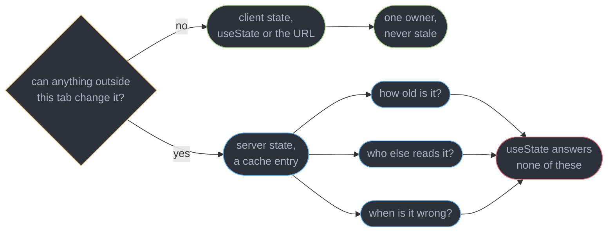
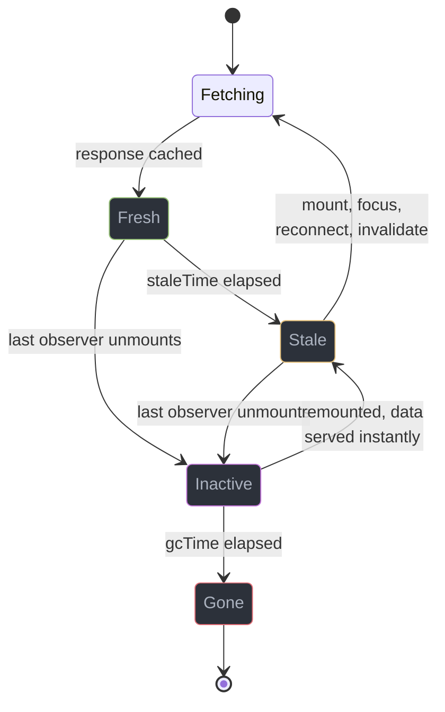
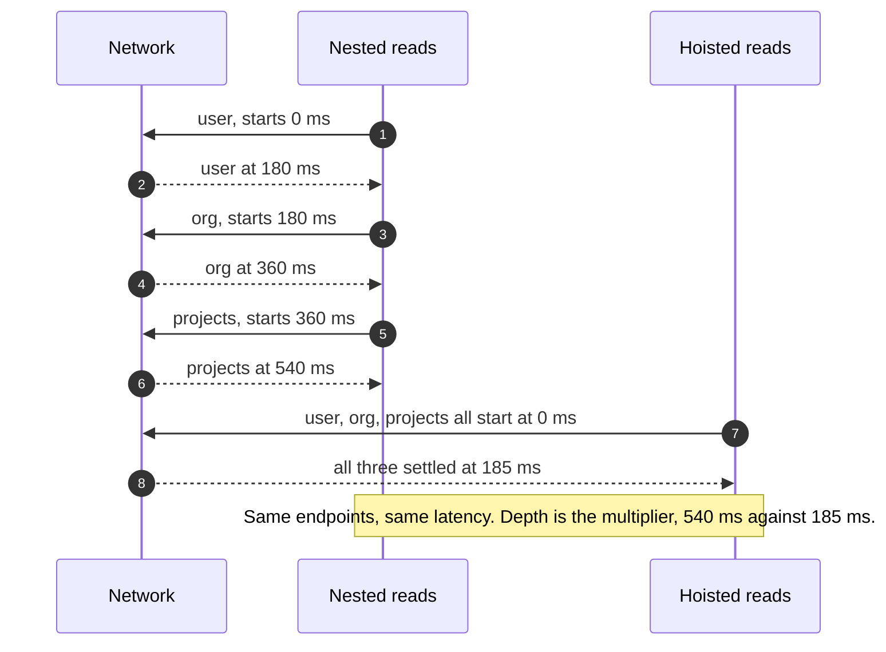
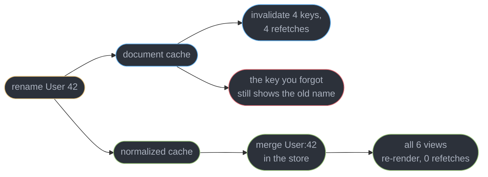
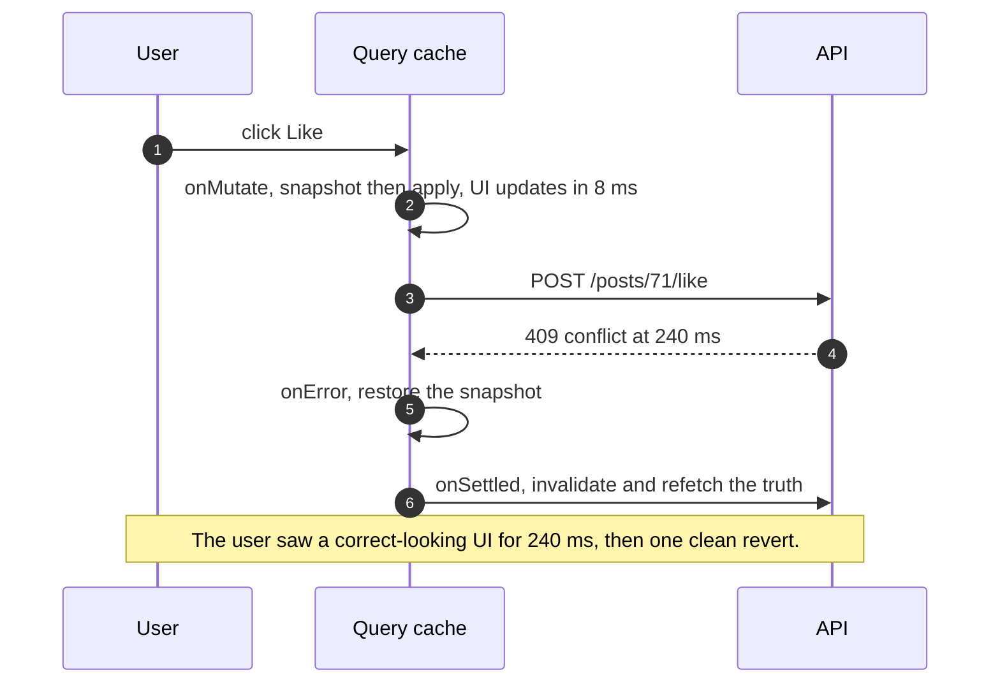
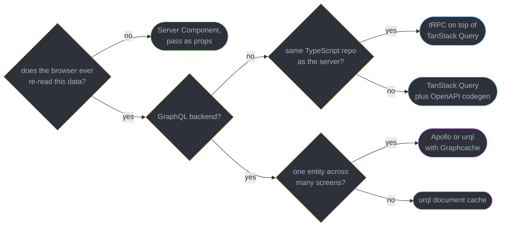

# Server State and Data Fetching

---

## 1. Concept Overview

Almost everything a React application displays is not its own. The order list, the user profile, the invoice total — those live in a database on the other side of a network, owned by a server, mutated by other people, and changing whether or not this browser tab is open. What the client holds is a *copy*, and a copy of remote data has properties that a counter or a modal-open flag simply does not have: it can be out of date the instant it arrives, it is shared by every component that asked for the same thing, it can be re-fetched to get closer to the truth, and it needs a rule for when to do that.

Calling that copy "state" and storing it in `useState` is the single most expensive mistake in front-end architecture, because it hides all four properties. A `useState` value has one owner, never goes stale, and has no notion of refetching — so every one of those behaviours has to be rebuilt by hand, per component, in effects. That is where the loading flags, the error flags, the `isRefetching` flags, the request races, the duplicate in-flight requests and the "why is this list stale after I edited it" bugs all come from. They are not state-management problems. They are cache problems being solved by people who did not know they were writing a cache.

This module is about naming that seam correctly and then using the tools built for it: TanStack Query v5 for REST-shaped data, normalized GraphQL clients when one entity appears in many views, tRPC 11.18.0 when client and server share one TypeScript repository, codegen when they do not, and Server Components when the fetch can happen server-side and never need a client cache at all.

It owns the boundary with the backend. The contracts themselves belong elsewhere: [REST API Design](../../backend/rest_api_design/rest_api_design.md) and [GraphQL](../../backend/graphql/graphql.md) own how the server exposes data; this module owns consuming it. Suspense mechanics belong to [Suspense and Error Boundaries](../suspense_and_error_boundaries/suspense_and_error_boundaries.md), which names the request waterfall; this module solves it. Genuinely client-owned state belongs to [Client State Management](../client_state_management/client_state_management.md), and form submission to [Forms and Validation](../forms_and_validation/forms_and_validation.md). Target is React 19.2.

---

## 2. Intuition

> **One-line analogy**: server state is a photograph of a room you are not standing in. It was accurate when the shutter closed, and the only questions worth asking are how old it is and when to take another one.

**Mental model**: draw one line through your application's data. On one side is state the client *owns* — a sidebar's open flag, a selected tab, a half-typed search box. Nothing outside the browser can change it, so it is never stale and never needs refetching. On the other side is state the client *borrows* — anything that came from an API. Borrowed state needs an age, a sharing rule and an invalidation rule. `useState` models the first side perfectly and the second side not at all.

**Why it matters**: the same product screen costs about 180 lines of effects, flags and race guards when server data is modelled as component state, and about 20 lines when it is modelled as a cache. A hand-rolled version also loses things a cache gets for free: two components asking for `user:42` in the same tick fire two requests instead of one, and a background refetch after a mutation has to be wired per call site.

**Key insight**: **fetching is the easy half; invalidation is the product.** Any developer can call `fetch`. What a query library sells is the answer to "this data is now wrong — which views must change, and when do they find out." That is why the interesting API surface in TanStack Query is `staleTime`, `invalidateQueries` and query keys, not `useQuery` itself.

---

## 3. Core Principles

- **Server state is a cache, not state.** It has an age, a scope, a refresh policy and an eviction policy. Any model without those four is incomplete.
- **The cache key is the data's identity.** Two components with the same key must get the same entry and share one in-flight request; two different keys must never collide.
- **Staleness and eviction are separate clocks.** How long data is trusted has nothing to do with how long it is kept.
- **Invalidation is a write-side concern.** The code that mutates knows what it invalidated; the reading components must not have to guess.
- **Optimistic updates require a snapshot.** Applying a change before the server confirms it is only safe if the pre-change value is recoverable on failure.
- **Normalization buys cross-view consistency and costs configuration.** One entity in six views wants a graph; six unrelated endpoints want documents.
- **Type safety across the wire is generated or inferred, never hand-written.** A hand-typed response is a comment that lies after the next deploy.
- **The client and the API are separate deployments.** A version-skew window always exists, so the contract must tolerate an old client hitting a new server and the reverse.
- **A boundary never fixes a waterfall.** Serialization is a scheduling problem, solved by hoisting or parallelizing the request.
- **When the server can fetch directly, the client cache may be unnecessary.** Ask whether the data ever needs to be re-read in the browser before installing a cache for it.

---

## 4. Types / Architectures / Strategies

### 4.1 Where data can live

| Layer | Owns | Stale? | Right for |
|-------|------|--------|-----------|
| `useState` / `useReducer` | client-only values | never | tab selection, dialog open, draft input |
| URL / router | shareable client state | never | filters, page number, selected id |
| Query cache | remote copies keyed by request | yes | lists, details, anything an API returns |
| Normalized entity cache | remote copies keyed by entity id | yes | one entity rendered in many views |
| Server Component | no client copy at all | n/a | read-mostly data that never re-reads in the browser |

### 4.2 Cache identity — document vs normalized

| | Document cache | Normalized cache |
|---|---|---|
| Keyed by | the request (`["orders", { status: "open" }]`) | entity type plus id (`User:42`) |
| One entity in 6 views | 6 copies, 6 chances to diverge | 1 record, all 6 views update |
| Cost of a write | invalidate the affected keys, refetch | merge the entity, no refetch needed |
| Configuration | query keys only | key fields, type policies, merge functions, pagination policies |
| Debugging | read the payload, it is the response | read the store, it is a graph |
| Typical | TanStack Query, urql default, SWR | Apollo Client, Relay, urql Graphcache |

### 4.3 The client landscape

| Client | Transport | Cache | Types | Reach for it when |
|--------|-----------|-------|-------|-------------------|
| TanStack Query v5 | anything you call | document | yours or generated | REST, any backend, any language |
| Apollo Client | GraphQL | normalized | codegen | one entity across many screens, big team |
| urql | GraphQL | document, normalized opt-in | codegen | GraphQL on a bundle budget, 8-12 KB core |
| Relay | GraphQL | normalized, compiler-enforced | compiler | very large GraphQL app that will pay for the discipline |
| tRPC 11.18.0 | HTTP, procedure-shaped | TanStack Query underneath | inferred, no codegen | client and server in one TypeScript repo |
| RSC only | server `await` | none on the client | direct | read-mostly pages with mutations through Server Functions |

### 4.4 Ways to kill a waterfall

| Strategy | Moves the request | Best saving |
|----------|-------------------|-------------|
| Hoist above the boundary | up the tree, to where inputs are known | one round trip per level removed |
| Parallel start | sideways, all at once | `depth x RTT` collapses to `RTT` |
| Route loader / `prefetchQuery` | before the component renders | full render time, 60-200 ms |
| Prefetch on hover or route intent | 200-400 ms before the click | the click feels instant |
| Server Component `await` | off the client entirely | the whole client round trip |

---

## 5. Architecture Diagrams

### Two kinds of state, two sets of questions



The three questions on the right are exactly what a hand-rolled effect ends up reimplementing, one component at a time, usually incorrectly.

### The life of one cache entry



Fresh and stale describe trust; inactive and garbage-collected describe memory. An entry that is stale is still shown immediately — staleness triggers a background refetch, never a spinner.

### Waterfall versus parallel, same three requests



The diagnosis takes 20 seconds in a network panel: parallel requests share a left edge, a waterfall draws a staircase.

### Document cache versus normalized cache after one write



The blue path is cheap to set up and leaks stale copies through any key you failed to list. The green path cannot leak, and charges you type policies and merge functions for the guarantee.

### An optimistic update and its rollback



`onMutate` must both cancel in-flight refetches and return the snapshot, or a late response overwrites the optimistic value and the rollback restores the wrong thing.

### Choosing a data layer



The first question is the one teams skip. A read-mostly page fetched on the server needs no client cache, and installing one anyway is how a 4 KB page grows a 47 KB data layer.

---

## 6. How It Works — Detailed Mechanics

### 6.1 The query key is the cache identity

A query key is a serializable array. TanStack Query hashes it deterministically and uses the hash as the entry's address, so two components with the same key share one entry and one in-flight request.

```ts
// Every input the fetcher reads must appear in the key, or entries collide.
const ordersKey = (filters: OrderFilters) => ["orders", "list", filters] as const;
const orderKey = (id: string) => ["orders", "detail", id] as const;

useQuery({
  queryKey: ordersKey({ status: "open", page: 2 }),
  queryFn: ({ signal }) => api.listOrders({ status: "open", page: 2 }, signal),
});
```

Two rules cover almost every key bug. **Anything the fetcher reads goes in the key** — a `page` variable outside the key means page 2 renders page 1's data forever, because the address never changed. And **keys are hierarchical prefixes**: `["orders"]` matches every key starting with it, which is what makes `invalidateQueries({ queryKey: ["orders"] })` sweep the list, the details and the counts in one call. Object values are hashed with stable key ordering, so `{ status, page }` and `{ page, status }` are the same entry.

The `signal` passed to `queryFn` is a real `AbortSignal`. Forwarding it to `fetch` is what makes a query cancel when its component unmounts or its key changes, which is the built-in answer to the response race that hand-rolled effects lose to.

### 6.2 `staleTime` and `gcTime` are different clocks

```ts
useQuery({
  queryKey: orderKey(id),
  queryFn: ({ signal }) => api.getOrder(id, signal),
  staleTime: 30_000,   // trusted for 30 s, no refetch on mount or focus
  gcTime: 5 * 60_000,  // kept in memory 5 min after the last observer unmounts
});
```

`staleTime` answers *how long is this data trusted*. While fresh, mounting a second component, refocusing the window or reconnecting the network all serve the cached value with zero requests. `gcTime` answers *how long is this data kept after nobody is looking*. An inactive entry is still in memory, so navigating back renders instantly from cache while a refetch runs behind it.

The default `staleTime` is **0**, which surprises people: data is stale the moment it arrives, so any remount triggers a background refetch. That is a deliberate freshness-first default, not a bug — the value is still served instantly, the refetch is invisible, and the UI never shows a spinner for it. Raise it when the data genuinely does not change that fast. A reference list that changes weekly at `staleTime: Infinity` and a live order queue at `staleTime: 0` are both correct; the mistake is a single global value applied to both.

The numbers that matter in practice: a product catalogue at `staleTime: 300_000` cut refetches on a 40-screen app from roughly 900 per session to 120, with no user-visible staleness because the catalogue changes twice a day. The same setting on the order queue would have shown five-minute-old order counts.

`gcTime` defaults to 5 minutes and is a memory knob. Long lists held at `gcTime: Infinity` are how a long-lived tab reaches 300 MB.

### 6.3 Mutations, invalidation and optimistic rollback

A mutation is the write half, and its real job is declaring what it invalidated.

```tsx
const qc = useQueryClient();

const rename = useMutation({
  mutationFn: (v: { id: string; name: string }) => api.renameOrder(v),
  onSuccess: (_data, v) => {
    qc.invalidateQueries({ queryKey: ["orders"] });          // prefix, sweeps list and counts
    qc.invalidateQueries({ queryKey: orderKey(v.id) });      // and the detail
  },
});
```

`invalidateQueries` marks matching entries stale and refetches the ones currently mounted; unmounted ones refetch when they next mount. The alternative, `setQueryData`, writes a value directly with no request — correct when the mutation response already contains the new entity, wasteful to skip when it does not, because a guessed value can drift from what the server actually stored.

Optimistic updates apply the change before the server answers, which needs three callbacks working together.

```tsx
const like = useMutation({
  mutationFn: (postId: string) => api.like(postId),
  onMutate: async (postId) => {
    await qc.cancelQueries({ queryKey: ["posts", postId] });        // stop in-flight refetches
    const previous = qc.getQueryData<Post>(["posts", postId]);      // snapshot for rollback
    qc.setQueryData<Post>(["posts", postId], (p) =>
      p ? { ...p, liked: true, likes: p.likes + 1 } : p);
    return { previous };
  },
  onError: (_err, postId, ctx) => {
    qc.setQueryData(["posts", postId], ctx?.previous);               // rollback
  },
  onSettled: (_d, _e, postId) => {
    qc.invalidateQueries({ queryKey: ["posts", postId] });           // reconcile with truth
  },
});
```

All three lines in `onMutate` are load-bearing. Without `cancelQueries`, a refetch that started before the click lands after the optimistic write and overwrites it with the old value. Without the snapshot in the returned context, `onError` has nothing to restore. Without `onSettled`, a success leaves the guessed value in the cache instead of the server's — which diverges the moment the server computes anything you did not, such as a like count that includes other users' clicks.

Perceived latency is the payoff: the UI updates in 8 ms instead of the 240 ms round trip. The cost is that a failure rate above roughly 2% makes the reverts themselves the user-visible feature.

### 6.4 `useSuspenseQuery` and the boundary

```tsx
// No isLoading branch. The read either returns data or suspends.
function OrderTable({ status }: { status: OrderStatus }) {
  const { data } = useSuspenseQuery({
    queryKey: ordersKey({ status, page: 1 }),
    queryFn: ({ signal }) => api.listOrders({ status, page: 1 }, signal),
  });
  return <Table rows={data.orders} />;
}
```

`useSuspenseQuery` throws the in-flight promise, so the nearest `Suspense` renders the fallback and the nearest error boundary handles a rejection. `data` is non-nullable in the type, which removes the `data?.orders ?? []` noise that `useQuery` requires. Boundary placement, fallback geometry and reset-with-cache-eviction all belong to [Suspense and Error Boundaries](../suspense_and_error_boundaries/suspense_and_error_boundaries.md).

The trap is that suspending components nested inside each other serialize, which is §6.7. `useSuspenseQuery` makes waterfalls easier to write and no harder to see.

### 6.5 Normalized caching and fragment colocation

A document cache stores the response under the request. Ask for the same user through four endpoints and you hold four copies, each aging independently. A normalized cache splits every response into entities keyed by type and id, stores each once, and rebuilds responses from the graph.

```ts
// Apollo: identity and merge behaviour are configuration, not defaults you can ignore.
new InMemoryCache({
  typePolicies: {
    Order: { keyFields: ["orderNumber"] },                     // not the default "id"
    Query: {
      fields: {
        orders: {
          keyArgs: ["status"],                                  // one list per status
          merge: (existing = [], incoming) => [...existing, ...incoming],
        },
      },
    },
  },
});
```

That block is the honest price of normalization. A type without an `id` and without `keyFields` is not normalized at all and is silently inlined into its parent; a paginated field without a `merge` function replaces page 1 with page 2 and logs a cache warning most teams learn to ignore. In exchange, renaming a user updates every screen showing that user with zero refetches, and the "I edited it in the modal and the table still shows the old value" class of bug cannot occur.

Fragment colocation is the pattern that makes this maintainable: each component declares the fields it needs, next to itself, and the parent composes them.

```graphql
fragment OrderRow_order on Order {
  orderNumber
  total
  customer { id displayName }
}

query OrdersPage($status: OrderStatus!) {
  orders(status: $status) {
    id
    ...OrderRow_order
  }
}
```

```tsx
// The component reads only what its own fragment declared, and typing follows.
function OrderRow({ order }: { order: OrderRow_orderFragment }) {
  return <Row title={order.customer.displayName} amount={order.total} />;
}
```

Two properties follow. Deleting the component deletes its field requirements, so the query shrinks automatically instead of over-fetching forever. And a field a component did not declare is a type error rather than a runtime `undefined`, which is what turns "who still uses this field" from a grep into a compiler question.

### 6.6 tRPC 11.18.0

tRPC removes the schema-and-codegen step entirely when the client and the server are in one TypeScript repository. The server's router type is imported by the client as a *type*, and inference does the rest.

```ts
// server: the router is ordinary TypeScript. Its type is the contract.
export const appRouter = router({
  order: router({
    byId: publicProcedure
      .input(z.object({ id: z.string().uuid() }))
      .query(({ input }) => db.order.findUniqueOrThrow({ where: { id: input.id } })),
    rename: protectedProcedure
      .input(z.object({ id: z.string().uuid(), name: z.string().min(1).max(120) }))
      .mutation(({ input }) => db.order.update({ where: { id: input.id }, data: { name: input.name } })),
  }),
});
export type AppRouter = typeof appRouter;

// client: one type-only import, zero generated files, full inference.
import type { AppRouter } from "../../server/router";
const trpc = createTRPCClient<AppRouter>({ links: [httpBatchLink({ url: "/api/trpc" })] });

const { data } = useQuery(trpc.order.byId.queryOptions({ id }));  // data is typed from the server
```

Rename a field on the server and the client fails to compile in the same edit, with no build step in between. That is a strictly tighter loop than codegen, which needs a running server or a committed schema and a regeneration command someone has to remember.

tRPC 11 accepts **any Standard Schema validator** natively — spec 1.1.0, implemented by Zod 4.5.4, Valibot, ArkType and others — so the input validator is a choice rather than a dependency the framework imposes. The constraints are equally real: it requires TypeScript on both ends and a shared repository, it is not a public API contract other languages can consume, and importing server code by value rather than by type drags the whole backend into the client bundle. Type-level plumbing at that scale is [TypeScript for Node and Backend Services](../../typescript/typescript_for_node_and_backend_services/typescript_for_node_and_backend_services.md).

### 6.7 Codegen, and contract drift across deploys

When the two sides are not one repository, generate the client from the contract.

```ts
// openapi-typescript emits types from the served spec; the fetch wrapper types itself.
// npx openapi-typescript https://api.example.com/openapi.json -o src/api/schema.d.ts
import createClient from "openapi-fetch";
import type { paths } from "./api/schema";

const api = createClient<paths>({ baseUrl: "/api/v2" });
const { data, error } = await api.GET("/orders/{id}", { params: { path: { id } } });
```

A generated client beats a hand-written one on three counts that compound: the response type cannot drift from the spec, an added required request field is a compile error rather than a 400 in production, and a removed field fails the build in every file that read it. On one 62-endpoint service, replacing hand-written types with generation surfaced 23 fields whose declared shape had not matched the API for months — every one of them a latent `undefined`.

`graphql-code-generator` does the same for GraphQL: it reads the schema plus your `.graphql` documents and emits typed hooks and per-fragment types, which is what makes §6.5's `OrderRow_orderFragment` exist as a real type.

**Contract drift is the part codegen does not solve.** The client is a separate deployment from the API, so there is always a window in which an old bundle talks to a new server, and — with a rollback, a CDN cache or a tab left open overnight — a new bundle talks to an old server. A tab open for 6 hours across two API deploys is ordinary, not exotic.

Design for the window rather than hoping to close it. Additive change only: new fields optional, new enum values tolerated by a `default` branch, removals done in two releases with a deprecation period longer than your longest realistic session. Version the path (`/api/v2`) for anything genuinely breaking, and keep the previous version alive for at least one deploy cycle. Regenerate types in CI against the deployed spec, not a local copy, so a drift fails the build instead of the browser. And when the client detects a version header it does not recognise, prompt a reload rather than rendering unknown data — a one-line banner is cheaper than the support tickets from a half-broken page.

### 6.8 Killing waterfalls

The diagnosis is visual. In the network panel, sort by start time and read the left edges of the request bars: parallel requests share an edge, a waterfall draws a staircase at 0 ms, 185 ms, 370 ms on a 180 ms link.

```tsx
// Parallel: independent queries start together instead of one per render pass.
const [orders, customers, quotas] = useSuspenseQueries({
  queries: [
    { queryKey: ordersKey(f), queryFn: () => api.listOrders(f) },
    { queryKey: ["customers", orgId], queryFn: () => api.listCustomers(orgId) },
    { queryKey: ["quotas", orgId], queryFn: () => api.getQuotas(orgId) },
  ],
});
```

Four fixes, in the order to try them. **Hoist** the query above the boundary, to the level where its inputs are already known — usually the route, which turns a nested read into a parallel one. **Parallelize** with `useSuspenseQueries` or `Promise.all`, for requests that were only serial because they were written in separate components. **Prefetch on intent**, which starts the request 200-400 ms before the click:

```tsx
// Hover is a 200-400 ms head start, and a hover that never becomes a click costs one request.
<Link
  to={`/orders/${id}`}
  onMouseEnter={() => qc.prefetchQuery({
    queryKey: orderKey(id), queryFn: () => api.getOrder(id), staleTime: 30_000,
  })}
/>
```

And **render as you fetch** rather than fetch on render: the route loader or Server Component starts every request the page needs before the components mount, so the render finds the cache warm. Fetch-on-render is the pattern that produces waterfalls by construction, because a request cannot start until its component renders, and its component cannot render until its parent's request finished.

Set `staleTime` on a prefetch or the prefetched entry is stale on arrival and refetched immediately by the component that mounts — a common way to double every request on a hover-prefetch page.

### 6.9 RSC changes the question

When the fetch happens on the server, there may be nothing to cache on the client at all.

```tsx
// Server Component: fetches on the server, ships data as props. No client cache, no key.
export default async function OrdersPage({ params }: { params: { org: string } }) {
  const orders = await db.order.findMany({ where: { org: params.org }, take: 50 });
  return <OrderTable orders={orders} />;   // a client component receiving plain data
}
```

The server-side call has no network hop from the browser's perspective, no loading state on the client, no key to invalidate, and no query-library bytes in the bundle. For a read-mostly page, this deletes the entire data layer.

The hybrid is what real applications look like. Server-fetched data arrives as props for the initial render; only the parts that must re-read in the browser — a live counter, an infinite list, anything a mutation changes — get a client query, seeded from the server value so the first render is not a spinner:

```tsx
"use client";
function LiveOrders({ initial }: { initial: Order[] }) {
  const { data } = useQuery({
    queryKey: ["orders", "live"],
    queryFn: () => api.listOrders({ status: "open" }),
    initialData: initial,        // server value seeds the cache
    staleTime: 10_000,
    refetchInterval: 15_000,
  });
  return <Table rows={data} />;
}
```

Server Functions handle the write side, and `revalidatePath` or `revalidateTag` invalidates the server's cache the way `invalidateQueries` invalidates the client's — the same idea, one layer down. Serialization rules, `"use server"` and Server Function security belong to [Server Components and Server Functions](../server_components_and_server_functions/server_components_and_server_functions.md).

---

## 7. Real-World Examples

**The 180-line component that became 20.** A logistics dashboard rendered one shipment table through `useState` plus `useEffect`: `data`, `loading`, `error`, `refreshing`, a mounted-ref race guard, a manual refetch after every mutation, and a `useRef` deduplicating concurrent requests. Replacing it with one `useQuery` and one `useMutation` with `invalidateQueries` deleted 160 lines and, more usefully, four bug classes at once — the stale-after-edit table, the double request on mount under StrictMode, the out-of-order response overwrite, and the spinner that flashed on every tab return.

**The catalogue that refetched 900 times a session.** An e-commerce SPA ran on TanStack Query defaults, so every remount of a category page refetched a catalogue that changes twice a day. Setting `staleTime: 300_000` on catalogue queries alone took requests per session from about 900 to 120 and cut the API's read traffic by 61%, with no perceptible staleness. The order-status queries kept `staleTime: 0` deliberately.

**The modal that never updated the table.** A CRM with a document cache let users rename an account in a modal. The mutation invalidated `["accounts", "detail", id]` and nobody added the list key, so the table behind the modal kept the old name until a hard reload. Support filed it as a caching bug 40 times in a quarter. The fix was one prefix — `invalidateQueries({ queryKey: ["accounts"] })` — and the deeper lesson is that this bug is structurally impossible in a normalized cache, which is what pushed the next service to Apollo.

**The tab open across two deploys.** A B2B tool shipped an API change that made a previously optional `region` field required. Clients loaded before the deploy kept POSTing without it and took 400s for 40 minutes, affecting 1,100 sessions. The API change was additive-looking to the team that shipped it and breaking to every browser tab already open. A version header plus a reload banner, and a rule that required fields are only ever added in a new path version, closed it.

---

## 8. Tradeoffs

| Design choice | Bought | Paid |
|---------------|--------|------|
| Server state in a cache, not `useState` | dedup, staleness, invalidation, retry for free | one more concept and 12-14 KB gzipped |
| `staleTime: 0` default | data is never trusted longer than a render | background refetch on every mount and focus |
| High `staleTime` | far fewer requests, calmer UI | users can act on data minutes old |
| Document cache | keys are the only configuration | duplicate copies, invalidation you must remember |
| Normalized cache | one entity, one record, no stale views | type policies, merge functions, harder debugging |
| tRPC inference | no codegen step, errors at edit time | one repo, TypeScript both ends, not a public API |
| Generated REST client | types cannot drift from the spec | a generation step in CI and a spec worth trusting |
| Optimistic updates | 8 ms perceived latency instead of 240 ms | snapshot, cancel and rollback plumbing per mutation |
| Prefetch on hover | the click feels instant | requests for hovers that never become clicks |
| Server Components for reads | no client cache, no data-layer bytes | every re-read needs a round trip or a client island |

---

## 9. When to Use / When NOT to Use

**Reach for a query library when:**

- The same data appears in more than one component, or the same endpoint is called from more than one place.
- Anything mutates and other views must notice — the moment invalidation exists, hand-rolling stops paying.
- You need retry, dedup, background refresh, pagination or offline behaviour, all of which are dozens of lines each by hand.

**Reach for a normalized cache when:**

- One entity is rendered in many views and edited from several of them.
- You are already on GraphQL and the schema has real ids.
- The team is large enough that "remember to invalidate the list key too" is not a reliable control.

**Do not reach for one when:**

- The data is fetched once on the server and never re-read in the browser. Pass it as props.
- It is a single fire-and-forget call with no other reader — a `fetch` in a Server Function is complete.
- The value is genuinely client-owned. A selected tab in a query cache is a category error; see [Client State Management](../client_state_management/client_state_management.md).
- You are trying to fix a waterfall. Caching hides a repeat request; it does nothing about the first one being serialized.

---

## 10. Common Pitfalls

**Fetching in an effect and losing the race.** The defining server-state bug, and it is invisible until the network is slow.

```tsx
// BROKEN: type "ab" fast and the response for "a" can land after the response for "ab",
// so the list shows results for the wrong query and never corrects itself.
function Results({ q }: { q: string }) {
  const [items, setItems] = useState<Item[]>([]);
  useEffect(() => {
    fetch(`/api/search?q=${q}`).then((r) => r.json()).then(setItems);
  }, [q]);
  return <List items={items} />;
}

// FIX: the cache is keyed by q, so each query has its own entry, the previous request
// is aborted through signal, and a late response can never write to the wrong key.
function Results({ q }: { q: string }) {
  const { data = [] } = useQuery({
    queryKey: ["search", q],
    queryFn: ({ signal }) => fetch(`/api/search?q=${q}`, { signal }).then((r) => r.json()),
    staleTime: 30_000,
    placeholderData: (prev) => prev,   // keep the old list visible while the new one loads
  });
  return <List items={data} />;
}
```

**A fetcher input missing from the key.** `page` read from a closure but absent from the key means page 2 shows page 1's data with no error anywhere, because the cache address never changed. Every input the fetcher reads belongs in the key.

**One global `staleTime` for everything.** A single value cannot be right for a catalogue that changes twice a day and an order queue that changes every second. Set it per query, or per query family through query options factories.

**Copying query data into `useState`.** `const [rows, setRows] = useState(data)` freezes a snapshot; background refetches then update the cache and not the screen. Derive during render instead, or use `select` to transform inside the query.

**Invalidating only the detail key.** The list, the counts and the search results are separate entries in a document cache. Use the shared prefix, and prefer key factories so a new key cannot be forgotten.

**Optimistic update without `cancelQueries`.** A refetch that started before the click lands after the optimistic write and silently reverts it, so the UI flickers back and the mutation looks broken despite a 200 response.

**Rollback with no snapshot.** `onError` that refetches instead of restoring shows the pre-mutation value after a round trip rather than instantly, and shows nothing correct in between. Return `{ previous }` from `onMutate`.

**Hand-written response types.** They are accurate on the day they are written and a lie after the next backend deploy, with the compiler cheerfully agreeing. Generate them, and regenerate in CI against the deployed spec.

**`gcTime: Infinity` on big lists.** Every visited page stays in memory forever. A long-lived tab on an admin tool reached 300 MB this way; the fix was the 5-minute default everywhere except three genuinely static lookups.

**Prefetching without `staleTime`.** The prefetched entry is stale on arrival, so the component that mounts refetches immediately and the hover bought nothing while doubling the request count.

**Reaching for a client cache on an RSC page.** If the browser never re-reads the data, the cache, its key, its invalidation and its 12 KB are all overhead on a page that had none.

---

## 11. Technologies & Tools

| Tool | Purpose |
|------|---------|
| TanStack Query | v5 document cache, mutations, invalidation, suspense queries |
| Apollo Client | Normalized GraphQL cache with type policies and merge functions |
| urql | Modular GraphQL client, 8-12 KB core, document cache by default |
| Graphcache | urql exchange that adds normalization when a document cache is not enough |
| Relay | Compiler-enforced normalized cache with mandatory fragment colocation |
| tRPC | 11.18.0 end-to-end inference over TanStack Query, no codegen |
| Zod | 4.5.4 Standard Schema validator for procedure inputs and response parsing |
| openapi-typescript | Generates TypeScript types from an OpenAPI document |
| openapi-fetch | Typed fetch wrapper that consumes those generated types |
| graphql-code-generator | Emits typed documents, hooks and per-fragment types from a schema |
| SWR | Minimal stale-while-revalidate cache for small applications |
| MSW | Intercepts requests so query behaviour is testable without a server |
| React Query Devtools | Inspects keys, freshness, observers and refetch activity live |
| Chrome DevTools | The network waterfall's left edges are the serialization diagnosis |

---

## 12. Interview Questions with Answers

**Q: Why does server state not belong in useState?**
**Short:** Data owned by a remote database is a cache of something you do not control, so it needs an age, a sharing rule and an invalidation rule that component state has none of.

A `useState` value has exactly one owner, never goes stale, and has no concept of refetching. Remote data has all three properties, so storing it in component state means hand-rebuilding them per component: loading and error flags, a mounted guard against response races, deduplication of concurrent requests, and a manual refetch after every mutation. That is roughly 180 lines of effects on a real screen against 20 with a query library, and the hand-rolled version still loses the races. The diagnostic question is simply whether anything outside this browser tab can change the value.

**Q: What is the difference between staleTime and gcTime?**
**Short:** staleTime decides how long the data is trusted without a refetch, while gcTime decides how long the entry survives in memory after the last component stops observing it.

They are independent clocks. Within `staleTime`, mounting another component, refocusing the window or reconnecting serves the cached value with zero requests. After it, the value is still served instantly and a background refetch runs behind it — stale never means a spinner. `gcTime` starts only when the last observer unmounts; until it expires, navigating back renders from cache immediately. Defaults are `staleTime: 0` and `gcTime: 5 minutes`, so the common tuning is raising `staleTime` per query family and leaving `gcTime` alone unless memory is a problem.

**Q: When would you choose a normalized cache over a document cache?**
**Short:** Document caches store one copy per request, so the same entity in six views is six copies that can diverge the moment one of them is edited.

Reach for normalization when one entity appears across many screens and is edited from several of them: a normalized store keys by type and id, so writing `User:42` updates every view with zero refetches and the "I renamed it in the modal and the table is stale" bug becomes structurally impossible. Reach for a document cache when endpoints are largely unrelated, because its only configuration is the key. The price of normalization is real — key fields, type policies, pagination merge functions — and a type without an id is silently not normalized at all.

**Q: How do you diagnose and kill a request waterfall?**
**Short:** Serialized round trips show up as a staircase of request bars whose left edges step rightward, each one starting only where the previous one ended.

Sort the network panel by start time: parallel requests share a left edge; 0 ms, 185 ms, 370 ms on a 180 ms link is a three-level waterfall costing `depth x RTT`. Four fixes in order: hoist the query to the level where its inputs are known, usually the route; parallelize with `useSuspenseQueries` or `Promise.all`; prefetch from a route loader or on hover intent; and render-as-you-fetch instead of fetch-on-render, so requests start before components mount. A Suspense boundary changes none of this — it decides what is visible while you wait, never when the wait starts.

**Q: What belongs in a TanStack Query key?**
**Short:** Every input the fetcher reads must appear in the key, because the hashed key is the cache entry's address and nothing else distinguishes two requests.

A `page` variable used by the fetcher but omitted from the key means page 2 renders page 1's data forever, silently, since the address never changed. Keys are hierarchical prefixes, so `["orders"]` matches `["orders", "detail", id]` and every other key beneath it — that is what makes one `invalidateQueries` call sweep a whole family. Object values hash with stable key ordering, so argument order does not matter. Centralize keys in a factory so a mutation cannot invalidate a key that no longer exists.

**Q: How does an optimistic update roll back safely?**
**Short:** onMutate must cancel in-flight refetches, snapshot the current value, and return that snapshot as context so onError can restore it synchronously.

All three parts are load-bearing. Without `cancelQueries`, a refetch that started before the click lands after the optimistic write and reverts it, which reads as a broken mutation despite a 200. Without the snapshot, `onError` has nothing to restore and refetching instead shows the correct value only after another round trip. `onSettled` then invalidates so the server's real value replaces the guessed one — necessary whenever the server computes anything you did not, such as a like count including other users. The payoff is 8 ms perceived latency against 240 ms.

**Q: When should a mutation call setQueryData instead of invalidateQueries?**
**Short:** Writing the response straight into the cache avoids a refetch entirely, and is correct only when the mutation returns the complete updated entity.

`invalidateQueries` marks entries stale and refetches the mounted ones, which is always correct but costs a round trip. `setQueryData` writes the value with no request, so use it when the mutation response is the authoritative new entity. Skipping it when the response is partial is how a guessed value drifts from what the server actually stored — derived fields, server timestamps and counters that other users also change. A common pattern uses both: `setQueryData` for the entity, `invalidateQueries` on the list prefix.

**Q: What does useSuspenseQuery change compared to useQuery?**
**Short:** Throwing the in-flight promise moves the loading and error branches out of the component and into the nearest boundary above it.

`data` becomes non-nullable in the type, deleting the `data?.items ?? []` noise that `useQuery` forces at every call site, and there is no `isLoading` branch to write. The fallback comes from the nearest `Suspense`, the failure from the nearest error boundary. The cost is that nesting suspending components serializes their fetches, so `useSuspenseQuery` makes waterfalls easier to write without making them easier to see — pair it with `useSuspenseQueries` or a route-level prefetch.

**Q: How does tRPC differ from a generated client?**
**Short:** Type inference straight from the server's router type removes the schema, the generation step and the moment where the two can disagree.

The client imports the router as a *type only*, so renaming a server field fails the client compile in the same edit, with no build step and no running server in between. Codegen needs a committed schema or a live spec plus a regeneration command someone must remember, which is a strictly looser loop. The constraints are the price: TypeScript on both ends, one shared repository, and no contract other languages can consume. tRPC 11.18.0 accepts any Standard Schema validator, spec 1.1.0, so Zod 4.5.4 or Valibot is a choice rather than a mandate.

**Q: What is contract drift and how do you design for it?**
**Short:** Two independent deployments guarantee a window where an old bundle talks to a new API, and rollbacks and day-old browser tabs make the reverse ordinary too.

A tab left open across two API deploys is normal, not exotic. Design for the window instead of hoping to close it: new fields optional, new enum values absorbed by a `default` branch, removals split across two releases with a deprecation period longer than a realistic session, and a versioned path for anything genuinely breaking with the previous version alive at least one deploy cycle. Regenerate types in CI against the deployed spec so drift fails the build. One team made an optional field required and took 400s across 1,100 sessions for 40 minutes.

**Q: Why is a generated API client better than a hand-written one?**
**Short:** Generating from the contract makes an added required field or a removed response field a compile error rather than a production 400 or an undefined at runtime.

Hand-written types are accurate the day they are written and become a comment that lies after the next backend deploy, with the compiler agreeing enthusiastically. Generation ties the types to the spec so they cannot drift, and it scales: on a 62-endpoint service, switching to `openapi-typescript` surfaced 23 fields whose declared shape had not matched the API for months. `graphql-code-generator` does the same for GraphQL, emitting typed documents and per-fragment types. Generate in CI against the deployed spec, never a local copy.

**Q: What problem does fragment colocation solve?**
**Short:** Colocating a fragment with its component makes each component declare its own field requirements, so the query is composed from the tree instead of written by hand at the top.

Two things follow. Deleting the component deletes its fields, so the query shrinks automatically rather than over-fetching forever because nobody dared remove a field — the "who still uses this" question becomes a compiler question. And a component reading a field it did not declare is a type error rather than a runtime `undefined`, which is exactly the failure a distant hand-maintained query produces. Relay enforces this with a compiler; Apollo and urql get it through `graphql-code-generator` and convention.

**Q: How do Apollo Client and urql compare?**
**Short:** Apollo normalizes by default with a large ecosystem and roughly 30 KB of weight, while urql ships an 8-12 KB core with a document cache and makes normalization an opt-in exchange.

Apollo's normalized `InMemoryCache`, type policies and field policies are the reason it wins on large applications where one entity spans many screens, and its ecosystem of devtools and links is the largest in GraphQL. urql's modular exchange architecture means you pay for what you add: the document cache covers most applications, and Graphcache adds normalization when cross-view consistency starts to bite. Choose on cache shape and bundle budget, not on features — both cover subscriptions, SSR and codegen.

**Q: Does React Server Components remove the need for a query library?**
**Short:** Fetching on the server means there may be no client copy to cache, so a read-mostly page can delete its entire data layer along with its bundle cost.

A Server Component awaits data and passes it down as props: no client round trip, no loading state, no key, no invalidation, no library bytes. The realistic shape is hybrid — server-fetched data seeds the initial render, and only the parts that genuinely re-read in the browser get a client query, using `initialData` so the first render is not a spinner. Server Functions plus `revalidateTag` handle the write side, which is the same invalidation idea one layer down. The question to ask first is whether the browser ever re-reads this data.

**Q: How does prefetching on hover work and what does it cost?**
**Short:** Hover intent buys a 200-400 ms head start, which is usually the whole perceived latency of the next navigation.

`prefetchQuery` on `onMouseEnter` warms the cache with the same key the destination will read, so the route renders from cache instead of waiting. Always pass `staleTime` — a prefetched entry with the default 0 is stale on arrival and refetched immediately by the component that mounts, which doubles requests while buying nothing. The cost is requests for hovers that never become clicks, so restrict it to links whose payload is small and whose click-through is high, and consider `onFocus` and touch-start for keyboard and mobile users.

**Q: Why does data refetch when the window regains focus, and should it?**
**Short:** Background refetch keeps a returning user from acting on data that went stale while they were in another tab, and it happens invisibly because the cached value stays on screen.

TanStack Query refetches stale queries on window focus, network reconnect and component mount by default. The value is never blanked — the cached one renders while the request runs — so the cost is requests, not spinners. The right control is `staleTime`, not disabling the behaviour: a catalogue at `staleTime: 300_000` will not refetch on focus at all, while an order queue at 0 should. On one 40-screen application, per-query `staleTime` cut a session from about 900 requests to 120 without a single user-visible staleness report.

**Q: How does a query cache eliminate the classic useEffect fetch race?**
**Short:** Out-of-order responses overwrite each other only when every result writes to the same `setState`, and a keyed cache gives each request its own destination.

Typing "ab" quickly fires a request for "a" and one for "ab"; if "a" resolves last, the naive effect writes its results and the list shows the wrong query with no error anywhere. A cache keyed by the query string gives each request a separate entry, so a late response writes to the key nobody is reading. On top of that, the `AbortSignal` handed to `queryFn` cancels the previous request when the key changes, and `placeholderData: (prev) => prev` keeps the old list visible instead of flashing empty between the two.

**Q: How do you keep a list from flashing empty during pagination?**
**Short:** Keeping the previous page's data as placeholder data lets the new page's entry load while the old rows stay on screen, so only the loading indicator changes.

Changing the page number changes the query key, which is a different cache entry with no data — so the naive result is a full blank between pages. `placeholderData: (prev) => prev` renders the previous entry's rows while the new request runs, with `isPlaceholderData` available to dim the table or disable the next button. For infinite scroll, `useInfiniteQuery` accumulates pages under one key with a `getNextPageParam` cursor function, which is the right shape when pages are appended rather than replaced.

---

## 13. Best Practices

- Ask whether anything outside this tab can change a value before choosing where it lives; that single question routes it to `useState`, the URL, or the cache.
- Centralize query keys in a factory per resource, so a mutation cannot invalidate a key that no longer exists and no fetcher input can be forgotten.
- Set `staleTime` per query family from how fast the data actually changes, and never one global value for the whole application.
- Forward the `queryFn` `signal` to every `fetch`, which is the built-in fix for the response race and for unmount cancellation.
- Invalidate on the shared prefix after a mutation, and use `setQueryData` only when the response contains the complete entity.
- Write `onMutate`, `onError` and `onSettled` together or not at all — an optimistic update missing any one of the three is worse than none.
- Generate every API type from the contract and regenerate in CI against the deployed spec, never a local copy.
- Treat additive-only change and a version header with a reload prompt as the contract for the skew window between client and API deploys.
- Read the left edges of request bars before optimizing anything, and fix serialization by hoisting or parallelizing rather than by caching.
- Reach for a normalized cache when one entity spans many editable views, and stay on a document cache when it does not.
- Start from Server Components for read-mostly pages, adding a client query only where the browser genuinely re-reads, seeded with `initialData`.

---

## 14. Case Study

**Problem.** A B2B order-management SPA had a Largest Contentful Paint of 2,400 ms at p50 with every API endpoint under 180 ms at p99. Editing an order's name in a modal left the table behind it showing the old name until a hard reload — filed 40 times a quarter as a caching bug. Typing in the search box occasionally showed results for a previous query. The bundle carried 62 hand-written response interfaces, of which 23 no longer matched the API.

**Investigation.** The network panel showed a four-step staircase: session at 0 ms, org at 175 ms, order list at 350 ms, and per-row customer lookups at 530 ms — 530 ms of pure serialization on a 175 ms link, behind a skeleton that looked deliberate. Every screen used `useEffect` plus `useState`, so each of the four levels could not start until its parent had rendered.

**Root cause.** Fetch-on-render with component-owned state, once per screen.

```tsx
// BROKEN: nested fetch-on-render. Each level's request waits for the level above to
// render, and the search input writes every response into one setState, so a slow
// early response can land last and win.
function OrdersScreen({ orgId }: { orgId: string }) {
  const [org, setOrg] = useState<Org | null>(null);
  const [orders, setOrders] = useState<Order[]>([]);
  useEffect(() => { fetch(`/api/orgs/${orgId}`).then((r) => r.json()).then(setOrg); }, [orgId]);
  useEffect(() => {
    if (!org) return;                                   // gate: starts only at 175 ms
    fetch(`/api/orders?org=${org.id}`).then((r) => r.json()).then(setOrders);
  }, [org]);
  return org ? <Table rows={orders} /> : <Skeleton />;
}
```

The rename mutation refetched only the detail endpoint, because the table's data lived in a different component's `useState` that the mutation had no way to reach.

**Fix.** One cache, keys from a factory, parallel starts, generated types.

```tsx
// FIX: org and orders start together because the list is keyed by the org slug from the
// route, not by the fetched org object. Invalidation reaches every view through the prefix.
const keys = {
  org: (slug: string) => ["org", slug] as const,
  orderList: (slug: string) => ["orders", "list", slug] as const,
  order: (id: string) => ["orders", "detail", id] as const,
};

function OrdersScreen({ slug }: { slug: string }) {
  const [org, orders] = useSuspenseQueries({
    queries: [
      { queryKey: keys.org(slug), queryFn: ({ signal }) => api.getOrg(slug, signal), staleTime: 300_000 },
      { queryKey: keys.orderList(slug), queryFn: ({ signal }) => api.listOrders(slug, signal), staleTime: 10_000 },
    ],
  });
  return <Table org={org.data} rows={orders.data} />;
}

const rename = useMutation({
  mutationFn: api.renameOrder,
  onSuccess: (updated) => {
    qc.setQueryData(keys.order(updated.id), updated);         // detail, no refetch
    qc.invalidateQueries({ queryKey: ["orders"] });           // list, counts, search
  },
});
```

Row-level customer lookups moved into the list response as an embedded object, removing the fourth level entirely. Search moved to a `["search", q]` key so a late response writes to an entry nobody is reading. The 62 hand-written interfaces were replaced by `openapi-typescript` output regenerated in CI, which failed the build on the first run and surfaced all 23 drifted fields.

**Results.**

- Largest Contentful Paint p50: 2,400 ms to 610 ms, with no backend change.
- Request start times: a 0 / 175 / 350 / 530 ms staircase to two parallel starts at 0 ms.
- Requests per session: 740 to 210, from per-query `staleTime` replacing refetch-on-every-mount.
- Stale-table reports after a rename: 40 per quarter to 0, from invalidating the prefix.
- Search showing the wrong query's results: reproducible at 300 ms latency, then not reproducible.
- Type drift found at build time: 23 fields on the first CI run, 0 since.

**Lesson.** None of the four defects was a React problem. The page was slow because requests were serialized by component nesting, the table was stale because two components each owned a private copy of the same server data, the search raced because every response wrote to one `setState`, and the types lied because a human maintained them. Naming the data as a cache — with an identity, an age and an invalidation rule — made all four disappear at once, and the 20 lines that replaced 180 are the smaller half of the win.
