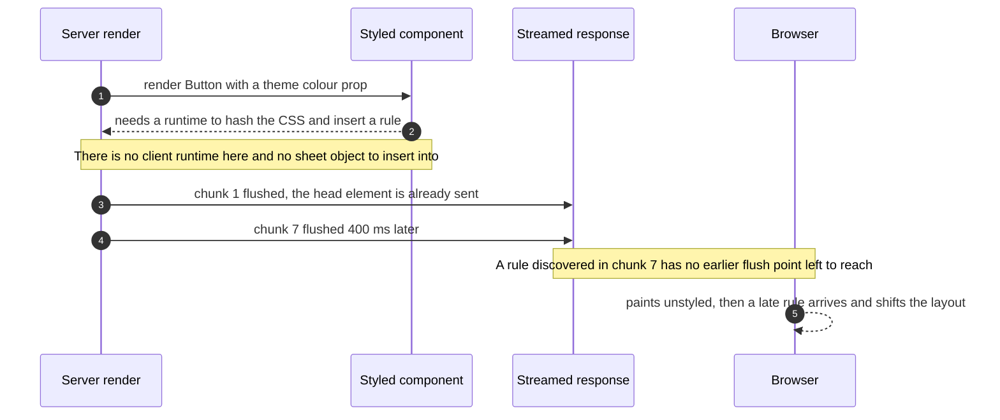
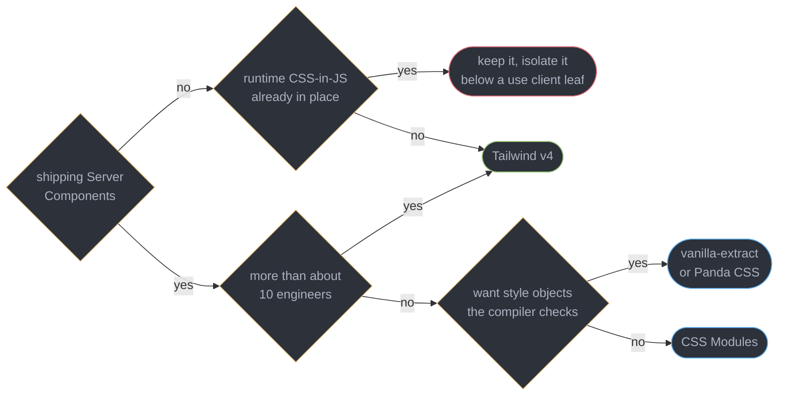
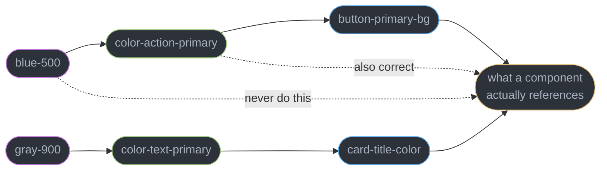
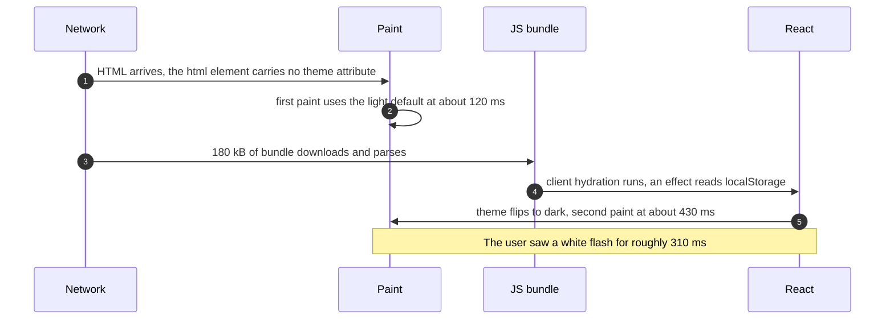
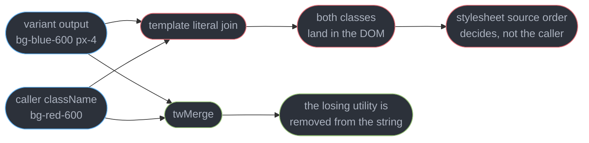

# Styling and Design Systems

---

## 1. Concept Overview

Between 2016 and 2022 the winning answer to "how do I style a React component" was to write CSS inside the component, in JavaScript, and let a runtime insert it into the document. styled-components and Emotion made that idiomatic, and for a client-rendered single-page application it was genuinely good: styles were colocated, scoped by construction, and could read props directly.

Server Components ended that consensus, and not for taste reasons. A runtime CSS-in-JS library has to **execute during render** to turn a template literal into a hashed class name, and then it has to **mutate a document it does not own** to get that rule into a stylesheet. A Server Component runs in a process with no DOM, no `CSSStyleSheet`, and no client runtime to carry state between the two. Streaming makes it worse: an HTML response is flushed in chunks, the `head` leaves the building first, and a rule discovered while rendering chunk 7 has no earlier flush point to reach. This is an architectural incompatibility, not a bug anyone can patch — which is why **styled-components has been in maintenance mode since January 2024**, on its own maintainers' reasoning. That is a statement about where styling belongs in the pipeline, not a criticism of a library that was excellent at the job it was designed for.

What replaced it is a single idea in four costumes: **styles are a build artifact, not a runtime side effect.** CSS Modules, Tailwind CSS v4, vanilla-extract and Panda CSS disagree about authoring syntax and agree completely about output — a static `.css` file, extracted at build time, that a Server Component can reference without executing anything.

This module owns the React and design-system half of that: which approach to pick, how tokens are layered, how theming survives first paint, how a component exposes style hooks without leaking internals, and what it costs to build a component library versus adopt one. It does **not** re-teach CSS. The cascade, specificity, layout, container queries and logical properties belong to [CSS Layout and the Cascade](../../frontend_platform/css_layout_and_the_cascade/css_layout_and_the_cascade.md); transitions and `prefers-reduced-motion` to [CSS Animation and Motion](../../frontend_platform/css_animation_and_motion/css_animation_and_motion.md); ARIA and keyboard contracts to [Accessible Component Patterns](../accessible_component_patterns/accessible_component_patterns.md); the RSC boundary itself to [Server Components and Server Functions](../server_components_and_server_functions/server_components_and_server_functions.md).

Versions verified 2026-09-04: React 19.2, Tailwind CSS v4, MUI v9 (current 9.4), Storybook 10.

---

## 2. Intuition

> **One-line analogy**: runtime CSS-in-JS is a printer that types each page as you read it. Every 2026-viable approach prints the whole book before you open it.

**Mental model**: ask where a style rule *becomes text*. In CSS Modules, Tailwind, vanilla-extract and Panda, it becomes text during `vite build` — the class name is decided by a compiler, and the browser receives a finished stylesheet it can parse in parallel with the HTML. In runtime CSS-in-JS, it becomes text during render, in a JavaScript function, on a machine that must therefore be running JavaScript. Every downstream consequence — RSC compatibility, bundle size, whether a prop can change a colour — follows from that one question.

**Why it matters**: the answer decides whether your design system can live in a Server Component at all. A styled kit that requires `"use client"` at the leaf pushes the boundary up through every parent that renders it, and the boundary is where server-only data access stops. Teams discover this when a `ThemeProvider` at the root turns an entire App Router application back into a client-rendered one, and 240 kB of component library ships to the browser to render a static marketing page.

**Key insight**: **a design system is a naming problem wearing a styling problem's clothes.** Whatever engine you pick, the thing that survives a rebrand, a dark mode, a white-label deployment and a five-year lifespan is a small vocabulary of semantic tokens that consumers reference by intent. `--color-action-primary` outlives three CSS engines. `#3b82f6` copy-pasted into 400 components outlives nothing.

---

## 3. Core Principles

- **Compile styles, do not execute them.** If a class name is computed at render time, it cannot exist in a Server Component and cannot be in the HTML on first paint.
- **Tokens are the contract; the engine is an implementation detail.** Migrating Tailwind to vanilla-extract is a week if tokens are semantic and a quarter if they are hex codes.
- **Semantic naming is what survives a rebrand.** A token named for its value must be renamed when the value changes. A token named for its role never does.
- **CSS custom properties are the runtime carrier.** They let a theme change without React re-rendering anything, because the browser's style engine resolves them, not your components.
- **Theme must be decided before first paint**, which means before any React code exists. Anything that reads `localStorage` after client hydration is already too late.
- **The last conflicting utility does not automatically win** — CSS resolves by specificity and source order, not by the order you concatenated strings. That is the whole reason `tailwind-merge` exists.
- **A component's style API is a public contract.** Expose variants and a `className` escape hatch; do not expose the internal class names of its parts.
- **Arbitrary values are an escape hatch, not a habit.** Every `w-[73px]` is a decision made outside the system, and a system nobody can leave is worth more than one nobody uses.
- **A design system is documented or it is folklore.** A catalogue with every state rendered is what makes visual regression possible and what stops three teams building three dropdowns.

---

## 4. Types / Architectures / Strategies

### 4.1 The four approaches on real criteria

| | CSS Modules | Tailwind v4 | vanilla-extract / Panda | Runtime CSS-in-JS |
|---|---|---|---|---|
| Works in a Server Component | yes | yes | yes | no, needs `"use client"` |
| JS shipped for styling | 0 kB | 0 kB | 0 kB | 12-16 kB plus per-component style objects |
| Style output | one file per module, tree-shaken | one file, ~9-14 kB gzipped for a whole app | one file per `.css.ts`, tree-shaken | injected at runtime, nothing to cache |
| Build cost | negligible, native to Vite | Oxide full build ~100 ms on a mid-size app | a second module graph the bundler must evaluate | none at build, all at render |
| Dynamic values from props | via inline custom properties | via inline custom properties | via `createVar` plus inline properties | native, any expression |
| Type safety | class names typed by a plugin | plugin-based class completion, no type errors | full TypeScript, a typo is a compile error | typed props, untyped CSS strings |
| Team scale-out | weak, nothing enforces a token | strong, the utility set *is* the constraint | strong, tokens are types | weak, every component invents its own props |

### 4.2 Where the boundary actually falls

A runtime library is not banned from a React 19.2 application — it is confined. Marking a styled leaf `"use client"` works, but every ancestor that renders it stays a client component too, and the provider that supplies the theme has to sit above all of them. In practice that means the boundary lands one or two levels below the root, which is the opposite of what App Router is for.

### 4.3 The three token tiers

| Tier | Names | Example | Who references it |
|------|-------|---------|-------------------|
| Primitive | the raw value | `--blue-500: oklch(0.62 0.19 259)` | only the semantic tier |
| Semantic | the role | `--color-action-primary: var(--blue-500)` | components, freely |
| Component | one part of one component | `--button-primary-bg: var(--color-action-primary)` | that component, and consumers overriding it |

### 4.4 Build versus adopt, over three years

| | Headless primitives plus your CSS | A styled kit (MUI v9) |
|---|---|---|
| Week 1 | a button, an input, a dialog | forty components, themed |
| Month 6 | your visual language, exactly | your visual language, approximately |
| Year 3 | you own 8-30 kB per widget family and every upgrade | you fight the theme for every custom design, and a major version is a migration |
| Server Components | native — Base UI and Radix parts are mostly client, the styling is not | MUI v9 defaults to Emotion, so styled leaves need `"use client"` |
| Accessibility | supplied by the primitive, see [Accessible Component Patterns](../accessible_component_patterns/accessible_component_patterns.md) | supplied by the kit |

---

## 5. Architecture Diagrams

### Why a runtime style engine cannot run on the server



Two independent blockers. The render process has nowhere to put a rule, and the response has no single moment at which all rules are known. Both are properties of the architecture, not of any one library.

### Choosing an approach



The first question is architectural and the second is social. Tailwind's advantage at scale is not brevity, it is that thirty engineers cannot invent thirty greys.

### The three token tiers, and the reference that breaks a rebrand



The dotted red path is the one that costs a quarter. A component referencing `blue-500` must be edited when the brand stops being blue, and there are 400 of them.

### The flash of wrong theme, in order



Every step between the two paints is React doing its job correctly. The flash is not a React bug — it is proof that the decision was made too late, and the only earlier place is a blocking script in the document head.

### Why joining class strings is not merging them



The broken path is silent: the caller passed a class, the class is present in the DOM, and the colour is still wrong.

### Retiring a token without breaking consumers

```mermaid
flowchart LR
    classDef aC fill:#2c313a,stroke:#e5c07b,color:#abb2bf
    classDef bC fill:#2c313a,stroke:#61afef,color:#abb2bf
    classDef cC fill:#2c313a,stroke:#98c379,color:#abb2bf
    classDef dC fill:#2c313a,stroke:#e06c75,color:#abb2bf

    T0(["token renamed<br/>at the source"]):::aC --> T1(["minor release: old name<br/>aliases the new one"]):::bC
    T1 --> T2(["build logs every<br/>remaining old usage"]):::bC
    T2 --> T3(["codemod ships<br/>in the same release"]):::cC
    T3 --> T4(["visual regression proves<br/>no pixel moved"]):::cC
    T4 --> T5(["next major<br/>removes the alias"]):::dC
```



The alias is the whole trick. It makes the rename a non-event for consumers and turns the deprecation into a countable number the platform team can watch fall to zero.

---

## 6. How It Works — Detailed Mechanics

### 6.1 The collision, precisely

Take the simplest possible runtime-styled component and put it in an App Router page with no `"use client"` anywhere:

```tsx
// app/page.tsx — a Server Component by default in Next.js 16.
import styled from "styled-components";

const Title = styled.h1`
  color: ${(p) => p.theme.colors.brand};
  font-size: 2rem;
`;

export default function Page() {
  return <Title>Quarterly report</Title>;
}
```

The build fails before any styling question is reached:

> `Error: createContext only works in Client Components. Add the "use client" directive at the top of the file to use it.`

That error is the visible symptom of a deeper thing. `styled` needs three capabilities at render time: React context to read the theme, a stateful sheet object to accumulate rules, and a document to flush them into. A Server Component has none of the three, and the fix — `"use client"` — does not just annotate the file. It moves the file and every module it imports into the client bundle, and it forces every ancestor that renders it to be a client component too, which is where server-only data access stops. The boundary rules are owned by [Server Components and Server Functions](../server_components_and_server_functions/server_components_and_server_functions.md).

The second blocker survives even inside a client component under SSR. A streamed response flushes in chunks and the `head` goes out first. Next.js exposes `useServerInsertedHTML` so a styled-components registry can push collected rules into the stream, and it works — but it collects rules per flush boundary, so a component that renders in a later Suspense chunk gets its `style` element inserted mid-body, after the elements it styles have already been painted. On a 4G connection with a 400 ms streaming gap that is a visible restyle.

Compare what a compiled system does. `vite build` runs the extraction, writes `assets/index-a3f1.css`, and the server sends a `link` element in the head of chunk 1. The browser fetches it in parallel with the HTML, parses it once, caches it on a content hash across deploys, and no JavaScript is involved at any point. The Server Component emits `class="btn btn--primary"` — a string. Strings serialize.

### 6.2 Tailwind v4 concretely

Tailwind v4 replaced the PostCSS-plus-JavaScript pipeline with **Oxide**, a Rust engine, and moved configuration into CSS. There is no `tailwind.config.js` by default; a project is a stylesheet.

```css
/* app.css — this file IS the configuration. */
@import "tailwindcss";

@theme {
  --color-brand-500: oklch(0.62 0.19 259);
  --color-surface: oklch(0.98 0.003 265);
  --font-display: "Inter Variable", ui-sans-serif, system-ui, sans-serif;
  --radius-card: 0.75rem;
  --spacing: 0.25rem;
}
```

Two things happen to every entry in that block, and the second is the one people miss. Tailwind **generates utilities** from it, so `--color-brand-500` yields `bg-brand-500`, `text-brand-500`, `border-brand-500` and the rest. And it **emits the variable itself** into `:root` as a real CSS custom property, so `var(--color-brand-500)` works in hand-written CSS, in an inline style, and in a third-party component that knows nothing about Tailwind. That is what makes v4 a token system rather than a class vocabulary — §6.4 builds on exactly this.

**The class-explosion criticism, answered honestly.** `<button className="inline-flex items-center justify-center rounded-md px-4 py-2 text-sm font-medium ...">` is genuinely unreadable, and pretending otherwise loses the argument. The answer is not a wrapper class that fuses three utilities into one bespoke name — that reintroduces the naming problem Tailwind exists to delete. The answer is that **a repeated class string is a missing component**:

```tsx
// The string appears exactly once, behind a typed API. Callers never see it.
export function Button({ tone = "primary", size = "md", ...props }: ButtonProps) {
  return <button className={button({ tone, size })} {...props} />;
}
```

A design system built this way has perhaps 60 components carrying long strings and 4,000 call sites carrying `<Button tone="ghost" size="sm">`. The long strings are real and they are contained. What Tailwind buys for that price is that the constraint is enforced by the toolchain rather than by review: `p-4` is a token reference with a different syntax, `text-sm` cannot drift to a fourth font size, and a designer's spacing scale is the only spacing that compiles.

**Arbitrary values** — `w-[73px]`, `bg-[#3b82f6]` — are the escape hatch. They are correct for a one-off alignment against a third-party embed and wrong as a habit, because each one is a decision made outside the system that no token rename will ever reach. A useful review rule: an arbitrary value needs a comment saying why the scale did not fit, and three of them in one file means the scale is wrong.

### 6.3 Zero-runtime CSS-in-JS

vanilla-extract and Panda CSS keep the authoring ergonomics of CSS-in-JS — style objects, TypeScript, colocation — and delete the runtime by evaluating the style code **during the build**.

```ts
// button.css.ts — this file runs at build time and ships zero bytes of JavaScript.
import { style, styleVariants, createThemeContract } from "@vanilla-extract/css";

export const vars = createThemeContract({
  color: { actionPrimary: null, textOnAction: null },
  radius: { card: null },
});

const base = style({
  display: "inline-flex",
  alignItems: "center",
  borderRadius: vars.radius.card,
  ":focus-visible": { outline: `2px solid ${vars.color.actionPrimary}` },
});

export const tone = styleVariants({
  primary: [base, { background: vars.color.actionPrimary, color: vars.color.textOnAction }],
  ghost: [base, { background: "transparent", color: vars.color.actionPrimary }],
});
```

The `.css.ts` extension is the signal to the bundler plugin. `createThemeContract` is the part worth stealing conceptually: it declares a token *shape* with `null` values, and any theme that fails to supply every key is a **compile error**, not a missing colour discovered in production. That is type safety a class-name system cannot offer.

Panda CSS takes the same position with a different surface — a `css()` function, `cva`-style recipes, and static extraction that scans your source for call sites. Both share one real constraint, and it is the mirror image of Tailwind's: **the value must be statically analysable.** `style({ color: someRuntimeValue })` cannot work, because the build has already finished. The answer in both is a CSS variable, which §6.6 shows.

CSS Modules remain the honest baseline. Zero new syntax, locally scoped class names, native support in Vite and Next.js, and full CSS features including nesting and container queries. What they do not give you is any enforcement: nothing stops the thirtieth engineer writing `color: #4a4a4a` in `Card.module.css`. For a team of three that is fine. For a team of thirty it is how you get 41 greys.

### 6.4 Design tokens in three tiers

Tokens are how a rebrand becomes a one-file change instead of a quarter. The layering is what makes that true.

```css
/* Tier 1 — primitive. Names the value. Nothing outside tier 2 may reference these. */
:root {
  --blue-500: oklch(0.62 0.19 259);
  --blue-300: oklch(0.78 0.11 259);
  --gray-50:  oklch(0.98 0.003 265);
  --gray-900: oklch(0.21 0.01 265);
}

/* Tier 2 — semantic. Names the ROLE. This is what components reference. */
:root {
  --color-surface:        var(--gray-50);
  --color-text-primary:   var(--gray-900);
  --color-action-primary: var(--blue-500);
}

/* Tier 3 — component. One part of one component, and the public override point. */
:root {
  --button-primary-bg: var(--color-action-primary);
}
```

The rule that carries all the value: **tier 3 references tier 2, tier 2 references tier 1, and a component never reaches past tier 2.** When the brand stops being blue you edit four lines in tier 1 and every semantic role follows. When a component references `--blue-500` directly, you edit that component — and the 399 others that did the same.

Naming discipline matters more than tooling here. `--color-primary` is ambiguous (primary what — text, background, brand?). `--color-action-primary` is not. `--color-danger` describes intent and survives; `--color-red` describes a value and does not, because the day danger becomes orange the token name becomes a lie the compiler cannot catch.

Style Dictionary is the usual generator when tokens must reach more than one platform — one JSON source emitting CSS custom properties for the web, a Swift file for iOS and XML for Android. For a web-only system that is overhead; the CSS file above is the source of truth and Figma variables sync to it.

### 6.5 Theming, and the flash that React cannot fix

Two mechanisms, and you want both. `prefers-color-scheme` is the operating-system signal and should be the default. An explicit override is what a user chooses on your site, and it must beat the OS signal:

```css
:root { --color-surface: var(--gray-50);  --color-text-primary: var(--gray-900); }

@media (prefers-color-scheme: dark) {
  :root:not([data-theme="light"]) {
    --color-surface: var(--gray-900); --color-text-primary: var(--gray-50);
  }
}
:root[data-theme="dark"] {
  --color-surface: var(--gray-900); --color-text-primary: var(--gray-50);
}
```

Every colour has a definition on bare `:root`, so a value never exists **only** inside a media query — that is the rule that keeps an explicit toggle working in both directions.

**Now the flash.** `document.documentElement.dataset.theme` has to be set before the browser's first paint. React cannot do it. Server-rendered HTML is painted at roughly 120 ms; the bundle downloads, parses and runs client hydration at roughly 430 ms; an effect reading `localStorage` runs after that. A dark-mode user sees a white page for about 310 ms, and it is worse on a cold cache. `useLayoutEffect` does not help — it is still after client hydration. Reading `localStorage` during render does not help either, because the *server* rendered the HTML and had no access to it.

The only thing that runs before first paint is a synchronous script in the document head:

```html
<!-- Blocking by design. Roughly 380 bytes, inline, no imports, no await. -->
<script>
  (function () {
    try {
      var t = localStorage.getItem("theme");
      if (t !== "light" && t !== "dark") {
        t = matchMedia("(prefers-color-scheme: dark)").matches ? "dark" : "light";
      }
      document.documentElement.dataset.theme = t;
    } catch (e) { /* private mode: fall through to the CSS default */ }
  })();
</script>
```

It must be **blocking**, not `defer` or `async`, because the point is to run before the parser reaches `body`. The `try/catch` is not decoration: `localStorage` throws outright in some privacy configurations, and an uncaught throw here leaves the whole document unthemed.

The React half is then small, and its job is only to persist a choice and to keep any UI that displays the current theme in step:

```tsx
export function useTheme() {
  // Read from the DOM, not from state — the script above is the source of truth.
  const [theme, set] = useState<"light" | "dark">(
    () => (document.documentElement.dataset.theme as "light" | "dark") ?? "light",
  );
  const toggle = () => {
    const next = theme === "light" ? "dark" : "light";
    document.documentElement.dataset.theme = next;   // one attribute, whole tree restyles
    localStorage.setItem("theme", next);
    set(next);
  };
  return { theme, toggle };
}
```

Flipping one attribute restyles the entire document with **zero React re-renders**, because custom properties are resolved by the browser's style engine and inherit down the tree. That is the payoff for putting colours in variables rather than in a JavaScript theme object: a context-based theme change re-renders every consumer, and on a 3,000-node page that is 40-90 ms of scripting for something the browser does in a single style recalculation. Context re-render cost is owned by [Context and Component Communication](../context_and_component_communication/context_and_component_communication.md).

### 6.6 Composition: merge order, variants, and slots

**`className` merge order is the single most common design-system bug**, and it is silent. A component that joins its own classes with the caller's — `` className={`bg-blue-600 px-4 ${props.className}`} `` — puts **both** `bg-blue-600` and the caller's `bg-red-600` in the class list, and CSS then resolves by specificity and stylesheet source order, which the caller does not control. `tailwind-merge` fixes it by understanding which utilities conflict and removing the loser from the string entirely:

```ts
import { clsx, type ClassValue } from "clsx";
import { twMerge } from "tailwind-merge";

// clsx flattens conditionals and arrays. twMerge resolves conflicts, last wins.
export function cn(...inputs: ClassValue[]) {
  return twMerge(clsx(inputs));
}
// cn("bg-blue-600 px-4", "bg-red-600")  ->  "px-4 bg-red-600"
```

Note `twMerge` costs roughly 6 kB gzipped and does real string work on every render. Calling it inside a list row rendered 500 times is measurable; hoist the static part out or memoize per variant combination.

**A variant API turns visual states into typed props.** `cva` is the common choice and pairs with either Tailwind or Panda:

```ts
import { cva, type VariantProps } from "class-variance-authority";

export const button = cva("inline-flex items-center rounded-md font-medium transition-colors", {
  variants: {
    tone: {
      primary: "bg-[var(--color-action-primary)] text-white hover:brightness-110",
      ghost: "bg-transparent text-[var(--color-action-primary)] hover:bg-black/5",
    },
    size: { sm: "h-8 px-3 text-sm", md: "h-10 px-4 text-sm", lg: "h-12 px-6 text-base" },
  },
  compoundVariants: [{ tone: "ghost", size: "lg", class: "px-4" }],
  defaultVariants: { tone: "primary", size: "md" },
});

export type ButtonVariants = VariantProps<typeof button>;   // { tone?: ..., size?: ... }
```

`VariantProps` is why this is worth a dependency: the prop types are derived from the variant definition, so adding a `tone` adds it to the type with no second edit and removing one turns every stale call site into a compile error.

**Dynamic values without a runtime.** A value known only at render time cannot become a class name, because the build has finished. Route it through a custom property instead — the class stays static and analysable, the value rides an inline style:

```tsx
// The class name never varies, so extraction still sees it. Works identically
// in Tailwind, vanilla-extract (createVar) and Panda.
<div
  className="h-2 w-[var(--pct)] rounded bg-[var(--color-action-primary)]"
  style={{ "--pct": `${percent}%` } as React.CSSProperties}
/>
```

**The `asChild` slot pattern** lets a caller change the rendered element without wrapping it. A `Button` that must be a link should render an `a`, not a `button` inside an `a`:

```tsx
import { Slot } from "@radix-ui/react-slot";

export function Button({ asChild, className, tone, size, ...rest }: ButtonProps) {
  const Comp = asChild ? Slot : "button";
  // The caller's className comes LAST so twMerge lets it win.
  return <Comp className={cn(button({ tone, size }), className)} {...rest} />;
}

// <Button asChild><Link href="/pricing">Pricing</Link></Button>
// renders a single <a> carrying the button's classes, props and ref.
```

`Slot` merges props and forwards the ref onto its single child. Base UI expresses the same idea with a `render` prop, and React Aria with `<Button elementType>`; the semantics are identical.

**What to expose and what to hide.** Expose variants, a `className` escape hatch, and a small set of tier-3 custom properties as documented override points. Do **not** expose internal part class names or a `styles={{ root, label, icon }}` object keyed on internals — the moment a consumer targets `.btn__icon`, that class name is public API and you cannot rename it. A documented `--button-primary-bg` is an override contract you can honour across a refactor; a leaked class name is one you cannot.

### 6.7 Build versus adopt

Headless primitives plus your own styles is the right default in 2026 for any product with a real visual identity: **shadcn/ui defaults to Base UI** for new installs since July 2026, Radix is not deprecated and now installs as a single `radix-ui` package, and React Aria is a first-class option too. You get the accessibility and interaction contracts for free and own every pixel. The shadcn model — generate the source into your repository rather than depending on a package — is a deliberate trade: no upgrade path, total control, and a diff you review.

A styled kit is right when the interface is internal, the visual identity is "clean and consistent", and forty components in week one beats forty components in month three. **MUI v9 still defaults to Emotion**, a runtime engine, so styled leaves need `"use client"` and the RSC constraint in §6.1 applies. (There was no MUI v8: Material UI jumped v7 to v9 on 2026-04-08 to re-align its major with MUI X, so a codebase on v7 is two majors behind, not one.) Pigment CSS is MUI's zero-runtime option, opt-in since v6, and its repository is in an alpha and on-hold state — plan against Emotion, not against a migration that has not shipped. Removing the Emotion dependency is named as future work in the v9 announcement, not something v9 did.

The honest three-year cost: a kit is cheapest in year one and most expensive in year three, when every bespoke design lands as a fight with someone else's theme abstraction and a major version is a migration project. Primitives are the reverse. Pick by how distinctive the product's visual language has to be, and note that the accessibility half of the decision is already made for you by any of the four — see [Accessible Component Patterns](../accessible_component_patterns/accessible_component_patterns.md).

### 6.8 Documenting and shipping the system

**Storybook 10 is ESM-only** and is the catalogue. Its value is not the browsing UI, it is that every component state exists as an addressable, deterministic render — which is exactly what visual regression needs:

```tsx
import type { Meta, StoryObj } from "@storybook/react-vite";
import { Button } from "./Button";

const meta = { title: "Core/Button", component: Button } satisfies Meta<typeof Button>;
export default meta;

// One story per state, not one story with a control. Snapshots need addressable states.
export const Primary: StoryObj<typeof Button> = { args: { tone: "primary", children: "Save" } };
export const GhostDisabled: StoryObj<typeof Button> = {
  args: { tone: "ghost", disabled: true, children: "Save" },
};
```

Visual regression (Chromatic, or Playwright's `toHaveScreenshot`) screenshots each story per commit and diffs against a baseline. It catches the class of change no unit test can: a token edit that moves 200 components by 2 px. Two rules keep it usable — freeze anything non-deterministic (dates, random ids, animation via `prefers-reduced-motion`, and note `useId` output changes with tree position), and pin the browser version, because a font-rendering change in a new Chromium build flags every story at once. Runners and CI wiring belong to [Testing and Frontend CI](../testing_and_frontend_ci/testing_and_frontend_ci.md).

**Versioning a component API.** A component's props are a public contract under semver. Adding an optional prop or a variant is a minor. Changing a default, removing a prop, renaming a variant value, or altering the rendered element is a **major** — and a major without a codemod is a major nobody adopts. Ship `jscodeshift` transforms in the same release; the difference between a 3-week and a 9-month migration is whether consumers can run one command.

**Deprecating a token** follows §5's last diagram. Alias the old name to the new one in a minor release so nothing breaks, log every remaining usage during the build so the count is visible, ship the codemod, prove with visual regression that the rename moved no pixels, and remove the alias only in the next major. Skipping the alias step is what turns a rename into an outage.

---

## 7. Real-World Examples

**The provider that unmade an App Router migration.** A B2B analytics product moved to Next.js App Router expecting a smaller client bundle. Its design system was built on Emotion with a root `ThemeProvider`, so the provider needed `"use client"`, which made the root layout a client component and every page under it client-rendered. The client bundle went from 412 kB to 438 kB — it grew. Rewriting the theme as CSS custom properties on `:root` and the components as CSS Modules took eleven weeks and brought first-load JS to 96 kB, because the marketing and docs routes stopped shipping any component-library code at all.

**41 greys.** A fintech design team audited a four-year-old CSS Modules codebase and found 41 distinct grey hex values across 190 module files, 12 of them within 2% of each other. Nothing was broken and nothing was enforceable — CSS Modules scope names, not values. They introduced a semantic token layer and a lint rule banning raw hex outside the primitive file, then migrated over two quarters. The follow-on dark mode took nine days instead of the estimated quarter, because the work was redefining 31 semantic tokens rather than editing 190 files.

**The `className` that did nothing.** A component library's `Badge` joined its own classes with the caller's using a template literal. A product team passed `className="bg-red-600"` for an error state and got blue, because the library's `bg-blue-100` was defined later in the stylesheet. Three teams independently worked around it with `!important` before anyone filed a bug. Switching the library's `cn()` to `twMerge` removed the losing utility from the string and let 14 `!important` declarations be deleted.

**The theme flash that cost a redesign its launch metrics.** A media site shipped dark mode with the theme in React state and `localStorage` read in an effect. Every dark-mode reader got a full-screen white flash of roughly 310 ms on each cold navigation. Support volume tripled for a week and the change was reverted before anyone identified the cause. It shipped again six weeks later with a 380-byte blocking script in `head` and no flash at all.

---

## 8. Tradeoffs

| Choice | Bought | Paid |
|--------|--------|------|
| Compiled CSS over a runtime engine | works in Server Components, 0 kB of styling JS, a cacheable file | dynamic values need a custom-property indirection |
| Tailwind v4 over CSS Modules | the constraint is enforced by the toolchain, not by review | long class strings, and a real onboarding cost |
| CSS Modules over Tailwind | zero new syntax, plain CSS everywhere | nothing enforces a token, so values drift with team size |
| vanilla-extract over both | tokens are types and a missing one is a compile error | a second module graph in the build, and a smaller ecosystem |
| `@theme` over a JS config file | tokens land as real custom properties usable outside Tailwind | no JavaScript access to the token values at runtime |
| Semantic over primitive token names | a rebrand is a four-line change | one more indirection to trace when debugging a colour |
| CSS custom properties over a JS theme object | a theme flip costs zero React re-renders | no type checking on a variable name, and a typo is silent |
| Blocking inline theme script | no flash of the wrong theme | roughly 380 bytes of render-blocking script in every document |
| `tailwind-merge` in `cn()` | the caller's class actually wins | about 6 kB gzipped and string work on every render |
| Headless primitives over a styled kit | exact visual control, RSC-native styling | you build and maintain forty components |
| A styled kit over primitives | forty themed components in week one | every custom design fights the theme, and a major is a migration |
| Visual regression in CI | catches the 2 px shift no unit test can | flaky without pinned fonts, browser version and frozen motion |

---

## 9. When to Use / When NOT to Use

**Reach for Tailwind v4 when:**

- More than about ten engineers touch the CSS, and you need the constraint enforced by the toolchain rather than by code review.
- The application is Server Component heavy and you want styling to cost zero client JavaScript.
- The design already has a defined scale — spacing, type, colour — that maps cleanly onto `@theme` tokens.

**Reach for vanilla-extract or Panda when:**

- Token correctness must be a compile error, not a visual bug. `createThemeContract` catching a missing colour at build time is the specific reason.
- The team is small, TypeScript-heavy, and already reasons in style objects.

**Reach for CSS Modules when:**

- The team is small enough that discipline works, or the project is short-lived enough that drift never compounds.
- You need full CSS with no abstraction — complex grid, container queries, `@supports` branching.

**Reach for a styled kit (MUI v9) when:**

- The interface is internal tooling and consistency matters more than distinctiveness.
- Forty components in week one is the actual requirement, and you accept `"use client"` on styled leaves.

**Do NOT introduce runtime CSS-in-JS when:**

- The application renders any Server Components. This is architectural, not stylistic — §6.1.
- You are starting a new project in 2026 for any reason. The compiled options cover every case the runtime one did, except a style that must be computed from a value the build cannot see, which a custom property solves.

**Do NOT build your own component library when:** the product has no distinctive visual identity, or the team is under about eight engineers. Forty accessible components is roughly two engineer-quarters, and it is a permanent maintenance liability, not a one-time cost.

**Do NOT put theme in React state alone when:** the application is server-rendered. The flash is unavoidable without a blocking script, and no amount of React cleverness moves work before first paint.

---

## 10. Common Pitfalls

**A `className` prop that is overridden because merge order was wrong.** The caller's class is present in the DOM and still loses.

```tsx
// BROKEN: both bg-blue-600 and the caller's bg-red-600 reach the DOM. CSS resolves
// by specificity and stylesheet source order, so the caller wins only by luck.
export function Badge({ className, children }: BadgeProps) {
  return <span className={`bg-blue-600 px-2 py-1 rounded ${className ?? ""}`}>{children}</span>;
}
// <Badge className="bg-red-600" />  renders BLUE, silently.

// FIX: twMerge understands that bg-* utilities conflict and deletes the loser
// from the string. The caller's class goes LAST so last-write-wins is real.
export function Badge({ className, children }: BadgeProps) {
  return <span className={cn("bg-blue-600 px-2 py-1 rounded", className)}>{children}</span>;
}
// <Badge className="bg-red-600" />  renders RED, and no !important is needed.
```

**Building a class name from a runtime value.** Every static-extraction system scans your source for complete class strings, so a name assembled at render time is never generated.

```tsx
// BROKEN: the build sees the template literal, never the string "text-red-500".
// The element renders with a class that has no matching rule anywhere.
<p className={`text-${status}-500`}>{label}</p>

// FIX: a lookup of complete literals, which extraction can see.
const statusClass = { ok: "text-green-500", warn: "text-amber-500", err: "text-red-500" } as const;
<p className={statusClass[status]}>{label}</p>
```

**Defining a colour only inside a media query.** A token that exists only under `@media (prefers-color-scheme: dark)` has no value when an explicit `[data-theme="dark"]` override is active on a light-preference machine, so the element falls back to the inherited colour. Define every token on bare `:root` first, then redefine it in each theme block.

**A theme object in React context.** Changing it re-renders every consumer — 40-90 ms of scripting on a 3,000-node page — to accomplish what one attribute flip and a style recalculation do for free. Keep colours in custom properties; use context only for the current theme *name*, if any UI needs to display it.

**Calling `twMerge` inside a hot list.** It parses and rewrites the class string on every call. In a virtualized table rendering 500 rows per scroll frame it shows up as a flat 8-12 ms of scripting. Hoist the static portion or memoize per variant combination — [React Performance and Profiling](../react_performance_and_profiling/react_performance_and_profiling.md) owns the measurement.

**Leaking internal class names as the override API.** Documenting `.btn__icon` as the way to restyle an icon makes that string public API. The first internal refactor that renames it is a breaking change you did not intend to ship. Expose tier-3 custom properties instead.

**Arbitrary values as a habit.** `w-[73px]` and `bg-[#3b82f6]` are outside the token system, so a rebrand and a scale change both miss them. One with a comment is fine; three in a file means the scale is wrong and should be fixed there.

**Visual regression without pinned rendering.** An unpinned browser image, a system font fallback, or an unfrozen animation makes every story diff on some random Tuesday, and a suite that cries wolf gets its baseline blanket-approved — which is the same as not having it.

---

## 11. Technologies & Tools

| Tool | Purpose |
|------|---------|
| Tailwind CSS | Utility-first CSS, v4 with the Oxide engine and CSS-first `@theme` |
| CSS Modules | Locally scoped class names, native to Vite and Next.js |
| vanilla-extract | Zero-runtime CSS-in-TypeScript, compile-time theme contracts |
| Panda CSS | Zero-runtime style functions and recipes with static extraction |
| Emotion | Runtime CSS-in-JS, still MUI v9's default engine |
| styled-components | Runtime CSS-in-JS, in maintenance mode since January 2024 |
| Lightning CSS | Rust CSS transformer and minifier under Tailwind v4 and Vite |
| class-variance-authority | Typed variant API generating class strings from props |
| tailwind-merge | Removes conflicting Tailwind utilities so the last one wins |
| clsx | Conditional class-name concatenation, under 1 kB |
| Base UI | Unstyled primitives, the shadcn/ui default since July 2026 |
| Radix Primitives | Unstyled primitives with `asChild`, now one `radix-ui` package |
| shadcn/ui | Generates component source into your repository, not a dependency |
| MUI | Styled component kit, v7 on Emotion |
| Style Dictionary | Compiles one token source to CSS, Swift and XML outputs |
| Storybook | Component catalogue, v10 is ESM-only |
| Chromatic | Hosted visual regression built on Storybook stories |

---

## 12. Interview Questions with Answers

**Q: Why does styled-components struggle with React Server Components?**
**Short:** Runtime style injection needs a JavaScript engine executing during render, and a Server Component has neither that nor a single flush point in a streamed response to inject into.

Two independent blockers. `styled` reads its theme from React context and accumulates rules in a stateful sheet object, so the file needs `"use client"` — which pulls it and every ancestor rendering it into the client bundle, exactly where server-only data access stops. Even inside a client component under SSR, a streamed response flushes the `head` first, so a rule discovered while rendering a later Suspense chunk gets inserted mid-body after its elements have painted. Its maintainers put the library in maintenance mode in January 2024 on precisely this reasoning, and every compiled alternative sidesteps both problems by emitting a plain class-name string that serializes.

**Q: Tailwind produces unreadable class strings. What is the honest answer to that?**
**Short:** Long class strings are real, and the fix is component extraction with a typed variant API — not a wrapper class that fuses utilities back into bespoke names.

Conceding the point first matters, because a 14-utility button really is unreadable. But a repeated class string is a missing component: the string should appear once, inside `Button`, behind `cva` variants that give callers `tone="ghost" size="sm"`. A system built that way has roughly 60 components carrying long strings and 4,000 call sites carrying props. What you buy for that price is a constraint the toolchain enforces rather than code review — `text-sm` cannot drift into a fourth font size, and thirty engineers cannot invent thirty greys, which is exactly what a CSS Modules codebase does at scale.

**Q: How do you eliminate the flash of the wrong theme?**
**Short:** Reading the stored preference in a blocking inline script in the document head sets the theme attribute before first paint, which is the only moment early enough.

The timeline is what makes it unavoidable in React: server HTML paints at roughly 120 ms, the bundle downloads and parses, client hydration runs at roughly 430 ms, and an effect reading `localStorage` runs after that — a 310 ms white flash for every dark-mode user. `useLayoutEffect` does not help because it is still after client hydration, and reading `localStorage` during render does not help because the server rendered the markup and had no access to it. A 380-byte synchronous script setting `documentElement.dataset.theme`, wrapped in `try/catch` because `localStorage` throws in some privacy modes, is the whole fix. React then only persists the choice.

**Q: What is the difference between a primitive and a semantic token, and why does it matter?**
**Short:** Primitive tokens name a value while semantic tokens name a role, and only the role survives a rebrand because every consumer references intent rather than a colour.

`--blue-500: oklch(0.62 0.19 259)` is primitive; `--color-action-primary: var(--blue-500)` is semantic; `--button-primary-bg: var(--color-action-primary)` is the component tier and the public override point. The rule that carries the value is that a component never reaches past the semantic tier. When the brand stops being blue you edit four primitive lines and everything follows — versus editing the 400 components that referenced `--blue-500` directly. The same discipline applies to naming: `--color-danger` survives danger becoming orange, `--color-red` becomes a lie the compiler cannot catch.

**Q: A caller passes className and the style does not change. What is happening?**
**Short:** Merging two class strings leaves both conflicting utilities in the DOM, so the winner is whichever the stylesheet defines last, not whichever the caller passed.

A template-literal join puts `bg-blue-600` and `bg-red-600` in the same class list, and CSS then resolves by specificity and source order — the caller wins only by coincidence. This is why teams reach for `!important` and why the bug survives review: the class really is in the DOM. `tailwind-merge` understands which utility groups conflict and deletes the loser from the string, so a `cn()` helper wrapping `clsx` and `twMerge`, with the caller's `className` passed last, makes last-write-wins actually true. Budget roughly 6 kB gzipped and keep it out of a hot list render.

**Q: What changed in Tailwind v4's configuration model?**
**Short:** CSS-first configuration puts tokens in a `@theme` block inside the stylesheet, compiled by the Rust Oxide engine, with no JavaScript config file required by default.

Each entry does two things. It generates the utility family — `--color-brand-500` yields `bg-brand-500`, `text-brand-500`, `border-brand-500` — and it emits the variable itself into `:root` as a real CSS custom property. That second half is what makes v4 a token system rather than a class vocabulary: `var(--color-brand-500)` works in hand-written CSS, in an inline style, and in a third-party component that has never heard of Tailwind. The tradeoff is that the values are no longer readable from JavaScript at build time the way a JS config's export was.

**Q: How does vanilla-extract avoid shipping a runtime?**
**Short:** Compiling style objects to static class names during the build is what makes it zero-runtime — a `.css.ts` file executes at build time and never reaches the browser.

The extension is the signal to the bundler plugin, which evaluates the module, emits a real `.css` file, and replaces the imports with the generated class-name strings. `createThemeContract` is the part worth stealing: it declares a token shape with `null` values so any theme missing a key is a compile error rather than a colour missing in production — type safety no class-name system can offer. The constraint is the mirror of Tailwind's: a value must be statically analysable, so anything computed at render time has to travel through a CSS variable set in an inline style.

**Q: When are CSS Modules still the right answer, and when do they fail?**
**Short:** Locally scoped class names keep specificity flat with zero new syntax, but nothing enforces a token, so a team of thirty accumulates dozens of near-identical greys.

They are native to Vite and Next.js, give you full CSS including nesting and container queries, and have no learning curve — genuinely correct for a team of three or a short-lived project. The failure mode is drift, and it is invisible: one audit of a four-year-old codebase found 41 grey hex values across 190 module files, 12 within 2% of each other, with nothing broken and nothing enforceable. Scoping solves collisions, not consistency. If you keep CSS Modules past about ten engineers, add a semantic token layer and a lint rule banning raw hex outside the primitive file.

**Q: How should a component expose its visual variants?**
**Short:** A variant API turns visual states into typed props, so callers pick a tone and a size rather than assembling a class string themselves.

`cva` defines a base string plus named variant groups, `compoundVariants` for combinations that need an override, and `defaultVariants`. The reason it earns a dependency is `VariantProps<typeof button>`, which derives the prop types from the definition — adding a tone adds it to the type with no second edit, and removing one turns every stale call site into a compile error. Pair it with a `className` escape hatch merged last, and resist adding a variant for a one-off: two call sites is a `className`, ten is a variant.

**Q: What does asChild solve that a wrapper element does not?**
**Short:** Rendering into the caller's element instead of a wrapper is what `asChild` does, merging props and forwarding the ref so a link can carry a button's styling with no nested tag.

Without it, a `Button` that must navigate produces a `button` inside an `a` or vice versa — invalid HTML, a broken accessibility tree, and two focusable elements where the user expects one. Radix's `Slot` merges its props onto its single child and forwards the ref; Base UI expresses the same idea with a `render` prop and React Aria with `elementType`. The gotchas are that the child must be a single element that accepts a ref, and that your own `className` must still merge with the child's rather than replacing it.

**Q: Build your own component library or adopt a styled kit?**
**Short:** Adopting a styled kit is cheapest in year one and most expensive by year three, when every bespoke design becomes a fight with someone else's theme abstraction.

A kit gives forty themed components in week one, which is the right call for internal tooling where consistency beats distinctiveness — accepting that MUI v9 still defaults to Emotion, so styled leaves need `"use client"` and the RSC constraint applies. Headless primitives plus your own CSS invert the curve: more work up front, exact visual control, and styling that is RSC-native. Base UI is shadcn/ui's default for new installs since July 2026, Radix is not deprecated and now installs as a single `radix-ui` package, and React Aria is first-class. Roughly two engineer-quarters for forty accessible components is the number to plan against.

**Q: How do you style something with a value only known at runtime, without a runtime engine?**
**Short:** Passing the value through a CSS custom property in an inline style keeps the class name static, so build-time extraction still sees it.

Write `className="w-[var(--pct)]"` and `style={{ "--pct": \`${percent}%\` }}` — the class is a complete literal the compiler can extract, and the browser resolves the variable per element. The same shape works in vanilla-extract via `createVar` and in Panda. What does not work is building the class name itself: `` `text-${status}-500` `` is never generated, because extraction scans source text for whole strings and that one never appears. Use a lookup object of complete literals for the small enumerated case, and a custom property for the continuous one.

**Q: Why put theme colours in CSS custom properties instead of a React context value?**
**Short:** Custom properties are resolved by the browser's style engine, so flipping one attribute on the root restyles the whole tree without React re-rendering a single component.

A theme object in context re-renders every consumer on change — 40-90 ms of scripting on a 3,000-node page to achieve what one attribute flip plus a style recalculation does for free. Variables also inherit, so a scoped override on a subtree themes just that subtree with no provider nesting. The costs are honest: no type checking on a variable name, so a typo silently inherits, and no JavaScript access to the resolved value without `getComputedStyle`. Keep context for the current theme *name* if some UI must display it.

**Q: How do you rename or remove a design token without breaking consumers?**
**Short:** Deprecating a token means aliasing it to its replacement for a full minor release, logging every remaining usage in the build, and removing it only at the next major.

The alias is what makes the rename a non-event: consumers keep compiling, and the build log turns the deprecation into a number the platform team watches fall to zero. Ship a codemod in the same release, because the difference between a three-week and a nine-month migration is whether one command does it. Then prove with visual regression that the rename moved no pixels — a token rename that also changes a value is two changes, and shipping them together makes the diff unreadable. Remove the alias only in the next major.

**Q: What is Storybook actually for once you have unit tests?**
**Short:** Storybook 10 is ESM-only and its real value is a per-state catalogue that visual regression can screenshot deterministically, catching what assertions cannot.

A unit test asserts behaviour; it cannot tell you that a token edit moved 200 components by 2 px. One story per state — not one story with controls — gives each state an addressable URL that Chromatic or Playwright's `toHaveScreenshot` can diff per commit. Determinism is the whole game: freeze dates and random ids, disable animation, remember that `useId` output changes with tree position, and pin the browser image, because a Chromium font-rendering change flags every story at once and a suite that cries wolf gets blanket-approved.

**Q: How do you version a component library's public API?**
**Short:** Breaking a component's prop contract is a major version, and whether a codemod ships alongside it decides if consumers actually upgrade.

Adding an optional prop or a new variant value is a minor. Changing a default, removing a prop, renaming a variant, or altering the rendered element is a major — including the subtle one, since a consumer's CSS may target the old tag. The trap is treating internal class names as private: the moment `.btn__icon` appears in documentation as the override mechanism, renaming it is a breaking change you did not mean to ship. Expose tier-3 custom properties as the documented override point instead, and pair every major with `jscodeshift` transforms.

---

## 13. Best Practices

- Choose a compiled system for anything new, and confine any existing runtime engine below a `"use client"` leaf rather than at the root.
- Define primitive, semantic and component token tiers, and enforce with a lint rule that components never reference a primitive directly.
- Name tokens for the role they play, never for the value they hold.
- Give every colour a definition on bare `:root` before redefining it in a media query or a `[data-theme]` block.
- Set the theme attribute in a blocking inline script in `head`, wrapped in `try/catch`, and let React only persist the choice.
- Route every conflicting-class merge through one `cn()` helper built on `clsx` plus `twMerge`, with the caller's `className` passed last.
- Extract any class string that appears twice into a component with a `cva` variant API.
- Carry runtime values in CSS custom properties on an inline style, and never assemble a class name from a variable.
- Expose variants, a `className` prop and documented custom properties as the override surface — never internal part class names.
- Write one Storybook story per state, pin the browser and fonts for visual regression, and ship a codemod with every major.

---

## 14. Case Study

**Problem.** A healthcare scheduling SaaS with 190 screens ran on Emotion with a root `ThemeProvider` and shipped a 438 kB first-load client bundle after an App Router migration that was supposed to shrink it. Three symptoms arrived in the same quarter: a white flash of roughly 310 ms on every cold load for the 34% of users on dark mode, a rebrand for a white-label customer estimated at one quarter of engineering, and a component library whose `className` prop was documented as "may not work" because three teams had worked around it with `!important`.

**Investigation.** All three traced to one decision: styles were produced at runtime and colours lived in a JavaScript object. The provider forced `"use client"` at the root, so every route shipped the component library even when it rendered static content. The theme object meant a colour change was a React state change, which meant the theme could not be known before client hydration, which meant the flash. And the rebrand was a quarter because 400 components referenced palette keys like `theme.colors.blue500` directly — there was no semantic layer to redefine.

**Root cause.** One `Badge` component contained the whole pattern:

```tsx
// BROKEN: three defects, none of which throws.
// 1. Runtime engine, so the file needs "use client" and drags its parents along.
// 2. Colour read from a JS theme object, so a theme change is a React re-render.
// 3. The caller's className is joined, not merged, so it loses to source order.
"use client";
import styled from "styled-components";

const Root = styled.span<{ tone: Tone }>`
  background: ${(p) => p.theme.colors.blue500};
  padding: 4px 8px;
`;

export function Badge({ tone, className, children }: BadgeProps) {
  return <Root tone={tone} className={`badge ${className ?? ""}`}>{children}</Root>;
}
```

**Fix.** Three tiers of tokens as CSS custom properties, Tailwind v4 with `@theme` for the utilities, `cva` for variants, and a `cn()` helper on `twMerge`:

```tsx
// FIX: no directive, no runtime, no theme object. Renders in a Server Component.
import { cva, type VariantProps } from "class-variance-authority";
import { cn } from "@/lib/cn";

const badge = cva("inline-flex items-center rounded px-2 py-1 text-xs font-medium", {
  variants: {
    tone: {
      info: "bg-[var(--color-status-info-bg)] text-[var(--color-status-info-fg)]",
      danger: "bg-[var(--color-status-danger-bg)] text-[var(--color-status-danger-fg)]",
    },
  },
  defaultVariants: { tone: "info" },
});

export function Badge({ tone, className, children }: BadgeProps & VariantProps<typeof badge>) {
  // className LAST so twMerge lets the caller win. No "use client" anywhere.
  return <span className={cn(badge({ tone }), className)}>{children}</span>;
}
```

A 380-byte blocking script in `head` set `data-theme` before first paint, and 61 semantic tokens were defined on bare `:root` with overrides in a `[data-theme="dark"]` block. The migration ran component by component over fourteen weeks behind Storybook 10 stories and Chromatic baselines, so each of the 190 screens was proven pixel-identical before its old file was deleted.

**Results.**

- First-load client JS: 438 kB to 104 kB, because 71 of 190 routes stopped shipping any component-library code.
- Flash of wrong theme: about 310 ms to 0, measured as the gap between first paint and the correct background.
- Largest Contentful Paint at p75: 2.9 s to 1.7 s on 4G, dominated by the stylesheet being cacheable and parseable in parallel.
- The white-label rebrand: one quarter estimated, nine days actual — 61 semantic token definitions rather than 400 component edits.
- `!important` declarations in product code: 14 to 0.
- Visual regressions caught before release during the migration: 23, of which 19 were spacing changes no unit test asserted.

**Lesson.** The bundle size, the flash and the rebrand estimate looked like three separate problems owned by three separate teams. They were one decision — computing styles at runtime and holding colours in JavaScript — and fixing that decision fixed all three without anyone working on two of them. The generalisable rule is that where a style rule *becomes text* determines what your entire architecture can do, and it is worth deciding deliberately rather than inheriting from whatever the first component used.
