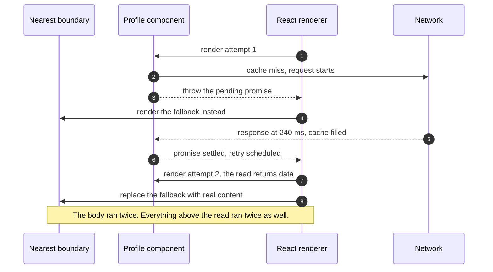
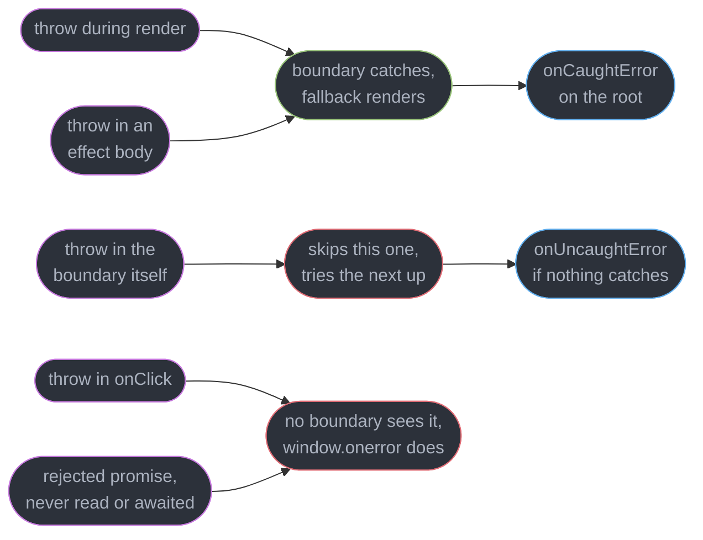
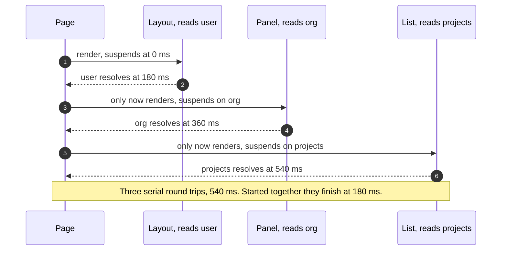
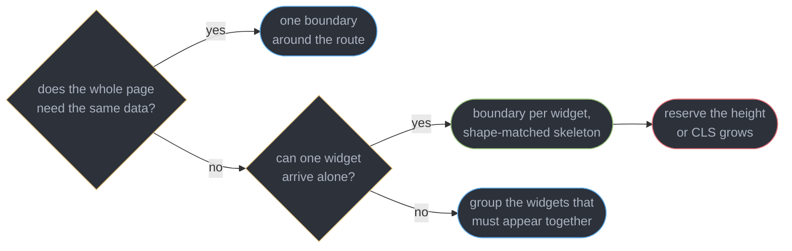
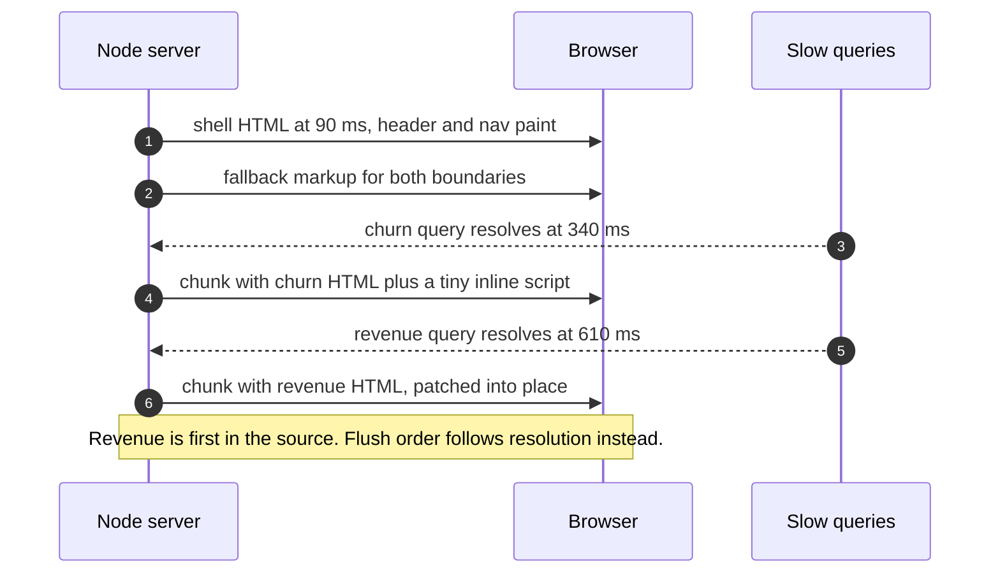
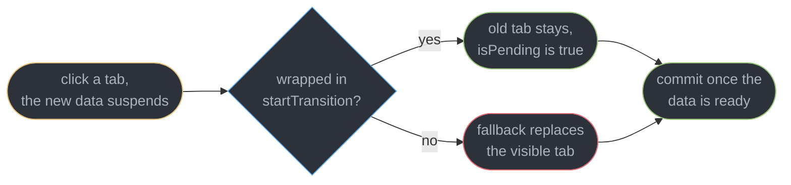

# Suspense and Error Boundaries

---

## 1. Concept Overview

Suspense and error boundaries are the same idea applied to the two things that go wrong when a component needs something it does not have. One says *this subtree is not ready yet*, the other says *this subtree cannot render at all*. Both are answered by an ancestor, not by the component itself, and both work by the child signalling upward: a component suspends by throwing a thenable, and it fails by throwing an error. React walks up the fiber tree, finds the nearest boundary of the matching kind, and renders that boundary's fallback in place of everything below it.

That inversion is the whole design. A component that reads data does not manage a loading flag, a spinner and an error banner alongside its real output; it renders as if the data is present, and the two states live in the tree above it. What used to be three interleaved branches inside one function becomes one function and two placements.

Which makes **placement an architecture decision**. A boundary defines a unit of independent failure and a unit of independent arrival: everything inside it appears at once and disappears at once. One boundary around a whole route means the slowest query holds the entire page; a boundary per widget means eight skeletons that fill in separately and eight opportunities for layout shift. The same placement also decides where a server can flush HTML during streaming SSR, so the boundary you drew for loading states is also your progressive-rendering plan.

This module covers the mechanism, `use()` `[19]`, boundary granularity, streaming SSR flush points, what error boundaries do not catch, and the transition interaction. Transitions themselves belong to [Concurrent Rendering and Transitions](../concurrent_rendering_and_transitions/concurrent_rendering_and_transitions.md); the fiber walk to [Fiber and Reconciliation](../fiber_and_reconciliation/fiber_and_reconciliation.md); the libraries that actually fetch to [Server State and Data Fetching](../server_state_and_data_fetching/server_state_and_data_fetching.md); client hydration to [Rendering Strategies, Client Hydration and SEO](../rendering_strategies_hydration_and_seo/rendering_strategies_hydration_and_seo.md). Target is React 19.2 (released 2025-10-01, latest patch 19.2.8 as of 2026-07-21).

---

## 2. Intuition

> **One-line analogy**: a boundary is a circuit breaker panel. The appliance does not decide what happens when it trips — the panel does, and how you group the circuits decides how much of the house goes dark.

**Mental model**: every component renders in one of three worlds — ready, not ready, broken. The component itself only ever writes code for *ready*. `Suspense` supplies the not-ready view, an error boundary supplies the broken view, and both are placed by whoever assembles the page and therefore knows how much of it may go dark at once.

**Why it matters**: the two failure modes are opposite and both expensive. A single boundary at the route level means a dashboard whose slowest widget takes 1,400 ms shows a blank screen for 1,400 ms, even though six of its eight widgets were ready at 120 ms. A boundary per widget with mismatched skeletons means eight elements resolving at eight different times, each one taller or shorter than its placeholder, producing a Cumulative Layout Shift score of 0.31 against a good threshold of 0.1.

**Key insight**: **a boundary controls what is shown while waiting, never when the waiting starts.** Wrapping a slow child in `Suspense` makes the wait pretty; it does not make the request earlier. That single sentence is the answer to most request-waterfall confusion — the fix is always to start the request higher up or in parallel, and the boundary is unrelated to it.

---

## 3. Core Principles

- **Suspending is a throw, and the nearest matching ancestor handles it.** Throw a thenable and the nearest `Suspense` responds; throw an `Error` and the nearest error boundary responds. Neither is caught by the component that threw.
- **A suspended component's body has already run, and will run again.** Everything before the read executes on every attempt, so the render must be pure and cheap up to the suspension point.
- **The boundary is the unit of arrival and of failure.** Everything inside appears together and fails together. Drawing boundaries is drawing those units.
- **Placement decides display, not scheduling.** Waterfalls are fixed by hoisting or parallelizing the fetch, never by moving a boundary.
- **The promise must outlive the render attempt.** A promise created during render is new on every retry, so the read never resolves and the component loops.
- **Error boundaries are render-phase only.** Event handlers, timers, `setTimeout` callbacks, and un-awaited rejections never reach one.
- **Error boundaries are still classes in 19.2.** There is no hook equivalent, which is why one small class or `react-error-boundary` appears in essentially every production codebase.
- **A transition that suspends keeps the old UI.** The fallback is for content that has nothing to replace, not for content being replaced.

---

## 4. Types / Architectures / Strategies

### 4.1 What actually suspends

| Source | Suspends | Note |
|--------|----------|------|
| `use(promise)` `[19]` | Yes | The promise must be created outside render or cached |
| `React.lazy` | Yes | On the dynamic `import()` promise, once per chunk |
| A Server Component awaiting data | Yes | The `await` is the suspension, resolved on the server |
| A query library with `useSuspenseQuery` | Yes | TanStack Query v5 throws its in-flight promise |
| `fetch` inside `useEffect` | **No** | The effect runs after commit — a boundary above it never fires |
| An `async` event handler | **No** | Nothing throws during render |

### 4.2 Boundary granularity

| Shape | Time to first useful pixel | Failure blast radius | Layout-shift risk |
|-------|---------------------------|----------------------|-------------------|
| One boundary per route | Slowest query, 1,400 ms on a dashboard | The whole page | None — one swap |
| One per region (3-5 boundaries) | Slowest query in the region | One region | Low, if regions are fixed height |
| One per widget (8-12) | Fastest query, 120 ms | One widget | High without reserved heights |
| Nested, region inside route | Shell at 90 ms, regions after | Graded | Low — the shell never moves |

### 4.3 Error-boundary methods

| API | Phase | Can set state | Runs during SSR | Use for |
|-----|-------|---------------|-----------------|---------|
| `static getDerivedStateFromError` | render | yes, by returning state | no | Deciding the fallback UI |
| `componentDidCatch` | commit | yes, imperatively | no | Logging, with the component stack |
| `onCaughtError` root option `[19]` | commit | n/a | no | Central telemetry for handled errors |
| `onUncaughtError` root option `[19]` | commit | n/a | no | Errors with no boundary above them |
| `onRecoverableError` root option | commit | n/a | client hydration | Mismatches React repaired by itself |

### 4.4 Fallback strategies, in order of preference

| Strategy | Mechanism | Use when |
|----------|-----------|----------|
| Previous content via `startTransition` | React keeps the committed tree | The user is replacing content that already exists |
| Shape-matched skeleton | Same box model as the resolved widget | First load of a known-size region |
| Reserved empty space | Fixed height, no visual noise | Sub-100 ms expected waits |
| Spinner | Generic | Genuinely unknown shape, last resort |

---

## 5. Architecture Diagrams

### The suspend and retry cycle



Attempt 1 is thrown away entirely — no commit, no effects, no DOM. That is why work placed before a read is paid for once per attempt.

### Where each error goes



The two red paths are where every production incident in this topic comes from: a handler that throws leaves the UI in a half-updated state with a clean-looking screen and a console entry nobody reads.

### The waterfall a nested boundary hides



Each level cannot even ask for its data until the level above committed. Depth is the multiplier, so a four-level page on a 180 ms link costs 720 ms of pure serialization.

### Choosing granularity



The last node is not optional advice. Eight independent fill-ins with unreserved heights measured 0.31 CLS on a real dashboard, against the 0.1 good threshold.

### Streaming SSR flush order



The inline script moves each late chunk from a hidden container into its boundary's slot, which is what makes out-of-order streaming possible without holding the response open.

### Suspending inside a transition



Same components, same promise, same boundary — only the urgency of the update differs, and the user-visible result is a spinner versus a dimmed tab that never blanks.

---

## 6. How It Works — Detailed Mechanics

### 6.1 A component suspends by throwing

There is no `isLoading` in a suspending component. The read either returns a value or throws the promise that will eventually produce one, and React treats the throw as a signal rather than a failure.

```ts
// The primitive every Suspense-aware library implements. Status lives OUTSIDE render.
type Entry<T> = { status: "pending" | "ok" | "err"; value?: T; error?: unknown; p: Promise<T> };
const cache = new Map<string, Entry<unknown>>();

export function read<T>(key: string, load: () => Promise<T>): T {
  let e = cache.get(key) as Entry<T> | undefined;
  if (!e) {
    const p = load().then(
      (v) => { e!.status = "ok"; e!.value = v; },
      (err) => { e!.status = "err"; e!.error = err; },
    );
    e = { status: "pending", p };
    cache.set(key, e as Entry<unknown>);
  }
  if (e.status === "pending") throw e.p;      // suspend
  if (e.status === "err") throw e.error;      // error boundary
  return e.value as T;
}
```

The cache is the load-bearing part, not the throw. React's retry is a plain re-render of the subtree: it calls the component function again from the top, and the read must return synchronously this time or the cycle repeats forever. A `Map` keyed by request identity is what turns the second attempt into a hit.

```tsx
// The consumer renders as if data is present. Loading and failure live above it.
function Profile({ id }: { id: string }) {
  const user = read(`user:${id}`, () => fetch(`/api/users/${id}`).then((r) => r.json()));
  return <h1>{user.name}</h1>;
}

<ErrorBoundary fallback={<ProfileError />}>
  <Suspense fallback={<ProfileSkeleton />}>
    <Profile id={id} />
  </Suspense>
</ErrorBoundary>
```

Two consequences follow immediately. First, the component body **runs at least twice** — once to suspend and once to succeed — so anything expensive placed above the read is paid for twice, and anything impure (an id counter, a `Math.random()` seed, a mutation of a module variable) is executed twice with different results. Second, nothing below the boundary commits during the wait: no DOM, no refs, no effects. A `useEffect` that starts a timer in a sibling of the suspended component never ran, which is why "my effect did not fire" is usually a suspension one component over.

### 6.2 `use()` `[19]`

`use()` is the built-in version of that read. It accepts a promise or a context, and it is the only React API allowed inside conditionals and loops.

```tsx
// A Server Component starts the request and does NOT await it, then hands the
// promise down. The client component unwraps it inside the boundary.
async function OrdersPage({ userId }: { userId: string }) {
  const ordersPromise = getOrders(userId);              // started, not awaited
  return (
    <Suspense fallback={<OrdersSkeleton rows={8} />}>
      <OrdersTable orders={ordersPromise} />
    </Suspense>
  );
}

"use client";
import { use } from "react";
function OrdersTable({ orders }: { orders: Promise<Order[]> }) {
  const rows = use(orders);                             // suspends until settled
  return <table>{rows.map((o) => <OrderRow key={o.id} order={o} />)}</table>;
}
```

**Why the rules of hooks do not apply.** `useState` and `useEffect` are positional: React walks a linked list on the fiber and matches call order to slots, so a conditional call desynchronizes every hook after it. `use()` stores nothing on that list — it inspects the argument, either returns a resolved value or throws — so calling it in a branch or inside a loop is legal and useful.

```tsx
// Legal, and impossible with useContext: the read happens after an early return.
function Row({ item, dense }: { item: Item; dense: boolean }) {
  if (!item.visible) return null;                       // early return first
  const theme = use(ThemeContext);                      // then a conditional read
  const detail = dense ? null : use(item.detailPromise);
  return <div className={theme.row}>{item.name}{detail?.note}</div>;
}
```

**The rule that breaks builds.** The promise handed to `use()` must be stable across render attempts. Create it during render and each retry creates a different promise, which is always pending on the attempt that reads it, so the component suspends forever and re-renders on every settle. React 19 detects the common client-side shape and warns `A component was suspended by an uncached promise. Creating promises inside a Client Component or hook is not yet supported, except via a Suspense-compatible library or framework.` The safe sources are a Server Component's props, a module-level or `cache()`-wrapped function, a query library, or a `useState` initializer. The broken and fixed pair is in §10.

### 6.3 Request waterfalls

Nesting suspending components serializes their fetches. A parent suspends, so the child never renders, so the child's request never starts — the round trips add rather than overlap.

```tsx
// BROKEN: three levels, three serial round trips. The boundary hides it perfectly.
function Page({ id }: { id: string }) {
  const user = use(getUser(id));                     // 180 ms
  return <Panel orgId={user.orgId} />;               // starts its fetch at 180 ms
}
function Panel({ orgId }: { orgId: string }) {
  const org = use(getOrg(orgId));                    // 180 ms, ends at 360 ms
  return <Projects orgId={org.id} />;                // starts at 360 ms
}
```

**Diagnosing it takes 20 seconds in a network panel.** Open the waterfall view, sort by start time and look at the left edges of the request bars. Parallel requests share a start edge; a waterfall shows a staircase where each bar begins where the previous one ended. Three bars starting at 0 ms, 185 ms and 370 ms on a 180 ms link is the signature, and the total is `depth x RTT` rather than `RTT`.

```tsx
// FIX: hoist every request to the point where its inputs are known, start them
// together, and pass the promises down. The reads still suspend, in parallel.
function Page({ id }: { id: string }) {
  const userP = getUser(id);
  const orgP = userP.then((u) => getOrg(u.orgId));   // genuinely dependent
  const feedP = getFeed(id);                         // independent, starts now
  return (
    <Suspense fallback={<PageSkeleton />}>
      <Header user={userP} /><Panel org={orgP} /><Feed feed={feedP} />
    </Suspense>
  );
}
```

Only `orgP` truly depends on the user, and even that overlaps with `feedP`. The three-level page drops from 540 ms to 360 ms; making `orgP` independent by passing the org id in the route drops it to 180 ms. Preloading is the same move applied earlier — `preload` / `preinit` `[19]` for assets, a router-level loader, or a framework `prefetch` on link hover, all of which start the request before the component that needs it renders.

**This module names the problem and stops there.** Caching, deduplication, `staleTime`, retry, and the query-library and Server-Component patterns that solve it belong to [Server State and Data Fetching](../server_state_and_data_fetching/server_state_and_data_fetching.md).

### 6.4 Boundary granularity in practice

```tsx
// One boundary per widget, each fallback matching its content's box exactly.
function Dashboard() {
  return (
    <Grid>
      <Suspense fallback={<CardSkeleton h={180} />}><Revenue /></Suspense>
      <Suspense fallback={<CardSkeleton h={180} />}><Churn /></Suspense>
      <Suspense fallback={<TableSkeleton rows={10} h={420} />}><Recent /></Suspense>
    </Grid>
  );
}
```

`h` is not decoration. A skeleton 180 px tall replaced by a 264 px card pushes everything below it down by 84 px at an arbitrary moment, and if the user was reading or about to click, that is the classic mis-tap. Measure the resolved widget once and hard-code the height, or render the skeleton with the same grid template so the container never resizes.

The cost of the other direction is arrival time. On a dashboard where seven queries return in 90-160 ms and one takes 1,400 ms, a single route-level boundary shows nothing for 1,400 ms; per-widget boundaries paint seven cards at 160 ms and one skeleton for the remaining 1,240 ms. The middle path — group widgets that are meaningless apart, such as a chart and its legend and its total — usually lands at three to five boundaries per page.

Boundaries nest, and the nearest one wins. A route boundary around a region boundary means a widget failure to load never blanks the shell: the inner fallback appears, the outer one never fires.

### 6.5 Streaming SSR

`renderToPipeableStream` turns every `Suspense` boundary into a flush point. React emits the shell — everything not inside a pending boundary — as soon as it is ready, with each pending boundary rendered as its fallback markup, then streams the real content per boundary as its data settles.

```ts
import { renderToPipeableStream } from "react-dom/server";

const { pipe, abort } = renderToPipeableStream(<App url={req.url} />, {
  bootstrapScripts: ["/main.js"],
  onShellReady() { res.statusCode = 200; res.setHeader("Content-Type", "text/html"); pipe(res); },
  onShellError(err) { res.statusCode = 500; res.send("<h1>Something went wrong</h1>"); },
  onError(err) { logger.error(err); },                 // fires per boundary, keeps streaming
});
setTimeout(abort, 10_000);                             // hand the rest to the client
```

The two error callbacks are not interchangeable. `onShellError` means nothing renderable was produced and you must send a 500 with your own HTML. `onError` fires for a failure *inside* a boundary while the shell is already on the wire with a 200 status — you log it, React streams that boundary's fallback, and the client retries the subtree during client hydration.

A late chunk arrives as hidden markup plus an inline script that moves it into place, so a boundary that resolves at 610 ms does not block one that resolved at 340 ms. Without any boundary, the server buffers until the slowest query finishes and Time to First Byte becomes the total render time: 1,400 ms instead of a 90 ms shell.

`abort` matters for tail latency. Ten seconds is a common ceiling; the aborted boundaries stream their fallbacks and the client finishes the work, converting an infinite server hang into a normal client-side load. [Rendering Strategies, Client Hydration and SEO](../rendering_strategies_hydration_and_seo/rendering_strategies_hydration_and_seo.md) owns what happens on the client from that point, including selective client hydration.

### 6.6 Error boundaries

An error boundary is a class component implementing one or both of two static-and-instance methods. There is no hook form in 19.2.

```tsx
// The whole API. getDerivedStateFromError picks the UI, componentDidCatch reports it.
class ErrorBoundary extends React.Component<
  { fallback: React.ReactNode; children: React.ReactNode },
  { failed: boolean }
> {
  state = { failed: false };

  static getDerivedStateFromError() {                  // render phase, pure, no side effects
    return { failed: true };
  }

  componentDidCatch(error: Error, info: React.ErrorInfo) {   // commit phase
    logger.error(error, { componentStack: info.componentStack });
  }

  render() {
    return this.state.failed ? this.props.fallback : this.props.children;
  }
}
```

`getDerivedStateFromError` runs during a re-render triggered by the throw and must be pure — logging from it double-reports under concurrent rendering. `componentDidCatch` runs after that commit and is where the network call, the breadcrumb and the component stack belong.

**What it does not catch, precisely.** Four categories, and all four surprise people:

```tsx
// NOT caught: the throw happens after render, in a browser event callback.
<button onClick={() => { throw new Error("boom"); }}>Save</button>

// NOT caught: async work resolves outside any render pass.
useEffect(() => { setTimeout(() => { throw new Error("boom"); }, 0); }, []);

// NOT caught: an unhandled rejection is not a React error at all.
useEffect(() => { void save(); }, []);                 // save() rejects, nothing observes it
```

1. **Event handlers.** The throw happens after commit, in a browser callback. Wrap the body in `try/catch` and put the failure in state, which then renders normally — and, if that state throws, the boundary does see it.
2. **Asynchronous code.** Timers, `requestAnimationFrame`, `.then` callbacks, and anything after an `await` are outside the render pass. `use()` on a rejected promise *is* caught, because the rejection surfaces as a render-phase throw.
3. **Server rendering.** Boundaries do not catch during `renderToPipeableStream`; that is `onError` and `onShellError` (§6.5).
4. **Errors in the boundary itself.** A `fallback` that throws, or a `render` that throws, propagates to the *next* boundary up. A boundary can never catch itself, which is why the top-level fallback must be trivial markup with no data access.

React 19 adds three root-level callbacks that replace the old console-only behaviour:

```ts
createRoot(el, {
  onCaughtError: (e, info) => report(e, { handled: true, stack: info.componentStack }),
  onUncaughtError: (e, info) => report(e, { handled: false, stack: info.componentStack }),
  onRecoverableError: (e) => report(e, { recovered: true }),   // client hydration mismatches
});
```

`onCaughtError` fires for errors a boundary handled — previously invisible to telemetry unless every boundary logged. `onUncaughtError` fires when nothing caught it and the tree unmounts. `onRecoverableError` fires for problems React repaired itself, overwhelmingly client hydration mismatches, and is the cheapest mismatch detector in production.

### 6.7 Combining the two, and resetting

The canonical arrangement is error boundary outside, `Suspense` inside. Outside-in means a rejected read renders the error fallback rather than a permanent skeleton; the reverse order leaves a failed subtree spinning forever, because the throw passes the boundary that would have caught it on the way up only after passing the `Suspense`.

```tsx
import { ErrorBoundary } from "react-error-boundary";

function Widget({ orgId }: { orgId: string }) {
  return (
    <ErrorBoundary
      FallbackComponent={RetryCard}
      onError={(e, info) => report(e, info)}
      resetKeys={[orgId]}                              // auto-reset when the input changes
      onReset={() => queryCache.remove(`org:${orgId}`)} // drop the rejected entry
    >
      <Suspense fallback={<CardSkeleton h={180} />}>
        <OrgSummary orgId={orgId} />
      </Suspense>
    </ErrorBoundary>
  );
}

function RetryCard({ error, resetErrorBoundary }: FallbackProps) {
  return <Card><p>{error.message}</p><button onClick={resetErrorBoundary}>Retry</button></Card>;
}
```

**Resetting is remounting, and the cache is the trap.** Clearing `failed` state re-renders the children, which read the same cache entry, which is still rejected — so the error boundary trips again instantly and the retry button looks broken. `onReset` must evict the entry, or the reset must change a `key` so the subtree remounts against fresh state. `react-error-boundary` (v6, ~1.4 kB gzipped) exists mostly because that reset plumbing plus `resetKeys` is more code than the boundary class itself.

### 6.8 Transitions and Suspense

The most surprising interaction in the topic: **an update marked as a transition that suspends does not show the fallback.** React keeps the currently committed tree on screen and prepares the new one in the background, committing only when the new content is ready.

```tsx
// Without startTransition the tab body blanks to a skeleton on every click.
function Tabs() {
  const [tab, setTab] = useState("posts");
  const [isPending, startTransition] = useTransition();

  return (
    <>
      <TabBar onSelect={(t) => startTransition(() => setTab(t))} active={tab} />
      <div style={{ opacity: isPending ? 0.6 : 1 }}>
        <Suspense fallback={<TabSkeleton />}>
          <TabBody tab={tab} />
        </Suspense>
      </div>
    </>
  );
}
```

The rule is coherent once stated as **the fallback is for content that has nothing to replace**. On the first render the boundary has never committed, so there is nothing to keep and the fallback appears. On a later transition there is committed content, and blanking it would be a regression — the user loses what they were reading in exchange for a spinner. `isPending` is how you signal the wait instead: a dimmed panel, a progress bar, a disabled tab.

The consequence people report as a bug is the opposite direction: "my fallback stopped showing after I added `startTransition`". It did, deliberately. If a boundary genuinely must show its fallback on a transition — usually because the new content is unrelated to the old — change the boundary's `key` so React treats it as a fresh mount rather than a replacement. [Concurrent Rendering and Transitions](../concurrent_rendering_and_transitions/concurrent_rendering_and_transitions.md) owns lane priority and `useDeferredValue`, which produces the same keep-the-old-value effect at the value level rather than the subtree level.

---

## 7. Real-World Examples

**The dashboard that showed nothing for 1.4 seconds.** An analytics product wrapped its whole route in a single boundary. Seven of eight queries returned in 90-160 ms; a cohort query took 1,400 ms at p50 and 4,200 ms at p95. Users reported "the dashboard is slow" and the API team measured every endpoint as fast, because the eight requests really were fast — the page just refused to paint any of them. Splitting into five boundaries brought first meaningful paint from 1,400 ms to 160 ms with no backend change at all.

**The retry button that did nothing.** A settings page used a boundary with a retry that only reset the boundary's own state. The children re-rendered, read the same rejected cache entry, and threw again in the same tick — the fallback never visibly changed, so support logged it as "the retry button is broken". Adding `onReset` to evict the entry made a single click succeed 71% of the time, since most failures were a transient 502.

**The lost payment errors.** A checkout submitted through an `onClick` handler that called an async function without a `try/catch`. Failures produced an unhandled rejection, no boundary fired, and the button simply stayed enabled with no message. Three weeks of failures were invisible until `onUncaughtError` plus a `window.onunhandledrejection` listener were wired to the error tracker and surfaced 1,900 silent failures in the first day.

**The four-level waterfall behind a perfect skeleton.** A CRM detail page nested account, contacts, deals and activity, each suspending on its parent's id. The skeleton looked polished, so nobody suspected the page; the network panel showed a clean 4-step staircase totalling 780 ms on a 180 ms link. Moving the four ids into the route and starting all four requests in the loader took it to 210 ms.

---

## 8. Tradeoffs

| Design choice | Bought | Paid |
|---------------|--------|------|
| Suspending by throwing | Components stay free of loading branches | The body runs at least twice, so impure render code breaks |
| Boundary owns the loading UI | Placement is composable and centrally reviewable | The component cannot customize its own wait |
| One boundary per route | One swap, zero layout shift | Slowest query gates every pixel |
| One boundary per widget | First useful pixel at the fastest query | Layout shift unless every height is reserved |
| Suspense as SSR flush points | 90 ms shell instead of 1,400 ms Time to First Byte | Streamed HTML complicates status codes and caching |
| Error boundaries as classes | Works unchanged since React 16 | A class in every codebase, or a dependency |
| Render-phase-only catching | Fallbacks stay predictable and pure | Handlers and async need their own `try/catch` |
| Transitions keep the old content | No blanking on navigation | Fallbacks silently stop appearing, which reads as a bug |

---

## 9. When to Use / When NOT to Use

**Use a Suspense boundary when:**

- A subtree reads data or code that may not be ready — `use()`, `React.lazy`, a suspense-enabled query, a Server Component `await`.
- You want a server to flush HTML before that subtree is ready, which requires the boundary as the flush point.
- A group of components should appear together and there is a sensible shared placeholder for all of them.

**Use an error boundary when:**

- A subtree can fail independently and the rest of the page is still worth showing — one broken widget, not a broken app.
- You need a retry affordance scoped tighter than a page reload.
- You want the component stack alongside the error in telemetry, which only `componentDidCatch` and the root callbacks provide.

**Do not reach for them when:**

- The wait is under about 100 ms. A skeleton that appears and vanishes within two frames is visual noise; render the old content or nothing.
- The failure is expected and typed — a 404, a validation error, an empty result. That is a normal render branch, not an exception.
- You are trying to fix a waterfall. Move the fetch; a boundary changes nothing about scheduling.
- The error came from an event handler or async code. Catch it there and put it in state.

---

## 10. Common Pitfalls

**A promise created during render.** The single most common `use()` failure, and it presents as a hung skeleton plus 100% CPU.

```tsx
// BROKEN: every render attempt calls getUser again, so use() gets a brand-new
// pending promise each time and the retry never finds a settled one. Infinite loop.
function Profile({ id }: { id: string }) {
  const user = use(getUser(id));                       // new promise per attempt
  return <h1>{user.name}</h1>;
}

// FIX: the promise is created once, outside the render that consumes it, and the
// component only unwraps it. A Server Component parent or a cache both work.
const userCache = new Map<string, Promise<User>>();
function getUserCached(id: string) {
  if (!userCache.has(id)) userCache.set(id, getUser(id));
  return userCache.get(id)!;
}
function Profile({ id }: { id: string }) {
  const user = use(getUserCached(id));                 // same promise every attempt
  return <h1>{user.name}</h1>;
}
```

React 19 warns `A component was suspended by an uncached promise. Creating promises inside a Client Component or hook is not yet supported, except via a Suspense-compatible library or framework.` — treat that string as the definitive diagnosis.

**Expecting a boundary to catch an event handler.** `onClick={() => { throw new Error("x"); }}` reaches `window.onerror`, never the boundary. Wrap the handler body in `try/catch` and set state.

**A fallback that throws.** The boundary cannot catch itself, so the error propagates upward and typically unmounts the whole app. Top-level fallbacks must be static markup with no data reads and no formatting of the error object.

**Error boundary inside the Suspense instead of outside.** A rejected read then renders the skeleton forever, because the error passes the `Suspense` on the way to a boundary that is below it. Error boundary outside, `Suspense` inside.

**Resetting the boundary without clearing the cache.** The children re-read the rejected entry and throw in the same tick, so the retry button appears dead. Evict in `onReset`, or remount with a changed `key`.

**Mismatched fallback geometry.** Eight widgets whose skeletons are 180 px and whose content is 264 px produced 0.31 CLS on a real dashboard, over the 0.1 good threshold. Reserve the resolved height.

**Nesting suspending components and calling it done.** A four-level nest on a 180 ms link costs 720 ms of serialized round trips behind a skeleton that looks intentional. Check the left edges of the request bars, not the total.

**Assuming effects ran below a boundary.** Nothing inside a suspended subtree commits, so no ref is attached and no effect has fired. A sibling's "my effect did not run" is often a suspension one component over.

**Adding `startTransition` and losing the fallback.** That is the specified behaviour, not a regression. Use `isPending` for the wait indicator, or change the boundary's `key` if a genuine remount is wanted.

---

## 11. Technologies & Tools

| Tool | Purpose |
|------|---------|
| React | 19.2 supplies `Suspense`, `use()`, and the three root error callbacks |
| react-error-boundary | v6 boundary with `resetKeys`, `onReset` and a render-prop fallback |
| Next.js | 16 maps `loading.tsx` and `error.tsx` onto boundaries per route segment |
| TanStack Query | `useSuspenseQuery` throws the in-flight promise and owns the cache |
| Sentry | Ships a boundary wrapper and captures the React component stack |
| React DevTools | Suspends a boundary on demand to inspect the fallback tree |
| Chrome DevTools | The network waterfall's left edges are the waterfall diagnosis |
| Lighthouse | Scores the Cumulative Layout Shift that mismatched fallbacks cause |
| Playwright | Route throttling reproduces a boundary's loading and error states |
| React Testing Library | `findBy` queries wait for a boundary to resolve without fake timers |

---

## 12. Interview Questions with Answers

**Q: What do error boundaries NOT catch?**
**Short:** Four categories escape them: event handlers, asynchronous code, server rendering, and any error thrown by the boundary component itself.

Handlers and timers throw after the render pass, so they reach `window.onerror` instead — wrap the body in `try/catch` and put the failure in state, which then renders through the boundary normally. An unhandled promise rejection is not a React error at all, though `use()` on a rejected promise *is* caught, because it surfaces as a render-phase throw. Server rendering uses `onError` and `onShellError` on `renderToPipeableStream`. And a fallback that throws propagates to the next boundary up, which is why the top-level fallback must be static markup.

**Q: Why does a transition that suspends show the old content instead of the fallback?**
**Short:** Marking the update as non-urgent tells React the new tree is a replacement, so it keeps the committed content on screen and swaps only when the data is ready.

The fallback exists for content with nothing to replace: on first render the boundary has never committed, so it shows. On a later `startTransition` update there is committed content, and blanking it would trade what the user was reading for a spinner. Signal the wait with `isPending` from `useTransition` — a dimmed panel or a progress bar. If a fallback genuinely must appear, change the boundary's `key` so React treats it as a fresh mount rather than a replacement.

**Q: How do you diagnose and fix a Suspense request waterfall?**
**Short:** Nesting suspending components serializes their fetches, so each level adds a full round trip before the next request is even allowed to start.

In the network panel, sort by start time and read the left edges of the bars: parallel requests share an edge, a waterfall shows a staircase at 0 ms, 185 ms, 370 ms on a 180 ms link. A four-level nest costs 720 ms of pure serialization behind a skeleton that looks deliberate. The fix is always scheduling, never placement — hoist each request to where its inputs are known, start the independent ones together, pass promises down, and preload from a route loader. The caching layer belongs to the server-state module.

**Q: What happens if you create a promise inside render and pass it to use()?**
**Short:** Creating the promise during render hands `use()` a different pending promise on every attempt, so the retry never finds a settled value and the component loops forever.

React retries by re-rendering the subtree from the top, so `use(getUser(id))` calls `getUser` again and suspends again — a hung skeleton with the CPU pinned. React 19 warns `A component was suspended by an uncached promise.` for the common client-side shape. Safe sources are a Server Component's props, a module-level cache keyed by request identity, a `useState` initializer, or a query library. The fix is a `Map` lookup that returns the same promise for the same key.

**Q: Why can use() be called conditionally when no other hook can?**
**Short:** Reading a resource with `use()` stores nothing on the fiber's hook list, so there is no positional slot to desynchronize when the call order changes.

`useState` and `useEffect` match call order to entries in a linked list, which is why a conditional call corrupts every hook after it. `use()` only inspects its argument and either returns a value or throws — no slot, no order dependency. That makes it legal after an early return, inside an `if`, and inside a loop, which is the one case where reading N promises or a context based on a prop is expressible at all. It still must be called from a component or hook, not from an event handler.

**Q: How does a component actually suspend?**
**Short:** Throwing a thenable during render is the signal — React unwinds to the nearest ancestor boundary, renders its fallback, and re-renders the subtree once the promise settles.

The read either returns synchronously or throws the promise that will produce the value, and React attaches a listener to that promise to schedule the retry. Nothing below the boundary commits during the wait: no DOM nodes, no attached refs, no effects. The retry is a plain re-render from the top of the component, so the body runs at least twice and any impure work above the read runs twice with it. A cache outside render is what makes the second attempt return instead of suspending again.

**Q: Why does a Suspense boundary around a component fetching in useEffect never show its fallback?**
**Short:** A plain fetch in an effect runs after the commit, so nothing is thrown during render and the boundary has no suspension to respond to.

Suspense reacts only to a thenable thrown from the render phase. An effect body executes after React has already committed the component successfully, which is why the component must manage its own `isLoading` state in that pattern. To make it suspend you need a source that throws — `use()`, `React.lazy`, `useSuspenseQuery`, or an awaiting Server Component. This is the most common "my boundary does nothing" report, and adding the boundary is not the fix.

**Q: Why are error boundaries still class components in React 19?**
**Short:** Only class components expose the two error lifecycle methods, so every codebase writes one small class or installs `react-error-boundary`.

`getDerivedStateFromError` runs during the re-render caused by the throw and returns the fallback state; `componentDidCatch` runs after that commit with the component stack. No hook equivalent exists in 19.2, and the React team has not shipped one because the API needs to intercept a render-phase throw from a descendant, which hooks have no way to express. In practice one class is written once and reused, or `react-error-boundary` at about 1.4 kB gzipped supplies it with `resetKeys` and `onReset` on top.

**Q: What is the difference between getDerivedStateFromError and componentDidCatch?**
**Short:** One computes fallback state during the render phase and must be pure, while the other runs after commit and is where logging and other side effects belong.

`static getDerivedStateFromError(error)` returns a partial state object and nothing else — logging from it can double-report under concurrent rendering, because render work may be discarded and repeated. `componentDidCatch(error, info)` receives `info.componentStack`, the single most useful field for triage, and is the right place for the tracker call and breadcrumbs. A boundary may implement either alone: state-only gives a fallback with no telemetry, `componentDidCatch` alone can still set state imperatively.

**Q: What do onCaughtError, onUncaughtError and onRecoverableError do?**
**Short:** Three root-level callbacks added in 19 turn error reporting into structured hooks for handled failures, unhandled failures, and problems React repaired by itself.

They are passed to `createRoot` or `hydrateRoot`. `onCaughtError` fires when a boundary handled the error — previously invisible to telemetry unless every boundary logged individually. `onUncaughtError` fires when nothing caught it and React unmounts the tree, which is the case worth paging on. `onRecoverableError` fires for self-repaired problems, overwhelmingly client hydration mismatches, making it the cheapest production mismatch detector available. Wire all three to one reporter with a `handled` flag.

**Q: How many Suspense boundaries should a page have?**
**Short:** Page-wide fallbacks trade every widget's independence for a blank screen held hostage by the slowest query on the route.

On a dashboard where seven queries return in 90-160 ms and one takes 1,400 ms, a single route boundary paints nothing for 1,400 ms while per-widget boundaries paint seven cards at 160 ms. The cost of many boundaries is layout shift and visual noise from skeletons appearing and vanishing independently. Three to five boundaries per page is the usual landing spot: group components that are meaningless apart — a chart with its legend and total — and split anything that can stand alone.

**Q: How do Suspense fallbacks cause layout shift, and how do you prevent it?**
**Short:** Fallback geometry must match the resolved content, or a skeleton shorter than the real widget pushes everything below it down the moment data arrives.

Eight widgets with 180 px skeletons resolving into 264 px cards measured 0.31 Cumulative Layout Shift on a real dashboard, against the 0.1 good threshold — and every shift is a mis-tap risk for anyone mid-click. Measure the resolved widget once and hard-code the skeleton height, or render both into a grid cell with a fixed template so the container never resizes. The other lever is not showing a fallback at all for sub-100 ms waits, where the flash costs more than the wait.

**Q: How does Suspense enable streaming server rendering?**
**Short:** Each boundary becomes a flush point, so the server sends the shell immediately and streams each slow subtree later as its own chunk.

`renderToPipeableStream` calls `onShellReady` once everything outside pending boundaries is renderable — a 90 ms shell instead of a 1,400 ms Time to First Byte — and pipes it with the fallback markup in place. As each boundary's data settles, React streams that content as hidden HTML plus a tiny inline script that moves it into the right slot, so a boundary resolving at 610 ms never blocks one that resolved at 340 ms. Without any boundary the server buffers until the slowest query finishes.

**Q: What happens when a component throws during server rendering?**
**Short:** Server-side failures inside a boundary stream that boundary's fallback instead, and React retries the subtree on the client during client hydration.

Client error boundaries do not run on the server. `onError` fires per failing boundary while the shell is already on the wire with a 200 status, so you log and keep streaming. `onShellError` is the different case: nothing renderable was produced, so you send a 500 with your own HTML — the status code is still yours to set at that point. An `abort` timeout, commonly 10 seconds, converts a hung query into the same graceful path by handing the remaining boundaries to the client.

**Q: How do you implement retry on an error boundary?**
**Short:** Resetting means remounting the subtree — clearing the fallback state alone is not enough, because the children re-read the same rejected cache entry.

The children re-render, hit the cached rejection, and throw in the same tick, so the retry button looks dead. Either evict the cache entry in `onReset`, or change a `key` on the subtree so it remounts against fresh state. `react-error-boundary` supplies `resetErrorBoundary` for the button, `onReset` for the cleanup, and `resetKeys` for automatic reset when an input changes — which is why most teams install it rather than hand-rolling. In one settings page, adding the eviction took retry success from 0% to 71%.

**Q: How do nested boundaries interact?**
**Short:** The nearest enclosing boundary of the matching kind handles the signal, so nesting lets a widget load or fail without taking its parent's shell with it.

React walks up the fiber tree from the throwing component and stops at the first `Suspense` for a thenable, or the first error boundary for an error. A route-level boundary wrapping region boundaries means an inner failure shows the inner fallback and the outer one never fires. That is also how graded degradation is expressed: shell always renders, region degrades to a card, widget degrades to a row. A boundary never catches an error thrown by itself or its own fallback — that goes to the next one up.

**Q: Why does React.lazy require a Suspense boundary?**
**Short:** Code-split components suspend on their dynamic import promise exactly like a data read, so without a boundary above them React has no fallback to render.

`React.lazy(() => import("./Chart"))` returns a component that throws the import promise on its first render, once per chunk. With no boundary anywhere above it, React throws `A component suspended while responding to synchronous input.` or unmounts to the root. Route-level boundaries usually cover this incidentally, which is why the failure tends to appear when a lazy component is used outside a route — a modal, a rarely opened panel. Preloading the chunk on hover removes the visible wait entirely.

**Q: What does use() do with a context instead of a promise?**
**Short:** Passing a context to `use()` reads it exactly like `useContext`, with the difference that the call is legal after an early return or inside a branch.

That is the whole distinction — same value, same subscription, same re-render behaviour. It matters for components that return `null` for invisible rows before they would need the theme, or that read one of two contexts depending on a prop, both of which the rules of hooks forbid with `useContext`. `use()` accepts only a promise or a context, and must still be called from inside a component or hook rather than from an event handler or a module body.

---

## 13. Best Practices

- Place error boundary outside, `Suspense` inside, so a rejected read shows an error rather than a permanent skeleton.
- Draw boundaries around units that should appear and fail together, and expect three to five per page rather than one or twelve.
- Reserve the resolved height in every fallback, and skip the fallback entirely for waits under 100 ms.
- Never create the promise you pass to `use()` during render — hand it down from a Server Component, a cache, or a query library.
- Fix waterfalls by hoisting and parallelizing the fetch, and verify with the left edges of the request bars, not the total.
- Wrap every `Suspense` boundary that can flush independently around a real data unit, so streaming SSR gets useful flush points for free.
- Put a `try/catch` in every async event handler and a `window.onunhandledrejection` listener in the app shell — boundaries will not do it.
- Wire `onCaughtError`, `onUncaughtError` and `onRecoverableError` on the root to one reporter, with a handled flag and the component stack.
- Make retry evict the failed cache entry or change a `key`; a reset that only clears boundary state re-throws in the same tick.
- Use `isPending` for transition waits, and keep the top-level fallback static markup that cannot itself throw.

---

## 14. Case Study

**Problem.** A B2B analytics dashboard had a Largest Contentful Paint of 1,900 ms at p50 despite every one of its eight API endpoints reporting under 200 ms at p99 — except a cohort query at 1,400 ms p50. Separately, a failed widget blanked the entire route to a generic error page, and support could not tell which widget had failed because the boundary logged only `error.message`. The retry button on that page had a 0% success rate.

**Investigation.** The network waterfall showed a three-step staircase: the org request started at 0 ms, the dashboard config at 190 ms, and the eight widget queries at 375 ms. So 375 ms of the 1,900 ms was serialization and the rest was the cohort query gating a single route-level boundary. The error page came from one `ErrorBoundary` at the router, and its fallback re-read the failed query to show a message — so the fallback itself threw and the error escaped to the root.

**Root cause.** One boundary of each kind at the top of the tree, plus nested reads.

```tsx
// BROKEN
function DashboardRoute({ orgId }: { orgId: string }) {
  return (
    <ErrorBoundary fallback={<GlobalError />}>       {/* fallback re-reads the query */}
      <Suspense fallback={<FullPageSpinner />}>      {/* gated by the 1,400 ms cohort */}
        <Shell orgId={orgId} />
      </Suspense>
    </ErrorBoundary>
  );
}
function Shell({ orgId }: { orgId: string }) {
  const org = use(getOrg(orgId));                    // 190 ms
  const config = use(getConfig(org.id));             // starts at 190 ms, ends at 375 ms
  return <Grid>{config.widgets.map((w) => <Widget key={w.id} spec={w} />)}</Grid>;
}
```

Every widget's request waited for `config`, `config` waited for `org`, and the whole grid waited for the slowest widget. One failure took all of it down, and the fallback's own read turned a handled error into an unhandled one.

**Fix.** Parallel requests, per-widget boundaries, static fallbacks.

```tsx
// FIX
function DashboardRoute({ orgId }: { orgId: string }) {
  const configP = getConfigByOrgSlug(orgId);          // no longer needs the org object
  return (
    <ErrorBoundary fallback={<StaticError />} onError={report}>
      <Suspense fallback={<ShellSkeleton />}>
        <Grid configP={configP} orgId={orgId} />
      </Suspense>
    </ErrorBoundary>
  );
}
function Grid({ configP, orgId }: { configP: Promise<Config>; orgId: string }) {
  const config = use(configP);
  return (
    <>{config.widgets.map((w) => (
      <ErrorBoundary key={w.id} FallbackComponent={WidgetError} resetKeys={[orgId]}
                     onReset={() => cache.remove(w.id)} onError={(e, i) => report(e, i, w.id)}>
        <Suspense fallback={<CardSkeleton h={w.height} />}>
          <Widget spec={w} />
        </Suspense>
      </ErrorBoundary>
    ))}</>
  );
}
```

`w.height` came from the config the widgets were already loading, so the skeletons matched their resolved cards exactly. The cohort widget kept its 1,400 ms wait, but alone.

**Results.**

- Largest Contentful Paint p50: 1,900 ms to 420 ms, with no backend change.
- Request start times: a 0 / 190 / 375 ms staircase to two parallel starts at 0 ms.
- Cumulative Layout Shift: 0.31 to 0.02, from reserving each card's real height.
- Blast radius of one failing widget: the whole route to one card, with seven others live.
- Retry success rate: 0% to 71%, once `onReset` evicted the rejected cache entry.
- Errors reaching `onUncaughtError`: 340 per day to 4, after the fallback stopped reading data.

**Lesson.** Both defects were placement, not code. The boundaries were correct components in the wrong positions, and the waterfall was three correct reads arranged so they could not overlap. Nothing about a boundary makes a request faster — it decides what is visible while you wait and how much goes dark when something breaks, and those two decisions are worth more of an architect's attention than any hook in the subtree below them.
