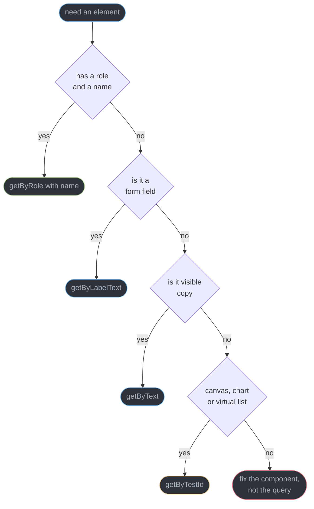
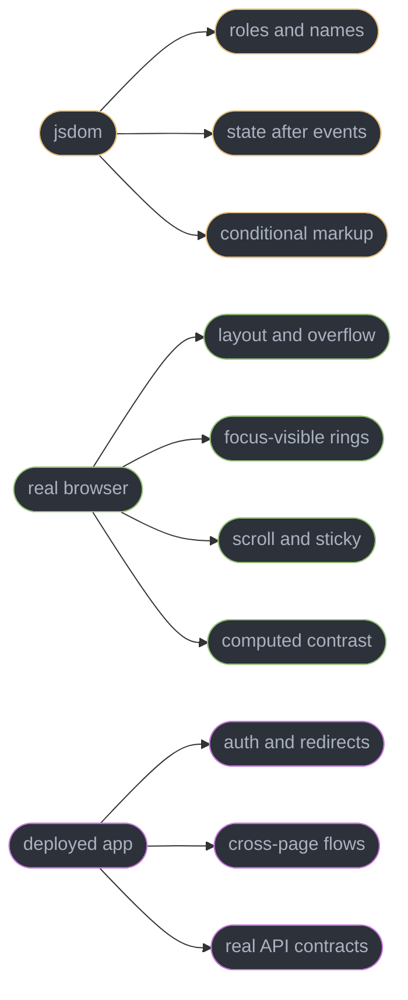
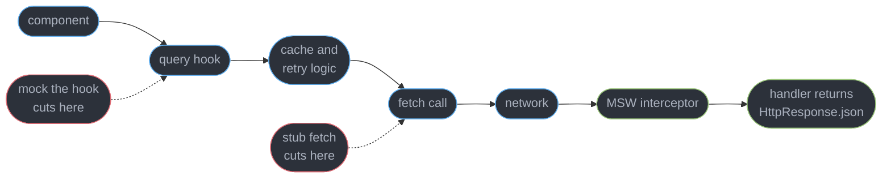
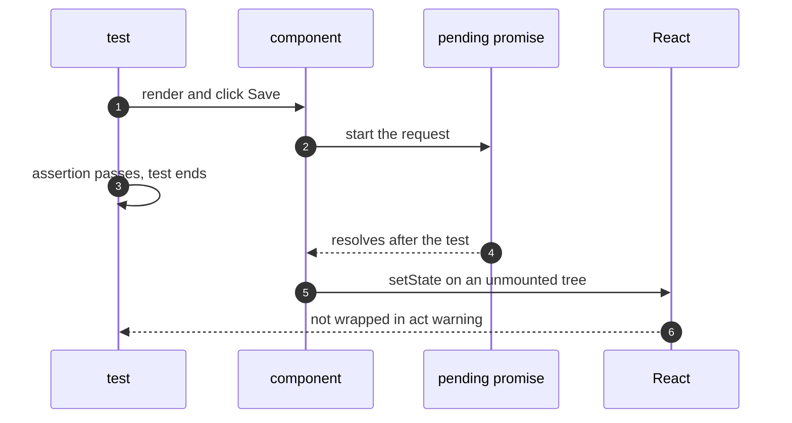
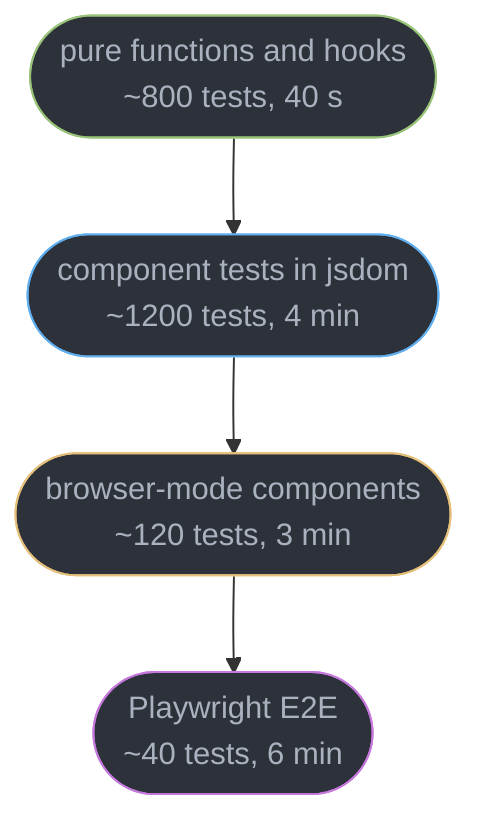
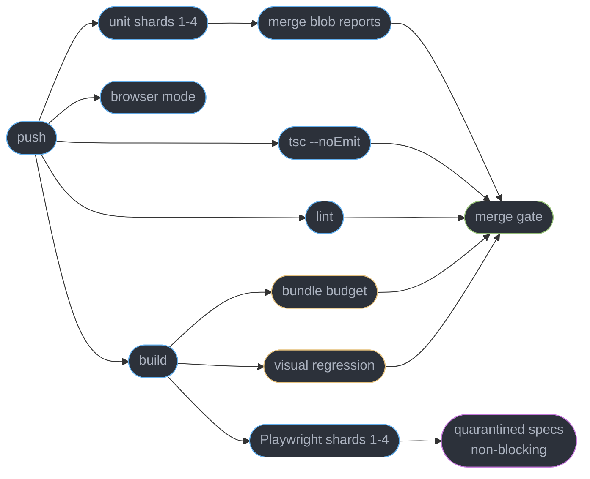

# Testing and Frontend CI

---

## 1. Concept Overview

A front-end test suite answers exactly one question: can a person still do the thing this product exists to let them do? Everything else — coverage percentages, snapshot counts, how many components have a `.test.tsx` beside them — is a proxy that goes stale the moment the implementation moves.

That framing decides the whole design. React Testing Library exists because the previous generation of tools (Enzyme's `shallow`, `react-test-renderer`, both gone from React 19) let you assert on a component's internals, and a suite built on internals fails on every refactor while passing through every real regression. RTL removes the internals from reach on purpose. You get a DOM and the same queries a screen reader uses, and nothing else.

**This module owns test-runner mechanics for the whole front-end track.** Query selection, `act()`, `userEvent`, network mocking, browser-mode component tests, Playwright, and the CI pipeline that runs all of it. Type-level assertions — `expectTypeOf`, `tsd`, testing that a generic infers what you claimed — belong to [Testing Typed Code](../../typescript/testing_typed_code/testing_typed_code.md), which defers runner mechanics here. WCAG success criteria and axe rule mapping belong to [Accessibility and WCAG](../../frontend_platform/accessibility_and_wcag/accessibility_and_wcag.md); the React-level ARIA patterns the tests here assert on belong to [Accessible Component Patterns](../accessible_component_patterns/accessible_component_patterns.md).

The versions this module is written against, verified 2026-09-02: `@testing-library/react` **16.3.2** (React 19 compatible), **Vitest 4.1.11**, **Jest 30.4.2**, **MSW v2**, **Storybook 10** (ESM-only). Playwright and Cypress move fast enough that pinning a number here would be wrong within a quarter, so this module describes their capabilities and not their release numbers.

---

## 2. Intuition

> **One-line analogy**: a test is a second user of your component, and the queries it uses decide which user it is imitating. `getByRole` imitates a person. `getByTestId` imitates a debugger attached to your source.

**Mental model**: every test picks a level to cut the system at, and the cut determines both what the test can prove and what it costs to keep. Cut below the DOM and you are testing your own implementation, which is free to run and worthless to keep. Cut at the DOM in jsdom and you test behaviour with no layout, no real focus and no CSS. Cut at a real browser and you get all three back at 20-50x the runtime. Cut at the deployed app and you prove the whole system works, once, slowly, and flakily.

**Why it matters**: a suite of 2,400 fast tests that break on every refactor is more expensive than the bugs it catches, because the cost lands on every future change rather than on one incident. The opposite failure is just as common: 300 E2E tests, a 47-minute pipeline, a 6% flake rate, and an engineering culture where a red build means "hit retry".

**Key insight**: **the query is the contract.** If `getByRole("button", { name: "Save" })` cannot find your Save button, a screen reader cannot find it either, and the test has told you about a real user-facing defect before it told you anything about your test. Reaching for `getByTestId` at that moment does not fix the component, it silences the only instrument that noticed.

---

## 3. Core Principles

- **Test what a user can do, never what a component contains.** State, props, hook call counts and internal handler names are not observable to a user and must not be observable to a test.
- **Query by role and accessible name first.** Then label, then text, then — only for genuinely non-semantic content — a test id. The ladder is an accessibility check that happens to be free.
- **`userEvent` over `fireEvent`.** A real click is pointerdown, mousedown, focus, pointerup, mouseup, click. `fireEvent.click` dispatches one of those six.
- **Mock the network, not the module.** A handler at the transport layer leaves your fetching code under test; a mocked hook deletes it from the suite entirely.
- **Await the DOM, do not sleep on it.** `findBy*` and `waitFor` poll until the assertion passes. A fixed `setTimeout` is a race that passes on your laptop.
- **Put the test where the fact lives.** Layout, real focus, scroll and computed CSS are browser facts and cannot be asserted in jsdom at all.
- **Few E2E tests, chosen deliberately.** They exist to prove the wiring between systems, not to re-test logic a component test already covers.
- **A flaky test is a bug report, not a scheduling problem.** Retry to keep the pipeline moving, quarantine to keep the signal, and fix within a fixed window or delete.
- **Fail the build on the type-check and the bundle budget too.** Both catch classes of regression no assertion in the suite will ever see.

---

## 4. Types / Architectures / Strategies

### 4.1 The query ladder, and what each rung costs

| Rung | Query | Use when | What it proves |
|------|-------|----------|----------------|
| 1 | `getByRole(role, { name })` | any interactive element, headings, landmarks | the element exists in the accessibility tree with a computed name |
| 2 | `getByLabelText` | form fields where the role is ambiguous or the label association is the point | label and control are actually associated |
| 3 | `getByPlaceholderText` | a field with no label — which is itself a defect | almost nothing; treat the need as a finding |
| 4 | `getByText` | non-interactive copy, error messages, empty states | the string reached the DOM |
| 5 | `getByDisplayValue` / `getByAltText` / `getByTitle` | narrow cases: a filled field, an image, a `title` attribute | the specific attribute is present |
| 6 | `getByTestId` | canvas, a chart's SVG root, a virtualized viewport — content with no semantics to query | the node exists, and nothing about the user's experience |

### 4.2 `getBy` vs `queryBy` vs `findBy`

| Prefix | Sync | Missing element | Correct use |
|--------|------|-----------------|-------------|
| `getBy*` | yes | throws immediately with the printed DOM | the element is there right now |
| `queryBy*` | yes | returns `null` | asserting **absence** — the only correct use |
| `findBy*` | returns a Promise | rejects after the timeout, default 1000 ms | the element appears after an async update |
| `getAllBy*` / `queryAllBy*` / `findAllBy*` | as above | throws / `[]` / rejects | collections, with a length assertion |

The trap is `await waitFor(() => expect(screen.queryByText("Saved")).toBeInTheDocument())`, which is `findByText` written in eight times the characters, with a worse failure message. And `getBy*` inside `waitFor` is fine — it throws, so `waitFor` retries; `queryBy*` inside `waitFor` never retries, because `null` is not a throw.

### 4.3 Where a test can run, and what each environment can see

| Environment | Layout | Real focus | Computed CSS | Startup | Per-test cost |
|-------------|--------|------------|--------------|---------|---------------|
| jsdom (Vitest / Jest default) | no — every box is 0x0 | approximated | no cascade, no media queries | ~150 ms | 5-30 ms |
| happy-dom | no | approximated | no | ~90 ms | 3-20 ms |
| Vitest browser mode (Playwright provider) | yes | yes | yes | 1-3 s | 50-300 ms |
| Playwright component testing | yes | yes | yes | 1-3 s | 80-400 ms |
| Playwright E2E against the built app | yes | yes | yes | 2-10 s | 0.5-8 s |

### 4.4 Four layers you can mock, and why only one of them is right

| Layer mocked | Written as | Code left under test | Verdict |
|--------------|-----------|----------------------|---------|
| the component's own hook | `vi.mock("./useOrders")` | the component's markup only | the fetching, caching and error handling are deleted from the suite |
| the client | `vi.mock("axios")` | your hook | breaks the day you move a call to `fetch` |
| `globalThis.fetch` | a hand-written stub | your hook and its client | you now maintain a partial `Response` implementation by hand |
| the network | MSW `http` handlers | everything above the socket | correct — and the same handlers serve Storybook and E2E |

---

## 5. Architecture Diagrams

### The query ladder as a decision, not a preference



Only one leaf ends in a test id, and it is the leaf where the DOM genuinely has no semantics. Every other route to a test id is the red box: a control a query cannot reach is a control a screen reader cannot reach.

### Which environment holds the fact you are asserting



A jsdom test that asserts an element is "visible" is asserting on a box measured as zero pixels tall. The middle column is not an upgrade of the left one, it is a different set of facts.

### Where MSW cuts, compared with the alternatives



Each red cut deletes everything to its right from the suite. Cutting at the interceptor deletes nothing — the hook, the cache, the retry policy and the serialization all run exactly as they do in production.

### What the act warning is actually reporting



The warning is not about `act()` being missing. It reports that a state update landed outside the window React was told to batch — here, after the test had already finished. Awaiting `findByRole` before asserting makes the update land inside the test, and the warning disappears without a single manual `act()`.

### The pyramid, with the numbers a real suite lands on



Roughly 2,160 tests, 13 minutes on 4 shards. The shape that goes wrong is the inversion: 40 component tests and 400 E2E tests, which is a 90-minute pipeline whose failures nobody can localise.

### The pipeline, and where the gates sit



The type-check is its own job because it fails in 30-60 seconds and never needs the 4-minute test run to tell you it failed. The quarantine lane runs the known-flaky specs and reports without blocking, so their signal survives without holding the merge queue hostage.

---

## 6. How It Works — Detailed Mechanics

### 6.1 `screen`, and the three query prefixes in one test

`render` mounts into a container appended to `document.body`. Destructuring its return (`const { getByRole } = render(...)`) scopes queries to that container and is worse for two reasons: portals — dialogs, toasts, tooltips — render outside it and become invisible to the query, and the destructured bindings go stale in ways `screen` cannot. Use `screen` and reach for `within(element)` when you genuinely need to scope.

```tsx
import { render, screen, within } from "@testing-library/react";
import userEvent from "@testing-library/user-event";

test("saving a draft shows a confirmation and clears the dirty marker", async () => {
  const user = userEvent.setup();
  render(<DraftEditor id="d-42" />);

  // getBy: it must be here now. Throws with the printed DOM if not.
  const save = screen.getByRole("button", { name: "Save draft" });

  // queryBy: the ONLY correct use is asserting absence.
  expect(screen.queryByRole("status")).not.toBeInTheDocument();

  await user.click(save);

  // findBy: appears after an await. Polls every 50 ms up to 1000 ms.
  const status = await screen.findByRole("status");
  expect(status).toHaveTextContent("Draft saved");

  // within: scope to a subtree when the same role appears more than once.
  const list = screen.getByRole("list", { name: "Recent drafts" });
  expect(within(list).getAllByRole("listitem")).toHaveLength(3);
});
```

RTL 16.3.2 auto-cleans up after each test when the runner exposes a global `afterEach`, which both Vitest and Jest do. Without it, every test would render into the same body and `getByRole` would find three Save buttons on the third test.

### 6.2 `userEvent` over `fireEvent`

`fireEvent.click(el)` dispatches one `click` event. A real pointer click dispatches `pointerover`, `pointerenter`, `pointermove`, `pointerdown`, `mousedown`, `focus`, `pointerup`, `mouseup`, `click` — nine events in order, with focus moving in the middle. That difference is not academic: a component that opens a menu on `pointerdown` and closes it on outside `mousedown` behaves correctly under `userEvent` and does nothing at all under `fireEvent.click`.

```tsx
// fireEvent typing sets the value and fires one input event. Nothing else.
fireEvent.change(input, { target: { value: "hello" } });

// userEvent typing dispatches keydown, keypress, input and keyup per character,
// respects maxLength, moves the caret, and fires focus first if the field is not
// focused. A component listening for Enter or counting keystrokes needs this.
const user = userEvent.setup();
await user.type(input, "hello{Enter}");
await user.keyboard("{Shift>}{Tab}{/Shift}");   // shift held across Tab
await user.tab();                                // real tab-order traversal
await user.selectOptions(screen.getByRole("combobox", { name: "Region" }), "eu-west-1");
```

**`userEvent.setup()` is called once per test, before `render`, and every method is awaited.** It installs a fake clock advance so that internal delays between the dispatched events do not depend on real time. Calling the API without `setup()` still works but uses the legacy direct-call path and loses the pointer-event sequence, which is exactly the part you wanted.

### 6.3 `act()` and what the warning is really telling you

The warning text, verbatim from React 19:

```
An update to DraftEditor inside a test was not wrapped in act(...).

When testing, code that causes React state updates should be wrapped into act(...):

act(() => {
  /* fire events that update state */
});
/* assert on the output */

This ensures that you're testing the behavior the user would see in the browser.
```

It does not mean "wrap this in `act()`". It means a `setState` happened outside the window React had been told to batch and flush, so the DOM you are about to assert on may be from before that update. There are exactly two shapes that produce it, and one of them is a bug in the test while the other is a bug in the component.

```tsx
// BROKEN: the assertion runs before the fetch resolves, so it fails; and the
// resolution then updates state after the test has ended, which is the warning.
test("shows the order total", () => {
  render(<OrderSummary id="o-9" />);
  expect(screen.getByText("$412.00")).toBeInTheDocument();
});

// FIX: await the element. findBy wraps its polling in act internally, so the
// update lands inside the test and no manual act() is needed anywhere.
test("shows the order total", async () => {
  render(<OrderSummary id="o-9" />);
  expect(await screen.findByText("$412.00")).toBeInTheDocument();
});
```

`render`, `fireEvent`, every `userEvent` method, `findBy*` and `waitFor` are all already wrapped in `act()` by RTL. The residual cases where you write it by hand are narrow: driving a `useSyncExternalStore` subscription by pushing a value into the store from the test, flushing a timer with `vi.advanceTimersByTime` inside `act`, and calling an imperative handle exposed via `useImperativeHandle`. If you find yourself wrapping a click in `act()`, the real problem is elsewhere.

The second shape is the component's fault: a `setState` in a `.then()` with no cancellation, firing after unmount. React 18 removed the "cannot update an unmounted component" warning because it produced too many false positives, but the underlying pattern is still a leak, and an `AbortController` or a mounted-flag in the effect cleanup is the fix. [Effects and Synchronization](../effects_and_synchronization/effects_and_synchronization.md) owns that cleanup contract.

### 6.4 MSW v2: intercepting the network

MSW registers a request interceptor — `http`/`https` module patching plus `fetch` in Node, a Service Worker in the browser — so the request leaves your application code completely and is answered at the transport boundary. Your client, your cache, your retry policy and your error mapping all execute.

```ts
// mocks/handlers.ts
import { http, HttpResponse, delay } from "msw";

export const handlers = [
  http.get("/api/orders/:id", ({ params }) =>
    HttpResponse.json({ id: params.id, total: 41200, currency: "USD" })
  ),
  http.post("/api/orders", async ({ request }) => {
    const body = (await request.json()) as { sku: string };
    if (!body.sku) return HttpResponse.json({ error: "sku required" }, { status: 422 });
    await delay(120);
    return HttpResponse.json({ id: "o-new" }, { status: 201 });
  }),
];
```

```ts
// vitest.setup.ts
import { setupServer } from "msw/node";
import { handlers } from "./mocks/handlers";

export const server = setupServer(...handlers);

// 'error' is the important flag: an un-handled request fails the test instead of
// escaping to the real network, which is how a suite silently starts calling staging.
beforeAll(() => server.listen({ onUnhandledRequest: "error" }));
afterEach(() => server.resetHandlers());
afterAll(() => server.close());
```

Per-test overrides are how you test the unhappy paths without a second set of handlers. `server.use()` prepends for the current test only, and `resetHandlers()` in `afterEach` undoes it.

```ts
test("a 503 shows the retry banner and keeps the form filled", async () => {
  server.use(http.get("/api/orders/:id", () => new HttpResponse(null, { status: 503 })));
  render(<OrderSummary id="o-9" />);
  expect(await screen.findByRole("alert")).toHaveTextContent("Could not load");
});
```

The compounding win is reuse. The same `handlers` array feeds `setupWorker` for Storybook 10 stories and the browser, and `setupWorker` again for a Playwright run against a stubbed backend — one description of the API, three consumers. What MSW does not give you is contract truth: a handler returning a shape the server no longer sends passes forever. Generate handlers from the OpenAPI or GraphQL schema, or run one contract test against the real service. [Server State and Data Fetching](../server_state_and_data_fetching/server_state_and_data_fetching.md) owns the drift problem itself.

### 6.5 Component tests in a real browser

jsdom implements the DOM API, not a browser. It has **no layout engine**: `getBoundingClientRect()` returns zeros, `offsetHeight` is 0, `IntersectionObserver` never fires, `scrollIntoView` is a no-op stub, and `getComputedStyle` returns only inline styles because no stylesheet was ever cascaded. Anything you want to assert about size, position, overflow, sticky headers, `:focus-visible` rings, container queries or contrast is not merely awkward in jsdom — it is absent.

Vitest 4 browser mode runs the same test file in a real browser driven by Playwright, with the same `describe`/`expect` and a Testing-Library-shaped locator API.

```ts
// vitest.config.ts — two projects, one command, different environments
import { defineConfig } from "vitest/config";

export default defineConfig({
  test: {
    projects: [
      {
        test: { name: "unit", environment: "jsdom", setupFiles: ["./vitest.setup.ts"] },
      },
      {
        test: {
          name: "browser",
          include: ["**/*.browser.test.tsx"],
          browser: {
            enabled: true,
            provider: "playwright",
            headless: true,
            instances: [{ browser: "chromium" }, { browser: "webkit" }],
          },
        },
      },
    ],
  },
});
```

```tsx
// VirtualTable.browser.test.tsx — every assertion here is false in jsdom
import { render } from "vitest-browser-react";
import { expect, test } from "vitest";

test("only the visible rows are mounted and the sticky header stays put", async () => {
  const screen = render(<VirtualTable rows={10_000} rowHeight={32} />);
  const body = screen.getByRole("rowgroup", { name: "Results" });

  // 640 px viewport / 32 px rows = 20 visible, plus a 5-row overscan each side.
  await expect.element(body).toBeVisible();
  expect(body.element().querySelectorAll("[role=row]").length).toBeLessThan(35);

  await screen.getByRole("row", { name: /Row 40/ }).scrollIntoView();
  const header = screen.getByRole("row", { name: "Column headers" }).element();
  expect(header.getBoundingClientRect().top).toBe(0);   // 0 in jsdom for the wrong reason
});
```

Playwright component testing covers the same ground from the other direction — mounting a component inside a Playwright page, with the full Playwright locator and trace tooling. Pick Vitest browser mode when the rest of your suite is already Vitest and you want one config and one watcher; pick Playwright CT when your E2E suite is large and you want one set of locator idioms across both. Do not run both.

The cost is real: browser-mode tests run 10-20x slower per test than jsdom, so the target is roughly 5-10% of the component suite — the ones whose subject is a browser fact.

### 6.6 End-to-end with Playwright

Playwright's defining property is **auto-waiting**. `page.getByRole("button", { name: "Checkout" }).click()` does not click a coordinate; it waits for the element to be attached, visible, stable (not animating), enabled, and to receive pointer events, then clicks, retrying the whole chain until the per-action timeout. That removes the single largest source of E2E flake, which is asserting against a DOM that has not settled.

The second property is the **trace viewer**. With `trace: "on-first-retry"`, a failure ships a `.zip` containing a DOM snapshot per action, the network log, console output, and a screenshot timeline. A CI failure becomes a thing you scrub through locally instead of a stack trace and a guess.

The third is **not logging in 40 times**. A setup project authenticates once, writes cookies and `localStorage` to disk, and every other project starts already signed in.

```ts
// auth.setup.ts — runs once, produces the storage state file
import { test as setup, expect } from "@playwright/test";
const FILE = "playwright/.auth/buyer.json";

setup("authenticate as a buyer", async ({ page }) => {
  await page.goto("/login");
  await page.getByLabel("Email").fill(process.env.E2E_EMAIL!);
  await page.getByLabel("Password").fill(process.env.E2E_PASSWORD!);
  await page.getByRole("button", { name: "Sign in" }).click();
  await expect(page.getByRole("heading", { name: "Orders" })).toBeVisible();
  await page.context().storageState({ path: FILE });
});
```

```ts
// playwright.config.ts
import { defineConfig, devices } from "@playwright/test";

export default defineConfig({
  fullyParallel: true,
  workers: process.env.CI ? 4 : undefined,
  retries: process.env.CI ? 2 : 0,
  reporter: process.env.CI ? [["blob"], ["github"]] : [["list"]],
  use: { baseURL: "http://localhost:3000", trace: "on-first-retry" },
  projects: [
    { name: "setup", testMatch: /auth\.setup\.ts/ },
    {
      name: "chromium",
      dependencies: ["setup"],
      use: { ...devices["Desktop Chrome"], storageState: "playwright/.auth/buyer.json" },
    },
  ],
});
```

On a 40-spec suite with a 3.2-second login, that removes roughly 128 seconds per run and, more usefully, removes 40 chances for the login form to flake.

**Cypress is still a reasonable choice, and saying otherwise is fashion.** Its time-travelling runner is the best interactive debugging experience in the category, `cy.intercept` is excellent, and a mature Cypress suite is not worth rewriting. What it gives up is genuine cross-browser reach — WebKit support arrived later and stayed behind — parallelism that does not depend on a paid dashboard, and multi-tab or multi-origin flows, which its in-page execution model makes structurally awkward. For a new suite in 2026 Playwright is the default. For an existing suite of 300 green Cypress specs, migrating is a quarter of work that buys speed and browser coverage, and nothing else.

### 6.7 What not to test, and the Server Component gap

**Do not assert on implementation.** Anything a user cannot observe: a piece of state, a prop that was passed, whether `useMemo` recomputed, how many times a component rendered. Those assertions fail on refactors that changed nothing observable and pass through regressions that changed everything.

**Do not snapshot whole trees.** A 400-line snapshot is reviewed exactly once. After that, every diff is approved with `-u` because nobody can tell an intentional change from a regression at that size, and the file becomes a rubber stamp with a green tick. Snapshots earn their place when the value is small, stable and hard to write by hand: a serialized reducer result, a generated class-name map, a formatted error string. `toMatchInlineSnapshot` is better for those because the expected value sits in the test file where a reviewer will actually read it.

**Do not chase 100% coverage.** Coverage tells you which lines ran, not which behaviours are protected — a suite that renders every component and asserts nothing reports 90%. Use it to find whole untested files, and ignore the last 15 points.

**Server Components are the honest gap in the tooling.** An async Server Component returns a Promise, and `render` from RTL 16.3.2 does not accept one. The practical strategy has three parts, and it is what the Next.js docs recommend as well:

```tsx
// 1. The data work is a plain async function, unit-tested with no React at all.
export async function getOrderSummary(id: string) { /* ... */ }
test("getOrderSummary rolls up line items with tax", async () => {
  await expect(getOrderSummary("o-9")).resolves.toMatchObject({ total: 41200 });
});

// 2. The client components below the boundary are ordinary RTL tests.
// 3. The composed page — server render, streaming, the boundary itself — is E2E.
test("the summary page streams the slow widget after the shell", async ({ page }) => {
  await page.goto("/orders/o-9");
  await expect(page.getByRole("heading", { name: "Order o-9" })).toBeVisible();
  await expect(page.getByRole("status", { name: "Loading forecast" })).toBeVisible();
  await expect(page.getByText("Forecast: 4 days")).toBeVisible({ timeout: 10_000 });
});
```

Two adjacent things do work today. Vitest with `@vitejs/plugin-rsc` can render an RSC payload in a test, which is early but real. And SSR hydration mismatches — the class of bug most specific to server rendering — are caught by asserting on the server HTML and then on the client-hydrated DOM in a browser test, since jsdom never runs the server render at all. [Server Components and Server Functions](../server_components_and_server_functions/server_components_and_server_functions.md) owns the boundary rules themselves.

### 6.8 CI: sharding, gates and flake management

Sharding splits the suite across machines by file. Both runners produce a machine-readable blob that a final job merges into one report, which matters because a per-shard report tells you nothing about the run as a whole.

```yaml
jobs:
  typecheck:                         # its own job: fails in ~45 s, needs no tests
    steps:
      - run: npm ci
      - run: npx tsc --noEmit

  unit:
    strategy:
      fail-fast: false               # a red shard 2 must not cancel shards 3 and 4
      matrix: { shard: [1, 2, 3, 4] }
    steps:
      - run: npx vitest run --shard=${{ matrix.shard }}/4 --reporter=blob
      - uses: actions/upload-artifact@v4
        with: { name: blob-${{ matrix.shard }}, path: .vitest-reports/ }

  merge-reports:
    needs: [unit]
    steps:
      - run: npx vitest run --merge-reports
```

Playwright shards the same way (`--shard=1/4`, `--reporter=blob`, then `merge-reports`), and it shards by *test* rather than by file, so a single 200-test spec still spreads across machines.

**Flake management is where most pipelines go wrong.** A blanket `retries: 2` with no bookkeeping means a test that fails 40% of the time is reported as green, and the real race it was detecting — an out-of-order response, a `startTransition` that lost an announcement, an unawaited animation — ships. Retries buy you a moving pipeline, not information; the information comes from recording the retry.

The working shape is a quarantine. Playwright reports a test that failed and then passed with the status `flaky`, which is distinct from `passed` in the JSON reporter. Feed that into a counter, and when a spec goes flaky three times in seven days, tag it `@quarantine` and split the run:

- the blocking job runs `--grep-invert @quarantine` with `retries: 1`;
- a non-blocking job runs `--grep @quarantine` and posts the result as a comment;
- each quarantined spec gets an owner and a 14-day expiry, after which it is fixed or deleted. A quarantine with no expiry is a graveyard, and a graveyard is where a real bug hides.

Two more gates belong on the merge, and neither is an assertion:

- **Visual regression.** Playwright's `toHaveScreenshot()` is built in and free but stores baselines in your repo and is sensitive to font rendering across OSes, so pin the browser version and generate baselines in the same container CI uses. Chromatic and Percy host the baselines and add review workflow, at a per-snapshot cost. Either way, scope it to a component gallery rather than full pages: a full-page baseline changes on every copy edit.
- **A bundle budget.** `size-limit` or a `bundlesize` check that fails the build when the entry chunk crosses a stated number — 180 kB gzipped is a common line — catches the accidental `import { format } from "date-fns"` that pulls 74 kB. The budget itself, and the delivery and RUM story around it, belong to [Frontend Delivery and Observability](../../frontend_platform/frontend_delivery_and_observability/frontend_delivery_and_observability.md); the bundling mechanics belong to [Modules, Bundling and the Build Pipeline](../../frontend_platform/modules_bundling_and_the_build_pipeline/modules_bundling_and_the_build_pipeline.md).

---

## 7. Real-World Examples

**The 2,300-test suite that caught nothing.** A logistics dashboard had 2,300 tests and 87% coverage, and shipped four user-visible regressions in one quarter. An audit found 1,900 of the tests were shallow renders asserting on props, and 380 were whole-tree snapshots. Rewriting 340 of the highest-traffic tests against roles and user actions — and deleting 1,700 outright — took the suite to 640 tests, cut CI from 22 minutes to 6, and caught three of the next quarter's four regressions before merge. The deleted 1,700 had never failed for a reason anyone could act on.

**The mocked hook that hid a 40-second cache.** A team mocked `useOrders` in every test, so the component's markup was well covered and its TanStack Query configuration was covered by nothing. A `staleTime` typo of `40_000` where `4_000` was meant shipped, and users saw 40-second-old order statuses for eleven days. Moving to MSW handlers surfaced it in the first test run, because the real query client was now in the test.

**The retry that hid a race.** A payments team set `retries: 3` after a flaky sprint, and the pipeline went green. Six weeks later a double-charge incident traced to an unguarded double submit — the exact behaviour one quarantined spec had been failing on intermittently, reported as `flaky` and never read. Adding a flake counter and a 14-day quarantine expiry surfaced 9 specs, of which 3 were real races.

**Sharding that cost more than it saved.** A team split a 4-minute Vitest suite across 8 shards. Each shard spent 55 seconds on `npm ci` and 20 seconds on Playwright browser download, so wall time went from 4 minutes to 2 minutes 10 while billed minutes went from 4 to 17. Dropping to 3 shards and caching the browser binaries landed at 2 minutes 20 for 7 billed minutes. Shard count is bounded by fixed setup cost, not by how many machines you can start.

---

## 8. Tradeoffs

| Choice | Bought | Paid |
|--------|--------|------|
| Role queries over test ids | tests that fail on real accessibility defects | some components must be fixed before they are testable |
| `userEvent` over `fireEvent` | the real event sequence, so pointer and focus logic is exercised | roughly 3-5x slower per interaction, and every call must be awaited |
| MSW over mocking the hook | the fetching, caching and error paths stay under test | a handler set to maintain, and no protection from contract drift |
| jsdom over a real browser | 5-30 ms per test and no browser to install | no layout, no CSS cascade, no real focus, no scroll |
| Vitest browser mode | browser facts inside the existing suite and config | 10-20x the per-test cost and a browser binary in CI |
| Playwright over Cypress | true cross-browser, free parallelism, multi-origin flows, trace viewer | a migration cost that buys nothing for an already-green suite |
| More E2E coverage | proof the whole system is wired | each test is 0.5-8 s, and a failure localises to "somewhere in the flow" |
| Blanket retries | a pipeline that keeps moving | real races reported as green, unless the retry is counted |
| Hosted visual regression | baselines that survive an OS upgrade, plus review workflow | per-snapshot cost and a third party in the merge path |
| A bundle budget gate | a regression class no assertion can catch | one more red build that is not a broken test |

---

## 9. When to Use / When NOT to Use

**Write a jsdom component test when:**

- The behaviour is expressible as "a user does X, then sees Y" and Y is text, a role, a state attribute or the presence of an element.
- The component has branching logic — loading, empty, error, partial — that would take four E2E runs to cover and four jsdom tests costing 60 ms total.
- You are locking in a bug fix. One test named after the incident is worth more than the ten coverage-driven tests around it.

**Promote it to a browser test when:**

- The subject is layout, overflow, sticky positioning, scroll behaviour, `:focus-visible`, container queries, computed contrast, or `IntersectionObserver`.
- The component is a virtualized list, a drag-and-drop surface, or a popover whose collision handling is the point.

**Write an E2E test when:**

- The value is in the wiring: auth and redirects, a multi-step flow across pages, a webhook round trip, a payment provider's hosted page.
- It is one of the three to five journeys whose breakage means the product is down. Those get an E2E test each and a synthetic monitor in production.

**Do NOT write a test when:**

- It asserts on state, props, render counts, or a hook's internals. It will fail on refactors and pass through regressions.
- It snapshots a tree big enough that a reviewer will approve the diff without reading it.
- It re-tests library behaviour. React Hook Form's validation and TanStack Query's retry logic have their own suites.
- It exists to move a coverage number. That test has a cost and no reader.

---

## 10. Common Pitfalls

**Reaching for a test id when the role query fails.** The most common and most expensive habit in the whole module, because it converts a real defect into a passing test.

```tsx
// BROKEN: the query needed a test id because the control is a div, and the test
// also asserts on internal state through a prop the component never renders.
// Both assertions pass while the button is unreachable by keyboard and unnamed
// to a screen reader.
render(<Toolbar onExport={fn} exportState="idle" />);
fireEvent.click(screen.getByTestId("export-btn"));
expect(screen.getByTestId("toolbar").dataset.state).toBe("busy");

// FIX: fix the component to render a button with a name, then query the way the
// user's software does, and assert on what the user perceives.
render(<Toolbar onExport={fn} />);
await user.click(screen.getByRole("button", { name: "Export CSV" }));
expect(await screen.findByRole("status")).toHaveTextContent("Preparing export");
```

**`queryBy` inside `waitFor`.** `waitFor` retries on a thrown error. `queryBy` returns `null` instead of throwing, so `waitFor(() => expect(screen.queryByText("Saved")).toBeInTheDocument())` fails once and never retries — it just burns the full timeout before reporting. Use `findBy*` to wait for presence, and `queryBy*` only for a synchronous absence assertion.

**Asserting absence immediately after an action.** `expect(screen.queryByRole("dialog")).not.toBeInTheDocument()` right after a close click passes before the dialog has closed *and* after, so it can never fail. Use `await waitFor(() => expect(...).not.toBeInTheDocument())`, or better, wait for the positive fact — focus returning to the trigger.

**A fixed `setTimeout` as a wait.** `await new Promise(r => setTimeout(r, 500))` passes on a laptop and fails on a loaded CI runner, and it costs 500 ms every run even when the DOM settled in 12 ms.

**Un-handled requests escaping to the real network.** Without `onUnhandledRequest: "error"`, a request MSW has no handler for goes out for real. Suites have been discovered calling staging from CI on every run, which is slow, non-deterministic, and occasionally writes data.

**Not resetting handlers between tests.** A `server.use()` override without `server.resetHandlers()` in `afterEach` leaks into every subsequent test in the file, producing a failure whose cause is in a different test entirely.

**Global fake timers with `userEvent`.** `userEvent` awaits real delays between its dispatched events, so `vi.useFakeTimers()` without `userEvent.setup({ advanceTimers: vi.advanceTimersByTime })` hangs until the test times out. This is the most confusing hang in the whole stack because nothing errors.

**Debug output that is truncated.** `screen.debug()` prints only 7,000 characters by default, which silently cuts the part you needed. Pass a larger limit, or set `DEBUG_PRINT_LIMIT`, or use `screen.logTestingPlaygroundURL()` to get a suggested query instead.

**A component that fails only in CI.** Usually the timezone or the locale. Pin `TZ=UTC` and the `Intl` locale in the CI environment, because a `toLocaleDateString()` assertion written in Europe/London passes locally and fails on a UTC runner for exactly half the year.

---

## 11. Technologies & Tools

| Tool | Purpose |
|------|---------|
| Testing Library | Role-based DOM queries; `@testing-library/react` 16.3.2 for React 19 |
| user-event | Realistic event sequences, keyboard traversal and pointer simulation |
| Vitest | Vite-native runner, 4.1.11, with stable browser mode and blob-report sharding |
| Jest | 30.4.2, still the default in React Native and older CRA-era codebases |
| jsdom | The default DOM implementation, with no layout engine |
| happy-dom | A faster, less complete jsdom alternative |
| MSW | Network-layer request interception shared by tests, Storybook and E2E |
| Playwright | Cross-browser E2E, component testing, auto-waiting, trace viewer |
| Cypress | Time-travelling interactive runner; a mature suite is not worth rewriting |
| Storybook | 10, ESM-only; the interaction-test and visual-baseline surface |
| Chromatic | Hosted visual regression built on Storybook |
| Percy | Hosted visual regression, framework-agnostic |
| axe-core | The rule engine behind `jest-axe`, `vitest-axe` and `@axe-core/playwright` |
| size-limit | Bundle budget enforcement as a CI gate |

---

## 12. Interview Questions with Answers

**Q: Why is `getByRole` the default query rather than a test id?**
**Short:** Role and name are exactly what assistive technology consumes, so a query that cannot find a control is reporting a real defect rather than test-harness friction.

`getByRole("button", { name: "Save" })` runs the same accessible-name computation the browser uses to build the accessibility tree. It fails when the element is a `div`, when there is no label, or when the only name comes from a placeholder — all three being user-facing bugs. Adding a test id at that moment makes the test pass and leaves the control unreachable by keyboard and unnamed to a screen reader. Test ids stay legitimate for content with no semantics at all: a canvas, a chart's SVG root, a virtualized viewport. Everywhere else the failing query is the most valuable output the suite produces.

**Q: What does the "not wrapped in act(...)" warning actually mean?**
**Short:** A state update landed outside the window React was told to batch and flush, so the DOM under assertion may predate it — usually because the test finished before an async update resolved.

The warning names a component and says the update should be wrapped in `act(...)`, but wrapping is rarely the fix. RTL already wraps `render`, `fireEvent`, every `userEvent` method, `findBy*` and `waitFor`, so awaiting the element you expect pulls the update back inside the test and the warning disappears. If it persists after that, the component is updating state after unmount — a `.then()` with no `AbortController` — which is a leak the test correctly noticed. Genuine manual `act()` is limited to pushing into an external store, advancing fake timers, and calling an imperative handle.

**Q: Why mock at the network layer with MSW instead of mocking `fetch` or the data hook?**
**Short:** Intercepting at the transport boundary leaves the client, cache, retry policy and error mapping running, while mocking a hook deletes all of that code from the suite.

`vi.mock("./useOrders")` covers the component's markup and nothing else — one team shipped a `staleTime` of 40 seconds instead of 4 for eleven days because their query configuration was never executed in a test. Stubbing `globalThis.fetch` is better but makes you hand-maintain a partial `Response`. MSW's `http` handlers returning `HttpResponse.json` answer the real request, and the same handler array feeds Storybook stories and a Playwright run, so the API is described once. Set `onUnhandledRequest: "error"` so an unmatched request fails instead of escaping to the real network.

**Q: What belongs in an E2E test versus a component test?**
**Short:** Component tests own branching logic and rendering behaviour, E2E owns wiring between systems — auth, redirects, cross-page flows and real API contracts.

A component test costs 5-30 ms and localises a failure to one file, so loading, empty, error and partial states all belong there. An E2E test costs 0.5-8 seconds and localises a failure to "somewhere in a flow", so it earns its place only where the value is the integration itself. The practical rule is three to five critical journeys with an E2E test each, plus a synthetic monitor in production, against roughly 1,200 component tests. The failure mode to avoid is the inverted pyramid: 400 E2E tests, a 90-minute pipeline, and a 6% flake rate that trains everyone to hit retry.

**Q: When do you use `getBy`, `queryBy` and `findBy`?**
**Short:** getBy throws when the element is missing, queryBy returns null and exists only for absence assertions, and findBy returns a promise that polls until the element appears.

The most common bug is `waitFor(() => expect(screen.queryByText("Saved")).toBeInTheDocument())`. `waitFor` retries on a throw, and `queryBy` returns `null` rather than throwing, so it never retries — it burns the full 1000 ms timeout and then fails. `findByText` is the correct form and gives a better message. The mirror-image bug is asserting absence synchronously right after a close click, which passes both before and after the close and therefore can never fail; wait for the positive fact instead, such as focus returning to the trigger.

**Q: Why prefer `userEvent` over `fireEvent`?**
**Short:** fireEvent dispatches a single synthetic event, while a real click produces nine in order with focus moving in the middle — a difference that changes component behaviour.

A menu that opens on `pointerdown` and closes on an outside `mousedown` works under `userEvent` and does nothing under `fireEvent.click`. Typing is the same story: `fireEvent.change` sets a value and fires one `input`, while `user.type` fires keydown, input and keyup per character, respects `maxLength`, and moves the caret. Call `userEvent.setup()` once per test before `render` and await every method. The one trap is fake timers — `vi.useFakeTimers()` without passing `advanceTimers` to `setup()` hangs the test silently, because `userEvent` awaits real delays between the events it dispatches.

**Q: What can jsdom not do, and what does that mean for what you test where?**
**Short:** jsdom has no layout engine and no CSS cascade, so every box measures zero pixels and anything about size, position, scroll or computed style is unassertable there.

`getBoundingClientRect()` returns zeros, `offsetHeight` is 0, `IntersectionObserver` never fires, `scrollIntoView` is a stub, and `getComputedStyle` sees only inline styles. So a jsdom assertion that something is "visible" is not testing visibility. Virtualized lists, sticky headers, popover collision handling, `:focus-visible` rings and contrast all belong in a real browser via Vitest browser mode or Playwright component testing. Budget roughly 5-10% of the component suite for it, since those tests run 10-20x slower and need a browser binary in CI.

**Q: When is a snapshot test worth keeping?**
**Short:** A whole-tree snapshot is reviewed once and rubber-stamped forever after, so snapshots only earn their place when the value is small, stable and awkward to write by hand.

A 400-line snapshot diff cannot be judged by a reviewer, so every change gets approved with `-u` and the file becomes a green tick with no meaning. Good candidates are a serialized reducer output, a generated class-name map, a formatted error string — and `toMatchInlineSnapshot` beats a separate file for those, because the expected value sits where a reviewer will read it. If you inherit a suite of tree snapshots, replace the high-traffic ones with role-based assertions and delete the rest rather than migrating them.

**Q: What counts as testing an implementation detail?**
**Short:** Asserting on state, props, render counts, hook internals or a private handler name — anything a user cannot observe and a refactor can change without changing behaviour.

The tell is a test that fails during a refactor where the UI is identical. Enzyme's `shallow` and `react-test-renderer/shallow` made this the default style, which is why both are gone from React 19. A subtler version is asserting a component rendered exactly twice: correct today, wrong the moment the React Compiler changes the memoization, and it was never a user-facing fact. The replacement is always the same question — what would a person see or be unable to do if this broke — and asserting that instead.

**Q: How do you handle flaky tests without hiding real bugs?**
**Short:** A blanket retry converts an intermittent failure into a green build, so retries must be paired with a counter and a quarantine that has an owner and an expiry.

Playwright reports a test that failed and then passed as `flaky` rather than `passed`, which is the signal to count. When a spec goes flaky three times in seven days, tag it `@quarantine`, run the blocking job with `--grep-invert @quarantine`, and run a non-blocking job with `--grep @quarantine` that reports without gating. Each quarantined spec gets an owner and 14 days, after which it is fixed or deleted, because a quarantine with no expiry is where a real race goes to hide. One payments team traced a double-charge incident to a spec that had been reported flaky for six weeks and never read.

**Q: How do you shard a suite, and how many shards is right?**
**Short:** Sharding splits tests across machines and merges blob reports at the end, but the useful shard count is bounded by fixed per-job setup cost, not by available machines.

Vitest runs `--shard=1/4 --reporter=blob` then `--merge-reports`; Playwright is the same flags and shards by test rather than by file, so one 200-test spec still spreads. Set `fail-fast: false` on the matrix so a red shard does not cancel the others. The counter-example worth remembering: a 4-minute suite split 8 ways paid 75 seconds of `npm ci` and browser download per shard, landing at 2 minutes 10 of wall time for 17 billed minutes, where 3 shards gave 2 minutes 20 for 7. Measure wall time against billed minutes before adding shards.

**Q: How do you avoid logging in on every E2E test?**
**Short:** Logging in once in a setup project and saving cookies plus localStorage to a storage-state file lets every other project start authenticated.

A `setup` project runs the login, calls `page.context().storageState({ path })`, and the main projects declare `dependencies: ["setup"]` with `use: { storageState }`. On a 40-spec suite with a 3.2-second login that saves about 128 seconds per run, and more importantly removes 40 chances for the login form to flake. Use one file per role — buyer, admin, read-only — rather than one shared file, and regenerate them per run so an expired token never leaks between runs. Never commit the files: they contain live session tokens.

**Q: Playwright or Cypress in 2026?**
**Short:** Playwright wins on genuine cross-browser reach, free parallelism, multi-origin flows and the trace viewer, but a mature Cypress suite is not worth rewriting for those alone.

Playwright's auto-waiting — attached, visible, stable, enabled, receiving pointer events, then retry — removes the largest source of E2E flake, and `trace: "on-first-retry"` turns a CI failure into a DOM-snapshot timeline you scrub through locally. Cypress still has the best interactive debugging experience in the category and an excellent `cy.intercept`. What it gives up is WebKit parity, parallelism that does not depend on a paid dashboard, and multi-tab or cross-origin flows, which its in-page execution model makes structurally awkward. New suite: Playwright. Existing green suite of 300 specs: migrating is a quarter of work for speed and browser coverage only.

**Q: How do you test a React Server Component?**
**Short:** Async server components return a promise that RTL cannot render, so the working strategy is unit-testing the data functions, RTL for client components, and E2E for the composed page.

Extract the async work into a plain function and test it with no React involved; test everything under `"use client"` with ordinary RTL; and cover the server render, the streaming boundary and the client/server seam with Playwright against the built app. Vitest with `@vitejs/plugin-rsc` can render an RSC payload directly, which is real but early. The bug class most specific to server rendering — an SSR hydration mismatch — is invisible in jsdom because jsdom never runs the server render, so it needs a browser test asserting on the server HTML and then on the client-hydrated DOM.

**Q: Vitest or Jest for a React codebase today?**
**Short:** Vitest shares the Vite config and transform pipeline the app already uses, so there is no second build to keep in step, and it adds browser mode in the same runner.

Vitest 4.1.11 is ESM-native, watches with Vite's HMR graph so a change reruns only the affected files, and its `expect` is Jest-compatible enough that most suites migrate with a find-and-replace of `jest.` to `vi.`. Jest 30.4.2 remains the right answer where the build is not Vite — React Native, a Metro or webpack app, a large CRA-era codebase — and its ecosystem of matchers and reporters is still the deepest. The decision is what builds your app, not which runner is newer, and a mixed repo running both is a genuinely bad outcome.

**Q: What belongs in CI besides the test suite?**
**Short:** Pixel diffs catch styling regressions no assertion describes, a standalone type-check fails in under a minute, and a bundle budget catches a size class of regression nothing else sees.

Run `tsc --noEmit` as its own job so a type error does not wait four minutes behind the tests; type-level assertions themselves belong to [Testing Typed Code](../../typescript/testing_typed_code/testing_typed_code.md). Scope visual regression to a component gallery rather than full pages, since a full-page baseline changes on every copy edit, and pin the browser version so font rendering does not diff. A `size-limit` gate at a stated number — 180 kB gzipped for the entry chunk is a common line — catches the accidental barrel import that pulls 74 kB. Also pin `TZ=UTC` and the locale, or half your date assertions fail on a runner for six months of the year.

---

## 13. Best Practices

- Query by role and accessible name first, and treat a query that needs a test id as a defect in the component rather than in the test.
- Use `screen`, not the destructured return of `render`, so portaled dialogs and toasts stay queryable.
- Call `userEvent.setup()` once per test before `render`, and await every interaction.
- Use `findBy*` to wait for appearance and `queryBy*` only for synchronous absence, never `queryBy*` inside `waitFor`.
- Mock the network with MSW handlers, run with `onUnhandledRequest: "error"`, and reset handlers in `afterEach`.
- Share one handler array across tests, Storybook and E2E, and back it with one contract test against the real service.
- Send layout, focus, scroll and computed-style assertions to a browser test, and keep it to 5-10% of the component suite.
- Give each of the three to five critical journeys one Playwright test, authenticated from a stored state file, with `trace: "on-first-retry"`.
- Run the type-check, the bundle budget and visual regression as their own gates, in parallel with the suite.
- Count flakes, quarantine with an owner and a 14-day expiry, and delete a spec that outlives its expiry.
- Name the test after the behaviour or the incident, never after the function, so a failure reads as a user-facing statement.

---

## 14. Case Study

**Problem.** A B2B invoicing product had 2,300 front-end tests, 87% coverage and a 22-minute pipeline, and shipped four user-visible regressions in one quarter. The team's request was more tests. The audit's finding was the opposite.

**Investigation.** Classifying all 2,300 by what they asserted: **1,900** were shallow renders asserting on props and state, **380** were whole-tree snapshots averaging 340 lines, and **20** asserted on user-visible behaviour. Coverage was 87% because rendering a component executes its lines; almost nothing was checked afterward. Every one of the four escaped regressions had been in a component with 90%+ coverage.

The worst single file was the invoice-approval toolbar, which combined all three failure modes.

```tsx
// BROKEN: a test id because the control is a div, an assertion on internal state
// through a data attribute, a mocked hook that deletes the fetching layer, and
// fireEvent, which never fires the pointerdown the menu actually listens for.
vi.mock("./useApprovals");
test("approve button", () => {
  render(<ApprovalToolbar invoiceId="i-77" approvalState="idle" />);
  fireEvent.click(screen.getByTestId("approve-btn"));
  expect(screen.getByTestId("toolbar").dataset.state).toBe("busy");
  expect(screen.getByTestId("toolbar")).toMatchSnapshot();
});
```

Three defects passed straight through it. The approve control was a `div`, so no keyboard user could approve an invoice. The confirmation menu never opened, because it listens on `pointerdown` and `fireEvent.click` does not dispatch one. And the mocked hook hid a retry policy that resubmitted an approval on a 502, producing duplicate approvals in production.

**Fix.** Four changes over three weeks.

```tsx
// FIX: the component renders a real button with a name, the network is mocked at
// the transport layer so the retry policy is under test, and every assertion is
// something the user perceives.
test("approving an invoice confirms, then announces the result", async () => {
  const user = userEvent.setup();
  render(<ApprovalToolbar invoiceId="i-77" />, { wrapper: QueryProvider });

  await user.click(screen.getByRole("button", { name: "Approve invoice" }));
  const menu = await screen.findByRole("menu", { name: "Confirm approval" });
  await user.click(within(menu).getByRole("menuitem", { name: "Approve" }));

  expect(await screen.findByRole("status")).toHaveTextContent("Invoice i-77 approved");
});

test("a 502 does not double-approve", async () => {
  let calls = 0;
  server.use(http.post("/api/invoices/:id/approve", () => {
    calls += 1;
    return new HttpResponse(null, { status: 502 });
  }));
  // ... approve, then assert the banner and that the mutation did not retry
  await screen.findByRole("alert");
  expect(calls).toBe(1);
});
```

Alongside it: 1,700 prop-assertion tests deleted outright and 340 rewritten against roles; all 380 tree snapshots removed, with 22 replaced by inline snapshots of formatted strings; the mocked hooks replaced by one MSW handler set shared with Storybook 10; and CI restructured into a standalone `tsc --noEmit` job, 3 Vitest shards with merged blob reports, one browser-mode project for the virtualized invoice grid, 18 Playwright specs on a stored buyer session, plus `size-limit` and Chromatic gates. Retries dropped from 3 to 1 with a flake counter and a 14-day quarantine.

**Results.**

- Suite size: 2,300 tests to 640, plus 18 E2E specs.
- Pipeline wall time: 22 minutes to 6 minutes 10, on fewer billed minutes than before.
- Coverage: 87% to 71%, and the team stopped treating the number as a target.
- Regressions reaching production the following quarter: 4 to 1, and that one was a server bug.
- Keyboard-inaccessible controls found by the role-query rewrite: 11, none previously known.
- Flaky specs surfaced by the counter: 9, of which 3 were real races including the double-approval retry.
- Test files changed per refactor PR, sampled over 12 PRs: 31 average to 3.

**Lesson.** The suite was large, fast to write and structurally incapable of failing for a reason worth acting on, because it asserted on things no user can see. Deleting 74% of it and rewriting 340 tests against roles and real network handlers improved every metric that mattered while making the headline coverage number worse — which is the clearest evidence available that the number was never measuring what the team thought it was.
